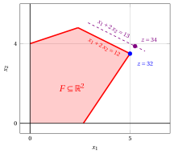
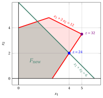

# Sensitivity analysis

**Part 4 · Matrix methods, sensitivity and geometry · Chapter 14** · [:material-file-pdf-box: Lecture notes, volume 4 (PDF)](../pdf/lecture-notes-4-advanced-methods.pdf) · [:material-presentation: Slides](../pdf/slides-14-sensitivity.pdf) · [:material-pencil: Exercises: Sensitivity analysis](../exercises/ex-14-sensitivity.md) · [:material-gesture-tap: App: Sensitivity analysis](../lab/sensitivity.md)

## 14.1 Optimal bases and their two conditions

- The input data of an LP problem are rarely known exactly: the entries of the objective-function vector ${\boldsymbol c}$ and of the right-hand-side vector ${\boldsymbol b}$ are estimates, and they may change after the LP problem has been solved. The <strong>sensitivity analysis</strong> studies how an optimal solution and the optimal value change when the input data change.

- We consider an LP problem in standard maximization form with $n+m$ non-negative variables and $m$ equality linear constraints, obtained from an LP problem in canonical maximization form by adding $m$ slack variables:

    

    \begin{align*}
    &&   \max \;\;{\boldsymbol c}' \, {\boldsymbol x}  \label{SENS_FORM_STANDARD_OBJ} \tag{14.1a}\\[2ex]
    && \text{subject to} \quad  {\boldsymbol A} \; {\boldsymbol x}  &= {\boldsymbol b},  & \phantom{j=1111}  \label{SENS_FORM_STANDARD_CONS1} \tag{14.1b}\\[2ex]
    && {\boldsymbol x}                        &\ge  {\boldsymbol 0}. \label{SENS_FORM_STANDARD_CONS2} \tag{14.1c}
    \end{align*}

!!! definizione "Definition 14.1: optimal basis"

    A basis ${\boldsymbol A}_{\pazocal{B}}$ of the LP problem [(14.1)](#eq-SENS_FORM_STANDARD) is called an <strong>optimal basis</strong> if it satisfies the following two conditions, and then its basic feasible solution is an optimal solution:

    1. <strong>primal feasibility</strong>: $~\bar{\boldsymbol b} = {\boldsymbol A}_{\pazocal{B}}^{-1} \, {\boldsymbol b} \ge {\boldsymbol 0}$;

    2. <strong>dual feasibility</strong>: $~{{ \bar{\boldsymbol c}}'}  = {\boldsymbol c}'_{\pazocal{N}} - {\boldsymbol \pi} \;{\boldsymbol  A}_{\pazocal{N}} \le {\boldsymbol 0}$, where ${\boldsymbol \pi} = {\boldsymbol c}'_{\pazocal{B}} \; {\boldsymbol  A}_{\pazocal{B}}^{-1}$.

!!! chiave ""

    The two conditions are <u>sufficient</u> for optimality; under degeneracy, an optimal basic feasible solution may also be associated with a basis which is not dual feasible. A change of the input data preserves the optimality of the basis as long as <u>both</u> conditions keep holding.

- The two conditions involve the input data in two different ways:

    1. the right-hand-side vector ${\boldsymbol b}$ appears only in the <u>primal</u> feasibility condition;

    2. the objective-function vector ${\boldsymbol c}$ appears only in the <u>dual</u> feasibility condition.

    Accordingly, a change of ${\boldsymbol b}$ may only destroy the primal feasibility of the basis, and a change of ${\boldsymbol c}$ may only destroy its dual feasibility.

!!! esempio "Example 14.1: optimal basis"

    Consider the following LP problem in canonical maximization form with $n=2$ non-negative variables and $m=3$ less-than-or-equal-to linear constraints:

    $$
    \begin{array}{rrrrrrrrrrrrr}
    {\max} & 5 \, {x_1} & {+} & 2 \, {x_2} \\[1ex]
    \text{subject to} & {-} \, {x_1} & {+} & 3 \, {x_2} & {\le} & 12 \\[1ex]
    & {x_1} & {+} & 2 \, {x_2} & {\le} & 12 \\[1ex]
    & {3} \, {x_1} & {-} & 2 \, {x_2} & {\le} & 8 \\[1ex]
    & {x_1,} &  & {x_2} & { \ge} & {0}
    \end{array}
    $$

    Its standard maximization form has $n+m=5$ non-negative variables, and the optimal basis determined by the simplex algorithm is

    $$
    \pazocal{B}= \{1,~~2,~~3\}
    \qquad \text{and} \qquad
    \pazocal{N}= \{4,~~5\} .
    $$

    The associated dictionary is:

    \begin{equation*}
    \begin{cases}
    \begin{array}{rrrrrrrrrrrrr}
    {x_1} & {=} & {5} & {-} & {\frac{1}{4}\,x_4} & {-} & {\frac{1}{4}\,x_5} \\[2ex]
    {x_2} & {=} & {\frac{7}{2}} & {-} & {\frac{3}{8}\,x_4} & {+} & {\frac{1}{8}\,x_5} \\[2ex]
    {x_3} & {=} & {\frac{13}{2}} & {+} & {\frac{7}{8}\,x_4} & {-} & {\frac{5}{8}\,x_5} \\[2ex]
    {z} & {=} & {32} & {-} & {2\,x_4} & {-} & {x_5}
    \end{array}
    \end{cases}
    \end{equation*}

    and we have:

    $$
    {\boldsymbol  A}_{\pazocal{B}}^{-1} =
    \begin{pmatrix}
    0 & \frac{1}{4} & \frac{1}{4} \\[1ex]
    0 & \frac{3}{8} & -\frac{1}{8} \\[1ex]
    1 & -\frac{7}{8} & \frac{5}{8}
    \end{pmatrix}
    \qquad \text{and} \qquad
    {\boldsymbol \pi} = {\boldsymbol c}'_{\pazocal{B}} \; {\boldsymbol  A}_{\pazocal{B}}^{-1} = (0~~2~~1) .
    $$

    An optimal solution is $\tilde{\boldsymbol x}(\, LP \,) = \begin{pmatrix} 5 \\[0.5ex] \frac{7}{2} \end{pmatrix}$ and the optimal value is $z(\, LP \,) = 32$.

## 14.2 Changes in the objective-function vector

- We replace one entry $c_k$ of the objective-function vector with $c_k + \delta$, where $\delta \in \R$, and we look for the values of $\delta$ for which the optimal basis remains optimal. Since ${\boldsymbol b}$ does not change, the primal feasibility condition keeps holding, and only the dual feasibility condition has to be checked.

### 14.2.1 Objective-function coefficient of a non-basic variable

!!! chiave ""

    If $k \in \pazocal{N}$, then ${\boldsymbol c}_{\pazocal{B}}$ does not change, and then ${\boldsymbol \pi}$ does not change either. Only the reduced cost of $x_k$ changes:

    $$
    \bar{c}_k \; \longrightarrow \; \bar{c}_k + \delta ,
    $$

    and the optimal basis remains optimal if and only if

    $$
    \delta \le - \, \bar{c}_k .
    $$

- The optimal solution and the optimal value do <u>not</u> change for these values of $\delta$: the dictionary is the same, except for one reduced cost.

### 14.2.2 Objective-function coefficient of a basic variable

!!! chiave ""

    If $k \in \pazocal{B}$, then ${\boldsymbol c}_{\pazocal{B}}$ changes, and then <u>all</u> the reduced costs change. Denoting by $\bar{a}_{kj}$ the entry of the matrix $\bar{\boldsymbol A}$ in the row of $x_k$ and in the column of $x_j$, we have

    $$
    \bar{c}_j \; \longrightarrow \; \bar{c}_j - \delta \; \bar{a}_{kj} , \qquad \forall j \in \pazocal{N} ,
    $$

    and the optimal basis remains optimal if and only if $\bar{c}_j - \delta \, \bar{a}_{kj} \le 0$ for every $j \in \pazocal{N}$, that is, if and only if

    $$
    \max \left\{~\frac{\bar c_j}{\bar a_{kj}}: j\in\pazocal{N},~\bar a_{kj}>0 ~\right\}
    \;\le\; \delta \;\le\;
    \min \left\{~\frac{\bar c_j}{\bar a_{kj}}: j\in\pazocal{N},~\bar a_{kj}<0 ~\right\} .
    $$

- The optimal solution does <u>not</u> change for these values of $\delta$, since $\bar{\boldsymbol b}$ is unchanged, but the optimal value becomes

    $$
    z(\, LP \,) + \delta \; \tilde{x}_k .
    $$

!!! esempio "Example 14.2: changes in the objective-function vector"

    Consider the optimal basis of [Example 14.1](#box-2-ex-sens-0), with $\pazocal{N}= \{4,~~5\}$, $\bar{c}_4 = -2$, $\bar{c}_5 = -1$ and

    $$
    \bar{\boldsymbol A}
    =
    \begin{pmatrix}
    \frac{1}{4} & \frac{1}{4} \\[1ex]
    \frac{3}{8} & -\frac{1}{8} \\[1ex]
    -\frac{7}{8} & \frac{5}{8}
    \end{pmatrix} .
    $$

    <strong>Coefficient of the basic variable $x_1$.</strong> We replace $c_1 = 5$ with $5 + \delta$. The row of $x_1$ in $\bar{\boldsymbol A}$ is $\left(\frac{1}{4}~~\frac{1}{4}\right)$, whose two entries are both positive, and then both of them give a lower bound on $\delta$:

    $$
    \delta \ge \max \left\{~\underbrace{\frac{-2}{1/4}}_{= \, -8},~\underbrace{\frac{-1}{1/4}}_{= \, -4}~\right\} = -4 ,
    $$

    and there is no upper bound, since no entry of the row is negative. Accordingly,

    $$
    \delta \ge -4
    \qquad \Longrightarrow \qquad
    c_1 \in [\, 1, \; +\infty \, ) .
    $$

    <strong>Coefficient of the basic variable $x_2$.</strong> We replace $c_2 = 2$ with $2 + \delta$. The row of $x_2$ in $\bar{\boldsymbol A}$ is $\left(\frac{3}{8}~~-\frac{1}{8}\right)$, with one positive entry, which gives a lower bound, and one negative entry, which gives an upper bound:

    $$
    \underbrace{\frac{-2}{3/8}}_{= \, -\frac{16}{3}} \; \le \; \delta \; \le \; \underbrace{\frac{-1}{-1/8}}_{= \, 8} ,
    $$

    that is,

    $$
    -\frac{16}{3} \le \delta \le 8
    \qquad \Longrightarrow \qquad
    c_2 \in \left[\, -\frac{10}{3}, \; 10 \, \right] .
    $$

    For every value of $c_2$ in this interval, the optimal solution remains $\tilde{\boldsymbol x}(\, LP \,) = \begin{pmatrix} 5 \\[0.5ex] \frac{7}{2} \end{pmatrix}$, while the optimal value becomes $32 + \delta \cdot \frac{7}{2}$.

    { .fig .cornice loading=lazy style="width:53%" }

    The level sets of the objective function <strong>rotate</strong> as $c_2$ varies, while the optimal solution remains the vertex $\begin{pmatrix} 5 \\[0.3ex] \frac{7}{2} \end{pmatrix}$. The two endpoints of the interval have a precise geometric meaning: they are the values of $c_2$ for which the level sets become <u>parallel to one of the two edges</u> meeting at that vertex. For $c_2 = 10$ they are parallel to the edge on $x_1 + 2x_2 = 12$, drawn in blue, and for $c_2 = -\frac{10}{3}$ they are parallel to the edge on $3x_1 - 2x_2 = 8$, drawn in green. Beyond those values the optimal solution moves to an adjacent vertex.

## 14.3 Changes in the right-hand-side vector

- We replace one entry $b_k$ of the right-hand-side vector with $b_k + \delta$, where $\delta \in \R$. Since ${\boldsymbol c}$ does not change, the dual feasibility condition keeps holding, and only the primal feasibility condition has to be checked.

!!! chiave ""

    The values of the basic variables become

    $$
    \bar{\boldsymbol b} \; \longrightarrow \;
    {\boldsymbol A}_{\pazocal{B}}^{-1} \, ({\boldsymbol b} + \delta \, {\boldsymbol e}_k)
    = \bar{\boldsymbol b} + \delta \; {\boldsymbol A}_{\pazocal{B}}^{-1} \, {\boldsymbol e}_k ,
    $$

    where ${\boldsymbol A}_{\pazocal{B}}^{-1} \, {\boldsymbol e}_k$ is the $k$-th <u>column</u> of the matrix ${\boldsymbol A}_{\pazocal{B}}^{-1}$, whose entries we denote by $\beta_{ik}$. The optimal basis remains optimal if and only if

    $$
    \max \left\{~- \, \frac{\bar b_i}{\beta_{ik}}: i\in\pazocal{B},~\beta_{ik}>0 ~\right\}
    \;\le\; \delta \;\le\;
    \min \left\{~- \, \frac{\bar b_i}{\beta_{ik}}: i\in\pazocal{B},~\beta_{ik}<0 ~\right\} .
    $$

!!! definizione "Definition 14.2: shadow prices"

    Given an optimal basis ${\boldsymbol A}_{\pazocal{B}}$ of the LP problem [(14.1)](#eq-SENS_FORM_STANDARD), the entries of the row vector

    $$
    {\boldsymbol \pi} = {\boldsymbol c}'_{\pazocal{B}} \; {\boldsymbol  A}_{\pazocal{B}}^{-1}
    $$

    are called the <strong>shadow prices</strong> of the $m$ linear constraints.

!!! chiave ""

    As long as the optimal basis remains optimal, the optimal value changes linearly with $\delta$:

    $$
    z(\, LP \,) \; \longrightarrow \; z(\, LP \,) + \delta \; \pi_k .
    $$

    The shadow price $\pi_k$ is then the <strong>marginal value</strong> of the $k$-th constraint: it measures the increase of the optimal value per unit increase of $b_k$.

- By the Strong Duality theorem, the vector ${\boldsymbol \pi}$ of the shadow prices is an optimal solution of the dual problem, and then

    $$
    z(\, LP \,) = {\boldsymbol \pi} \; {\boldsymbol b} = \sum_{i=1}^m \pi_i \; b_i .
    $$

- If the $k$-th constraint is <u>not</u> binding at the optimal solution, i.e., if its slack variable is basic with a strictly positive value, then $\pi_k = 0$: a small change of $b_k$ does not change the optimal value.

!!! esempio "Example 14.3: changes in the right-hand-side vector"

    Consider the optimal basis of [Example 14.1](#box-2-ex-sens-0), with $\bar{\boldsymbol b} = \left(5~~\frac{7}{2}~~\frac{13}{2}\right)'$ and ${\boldsymbol \pi} = (0~~2~~1)$.

    <strong>First constraint.</strong> Its shadow price is $\pi_1 = 0$, since its slack variable $x_3$ is basic with value $\frac{13}{2} > 0$: the first constraint is not binding at the optimal solution, and a small change of $b_1$ does not change the optimal value. The first column of ${\boldsymbol A}_{\pazocal{B}}^{-1}$ is $(0~~0~~1)'$, and then only the value of $x_3$ changes, giving

    $$
    \frac{13}{2} + \delta \ge 0
    \qquad \Longrightarrow \qquad
    \delta \ge - \, \frac{13}{2}
    \qquad \Longrightarrow \qquad
    b_1 \in \left[\, \frac{11}{2}, \; +\infty \, \right) .
    $$

    <strong>Second constraint.</strong> Its shadow price is $\pi_2 = 2$. The second column of ${\boldsymbol A}_{\pazocal{B}}^{-1}$ is $\left(\frac{1}{4}~~\frac{3}{8}~~-\frac{7}{8}\right)'$, and then

    $$
    \begin{cases}
    5 + \frac{1}{4} \, \delta \ge 0\\[1.5ex]
    \frac{7}{2} + \frac{3}{8} \, \delta \ge 0\\[1.5ex]
    \frac{13}{2} - \frac{7}{8} \, \delta \ge 0
    \end{cases}
    \qquad \Longrightarrow \qquad
    \begin{cases}
    \delta \ge -20\\[1.5ex]
    \delta \ge -\frac{28}{3}\\[1.5ex]
    \delta \le \frac{52}{7}
    \end{cases}
    \qquad \Longrightarrow \qquad
    - \, \frac{28}{3} \le \delta \le \frac{52}{7} ,
    $$

    that is,

    $$
    b_2 \in \left[\, \frac{8}{3}, \; \frac{136}{7} \, \right] .
    $$

    For every value of $b_2$ in this interval, the optimal value is

    $$
    z(\, LP \,) = 32 + 2 \; \delta .
    $$

    For instance, with $b_2 = 13$ we have $\delta = 1$ and the optimal value becomes $34$; with $b_2 = 11$ we have $\delta = -1$ and the optimal value becomes $30$.

    <strong>Third constraint.</strong> Its shadow price is $\pi_3 = 1$, and its column is $\left(\frac{1}{4}~~-\frac{1}{8}~~\frac{5}{8}\right)'$, which gives

    $$
    b_3 \in \left[\, - \, \frac{12}{5}, \; 36 \, \right] .
    $$

    { .fig .cornice loading=lazy style="width:53%" }

    By increasing $b_2$ from $12$ to $13$, the second constraint translates outwards, the optimal solution moves from $\begin{pmatrix} 5 \\[0.3ex] \frac{7}{2} \end{pmatrix}$ to $\begin{pmatrix} \frac{21}{4} \\[0.3ex] \frac{31}{8} \end{pmatrix}$ and the optimal value increases by $\pi_2 = 2$.

## 14.4 Adding a new variable

- We add one non-negative variable $x_{\star}$ to the LP problem [(14.1)](#eq-SENS_FORM_STANDARD), with objective-function coefficient $c_{\star}$ and column ${\boldsymbol A}_{\star} \in \R^{m}$. The optimal basis of the original LP problem is still a basis of the new one, and it is still <u>primal feasible</u>, since neither ${\boldsymbol A}_{\pazocal{B}}$ nor ${\boldsymbol b}$ has changed.

!!! chiave ""

    The new variable $x_{\star}$ is non-basic, and its reduced cost is

    $$
    \bar{c}_{\star} = c_{\star} - {\boldsymbol \pi} \; {\boldsymbol  A}_{\star} .
    $$

    1. If $\bar{c}_{\star} \le 0$, then the basis is still dual feasible and the optimal solution does not change: the new variable takes the value $\tilde{x}_{\star} = 0$.

    2. If $\bar{c}_{\star} > 0$, then the basis is no longer dual feasible: the <strong>simplex algorithm</strong> is restarted from it, with $x_{\star}$ as the first pivot column.

!!! esempio "Example 14.4: adding a new variable"

    Consider the LP problem of [Example 14.1](#box-2-ex-sens-0) and add a new non-negative variable $x_{\star}$ with objective-function coefficient $c_{\star} = 4$ and column ${\boldsymbol  A}_{\star} = (1~~1~~1)'$, that is, the LP problem becomes:

    $$
    \begin{array}{rrrrrrrrrrrrr}
    {\max} & 5 \, {x_1} & {+} & 2 \, {x_2} & {+} & 4 \, {x_{\star}} \\[1ex]
    \text{subject to} & {-} \, {x_1} & {+} & 3 \, {x_2} & {+} & \, {x_{\star}} & {\le} & 12 \\[1ex]
    & {x_1} & {+} & 2 \, {x_2} & {+} & \, {x_{\star}} & {\le} & 12 \\[1ex]
    & {3} \, {x_1} & {-} & 2 \, {x_2} & {+} & \, {x_{\star}} & {\le} & 8 \\[1ex]
    & {x_1,} &  & {x_2,} &  & {x_{\star}} & { \ge} & {0}
    \end{array}
    $$

    The reduced cost of the new variable is

    $$
    \bar{c}_{\star} = c_{\star} - {\boldsymbol \pi} \; {\boldsymbol  A}_{\star}
    = 4 - (0~~2~~1)
    \begin{pmatrix} 1 \\ 1 \\ 1 \end{pmatrix}
    = 4 - 3 = 1 > 0 ,
    $$

    and then the basis $\pazocal{B}= \{1,~~2,~~3\}$ is no longer dual feasible: it is convenient to produce the new variable.

    We restart the simplex algorithm from this basis, with $x_{\star}$ as pivot column. Its column in the dictionary is

    $$
    \bar{\boldsymbol A}_{\star} = {\boldsymbol A}_{\pazocal{B}}^{-1} \; {\boldsymbol  A}_{\star}
    =
    \begin{pmatrix}
    0 & \frac{1}{4} & \frac{1}{4} \\[1ex]
    0 & \frac{3}{8} & -\frac{1}{8} \\[1ex]
    1 & -\frac{7}{8} & \frac{5}{8}
    \end{pmatrix}
    \begin{pmatrix} 1 \\ 1 \\ 1 \end{pmatrix}
    =
    \begin{pmatrix}
    \frac{1}{2} \\[1ex]
    \frac{1}{4} \\[1ex]
    \frac{3}{4}
    \end{pmatrix} ,
    $$

    and the ratio test gives

    $$
    t_m = \min \left\{~\frac{5}{1/2},~\frac{7/2}{1/4},~\frac{13/2}{3/4}~\right\}
    = \min \left\{~10,~14,~\frac{26}{3}~\right\} = \frac{26}{3} ,
    $$

    attained by the basic variable $x_3$, which leaves the basis. After this single pivoting operation all the reduced costs become non-positive, and the new optimal solution is

    $$
    \tilde{x}_1 = \frac{2}{3}, \qquad
    \tilde{x}_2 = \frac{4}{3}, \qquad
    \tilde{x}_{\star} = \frac{26}{3} ,
    $$

    with optimal value

    $$
    z(\, LP \,) = 5 \cdot \frac{2}{3} + 2 \cdot \frac{4}{3} + 4 \cdot \frac{26}{3} = \frac{122}{3} .
    $$

## 14.5 Adding a new constraint

- We add one linear constraint

    $$
    \sum_{j=1}^{n+m} a_{\star j} \; x_j \le b_{\star}
    $$

    to the LP problem [(14.1)](#eq-SENS_FORM_STANDARD), together with its slack variable $x_{n+m+1} \ge 0$. The optimal basis of the original LP problem, extended with $x_{n+m+1}$, is a basis of the new LP problem.

!!! chiave ""

    The extended basis is still <u>dual feasible</u>, since the reduced costs do not change and the reduced cost of the new slack variable is $0$. Its primal feasibility, instead, depends on the optimal solution $\tilde{\boldsymbol x}(\, LP \,)$ of the original LP problem:

    1. if $\tilde{\boldsymbol x}(\, LP \,)$ <strong>satisfies</strong> the new constraint, then the extended basis is still optimal and the optimal solution does not change;

    2. if $\tilde{\boldsymbol x}(\, LP \,)$ <strong>violates</strong> the new constraint, then the new slack variable takes a negative value and the <strong>dual simplex algorithm</strong> is restarted from the extended basis, with $x_{n+m+1}$ as the first pivot row.

!!! esempio "Example 14.5: adding a new constraint"

    Consider the LP problem of [Example 14.1](#box-2-ex-sens-0) and add the new linear constraint

    $$
    x_1 + x_2 \le 6 ,
    $$

    with its slack variable $x_6$. The optimal solution of the original LP problem violates it, since

    $$
    \tilde{x}_1 + \tilde{x}_2 = 5 + \frac{7}{2} = \frac{17}{2} > 6 ,
    $$

    and then the value of the new slack variable is

    $$
    \bar{b}_6 = 6 - \frac{17}{2} = - \, \frac{5}{2} < 0 .
    $$

    The extended basis $\pazocal{B}= \{1,~~2,~~3,~~6\}$ is dual feasible, since the reduced costs are still $\bar{c}_4 = -2$ and $\bar{c}_5 = -1$, but it is not primal feasible. We apply the <strong>dual simplex algorithm</strong>, with $x_6$ as pivot row. The row of $x_6$ in the dictionary is obtained by substituting the equations of $x_1$ and $x_2$ in the new constraint:

    $$
    x_6 = 6 - x_1 - x_2
    = 6 - \left( 5 - \frac{1}{4} \, x_4 - \frac{1}{4} \, x_5 \right) - \left( \frac{7}{2} - \frac{3}{8} \, x_4 + \frac{1}{8} \, x_5 \right)
    = - \, \frac{5}{2} + \frac{5}{8} \, x_4 + \frac{1}{8} \, x_5 ,
    $$

    that is, $\bar{a}_{64} = - \, \frac{5}{8}$ and $\bar{a}_{65} = - \, \frac{1}{8}$. The ratio test gives

    $$
    \min \left\{~\underbrace{\frac{-2}{-5/8}}_{= \, \frac{16}{5}},~\underbrace{\frac{-1}{-1/8}}_{= \, 8}~\right\} = \frac{16}{5} ,
    $$

    and then the pivot column is $x_4$. After this single dual pivoting operation the basis becomes primal feasible, and the new optimal solution is

    $$
    \tilde{\boldsymbol x}(\, LP \,) =
    \begin{pmatrix}
    4 \\[0.5ex]
    2
    \end{pmatrix}
    \qquad \text{with} \qquad
    z(\, LP \,) = 5 \cdot 4 + 2 \cdot 2 = 24 .
    $$

    { .fig .cornice loading=lazy style="width:53%" }

    In violet the optimal solution of the original LP problem, which violates the new constraint, and in blue the optimal solution of the new LP problem, reached with one dual pivoting operation.

## 14.6 Summary

!!! chiave ""

    Given an optimal basis ${\boldsymbol A}_{\pazocal{B}}$ of an LP problem, a change of its input data is handled as follows:

    
<table>
    <tr>
    <th><strong>change</strong></th>
    <th><strong>condition to check</strong></th>
    <th><strong>how to restart</strong></th>
    </tr>
    <tr>
    <td>\(c_k\) with \(k \in \pazocal{N}\)</td>
    <td>dual feasibility</td>
    <td>simplex algorithm</td>
    </tr>
    <tr>
    <td>\(c_k\) with \(k \in \pazocal{B}\)</td>
    <td>dual feasibility</td>
    <td>simplex algorithm</td>
    </tr>
    <tr>
    <td>\(b_k\)</td>
    <td>primal feasibility</td>
    <td>dual simplex algorithm</td>
    </tr>
    <tr>
    <td>new variable \(x_{\star}\)</td>
    <td>dual feasibility</td>
    <td>simplex algorithm</td>
    </tr>
    <tr>
    <td>new constraint</td>
    <td>primal feasibility</td>
    <td>dual simplex algorithm</td>
    </tr>
    </table>

    In all the cases the previous optimal basis is used as a <strong>warm start</strong>: the two algorithms restart from it, and usually a small number of pivoting operations is enough to restore optimality.

---

**Exercises on this chapter:** [:material-pencil: Sensitivity analysis](../exercises/ex-14-sensitivity.md)

<!-- laboratorio-interattivo: sezione generata da interattivi.py -->

## Interactive lab { #interactive-lab }

The ideas of the chapter, hands on: move the sliders and drag the points.
Each app also opens full page in the [interactive lab](../lab/index.md): [Sensitivity analysis](../lab/sensitivity.md).

