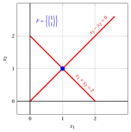
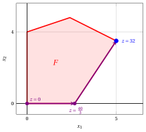

# The geometry of Linear Programming

**Part 4 · Matrix methods, sensitivity and geometry · Chapter 15** · [:material-file-pdf-box: Lecture notes, volume 4 (PDF)](../pdf/lecture-notes-4-advanced-methods.pdf) · [:material-pencil: Exercises: The geometry of Linear Programming](../exercises/ex-15-geometry.md)

## 15.1 The dimension of a polyhedron

- The feasible region of an LP problem is a polyhedron $F \subseteq \R^n$. So far we have described it through its linear constraints; in this document we describe its <strong>geometric</strong> structure, and we relate it to the algebraic notions of basis and basic feasible solution.

!!! definizione "Definition 15.1: affine hull and dimension"

    Given a polyhedron $F \subseteq \R^n$, its <strong>affine hull</strong> $\mathrm{aff}(F)$ is the smallest affine subspace of $\R^n$ containing $F$. The <strong>dimension</strong> of $F$, denoted by $\dim(F)$, is the dimension of $\mathrm{aff}(F)$.

    Equivalently, $\dim(F) = k$ if and only if $F$ contains $k+1$ points ${\boldsymbol x}^{(0)}, {\boldsymbol x}^{(1)}, \dots, {\boldsymbol x}^{(k)}$ such that the $k$ vectors ${\boldsymbol x}^{(1)} - {\boldsymbol x}^{(0)}, \dots, {\boldsymbol x}^{(k)} - {\boldsymbol x}^{(0)}$ are linearly independent, and it does not contain $k+2$ points with this property.

!!! definizione "Definition 15.2: full-dimensional polyhedron"

    A polyhedron $F \subseteq \R^n$ is called <strong>full-dimensional</strong> if $\dim(F) = n$. By convention, $\dim(\emptyset) = -1$, and a polyhedron consisting of a single point has dimension $0$.

- The dimension of a polyhedron is <u>not</u> the number of variables: it is the number of independent directions along which one can move inside the polyhedron. Every equality constraint satisfied by all the points of $F$, and <u>linearly independent</u> of the other ones, reduces its dimension by one.

!!! chiave ""

    The feasible region of an LP problem in <strong>standard maximization form</strong>,

    $$
    F = \left\{\, {\boldsymbol x} \in \R^{n} ~:~ {\boldsymbol A}\,{\boldsymbol x} = {\boldsymbol b}, ~ {\boldsymbol x} \ge {\boldsymbol 0} \,\right\} ,
    $$

    is <u>never</u> full-dimensional when $F \ne \emptyset$ and $\rank({\boldsymbol A}) \ge 1$: all its points satisfy the $m$ equality constraints, and then

    $$
    \dim(F) \; \le \; n - \rank({\boldsymbol A}) .
    $$

    The feasible region of an LP problem in <strong>canonical maximization form</strong> is instead full-dimensional whenever it contains a point satisfying all the constraints strictly.

!!! esempio "Example 15.1: dimension of a polyhedron"

    - The feasible region of the LP problem in canonical maximization form

        $$
        \begin{array}{rrrrrrrrrrrrr}
        {\max} & 5 \, {x_1} & {+} & 2 \, {x_2} \\[1ex]
        \text{subject to} & {-} \, {x_1} & {+} & 3 \, {x_2} & {\le} & 12 \\[1ex]
        & {x_1} & {+} & 2 \, {x_2} & {\le} & 12 \\[1ex]
        & {3} \, {x_1} & {-} & 2 \, {x_2} & {\le} & 8 \\[1ex]
        & {x_1,} &  & {x_2} & { \ge} & {0}
        \end{array}
        $$

        is <strong>full-dimensional</strong>: $\dim(F) = 2$, since for instance the point $\begin{pmatrix} 1 \\ 1 \end{pmatrix}$ satisfies all five constraints strictly, and then a small disc around it is contained in $F$.

    - The feasible region of the LP problem in standard maximization form

        $$
        F = \left\{~
        \begin{pmatrix} x_1 \\ x_2 \\ x_3 \end{pmatrix}
        \in \R^3 ~:~
        2x_1 + 3x_2 + x_3 = 4,~~ {\boldsymbol x} \ge {\boldsymbol 0}
        ~\right\}
        $$

        has dimension $\dim(F) = 2$, and then it is <u>not</u> full-dimensional: all its points lie on the plane $2x_1 + 3x_2 + x_3 = 4$. Here $n = 3$, $\rank({\boldsymbol A}) = 1$ and indeed $\dim(F) = 2 = n - \rank({\boldsymbol A})$.

## 15.2 Faces, facets and vertices

!!! definizione "Definition 15.3: valid inequality"

    A linear inequality ${\boldsymbol a}' {\boldsymbol x} \le \beta$, with ${\boldsymbol a} \in \R^n$ and $\beta \in \R$, is <strong>valid</strong> for a polyhedron $F \subseteq \R^n$ if it is satisfied by all its points:

    $$
    {\boldsymbol a}' {\boldsymbol x} \le \beta, \qquad \forall {\boldsymbol x} \in F .
    $$

!!! definizione "Definition 15.4: face"

    Given a polyhedron $F \subseteq \R^n$ and a valid inequality ${\boldsymbol a}' {\boldsymbol x} \le \beta$ for $F$, the set

    $$
    G = \left\{\, {\boldsymbol x} \in F ~:~ {\boldsymbol a}' {\boldsymbol x} = \beta \,\right\}
    $$

    is called a <strong>face</strong> of $F$. A face is <strong>proper</strong> if $G \ne \emptyset$ and $G \ne F$.

- A face of a polyhedron is obtained by requiring that one valid inequality is satisfied with equality, and it is itself a polyhedron. Both $F$ and $\emptyset$ are faces of $F$: the first one is obtained with the valid inequality ${\boldsymbol 0}' {\boldsymbol x} \le 0$, the second one with any valid inequality which is never satisfied with equality.

- Every linear constraint $\sum_{j} a_{ij} x_j \le b_i$ of the LP problem is a valid inequality for its feasible region, and then it defines a face: the set of the feasible solutions for which the constraint is <strong>binding</strong>. Together with the Complementary Slackness conditions, this is the link between the geometry of $F$ and the dual problem.

!!! definizione "Definition 15.5: facet and vertex"

    Given a polyhedron $F \subseteq \R^n$ and a non-empty face $G$ of $F$:

    1. $G$ is a <strong>facet</strong> of $F$ if $\dim(G) = \dim(F) - 1$;

    2. $G$ is a <strong>vertex</strong> of $F$ if $\dim(G) = 0$, that is, if $G$ consists of a single point.

    A facet is always a proper face. A vertex is a proper face, except when $F$ itself consists of a single point: in that case $G = F$ is the only vertex of $F$.

!!! chiave ""

    The facets are the <strong>largest</strong> proper faces and, when the polyhedron has at least one vertex (as the feasible region of an LP problem with non-negative variables), the vertices are the <strong>smallest</strong> non-empty ones. The facets are important because they are exactly the constraints that cannot be removed: a full-dimensional polyhedron is described by its facet-defining inequalities, and by those only. The vertices are important because, as we show below, they are exactly the basic feasible solutions.

!!! definizione "Definition 15.6: extreme point"

    A point ${\boldsymbol x} \in F$ is an <strong>extreme point</strong> of the polyhedron $F$ if it does not lie strictly between two <u>distinct</u> points of $F$, that is, if there are no ${\boldsymbol x}^{(1)}, {\boldsymbol x}^{(2)} \in F$ with ${\boldsymbol x}^{(1)} \ne {\boldsymbol x}^{(2)}$ and $\lambda \in (0,1)$ such that

    $$
    {\boldsymbol x} = \lambda \, {\boldsymbol x}^{(1)} + (1-\lambda) \, {\boldsymbol x}^{(2)} .
    $$

!!! teorema "Theorem 15.7: vertices and extreme points"

    Given a polyhedron $F \subseteq \R^n$ and a point ${\boldsymbol x} \in F$, the following two statements are equivalent:

    1. $\{{\boldsymbol x}\}$ is a vertex of $F$;

    2. ${\boldsymbol x}$ is an extreme point of $F$.

??? dimostrazione "Proof"

    $(1 \Rightarrow 2)$ Let $\{{\boldsymbol x}\}$ be the face defined by the valid inequality ${\boldsymbol a}' {\boldsymbol y} \le \beta$, and assume ${\boldsymbol x} = \lambda \, {\boldsymbol x}^{(1)} + (1-\lambda) \, {\boldsymbol x}^{(2)}$ with ${\boldsymbol x}^{(1)}, {\boldsymbol x}^{(2)} \in F$ and $\lambda \in (0,1)$. Then

    $$
    \beta = {\boldsymbol a}' {\boldsymbol x}
    = \lambda \, \underbrace{{\boldsymbol a}' {\boldsymbol x}^{(1)}}_{\le \, \beta} + (1-\lambda) \, \underbrace{{\boldsymbol a}' {\boldsymbol x}^{(2)}}_{\le \, \beta} \; \le \; \beta ,
    $$

    and the inequality can hold with equality only if ${\boldsymbol a}' {\boldsymbol x}^{(1)} = {\boldsymbol a}' {\boldsymbol x}^{(2)} = \beta$. Accordingly both points belong to the face $\{{\boldsymbol x}\}$, and then ${\boldsymbol x}^{(1)} = {\boldsymbol x}^{(2)} = {\boldsymbol x}$: the two points are not distinct.

    $(2 \Rightarrow 1)$ Let ${\boldsymbol x}$ be an extreme point and let $I$ be the set of the indices of the constraints of $F$ binding at ${\boldsymbol x}$. If the rows $\{{\boldsymbol a}_i\}_{i \in I}$ did not span $\R^n$, there would be a direction ${\boldsymbol d} \ne {\boldsymbol 0}$ with ${\boldsymbol a}_i' {\boldsymbol d} = 0$ for every $i \in I$, and then, for $\varepsilon > 0$ small enough, both ${\boldsymbol x} \pm \varepsilon {\boldsymbol d}$ would belong to $F$, contradicting the fact that ${\boldsymbol x}$ is an extreme point, since ${\boldsymbol x}$ is their midpoint. Accordingly the binding rows span $\R^n$, the system $\{{\boldsymbol a}_i' {\boldsymbol y} = b_i\}_{i \in I}$ has ${\boldsymbol x}$ as its unique solution, and the valid inequality obtained by summing the binding constraints defines the face $\{{\boldsymbol x}\}$. □

!!! esempio "Example 15.2: faces, facets and vertices"

    Consider the feasible region $F$ of the first LP problem of [Example 15.1](#box-3-ex-geo-dim). It is full-dimensional, $\dim(F) = 2$, and then:

    1. its <strong>facets</strong> are its faces of dimension $1$, that is, its five <u>edges</u>;

    2. its <strong>vertices</strong> are its faces of dimension $0$, that is, its five <u>corner points</u>.

    Each of the five linear constraints defines one facet, and then all of them are necessary to describe $F$:

    
<table>
    <tr>
    <th><strong>constraint</strong></th>
    <th><strong>facet it defines</strong></th>
    <th><strong>vertices it contains</strong></th>
    </tr>
    <tr>
    <td>\(-x_1 + 3x_2 \le 12\)</td>
    <td>edge from \((0,4)\) to \(\left(\frac{12}{5},\frac{24}{5}\right)\)</td>
    <td>\(2\)</td>
    </tr>
    <tr>
    <td>\(x_1 + 2x_2 \le 12\)</td>
    <td>edge from \(\left(\frac{12}{5},\frac{24}{5}\right)\) to \(\left(5,\frac{7}{2}\right)\)</td>
    <td>\(2\)</td>
    </tr>
    <tr>
    <td>\(3x_1 - 2x_2 \le 8\)</td>
    <td>edge from \(\left(5,\frac{7}{2}\right)\) to \(\left(\frac{8}{3},0\right)\)</td>
    <td>\(2\)</td>
    </tr>
    <tr>
    <td>\(x_2 \ge 0\)</td>
    <td>edge from \(\left(\frac{8}{3},0\right)\) to \((0,0)\)</td>
    <td>\(2\)</td>
    </tr>
    <tr>
    <td>\(x_1 \ge 0\)</td>
    <td>edge from \((0,0)\) to \((0,4)\)</td>
    <td>\(2\)</td>
    </tr>
    </table>

    { .fig .cornice loading=lazy style="width:56%" }

    The five points marked in black are the vertices of $F$, and the five red segments joining them are its facets.

## 15.3 Basic feasible solutions and vertices

- We now relate the geometric notion of vertex to the algebraic notion of basic feasible solution, which is the one used by the simplex algorithm. We consider an LP problem in standard maximization form with $n+m$ non-negative variables and $m$ equality linear constraints, with $\rank({\boldsymbol A}) = m$.

!!! teorema "Theorem 15.8: basic feasible solutions and vertices"

    Given an LP problem in standard maximization form and a point $\bar{\boldsymbol x} \in F$, the following two statements are equivalent:

    1. $\bar{\boldsymbol x}$ is a <strong>basic feasible solution</strong>, that is, there exists a basis ${\boldsymbol A}_{\pazocal{B}}$ such that $\bar{\boldsymbol x}_{\pazocal{B}} = {\boldsymbol A}_{\pazocal{B}}^{-1} {\boldsymbol b} \ge {\boldsymbol 0}$ and $\bar{\boldsymbol x}_{\pazocal{N}} = {\boldsymbol 0}$;

    2. $\bar{\boldsymbol x}$ is a <strong>vertex</strong> of $F$.

- The idea of the proof is that the columns associated with the strictly positive entries of $\bar{\boldsymbol x}$ are linearly independent if and only if $\bar{\boldsymbol x}$ cannot be moved in two opposite directions while staying in $F$.

??? dimostrazione "Proof"

    Let $P = \{\, j ~:~ \bar x_j > 0 \,\}$.

    $(1 \Rightarrow 2)$ Let $\bar{\boldsymbol x}$ be a basic feasible solution with basis $\pazocal{B}$. Then $P \subseteq \pazocal{B}$, and then the columns $\{{\boldsymbol A}_j\}_{j \in P}$ are linearly independent, being a subset of the columns of the invertible matrix ${\boldsymbol A}_{\pazocal{B}}$. Assume $\bar{\boldsymbol x} = \lambda \, {\boldsymbol x}^{(1)} + (1-\lambda) \, {\boldsymbol x}^{(2)}$ with ${\boldsymbol x}^{(1)}, {\boldsymbol x}^{(2)} \in F$ and $\lambda \in (0,1)$. For every $j \notin P$ we have $\bar x_j = 0$ and, since both points are non-negative, $x^{(1)}_j = x^{(2)}_j = 0$. Setting ${\boldsymbol d} = {\boldsymbol x}^{(1)} - {\boldsymbol x}^{(2)}$, we obtain $d_j = 0$ for every $j \notin P$ and

    $$
    {\boldsymbol A} \, {\boldsymbol d} = {\boldsymbol A}{\boldsymbol x}^{(1)} - {\boldsymbol A}{\boldsymbol x}^{(2)} = {\boldsymbol b} - {\boldsymbol b} = {\boldsymbol 0}
    \qquad \Longrightarrow \qquad
    \sum_{j \in P} d_j \, {\boldsymbol A}_j = {\boldsymbol 0} .
    $$

    By the linear independence of $\{{\boldsymbol A}_j\}_{j \in P}$ we get ${\boldsymbol d} = {\boldsymbol 0}$, that is, ${\boldsymbol x}^{(1)} = {\boldsymbol x}^{(2)}$. Accordingly $\bar{\boldsymbol x}$ is an extreme point and, by [Theorem 15.7](#box-8-theo-vertex-extreme), a vertex of $F$.

    $(2 \Rightarrow 1)$ Let $\bar{\boldsymbol x}$ be a vertex of $F$ and assume, by contradiction, that the columns $\{{\boldsymbol A}_j\}_{j \in P}$ are linearly dependent: there exists ${\boldsymbol d} \ne {\boldsymbol 0}$ with $d_j = 0$ for every $j \notin P$ and $\sum_{j \in P} d_j {\boldsymbol A}_j = {\boldsymbol 0}$. Since $\bar x_j > 0$ for every $j \in P$, for $\varepsilon > 0$ small enough both points $\bar{\boldsymbol x} \pm \varepsilon \, {\boldsymbol d}$ are non-negative, and they satisfy ${\boldsymbol A}(\bar{\boldsymbol x} \pm \varepsilon {\boldsymbol d}) = {\boldsymbol b}$: they belong to $F$. But $\bar{\boldsymbol x}$ is their midpoint, which contradicts [Theorem 15.7](#box-8-theo-vertex-extreme). Accordingly $\{{\boldsymbol A}_j\}_{j \in P}$ are linearly independent; since $\rank({\boldsymbol A}) = m$, they can be completed to $m$ linearly independent columns, whose indices form a basis $\pazocal{B} \supseteq P$. With respect to it, $\bar{\boldsymbol x}_{\pazocal{N}} = {\boldsymbol 0}$ and $\bar{\boldsymbol x}_{\pazocal{B}} = {\boldsymbol A}_{\pazocal{B}}^{-1} {\boldsymbol b} \ge {\boldsymbol 0}$: $\bar{\boldsymbol x}$ is a basic feasible solution. □

!!! chiave ""

    The correspondence between bases and vertices is <strong>onto</strong> but not necessarily <strong>one-to-one</strong>: every basic feasible solution is a vertex, but the same vertex may be associated with several different bases. This happens <u>only if</u> the vertex is <strong>degenerate</strong>, that is, if some basic variable takes the value $0$: a non-degenerate vertex is associated with exactly one basis, formed by the indices of its strictly positive entries, while a degenerate vertex is usually, but not always, associated with several bases.

!!! esempio "Example 15.3: bases and vertices"

    Consider the first LP problem of [Example 15.1](#box-3-ex-geo-dim) in standard maximization form, with $n+m=5$ non-negative variables and $m=3$ equality linear constraints. A basis is a subset of $3$ indices out of $5$, and there are $\binom{5}{3} = 10$ such subsets. All of them give an invertible matrix ${\boldsymbol A}_{\pazocal{B}}$, and then all of them are bases:

    
<table>
    <tr>
    <th>\(\pazocal{B}\)</th>
    <th>\({\boldsymbol x}_{\pazocal{B}} = {\boldsymbol A}_{\pazocal{B}}^{-1} {\boldsymbol b}\)</th>
    <th>feasible</th>
    <th>vertex \((x_1,x_2)\)</th>
    </tr>
    <tr>
    <td>\(\{1,2,3\}\)</td>
    <td>\(\left(5,~\frac{7}{2},~\frac{13}{2}\right)\)</td>
    <td>✓</td>
    <td>\(\left(5,\frac{7}{2}\right)\)</td>
    </tr>
    <tr>
    <td>\(\{1,2,4\}\)</td>
    <td>\(\left(\frac{48}{7},~\frac{44}{7},~-\frac{52}{7}\right)\)</td>
    <td></td>
    <td></td>
    </tr>
    <tr>
    <td>\(\{1,2,5\}\)</td>
    <td>\(\left(\frac{12}{5},~\frac{24}{5},~\frac{52}{5}\right)\)</td>
    <td>✓</td>
    <td>\(\left(\frac{12}{5},\frac{24}{5}\right)\)</td>
    </tr>
    <tr>
    <td>\(\{1,3,4\}\)</td>
    <td>\(\left(\frac{8}{3},~\frac{44}{3},~\frac{28}{3}\right)\)</td>
    <td>✓</td>
    <td>\(\left(\frac{8}{3},0\right)\)</td>
    </tr>
    <tr>
    <td>\(\{1,3,5\}\)</td>
    <td>\((12,~24,~-28)\)</td>
    <td></td>
    <td></td>
    </tr>
    <tr>
    <td>\(\{1,4,5\}\)</td>
    <td>\((-12,~24,~44)\)</td>
    <td></td>
    <td></td>
    </tr>
    <tr>
    <td>\(\{2,3,4\}\)</td>
    <td>\((-4,~24,~20)\)</td>
    <td></td>
    <td></td>
    </tr>
    <tr>
    <td>\(\{2,3,5\}\)</td>
    <td>\((6,~-6,~20)\)</td>
    <td></td>
    <td></td>
    </tr>
    <tr>
    <td>\(\{2,4,5\}\)</td>
    <td>\((4,~4,~16)\)</td>
    <td>✓</td>
    <td>\((0,4)\)</td>
    </tr>
    <tr>
    <td>\(\{3,4,5\}\)</td>
    <td>\((12,~12,~8)\)</td>
    <td>✓</td>
    <td>\((0,0)\)</td>
    </tr>
    </table>

    Exactly $5$ of the $10$ bases are feasible, and they correspond to the $5$ vertices of $F$ determined in the previous example. In this LP problem the correspondence is <strong>one-to-one</strong>, since no basic feasible solution is degenerate: in every feasible row of the table all three basic variables are strictly positive.

!!! esempio "Example 15.4: a degenerate vertex"

    Consider instead the following LP problem in canonical maximization form, whose feasible region consists of a single point:

    $$
    \begin{array}{rrrrrrrrrrrrr}
    {\max} & \, {x_1} & {+} & {2} \, {x_2} \\[1ex]
    \text{subject to} & \, {x_1} & {+} & \, {x_2} & {\le} & {2} \\[1ex]
    & {-} \, {x_1} & {-} & \, {x_2} & {\le} & {-2} \\[1ex]
    & \, {x_1} & {-} & \, {x_2} & {\le} & {0} \\[1ex]
    & {-} \, {x_1} & {+} & \, {x_2} & {\le} & {0} \\[1ex]
    & {x_1,} &  & {x_2} & { \ge} & {0}
    \end{array}
    $$

    The first two constraints impose $x_1 + x_2 = 2$ and the last two impose $x_1 = x_2$, and then

    $$
    F = \left\{ \begin{pmatrix} 1 \\ 1 \end{pmatrix} \right\} ,
    \qquad \dim(F) = 0 .
    $$

    In standard maximization form the problem has $6$ variables and $4$ constraints, and the single vertex $\begin{pmatrix} 1 \\ 1 \end{pmatrix}$ is associated with <strong>four</strong> different bases,

    $$
    \{1,2,3,5\}, \qquad \{1,2,3,6\}, \qquad \{1,2,4,5\}, \qquad \{1,2,4,6\} ,
    $$

    in each of which two basic variables take the value $0$. This vertex is therefore <strong>degenerate</strong>, and the correspondence between bases and vertices is not one-to-one.

    { .fig .cornice loading=lazy style="width:44%" }

## 15.4 The Fundamental Theorem, geometrically

- The Fundamental Theorem of Linear Programming states that, whenever an LP problem admits an optimal solution, it admits a <u>basic</u> feasible solution which is optimal. By [Theorem 15.8](#box-10-theo-bfs-vertex), this statement has an immediate geometric reading.

!!! teorema "Corollary 15.9: optimal vertices"

    If an LP problem admits an optimal solution, then at least one <strong>vertex</strong> of its feasible region is an optimal solution.

!!! chiave ""

    This is the result that justifies the <strong>graphical solution method</strong>: to solve an LP problem with two variables it is enough to compute the objective value at each vertex of the feasible region and to keep the best one. It is also the result that makes the simplex algorithm possible: the search for an optimal solution, which is a priori a search over infinitely many points, becomes a search over the <u>finitely many</u> vertices.

- The set of the optimal solutions of an LP problem is itself a <strong>face</strong> of the feasible region: it is the face defined by the valid inequality ${\boldsymbol c}' {\boldsymbol x} \le z(\, LP \,)$. Accordingly:

    1. if that face is a vertex, the optimal solution is unique;

    2. if that face has dimension $1$ or more, the LP problem admits infinitely many optimal solutions, and among them at least one vertex.

- A vertex is an optimal solution if and only if no edge leaving it, bounded or unbounded, improves the objective function. The <strong>optimality check</strong> of the simplex algorithm is based on this property: the non-basic variables correspond to the directions leaving the vertex, and their effect on the objective function is measured by the reduced costs. The check is a <u>sufficient</u> condition for optimality but, at a degenerate vertex, not a necessary one: a degenerate vertex may be optimal even if some reduced cost is positive, since the corresponding direction may immediately leave $F$.

!!! definizione "Definition 15.10: adjacent vertices"

    Two vertices of a polyhedron are called <strong>adjacent</strong> if the segment joining them is a face, that is, an edge.

!!! chiave ""

    In terms of bases, two <u>non-degenerate</u> basic feasible solutions are adjacent if and only if their bases differ by exactly one index.

    A <strong>pivoting operation</strong> of the simplex algorithm replaces one index of the basis with another one. If it is non-degenerate, it moves from one vertex to an <strong>adjacent</strong> one, along an edge of the feasible region, strictly increasing the objective value; if it is degenerate ($t_m = 0$), it changes the basis but remains at the same vertex. The simplex algorithm is, geometrically, a walk on the edges of the polyhedron.

!!! esempio "Example 15.5: the simplex algorithm as a walk on the edges"

    The execution of the simplex algorithm on the first LP problem of [Example 15.1](#box-3-ex-geo-dim), started from the basis $\pazocal{B}= \{3,4,5\}$, visits the following vertices:

    $$
    (0,0) ~ \longrightarrow ~ \left(\frac{8}{3},0\right) ~ \longrightarrow ~ \left(5,\frac{7}{2}\right) ,
    $$

    with objective values $0$, $\frac{40}{3}$ and $32$. Each step moves along one edge of $F$, to an adjacent vertex, and the objective value strictly increases. In the figure, in violet the two vertices visited before the last one, in blue the optimal vertex.

    { .fig .cornice loading=lazy style="width:56%" }

## 15.5 Summary

!!! chiave ""

    
<table>
    <tr>
    <th><strong>geometric notion</strong></th>
    <th><strong>algebraic counterpart</strong></th>
    </tr>
    <tr>
    <td>polyhedron \(F\)</td>
    <td>feasible region of the LP problem</td>
    </tr>
    <tr>
    <td>\(\dim(F)\)</td>
    <td>\(n\) minus the independent equalities valid on \(F\)</td>
    </tr>
    <tr>
    <td>face</td>
    <td>solutions making a valid inequality binding</td>
    </tr>
    <tr>
    <td>facet</td>
    <td>a constraint which cannot be removed</td>
    </tr>
    <tr>
    <td>vertex \(=\) extreme point</td>
    <td>basic feasible solution</td>
    </tr>
    <tr>
    <td>degenerate vertex</td>
    <td>several bases, one single point</td>
    </tr>
    <tr>
    <td>edge between two vertices</td>
    <td>pivoting operation</td>
    </tr>
    <tr>
    <td>optimal face</td>
    <td>set of the optimal solutions</td>
    </tr>
    </table>

- The number of vertices of a polyhedron can be <strong>exponential</strong> in the number of its constraints and variables: for an LP problem in standard maximization form it is bounded by $\binom{n+m}{m}$. This is why the simplex algorithm, which visits one vertex at a time, cannot be shown to be efficient by simply counting the vertices, and why its behaviour in practice is much better than its worst case.

---

**Exercises on this chapter:** [:material-pencil: The geometry of Linear Programming](../exercises/ex-15-geometry.md)
