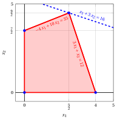
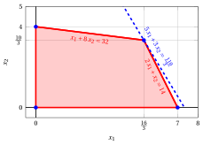
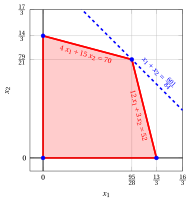
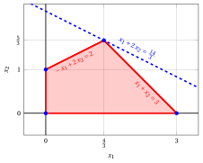

# LP problems with two variables – Type A

**Catalogue of LP problems** · [:material-file-pdf-box: Problem catalogue (PDF)](../pdf/lp-problem-catalogue.pdf)

## LP Problem $P0$

!!! chiave ""

    $$
    \begin{array}{rrrrrrrrrrrrr}
    {\max} & 2 \, {x_1} & {+} & 4 \, {x_2} \\[2ex]
    \text{subject to} & 2 \, {x_1} & {+} & 3 \, {x_2} & {\le} & 4 \\[2ex]
    & {x_1,} &  & {x_2} & { \ge} & { 0 }
    \end{array}
    $$

{ .fig .ovale loading=lazy style="width:76%" }

## LP Problem $P1$

!!! chiave ""

    $$
    \begin{array}{rrrrrrrrrrrrr}
    {\max} & {x_1} & {+} & 8 \, {x_2} \\[2ex]
    \text{subject to} & {3} \, {x_1} & {+} & {6} \, {x_2} & {\le} & {16} \\[2ex]
    & {x_1,} &  & {x_2} & { \ge} & {0 }
    \end{array}
    $$

{ .fig .ovale loading=lazy style="width:76%" }

## LP Problem $P2$

!!! chiave ""

    $$
    \begin{array}{rrrrrrrrrrrrr}
    {\max} & {x_1} & {+} & 3 \, {x_2} \\[2ex]
    \text{subject to} & {-}4 \, {x_1} & {+} & 10 \, {x_2} & {\le} & 35 \\[2ex]
    & 3 \, {x_1} & {+} & \, {x_2} & {\le} & 12 \\[2ex]
    & {x_1,} &  & {x_2} & { \ge} & { 0 }
    \end{array}
    $$

{ .fig .ovale loading=lazy style="width:76%" }

## LP Problem $P3$

!!! chiave ""

    $$
    \begin{array}{rrrrrrrrrrrrr}
    {\max} & {2} \, {x_1} & {+} & {4} \, {x_2} \\[2ex]
    \text{subject to} & {-} \, {x_1} & {+} & \, {x_2} & {\le} & {2} \\[2ex]
    & {8} \, {x_1} & {+} & {2} \, {x_2} & {\le} & {19} \\[2ex]
    & {x_1,} &  & {x_2} & { \ge} & { 0 }
    \end{array}
    $$

{ .fig .ovale loading=lazy style="width:76%" }

## LP Problem $P4$

!!! chiave ""

    $$
    \begin{array}{rrrrrrrrrrrrr}
    {\max} & 5 {x_1} & {+} & 3 \, {x_2} \\[2ex]
    \text{subject to} & 2 \, {x_1} & {+} & \, {x_2} & {\le} & 14 \\[2ex]
    & \, {x_1} & {+} & 8 \, {x_2} & {\le} & 32 \\[2ex]
    & {x_1,} &  & {x_2} & { \ge} & { 0 }
    \end{array}
    $$

{ .fig .ovale loading=lazy style="width:82%" }

## LP Problem $P5$

!!! chiave ""

    $$
    \begin{array}{rrrrrrrrrrrrr}
    {\max} & 2 {x_1} & {+} & 3 \, {x_2} \\[2ex]
    \text{subject to} & 6 \, {x_1} & {+} & 21 \, {x_2} & {\le} & 77 \\[2ex]
    & 8 \, {x_1} & {+} & 3 \, {x_2} & {\le} & 36 \\[2ex]
    & {x_1,} &  & {x_2} & { \ge} & { 0 }
    \end{array}
    $$

{ .fig .ovale loading=lazy style="width:76%" }

## ILP problem $P6$

!!! chiave ""

    $$
    \begin{array}{rrrrrrrrrrrrr}
    {\max} & {x_1} & {+} & \, {x_2} \\[2ex]
    \text{subject to} & {4} \, {x_1} & {+} & {15} \, {x_2} & {\le} & {70} \\[2ex]
    & {12} \, {x_1} & {+} & {3} \, {x_2} & {\le} & {52} \\[2ex]
    & {x_1,} &  & {x_2} & {\in} & {\mathbb{Z}_{\ge 0}}
    \end{array}
    $$

{ .fig .ovale loading=lazy style="width:76%" }

## LP Problem $P7$

!!! chiave ""

    $$
    \begin{array}{rrrrrrrrrrrrr}
    {\max} & 3 \, {x_1} & {+} & {x_2} \\[2ex]
    \text{subject to} & {x_1} & {+} & {4} \, {x_2} & {\le} & {12} \\[2ex]
    & 2 \, {x_1} & {+} & \, {x_2} & {\le} & 5 \\[2ex]
    & {x_1,} &  & {x_2} & {\ge} & {0}
    \end{array}
    $$

{ .fig .ovale loading=lazy style="width:76%" }

## LP Problem $P8$

!!! chiave ""

    $$
    \begin{array}{rrrrrrrrrrrrr}
    {\max} & \, {x_1} & {+} & 2 \, {x_2} \\[2ex]
    \text{subject to} & {-} {x_1} & {+} & {2} \, {x_2} & {\le} & {2} \\[2ex]
    & \, {x_1} & {+} & \, {x_2} & {\le} & 3 \\[2ex]
    & \, {x_1,} &  & {x_2} & { \ge } & { 0 }
    \end{array}
    $$

{ .fig .ovale loading=lazy style="width:76%" }

## LP Problem $P9$

!!! chiave ""

    $$
    \begin{array}{rrrrrrrrrrrrr}
    {\max} & 2 \, {x_1} & {+} & {x_2} \\[2ex]
    \text{subject to} & {-} \, {x_1} & {+} & \, {x_2} & {\le} & 1 \\[2ex]
    & {6} \, {x_1} & {+} & {4} \, {x_2} & {\le} & {39} \\[2ex]
    & {x_1,} &  & {x_2} & { \ge} & {0}
    \end{array}
    $$

{ .fig .ovale loading=lazy style="width:76%" }

## LP Problem $P10$

!!! chiave ""

    $$
    \begin{array}{rrrrrrrrrrrrr}
    {\max} & 5 \, {x_1} & {+} & 2 \, {x_2} \\[2ex]
    \text{subject to} & {-} \, {x_1} & {+} & 3 \, {x_2} & {\le} & 12 \\[2ex]
    & {x_1} & {+} & 2 \, {x_2} & {\le} & 12 \\[2ex]
    & {3} \, {x_1} & {-} & 2 \, {x_2} & {\le} & {8} \\[2ex]
    & {x_1,} &  & {x_2} & { \ge} & {0}
    \end{array}
    $$

{ .fig .ovale loading=lazy style="width:76%" }
