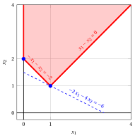
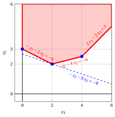
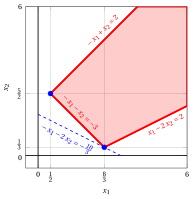
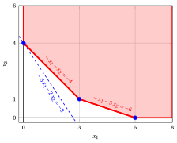
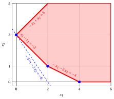
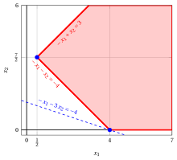

# LP problems with two variables – Type B

**Catalogue of LP problems** · [:material-file-pdf-box: Problem catalogue (PDF)](../pdf/lp-problem-catalogue.pdf)

## LP Problem $P11$

!!! chiave ""

    $$
    \begin{array}{rrrrrrrrrrrrr}
    {\max} & {-2}\, {x_1} & {-} & {4}\, {x_2} \\[2ex]
    \text{subject to} & {-}\, {x_1} & {-} & \, {x_2} & {\le} & {-2} \\[1.5ex]
    & \, {x_1} & {-} & \, {x_2} & {\le} & {0} \\[1.5ex]
    & {x_1,} &  & {x_2} & { \ge} & { 0 }
    \end{array}
    $$

{ .fig .ovale loading=lazy style="width:71%" }

## LP Problem $P12$

!!! chiave ""

    $$
    \begin{array}{rrrrrrrrrrrrr}
    {\max} & {-}\, {x_1} & {-} & {2}\, {x_2} \\[2ex]
    \text{subject to} & {-}\, {x_1} & {-} & \, {x_2} & {\le} & {-3} \\[1.5ex]
    & \, {x_1} & {-} & {2}\, {x_2} & {\le} & {-1} \\[1.5ex]
    & {x_1,} &  & {x_2} & { \ge} & { 0 }
    \end{array}
    $$

{ .fig .ovale loading=lazy style="width:71%" }

## LP Problem $P13$

!!! chiave ""

    $$
    \begin{array}{rrrrrrrrrrrrr}
    {\max} & {-} \, {x_1} & {-} & {3} \, {x_2} \\[1.5ex]
    \text{subject to} & {-} \, {x_1} & {-} & {2}\, {x_2} & {\le} & {-6} \\[1.5ex]
    & \, {x_1} & {-} & {4} \, {x_2} & {\le} & {-6} \\[1.5ex]
    & {2} \, {x_1} & {-} & {2} \, {x_2} & {\le} & {3} \\[1.5ex]
    & {x_1,} &  & {x_2} & { \ge} & { 0 }
    \end{array}
    $$

{ .fig .ovale loading=lazy style="width:76%" }

## LP Problem $P14$

!!! chiave ""

    $$
    \begin{array}{rrrrrrrrrrrrr}
    {\max} & {-} \, {x_1} & {-} & {2} \, {x_2} \\[1.5ex]
    \text{subject to} & {-} \, {x_1} & {+} & {x_2} & {\le} & {2} \\[1.5ex]
    & \, {x_1} & {-} & {2} \, {x_2} & {\le} & {2} \\[1.5ex]
    & {-} \, {x_1} & {-} & {x_2} & {\le} & {-3} \\[1.5ex]
    & {x_1,} &  & {x_2} & { \ge} & { 0 }
    \end{array}
    $$

{ .fig .ovale loading=lazy style="width:76%" }

## LP Problem $P15$

!!! chiave ""

    $$
    \begin{array}{rrrrrrrrrrrrr}
    {\max} & {-}{3}\, {x_1} & {-} & {2}\, {x_2} \\[2ex]
    \text{subject to} & {-}\, {x_1} & {-} & \, {x_2} & {\le} & {-4} \\[1.5ex]
    & {-}\, {x_1} & {-} & {3}\, {x_2} & {\le} & {-6} \\[1.5ex]
    & {x_1,} &  & {x_2} & { \ge} & { 0 }
    \end{array}
    $$

{ .fig .ovale loading=lazy style="width:71%" }

## LP Problem $P16$

!!! chiave ""

    $$
    \begin{array}{rrrrrrrrrrrrr}
    {\max} & {-}\, {x_1} & {-} & {2}\, {x_2} \\[2ex]
    \text{subject to} & {-}{2}\, {x_1} & {-} & \, {x_2} & {\le} & {-4} \\[1.5ex]
    & {-}\, {x_1} & {-} & {3}\, {x_2} & {\le} & {-6} \\[1.5ex]
    & {x_1,} &  & {x_2} & { \ge} & { 0 }
    \end{array}
    $$

{ .fig .ovale loading=lazy style="width:71%" }

## LP Problem $P17$

!!! chiave ""

    $$
    \begin{array}{rrrrrrrrrrrrr}
    {\max} & {-}{3}\, {x_1} & {-} & {2}\, {x_2} \\[2ex]
    \text{subject to} & {-}\, {x_1} & {-} & \, {x_2} & {\le} & {-3} \\[1.5ex]
    & {-}\, {x_1} & {+} & \, {x_2} & {\le} & {3} \\[1.5ex]
    & {-}\, {x_1} & {-} & {2}\, {x_2} & {\le} & {-4} \\[1.5ex]
    & {x_1,} &  & {x_2} & { \ge} & { 0 }
    \end{array}
    $$

{ .fig .ovale loading=lazy style="width:71%" }

## LP Problem $P18$

!!! chiave ""

    $$
    \begin{array}{rrrrrrrrrrrrr}
    {\max} & {-}{2}\, {x_1} & {-} & \, {x_2} \\[2ex]
    \text{subject to} & {-}\, {x_1} & {-} & \, {x_2} & {\le} & {-3} \\[1.5ex]
    & \, {x_1} & {-} & {2}\, {x_2} & {\le} & {4} \\[1.5ex]
    & {-}{2}\, {x_1} & {+} & {2}\, {x_2} & {\le} & {2} \\[1.5ex]
    & {x_1,} &  & {x_2} & { \ge} & { 0 }
    \end{array}
    $$

{ .fig .ovale loading=lazy style="width:71%" }

## LP Problem $P19$

!!! chiave ""

    $$
    \begin{array}{rrrrrrrrrrrrr}
    {\max} & {-}\, {x_1} & {-} & {3}\, {x_2} \\[2ex]
    \text{subject to} & {-}\, {x_1} & {-} & \, {x_2} & {\le} & {-4} \\[1.5ex]
    & {-}\, {x_1} & {+} & \, {x_2} & {\le} & {3} \\[1.5ex]
    & {x_1,} &  & {x_2} & { \ge} & { 0 }
    \end{array}
    $$

{ .fig .ovale loading=lazy style="width:71%" }

## LP Problem $P20$

!!! chiave ""

    $$
    \begin{array}{rrrrrrrrrrrrr}
    {\max} & {-}{3}\, {x_1} & {-} & \, {x_2} \\[2ex]
    \text{subject to} & \, {x_1} & {-} & \, {x_2} & {\le} & {5} \\[1.5ex]
    & {-}{2}\, {x_1} & {-} & \, {x_2} & {\le} & {-4} \\[1.5ex]
    & {x_1,} &  & {x_2} & { \ge} & { 0 }
    \end{array}
    $$

{ .fig .ovale loading=lazy style="width:71%" }
