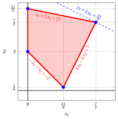
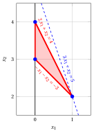
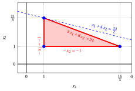
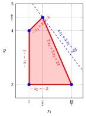
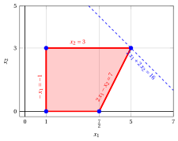
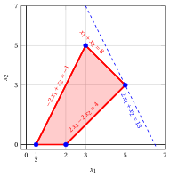
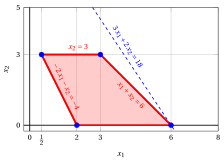
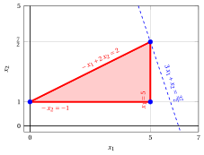

# LP problems with two variables – Type C

**Catalogue of LP problems** · [:material-file-pdf-box: Problem catalogue (PDF)](../pdf/lp-problem-catalogue.pdf)

## LP Problem $P21$

!!! chiave ""

    $$
    \begin{array}{rrrrrrrrrrrrr}
    {\max} & \, {x_1} & {+} & {2}\, {x_2} \\[2ex]
    \text{subject to} & {-}\, {x_1} & {-} & \, {x_2} & {\le} & {-2} \\[1.5ex]
    & {4}\, {x_1} & {-} & {2}\, {x_2} & {\le} & {7} \\[1.5ex]
    & \, {x_1} & {+} & {5}\, {x_2} & {\le} & {21} \\[1.5ex]
    & {x_1,} &  & {x_2} & { \ge} & { 0 }
    \end{array}
    $$

{ .fig .ovale loading=lazy style="width:65%" }

## LP Problem $P22$

!!! chiave ""

    $$
    \begin{array}{rrrrrrrrrrrrr}
    {\max} & {3}\, {x_1} & {+} & \, {x_2} \\[2ex]
    \text{subject to} & \, {x_1} & {-} & \, {x_2} & {\le} & {-1} \\[1.5ex]
    & {-}\, {x_1} & {-} & \, {x_2} & {\le} & {-3} \\[1.5ex]
    & {2}\, {x_1} & {+} & \, {x_2} & {\le} & {4} \\[1.5ex]
    & {x_1,} &  & {x_2} & { \ge} & { 0 }
    \end{array}
    $$

{ .fig .ovale loading=lazy style="width:53%" }

## LP Problem $P23$

!!! chiave ""

    $$
    \begin{array}{rrrrrrrrrrrrr}
    {\max} & \, {x_1} & {+} & {4}\, {x_2} \\[2ex]
    \text{subject to} & {3}\, {x_1} & {+} & {8}\, {x_2} & {\le} & {24} \\[1.5ex]
    & \, {x_1} &  &  & {\ge} & {1} \\[1.5ex]
    &  &  & \, {x_2} & {\ge} & {1} \\[1.5ex]
    & {x_1,} &  & {x_2} & { \ge} & { 0 }
    \end{array}
    $$

{ .fig .ovale loading=lazy style="width:71%" }

## LP Problem $P24$

!!! chiave ""

    $$
    \begin{array}{rrrrrrrrrrrrr}
    {\max} & {4}\, {x_1} & {+} & {3}\, {x_2} \\[2ex]
    \text{subject to} & {7}\, {x_1} & {+} & {3}\, {x_2} & {\le} & {24} \\[1.5ex]
    & {-}\, {x_1} & {+} & \, {x_2} & {\le} & {3} \\[1.5ex]
    & \, {x_1} &  &  & {\ge} & {1} \\[1.5ex]
    &  &  & \, {x_2} & {\ge} & {2} \\[1.5ex]
    & {x_1,} &  & {x_2} & { \ge} & { 0 }
    \end{array}
    $$

{ .fig .ovale loading=lazy style="width:59%" }

## LP Problem $P25$

!!! chiave ""

    $$
    \begin{array}{rrrrrrrrrrrrr}
    {\max} & {2}\, {x_1} & {+} & {2}\, {x_2} \\[2ex]
    \text{subject to} & \, {x_1} &  &  & {\ge} & {1} \\[1.5ex]
    &  &  & \, {x_2} & {\le} & {3} \\[1.5ex]
    & {2}\, {x_1} & {-} & \, {x_2} & {\le} & {7} \\[1.5ex]
    & {x_1,} &  & {x_2} & { \ge} & { 0 }
    \end{array}
    $$

{ .fig .ovale loading=lazy style="width:71%" }

## LP Problem $P26$

!!! chiave ""

    $$
    \begin{array}{rrrrrrrrrrrrr}
    {\max} & {2}\, {x_1} & {+} & {3}\, {x_2} \\[2ex]
    \text{subject to} & {-}\, {x_1} & {-} & \, {x_2} & {\le} & {-2} \\[1.5ex]
    & \, {x_1} & {+} & {2}\, {x_2} & {\le} & {8} \\[1.5ex]
    & {3}\, {x_1} & {+} & \, {x_2} & {\le} & {9} \\[1.5ex]
    & {x_1,} &  & {x_2} & { \ge} & { 0 }
    \end{array}
    $$

{ .fig .ovale loading=lazy style="width:65%" }

## LP Problem $P27$

!!! chiave ""

    $$
    \begin{array}{rrrrrrrrrrrrr}
    {\max} & {2}\, {x_1} & {+} & \, {x_2} \\[2ex]
    \text{subject to} & \, {x_1} & {+} & \, {x_2} & {\le} & {8} \\[1.5ex]
    & {2}\, {x_1} & {-} & {2}\, {x_2} & {\le} & {4} \\[1.5ex]
    & {-}{2}\, {x_1} & {+} & \, {x_2} & {\le} & {-1} \\[1.5ex]
    & {x_1,} &  & {x_2} & { \ge} & { 0 }
    \end{array}
    $$

{ .fig .ovale loading=lazy style="width:65%" }

## LP Problem $P28$

!!! chiave ""

    $$
    \begin{array}{rrrrrrrrrrrrr}
    {\max} & {3}\, {x_1} & {+} & {2}\, {x_2} \\[2ex]
    \text{subject to} & \, {x_1} & {+} & \, {x_2} & {\le} & {6} \\[1.5ex]
    & {-}{2}\, {x_1} & {-} & \, {x_2} & {\le} & {-4} \\[1.5ex]
    &  &  & \, {x_2} & {\le} & {3} \\[1.5ex]
    & {x_1,} &  & {x_2} & { \ge} & { 0 }
    \end{array}
    $$

{ .fig .ovale loading=lazy style="width:71%" }

## LP Problem $P29$

!!! chiave ""

    $$
    \begin{array}{rrrrrrrrrrrrr}
    {\max} & {3}\, {x_1} & {+} & \, {x_2} \\[2ex]
    \text{subject to} & {-}\, {x_1} & {+} & {2}\, {x_2} & {\le} & {2} \\[1.5ex]
    &  &  & \, {x_2} & {\ge} & {1} \\[1.5ex]
    & \, {x_1} &  &  & {\le} & {5} \\[1.5ex]
    & {x_1,} &  & {x_2} & { \ge} & { 0 }
    \end{array}
    $$

{ .fig .ovale loading=lazy style="width:71%" }

## LP Problem $P30$

!!! chiave ""

    $$
    \begin{array}{rrrrrrrrrrrrr}
    {\max} & \, {x_1} & {+} & \, {x_2} \\[2ex]
    \text{subject to} & {-}\, {x_1} & {+} & \, {x_2} & {\le} & {2} \\[1.5ex]
    & {-}\, {x_1} & {-} & {2}\, {x_2} & {\le} & {-4} \\[1.5ex]
    & {2}\, {x_1} & {-} & \, {x_2} & {\le} & {8} \\[1.5ex]
    &  &  & {2}\, {x_2} & {\le} & {8} \\[1.5ex]
    & {x_1,} &  & {x_2} & { \ge} & { 0 }
    \end{array}
    $$

{ .fig .ovale loading=lazy style="width:71%" }
