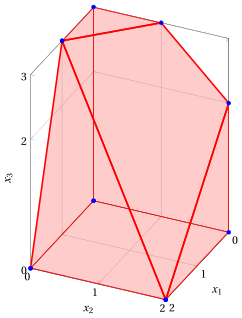
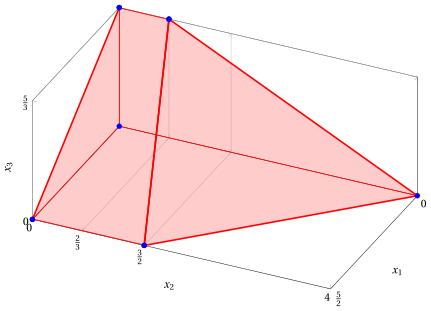
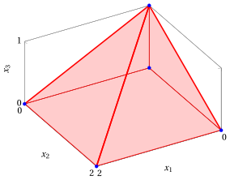
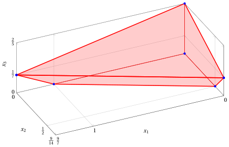
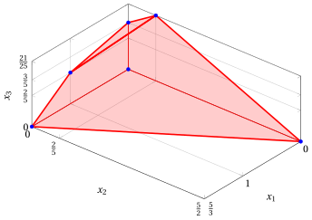
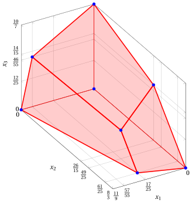

# LP problems with three variables – Type A

**Catalogue of LP problems** · [:material-file-pdf-box: Problem catalogue (PDF)](../pdf/lp-problem-catalogue.pdf)

## LP Problem $P41$

!!! chiave ""

    $$
    \begin{array}{rrrrrrrrrrrrr}
    {\max} & 2\; {x_1} & {+} & {x_2} & {+} & 3\; {x_3} \\[1.5ex]
    \text{subject to} & \, {x_1} & {+} & \, {x_2} & {+} & \, {x_3} & {\le} & {4} \\[1.5ex]
    &  &  & \, {x_2} &  &  & {\le} & {2} \\[1.5ex]
    &  &  &  &  & \, {x_3} & {\le} & {3} \\[1.5ex]
    & 3\, {x_1} &  &  & {+} & \, {x_3} & {\le} & {6} \\[1.5ex]
    & {x_1,} &  & {x_2,} &  & {x_3} & { \ge} & { 0 }
    \end{array}
    $$

{ .fig .ovale loading=lazy style="width:53%" }

## LP Problem $P42$

!!! chiave ""

    $$
    \begin{array}{rrrrrrrrrrrrr}
    {\max} & 3 \, {x_1} & {+} & 2 \, {x_2} & {+} & 4 \, {x_3} \\[2ex]
    \text{subject to} & \, {x_1} & {+} & \, {x_2} & {+} & 2 \, {x_3} & {\le} & 4 \\[2ex]
    & 2 \, {x_1} &  &  & {+} & 3 \, {x_3} & {\le} & 5 \\[2ex]
    & 2 \, {x_1} & {+} & \, {x_2} & {+} & 3 \, {x_3} & {\le} & 7 \\[2ex]
    & {x_1,} &  & {x_2,} &  & \, {x_3} & { \ge} & { 0 }
    \end{array}
    $$

{ .fig .ovale loading=lazy style="width:76%" }

## LP Problem $P43$

!!! chiave ""

    $$
    \begin{array}{rrrrrrrrrrrrr}
    {\max} & {x_1} & {+} & 2 \, {x_2} & {+} & 7 \, {x_3} \\[2ex]
    \text{subject to} & {x_1} &  &  & {+} & 2 \, {x_3} & {\le} & 2 \\[2ex]
    &  &  & {x_2} & {+} & 2 \, {x_3} & {\le} & 2 \\[2ex]
    & {x_1,} &  & {x_2,} &  & {x_3} & { \ge} & {0}
    \end{array}
    $$

{ .fig .ovale loading=lazy style="width:71%" }

## LP Problem $P44$

!!! chiave ""

    $$
    \begin{array}{rrrrrrrrrrrrr}
    {\max} & {x_1} & {+} & 2 \, {x_2} & {+} & 3 \, {x_3} \\[2ex]
    \text{subject to} & {x_1} & {+} & 2 \, {x_2} & {-} & 2 \, {x_3} & {\le} & 1 \\[2ex]
    & 2 \, {x_1} & {-} & \, {x_2} & {-} & 3 \, {x_3} & {\le} & 4 \\[2ex]
    & {x_1} & {+} & 2 \, {x_2} & {+} & 5 \, {x_3} & {\le} & 2 \\[2ex]
    & {x_1,} &  & {x_2,} &  & \, {x_3} & {\ge} & { 0 }
    \end{array}
    $$

{ .fig .ovale loading=lazy style="width:88%" }

## LP Problem $P45$

!!! chiave ""

    $$
    \begin{array}{rrrrrrrrrrrrr}
    {\max} & {4} \, {x_1} & {-} & 13\, {x_2} & {+} & {7} \, {x_3} \\[1.5ex]
    \text{subject to} & 3\, {x_1} & {+} & 2 \, {x_2} & {+} & 5 \, {x_3} & {\le} & {5} \\[1.5ex]
    & {x_1} & {-} & 3\, {x_2} & {+} & 5\, {x_3} & {\le} & {3} \\[1.5ex]
    & {x_1,} &  & {x_2,} &  & {x_3} & { \ge} & { 0 }
    \end{array}
    $$

{ .fig .ovale loading=lazy style="width:82%" }

## LP Problem $P46$

!!! chiave ""

    $$
    \begin{array}{rrrrrrrrrrrrr}
    {\max} & 5\, {x_1} & {+} & 6\, {x_2} & {+} & 10\, {x_3} \\[2ex]
    \text{subject to} & 9\, {x_1} & {+} & 2 \, {x_2} & {+} & 2\, {x_3} & {\le} & 11 \\[2ex]
    & 2\, {x_1} & {+} & 6 \, {x_2} & {+} & 6\, {x_3} & {\le} & 16 \\[2ex]
    & 4\, {x_1} & {+} & 2 \, {x_2} & {+} & 7\, {x_3} & {\le} & 10 \\[2ex]
    & {x_1}, &  & {x_2}, &  & {x_3} & {\ge} & { 0 }
    \end{array}
    $$

{ .fig .ovale loading=lazy style="width:85%" }
