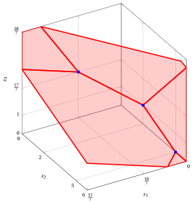
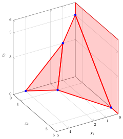
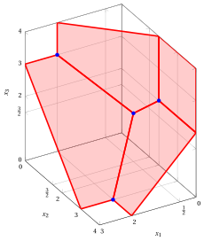
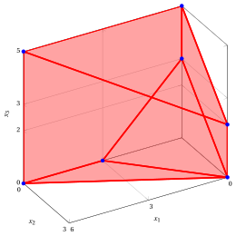
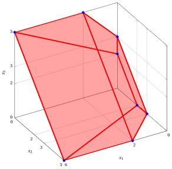
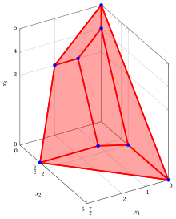

# LP problems with three variables – Type B

**Catalogue of LP problems** · [:material-file-pdf-box: Problem catalogue (PDF)](../pdf/lp-problem-catalogue.pdf)

## LP Problem $P51$

!!! chiave ""

    $$
    \begin{array}{rrrrrrrrrrrrrrrr}
    {\max} & {-} & {2\,x_1} & {-} & {\,x_2} &  &  \\[2ex]
    \text{subject to} &  & \, {x_1} & {-} & {x_2} & {-} & 3 \, {x_3} & {\le} & {-} 5 \\[2ex]
    & {-} & 3 \, {x_1} & {-} & 2 \, {x_2} & {+} & 2 \, {x_3} & {\le} & {-}2 \\[2ex]
    &  & {x_1,} &  & {x_2,} &  & {x_3} & { \ge} & { 0 }
    \end{array}
    $$

{ .fig .ovale loading=lazy style="width:79%" }

## LP Problem $P52$

!!! chiave ""

    $$
    \begin{array}{rrrrrrrrrrrrrrrr}
    {\max} & {-} & {\,x_1} & {-} & {2\,x_2} & {-} & {\,x_3} &  &  \\[2ex]
    \text{subject to} & {-} & {2\,x_1} & {-} & {\,x_2} & {-} & {\,x_3} & {\le} & {-5} \\[2ex]
    & {-} & {\,x_1} & {-} & {2\,x_2} & {-} & {\,x_3} & {\le} & {-4} \\[2ex]
    & {-} & {\,x_1} & {-} & {\,x_2} & {-} & {2\,x_3} & {\le} & {-3} \\[2ex]
    &  & {x_1,} &  & {x_2,} &  & {x_3} & { \ge} & { 0 }
    \end{array}
    $$

{ .fig .ovale loading=lazy style="width:79%" }

## LP Problem $P53$

!!! chiave ""

    $$
    \begin{array}{rrrrrrrrrrrrrrrr}
    {\max} & {-} & {\,x_1} & {-} & {2\,x_2} & {-} & {4\,x_3} &  &  \\[2ex]
    \text{subject to} & {-} & {\,x_1} & {-} & {\,x_2} &  &  & {\le} & {-2} \\[2ex]
    &  &  & {-} & {\,x_2} & {-} & {\,x_3} & {\le} & {-3} \\[2ex]
    & {-} & {\,x_1} &  &  & {-} & {\,x_3} & {\le} & {-2} \\[2ex]
    &  & {x_1,} &  & {x_2,} &  & {x_3} & { \ge} & { 0 }
    \end{array}
    $$

{ .fig .ovale loading=lazy style="width:79%" }

## LP Problem $P54$

!!! chiave ""

    $$
    \begin{array}{rrrrrrrrrrrrrrrr}
    {\max} & {-} & {\,x_1} & {-} & {2\,x_2} & {-} & {2\,x_3} &  &  \\[2ex]
    \text{subject to} &  & {\,x_1} & {+} & {2\,x_2} &  &  & {\le} & {6} \\[2ex]
    & {-} & {\,x_1} & {-} & {\,x_2} & {-} & {\,x_3} & {\le} & {-3} \\[2ex]
    &  &  &  & {\,x_2} & {+} & {\,x_3} & {\le} & {5} \\[2ex]
    &  & {x_1,} &  & {x_2,} &  & {x_3} & { \ge} & { 0 }
    \end{array}
    $$

{ .fig .ovale loading=lazy style="width:79%" }

## LP Problem $P55$

!!! chiave ""

    $$
    \begin{array}{rrrrrrrrrrrrrrrr}
    {\max} & {-} & {2\,x_1} & {-} & {2\,x_2} & {-} & {\,x_3} &  &  \\[2ex]
    \text{subject to} &  &  &  & {\,x_2} & {+} & {\,x_3} & {\le} & {5} \\[2ex]
    & {-} & {\,x_1} & {+} & {\,x_2} & {+} & {\,x_3} & {\le} & {3} \\[2ex]
    &  & {\,x_1} & {-} & {2\,x_2} & {-} & {2\,x_3} & {\le} & {-4} \\[2ex]
    &  & {x_1,} &  & {x_2,} &  & {x_3} & { \ge} & { 0 }
    \end{array}
    $$

{ .fig .ovale loading=lazy style="width:79%" }

## LP Problem $P56$

!!! chiave ""

    $$
    \begin{array}{rrrrrrrrrrrrrrrr}
    {\max} & {-} & {2\,x_1} & {-} & {3\,x_2} & {-} & {3\,x_3} &  &  \\[2ex]
    \text{subject to} & {-} & {\,x_1} & {-} & {2\,x_2} & {-} & {\,x_3} & {\le} & {-4} \\[2ex]
    &  &  & {-} & {2\,x_2} & {-} & {\,x_3} & {\le} & {-3} \\[2ex]
    &  & {\,x_1} & {+} & {\,x_2} & {+} & {\,x_3} & {\le} & {5} \\[2ex]
    &  & {x_1,} &  & {x_2,} &  & {x_3} & { \ge} & { 0 }
    \end{array}
    $$

{ .fig .ovale loading=lazy style="width:79%" }
