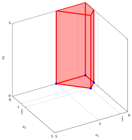
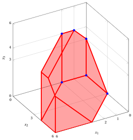
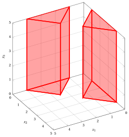

# LP problems with three variables – Type D

**Catalogue of LP problems** · [:material-file-pdf-box: Problem catalogue (PDF)](../pdf/lp-problem-catalogue.pdf)

## LP Problem $P81$

!!! chiave ""

    $$
    \begin{array}{rrrrrrrrrrrrrrrr}
    {\max} &  & {\,x_1} & {+} & {\,x_2} & {+} & {\,x_3} &  &  \\[2ex]
    \text{subject to} &  & \, {x_1} & {+} & {x_2} &  &  & {\le} & {2} \\[2ex]
    & {-} & \, {x_1} & {+} & {x_2} &  &  & {\le} & {1} \\[2ex]
    &  & {x_1,} &  & {x_2,} &  & {x_3} & { \ge} & { 0 }
    \end{array}
    $$

{ .fig .ovale loading=lazy style="width:79%" }

## LP Problem $P82$

!!! chiave ""

    $$
    \begin{array}{rrrrrrrrrrrrrrrr}
    {\max} &  & {\,x_1} & {+} & {\,x_2} & {+} & {\,x_3} &  &  \\[2ex]
    \text{subject to} &  & \, {x_1} & {+} & {x_2} & {+} & {x_3} & {\le} & {2} \\[2ex]
    & {-} & \, {x_1} & {-} & {x_2} & {-} & {x_3} & {\le} & {-4} \\[2ex]
    &  & {x_1,} &  & {x_2,} &  & {x_3} & { \ge} & { 0 }
    \end{array}
    $$

{ .fig .ovale loading=lazy style="width:79%" }

## LP Problem $P83$

!!! chiave ""

    $$
    \begin{array}{rrrrrrrrrrrrrrrr}
    {\max} &  & {x_1} & {+} & {2\,x_2} & {+} & {x_3} &  &  \\[2ex]
    \text{subject to} &  & {x_1} & {-} & {x_2} &  &  & {\le} & {2} \\[2ex]
    & {-} & {x_1} & {+} & {x_2} & {+} & {x_3} & {\le} & {3} \\[2ex]
    &  &  &  &  &  & {x_3} & {\le} & {4} \\[2ex]
    &  & {x_1,} &  & {x_2,} &  & {x_3} & { \ge} & { 0 }
    \end{array}
    $$

{ .fig .ovale loading=lazy style="width:65%" }

## LP Problem $P84$

!!! chiave ""

    $$
    \begin{array}{rrrrrrrrrrrrrrrr}
    {\max} &  & {x_1} & {+} & {x_2} & {+} & {x_3} &  &  \\[2ex]
    \text{subject to} &  & {2\,x_1} & {+} & {x_2} &  &  & {\le} & {4} \\[2ex]
    &  &  &  & {x_2} & {+} & {2\,x_3} & {\le} & {4} \\[2ex]
    & {-} & {x_1} & {-} & {x_2} & {-} & {x_3} & {\le} & {-5} \\[2ex]
    &  & {x_1,} &  & {x_2,} &  & {x_3} & { \ge} & { 0 }
    \end{array}
    $$

{ .fig .ovale loading=lazy style="width:79%" }

## LP Problem $P85$

!!! chiave ""

    $$
    \begin{array}{rrrrrrrrrrrrrrrr}
    {\max} &  & {x_1} & {+} & {x_2} & {+} & {x_3} &  &  \\[2ex]
    \text{subject to} &  & {x_1} & {-} & {x_2} &  &  & {\le} & {-1} \\[2ex]
    & {-} & {x_1} & {+} & {x_2} &  &  & {\le} & {-1} \\[2ex]
    &  & {x_1} & {+} & {x_2} &  &  & {\le} & {4} \\[2ex]
    &  & {x_1,} &  & {x_2,} &  & {x_3} & { \ge} & { 0 }
    \end{array}
    $$

{ .fig .ovale loading=lazy style="width:65%" }

## LP Problem $P86$

!!! chiave ""

    $$
    \begin{array}{rrrrrrrrrrrrrrrr}
    {\max} &  & {2\,x_1} & {+} & {2\,x_2} & {-} & {x_3} &  &  \\[2ex]
    \text{subject to} &  & {x_1} & {+} & {x_2} &  &  & {\le} & {4} \\[2ex]
    &  & {x_1} &  &  & {-} & {x_3} & {\le} & {1} \\[2ex]
    & {-} & {x_1} & {-} & {x_2} &  &  & {\le} & {-1} \\[2ex]
    &  & {x_1,} &  & {x_2,} &  & {x_3} & { \ge} & { 0 }
    \end{array}
    $$

{ .fig .ovale loading=lazy style="width:65%" }
