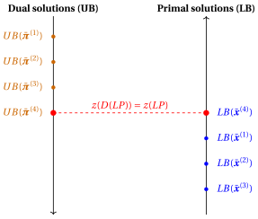
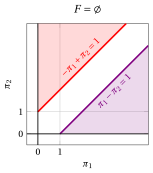
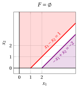

# Duality theory

**Part 3 · Duality and the dual simplex · Chapter 9** · [:material-file-pdf-box: Lecture notes, volume 3 (PDF)](../pdf/lecture-notes-3-duality.pdf) · [:material-pencil: Exercises](../exercises/ex-09-duality.md)

## 9.1 Dual problem of an LP problem in canonical max form

!!! definizione "Definition 9.1: dual problem of an LP problem in canonical maximization form"

    Given a Linear Programming (LP) problem in canonical maximization form with $n$ non-negative variables and $m$ less-than-or-equal-to linear constraints (called the <strong>primal problem</strong> and denoted by $LP$):

    

    \begin{align*}
    &&   \max \;\;{\sum_{j =1}^n c_j \, x_j}                               \label{ObjFunc_P} \tag{9.1a}\\[0.5ex]
    && \text{subject to} \quad  {\sum_{j =1}^n a_{ij} \, x_j}  &\leq b_i,   & \forall i \in \{1,2,\dots,m\},                    \label{Cons_P} \tag{9.1b}\\[0.5ex]
    &&x_j                        &\ge  0, & \forall j \in \{1,2,\dots,n\},\label{NonNegCons_P} \tag{9.1c}
    \end{align*}

    the following LP problem with $m$ non-negative variables and $n$ greater-than-or-equal-to linear constraints

    

    \begin{align*}
    &&   \min \;\;{\sum_{i =1}^m b_i \, \pi_i}                               \label{ObjFunc_D}  \tag{9.2a}\\[0.5ex]
    && \text{subject to} \quad  {\sum_{i =1}^m a_{ij} \, \pi_i}  &\geq c_j,   & \forall j \in \{1,2,\dots,n\},                    \label{Cons_D}  \tag{9.2b}\\[0.5ex]
    &&\pi_i                        &\ge  0, & \forall i \in \{1,2,\dots,m\}, \label{NonNegCons_D} \tag{9.2c}
    \end{align*}

    is called the <strong>dual problem</strong> and denoted by $D(LP)$.

!!! esempio "Example 9.1: pair of primal and dual problems"

    Let us consider the following primal problem $LP$ in canonical maximization form with $n=2$ non-negative variables and $m=3$ less-than-or-equal-to linear constraints ([Example 9.1](#box-2-ex-dual-1)):

    $$
    \begin{array}{rrrrrrrrrrrrr}
    {\max} & 5 \, {x_1} & {+} & 2 \, {x_2} \\[2ex]
    \text{subject to} & {-} \, {x_1} & {+} & 3 \, {x_2} & {\le} & 12 \\[2ex]
    & {x_1} & {+} & 2 \, {x_2} & {\le} & 12 \\[2ex]
    & {3} \, {x_1} & {-} & 2 \, {x_2} & {\le} & {8} \\[2ex]
    & {x_1,} &  & {x_2} & { \ge} & {0}
    \end{array}
    $$

    The dual problem $D(LP)$ with $m=3$ non-negative variables and $n=2$ greater-than-or-equal-to linear constraints reads as follows:

    $$
    \begin{array}{rrrrrrrrrrrrr}
    {\min} & 12\, {\pi_1} & {+} & 12 \, {\pi_2} & {+} & 8 \, {\pi_3} \\[2ex]
    \text{subject to} & {-} \, {\pi_1} & {+} & \, {\pi_2} & {+} & 3 \, {\pi_3} & {\ge} & 5 \\[2ex]
    & 3 \, {\pi_1} & {+} & 2 \, {\pi_2} & {-} & 2\, {\pi_3} & {\ge} & 2 \\[2ex]
    & {\pi_1,} &  & {\pi_2,} &  & \, {\pi_3} & { \ge} & { 0 }
    \end{array}
    $$

!!! chiave ""

    Upper bounds on the optimal value $z(LP)$ of the primal problem can be obtained by taking non-negative linear combinations of the constraints, choosing the multipliers so that the coefficient of each variable in the resulting left-hand side is greater than or equal to its coefficient in the objective function. The right-hand side of the resulting inequality then provides an upper bound on $z(LP)$.

!!! esempio "Example 9.2: Computing upper bounds using linear combinations of the constraints"

    Let us consider the primal problem of [Example 9.1](#box-2-ex-dual-1).

    - For example, by multiplying the second constraint by $5$, we get:

        $$
        5 \; x_1 + 10 \; x_2  ~~\le~~ 60
        $$

        Hence, any feasible solution of the primal problem satisfies this inequality, which is an overestimate of the objective function, since we have:

        $$
        5 \;x_{1}  + 2 \; x_{2}  ~~\le~~ 5 \; x_1 + 10 \;x_2 ~~\le~~ 60
        $$

        In particular, these inequalities hold for the optimal solution, so $z(\,LP\,) \le 60$.

    - For example, by multiplying the second constraint by $\frac{5}{2}$ and then adding it to the third constraint, we get:

        $$
        \frac{5}{2}\,(x_1 + 2\,x_2) + (3\,x_1 - 2\,x_2) \le 12 \cdot \frac{5}{2} + 8 ~~\Rightarrow~~ \frac{11}{2}\,x_1 + 3\,x_2 \le 38
        $$

        Hence, any feasible solution of the primal problem satisfies this inequality, which is an overestimate of the objective function, since we have:

        $$
        5 \;x_{1}  + 2 \; x_{2}  ~~\le~~ \frac{11}{2}\,x_1 + 3\,x_2 ~~\le~~ 38
        $$

        In particular, these inequalities hold for the optimal solution, so $z(\,LP\,) \le 38$.

    - For example, by multiplying the first, second, and third constraints by $2$, $1$, and $2$, respectively, and then summing them up, we get:

        $$
        2\,(-x_1 + 3\,x_2) + (x_1 + 2\,x_2) + 2\,(3\,x_1 - 2\,x_2) \le 12 \cdot 2 + 12 + 8 \cdot 2 ~~\Rightarrow~~ 5\,x_1 + 4\,x_2 \le 52
        $$

        Hence, any feasible solution of the primal problem satisfies this inequality, which is an overestimate of the objective function, since we have:

        $$
        5 \;x_{1}  + 2 \; x_{2}  ~~\le~~ 5 \;x_{1}  + 4 \; x_{2} ~~\le~~ 52
        $$

        In particular, these inequalities hold for the optimal solution, so $z(\,LP\,) \le 52$.

!!! esempio "Example 9.3: Computing upper bounds using linear combinations of the constraints"

    Let us consider the primal problem of [Example 9.1](#box-2-ex-dual-1).

    Since we have three constraints, we introduce three multipliers: $\pi_1$, $\pi_2$, and $\pi_3$. Multiplying each constraint by its multiplier, we get:

    \begin{align*}
    (-x_1 + 3\,x_2) \; \pi_1 &\le 12 \; \pi_1 \\[1ex]
    (x_1 + 2\,x_2) \; \pi_2 &\le 12 \; \pi_2 \\[1ex]
    (3\,x_1 - 2\,x_2) \; \pi_3 &\le 8 \; \pi_3
    \end{align*}

    Summing the three inequalities, we get:

    \begin{align*}
    (-x_1 + 3\,x_2)\,\pi_1 + (x_1 + 2\,x_2)\,\pi_2 + (3\,x_1 - 2\,x_2)\,\pi_3 &\le 12\,\pi_1 + 12\,\pi_2 + 8\,\pi_3
    \end{align*}

    Grouping by variable, we get:

    \begin{align*}
    (-\pi_1 + \pi_2 + 3\,\pi_3)\,x_1 + (3\,\pi_1 + 2\,\pi_2 - 2\,\pi_3)\,x_2 &\le 12\,\pi_1 + 12\,\pi_2 + 8\,\pi_3
    \end{align*}

    The right-hand side of this inequality provides a valid upper bound on $z(\, LP\,)$ if and only if the coefficient of each variable is at least as large as the corresponding coefficient in the objective function:

    \begin{align*}
    -\pi_1 + \pi_2 + 3\,\pi_3 &\ge 5 \\[1ex]
    3\,\pi_1 + 2\,\pi_2 - 2\,\pi_3 &\ge 2
    \end{align*}

    Each multiplier must be non-negative:

    $$
    \pi_1,~ \pi_2,~ \pi_3 \ge 0
    $$

    otherwise, the direction of the corresponding inequality would be reversed. Since we want to obtain the best possible upper bound, i.e., the smallest one, we must minimize the right-hand side of the inequality that provides the upper bound on $z(\,LP\,)$.

!!! chiave ""

    The dual problem $D(LP)$ is the LP problem of finding the best possible upper bound on the optimal value $z(\, LP\,)$ of the primal problem $LP$ by using linear combinations of the constraints.

- An important property of the duality transformation is that it gives back the starting problem if applied twice.

!!! teorema "Observation 9.2"

    The dual problem of the dual problem [(9.2)](#eq-DUAL) is the primal problem [(9.1)](#eq-PRIMAL).

??? dimostrazione "Proof"

    Starting from the dual problem [(9.2)](#eq-DUAL),

    \begin{align*}
    && \min \;\; \sum_{i=1}^m b_i \pi_i \\[1ex]
    && \text{subject to} \quad \sum_{i=1}^m a_{ij}\pi_i &\ge c_j,
    & \forall j \in \{1,2,\dots,n\}, \\[1ex]
    && \pi_i &\ge 0,
    & \forall i \in \{1,2,\dots,m\},
    \end{align*}

    consider the equivalent LP problem obtained by multiplying the objective function and each constraint by $-1$:

    \begin{align*}
    && \max \;\; \sum_{i=1}^m (-b_i)\pi_i \\[1ex]
    && \text{subject to} \quad \sum_{i=1}^m (-a_{ij})\pi_i &\le -c_j,
    & \forall j \in \{1,2,\dots,n\}, \\[1ex]
    && \pi_i &\ge 0,
    & \forall i \in \{1,2,\dots,m\}.
    \end{align*}

    This problem is now in canonical maximization form. Hence, its dual is

    \begin{align*}
    && \min \;\; \sum_{j=1}^n (-c_j)x_j \\[1ex]
    && \text{subject to} \quad \sum_{j=1}^n (-a_{ij})x_j &\ge -b_i,
    & \forall i \in \{1,2,\dots,m\}, \\[1ex]
    && x_j &\ge 0,
    & \forall j \in \{1,2,\dots,n\}.
    \end{align*}

    Finally, multiplying the objective function and each constraint by $-1$, we obtain the equivalent problem

    \begin{align*}
    && \max \;\; \sum_{j=1}^n c_j x_j \\[1ex]
    && \text{subject to} \quad \sum_{j=1}^n a_{ij}x_j &\le b_i,
    & \forall i \in \{1,2,\dots,m\}, \\[1ex]
    && x_j &\ge 0,
    & \forall j \in \{1,2,\dots,n\},
    \end{align*}

    which is exactly the primal problem [(9.1)](#eq-PRIMAL). Therefore, the dual of the dual problem [(9.2)](#eq-DUAL) is the primal problem [(9.1)](#eq-PRIMAL). □

### 9.1.1 Weak Duality

- The following theorem, called <strong>Weak Duality</strong>, states that the value of any feasible solution of the primal problem [(9.1)](#eq-PRIMAL) is smaller than or equal to the value of any feasible solution of the dual problem [(9.2)](#eq-DUAL).

!!! teorema "Theorem 9.3: Weak Duality"

    For any feasible solution $(\bar x_1,\bar x_2,\dots,\bar x_n)$ of the primal problem [(9.1)](#eq-PRIMAL) and any feasible solution $(\bar \pi_1,\bar \pi_2,\dots,\bar \pi_m)$ of the dual problem [(9.2)](#eq-DUAL), we have

    \begin{equation*}
    \label{WD}
    \sum_{j=1}^n c_j \bar x_j \le \sum_{i=1}^m b_i \bar \pi_i. \tag{9.3}
    \end{equation*}

- The idea of the proof is to use the primal and dual feasibility of the two solutions to show that the value of the primal solution is at most equal to the value of the dual solution.

??? dimostrazione "Proof"

    We have:

    \begin{align*}
    \sum_{j=1}^{n} c_j \; \bar x_j
    &\le \sum_{j=1}^{n} \left( \sum_{i=1}^{m} a_{ij} \; \bar \pi_i \right) \bar x_j
    && \text{\begin{array}{l}
    \text{(by }\eqref {\text{Cons_D}}\text{ and }\eqref {\text{NonNegCons_P}}: \\
    {\textstyle c_j \le \sum_{i=1}^{m} a_{ij} \bar \pi_i,~\bar x_j \ge 0, \forall j \in \{1,2,\dots,n\}})
    \end{array}} \\[2ex]
    &= \sum_{i=1}^{m} \left( \sum_{j=1}^{n} a_{ij} \; \bar x_j \right) \bar \pi_i
    && \\[2ex]
    &\le \sum_{i=1}^{m} b_i \; \bar \pi_i
    && \text{\begin{array}{l}
    \text{(by }\eqref {\text{Cons_P}}\text{ and }\eqref {\text{NonNegCons_D}}: \\
    {\textstyle \sum_{j=1}^{n} a_{ij} \bar x_j \le b_i,~ \bar \pi_i \ge 0, \forall i \in \{1,2,\dots,m\}})
    \end{array}}
    \end{align*}

    
□

- The Weak Duality theorem states that the value of any feasible solution $(\bar \pi_1,\bar \pi_2,\dots,\bar \pi_m)$ of a dual problem [(9.2)](#eq-DUAL) provides a valid <strong>upper bound</strong> on the optimal value $z(\,LP\,)$ of the primal problem [(9.1)](#eq-PRIMAL):

    $$
    z(\, LP\,) \le \sum_{i=1}^m b_i \; \bar \pi_i
    $$

    Moreover, the value of any feasible solution $(\bar x_1,\bar x_2, \dots,\bar x_n)$ of a primal problem [(9.1)](#eq-PRIMAL) provides a valid <strong>lower bound</strong> on the optimal value $z(~ D(LP)~)$ of the dual problem [(9.2)](#eq-DUAL):

    $$
    \sum_{j=1}^n c_j \; \bar x_j \le z(  ~D(LP)~)
    $$

!!! esempio "Example 9.4: Primal and dual feasible solutions"

    Consider the following pair of primal and dual LP problems:

    $$
    \begin{array}{rrrrrrrrrrrrr}
    {\max} & 5 \, {x_1} & {+} & 2 \, {x_2} \\[2ex]
    \text{subject to} & {-} \, {x_1} & {+} & 3 \, {x_2} & {\le} & 12 \\[2ex]
    & {x_1} & {+} & 2 \, {x_2} & {\le} & 12 \\[2ex]
    & {3} \, {x_1} & {-} & 2 \, {x_2} & {\le} & {8} \\[2ex]
    & {x_1,} &  & {x_2} & { \ge} & {0}
    \end{array}
    $$

    $$
    \begin{array}{rrrrrrrrrrrrr}
    {\min} & 12\, {\pi_1} & {+} & 12 \, {\pi_2} & {+} & 8 \, {\pi_3} \\[2ex]
    \text{subject to} & {-} \, {\pi_1} & {+} & \, {\pi_2} & {+} & 3 \, {\pi_3} & {\ge} & 5 \\[2ex]
    & 3 \, {\pi_1} & {+} & 2 \, {\pi_2} & {-} & 2\, {\pi_3} & {\ge} & 2 \\[2ex]
    & {\pi_1,} &  & {\pi_2,} &  & \, {\pi_3} & { \ge} & { 0 }
    \end{array}
    $$

    

    A feasible primal solution is:

    $$
    \bar{x}_1=\frac{12}{5},~~\bar{x}_2=\frac{24}{5}
    $$

    It provides the following lower bound on the optimal value:

    $$
    LB(\bar{\boldsymbol x})= 5 \cdot \frac{12}{5} + 2 \cdot \frac{24}{5} = \frac{108}{5}
    $$

    Another feasible primal solution is:

    $$
    \bar{x}_1=\frac{8}{3},~~\bar{x}_2=0
    $$

    It provides the following lower bound on the optimal value:

    $$
    LB(\bar{\boldsymbol x})= 5 \cdot \frac{8}{3} + 2 \cdot 0 = \frac{40}{3}
    $$

    

    

    { .fig .ovale loading=lazy style="width:90%" }

    

    

    A feasible dual solution is:

    $$
    \bar{\pi}_1=0,~~\bar{\pi}_2=5,~~\bar{\pi}_3=0
    $$

    It provides the following upper bound on the optimal value:

    $$
    UB(\bar{\boldsymbol\pi})= 12 \cdot 0 + 12 \cdot 5 + 8 \cdot 0 = 60
    $$

    Another feasible dual solution is:

    $$
    \bar{\pi}_1=3,~~\bar{\pi}_2=8,~~\bar{\pi}_3=0
    $$

    It provides the following upper bound on the optimal value:

    $$
    UB(\bar{\boldsymbol\pi})= 12 \cdot 3 + 12 \cdot 8 + 8 \cdot 0 = 132
    $$

    

    

    { .fig .ovale loading=lazy style="width:94%" }

    

- Using Weak Duality, we can show that $(\tilde x_1,\tilde x_2,\dots,\tilde x_n)$ is an optimal solution of the primal problem [(9.1)](#eq-PRIMAL) and $(\tilde \pi_1,\tilde \pi_2,\dots,\tilde \pi_m)$ is an optimal solution of the dual problem [(9.2)](#eq-DUAL) if they are feasible for their respective problems and satisfy

    $$
    \sum_{j=1}^n c_j \tilde x_j = \sum_{i=1}^m b_i \tilde \pi_i.
    $$

    This follows from Weak Duality as follows:

    1. By Weak Duality, for every feasible solution $(\bar x_1,\bar x_2,\dots,\bar x_n)$ of the primal problem [(9.1)](#eq-PRIMAL), and for the feasible dual solution $(\tilde \pi_1,\tilde \pi_2,\dots,\tilde \pi_m)$, we have

        $$
        \sum_{j=1}^n c_j \bar x_j \le \sum_{i=1}^m b_i \tilde \pi_i.
        $$

        If, in addition,

        $$
        \sum_{j=1}^n c_j \tilde x_j = \sum_{i=1}^m b_i \tilde \pi_i,
        $$

        then

        $$
        \sum_{j=1}^n c_j \bar x_j \le \sum_{j=1}^n c_j \tilde x_j
        $$

        for every feasible solution $(\bar x_1,\bar x_2,\dots,\bar x_n)$ of the primal problem. Hence, $(\tilde x_1,\tilde x_2,\dots,\tilde x_n)$ is an optimal solution of the primal problem [(9.1)](#eq-PRIMAL).

    2. By Weak Duality, for every feasible solution $(\bar \pi_1,\bar \pi_2,\dots,\bar \pi_m)$ of the dual problem [(9.2)](#eq-DUAL), and for the feasible primal solution $(\tilde x_1,\tilde x_2,\dots,\tilde x_n)$, we have

        $$
        \sum_{j=1}^n c_j \tilde x_j \le \sum_{i=1}^m b_i \bar \pi_i.
        $$

        If, in addition,

        $$
        \sum_{j=1}^n c_j \tilde x_j = \sum_{i=1}^m b_i \tilde \pi_i,
        $$

        then

        $$
        \sum_{i=1}^m b_i \tilde \pi_i \le \sum_{i=1}^m b_i \bar \pi_i
        $$

        for every feasible solution $(\bar \pi_1,\bar \pi_2,\dots,\bar \pi_m)$ of the dual problem. Hence, $(\tilde \pi_1,\tilde \pi_2,\dots,\tilde \pi_m)$ is an optimal solution of the dual problem [(9.2)](#eq-DUAL).

!!! esempio "Example 9.5: Primal and dual optimal solutions"

    Consider the following pair of primal and dual LP problems:

    $$
    \begin{array}{rrrrrrrrrrrrr}
    {\max} & 5 \, {x_1} & {+} & 2 \, {x_2} \\[2ex]
    \text{subject to} & {-} \, {x_1} & {+} & 3 \, {x_2} & {\le} & 12 \\[2ex]
    & {x_1} & {+} & 2 \, {x_2} & {\le} & 12 \\[2ex]
    & {3} \, {x_1} & {-} & 2 \, {x_2} & {\le} & {8} \\[2ex]
    & {x_1,} &  & {x_2} & { \ge} & {0}
    \end{array}
    $$

    $$
    \begin{array}{rrrrrrrrrrrrr}
    {\min} & 12\, {\pi_1} & {+} & 12 \, {\pi_2} & {+} & 8 \, {\pi_3} \\[2ex]
    \text{subject to} & {-} \, {\pi_1} & {+} & \, {\pi_2} & {+} & 3 \, {\pi_3} & {\ge} & 5 \\[2ex]
    & 3 \, {\pi_1} & {+} & 2 \, {\pi_2} & {-} & 2\, {\pi_3} & {\ge} & 2 \\[2ex]
    & {\pi_1,} &  & {\pi_2,} &  & \, {\pi_3} & { \ge} & { 0 }
    \end{array}
    $$

    To show that

    $$
    \tilde{x}_1=5,\qquad \tilde{x}_2=\frac{7}{2}
    $$

    is an optimal solution of the primal problem [(9.1)](#eq-PRIMAL), and that

    $$
    \tilde \pi_1=0,\qquad \tilde \pi_2=2,\qquad \tilde \pi_3=1
    $$

    is an optimal solution of the dual problem [(9.2)](#eq-DUAL), we can proceed as follows.

    First, we verify that we have a feasible solution for the primal problem:

    \begin{align*}
    -\tilde x_1 + 3\tilde x_2 &= -5 + 3\cdot \frac{7}{2} = \frac{11}{2} \le 12,\\[1ex]
    \tilde x_1 + 2\tilde x_2 &= 5 + 2\cdot \frac{7}{2} = 12 \le 12,\\[1ex]
    3\tilde x_1 - 2\tilde x_2 &= 3\cdot 5 - 2\cdot \frac{7}{2} = 8 \le 8,\\[1ex]
    \tilde x_1 &= 5 \ge 0,\qquad \tilde x_2=\frac{7}{2} \ge 0.
    \end{align*}

    Second, we verify that we have a feasible solution for the dual problem:

    \begin{align*}
    -\tilde \pi_1 + \tilde \pi_2 + 3\tilde \pi_3 &= -0 + 2 + 3\cdot 1 = 5 \ge 5,\\[1ex]
    3\tilde \pi_1 + 2\tilde \pi_2 - 2\tilde \pi_3 &= 3\cdot 0 + 2\cdot 2 - 2\cdot 1 = 2 \ge 2,\\[1ex]
    \tilde \pi_1 &= 0 \ge 0,\qquad \tilde \pi_2=2 \ge 0,\qquad \tilde \pi_3=1 \ge 0.
    \end{align*}

    Finally, we compute the objective function values:

    $$
    5\tilde x_1 + 2\tilde x_2
    =
    5\cdot 5 + 2\cdot \frac{7}{2}
    =
    25+7
    =
    32,
    $$

    and

    $$
    12\tilde \pi_1 + 12\tilde \pi_2 + 8\tilde \pi_3
    =
    12\cdot 0 + 12\cdot 2 + 8\cdot 1
    =
    24+8
    =
    32.
    $$

    Since both solutions are feasible for their respective problems and their objective values are equal, by Weak Duality, they are both optimal.

### 9.1.2 Strong Duality

- The following theorem, called <strong>Strong Duality</strong>, states that the primal problem [(9.1)](#eq-PRIMAL) has an optimal solution if and only if the dual problem [(9.2)](#eq-DUAL) has an optimal solution, and in this case, the optimal values of the two problems coincide.

!!! teorema "Theorem 9.4: Strong Duality"

    The primal problem [(9.1)](#eq-PRIMAL) has an optimal solution $(\tilde x_1,\tilde x_2,\dots,\tilde x_n)$ if and only if the dual problem [(9.2)](#eq-DUAL) has an optimal solution $(\tilde \pi_1,\tilde \pi_2,\dots,\tilde \pi_m)$, and in this case

    \begin{equation*}
    \label{SD}
    \sum_{j=1}^n c_j \tilde x_j = \sum_{i=1}^m b_i \tilde \pi_i. \tag{9.4}
    \end{equation*}

- The existence of an optimal solution does not imply its uniqueness. This theorem only states that there exists at least one optimal solution for the primal problem if and only if there exists at least one optimal solution for the dual problem (there may be several optimal solutions on one side or on both sides, but the optimal objective values are equal).

- Strong duality implies that

    $$
    \begin{array}{c}
    \text{the primal problem has an optimal solution}\\[1ex]
    \Updownarrow \\[1ex]
    \text{the dual problem has an optimal solution}
    \end{array}
    $$

    so  “the primal problem has an optimal solution” is a necessary and sufficient condition to  “the dual problem has an optimal solution” and vice versa.

- The main steps of the proof of the Strong Duality theorem are as follows:

    1. We first show that if the primal problem has an optimal solution, then the dual problem has an optimal solution, and the optimal values of the two problems coincide.

        This is done by using an optimal dictionary of the primal problem produced by the simplex algorithm to construct a feasible solution of the dual problem satisfying $\eqref{SD}$.

        By Weak Duality, such a dual solution is necessarily optimal, which proves one implication.

    2. The converse implication is obtained by applying the previous reasoning to the dual problem (equivalently, by exchanging the roles of primal and dual, since the dual of the dual is the primal problem).

??? dimostrazione "Proof"

    Assume that the primal problem [(9.1)](#eq-PRIMAL) has an optimal solution, and consider an optimal dictionary produced by the simplex algorithm. Its last row can be written as

    \begin{equation*}
    \sum_{j=1}^n c_j x_j
    =
    \bar z + \sum_{j=1}^{n+m} \hat c_j x_j,
    \qquad
    \text{where}
    \qquad
    \hat c_j =
    \begin{cases}
    \bar c_j & \text{if } j \in \pazocal{N},\\
    0 & \text{otherwise}.
    \end{cases}
    \end{equation*}

    Thus, $\hat c_j$ is equal to the reduced cost of a variable $x_j$ if $j \in \pazocal{N}$ (the set of indices of the non-basic variables), and it is equal to $0$ otherwise.

    Rearranging the terms, we get

    \begin{equation*}
    \sum_{j=1}^n c_j x_j
    =
    \bar z
    + \sum_{j=1}^{n} \hat c_j x_j
    + \sum_{i=1}^{m} \hat c_{n+i} x_{n+i},
    \end{equation*}

    where the sum has been split into the original variables and the slack variables. Recall that, for the slack variables, we have

    $$
    x_{n+i} = b_i - \sum_{j=1}^n a_{ij}x_j,
    \qquad
    \forall i \in \{1,2,\dots,m\}.
    $$

    Substituting these expressions into the previous identity, we obtain

    \begin{align*}
    \sum_{j=1}^n c_j x_j
    &=
    \bar z
    + \sum_{j=1}^{n} \hat c_j x_j
    + \sum_{i=1}^{m} \hat c_{n+i}
    \left(
    b_i - \sum_{j=1}^n a_{ij}x_j
    \right)
    \\[1.5ex]
    &=
    \bar z
    + \sum_{j=1}^{n} \hat c_j x_j
    + \sum_{i=1}^{m} b_i \hat c_{n+i}
    - \sum_{i=1}^{m} \hat c_{n+i}\sum_{j=1}^{n} a_{ij}x_j
    \\[1.5ex]
    &=
    \bar z
    + \sum_{j=1}^{n} \hat c_j x_j
    + \sum_{i=1}^{m} b_i \hat c_{n+i}
    - \sum_{j=1}^{n}\left(\sum_{i=1}^{m} a_{ij}\hat c_{n+i}\right)x_j
    \\[1.5ex]
    &=
    \bar z
    + \sum_{i=1}^{m} b_i \hat c_{n+i}
    + \sum_{j=1}^{n}
    \left(
    \hat c_j - \sum_{i=1}^{m} a_{ij}\hat c_{n+i}
    \right)x_j.
    \tag{A}\label{A}
    \end{align*}

    Since $\eqref{A}$ is an identity in the variables $x_1,x_2,\dots,x_n$, it holds for every choice of these variables. Therefore, the constant terms on the two sides must coincide, and the coefficients of each variable must also coincide. Hence,

    \begin{equation*}
    \tag{B}\label{B}
    \bar z + \sum_{i=1}^{m} b_i \hat c_{n+i}  = 0
    \qquad \Longrightarrow \qquad
    \bar z = -\sum_{i=1}^{m} b_i \hat c_{n+i},
    \end{equation*}

    and

    \begin{equation*}
    \tag{C}\label{C}
    c_j
    =
    \hat c_j - \sum_{i=1}^{m} a_{ij} \hat c_{n+i},
    \qquad
    \forall j \in \{1,2,\dots,n\}.
    \end{equation*}

    Now we define

    \begin{equation*}
    \tag{D}\label{D}
    \tilde \pi_i = -\hat c_{n+i},
    \qquad
    \forall i \in \{1,2,\dots,m\},
    \end{equation*}

    and we show that $(\tilde \pi_1,\tilde \pi_2,\dots,\tilde \pi_m)$ is an optimal solution of the dual problem [(9.2)](#eq-DUAL) satisfying $\eqref{SD}$.

    Since the dictionary is optimal, we have $\hat c_j \le 0$ for all $j \in \{1,2,\dots,n+m\}$. Hence, from $\eqref{D}$ we obtain

    $$
    \tilde \pi_i = -\hat c_{n+i} \ge 0,
    \qquad
    \forall i \in \{1,2,\dots,m\},
    $$

    and from $\eqref{C}$ we get

    $$
    \sum_{i=1}^{m} a_{ij}\tilde \pi_i
    =
    c_j - \hat c_j
    \ge c_j,
    \qquad
    \forall j \in \{1,2,\dots,n\}.
    $$

    Therefore, $(\tilde \pi_1,\tilde \pi_2,\dots,\tilde \pi_m)$ is feasible for the dual problem [(9.2)](#eq-DUAL).

    Moreover, since $(\tilde x_1,\tilde x_2,\dots,\tilde x_n)$ is an optimal solution of the primal problem [(9.1)](#eq-PRIMAL), its objective value is equal to the optimal value $\bar z$ of the primal problem [(9.1)](#eq-PRIMAL). Hence, by $\eqref{B}$, we have

    $$
    \sum_{j=1}^{n} c_j \tilde x_j
    =
    \bar z
    =
    \sum_{i=1}^{m} b_i \tilde \pi_i.
    $$

    Thus, the feasible dual solution $(\tilde \pi_1,\tilde \pi_2,\dots,\tilde \pi_m)$ satisfies $\eqref{SD}$.

    Finally, Weak Duality implies that for every feasible dual solution $(\bar \pi_1,\bar \pi_2,\dots,\bar \pi_m)$,

    $$
    \sum_{j=1}^{n} c_j \tilde x_j
    \le
    \sum_{i=1}^{m} b_i \bar \pi_i.
    $$

    Since for the feasible dual solution $(\tilde \pi_1,\tilde \pi_2,\dots,\tilde \pi_m)$ we have

    $$
    \sum_{j=1}^{n} c_j \tilde x_j
    =
    \sum_{i=1}^{m} b_i \tilde \pi_i,
    $$

    it follows that

    $$
    \sum_{i=1}^{m} b_i \tilde \pi_i
    \le
    \sum_{i=1}^{m} b_i \bar \pi_i
    $$

    for every feasible dual solution $(\bar \pi_1,\bar \pi_2,\dots,\bar \pi_m)$. Hence, $(\tilde \pi_1,\tilde \pi_2,\dots,\tilde \pi_m)$ is an optimal solution of the dual problem [(9.2)](#eq-DUAL).

    The converse implication is obtained by applying the previous reasoning to the dual problem (after rewriting it in the corresponding canonical form, if needed). Since the dual of the dual problem is the primal problem, it follows that if the dual problem [(9.2)](#eq-DUAL) has an optimal solution, then the primal problem [(9.1)](#eq-PRIMAL) also has an optimal solution. □

- The figure below illustrates the relationship between primal and dual bounds for a <strong>maximization</strong> LP problem. As an illustrative example, the figure considers four primal feasible solutions

    $$
    \bar{\boldsymbol x}^{(1)}, \bar{\boldsymbol x}^{(2)}, \bar{\boldsymbol x}^{(3)}, \bar{\boldsymbol x}^{(4)},
    $$

    and four dual feasible solutions

    $$
    \bar{\boldsymbol\pi}^{(1)}, \bar{\boldsymbol\pi}^{(2)}, \bar{\boldsymbol\pi}^{(3)}, \bar{\boldsymbol\pi}^{(4)}.
    $$

    Primal feasible solutions provide <strong>lower bounds</strong> on the optimal value, while dual feasible solutions provide <strong>upper bounds</strong> on the optimal value by the Weak Duality theorem $\eqref{WD}$.

    The fourth solution of each sequence attains the optimal value, and by the Strong Duality theorem $\eqref{SD}$ the two bounds meet: $z(\,{ LP}\,) = z(~{ D(LP)}~)$.

{ .fig .cornice loading=lazy style="width:62%" }

!!! esempio "Example 9.6: optimal dual solutions from primal optimal dictionaries"

    Let us consider the primal problem of [Example 9.1](#box-2-ex-dual-1) (where $n=2$ and $m=3$). The standard form of the primal problem is

    $$
    \begin{array}{rrrrrrrrrrrr}
    {\max} & 5 \, {x_1} & {+} & 2 \, {x_2} &  &  &  &  &  &  &  &  \\[2ex]
    \text{subject to} & {-} \, {x_1} & {+} & 3 \, {x_2} & {+} & {x_3} &  &  &  &  & {=} & {12} \\[2ex]
    & {x_1} & {+} & 2 \, {x_2} &  &  & {+} & {x_4} &  &  & {=} & {12} \\[2ex]
    & {3} \, {x_1} & {-} & 2 \, {x_2} &  &  &  &  & {+} & {x_5} & {=} & {8} \\[2ex]
    & {x_1,} &  & {x_2,} &  & {x_3,} &  & {x_4,} &  & {x_5} & {\geq} & {0}
    \end{array}
    $$

    where $x_3$, $x_4$ and $x_5$ are the slack variables associated with the three constraints. An optimal dictionary reads as follows:

    \begin{equation*}
    \begin{cases}
    \begin{array}{rrrrrrrrrrrrr}
    {x_1=5} & {-} & {\frac{1}{4}} \, {x_4} & {-} & {\frac{1}{4}}\, {x_5} \\[2ex]
    {x_2=\frac{7}{2}} & {-} & {\frac{3}{8}}\, {x_4} & {+} & {\frac{1}{8}}\, {x_5} \\[2ex]
    {x_3=\frac{13}{2}} & {+} & {\frac{7}{8}}\, {x_4} & {-} & {\frac{5}{8}}\, {x_5} \\[2ex]
    {z= 32} & {-} & {2} \, {x_4} & {-} & \, {x_5}
    \end{array}
    \end{cases}
    \end{equation*}

    where the basic variables are $x_1$, $x_2$ and $x_3$, and the non-basic variables are $x_4$ and $x_5$. The optimal primal solution is $\tilde{x}_1=5$, $\tilde{x}_2=\frac{7}{2}$, $\tilde{x}_3=\frac{13}{2}$, $\tilde{x}_4=0$ and $\tilde{x}_5=0$, and the optimal value is $32$.

    The dual problem is

    $$
    \begin{array}{rrrrrrrrrrrrr}
    {\min} & 12\, {\pi_1} & {+} & 12 \, {\pi_2} & {+} & 8 \, {\pi_3} \\[2ex]
    \text{subject to} & {-} \, {\pi_1} & {+} & \, {\pi_2} & {+} & 3 \, {\pi_3} & {\ge} & 5 \\[2ex]
    & 3 \, {\pi_1} & {+} & 2 \, {\pi_2} & {-} & 2\, {\pi_3} & {\ge} & 2 \\[2ex]
    & {\pi_1,} &  & {\pi_2,} &  & \, {\pi_3} & { \ge} & { 0 }
    \end{array}
    $$

    The values $\hat{c}_j$ with $j \in \{1,2,3,4,5\}$ used in the proof of the Strong Duality theorem are:

    $$
    \hat{c}_1=0,~~\hat{c}_2=0,~~\hat{c}_3=0,~~\hat{c}_4=-2,~~\hat{c}_5=-1
    $$

    The optimal dual solution can be obtained by assigning the values $\hat{c}_j$ to the corresponding dual variables with reversed signs, as in $\eqref{D}$, and it reads as follows:

    $$
    \tilde{\pi}_1 = -\hat{c}_3 = 0,~~ \tilde{\pi}_2 = -\hat{c}_4 =2,~~\tilde{\pi}_3 = -\hat{c}_5 = 1
    $$

    The solution is feasible for the dual problem, since $\tilde{\pi}_1$, $\tilde{\pi}_2$ and $\tilde{\pi}_3$ are non-negative and

    $$
    -\tilde{\pi}_1 + \tilde{\pi}_2 + 3 \tilde{\pi}_3 = -0 + 2 + 3 \cdot 1 = 5 \ge 5, \qquad
    3 \tilde{\pi}_1 + 2 \tilde{\pi}_2 - 2 \tilde{\pi}_3 = 3 \cdot 0 + 2 \cdot 2 - 2 \cdot 1 = 2 \ge 2.
    $$

    The objective function value of this solution is:

    $$
    12 \cdot 0  + 12 \cdot 2 + 8 \cdot 1 = 32
    $$

## 9.2 Primal and dual problems: possible outcomes

- The Weak Duality and the Strong Duality theorems relate the optimal values of the primal problem [(9.1)](#eq-PRIMAL) and of the dual problem [(9.2)](#eq-DUAL) whenever both admit an optimal solution. We now describe what happens when one of the two problems is infeasible or unbounded.

!!! teorema "Corollary 9.5: unbounded problems and infeasible problems"

    For a pair of primal [(9.1)](#eq-PRIMAL) and dual [(9.2)](#eq-DUAL) problems:

    1. if the primal problem is <strong>unbounded</strong>, then the dual problem is <strong>infeasible</strong>;

    2. if the dual problem is <strong>unbounded</strong>, then the primal problem is <strong>infeasible</strong>.

- The idea of the proof is that one single feasible solution of one of the two problems would bound the objective value of the other one, by Weak Duality.

??? dimostrazione "Proof"

    We prove the first point; the second one is obtained by exchanging the roles of the two problems.

    Assume, by contradiction, that the primal problem [(9.1)](#eq-PRIMAL) is unbounded and that the dual problem [(9.2)](#eq-DUAL) admits a feasible solution $(\bar \pi_1,\bar \pi_2,\dots,\bar \pi_m)$. By Weak Duality $\eqref{WD}$, for every feasible solution $(\bar x_1,\bar x_2,\dots,\bar x_n)$ of the primal problem we have

    $$
    \sum_{j=1}^n c_j \bar x_j \le \underbrace{\sum_{i=1}^m b_i \bar \pi_i}_{= \, M} ,
    $$

    where $M$ is a <u>fixed</u> real number, since the dual feasible solution is fixed. Accordingly, no feasible solution of the primal problem has an objective value larger than $M$, which contradicts the assumption that the primal problem is unbounded. □

!!! teorema "Theorem 9.6: possible outcomes of a pair of primal and dual problems"

    For a pair of primal [(9.1)](#eq-PRIMAL) and dual [(9.2)](#eq-DUAL) problems, exactly one of the following four cases occurs:

    1. both problems admit an <strong>optimal solution</strong>, and the two optimal values coincide;

    2. the primal problem is <strong>unbounded</strong> and the dual problem is <strong>infeasible</strong>;

    3. the primal problem is <strong>infeasible</strong> and the dual problem is <strong>unbounded</strong>;

    4. both problems are <strong>infeasible</strong>.

??? dimostrazione "Proof"

    By the Fundamental Theorem of Linear Programming, each of the two problems is infeasible, is unbounded, or admits an optimal solution, and then there are nine possible combinations. We show that five of them cannot occur.

    1. If the primal problem admits an optimal solution, then by Strong Duality $\eqref{SD}$ the dual problem admits an optimal solution as well. This excludes the two combinations in which the primal problem admits an optimal solution and the dual problem is unbounded or infeasible. Symmetrically, the two combinations in which the dual problem admits an optimal solution and the primal problem is unbounded or infeasible are excluded as well.

    2. If the primal problem is unbounded, then by [Corollary 9.5](#box-11-cor-outcomes) the dual problem is infeasible. This excludes the combination in which both problems are unbounded.

    The four remaining combinations are the ones of the statement. □

!!! chiave ""

    The possible outcomes of a pair of primal and dual problems are summarized in the following table, where the four cases of [Theorem 9.6](#box-12-theo-outcomes) are marked by ✓:

    
<table>
    <tr>
    <th></th>
    <th colspan="3"><strong>dual problem</strong> \(D(LP)\)</th>
    </tr>
    <tr>
    <td><strong>primal problem</strong> \(LP\)</td>
    <td>optimal solution</td>
    <td>unbounded</td>
    <td>infeasible</td>
    </tr>
    <tr>
    <td>optimal solution</td>
    <td>✓</td>
    <td></td>
    <td></td>
    </tr>
    <tr>
    <td>unbounded</td>
    <td></td>
    <td></td>
    <td>✓</td>
    </tr>
    <tr>
    <td>infeasible</td>
    <td></td>
    <td>✓</td>
    <td>✓</td>
    </tr>
    </table>

    In particular, an infeasible primal problem may have either an unbounded or an infeasible dual problem: the infeasibility of the primal problem alone does <u>not</u> determine the outcome of the dual problem.

!!! esempio "Example 9.7: unbounded primal problem and infeasible dual problem"

    Consider the following pair of primal and dual problems, with $n=2$ and $m=2$ (called [Example 9.7](#box-13-ex-out-1)):

    

    $$
    \begin{array}{rrrrrrrrrrrrr}
    {\max} & \, {x_1} & {+} & \, {x_2} \\[1.5ex]
    \text{subject to} & {-} \, {x_1} & {+} & \, {x_2} & {\le} & {1} \\[1.5ex]
    & \, {x_1} & {-} & \, {x_2} & {\le} & {1} \\[1.5ex]
    & {x_1,} &  & {x_2} & { \ge} & {0}
    \end{array}
    $$

    

    

    $$
    \begin{array}{rrrrrrrrrrrrr}
    {\min} & \, {\pi_1} & {+} & \, {\pi_2} \\[1.5ex]
    \text{subject to} & {-} \, {\pi_1} & {+} & \, {\pi_2} & {\ge} & {1} \\[1.5ex]
    & \, {\pi_1} & {-} & \, {\pi_2} & {\ge} & {1} \\[1.5ex]
    & {\pi_1,} &  & {\pi_2} & { \ge} & {0}
    \end{array}
    $$

    

    The primal problem is <strong>unbounded</strong>: for every value $t \ge 0$, the point $\bar x_1 = \bar x_2 = t$ is a feasible solution of objective value $2 \, t$.

    The dual problem is <strong>infeasible</strong>: by summing its two constraints we obtain

    $$
    \underbrace{(-\pi_1 + \pi_2)}_{\ge \, 1} + \underbrace{(\pi_1 - \pi_2)}_{\ge \, 1} = 0 \ge 2 ,
    $$

    which is never satisfied.

    

    { .fig .cornice loading=lazy style="width:83%" }

    

    

    { .fig .cornice loading=lazy style="width:83%" }

    

    In the first figure the feasible region of the primal problem, in the second one the two half-planes defined by the dual constraints, whose intersection is empty.

!!! esempio "Example 9.8: infeasible primal problem and unbounded dual problem"

    Consider the following pair of primal and dual problems, with $n=2$ and $m=2$ (called [Example 9.8](#box-14-ex-out-2)):

    

    $$
    \begin{array}{rrrrrrrrrrrrr}
    {\max} & \, {x_1} & {+} & \, {x_2} \\[1.5ex]
    \text{subject to} & \, {x_1} & {+} & \, {x_2} & {\le} & {2} \\[1.5ex]
    & {-} \, {x_1} & {-} & \, {x_2} & {\le} & {-4} \\[1.5ex]
    & {x_1,} &  & {x_2} & { \ge} & {0}
    \end{array}
    $$

    

    

    $$
    \begin{array}{rrrrrrrrrrrrr}
    {\min} & {2} \, {\pi_1} & {-} & {4} \, {\pi_2} \\[1.5ex]
    \text{subject to} & \, {\pi_1} & {-} & \, {\pi_2} & {\ge} & {1} \\[1.5ex]
    & \, {\pi_1} & {-} & \, {\pi_2} & {\ge} & {1} \\[1.5ex]
    & {\pi_1,} &  & {\pi_2} & { \ge} & {0}
    \end{array}
    $$

    

    The primal problem is <strong>infeasible</strong>: the first constraint imposes $x_1 + x_2 \le 2$ and the second one imposes $x_1 + x_2 \ge 4$.

    The dual problem is <strong>unbounded</strong>: for every value $t \ge 0$, the point $\bar \pi_1 = 1 + t$ and $\bar \pi_2 = t$ is a feasible solution, since $\bar \pi_1 - \bar \pi_2 = 1 \ge 1$, and its objective value is

    $$
    2 \, (1 + t) - 4 \, t = 2 - 2 \, t ,
    $$

    which tends to $-\infty$ as $t$ grows. Since the dual problem is a minimization problem, it is unbounded.

    

    { .fig .cornice loading=lazy style="width:83%" }

    

    

    { .fig .cornice loading=lazy style="width:83%" }

    

    In the first figure the two half-planes defined by the primal constraints, whose intersection is empty; in the second one the feasible region of the dual problem and, in violet, the family of feasible solutions along which its objective value tends to $-\infty$.

!!! esempio "Example 9.9: infeasible primal problem and infeasible dual problem"

    Consider the following pair of primal and dual problems, with $n=2$ and $m=2$ (called [Example 9.9](#box-15-ex-out-3)):

    

    $$
    \begin{array}{rrrrrrrrrrrrr}
    {\max} & \, {x_1} & {+} & \, {x_2} \\[1.5ex]
    \text{subject to} & \, {x_1} & {-} & \, {x_2} & {\le} & {1} \\[1.5ex]
    & {-} \, {x_1} & {+} & \, {x_2} & {\le} & {-2} \\[1.5ex]
    & {x_1,} &  & {x_2} & { \ge} & {0}
    \end{array}
    $$

    

    

    $$
    \begin{array}{rrrrrrrrrrrrr}
    {\min} & \, {\pi_1} & {-} & {2} \, {\pi_2} \\[1.5ex]
    \text{subject to} & \, {\pi_1} & {-} & \, {\pi_2} & {\ge} & {1} \\[1.5ex]
    & {-} \, {\pi_1} & {+} & \, {\pi_2} & {\ge} & {1} \\[1.5ex]
    & {\pi_1,} &  & {\pi_2} & { \ge} & {0}
    \end{array}
    $$

    

    The primal problem is <strong>infeasible</strong>: the two constraints impose $x_1 - x_2 \le 1$ and $x_1 - x_2 \ge 2$.

    The dual problem is <strong>infeasible</strong> as well: by summing its two constraints we obtain $0 \ge 2$, which is never satisfied.

    

    { .fig .cornice loading=lazy style="width:83%" }

    

    

    { .fig .cornice loading=lazy style="width:83%" }

    

    In the first figure the primal problem and in the second one the dual problem: both feasible regions are empty.

!!! chiave ""

    [Theorem 9.6](#box-12-theo-outcomes) can be used to <strong>certify</strong> the outcome of an LP problem:

    1. one feasible solution of the dual problem proves that the primal problem is <u>not</u> unbounded;

    2. one feasible solution of the primal problem proves that the dual problem is <u>not</u> unbounded;

    3. one feasible solution of each of the two problems proves that <u>both</u> admit an optimal solution.

## 9.3 Complementary Slackness

- The following theorem, called <strong>Complementary Slackness</strong>, states that a feasible solution of the primal problem [(9.1)](#eq-PRIMAL) and a feasible solution of the dual problem [(9.2)](#eq-DUAL) are both optimal if and only if the Complementary Slackness Conditions hold.

!!! teorema "Theorem 9.7: Complementary Slackness"

    A feasible solution $(\bar x_1,\bar x_2,\dots,\bar x_n)$ of the primal problem [(9.1)](#eq-PRIMAL) and a feasible solution $(\bar \pi_1,\bar \pi_2,\dots,\bar \pi_m)$ of the dual problem [(9.2)](#eq-DUAL) are optimal solutions of their respective problems if and only if the following conditions hold:

    

    \begin{align*}
    \label{WW}
    \sum_{j=1}^n a_{ij}\bar x_j = b_i
    \quad \text{or} \quad
    \bar \pi_i = 0,
    \qquad
    \forall i \in \{1,\dots,m\}, \tag{9.5a}\\[2ex]
    \label{QQ}
    \sum_{i=1}^m a_{ij}\bar \pi_i = c_j
    \quad \text{or} \quad
    \bar x_j = 0,
    \qquad
    \forall j \in \{1,\dots,n\}. \tag{9.5b}
    \end{align*}

- In $\eqref{WW}$ and $\eqref{QQ}$, the “or” is inclusive, that is, both conditions may hold simultaneously.

!!! definizione "Definition 9.8: Complementary Slackness Conditions"

    Conditions $\eqref{WW}$ and $\eqref{QQ}$ are called <strong>Complementary Slackness Conditions</strong> and they can be equivalently rewritten as:

    

    \begin{align*}
    \label{WW_bis}
    \bar \pi_i \: \left( \sum_{j=1}^n a_{ij}\bar x_j - b_i \right) = 0,
    \qquad
    \forall i \in \{1,\dots,m\}, \tag{9.6a}\\[2ex]
    \label{QQ_bis}
    \bar x_j \: \left(c_j - \sum_{i=1}^m a_{ij}\bar \pi_i   \right) = 0,
    \qquad
    \forall j \in \{1,\dots,n\}. \tag{9.6b}
    \end{align*}

- Complementary Slackness implies that

    $$
    \begin{array}{c}
    \text{a pair of primal and dual feasible solutions are  optimal}\\[1ex]
    \Updownarrow \\[1ex]
    \text{the Complementary Slackness Conditions hold}
    \end{array}
    $$

    so “the Complementary Slackness Conditions hold” is a necessary and sufficient condition for “a pair of feasible primal and dual solutions are optimal” and vice versa.

!!! definizione "Definition 9.9: active constraints"

    A primal or a dual constraint is called:

    1. <strong>active</strong> if it is satisfied at equality by a given solution (there is no slack);

    2. <strong>not active</strong> if it is not satisfied at equality by a given solution (there is a slack).

- Condition $\eqref{WW}$ (or equivalently $\eqref{WW_bis}$) implies that if a primal constraint is not active, i.e., there is a slack, the corresponding dual variable must be zero.

- Condition $\eqref{QQ}$ (or equivalently $\eqref{QQ_bis}$) implies that if a dual constraint is not active, i.e., there is a slack, the corresponding primal variable must be zero.

!!! esempio "Example 9.10: Complementary slackness"

    Consider the following pair of primal and dual LP problems:

    $$
    \begin{array}{rrrrrrrrrrrrr}
    {\max} & 5 \, {x_1} & {+} & 2 \, {x_2} \\[2ex]
    \text{subject to} & {-} \, {x_1} & {+} & 3 \, {x_2} & {\le} & 12 \\[2ex]
    & {x_1} & {+} & 2 \, {x_2} & {\le} & 12 \\[2ex]
    & {3} \, {x_1} & {-} & 2 \, {x_2} & {\le} & {8} \\[2ex]
    & {x_1,} &  & {x_2} & { \ge} & {0}
    \end{array}
    $$

    $$
    \begin{array}{rrrrrrrrrrrrr}
    {\min} & 12\, {\pi_1} & {+} & 12 \, {\pi_2} & {+} & 8 \, {\pi_3} \\[2ex]
    \text{subject to} & {-} \, {\pi_1} & {+} & \, {\pi_2} & {+} & 3 \, {\pi_3} & {\ge} & 5 \\[2ex]
    & 3 \, {\pi_1} & {+} & 2 \, {\pi_2} & {-} & 2\, {\pi_3} & {\ge} & 2 \\[2ex]
    & {\pi_1,} &  & {\pi_2,} &  & \, {\pi_3} & { \ge} & { 0 }
    \end{array}
    $$

    An optimal primal solution is

    $$
    \tilde{x}_1=5,\qquad \tilde{x}_2=\frac{7}{2}.
    $$

    Primal slacks:

    \begin{align*}
    12-(-\tilde x_1+3\tilde x_2)=12-\left(-5+3\cdot\frac{7}{2}\right)=\frac{13}{2}>0
    \quad\Rightarrow\quad \tilde\pi_1=0,\\[1ex]
    12-(\tilde x_1+2\tilde x_2)=12-(5+7)=0
    \quad\Rightarrow\quad \tilde\pi_2\text{ may be } >0,\\[1ex]
    8-(3\tilde x_1-2\tilde x_2)=8-(15-7)=0
    \quad\Rightarrow\quad \tilde\pi_3\text{ may be } >0.
    \end{align*}

    The first primal constraint is not active, i.e., there is a slack. So the corresponding dual variable $\tilde\pi_1$ must be zero.

    The second and third primal constraints are active, i.e., there are no slacks. So the corresponding dual variables $\tilde\pi_2$ and $\tilde\pi_3$ are free to be positive.

    An optimal dual solution is

    $$
    \tilde{\pi}_1=0,\qquad \tilde{\pi}_2=2,\qquad \tilde{\pi}_3=1.
    $$

    Dual slacks:

    \begin{align*}
    (-\tilde\pi_1+\tilde\pi_2+3\tilde\pi_3)-5
    =(-0+2+3\cdot 1)-5=0
    \quad\Rightarrow\quad \tilde x_1\text{ may be } >0,\\[1ex]
    (3\tilde\pi_1+2\tilde\pi_2-2\tilde\pi_3)-2
    =(3\cdot 0+2\cdot 2-2\cdot 1)-2=0
    \quad\Rightarrow\quad \tilde x_2\text{ may be } >0.
    \end{align*}

    All dual constraints are active, i.e., there are no slacks. So the corresponding primal variables $\tilde x_1$ and $\tilde x_2$ are free to be positive.

- The complementary slackness conditions geometrically mean that, given an optimal solution ($\tilde x_1,\tilde x_2,\dots,\tilde x_n$) of a primal problem [(9.1)](#eq-PRIMAL) and an optimal solution ($\tilde \pi_1,\tilde \pi_2,\dots,\tilde \pi_m$) of its dual problem [(9.2)](#eq-DUAL), we have two pairs of perpendicular vectors:

    $$
    \begin{pmatrix}
    \tilde{\pi}_1 \\
    \tilde{\pi}_2 \\
    \vdots \\
    \tilde{\pi}_m
    \end{pmatrix}, ~~~~~~
    \begin{pmatrix}
    \displaystyle \sum_{j=1}^n a_{1j} \tilde  x_j - b_1
    \\
    \displaystyle \sum_{j=1}^n a_{2j} \tilde  x_j - b_2
    \\
    \vdots
    \\
    \displaystyle \sum_{j=1}^n a_{mj} \tilde  x_j - b_m
    \end{pmatrix}
    \text{    and    }
    \begin{pmatrix}
    \tilde{x}_1 \\
    \tilde{x}_2 \\
    \vdots \\
    \tilde{x}_n
    \end{pmatrix}, ~~~~~
    \begin{pmatrix}
    c_1 - \displaystyle \sum_{i=1}^m a_{i1} \tilde \pi_i
    \\
    c_2 - \displaystyle \sum_{i=1}^m a_{i2} \tilde \pi_i
    \\
    \vdots
    \\
    c_n - \displaystyle \sum_{i=1}^m a_{in} \tilde  \pi_i
    \end{pmatrix}
    $$

!!! esempio "Example 9.11: Complementary Slackness"

    Consider again the previous pair of primal and dual LP problems and their optimal solutions.

    The first pair of perpendicular vectors (nonzero case) is

    $$
    \begin{pmatrix}
    \tilde{\pi}_1 \\
    \tilde{\pi}_2 \\
    \tilde{\pi}_3
    \end{pmatrix}
    =
    \begin{pmatrix}
    0 \\
    2 \\
    1
    \end{pmatrix}
    \text{    and    }
    \begin{pmatrix}
    -\tilde x_1 + 3\tilde x_2 - 12 \\
    \tilde x_1 + 2\tilde x_2 - 12 \\
    3\tilde x_1 - 2\tilde x_2 - 8
    \end{pmatrix}
    =
    \begin{pmatrix}
    -\frac{13}{2} \\
    0 \\
    0
    \end{pmatrix}.
    $$

    Orthogonality check:

    $$
    \begin{pmatrix}0 & 2 & 1\end{pmatrix}
    \begin{pmatrix}
    -\frac{13}{2} \\
    0 \\
    0
    \end{pmatrix}
    =0\cdot\left(-\frac{13}{2}\right)+2\cdot 0+1\cdot 0=0.
    $$

    { .fig .ovale loading=lazy style="width:59%" }

    The two vectors are drawn in the same space $\R^3$ with generic coordinates $(v_1, v_2, v_3)$: in blue the optimal dual solution $\tilde{\boldsymbol \pi}$, in red the vector of the primal constraint values minus the RHS, $\left(-\frac{13}{2}, 0, 0\right)$.

    The second pair of perpendicular vectors is

    $$
    \begin{pmatrix}
    \tilde x_1 \\
    \tilde x_2
    \end{pmatrix}
    =
    \begin{pmatrix}
    5 \\
    \frac{7}{2}
    \end{pmatrix}
    \text{    and    }
    \begin{pmatrix}
    5-(-\tilde\pi_1+\tilde\pi_2+3\tilde\pi_3) \\
    2-(3\tilde\pi_1+2\tilde\pi_2-2\tilde\pi_3)
    \end{pmatrix}
    =
    \begin{pmatrix}
    5-(-0+2+3\cdot1) \\
    2-(3\cdot0+2\cdot2-2\cdot1)
    \end{pmatrix}
    =
    \begin{pmatrix}
    0 \\
    0
    \end{pmatrix}.
    $$

    Orthogonality check:

    $$
    \begin{pmatrix}5 & \frac{7}{2}\end{pmatrix}
    \begin{pmatrix}
    0 \\
    0
    \end{pmatrix}
    =0.
    $$

??? dimostrazione "Proof"

    Since $(\bar x_1,\bar x_2,\dots,\bar x_n)$ is a feasible solution of the primal problem [(9.1)](#eq-PRIMAL) and $(\bar \pi_1,\bar \pi_2,\dots,\bar \pi_m)$ is a feasible solution of the dual problem [(9.2)](#eq-DUAL), by the same argument used in the proof of Weak Duality, we have

    \begin{equation*}
    \label{KKK}
    \tag{A}
    \sum_{j=1}^{n} c_j \bar x_j
    \le
    \sum_{j=1}^{n} \left( \sum_{i=1}^{m} a_{ij}\bar \pi_i \right)\bar x_j
    =
    \sum_{i=1}^{m} \left( \sum_{j=1}^{n} a_{ij}\bar x_j \right)\bar \pi_i
    \le
    \sum_{i=1}^{m} b_i \bar \pi_i.
    \end{equation*}

    The first inequality of $\eqref{KKK}$ can be rewritten as

    $$
    0 \le \sum_{j=1}^{n} \left( \sum_{i=1}^{m} a_{ij}\bar \pi_i - c_j\right)\bar x_j,
    $$

    and by dual feasibility and primal feasibility, for all $j \in \{1,2,\dots,n\}$, we have

    $$
    \sum_{i=1}^{m} a_{ij}\bar \pi_i - c_j \ge 0
    \qquad\text{and}\qquad
    \bar x_j \ge 0.
    $$

    A sum of non-negative terms equals zero if and only if each term is zero. Therefore, equality holds in the first inequality of $\eqref{KKK}$ if and only if

    $$
    \sum_{i=1}^{m} a_{ij}\bar \pi_i = c_j
    \quad \text{or} \quad
    \bar x_j = 0,
    \qquad
    \forall j \in \{1,2,\dots,n\},
    $$

    that is, if and only if condition $\eqref{QQ}$ holds.

    Similarly, the second inequality of $\eqref{KKK}$ can be rewritten as

    $$
    0 \le \sum_{i=1}^{m} \left( b_i - \sum_{j=1}^{n} a_{ij}\bar x_j\right)\bar \pi_i,
    $$

    and by primal feasibility and dual feasibility, for all $i \in \{1,2,\dots,m\}$, we have

    $$
    b_i - \sum_{j=1}^{n} a_{ij}\bar x_j \ge 0
    \qquad\text{and}\qquad
    \bar \pi_i \ge 0.
    $$

    A sum of non-negative terms equals zero if and only if each term is zero. Therefore, equality holds in the second inequality of $\eqref{KKK}$ if and only if

    $$
    \sum_{j=1}^{n} a_{ij}\bar x_j = b_i
    \quad \text{or} \quad
    \bar \pi_i = 0,
    \qquad
    \forall i \in \{1,2,\dots,m\},
    $$

    that is, if and only if condition $\eqref{WW}$ holds.

    Assume first that $(\bar x_1,\bar x_2,\dots,\bar x_n)$ and $(\bar \pi_1,\bar \pi_2,\dots,\bar \pi_m)$ are optimal solutions of their respective problems. Then, by Strong Duality,

    $$
    \sum_{j=1}^{n} c_j \bar x_j
    =
    \sum_{i=1}^{m} b_i \bar \pi_i.
    $$

    Therefore, both inequalities in $\eqref{KKK}$ must hold with equality, and hence conditions $\eqref{WW}$ and $\eqref{QQ}$ hold.

    Conversely, assume that conditions $\eqref{WW}$ and $\eqref{QQ}$ hold. Then both inequalities in $\eqref{KKK}$ hold with equality, and therefore

    $$
    \sum_{j=1}^{n} c_j \bar x_j
    =
    \sum_{i=1}^{m} b_i \bar \pi_i.
    $$

    Since $(\bar x_1,\bar x_2,\dots,\bar x_n)$ and $(\bar \pi_1,\bar \pi_2,\dots,\bar \pi_m)$ are feasible solutions, Weak Duality implies that they are optimal solutions of their respective problems. □

- The following theorem (derived from the previous one) allows us to check whether a feasible solution of a primal problem [(9.1)](#eq-PRIMAL) is optimal by constructing (if possible) a feasible solution of the dual problem [(9.2)](#eq-DUAL) with the same objective function value, i.e., it is an optimality check.

!!! teorema "Corollary 9.10"

    A feasible solution $(\bar x_1,\bar x_2,\dots,\bar x_n)$ of the primal problem [(9.1)](#eq-PRIMAL) is optimal if and only if there exists $(\bar \pi_1,\bar \pi_2,\dots,\bar \pi_m)$ such that:

    

    \begin{align*}
    \label{ZZ1}
    &\sum_{i=1}^m a_{ij} \bar  \pi_i = c_j \quad \text{if} \quad  \bar  x_j>0, \qquad \forall j \in \{1,\dots,n\}, \tag{9.7a}\\[2ex]
    \label{ZZ2}
    &\bar  \pi_i = 0 \quad \text{if} \quad  \sum_{j=1}^n a_{ij} \bar  x_j < b_i, \qquad \forall i \in \{1,\dots,m\}, \tag{9.7b}\\[2ex]
    \label{ZZ3}
    &\sum_{i=1}^m a_{ij} \bar  \pi_i \ge c_j, \qquad \forall j \in \{1,\dots,n\}, \tag{9.7c}\\[2ex]
    \label{ZZ4}
    &\bar  \pi_i \ge 0, \qquad \forall i\in \{1,\dots,m\}. \tag{9.7d}
    \end{align*}

??? dimostrazione "Proof"

    Assume first that $(\bar x_1,\bar x_2,\dots,\bar x_n)$ is an optimal solution of problem [(9.1)](#eq-PRIMAL). 

    By Strong Duality, there exists an optimal solution $(\bar \pi_1,\bar \pi_2,\dots,\bar \pi_m)$ of the dual problem [(9.2)](#eq-DUAL). Since $(\bar \pi_1,\bar \pi_2,\dots,\bar \pi_m)$ is feasible for the dual problem, it satisfies $\eqref{ZZ3}$ and $\eqref{ZZ4}$.Moreover, since the primal and dual solutions are both optimal, by Complementary Slackness they satisfy $\eqref{ZZ1}$ and $\eqref{ZZ2}$. 

    Hence, there exists $(\bar \pi_1,\bar \pi_2,\dots,\bar \pi_m)$ satisfying $\eqref{ZZ1}$–$\eqref{ZZ4}$.

    Conversely, assume that there exists $(\bar \pi_1,\bar \pi_2,\dots,\bar \pi_m)$ satisfying $\eqref{ZZ1}$–$\eqref{ZZ4}$.

    Since $(\bar x_1,\bar x_2,\dots,\bar x_n)$ is feasible for the primal problem by hypothesis, and $\eqref{ZZ3}$–$\eqref{ZZ4}$ imply that $(\bar \pi_1,\bar \pi_2,\dots,\bar \pi_m)$ is feasible for the dual problem, both vectors are feasible for their respective problems. Furthermore, $\eqref{ZZ1}$ implies condition $\eqref{QQ}$.  Moreover, primal feasibility together with $\eqref{ZZ2}$ implies condition $\eqref{WW}$.

    Therefore, the primal and dual feasible solutions satisfy the Complementary Slackness conditions, and by the Complementary Slackness theorem they are optimal for their respective problems. □

!!! esempio "Example 9.12: Complementary Slackness"

    We check if the feasible solution

    $$
    \bar {x}_1=5,~~\bar{x}_2=\frac{7}{2}
    $$

    of the LP problem of [Example 9.1](#box-2-ex-dual-1) is optimal.

    1. Since

        $$
        \sum_{i=1}^m a_{ij} \bar  \pi_i = c_j \text{   if   }\bar  x_j>0,~\forall
        j \in \{1,2,\dots,n\}
        $$

        we build the following system of two linear equations with three variables:

        $$
        \begin{array}{rrrrrrrrrrrrr}
        & {-} \, {\bar \pi_1} & {+} & \, {\bar \pi_2} & {+} & 3 \, {\bar \pi_3} & {=} & 5 &  & {\left(\bar x_1=5>0\right)} \\[2ex]
        & 3\, {\bar \pi_1} & {+} & 2 \, {\bar \pi_2} & {-} & 2 \, {\bar \pi_3} & {=} & 2 &  & {\left(\bar x_2=\frac{7}{2}>0\right)}
        \end{array}
        $$

    2. Since

        $$
        \bar \pi_i = 0  \text{       if       } \sum_{j=1}^n a_{ij} \bar  x_j < b_i,~\forall
        i \in \{1,2,\dots,m\}
        $$

        we compute:

        $$
        \begin{array}{rrrrrrrrrrrrr}
        & {-1} {\cdot} {5} & {+} & 3 {\cdot} {\frac{7}{2}} & {=} & {\frac{11}{2}< 12} & { \text{       so       } \bar \pi_1 = 0} \\[2ex]
        & 1 {\cdot} {5} & {+} & 2 {\cdot} {\frac{7}{2}} & {=} & {12 \nless 12} &  \\[2ex]
        & 3 {\cdot} {5} & {-} & 2 {\cdot} {\frac{7}{2}} & {=} & {8 \nless 8} &
        \end{array}
        $$

        We then solve the previous system of two equations with two variables and we get:

        $$
        \bar{\pi}_1=0,~~ \bar{\pi}_2=2,~~\bar{\pi}_3=1
        $$

    3. We need to check

        $$
        \sum_{i=1}^m a_{ij} \bar  \pi_i \ge c_j, \quad \forall j \in \{1,2,\dots,n\}
        $$

        so we compute:

        $$
        \begin{array}{rrrrrrrrrrrrr}
        & {-1} {\cdot} {0} & {+} & 1 {\cdot} {2} & {+} & 3 {\cdot} {1} & {=} & 5 { \ge 5} \\[2ex]
        & {3} {\cdot} {0} & {+} & 2 {\cdot} {2} & {-} & 2 {\cdot} {1} & {=} & 2 { \ge 2}
        \end{array}
        $$

    4. We need to check

        $$
        \bar  \pi_i \ge 0, \quad \forall i \in \{1,2,\dots,m\}
        $$

        so since

        $$
        \bar \pi_1=0 \ge 0, ~~\bar \pi_2=2 \ge 0, ~~\bar \pi_3=1 \ge 0
        $$

        the solution is optimal.

!!! esempio "Example 9.13: Complementary Slackness"

    We check if the feasible solution

    $$
    \bar {x}_1=\frac{12}{5},~~\bar{x}_2=\frac{24}{5}
    $$

    of the LP problem of [Example 9.1](#box-2-ex-dual-1) is optimal.

    1. Since

        $$
        \sum_{i=1}^m a_{ij} \bar  \pi_i = c_j \text{   if   }\bar  x_j>0,~\forall
        j \in \{1,2,\dots,n\}
        $$

        we build the following system of two linear equations with three variables:

        $$
        \begin{array}{rrrrrrrrrrrrr}
        & {-} \, {\bar \pi_1} & {+} & \, {\bar \pi_2} & {+} & 3 \, {\bar \pi_3} & {=} & 5 &  & {\left(\bar x_1=\frac{12}{5}>0\right)} \\[2ex]
        & 3\, {\bar \pi_1} & {+} & 2 \, {\bar \pi_2} & {-} & 2 \, {\bar \pi_3} & {=} & 2 &  & {\left(\bar x_2=\frac{24}{5}>0\right)}
        \end{array}
        $$

    2. Since

        $$
        \bar \pi_i = 0  \text{       if       } \sum_{j=1}^n a_{ij} \bar  x_j < b_i,~\forall
        i \in \{1,2,\dots,m\}
        $$

        we compute:

        $$
        \begin{array}{rrrrrrrrrrrrr}
        & {-1} {\cdot} {\frac{12}{5}} & {+} & 3 {\cdot} {\frac{24}{5}} & {=} & {12 \nless 12} &  \\[2ex]
        & 1 {\cdot} {\frac{12}{5}} & {+} & 2 {\cdot} {\frac{24}{5}} & {=} & {12 \nless 12} &  \\[2ex]
        & 3 {\cdot} {\frac{12}{5}} & {-} & 2 {\cdot} {\frac{24}{5}} & {=} & {-\frac{12}{5}< 8} & { \text{       so       } \bar \pi_3 = 0}
        \end{array}
        $$

        We then solve the previous system of two equations with two variables and we get:

        $$
        \bar{\pi}_1 = -\frac{8}{5},~~\bar{\pi}_2 = \frac{17}{5},~~\bar{\pi}_3=0
        $$

    3. We need to check

        $$
        \sum_{i=1}^m a_{ij} \bar  \pi_i \ge c_j, \quad \forall j \in \{1,2,\dots,n\}
        $$

        so we compute:

        $$
        \begin{array}{rrrrrrrrrrrrr}
        & {-1} {\cdot} {\left(-\frac{8}{5}\right)} & {+} & 1 {\cdot} {\frac{17}{5}} & {+} & 3 {\cdot} {0} & {=} & 5 { \ge 5} \\[2ex]
        & {3} {\cdot} {\left(-\frac{8}{5}\right)} & {+} & 2 {\cdot} {\frac{17}{5}} & {-} & 2 {\cdot} {0} & {=} & 2 { \ge 2}
        \end{array}
        $$

    4. We need to check

        $$
        \bar  \pi_i \ge 0, \quad \forall i \in \{1,2,\dots,m\}
        $$

        but since

        $$
        \bar \pi_1=-\frac{8}{5} < 0
        $$

        the solution is not optimal.

### 9.3.1 Dual problem in matrix notation

- The input data of an LP problem in canonical maximization form with $n$ variables and $m$ less-than-or-equal-to inequality constraints can be represented in matrix notation by an <strong>objective-function coefficient vector</strong> ${\boldsymbol c} \in \R^n$ of $n$ rows, by an <strong>RHS vector</strong> ${\boldsymbol b} \in \R^m$ of $m$ rows, and by a <strong>constraint matrix</strong> ${\boldsymbol A} \in \R^{m \times n}$ with $m$ rows and $n$ columns:

    $$
    {\boldsymbol c}=
    \begin{pmatrix}
    c_{1} \\
    c_{2} \\
    \vdots  \\
    \vdots  \\
    c_{n} \\
    \end{pmatrix}
    \qquad\qquad
    {\boldsymbol A}=
    \begin{pmatrix}
    a_{11} & a_{12} & \dots& \dots & a_{1n}\\
    a_{21} & a_{22} & \dots& \dots & a_{2n}\\
    \vdots  & \vdots  & \dots& \dots & \vdots \\
    a_{m1} & a_{m2} & \dots& \dots & a_{mn}\\
    \end{pmatrix}
    \qquad\qquad
    {\boldsymbol b}=
    \begin{pmatrix}
    b_{1} \\
    b_{2} \\
    \vdots  \\
    b_{m} \\
    \end{pmatrix}
    $$

- The $n$ primal variables can be represented by a column vector ${\boldsymbol x} \in \R^n$ of $n$ rows containing the $n$ variables, and the $m$ dual variables can be represented by a column vector $\boldsymbol{\pi} \in \R^m$ of $m$ rows containing the $m$ variables:

    $$
    {\boldsymbol x}=
    \begin{pmatrix}
    x_{1} \\
    x_{2} \\
    \vdots  \\
    \vdots  \\
    x_{n} \\
    \end{pmatrix}
    \qquad\qquad
    \boldsymbol{\pi} =
    \begin{pmatrix}
    \pi_{1} \\
    \pi_{2} \\
    \vdots  \\
    \pi_{m} \\
    \end{pmatrix}
    $$

- Using matrix notation, a primal problem in canonical maximization form and its dual problem read as follows:

    

    \begin{align*}
    &&   \max \;\;{\boldsymbol c}'\;  {\boldsymbol x}                               \\[2ex]
    && \text{subject to} \quad  {\boldsymbol A} \; {\boldsymbol x}  &\leq {\boldsymbol b}, \\[2ex]
    && {\boldsymbol x}                        &\ge  {\boldsymbol 0}.
    \end{align*}

    

    

    \begin{align*}
    &&  \min \;\;{\boldsymbol b}' \; \boldsymbol{\pi}                                \\[2ex]
    && \text{subject to} \quad  {\boldsymbol A}' \; \boldsymbol{\pi}  &\geq {\boldsymbol c}, \\[2ex]
    && \boldsymbol{\pi}                        &\ge  {\boldsymbol 0}.
    \end{align*}

    

!!! esempio "Example 9.14: matrix notation"

    For the LP problem of [Example 9.1](#box-2-ex-dual-1), with $n=2$ variables and $m=3$ constraints, the input data are:

    $$
    {\boldsymbol c}=
    \begin{pmatrix}
    5 \\[2ex]
    2
    \end{pmatrix} ~~
    {\boldsymbol A}=
    \begin{pmatrix}
    -1 & 3  \\[2ex]
    1 & 2   \\[2ex]
    3 & -2
    \end{pmatrix} ~~
    {\boldsymbol A}'=
    \begin{pmatrix}
    -1 & 1 & 3 \\[2ex]
    3 & 2 & -2
    \end{pmatrix} ~~
    {\boldsymbol b}=
    \begin{pmatrix}
    12 \\[2ex]
    12\\[2ex]
    8
    \end{pmatrix}
    $$

    and the variables are:

    $$
    {\boldsymbol x}=
    \begin{pmatrix}
    x_1 \\[2ex]
    x_2
    \end{pmatrix} ~~~
    \boldsymbol{\pi}=
    \begin{pmatrix}
    \pi_1 \\[2ex]
    \pi_2 \\[2ex]
    \pi_3
    \end{pmatrix}
    $$

## 9.4 Dual problem of a generic LP problem

!!! definizione "Definition 9.11: dual problem of a generic LP problem"

    Given the following generic LP problem:

    

    \begin{align*}
    &&   \max \;\;{\sum_{j \in N} c_j \, x_j}                                \tag{9.8a}\\[1ex]
    && \text{subject to} \quad  {\sum_{j \in N} a_{ij} \, x_j}  &\leq b_i,   & \forall i \in M_{\le},                      \tag{9.8b}\\[1ex]
    && {\sum_{j \in N} a_{ij} \, x_j}  &= b_i,   & \forall i \in M_{=},                      \tag{9.8c}\\[1ex]
    && {\sum_{j \in N} a_{ij} \, x_j}  &\ge b_i,   & \forall i \in M_{\ge},                      \tag{9.8d}\\[1ex]
    &&x_j                        &\ge  0, & \forall j \in N_{\ge 0}, \tag{9.8e}\\[1ex]
    &&x_j                        &\gtreqless  0, & \forall j \in N_{\gtreqless 0}, \tag{9.8f}\\[1ex]
    &&x_j                        &\le  0, & \forall j \in N_{\le 0}, \tag{9.8g}
    \end{align*}

    where

    1. $N_{\ge 0}$, $N_{\gtreqless 0}$ and $N_{\le 0}$ are the disjoint subsets of indices of the non-negative, free and nonpositive variables, respectively, and $N= N_{\ge 0} \cup  N_{\gtreqless 0} \cup N_{\le 0}$;

    2. $M_{\le}$, $M_{=}$ and $M_{\ge}$ are the disjoint subsets of indices of the less-than-or-equal-to, equality and greater-than-or-equal-to constraints, respectively, and $M= M_{\le } \cup  M_{=} \cup M_{\ge}$.

    the <strong>dual problem</strong> $D(LP)$ of the LP problem [(9.8)](#eq-GEN_PRIMAL) is the following LP problem:

    

    \begin{align*}
    &&   \min \;\;{\sum_{i \in M} b_i \, \pi_i}                                \tag{9.9a}\\[1ex]
    && \text{subject to} \quad  {\sum_{i \in M} a_{ij} \, \pi_i}  &\geq c_j,   & \forall j \in N_{\ge 0},                     \tag{9.9b}\\[1ex]
    && {\sum_{i \in M} a_{ij} \, \pi_i}  &= c_j,   & \forall j \in N_{\gtreqless 0},                     \tag{9.9c}\\[1ex]
    && {\sum_{i \in M} a_{ij} \, \pi_i}  &\le c_j,   & \forall j \in N_{\le 0},                     \tag{9.9d}\\[1ex]
    &&\pi_i                        &\ge  0, & \forall i \in M_{\le}, \tag{9.9e}\\[1ex]
    &&\pi_i                        &\gtreqless  0, & \forall i \in M_{=}, \tag{9.9f}\\[1ex]
    &&\pi_i                        &\le  0, & \forall i \in M_{\ge}. \tag{9.9g}
    \end{align*}

!!! esempio "Example 9.15: dual problem of a generic LP problem"

    Consider the following generic LP problem:

    $$
    \begin{array}{rrrrrrrrrrrrr}
    {\max} & 4 \, {x_1} & {+} & \, {x_2} & {+} & 5 \, {x_3} & {+} & 3 \, {x_4} \\[1ex]
    \text{subject to} & \, {x_1} & {-} & \, {x_2} & {-} & \, {x_3} & {+} & 3 \, {x_4} & {\le} & 1 \\[1ex]
    & 5 \, {x_1} & {+} & \, {x_2} & {+} & 3 \, {x_3} & {+} & 8 \, {x_4} & {=} & 55 \\[1ex]
    & {-} \, {x_1} & {+} & 2 \, {x_2} & {+} & 3 \, {x_3} & {-} & 5 \, {x_4} & {\ge} & 3 \\[1ex]
    & \, {x_1} & {+} & 3 \, {x_2} & {-} & 2 \, {x_3} & {+} & 2 \, {x_4} & {\ge} & 6 \\[1ex]
    & {x_1,} &  & {x_2} &  &  &  &  & { \ge} & { 0 } \\[1ex]
    &  &  &  &  & {x_3} &  &  & { \gtreqless} & { 0 } \\[1ex]
    &  &  &  &  &  &  & {x_4} & { \le} & { 0 }
    \end{array}
    $$

    As far as the index of the variables is concerned, we have:

    $$
    N_{\ge 0}=\{1,2\},~~~ N_{\gtreqless 0}=\{3\},~~~ N_{\le 0}=\{4\},~~~N=\{1,2,3,4\}
    $$

    As far as the index of the constraints is concerned, we have:

    $$
    M_{\le }=\{1\},~~~ M_{=}=\{2\},~~~  M_{\ge}=\{3,4\},~~~M=\{1,2,3,4\}
    $$

    The dual problem $D(LP)$ of the LP problem is:

    $$
    \begin{array}{rrrrrrrrrrrrr}
    {\min} & \, {\pi_1} & {+} & 55 \, {\pi_2} & {+} & 3 \, {\pi_3} & {+} & {6\;\pi_4} &  \\[1ex]
    \text{subject to} & \, {\pi_1} & {+} & 5 \, {\pi_2} & {-} & \, {\pi_3} & {+} & {\pi_4} &  & {\ge} & 4 \\[1ex]
    & {-} \, {\pi_1} & {+} & \, {\pi_2} & {+} & 2\, {\pi_3} & {+} & {3\;\pi_4} &  & {\ge} & 1 \\[1ex]
    & {-} \, {\pi_1} & {+} & 3 \, {\pi_2} & {+} & 3 \, {\pi_3} & {-} & {2\;\pi_4} &  & {=} & 5 \\[1ex]
    & 3 \, {\pi_1} & {+} & 8 \, {\pi_2} & {-} & 5 \, {\pi_3} & {+} & {2\;\pi_4} &  & {\le} & 3 \\[1ex]
    & {\pi_1} &  &  &  &  &  &  &  & { \ge} & { 0 } \\[1ex]
    &  &  & {\pi_2} &  &  &  &  &  & { \gtreqless} & { 0 } \\[1ex]
    &  &  &  &  & {\pi_3} &  &  &  & { \le} & { 0 } \\[1ex]
    &  &  &  &  &  &  & {\pi_4} &  & { \le} & { 0 }
    \end{array}
    $$

!!! chiave ""

    Since an equivalent LP problem in canonical maximization form can be obtained from an LP in generic maximization form, Weak Duality, Strong Duality, and the Complementary Slackness theorem hold for the generic case as well.

<!-- laboratorio-interattivo: sezione generata da interattivi.py -->

## Interactive lab { #interactive-lab }

The ideas of the chapter, hands on: move the sliders and drag the points.
Each app also opens full page in the [interactive lab](../lab/index.md): [Weak and strong duality](../lab/weak-duality.md).

