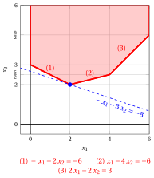

# Dual Simplex algorithm

**Part 3 · Duality and the dual simplex · Chapter 10** · [:material-file-pdf-box: Lecture notes, volume 3 (PDF)](../pdf/lecture-notes-3-duality.pdf) · [:material-pencil: Exercises](../exercises/ex-10-dual-simplex.md)

## 10.1 Pair of primal and dual problems

- We consider the standard maximization form of the dual problem, obtained by adding $n$ surplus non-negative variables to a dual LP problem with $m$ non-negative variables and $n$ greater-than-or-equal-to linear constraints:

    

    \begin{align*}
    &&   \max \;\;-{\boldsymbol b}' \, {\boldsymbol \pi}  \label{DUAL_OBJ} \tag{10.1a}\\[2ex]
    && \text{subject to} \quad  {\boldsymbol A}' \; {\boldsymbol \pi}  &= {\boldsymbol c},  & \phantom{j=1111}  \label{DUAL_CONS1} \tag{10.1b}\\[2ex]
    && {\boldsymbol \pi}                        &\ge  {\boldsymbol 0}. \label{DUAL_CONS2} \tag{10.1c}
    \end{align*}

    The $n$ non-negative surplus variables are added <em>before</em> the $m$ dual variables in order to shift the indices of the dual variables by $n$ and to obtain the following index correspondence:

    - the $n$ surplus variables $\pi_1,\pi_2,\dots,\pi_n$ of the dual problem can be associated to the $n$ primal variables $x_1,\dots,x_n$;

    - the $m$ dual variables $\pi_{n+1},\pi_{n+2},\dots,\pi_{n+m}$ of the dual problem can be associated to the $m$ slack variables $x_{n+1},\dots,x_{n+m}$ of the primal problem.

    The input data of the dual problem are:

    $$
    {\boldsymbol  b}=
    \begin{pmatrix}
    b_{1} \\
    b_{2} \\
    \vdots  \\
    b_{n} \\
    b_{n+1} \\
    b_{n+2} \\
    \vdots  \\
    b_{n+m} \\
    \end{pmatrix} ~~~~~~
    {\boldsymbol  A}'=
    \begin{pmatrix}
    a'_{11} & a'_{12} & \cdots & a'_{1n} & a'_{1(n+1)} & a'_{1(n+2)} & \cdots & a'_{1(n+m)}\\
    a'_{21} & a'_{22} & \cdots & a'_{2n} & a'_{2(n+1)} & a'_{2(n+2)} & \cdots & a'_{2(n+m)}\\
    \vdots & \vdots & \ddots & \vdots & \vdots & \vdots & \ddots & \vdots \\
    a'_{n1} & a'_{n2} & \cdots & a'_{nn} & a'_{n(n+1)} & a'_{n(n+2)} & \cdots & a'_{n(n+m)}\\
    \end{pmatrix}
    $$

    $$
    {\boldsymbol c}=
    \begin{pmatrix}
    c_{1} \\
    c_{2} \\
    \vdots  \\
    c_{n} \\
    \end{pmatrix}
    $$

    The $n+m$ non negative dual variables can be written as a column vector ${\boldsymbol \pi}$  of $n+m$ rows.

    $$
    {\boldsymbol \pi} = \begin{pmatrix}
    \pi_1 \\
    \pi_2 \\
    \vdots  \\
    \pi_n \\
    \pi_{n+1} \\
    \pi_{n+2} \\
    \vdots  \\
    \pi_{n+m} \\
    \end{pmatrix}
    $$

    Since the dual problem [(10.1)](#eq-DUAL_STD) is obtained by adding $n$ surplus variables to a dual LP problem with $n$ greater-than-or-equal-to constraints,  we have:

    $$
    \begin{pmatrix}
    a'_{11} & a'_{12} & \cdots   &a'_{1n}\\
    a'_{21} & a'_{22} & \cdots   &a'_{2n}\\
    \vdots & \vdots & \ddots & \vdots \\
    a'_{n1} & a'_{n2} & \cdots   &a'_{nn}\\
    \end{pmatrix}
    =\begin{pmatrix}
    -1 & 0 & \cdots & 0\\
    0 & -1 & \cdots & 0\\
    \vdots  & \vdots  & \ddots & \vdots \\
    0 &  0&  \cdots & -1
    \end{pmatrix}
    $$

    which is the negative identity matrix $-{\boldsymbol  I}$ of size $n$. Moreover, for the same reason, we have:

    $$
    \begin{pmatrix}
    b_{1} \\
    b_{2} \\
    \vdots  \\
    b_{n} \\
    \end{pmatrix}
    =
    \begin{pmatrix}
    0 \\
    0 \\
    \vdots  \\
    0 \\
    \end{pmatrix}
    $$

!!! esempio "Example 10.1: pair of primal and dual problems"

    We consider the following LP problem in canonical maximization form with $n=2$ variables and $m=3$ constraints:

    $$
    \begin{array}{rrrrrrrrrrrrr}
    {\max} & {-} \, {x_1} & {-} & {3} \, {x_2} \\[1.5ex]
    \text{subject to} & {-} \, {x_1} & {-} & {2}\, {x_2} & {\le} & {-6} \\[1.5ex]
    & \, {x_1} & {-} & {4} \, {x_2} & {\le} & {-6} \\[1.5ex]
    & {2} \, {x_1} & {-} & {2} \, {x_2} & {\le} & {3} \\[1.5ex]
    & {x_1,} &  & {x_2} & { \ge} & { 0 }
    \end{array}
    $$

    

    { .fig .ovale loading=lazy style="width:92%" }

    

    

    An optimal solution ${\tilde{\boldsymbol x}}(\,LP\,)$  is:

    $$
    \tilde{x}_1=2,~~\tilde{x}_2=2
    $$

    and the optimal value is:

    $$
    z(~LP~)  = -8
    $$

    

    We call this LP problem [Example 10.1](#box-1-ex-dsimplex-1).

!!! esempio "Example 10.2: pair of primal and dual problems"

    Adding $m=3$ slack variables, the standard form of the LP problem of [Example 10.1](#box-1-ex-dsimplex-1) with $n+m=5$ variables and $m=3$ constraints reads as follows:

    $$
    \begin{array}{rrrrrrrrrrrrr}
    {\max} & {-} \, {x_1} & {-} & {3} \, {x_2} \\[1.5ex]
    \text{subject to} & {-} \, {x_1} & {-} & {2} \, {x_2} & {+} & {x_3} &  &  &  &  & {=} & {-6} \\[1.5ex]
    & \, {x_1} & {-} & {4} \, {x_2} &  &  & {+} & {x_4} &  &  & {=} & {-6} \\[1.5ex]
    & {2} \, {x_1} & {-} & {2} \, {x_2} &  &  &  &  & {+} & {x_5} & {=} & {3} \\[1.5ex]
    & {x_1}, &  & {x_2}, &  & {x_3}, &  & {x_4}, &  & {x_5} & { \ge} & { 0 }
    \end{array}
    $$

    The dual problem of the LP problem of [Example 10.1](#box-1-ex-dsimplex-1) is the following LP problem in canonical minimization form with $m=3$ variables and $n=2$ constraints:

    $$
    \begin{array}{rrrrrrrrrrrrr}
    {\min} & {-6}\, {\pi_1} & {-} & {6} \, {\pi_2} & {+} & {3} \, {\pi_3} \\[2ex]
    \text{subject to} & {-} \, {\pi_1} & {+} & \, {\pi_2} & {+} & {2}\, {\pi_3} & {\ge} & {-1} \\[1.5ex]
    & {-2} {\pi_1} & {-} & {4} \, {\pi_2} & {-} & {2} \, {\pi_3} & {\ge} & {-3} \\[1.5ex]
    & {\pi_1}, &  & {\pi_2}, &  & {\pi_3} & { \ge} & { 0 }
    \end{array}
    $$

    Shifting the indices of the dual variables by $n=2$ and adding $n=2$ surplus variables, we then obtain the following standard maximization form:

    $$
    \begin{array}{rrrrrrrrrrrrr}
    {\max} &  &  &  &  &  & {6}\, {\pi_3} & {+} & {6} \, {\pi_4} & {-} & {3} \, {\pi_5} \\[2ex]
    \text{subject to} & {-} & \, {\pi_1} &  &  & {-} & \, {\pi_3} & {+} & \, {\pi_4} & {+} & {2} \, {\pi_5} & {=} & {-1} \\[1.5ex]
    &  &  & {-} & \, {\pi_2} & {-} & {2} \, {\pi_3} & {-} & {4} \, {\pi_4} & {-} & {2} \, {\pi_5} & {=} & {-3} \\[1.5ex]
    &  & {\pi_1}, &  & {\pi_2}, &  & {\pi_3}, &  & {\pi_4}, &  & {\pi_5} & { \ge} & { 0 }
    \end{array}
    $$

    In this dual problem in standard form, we have:

    $$
    {\boldsymbol  b}=
    \begin{pmatrix}
    0 \\[0.5ex]
    0 \\[0.5ex]
    -6  \\[0.5ex]
    -6  \\[0.5ex]
    3
    \end{pmatrix}
    \quad
    {\boldsymbol  A}'=
    \begin{pmatrix}
    -1 & 0 & -1 & 1 & 2 \\[1ex]
    0 & -1 & -2 & -4 & -2
    \end{pmatrix}
    \quad
    {\boldsymbol c}=
    \begin{pmatrix}
    -1 \\[1ex]
    -3
    \end{pmatrix}
    \text{     and     }  {\boldsymbol  \pi}=
    \begin{pmatrix}
    \pi_{1} \\[0.5ex]
    \pi_{2} \\[0.5ex]
    \pi_{3}  \\[0.5ex]
    \pi_{4}  \\[0.5ex]
    \pi_{5}
    \end{pmatrix}
    $$

    An optimal solution ${\tilde{\boldsymbol \pi}}(\,D(LP)\,)$ of this LP problem is: $\tilde{\pi}_1=0,~~\tilde{\pi}_2=0,~~\tilde{\pi}_3=\frac{7}{6},~~\tilde{\pi}_4=\frac{1}{6},~~\tilde{\pi}_5=0$.

## 10.2 Primal and dual feasible bases

- The simplex algorithm starts from a basis associated with a <strong>basic feasible solution</strong>, that is, a basis with $\bar{\boldsymbol b} \ge {\boldsymbol 0}$, and it performs pivoting operations until all the reduced costs become non-positive. Throughout the execution, the basic solution is always feasible for the primal problem and the objective value never decreases.

- The <strong>dual simplex algorithm</strong> does the opposite: it starts from a basis whose reduced costs are all non-positive, and it performs pivoting operations until the basic solution becomes feasible.

!!! definizione "Definition 10.1: primal feasible and dual feasible bases"

    Given a basis ${\boldsymbol A}_{\pazocal{B}}$ of the LP problem in standard maximization form and the associated dictionary, the basis is called:

    1. <strong>primal feasible</strong> if $~\bar{\boldsymbol b} \ge {\boldsymbol 0}$;

    2. <strong>dual feasible</strong> if $~\bar{\boldsymbol c} \le {\boldsymbol 0}$.

!!! chiave ""

    If a basis is <u>both</u> primal feasible and dual feasible, i.e.,

    $$
    \bar{\boldsymbol b} \ge {\boldsymbol 0}
    \qquad \text{and} \qquad
    \bar{\boldsymbol c} \le {\boldsymbol 0} ,
    $$

    then the associated basic feasible solution is an <strong>optimal solution</strong>. Conversely, if the LP problem has an optimal solution, then <u>there exists</u> a basis which is both primal feasible and dual feasible. A degenerate optimal basic solution may also be associated with a basis which is not dual feasible, i.e., with some $\bar c_j > 0$.

### 10.2.1 The dual solution associated with a basis

- The name “dual feasible” is justified as follows. Given a basis ${\boldsymbol A}_{\pazocal{B}}$ of the LP problem in standard maximization form, we associate with it the row vector of $m$ components

    \begin{equation*}
    \label{DUAL_SOL}
    {\boldsymbol \pi} = {\boldsymbol c}'_{\pazocal{B}} \; {\boldsymbol A}_{\pazocal{B}}^{-1} , \tag{10.2}
    \end{equation*}

    which is exactly the vector appearing in the definition of the reduced costs and of the objective value of the dictionary:

    $$
    \bar{c}_j = c_j - \underbrace{{\boldsymbol c}'_{\pazocal{B}} \; {\boldsymbol A}_{\pazocal{B}}^{-1}}_{= \, {\boldsymbol \pi}} \; {\boldsymbol A}_j , \qquad \forall j \in \pazocal{N},
    \qquad \text{and} \qquad
    \bar{z} = \underbrace{{\boldsymbol c}'_{\pazocal{B}} \; {\boldsymbol A}_{\pazocal{B}}^{-1}}_{= \, {\boldsymbol \pi}} \; {\boldsymbol b} = {\boldsymbol \pi} \; {\boldsymbol b} .
    $$

- The $m$ components of ${\boldsymbol \pi}$ are the values of the $m$ original dual variables, i.e., of the variables $\pi_{n+1},\pi_{n+2},\dots,\pi_{n+m}$ of the dual problem [(10.1)](#eq-DUAL_STD). We now show that ${\boldsymbol \pi}$ is a <u>feasible</u> solution of the dual problem if and only if the basis is dual feasible.

- <strong>The reduced costs of the basic variables are zero.</strong> Indeed, by definition of ${\boldsymbol \pi}$ we have

    $$
    {\boldsymbol \pi} \; {\boldsymbol A}_{\pazocal{B}}
    = {\boldsymbol c}'_{\pazocal{B}} \; \underbrace{{\boldsymbol A}_{\pazocal{B}}^{-1} \; {\boldsymbol A}_{\pazocal{B}}}_{= \, {\boldsymbol I}}
    = {\boldsymbol c}'_{\pazocal{B}} ,
    $$

    that is, ${\boldsymbol \pi} \, {\boldsymbol A}_i = c_i$ for every $i \in \pazocal{B}$, and then $\bar{c}_i = 0$ for every $i \in \pazocal{B}$.

- <strong>The reduced costs of the non-basic variables are the dual slacks.</strong> For every $j \in \pazocal{N}$ we have

    $$
    \bar{c}_j \le 0
    \qquad \Longleftrightarrow \qquad
    c_j - {\boldsymbol \pi} \; {\boldsymbol A}_j \le 0
    \qquad \Longleftrightarrow \qquad
    {\boldsymbol \pi} \; {\boldsymbol A}_j \ge c_j .
    $$

    Putting together the two previous points, the condition $\bar{\boldsymbol c} \le {\boldsymbol 0}$ is equivalent to

    $$
    {\boldsymbol \pi} \; {\boldsymbol A}_j \ge c_j , \qquad \forall j \in \{1,2,\dots,n+m\} ,
    $$

    which is precisely the set of constraints of the dual problem written for all the columns of the LP problem in standard maximization form.

- <strong>The non-negativity of ${\boldsymbol \pi}$ is contained in these inequalities.</strong> The last $m$ columns of the LP problem in standard maximization form are the columns of the slack variables, i.e., ${\boldsymbol A}_{n+i} = {\boldsymbol e}_i$ with $c_{n+i} = 0$ for every $i \in \{1,2,\dots,m\}$. Accordingly, the inequality written for the column $n+i$ reads

    $$
    {\boldsymbol \pi} \; {\boldsymbol e}_i \ge 0
    \qquad \Longleftrightarrow \qquad
    \pi_i \ge 0 .
    $$

!!! chiave ""

    A basis ${\boldsymbol A}_{\pazocal{B}}$ is <strong>dual feasible</strong> if and only if the associated vector

    $$
    {\boldsymbol \pi} = {\boldsymbol c}'_{\pazocal{B}} \; {\boldsymbol A}_{\pazocal{B}}^{-1}
    $$

    is a <strong>feasible solution of the dual problem</strong>. In this case, by the weak duality theorem, the value

    $$
    \bar{z} = {\boldsymbol \pi} \; {\boldsymbol b}
    $$

    is an <strong>upper bound</strong> on the optimal value of the LP problem.

- This is the exact mirror image of what happens in the simplex algorithm: there, every basis visited is primal feasible and then $\bar{z}$ is the value of a feasible solution of the LP problem, i.e., a <u>lower</u> bound on the optimal value, and the algorithm increases it until it becomes also an upper bound. Here, every basis visited is dual feasible and then $\bar{z}$ is an <u>upper</u> bound on the optimal value, and the algorithm decreases it until it becomes also a lower bound.

- Accordingly, the two algorithms can be described as follows:

    
<table>
    <tr>
    <th></th>
    <th><strong>simplex algorithm</strong></th>
    <th><strong>dual simplex algorithm</strong></th>
    </tr>
    <tr>
    <td>starts from a basis which is</td>
    <td>primal feasible</td>
    <td>dual feasible</td>
    </tr>
    <tr>
    <td>maintains at every iteration</td>
    <td>primal feasibility</td>
    <td>dual feasibility</td>
    </tr>
    <tr>
    <td>terminates when the basis is also</td>
    <td>dual feasible</td>
    <td>primal feasible</td>
    </tr>
    <tr>
    <td>or when it detects that the problem is</td>
    <td>unbounded</td>
    <td>infeasible</td>
    </tr>
    <tr>
    <td>the value \(\bar z\) is</td>
    <td>a lower bound</td>
    <td>an upper bound</td>
    </tr>
    <tr>
    <td>and along the execution it is</td>
    <td>non-decreasing</td>
    <td>non-increasing</td>
    </tr>
    </table>

!!! esempio "Example 10.3: the dual solutions associated with three bases"

    For the LP problem of [Example 10.1](#box-1-ex-dsimplex-1) in standard maximization form, we consider the partition $\pazocal{B}= \{3,~~4,~~5\}$ and $\pazocal{N}= \{1,~~2\}$ of the slack variables. We have:

    $$
    {\boldsymbol A}_{\pazocal{B}} =
    \begin{pmatrix}
    1 & 0 & 0 \\
    0 & 1 & 0 \\
    0 & 0 & 1
    \end{pmatrix}
    = {\boldsymbol A}_{\pazocal{B}}^{-1}
    \qquad \text{and} \qquad
    {\boldsymbol c}'_{\pazocal{B}} =
    \begin{pmatrix}
    0 & 0 & 0
    \end{pmatrix}
    \qquad \Longrightarrow \qquad
    {\boldsymbol \pi} =
    \begin{pmatrix}
    0 & 0 & 0
    \end{pmatrix}
    $$

    which is a feasible solution of the dual problem, and $\bar{z} = {\boldsymbol \pi} \, {\boldsymbol b} = 0$ is an upper bound on the optimal value. Consistently, the reduced costs $\bar{\boldsymbol c}' = {\boldsymbol c}'_{\pazocal{N}} = \begin{pmatrix} -1 & -3 \end{pmatrix}$ are all non-positive.

    After the first dual pivoting operation we obtain $\pazocal{B}= \{1,~~4,~~5\}$ and $\pazocal{N}= \{2,~~3\}$, with

    $$
    {\boldsymbol A}_{\pazocal{B}} =
    \begin{pmatrix}
    -1 & 0 & 0 \\
    1 & 1 & 0 \\
    2 & 0 & 1
    \end{pmatrix} ,
    \qquad
    {\boldsymbol A}_{\pazocal{B}}^{-1} =
    \begin{pmatrix}
    -1 & 0 & 0 \\
    1 & 1 & 0 \\
    2 & 0 & 1
    \end{pmatrix}
    \qquad \text{and} \qquad
    {\boldsymbol c}'_{\pazocal{B}} =
    \begin{pmatrix}
    -1 & 0 & 0
    \end{pmatrix} ,
    $$

    and then

    $$
    {\boldsymbol \pi} = {\boldsymbol c}'_{\pazocal{B}} \; {\boldsymbol A}_{\pazocal{B}}^{-1} =
    \begin{pmatrix}
    1 & 0 & 0
    \end{pmatrix}
    \qquad \text{and} \qquad
    \bar{z} = {\boldsymbol \pi} \; {\boldsymbol b} =
    \begin{pmatrix}
    1 & 0 & 0
    \end{pmatrix}
    \begin{pmatrix}
    -6 \\ -6 \\ 3
    \end{pmatrix}
    = -6 .
    $$

    After the second dual pivoting operation we obtain $\pazocal{B}= \{1,~~2,~~5\}$ and $\pazocal{N}= \{3,~~4\}$, with

    $$
    {\boldsymbol \pi} =
    \begin{pmatrix}
    \frac{7}{6} & \frac{1}{6} & 0
    \end{pmatrix}
    \qquad \text{and} \qquad
    \bar{z} = {\boldsymbol \pi} \; {\boldsymbol b} = -8 .
    $$

    The three upper bounds $0 \longrightarrow -6 \longrightarrow -8$ are non-increasing, and the last one is attained by a primal feasible solution: it is then the optimal value.

## 10.3 Finding an initial dual basic feasible solution

- The dual simplex algorithm requires in input a <strong>dual feasible basis</strong>, i.e., a basis whose dictionary satisfies $\bar{\boldsymbol c} \le {\boldsymbol 0}$. This is the mirror image of the requirement of the simplex algorithm, which needs in input a primal feasible basis and, when none is readily available, resorts to the Phase $0$.

- In this section we describe first the situations in which a dual feasible basis is available <strong>for free</strong>, i.e., without any computation, and then what can be done in the general case.

### 10.3.1 When a dual feasible basis is available for free

- <strong>First case: a non-positive objective-function vector.</strong> For an LP problem in canonical maximization form with ${\boldsymbol c} \le {\boldsymbol 0}$, the partition of the slack variables is dual feasible. Indeed, with

    $$
    \pazocal{B}=\{n+1,n+2,\dots,n+m\} \text{   and   } \pazocal{N}=\{1,2,\dots,n\}
    $$

    we have ${\boldsymbol A}_{\pazocal{B}} = {\boldsymbol I}$ and ${\boldsymbol c}_{\pazocal{B}} = {\boldsymbol 0}$, and then

    $$
    {\boldsymbol \pi} = {\boldsymbol c}'_{\pazocal{B}} \; {\boldsymbol A}_{\pazocal{B}}^{-1} = {\boldsymbol 0}
    \qquad \text{and} \qquad
    \bar{\boldsymbol c}' = {\boldsymbol c}'_{\pazocal{N}} - \underbrace{{\boldsymbol c}'_{\pazocal{B}} \; {\boldsymbol A}_{\pazocal{B}}^{-1}}_{= \, {\boldsymbol 0}} \; {\boldsymbol A}_{\pazocal{N}} = {\boldsymbol c}' \le {\boldsymbol 0} .
    $$

!!! chiave ""

    For an LP problem in canonical maximization form, if

    $$
    {\boldsymbol c} \le {\boldsymbol 0}
    \qquad \text{and} \qquad
    b_i < 0 \text{ for some } i \in \{1,2,\dots,m\} ,
    $$

    then the partition $\pazocal{B}=\{n+1,\dots,n+m\}$ and $\pazocal{N}=\{1,\dots,n\}$ of the slack variables is <strong>dual feasible but not primal feasible</strong>: the dual simplex algorithm can be applied directly, while the simplex algorithm would require the Phase $0$.

- <strong>Second case: re-optimization after a change of the right-hand-side vector.</strong> Assume that an optimal basis ${\boldsymbol A}_{\pazocal{B}}$ of an LP problem is known and that the right-hand-side vector ${\boldsymbol b}$ is replaced by a new vector $\hat{\boldsymbol b}$. The reduced costs

    $$
    \bar{c}_j = c_j - {\boldsymbol c}'_{\pazocal{B}} \; {\boldsymbol A}_{\pazocal{B}}^{-1} \; {\boldsymbol A}_j ,
    \qquad \forall j \in \pazocal{N},
    $$

    <u>do not depend</u> on ${\boldsymbol b}$, and then they remain all non-positive: the basis <strong>remains dual feasible</strong>. On the contrary, the values of the basic variables

    $$
    \bar{\boldsymbol b} = {\boldsymbol A}_{\pazocal{B}}^{-1} \; \hat{\boldsymbol b}
    $$

    do change and may become negative: the basis may lose primal feasibility. The dual simplex algorithm can then be started from the old optimal basis and typically restores optimality in very few iterations.

- <strong>Third case: adding a constraint to an optimal basis.</strong> Assume that an optimal basis ${\boldsymbol A}_{\pazocal{B}}$ of an LP problem is known, with optimal solution $\tilde{\boldsymbol x}$, and that a new constraint

    $$
    {\boldsymbol a}' \, {\boldsymbol x} \le \beta
    $$

    is added to the problem, together with its slack variable $x_{n+m+1}$. We consider the new partition

    $$
    \hat{\pazocal{B}} = \pazocal{B} \cup \{n+m+1\}
    \text{   and   }
    \hat{\pazocal{N}} = \pazocal{N} .
    $$

    - **a.** The new basis matrix and its inverse are

        $$
        {\boldsymbol A}_{\hat{\pazocal{B}}} =
        \begin{pmatrix}
        {\boldsymbol A}_{\pazocal{B}} & {\boldsymbol 0} \\[1ex]
        {\boldsymbol a}'_{\pazocal{B}} & 1
        \end{pmatrix}
        \qquad \text{and} \qquad
        {\boldsymbol A}_{\hat{\pazocal{B}}}^{-1} =
        \begin{pmatrix}
        {\boldsymbol A}_{\pazocal{B}}^{-1} & {\boldsymbol 0} \\[1ex]
        - \, {\boldsymbol a}'_{\pazocal{B}} \; {\boldsymbol A}_{\pazocal{B}}^{-1} & 1
        \end{pmatrix} ,
        $$

        where ${\boldsymbol a}'_{\pazocal{B}}$ collects the components of ${\boldsymbol a}'$ associated with the basic variables. In particular, ${\boldsymbol A}_{\hat{\pazocal{B}}}$ is invertible and then it is a basis.

    - **b.** Since the new slack variable has objective-function coefficient equal to zero, we have ${\boldsymbol c}'_{\hat{\pazocal{B}}} = \begin{pmatrix} {\boldsymbol c}'_{\pazocal{B}} & 0\end{pmatrix}$ and then

        $$
        \hat{\boldsymbol \pi} = {\boldsymbol c}'_{\hat{\pazocal{B}}} \; {\boldsymbol A}_{\hat{\pazocal{B}}}^{-1}
        = \begin{pmatrix} {\boldsymbol c}'_{\pazocal{B}} \; {\boldsymbol A}_{\pazocal{B}}^{-1} & 0 \end{pmatrix}
        = \begin{pmatrix} {\boldsymbol \pi} & 0 \end{pmatrix} ,
        $$

        that is, the dual variable of the new constraint is set to zero and all the other dual variables are unchanged. Accordingly, for every $j \in \hat{\pazocal{N}}$,

        $$
        \hat{c}_j = c_j - \begin{pmatrix} {\boldsymbol \pi} & 0 \end{pmatrix}
        \begin{pmatrix} {\boldsymbol A}_j \\[1ex] a_j \end{pmatrix}
        = c_j - {\boldsymbol \pi} \; {\boldsymbol A}_j = \bar{c}_j \le 0 :
        $$

        the reduced costs are <u>unchanged</u> and the new basis is <strong>dual feasible</strong>.

    - **c.** The value of the new basic variable is

        $$
        \bar{b}_{n+m+1} = \beta - {\boldsymbol a}' \, \tilde{\boldsymbol x} ,
        $$

        which is negative if and only if the old optimal solution $\tilde{\boldsymbol x}$ <u>violates</u> the new constraint. In this case the dual simplex algorithm is started from $\hat{\pazocal{B}}$.

- <strong>Fourth case: branch-and-bound and cutting planes.</strong> The third case is exactly what happens when an integer linear programming problem is solved: at every node of the branch-and-bound tree a bound such as

    $$
    x_j \le \lfloor \tilde{x}_j \rfloor
    \qquad \text{or} \qquad
    x_j \ge \lceil \tilde{x}_j \rceil
    $$

    is added to the LP relaxation solved at the parent node, and the same happens every time a cutting plane is added. The optimal basis of the parent node is dual feasible for the child node, and the dual simplex algorithm re-optimizes it with a handful of pivoting operations instead of solving the new LP problem from scratch. This is one of the main reasons why the dual simplex algorithm is among the most used algorithms in modern LP solvers, and the one typically used to re-optimize inside branch-and-bound.

!!! esempio "Example 10.4: re-optimization after a change of ${\boldsymbol b}$"

    We consider the LP problem of [Example 10.1](#box-1-ex-dsimplex-1) and its optimal basis $\pazocal{B}= \{1,~~2,~~5\}$ and $\pazocal{N}= \{3,~~4\}$, with the optimal dictionary:

    \begin{equation*}
    \begin{cases}
    \begin{array}{rrrrrrrrrrrrr}
    {x_1} & {=} & {2} & {+} & {\frac{2}{3}\,x_3} & {-} & {\frac{1}{3}\,x_4} \\[2ex]
    {x_2} & {=} & {2} & {+} & {\frac{1}{6}\,x_3} & {+} & {\frac{1}{6}\,x_4} \\[2ex]
    {x_5} & {=} & {3} & {-} & {x_3} & {+} & {x_4} \\[2ex]
    {z} & {=} & {-8} & {-} & {\frac{7}{6}\,x_3} & {-} & {\frac{1}{6}\,x_4}
    \end{array}
    \end{cases}
    \end{equation*}

    Assume now that the right-hand side of the first constraint changes from $-6$ to $-12$, i.e., that

    $$
    {\boldsymbol b} =
    \begin{pmatrix}
    -6 \\ -6 \\ 3
    \end{pmatrix}
    \qquad \longrightarrow \qquad
    \hat{\boldsymbol b} =
    \begin{pmatrix}
    -12 \\ -6 \\ 3
    \end{pmatrix} .
    $$

    The reduced costs do not depend on the right-hand-side vector, and then $\bar{\boldsymbol c}' = \begin{pmatrix} -\frac{7}{6} & -\frac{1}{6}\end{pmatrix}$ is unchanged and the basis remains <strong>dual feasible</strong>. The values of the basic variables, instead, become

    $$
    \bar{\boldsymbol b} = {\boldsymbol A}_{\pazocal{B}}^{-1} \; \hat{\boldsymbol b} =
    \begin{pmatrix}
    -\frac{2}{3} & \frac{1}{3} & 0 \\[1ex]
    -\frac{1}{6} & -\frac{1}{6} & 0 \\[1ex]
    1 & -1 & 1
    \end{pmatrix}
    \begin{pmatrix}
    -12 \\ -6 \\ 3
    \end{pmatrix}
    =
    \begin{pmatrix}
    6 \\ 3 \\ -3
    \end{pmatrix} ,
    $$

    and the dictionary becomes:

    \begin{equation*}
    \begin{cases}
    \begin{array}{rrrrrrrrrrrrr}
    {x_1} & {=} & {6} & {+} & {\frac{2}{3}\,x_3} & {-} & {\frac{1}{3}\,x_4} \\[2ex]
    {x_2} & {=} & {3} & {+} & {\frac{1}{6}\,x_3} & {+} & {\frac{1}{6}\,x_4} \\[2ex]
    {x_5} & {=} & {-3} & {-} & {x_3} & {+} & {x_4} \\[2ex]
    {z} & {=} & {-15} & {-} & {\frac{7}{6}\,x_3} & {-} & {\frac{1}{6}\,x_4}
    \end{array}
    \end{cases}
    \end{equation*}

    The basis is no longer primal feasible, since $\bar b_5 = -3 < 0$. We then perform a dual pivoting operation with pivot row $x_5$. The values of its row are $\bar a_{53} = 1 \ge 0$ and $\bar a_{54} = -1 < 0$, and then $x_4$ is the only candidate and it is the pivot column, with

    $$
    s_m = \frac{\bar c_4}{\bar a_{54}} = \frac{-\frac{1}{6}}{-1} = \frac{1}{6} .
    $$

    Updating the dictionary, with $\pazocal{B}= \{1,~~2,~~4\}$ and $\pazocal{N}= \{3,~~5\}$, we obtain:

    \begin{equation*}
    \begin{cases}
    \begin{array}{rrrrrrrrrrrrr}
    {x_1} & {=} & {5} & {+} & {\frac{1}{3}\,x_3} & {-} & {\frac{1}{3}\,x_5} \\[2ex]
    {x_2} & {=} & {\frac{7}{2}} & {+} & {\frac{1}{3}\,x_3} & {+} & {\frac{1}{6}\,x_5} \\[2ex]
    {x_4} & {=} & {3} & {+} & {x_3} & {+} & {x_5} \\[2ex]
    {z} & {=} & {-\frac{31}{2}} & {-} & {\frac{4}{3}\,x_3} & {-} & {\frac{1}{6}\,x_5}
    \end{array}
    \end{cases}
    \end{equation*}

    Now $\bar{\boldsymbol b} \ge {\boldsymbol 0}$ and $\bar{\boldsymbol c} \le {\boldsymbol 0}$: after a <u>single</u> dual pivoting operation the new optimal solution is

    $$
    \tilde{\boldsymbol x}(\, LP \,) =
    \begin{pmatrix}
    5 \\[0.5ex]
    \frac{7}{2}
    \end{pmatrix}
    \qquad \text{and} \qquad
    z(\, LP \,) = -\frac{31}{2} .
    $$

!!! esempio "Example 10.5: adding a constraint to an optimal basis"

    We consider again the LP problem of [Example 10.1](#box-1-ex-dsimplex-1) with its optimal basis $\pazocal{B}= \{1,~~2,~~5\}$ and its optimal solution $\tilde x_1 = 2$ and $\tilde x_2 = 2$, and we add the new constraint

    $$
    x_1 + x_2 \le 3 ,
    $$

    together with its slack variable $x_6$. The new basis is $\hat{\pazocal{B}}= \{1,~~2,~~5,~~6\}$ and $\hat{\pazocal{N}}= \{3,~~4\}$.

    The reduced costs are <u>unchanged</u>, and then the new basis is dual feasible. The value of the new basic variable is

    $$
    \bar b_6 = 3 - (\tilde x_1 + \tilde x_2) = 3 - 4 = -1 < 0 ,
    $$

    since the old optimal solution violates the new constraint. The equation of $x_6$ in the new dictionary is obtained by substituting the equations of $x_1$ and $x_2$:

    $$
    x_6 = 3 - x_1 - x_2
    = 3 - \left(2 + \frac{2}{3}\,x_3 - \frac{1}{3}\,x_4\right) - \left(2 + \frac{1}{6}\,x_3 + \frac{1}{6}\,x_4\right)
    = -1 - \frac{5}{6}\,x_3 + \frac{1}{6}\,x_4 ,
    $$

    and the new dictionary is:

    \begin{equation*}
    \begin{cases}
    \begin{array}{rrrrrrrrrrrrr}
    {x_1} & {=} & {2} & {+} & {\frac{2}{3}\,x_3} & {-} & {\frac{1}{3}\,x_4} \\[2ex]
    {x_2} & {=} & {2} & {+} & {\frac{1}{6}\,x_3} & {+} & {\frac{1}{6}\,x_4} \\[2ex]
    {x_5} & {=} & {3} & {-} & {x_3} & {+} & {x_4} \\[2ex]
    {x_6} & {=} & {-1} & {-} & {\frac{5}{6}\,x_3} & {+} & {\frac{1}{6}\,x_4} \\[2ex]
    {z} & {=} & {-8} & {-} & {\frac{7}{6}\,x_3} & {-} & {\frac{1}{6}\,x_4}
    \end{array}
    \end{cases}
    \end{equation*}

    We perform a dual pivoting operation with pivot row $x_6$. The values of its row are $\bar a_{63} = \frac{5}{6} \ge 0$ and $\bar a_{64} = -\frac{1}{6} < 0$, and then $x_4$ is the pivot column, with

    $$
    s_m = \frac{\bar c_4}{\bar a_{64}} = \frac{-\frac{1}{6}}{-\frac{1}{6}} = 1 .
    $$

    Updating the dictionary, with $\pazocal{B}= \{1,~~2,~~4,~~5\}$ and $\pazocal{N}= \{3,~~6\}$, we obtain:

    \begin{equation*}
    \begin{cases}
    \begin{array}{rrrrrrrrrrrrr}
    {x_1} & {=} & {0} & {-} & {x_3} & {-} & {2\,x_6} \\[2ex]
    {x_2} & {=} & {3} & {+} & {x_3} & {+} & {x_6} \\[2ex]
    {x_4} & {=} & {6} & {+} & {5\,x_3} & {+} & {6\,x_6} \\[2ex]
    {x_5} & {=} & {9} & {+} & {4\,x_3} & {+} & {6\,x_6} \\[2ex]
    {z} & {=} & {-9} & {-} & {2\,x_3} & {-} & {x_6}
    \end{array}
    \end{cases}
    \end{equation*}

    Again a <u>single</u> dual pivoting operation restores optimality, and the new optimal solution is

    $$
    \tilde{\boldsymbol x}(\, LP \,) =
    \begin{pmatrix}
    0 \\[0.5ex]
    3
    \end{pmatrix}
    \qquad \text{and} \qquad
    z(\, LP \,) = -9 .
    $$

    The new optimal value $-9$ is <u>not larger</u> than the old one $-8$, as it must be, since adding a constraint to a maximization problem can only reduce the optimal value.

### 10.3.2 The general case

- When neither ${\boldsymbol b} \ge {\boldsymbol 0}$ nor ${\boldsymbol c} \le {\boldsymbol 0}$, the partition of the slack variables is neither primal feasible nor dual feasible, and no basis is available for free. Besides the Phase $0$, the dual simplex algorithm offers the following alternative.

!!! chiave ""

    <strong>Finding a primal feasible basis with the dual simplex algorithm.</strong>

    - **a.** Replace the objective-function vector ${\boldsymbol c}$ by any vector $\hat{\boldsymbol c} \le {\boldsymbol 0}$, for instance $\hat{\boldsymbol c} = {\boldsymbol 0}$ or $\hat{c}_j = \min\{c_j,0\}$. The feasible region is <u>unchanged</u>.

    - **b.** The partition of the slack variables is dual feasible for the modified problem. Run the dual simplex algorithm on it, with the smallest-index rule (Bland's rule) of Section [10.4.3](#sez-sec-dsx-bland).

    - **c.** If it terminates with the certificate of infeasibility, the modified problem is infeasible and then the <u>original</u> problem is infeasible too, since they have the same feasible region. <code>STOP</code>.

    - **d.** Otherwise it terminates with a basis $\pazocal{B}$ which is primal feasible for the modified problem, and then <u>also for the original problem</u>.

    - **e.** Restore the original vector ${\boldsymbol c}$, recompute the reduced costs $\bar{\boldsymbol c}$ and the value $\bar z$ of the basis $\pazocal{B}$, and run the simplex algorithm starting from it.

- This is a genuine alternative to the Phase $0$: it plays exactly the same role, i.e., it provides an initial primal feasible basis or a proof that none exists, but it does so without introducing the auxiliary variable $x_0$ and without solving an auxiliary problem.

- With $\hat{\boldsymbol c} = {\boldsymbol 0}$ all the reduced costs are equal to zero at every iteration, all the ratios of the ratio test are equal to zero and the pivot column is always chosen by the tie-breaking part of Bland's rule alone, i.e., as the candidate with the smallest index. Since Bland's rule prevents cycling, the procedure terminates.

!!! esempio "Example 10.6: finding a primal feasible basis with the dual simplex algorithm"

    We consider the following LP problem in canonical maximization form with $n=2$ non-negative variables and $m=3$ less-than-or-equal-to linear constraints (called [Example 10.6](#box-7-ex-dsx-phase)):

    $$
    \begin{array}{rrrrrrrrrrrrr}
    {\max} & {3} \, {x_1} & {+} & \, {x_2} \\[1ex]
    \text{subject to} & {-} \, {x_1} & {-} & \, {x_2} & {\le} & {-2} \\[1ex]
    & \, {x_1} & {+} & {2} \, {x_2} & {\le} & {8} \\[1ex]
    & {2} \, {x_1} & {+} & \, {x_2} & {\le} & {10} \\[1ex]
    & {x_1,} &  & {x_2} & { \ge} & {0}
    \end{array}
    $$

    Here ${\boldsymbol c} \not\le {\boldsymbol 0}$ and ${\boldsymbol b} \not\ge {\boldsymbol 0}$: the partition $\pazocal{B}= \{3,~~4,~~5\}$ and $\pazocal{N}= \{1,~~2\}$ of the slack variables is neither primal feasible nor dual feasible.

    <strong>Step a.</strong> We replace the objective-function vector by $\hat{\boldsymbol c} = {\boldsymbol 0}$. The dictionary of the modified problem is:

    \begin{equation*}
    \begin{cases}
    \begin{array}{rrrrrrrrrrrrr}
    {x_3} & {=} & {-2} & {+} & {x_1} & {+} & {x_2} \\[2ex]
    {x_4} & {=} & {8} & {-} & {x_1} & {-} & {2\,x_2} \\[2ex]
    {x_5} & {=} & {10} & {-} & {2\,x_1} & {-} & {x_2} \\[2ex]
    {\hat z} & {=} & {0} & {+} & {0\,x_1} & {+} & {0\,x_2}
    \end{array}
    \end{cases}
    \end{equation*}

    All the reduced costs are non-positive, and then the basis is dual feasible.

    <strong>Step b.</strong> The pivot row is $x_3$, since $\bar b_3 = -2 < 0$. The values of its row are $\bar a_{31} = -1 < 0$ and $\bar a_{32} = -1 < 0$, and then both non-basic variables are candidates:

    $$
    s_m = \min \left\{~\underbrace{\frac{0}{-1}}_{= \, 0},~\underbrace{\frac{0}{-1}}_{= \, 0}~\right\} = 0 ,
    $$

    and the two ratios are equal. By Bland's rule we choose the smallest index, i.e., $x_1$ is the pivot column. Updating the dictionary, with $\pazocal{B}= \{1,~~4,~~5\}$ and $\pazocal{N}= \{2,~~3\}$, we obtain:

    \begin{equation*}
    \begin{cases}
    \begin{array}{rrrrrrrrrrrrr}
    {x_1} & {=} & {2} & {-} & {x_2} & {+} & {x_3} \\[2ex]
    {x_4} & {=} & {6} & {-} & {x_2} & {-} & {x_3} \\[2ex]
    {x_5} & {=} & {6} & {+} & {x_2} & {-} & {2\,x_3} \\[2ex]
    {\hat z} & {=} & {0} & {+} & {0\,x_2} & {+} & {0\,x_3}
    \end{array}
    \end{cases}
    \end{equation*}

    <strong>Step d.</strong> Now $\bar{\boldsymbol b} = \begin{pmatrix} 2 & 6 & 6 \end{pmatrix}' \ge {\boldsymbol 0}$: the basis $\pazocal{B}= \{1,~~4,~~5\}$ is <strong>primal feasible</strong>, both for the modified problem and for the original one.

    <strong>Step e.</strong> We restore the original objective function and we recompute the objective-function row by substituting the equation of $x_1$:

    $$
    z = 3\,x_1 + x_2 = 3 \, (2 - x_2 + x_3) + x_2 = 6 - 2\,x_2 + 3\,x_3 ,
    $$

    which gives the dictionary:

    \begin{equation*}
    \begin{cases}
    \begin{array}{rrrrrrrrrrrrr}
    {x_1} & {=} & {2} & {-} & {x_2} & {+} & {x_3} \\[2ex]
    {x_4} & {=} & {6} & {-} & {x_2} & {-} & {x_3} \\[2ex]
    {x_5} & {=} & {6} & {+} & {x_2} & {-} & {2\,x_3} \\[2ex]
    {z} & {=} & {6} & {-} & {2\,x_2} & {+} & {3\,x_3}
    \end{array}
    \end{cases}
    \end{equation*}

    The reduced cost $\bar c_3 = 3 > 0$, and then we perform a (primal) pivoting operation with pivot column $x_3$. We find the largest $t$ such that $\bar{\boldsymbol b} - t \; \bar{\boldsymbol A}_3 \ge {\boldsymbol 0}$:

    $$
    \begin{cases}
    \underbrace{2 -t \cdot (-1)\ge 0}_{x_1 \ge 0} \\[1ex]
    \underbrace{6 -t \cdot 1\ge 0}_{x_4 \ge 0} \\[1ex]
    \underbrace{6 -t \cdot 2\ge 0}_{x_5 \ge 0} \\
    \end{cases}
    \qquad
    \begin{cases}
    t\ge -2  \\[1ex]
    t\le 6  \\[1ex]
    t\le 3
    \end{cases}
    \text{   then   } t_{m}=3
    $$

    and the pivot row is $x_5$. Updating the dictionary, with $\pazocal{B}= \{1,~~3,~~4\}$ and $\pazocal{N}= \{2,~~5\}$, we obtain:

    \begin{equation*}
    \begin{cases}
    \begin{array}{rrrrrrrrrrrrr}
    {x_1} & {=} & {5} & {-} & {\frac{1}{2}\,x_2} & {-} & {\frac{1}{2}\,x_5} \\[2ex]
    {x_3} & {=} & {3} & {+} & {\frac{1}{2}\,x_2} & {-} & {\frac{1}{2}\,x_5} \\[2ex]
    {x_4} & {=} & {3} & {-} & {\frac{3}{2}\,x_2} & {+} & {\frac{1}{2}\,x_5} \\[2ex]
    {z} & {=} & {15} & {-} & {\frac{1}{2}\,x_2} & {-} & {\frac{3}{2}\,x_5}
    \end{array}
    \end{cases}
    \end{equation*}

    All the reduced costs are non-positive: the basis is optimal and

    $$
    \tilde{\boldsymbol x}(\, LP \,) =
    \begin{pmatrix}
    5 \\[0.5ex]
    0
    \end{pmatrix}
    \qquad \text{and} \qquad
    z(\, LP \,) = 15 .
    $$

## 10.4 Dual pivoting operations

- Given a dual feasible basis ${\boldsymbol A}_{\pazocal{B}}$ of the LP problem in standard maximization form, if in the associated dictionary there exists $r \in \pazocal{B}$ such that $\bar{b}_r < 0$ (a negative basic value), it is necessary to perform a dual pivoting operation.

- The dual simplex algorithm works on the <u>primal</u> dictionary, exactly the same object used by the simplex algorithm. What changes is the <strong>order</strong> of the two choices.

!!! definizione "Definition 10.2: dual pivoting operation"

    A <strong>dual pivoting operation</strong> consists in determining a <strong>new dual feasible basis</strong> with the goal of restoring the non-negativity of one basic variable, by <strong>swapping one basic variable and one non-basic variable</strong>.

    - The basic variable that becomes non-basic is called the <strong>pivot row</strong>, and it is chosen <u>first</u>;

    - The non-basic variable that becomes basic is called the <strong>pivot column</strong>, and it is chosen <u>second</u>.

- The order of the two choices is the opposite of the one of the simplex algorithm.

### 10.4.1 Determining the pivot row

!!! chiave ""

    <strong>The pivot row is a basic variable with a negative value</strong>, i.e., a basic variable

    $$
    x_r \text{  with  } r \in \pazocal{B}
    \text{  such that  } \bar{b}_r < 0 .
    $$

- The variable $x_r$ leaves the basis and becomes non-basic, and then it takes the value $0$: this is precisely what restores its non-negativity. If several basic variables have a negative value, any one of them preserves dual feasibility. In these notes we always choose the one with the <strong>smallest index</strong>:

    $$
    r = \min \left\{~ i \in \pazocal{B} : \bar b_i < 0 ~\right\} .
    $$

    LP solvers often choose instead the most negative value $\bar b_r$, or more refined criteria; the smallest-index choice is part of Bland's rule (Section [10.4.3](#sez-sec-dsx-bland)), which guarantees that the algorithm terminates.

### 10.4.2 Determining the pivot column

- The pivot column is chosen so that <u>dual feasibility is preserved</u>, that is, so that all the reduced costs remain non-positive after the dual pivoting operation. We now derive the rule.

- The equation of the pivot row in the dictionary and the equation of the objective function are

    $$
    x_r = \bar{b}_r - \sum_{j \in \pazocal{N}} \bar{a}_{rj} \; x_j
    \qquad \text{and} \qquad
    z = \bar{z} + \sum_{j \in \pazocal{N}} \bar{c}_{j} \; x_j .
    $$

    The first one can be rewritten as the identity

    $$
    0 = \bar{b}_r - \sum_{j \in \pazocal{N}} \bar{a}_{rj} \; x_j - x_r ,
    $$

    which holds for every point satisfying the equality constraints. Accordingly, for every value $s \in \R$, we can add $s$ times this identity to the equation of the objective function without changing it:

    \begin{equation*}
    \label{DUAL_STEP}
    z = \underbrace{\bar{z} + s \; \bar{b}_r}_{\text{new } \bar z}
    + \sum_{j \in \pazocal{N}} \underbrace{\big( \bar{c}_{j} - s \; \bar{a}_{rj} \big)}_{\text{new } \bar c_j} \; x_j
    + \underbrace{( - \, s )}_{\text{new } \bar c_r} \; x_r . \tag{10.3}
    \end{equation*}

- These $|\pazocal{N}|+1$ coefficients are the reduced costs of the new dictionary, in which $x_r$ has become non-basic. <strong>The value of $s$ is increased as much as possible while at the same time maintaining non-positive all the reduced costs</strong>. In this way a new dual feasible basis is determined. Imposing the non-positivity of all the coefficients of $\eqref{DUAL_STEP}$, we obtain:

    $$
    \begin{cases}
    - \, s \le 0 \\[1ex]
    \bar{c}_{j} - s \; \bar{a}_{rj} \le 0, \qquad \forall j \in \pazocal{N}
    \end{cases}
    \qquad
    \begin{cases}
    s \ge 0 \\[1ex]
    s \le \dfrac{\bar c_j}{\bar a_{rj}}, \qquad \forall j \in \pazocal{N} \text{ with } \bar a_{rj} < 0
    \end{cases}
    $$

    where the inequalities with $\bar a_{rj} > 0$ are satisfied for every $s \ge 0$, since $\bar{c}_{j} \le 0$, and those with $\bar a_{rj} = 0$ reduce to $\bar{c}_{j} \le 0$, which holds by hypothesis. The direction of the inequality is reversed when dividing by $\bar a_{rj} < 0$. Accordingly, the value of $s$ becomes the maximum value, called $s_m$, such that:

    $$
    s_m = \min \left\{~\frac{\bar c_j}{\bar a_{rj}}: j\in\pazocal{N},~\bar a_{rj}<0 ~\right\} \; \ge \; 0 .
    $$

- With this value of $s$, the new reduced cost of the variable $x_p$ attaining the minimum becomes

    $$
    \bar{c}_{p} - s_m \; \bar{a}_{rp} = \bar{c}_{p} - \frac{\bar c_p}{\bar a_{rp}} \; \bar{a}_{rp} = 0 ,
    $$

    and a variable whose reduced cost is zero can enter the basis: $x_p$ is the pivot column.

!!! chiave ""

    <strong>The pivot column is a non-basic variable whose reduced cost becomes zero by setting the dual step to $s_m$</strong>, i.e., a non-basic variable

    $$
    x_p \text{  with  } p \in \pazocal{N}
    \text{  such that  }
    \frac{\bar{c}_p}{\bar{a}_{rp}}
    = s_m = \min \left\{~\frac{\bar c_j}{\bar a_{rj}}: j\in\pazocal{N},~\bar a_{rj}<0 ~\right\} ,
    $$

    where $\bar{a}_{rp}$ is the value of the row $\bar{\boldsymbol a}_{r}$ associated with the pivot column $x_p$.

- Given $s_m$ and the row $\bar{\boldsymbol a}_{r}$, <strong>the new reduced costs</strong> (which determine the new vector $\bar{\boldsymbol c}$) and <strong>the new objective value</strong> are obtained as follows:

    \begin{equation*}
    \label{DUAL_UPDATED2}
    \bar c_j \; \leftarrow \; \bar{c}_{j} - s_m \; \bar{a}_{rj} ,
    \quad \forall j \in \pazocal{N} \setminus \{p\},
    \qquad
    \bar c_r \; \leftarrow \; - \, s_m ,
    \qquad
    \bar c_p \; \leftarrow \; 0 ,
    \qquad
    \bar z \; \leftarrow \; \bar{z} + s_m \; \bar{b}_r . \tag{10.4}
    \end{equation*}

- Since $s_m \ge 0$ and $\bar b_r < 0$, we have

    $$
    \bar{z} + s_m \; \bar{b}_r \; \le \; \bar z :
    $$

    <strong>the objective value never increases</strong>, which is the mirror image of what happens in the simplex algorithm, where the objective value never decreases. By the previous section, $\bar z$ is at every iteration an upper bound on the optimal value, and the dual simplex algorithm decreases it.

- Given a pivot row $x_r$ with $r \in \pazocal{B}$ and a pivot column $x_p$ with $p \in \pazocal{N}$, <strong>the new partition of the indices of the variables</strong> is updated as follows:

    \begin{equation*}
    \label{DUAL_UPDATED1}
    \pazocal{B} \leftarrow \big(\pazocal{B} \setminus \{ r \} \big) \cup \{ p \}
    \text{   and   }
    \pazocal{N} \leftarrow \big(\pazocal{N} \setminus \{ p \} \big) \cup \{ r \} \tag{10.5}
    \end{equation*}

    By construction ${\boldsymbol A}_{\pazocal{B}}$ remains a basis, since $\bar a_{rp} \ne 0$.

### 10.4.3 The smallest-index rule (Bland's rule) { #sez-sec-dsx-bland }

- The pivot row and the pivot column are not always unique: several basic variables may have a negative value, and several non-basic variables may attain the minimum $s_m$. If $s_m = 0$ (a <strong>degenerate</strong> dual pivoting operation) the value $\bar z$ does not change and, with an arbitrary choice, the algorithm could cycle. In these notes we always break the ties as follows.

!!! chiave ""

    <strong>Bland's rule for the dual simplex algorithm.</strong>

    - **a.** The pivot row is the basic variable with negative value having the <strong>smallest index</strong>:

        $$
        r = \min \left\{~ i \in \pazocal{B} : \bar b_i < 0 ~\right\} .
        $$

    - **b.** The pivot column is the candidate attaining $s_m$ having the <strong>smallest index</strong>:

        $$
        p = \min \left\{~ j \in \pazocal{N} : \bar a_{rj} < 0, ~ \frac{\bar c_j}{\bar a_{rj}} = s_m ~\right\} .
        $$

    By the correspondence $\pi_j \leftrightarrow x_j$, this is exactly Bland's rule of the simplex algorithm applied to the dual problem, and then the dual simplex algorithm with this rule always terminates.

### 10.4.4 Certificate of infeasibility

- If $\bar a_{rj} \ge 0$ for every $j \in \pazocal{N}$, then the ratio test has no candidate: the value of $s$ can be increased without bound while maintaining non-positive all the reduced costs. In this case the LP problem is infeasible.

!!! chiave ""

    <strong>Certificate of infeasibility.</strong> Given a dual feasible basis ${\boldsymbol A}_{\pazocal{B}}$, if there exists a basic variable $x_r$ with $r \in \pazocal{B}$ such that

    $$
    \bar{b}_r < 0
    \qquad \text{and} \qquad
    \bar{a}_{rj} \ge 0, \quad \forall j \in \pazocal{N},
    $$

    then the LP problem in standard maximization form is <strong>infeasible</strong>.

- <strong>First proof (on the primal).</strong> The equation of the pivot row in the dictionary is

    $$
    x_r = \bar{b}_r - \sum_{j \in \pazocal{N}} \bar{a}_{rj} \; x_j ,
    $$

    and every feasible solution satisfies $x_j \ge 0$ for every $j \in \pazocal{N}$. Since $\bar{a}_{rj} \ge 0$ for every $j \in \pazocal{N}$, every term of the sum is non-negative and we obtain

    $$
    x_r \le \bar{b}_r < 0 ,
    $$

    which contradicts the non-negativity of $x_r$. Accordingly, no feasible solution exists.

- <strong>Second proof (on the dual).</strong> For every value $s \ge 0$, the coefficients of $\eqref{DUAL_STEP}$ are all non-positive, and then they are the reduced costs of a dual feasible solution of value

    $$
    \bar{z} + s \; \bar{b}_r .
    $$

    Since $\bar b_r < 0$, this value tends to $- \, \infty$ as $s$ grows: the dual problem is <strong>unbounded</strong>. By the weak duality theorem, the primal problem is then <strong>infeasible</strong>. This is the exact mirror image of the certificate of unboundedness of the simplex algorithm.

### 10.4.5 Update of the dictionary

!!! chiave ""

    Once the pivot row $x_r$ with $r \in \pazocal{B}$ and the pivot column $x_p$ with $p \in \pazocal{N}$ are determined, the new dictionary is obtained with <strong>exactly the same row operations as in the simplex algorithm</strong>.

- Let $x_p$ be the entering variable and $x_r$ the leaving variable. From the equation of the pivot row, we have:

    $$
    x_r=\bar b_r-\bar a_{rp}x_p-\sum_{j\in\pazocal{N}\setminus\{p\}}\bar a_{rj}x_j .
    $$

    Solving for $x_p$ gives the equation of the pivot column in the new dictionary:

    \begin{equation*}
    x_p=\frac{\bar b_r}{\bar a_{rp}}
    -\sum_{j\in\pazocal{N}\setminus\{p\}}
    \frac{\bar a_{rj}}{\bar a_{rp}}x_j
    -\frac{1}{\bar a_{rp}}x_r .
    \label{eq:dual-pivot-equation} \tag{10.6}
    \end{equation*}

    For each remaining basic variable $i\in\pazocal{B}\setminus\{r\}$, substituting with $\eqref{eq:dual-pivot-equation}$ gives their equations in the new dictionary, and substituting in the equation of the objective function gives the new objective-function row, whose coefficients are exactly those of $\eqref{DUAL_UPDATED2}$.

- The new value of the pivot column is

    $$
    \bar b_p = \frac{\bar b_r}{\bar a_{rp}} \; \ge \; 0 ,
    $$

    since $\bar b_r < 0$ and $\bar a_{rp} < 0$: the variable entering the basis takes a non-negative value. The values of the other basic variables, instead, may well be negative, and further dual pivoting operations are then needed.

!!! esempio "Example 10.7: dual pivoting operations"

    For the LP problem of [Example 10.1](#box-1-ex-dsimplex-1), with $\pazocal{B}= \{3,~~4,~~5\}$ and $\pazocal{N}= \{1,~~2\}$, we have the dictionary:

    \begin{equation*}
    \begin{cases}
    \begin{array}{rrrrrrrrrrrrr}
    {x_3} & {=} & {-6} & {+} & {x_1} & {+} & {2\,x_2} \\[2ex]
    {x_4} & {=} & {-6} & {-} & {x_1} & {+} & {4\,x_2} \\[2ex]
    {x_5} & {=} & {3} & {-} & {2\,x_1} & {+} & {2\,x_2} \\[2ex]
    {z} & {=} & {0} & {-} & {x_1} & {-} & {3\,x_2}
    \end{array}
    \end{cases}
    \end{equation*}

    All the reduced costs are non-positive, and then the basis is dual feasible. Two basic variables have a negative value, $\bar b_3 = -6 < 0$ and $\bar b_4 = -6 < 0$, and by the smallest-index rule we choose $x_3$ as the <u>pivot row</u>.

    We then find the largest $s$ such that all the reduced costs of $\eqref{DUAL_STEP}$ remain non-positive:

    $$
    \begin{cases}
    \underbrace{- \, s \le 0}_{\bar c_3 \le 0} \\[1ex]
    \underbrace{-1 -s \cdot (-1) \le 0}_{\bar c_1 \le 0} \\[1ex]
    \underbrace{-3 -s \cdot (-2) \le 0}_{\bar c_2 \le 0} \\
    \end{cases}
    \qquad
    \begin{cases}
    s\ge 0  \\[1ex]
    s\le 1  \\[1ex]
    s\le \frac{3}{2}
    \end{cases}
    \text{   then   } s_{m}=\min \left\{~\underbrace{\frac{-1}{-1}}_{= \, 1},~\underbrace{\frac{-3}{-2}}_{= \, \frac{3}{2}}~\right\} = 1
    $$

    The dual step becomes $s_{m}=1$, the reduced cost of $x_1$ becomes zero and $x_1$ is the <u>pivot column</u>. The other reduced costs and the objective value become $\bar c_j - s_m \, \bar a_{3j}$ and $\bar z + s_m \, \bar b_3$, then we have:

    $$
    \bar c_2 = -3 - 1 \cdot (-2) = -1 ,
    \qquad
    \bar c_3 = - \, 1 ,
    \qquad
    \bar z = 0 + 1 \cdot (-6) = -6 ,
    $$

    and accordingly

    $$
    \begin{pmatrix}
    \bar c_2 \\[1ex]
    \bar c_3
    \end{pmatrix}
    =
    \begin{pmatrix}
    -1 \\[1ex]
    -1
    \end{pmatrix}
    \le
    \begin{pmatrix}
    0 \\[1ex]
    0
    \end{pmatrix} .
    $$

    The new partition of the indices of the variables is $\pazocal{B}=\{1,4,5\}$ and $\pazocal{N}=\{2,3\}$.

!!! esempio "Example 10.8: update of the dictionary"

    For the LP problem of [Example 10.1](#box-1-ex-dsimplex-1), performing the dual pivoting operation of [Example 10.7](#box-9-ex-dsx-pivot), with $x_3$ as the pivot row and $x_1$ as the pivot column, we have:

    $$
    x_3 = -6 + x_1 + 2\,x_2 \quad \text{then} \quad x_1 = 6 - 2\,x_2 + x_3
    $$

    Substituting in the other equations of the dictionary, we get:

    \begin{gather*}
    x_4 = -6 - x_1 + 4\,x_2 = -6 - \left(6 - 2\,x_2 + x_3\right) + 4\,x_2 = -12 + 6\,x_2 - x_3\\[1ex]
    x_5 = 3 - 2\,x_1 + 2\,x_2 = 3 - 2\left(6 - 2\,x_2 + x_3\right) + 2\,x_2 = -9 + 6\,x_2 - 2\,x_3\\[1ex]
    z = - \, x_1 - 3\,x_2 = - \left(6 - 2\,x_2 + x_3\right) - 3\,x_2 = -6 - x_2 - x_3
    \end{gather*}

    and then the new dictionary, with $\pazocal{B}= \{1,~~4,~~5\}$ and $\pazocal{N}= \{2,~~3\}$, is:

    \begin{equation*}
    \begin{cases}
    \begin{array}{rrrrrrrrrrrrr}
    {x_1} & {=} & {6} & {-} & {2\,x_2} & {+} & {x_3} \\[2ex]
    {x_4} & {=} & {-12} & {+} & {6\,x_2} & {-} & {x_3} \\[2ex]
    {x_5} & {=} & {-9} & {+} & {6\,x_2} & {-} & {2\,x_3} \\[2ex]
    {z} & {=} & {-6} & {-} & {x_2} & {-} & {x_3}
    \end{array}
    \end{cases}
    \end{equation*}

    The reduced costs and the objective value coincide with those computed in [Example 10.7](#box-9-ex-dsx-pivot), as expected, and the value of the entering variable is $\bar b_1 = \frac{\bar b_3}{\bar a_{31}} = \frac{-6}{-1} = 6 \ge 0$.

## 10.5 Pseudo-code of the dual simplex algorithm

!!! algoritmo "Algorithm"

    - <strong>Input</strong>

        An LP problem in standard maximization form and a <strong>dual feasible</strong> basis, i.e., a basis whose dictionary satisfies $\bar{\boldsymbol c} \le {\boldsymbol 0}$.

    - <strong>Output</strong>

        An optimal solution of the LP problem, if one exists; otherwise, a certificate that the LP problem is infeasible.

    - **Step 0:** <strong>Initialization</strong>

        Consider the given dual feasible basis and the associated dictionary. Go to <u>Step $1$</u>.

    - **Step 1:** <strong>Feasibility check</strong>

        With respect to the current dictionary, if

        $$
        \bar b_i \ge 0,
        \qquad \forall i\in\pazocal B ,
        $$

        then the basis is primal feasible and dual feasible, the basic feasible solution $x_i=\bar b_i$, $\forall i\in\pazocal B$, and $x_j=0$, $\forall j\in\pazocal N$, is an optimal solution and $\bar z$ is the optimal value. In this case <code>STOP</code>.

    - **Step 2:** <strong>Dual pivoting operations</strong>

        The <strong>pivot row</strong> is the basic variable $x_r$ with negative value having the smallest index:

        $$
        r = \min \left\{~ i \in \pazocal{B} : \bar b_i < 0 ~\right\} .
        $$

        - **a.** If

            $$
            \bar a_{rj}\ge 0,
            ~~~~ \forall j\in\pazocal{N},
            $$

            then the LP problem is <strong>infeasible</strong>. <code>STOP</code>.

        - **b.** Determine the <strong>pivot column</strong>, i.e., a non-basic variable $x_p$ with $p \in \pazocal{N}$ such that

            $$
            \frac{\bar{c}_p}{\bar{a}_{rp}} = s_m
            = \min \left\{~\frac{\bar c_j}{\bar a_{rj}}: j\in\pazocal{N},~\bar a_{rj}<0 ~\right\} ;
            $$

            in case of ties, choose the candidate with the smallest index $p$.

        - **c.** Update the dictionary with the same row operations as in the simplex algorithm. In particular, $\bar z \leftarrow \bar z + s_m \, \bar b_r$.

        - **d.** Update the basis:

            $$
            \pazocal{B} \leftarrow \big(\pazocal{B} \setminus \{ r \} \big) \cup \{ p \}
            \text{   and   }
            \pazocal{N} \leftarrow \big(\pazocal{N} \setminus \{ p \} \big) \cup \{ r \} .
            $$

        Go to <u>Step $1$</u>.

!!! esempio "Example 10.9: execution of the dual simplex algorithm"

    Consider the LP problem of [Example 10.1](#box-1-ex-dsimplex-1) in standard maximization form. Its objective-function vector satisfies ${\boldsymbol c} \le {\boldsymbol 0}$, and then the partition $\pazocal{B}= \{3,~~4,~~5\}$ and $\pazocal{N}= \{1,~~2\}$ of the slack variables is <strong>dual feasible</strong>. The associated dictionary is:

    \begin{equation*}
    \begin{cases}
    \begin{array}{rrrrrrrrrrrrr}
    {x_3} & {=} & {-6} & {+} & {x_1} & {+} & {2\,x_2} \\[2ex]
    {x_4} & {=} & {-6} & {-} & {x_1} & {+} & {4\,x_2} \\[2ex]
    {x_5} & {=} & {3} & {-} & {2\,x_1} & {+} & {2\,x_2} \\[2ex]
    {z} & {=} & {0} & {-} & {x_1} & {-} & {3\,x_2}
    \end{array}
    \end{cases}
    \end{equation*}

    All the reduced costs are non-positive, but the basic solution is <u>not</u> feasible, since $\bar b_3 = -6 < 0$ and $\bar b_4 = -6 < 0$.

    <strong>First dual pivoting operation.</strong> The pivot row is $x_3$, the basic variable with negative value having the smallest index. The values of its row are $\bar a_{31} = -1 < 0$ and $\bar a_{32} = -2 < 0$, and then both non-basic variables are candidates:

    $$
    \min \left\{~\underbrace{\frac{-1}{-1}}_{= \, 1},~\underbrace{\frac{-3}{-2}}_{= \, \frac{3}{2}}~\right\} = s_m = 1
    $$

    and the pivot column is $x_1$. The new objective value is $\bar z + s_m \, \bar b_3 = 0 + 1 \cdot (-6) = -6$. The new dictionary, with $\pazocal{B}= \{1,~~4,~~5\}$ and $\pazocal{N}= \{2,~~3\}$, is:

    \begin{equation*}
    \begin{cases}
    \begin{array}{rrrrrrrrrrrrr}
    {x_1} & {=} & {6} & {-} & {2\,x_2} & {+} & {x_3} \\[2ex]
    {x_4} & {=} & {-12} & {+} & {6\,x_2} & {-} & {x_3} \\[2ex]
    {x_5} & {=} & {-9} & {+} & {6\,x_2} & {-} & {2\,x_3} \\[2ex]
    {z} & {=} & {-6} & {-} & {x_2} & {-} & {x_3}
    \end{array}
    \end{cases}
    \end{equation*}

    The reduced costs are still all non-positive, as expected, but the basic solution is still not feasible.

    <strong>Second dual pivoting operation.</strong> The pivot row is $x_4$, the basic variable with negative value having the smallest index ($\bar b_4 = -12$, $\bar b_5 = -9$). The only negative value of its row is $\bar a_{42} = -6$, and then the pivot column is $x_2$, with dual step $s_m = \frac{\bar c_2}{\bar a_{42}} = \frac{-1}{-6} = \frac{1}{6}$ and new objective value $\bar z + s_m \, \bar b_4 = -6 + \frac{1}{6} \cdot (-12) = -8$. The new dictionary, with $\pazocal{B}= \{1,~~2,~~5\}$ and $\pazocal{N}= \{3,~~4\}$, is:

    \begin{equation*}
    \begin{cases}
    \begin{array}{rrrrrrrrrrrrr}
    {x_1} & {=} & {2} & {+} & {\frac{2}{3}\,x_3} & {-} & {\frac{1}{3}\,x_4} \\[2ex]
    {x_2} & {=} & {2} & {+} & {\frac{1}{6}\,x_3} & {+} & {\frac{1}{6}\,x_4} \\[2ex]
    {x_5} & {=} & {3} & {-} & {x_3} & {+} & {x_4} \\[2ex]
    {z} & {=} & {-8} & {-} & {\frac{7}{6}\,x_3} & {-} & {\frac{1}{6}\,x_4}
    \end{array}
    \end{cases}
    \end{equation*}

    Now $\bar{\boldsymbol b} \ge {\boldsymbol 0}$ and $\bar{\boldsymbol c} \le {\boldsymbol 0}$: the basis is primal feasible and dual feasible, and then it is optimal. An optimal solution of the LP problem of [Example 10.1](#box-1-ex-dsimplex-1) is

    $$
    \tilde{\boldsymbol x}(\, LP \,) =
    \begin{pmatrix}
    2 \\[0.5ex]
    2
    \end{pmatrix}
    $$

    and the optimal value is $z(\, LP \,) = -8$, in accordance with the execution reported in the previous pages.

    The three bases visited by the algorithm correspond to three feasible solutions of the <strong>dual</strong> problem, given by ${\boldsymbol \pi} = {\boldsymbol c}'_{\pazocal{B}} \, {\boldsymbol A}_{\pazocal{B}}^{-1}$:

    $$
    \begin{pmatrix} 0 \\ 0 \\ 0 \end{pmatrix}
    ~ \longrightarrow ~
    \begin{pmatrix} 1 \\ 0 \\ 0 \end{pmatrix}
    ~ \longrightarrow ~
    \begin{pmatrix} \frac{7}{6} \\[0.5ex] \frac{1}{6} \\[0.5ex] 0 \end{pmatrix} ,
    $$

    whose dual objective values ${\boldsymbol b}' {\boldsymbol \pi}$ are

    $$
    0 ~ \longrightarrow ~ -6 ~ \longrightarrow ~ -8 ,
    $$

    non-increasing, as it must be for a minimization problem (here they even decrease strictly, but a degenerate dual pivoting operation with $s_m = 0$ leaves the value unchanged). They are <u>vertices of the dual polyhedron</u>, and the dual simplex algorithm moves from one of them to an adjacent one: it is the simplex algorithm executed on the dual problem.

    In the following figure the axes are the three <u>original</u> dual variables, called $\pi_1,\pi_2,\pi_3$ in the dual problem of [Example 10.1](#box-1-ex-dsimplex-1); recalling that in the standard maximization form their indices are shifted by $n=2$, they correspond to $\pi_3,\pi_4,\pi_5$.

    { .fig .cornice loading=lazy style="width:62%" }

    In violet the first two dual vertices visited by the algorithm, in blue the optimal one. The corresponding primal basic solutions are instead <u>not</u> feasible until the last iteration.

!!! esempio "Example 10.10: certificate of infeasibility"

    Consider the following LP problem in canonical maximization form with $n=2$ non-negative variables and $m=3$ less-than-or-equal-to linear constraints (called [Example 10.10](#box-12-ex-dsx-inf)):

    $$
    \begin{array}{rrrrrrrrrrrrr}
    {\max} & {-2} \, {x_1} & {-} & \, {x_2} \\[1ex]
    \text{subject to} & {-} \, {x_1} & {-} & {2} \, {x_2} & {\le} & {-6} \\[1ex]
    & {-2} \, {x_1} & {-} & \, {x_2} & {\le} & {-6} \\[1ex]
    & \, {x_1} & {+} & \, {x_2} & {\le} & {2} \\[1ex]
    & {x_1,} &  & {x_2} & { \ge} & {0}
    \end{array}
    $$

    Since ${\boldsymbol c} \le {\boldsymbol 0}$, the partition $\pazocal{B}= \{3,~~4,~~5\}$ and $\pazocal{N}= \{1,~~2\}$ is dual feasible. The initial dictionary is:

    \begin{equation*}
    \begin{cases}
    \begin{array}{rrrrrrrrrrrrr}
    {x_3} & {=} & {-6} & {+} & {x_1} & {+} & {2\,x_2} \\[2ex]
    {x_4} & {=} & {-6} & {+} & {2\,x_1} & {+} & {x_2} \\[2ex]
    {x_5} & {=} & {2} & {-} & {x_1} & {-} & {x_2} \\[2ex]
    {z} & {=} & {0} & {-} & {2\,x_1} & {-} & {x_2}
    \end{array}
    \end{cases}
    \end{equation*}

    <strong>First dual pivoting operation.</strong> By the smallest-index rule the pivot row is $x_3$, whose value is $\bar b_3 = -6 < 0$. The values of its row are $\bar a_{31} = -1 < 0$ and $\bar a_{32} = -2 < 0$, and then both non-basic variables are candidates:

    $$
    \min \left\{~\underbrace{\frac{-2}{-1}}_{= \, 2},~\underbrace{\frac{-1}{-2}}_{= \, \frac{1}{2}}~\right\} = \frac{1}{2}
    $$

    and the pivot column is $x_2$. The new dictionary, with $\pazocal{B}= \{2,~~4,~~5\}$ and $\pazocal{N}= \{1,~~3\}$, is:

    \begin{equation*}
    \begin{cases}
    \begin{array}{rrrrrrrrrrrrr}
    {x_2} & {=} & {3} & {-} & {\frac{1}{2}\,x_1} & {+} & {\frac{1}{2}\,x_3} \\[2ex]
    {x_4} & {=} & {-3} & {+} & {\frac{3}{2}\,x_1} & {+} & {\frac{1}{2}\,x_3} \\[2ex]
    {x_5} & {=} & {-1} & {-} & {\frac{1}{2}\,x_1} & {-} & {\frac{1}{2}\,x_3} \\[2ex]
    {z} & {=} & {-3} & {-} & {\frac{3}{2}\,x_1} & {-} & {\frac{1}{2}\,x_3}
    \end{array}
    \end{cases}
    \end{equation*}

    <strong>Second dual pivoting operation.</strong> Two basic variables have a negative value, $x_4$ and $x_5$: by the smallest-index rule the pivot row is $x_4$. The values of its row are $\bar a_{41} = -\frac{3}{2} < 0$ and $\bar a_{43} = -\frac{1}{2} < 0$, and then both non-basic variables are candidates:

    $$
    \min \left\{~\underbrace{\frac{-\frac{3}{2}}{-\frac{3}{2}}}_{= \, 1},~\underbrace{\frac{-\frac{1}{2}}{-\frac{1}{2}}}_{= \, 1}~\right\} = 1 .
    $$

    The two ratios are equal and, by the smallest-index rule, the pivot column is $x_1$. We have:

    $$
    x_4 = -3 + \frac{3}{2}\,x_1 + \frac{1}{2}\,x_3 \quad \text{then} \quad x_1 = 2 - \frac{1}{3}\,x_3 + \frac{2}{3}\,x_4 ,
    $$

    and, substituting in the other equations of the dictionary:

    $$
    x_2 = 3 - \frac{1}{2}\left(2 - \frac{1}{3}\,x_3 + \frac{2}{3}\,x_4\right) + \frac{1}{2}\,x_3 = 2 + \frac{2}{3}\,x_3 - \frac{1}{3}\,x_4
    $$

    $$
    x_5 = -1 - \frac{1}{2}\left(2 - \frac{1}{3}\,x_3 + \frac{2}{3}\,x_4\right) - \frac{1}{2}\,x_3 = -2 - \frac{1}{3}\,x_3 - \frac{1}{3}\,x_4
    $$

    $$
    z = -3 - \frac{3}{2}\left(2 - \frac{1}{3}\,x_3 + \frac{2}{3}\,x_4\right) - \frac{1}{2}\,x_3 = -6 + 0\,x_3 - x_4 .
    $$

    The new dictionary, with $\pazocal{B}= \{1,~~2,~~5\}$ and $\pazocal{N}= \{3,~~4\}$, is:

    \begin{equation*}
    \begin{cases}
    \begin{array}{rrrrrrrrrrrrr}
    {x_1} & {=} & {2} & {-} & {\frac{1}{3}\,x_3} & {+} & {\frac{2}{3}\,x_4} \\[2ex]
    {x_2} & {=} & {2} & {+} & {\frac{2}{3}\,x_3} & {-} & {\frac{1}{3}\,x_4} \\[2ex]
    {x_5} & {=} & {-2} & {-} & {\frac{1}{3}\,x_3} & {-} & {\frac{1}{3}\,x_4} \\[2ex]
    {z} & {=} & {-6} & {+} & {0\,x_3} & {-} & {x_4}
    \end{array}
    \end{cases}
    \end{equation*}

    Because of the tie in the ratio test, the reduced cost $\bar c_3$ becomes $0$ too: it is still non-positive and the basis is still dual feasible, with $\bar z = -3 + 1 \cdot (-3) = -6$.

    <strong>Third dual pivoting operation.</strong> The only basic variable with a negative value is $x_5$, whose row has values

    $$
    \bar a_{53} = \frac{1}{3} \ge 0
    \qquad \text{and} \qquad
    \bar a_{54} = \frac{1}{3} \ge 0 ,
    $$

    that is, <u>all non-negative</u>. By the certificate of infeasibility, the LP problem of [Example 10.10](#box-12-ex-dsx-inf) is <strong>infeasible</strong>.

    Indeed, the equation of $x_5$ in this dictionary reads

    $$
    x_5 = -2 - \frac{1}{3} \, x_3 - \frac{1}{3} \, x_4 ,
    $$

    and every feasible solution satisfies $x_3 \ge 0$ and $x_4 \ge 0$, which gives

    $$
    x_5 \le -2 < 0 ,
    $$

    in contradiction with the non-negativity of $x_5$. Accordingly, no feasible solution exists.

    The certificate was already available in the previous dictionary, where the row of $x_5$ was $x_5 = -1 - \frac{1}{2}\,x_1 - \frac{1}{2}\,x_3$ with all non-negative values $\bar a_{51}, \bar a_{53}$: the smallest-index rule selected $x_4$ first. A certificate of infeasibility can be read in any row with $\bar b_r < 0$ and $\bar a_{rj} \ge 0$ for every $j \in \pazocal{N}$, even if it is not the pivot row.

## 10.6 Solving the dual problem with the simplex algorithm

- In this section we execute the <strong>simplex algorithm on the dual problem</strong> of the LP problem of [Example 10.1](#box-1-ex-dsimplex-1) and, in parallel, we report at every iteration the corresponding dictionary of the primal problem. The two executions are two different ways of describing the <u>same</u> sequence of bases: the dual simplex algorithm applied to the primal problem is exactly the simplex algorithm applied to the dual problem.

!!! esempio "Example 10.11: the simplex algorithm on the dual problem"

    - <strong>Initialization</strong>

        We shift the indices of the original dual variables by $n=2$ and we add $n=2$ surplus variables in front. We then obtain the following standard maximization form:

        $$
        \begin{array}{rrrrrrrrrrrrr}
        {\max} &  &  &  &  &  & {6}\, {\pi_3} & {+} & {6} \, {\pi_4} & {-} & {3} \, {\pi_5} \\[2ex]
        \text{subject to} & {-} & \, {\pi_1} &  &  & {-} & \, {\pi_3} & {+} & \, {\pi_4} & {+} & {2} \, {\pi_5} & {=} & {-1} \\[1.5ex]
        &  &  & {-} & \, {\pi_2} & {-} & {2} \, {\pi_3} & {-} & {4} \, {\pi_4} & {-} & {2} \, {\pi_5} & {=} & {-3} \\[1.5ex]
        &  & {\pi_1}, &  & {\pi_2}, &  & {\pi_3}, &  & {\pi_4}, &  & {\pi_5} & { \ge} & { 0 }
        \end{array}
        $$

        The dual initial dictionary is:

        \begin{equation*}
        \begin{cases}
        \begin{array}{rrrrrrrrrrrrr}
        {\pi_1=} & {1} & {-} & \, {\pi_3} & {+} & \, {\pi_4} & {+} & {2} \, {\pi_5} \\[2ex]
        {\pi_2=} & {3} & {-} & {2} \, {\pi_3} & {-} & {4} \, {\pi_4} & {-} & {2} \, {\pi_5} \\[2ex]
        {-w=} & {0} & {+} & {6} \, {\pi_3} & {+} & {6} \, {\pi_4} & {-} & {3} \, {\pi_5}
        \end{array}
        \end{cases}
        \end{equation*}

        where  $\pazocal{B}=\{1,2\}$ and $\pazocal{N}=\{3,4,5\}$. The basic dual feasible solution is:

        $$
        \bar \pi_1=1,~~
        \bar \pi_2=3,~~~~~
        \bar \pi_3=0,~~
        \bar \pi_4=0,~~
        \bar \pi_5=0
        $$

        with $-w=0$, i.e., $w=0$.

        After having added the slack variables to the primal problem, we obtain the following standard form:

        $$
        \begin{array}{rrrrrrrrrrrrr}
        {\max} & {-} \, {x_1} & {-} & {3} \, {x_2} \\[1.5ex]
        \text{subject to} & {-} \, {x_1} & {-} & {2} \, {x_2} & {+} & {x_3} &  &  &  &  & {=} & {-6} \\[1.5ex]
        & \, {x_1} & {-} & {4} \, {x_2} &  &  & {+} & {x_4} &  &  & {=} & {-6} \\[1.5ex]
        & {2} \, {x_1} & {-} & {2} \, {x_2} &  &  &  &  & {+} & {x_5} & {=} & {3} \\[1.5ex]
        & {x_1,} &  & {x_2,} &  & {x_3,} &  & {x_4,} &  & {x_5} & { \ge} & { 0 }
        \end{array}
        $$

        The primal initial dictionary is:

        \begin{equation*}
        \begin{cases}
        \begin{array}{rrrrrrrrrrrrr}
        {x_3=} & {-6} & {+} & \, {x_1} & {+} & {2} \, {x_2} \\[2ex]
        {x_4=} & {-6} & {-} & \, {x_1} & {+} & {4} \, {x_2} \\[2ex]
        {x_5=} & {3} & {-} & {2} \, {x_1} & {+} & {2} \, {x_2} \\[2ex]
        {z=} & {0} & {-} & \, {x_1} & {-} & {3} \, {x_2}
        \end{array}
        \end{cases}
        \end{equation*}

        where $\pazocal{B}=\{3,4,5\}$ and $\pazocal{N}=\{1,2\}$. The basic primal non-feasible solution is:

        $$
        \bar x_3=-6,~~
        \bar x_4=-6,~~
        \bar x_5=3,~~~~~~
        \bar x_1=0,~~
        \bar x_2=0~~
        \text{  of value   }0
        $$

    - <strong>Iteration 1</strong>

        If we increase the value of the variable $\pi_3$, we can get a better dual solution. We have:

        $$
        \begin{cases}
        \pi_1 =& 1 - \, \pi_3 \\[2ex]
        \pi_2 =& 3 - 2 \,\pi_3
        \end{cases}
        \qquad
        \qquad
        \begin{cases}
        \underbrace{ 1 - \, \pi_3 \ge 0}_{\pi_1 \ge 0} \\[2ex]
        \underbrace{ 3 - 2 \, \pi_3 \ge 0}_{\pi_2 \ge 0}
        \end{cases}
        \qquad
        \qquad
        \begin{cases}
        \pi_3 \le&  1 \\[2ex]
        \pi_3 \le&  \frac{3}{2}
        \end{cases}
        $$

        By increasing the value of $\pi_3$ to $1$, the value of $\pi_1$ decreases to $0$. Then we have that:

        - $\pi_3$ becomes dual basic and, accordingly, $x_3$ becomes primal non-basic;

        - $\pi_1$ becomes dual non-basic and, accordingly, $x_1$ becomes primal basic.

        - For the dual LP problem, we have:

            $$
            \pi_1= 1 - \, \pi_3 + \, \pi_4 + 2 \,\pi_5
            \text{    then     } \pi_3 = 1 - \pi_1 + \pi_4 + 2 \, \pi_5 .
            $$

            Substituting in the other equations of the dual dictionary, we get:

            $$
            \pi_2 = 3 -  2 \left(1 - \pi_1 + \pi_4 + 2 \, \pi_5 \right) - 4 \, \pi_4 - 2 \, \pi_5 = 1 + 2 \, \pi_1 - 6 \, \pi_4 - 6 \, \pi_5
            $$

            $$
            -w = 0 + 6 \; \left(1 - \pi_1 + \pi_4 + 2 \, \pi_5 \right) + 6 \, \pi_4 - 3 \, \pi_5 = 6 - 6 \, \pi_1  + 12 \, \pi_4 + 9 \, \pi_5
            $$

            Accordingly, we now have the following dual dictionary:

            \begin{equation*}
            \begin{cases}
            \begin{array}{rrrrrrrrrrrrr}
            {\pi_2=} & {1} & {+} & {2} \, {\pi_1} & {-} & {6} \, {\pi_4} & {-} & {6} \, {\pi_5} \\[2ex]
            {\pi_3=} & {1} & {-} & \, {\pi_1} & {+} & \, {\pi_4} & {+} & {2} \, {\pi_5} \\[2ex]
            {-w=} & {6} & {-} & {6} \, {\pi_1} & {+} & {12} \, {\pi_4} & {+} & {9} \, {\pi_5}
            \end{array}
            \end{cases}
            \end{equation*}

            where  $\pazocal{B}=\{2,3\}$ and $\pazocal{N}=\{1,4,5\}$. The basic dual feasible solution is:

            $$
            \bar  \pi_2=1,~~
            \bar \pi_3=1,~~~~~~
            \bar \pi_1=0,~~
            \bar \pi_4=0,~~
            \bar \pi_5=0,
            ~~~ -w=6, \quad w=-6.
            $$

        - For the primal LP problem, we have:

            $$
            x_3 = - 6 + x_1 + 2 \, x_2 \text{    then     } x_1 = 6 - 2 x_2 + x_3 .
            $$

            Substituting in the other equations of the primal dictionary, we get:

            $$
            x_4 = - 6 - \left( 6 - 2 x_2 + x_3 \right) +  4\, x_2 = - 12  + 6 \,x_2 - x_3
            $$

            $$
            x_5 = 3 - 2 \, \left( 6 - 2 x_2 + x_3 \right) + 2 \, x_2 = - 9 + 6 \, x_2 - 2 \, x_3
            $$

            $$
            z = 0 -  \, \left( 6 - 2 x_2 + x_3 \right) -  3 \; x_2= - 6 - \,x_2 - \,x_3
            $$

            Accordingly, we now have the following primal dictionary:

            \begin{equation*}
            \begin{cases}
            \begin{array}{rrrrrrrrrrrrr}
            {x_1=} & {6} & {-} & {2} \, {x_2} & {+} & {x_3} &  \\[2ex]
            {x_4=} & {-12} & {+} & {6} \, {x_2} & {-} & \, {x_3} \\[2ex]
            {x_5=} & {-9} & {+} & {6} \, {x_2} & {-} & {2} \, {x_3} \\[2ex]
            {z=} & {-6} & {-} & \, {x_2} & {-} & \, {x_3}
            \end{array}
            \end{cases}
            \end{equation*}

            where $\pazocal{B}=\{1,4,5\}$ and $\pazocal{N}=\{2,3\}$. The basic primal non-feasible solution is:

            $$
            \bar x_1=6,~~
            \bar x_4=-12,~~
            \bar x_5=-9,~~~~~~
            \bar x_2=0,~~
            \bar x_3=0~~
            \text{  of value   }-6
            $$

    - <strong>Iteration 2</strong>

        If we increase the value of the variable $\pi_4$, we can get a better dual solution. We have:

        $$
        \begin{cases}
        \pi_2 =& 1 -6\, \pi_4\\[2ex]
        \pi_3 =& 1 +  \pi_4
        \end{cases}
        \qquad
        \qquad
        \begin{cases}
        \underbrace{ 1 -6\, \pi_4 \ge 0}_{\pi_2 \ge 0}\\[2ex]
        \underbrace{ 1 + \pi_4 \ge 0}_{\pi_3 \ge 0}
        \end{cases}
        \qquad
        \qquad
        \begin{cases}
        \pi_4 \le&  \frac{1}{6} \\[2ex]
        \pi_4 \ge&  -1
        \end{cases}
        $$

        By increasing the value of $\pi_4$ to $\frac{1}{6}$, the value of $\pi_2$ decreases to $0$. Then we have that:

        - $\pi_4$ becomes dual basic and, accordingly, $x_4$ becomes primal non-basic;

        - $\pi_2$ becomes dual non-basic and, accordingly, $x_2$ becomes primal basic.

        - For the dual LP problem, we have:

            $$
            \pi_2 =  1 + 2 \, \pi_1 - 6 \, \pi_4 - 6 \, \pi_5 \text{    then     } \pi_4 =  \frac{1}{6} + \frac{1}{3} \, \pi_1 - \frac{1}{6} \, \pi_2 - \, \pi_5.
            $$

            Substituting in the other equations of the dual dictionary, we get:

            $$
            \pi_3 = 1 - \pi_1 + \left( \frac{1}{6} + \frac{1}{3} \, \pi_1 - \frac{1}{6} \, \pi_2 - \, \pi_5 \right) + 2\, \pi_5 = \frac{7}{6} - \frac{2}{3}\: \pi_1 - \frac{1}{6} \, \pi_2 + \pi_5
            $$

            $$
            -w =  6  - 6 \, \pi_1 + 12 \;  \left( \frac{1}{6} + \frac{1}{3} \, \pi_1 - \frac{1}{6} \, \pi_2 - \, \pi_5 \right)  + 9 \, \pi_5 = 8 - 2 \, \pi_1 - 2\, \pi_2 - 3 \, \pi_5 .
            $$

            Accordingly, we now have the following optimal dual dictionary:

            \begin{equation*}
            \begin{cases}
            \begin{array}{rrrrrrrrrrrrr}
            {\pi_3=} & {\frac{7}{6}} & {-} & {\frac{2}{3}\: \pi_1} & {-} & {\frac{1}{6} \, \pi_2} & {+} & \, {\pi_5} \\[2ex]
            {\pi_4=} & {\frac{1}{6}} & {+} & {\frac{1}{3} \, \pi_1} & {-} & {\frac{1}{6} \, \pi_2} & {-} & {\, \pi_5} \\[2ex]
            {-w =} & {8} & {-} & {2} \, {\pi_1} & {-} & {2} \, {\pi_2} & {-} & {3} \, {\pi_5}
            \end{array}
            \end{cases}
            \end{equation*}

            where  $\pazocal{B}=\{3,4\}$ and $\pazocal{N}=\{1,2,5\}$. The dual basic optimal solution is:

            $$
            \tilde \pi_3=\frac{7}{6},~~
            \tilde \pi_4=\frac{1}{6},~~~~~~
            \tilde \pi_1=0,~~
            \tilde \pi_2=0,~~
            \tilde \pi_5=0,
            ~~~ -w=8,\quad w=-8.
            $$

        - For the primal LP problem, we have:

            $$
            x_4 = -12 + 6 \,x_2 - \, x_3 \text{    then     } x_2 = 2 + \frac{1}{6} \,x_3 + \frac{1}{6} \, x_4.
            $$

            Substituting in the other equations of the dictionary, we get:

            $$
            x_1 = 6 - 2 \, \left(  2 + \frac{1}{6} \,x_3 + \frac{1}{6} \, x_4 \right) + x_3 = 2 + \frac{2}{3} \,x_3 - \frac{1}{3} \,x_4
            $$

            $$
            x_5 = - 9 + 6 \, \left(  2 + \frac{1}{6} \,x_3 + \frac{1}{6} \, x_4 \right)  - 2 \, x_3 = 3 - \,x_3 + \,x_4
            $$

            $$
            z = -6 - \left(  2 + \frac{1}{6} \,x_3 + \frac{1}{6} \, x_4 \right) - x_3 = - 8 - \frac{7}{6} \, x_3 - \frac{1}{6} \, x_4
            $$

            Accordingly, we now have the following optimal primal dictionary:

            \begin{equation*}
            \begin{cases}
            \begin{array}{rrrrrrrrrrrrr}
            {x_1=} & {2} & {+} & {\frac{2}{3}} \, {x_3} & {-} & {\frac{1}{3}}\, {x_4} \\[2ex]
            {x_2=} & {2} & {+} & {\frac{1}{6}} \, {x_3} & {+} & {\frac{1}{6}} \, {x_4} \\[2ex]
            {x_5=} & {3} & {-} & \, {x_3} & {+} & \, {x_4} \\[2ex]
            {z=} & {-8} & {-} & {\frac{7}{6}} \, {x_3} & {-} & {\frac{1}{6}} \, {x_4}
            \end{array}
            \end{cases}
            \end{equation*}

            where $\pazocal{B}=\{1,2,5\}$ and $\pazocal{N}=\{3,4\}$. The primal basic optimal solution is:

            $$
            \tilde x_1=2,~~
            \tilde x_2=2,~~
            \tilde x_5=3,~~~~~~
            \tilde x_3=0,~~
            \tilde x_4=0~~
            \text{  of value   } -8
            $$
