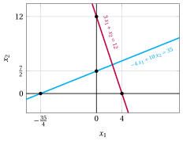
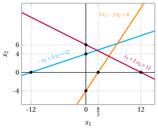
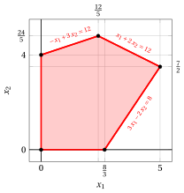
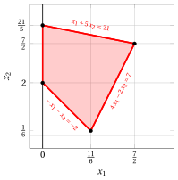
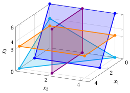
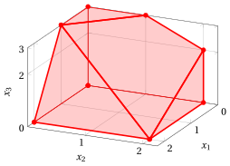
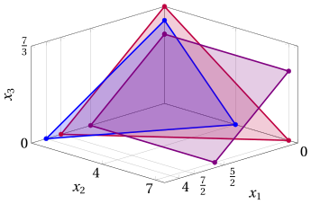
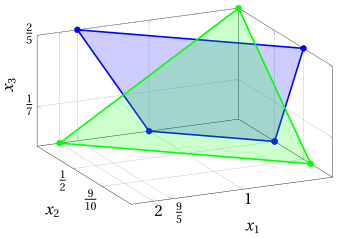
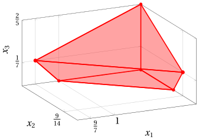
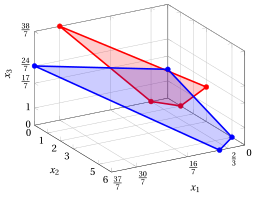

# Exercises · Half-spaces and polyhedra

<div class="info-capitolo" markdown>

**Exercises · Chapter 2** · each solution opens with a click · [:material-book-open-variant: Chapter 2: Half-spaces and polyhedra](../lp-problems/02-polyhedra.md) · [:material-file-pdf-box: Exercises, volume 1 (PDF)](../pdf/exercises-1-linear-programming-problems.pdf)

</div>

In the exercises of this chapter the intersection point of two supporting hyper-planes in $\R^2$ is computed by solving a system of two linear equations in two variables, with the following formula:

!!! nota ""

    Given $a_{11},a_{12},a_{21},a_{22},b_1,b_2 \in \R$, if $(a_{11} \; a_{22} - a_{12} \; a_{21}) \neq 0$, we have:

    \begin{equation*}
    \left\{ \begin{array}{ll}
    a_{11} \; {x}_1 + a_{12} \; {x}_2  & = b_1\\[2ex]
    a_{21} \; {x}_1 + a_{22} \; {x}_2  & = b_2
    \end{array} \right.
    ~~\Longrightarrow~~
    \begin{pmatrix}
    x_1 \\[0.5ex]
    x_2
    \end{pmatrix} = \begin{pmatrix}
    \frac{b_1 \; a_{22}-a_{12}\;b_2}{a_{11} \; a_{22} - a_{12} \; a_{21}} \\[2ex]
    \frac{a_{11}\;b_2  - b_{1} \; a_{21}}{a_{11} \; a_{22} - a_{12} \; a_{21}}
    \end{pmatrix}
    \end{equation*}

<a id="esercizio-2-1"></a>

!!! esercizio "Exercise 2.1: Polyhedra (P2)"

    Consider the following half-spaces in $\R^2$:

    $$
    \begin{array}{rrrrrrrrrrrrr}
    & {-} 4\, {x_1} & {+} & 10 \, {x_2} & {\le} & 35 \\[2ex]
    & 3\, {x_1} & {+} & \, {x_2} & {\le} & 12 \\[2ex]
    & {x_1} &  &  & { \ge} & {0} \\[2ex]
    &  &  & {x_2} & { \ge} & {0}
    \end{array}
    $$

    **Questions**

    1. Draw a plot of their supporting hyper-planes.

    2. Draw the polyhedron given by the intersection of the half-spaces. Is it a polytope?

??? soluzione "Solution"

    1. The supporting hyper-planes associated with the half-spaces and the intersection points with the axis are:

        <div class="tabella" markdown="0"><table>
        <tr>
        <td></td>
        <td><span style="color:#0c8599"><span class="arithmatex">\(-\)</span>4  <span class="arithmatex">\(x_1\)</span></span></td>
        <td><span style="color:#0c8599"><span class="arithmatex">\(+\)</span></span></td>
        <td><span style="color:#0c8599">10  <span class="arithmatex">\(x_2\)</span></span></td>
        <td><span style="color:#0c8599"><span class="arithmatex">\(=\)</span></span></td>
        <td><span style="color:#0c8599">35</span></td>
        <td></td>
        <td></td>
        <td></td>
        <td><span style="color:#0c8599"><span class="arithmatex">\(\begin{pmatrix} -\dfrac{35}{4} \\[0.5ex] 0 \end{pmatrix}\)</span>,  <span class="arithmatex">\(\begin{pmatrix} 0 \\[0.5ex] \dfrac{7}{2} \end{pmatrix}\)</span></span></td>
        </tr>
        <tr>
        <td></td>
        <td><span style="color:#7048e8">3  <span class="arithmatex">\(x_1\)</span></span></td>
        <td><span style="color:#7048e8"><span class="arithmatex">\(+\)</span></span></td>
        <td><span style="color:#7048e8"><span class="arithmatex">\(x_2\)</span></span></td>
        <td><span style="color:#7048e8"><span class="arithmatex">\(=\)</span></span></td>
        <td><span style="color:#7048e8">12</span></td>
        <td></td>
        <td></td>
        <td></td>
        <td><span style="color:#7048e8"><span class="arithmatex">\(\begin{pmatrix} 4 \\[0.5ex] 0 \end{pmatrix}\)</span>,  <span class="arithmatex">\(\begin{pmatrix} 0 \\[0.5ex] 12 \end{pmatrix}\)</span></span></td>
        </tr>
        <tr>
        <td></td>
        <td><span class="arithmatex">\(x_1\)</span></td>
        <td></td>
        <td></td>
        <td><span class="arithmatex">\(=\)</span></td>
        <td><span class="arithmatex">\(0\)</span></td>
        </tr>
        <tr>
        <td></td>
        <td></td>
        <td></td>
        <td><span class="arithmatex">\(x_2\)</span></td>
        <td><span class="arithmatex">\(=\)</span></td>
        <td><span class="arithmatex">\(0\)</span></td>
        </tr>
        </table></div>

        Their plot is shown below.

        { .fig .cornice loading=lazy style="width:65%" }

        We compute the intersection point:

        \begin{equation*}
        \left\{ \begin{array}{ll}
        -4 \; {x}_1 + 10 \; {x}_2  & = 35\\[2ex]
        3 \; {x}_1 +  \; {x}_2  & = 12
        \end{array} \right.
        ~~\Longrightarrow~~
        \begin{pmatrix}
        x_1 \\[0.5ex]
        x_2
        \end{pmatrix} = \begin{pmatrix}
        \frac{35 \cdot 1 - 10 \cdot 12}{(-4) \cdot 1 - 10 \cdot 3} \\[2ex]
        \frac{(-4) \cdot 12  - 35 \cdot 3}{(-4) \cdot 1 - 10 \cdot 3 }
        \end{pmatrix}
        = \begin{pmatrix}
        \frac{5}{2} \\[0.5ex]
        \frac{9}{2}
        \end{pmatrix}
        \end{equation*}

    2. The polyhedron, given by the intersection of the half-spaces, is:

        { .fig .cornice loading=lazy style="width:65%" }

        A polyhedron is a <strong>polytope</strong> if it is bounded (definitions of bounded polyhedron and of polytope in the chapter «Half-spaces and polyhedra»); equivalently, if there exist ${\boldsymbol \alpha},{\boldsymbol \beta} \in \R^n$ such that $\alpha_j \le x_j \le \beta_j$ for every ${\boldsymbol x} \in P$ and every $j \in \{1,2,\dots,n\}$.

        This polyhedron $P$ is bounded since for every $\begin{pmatrix} x_1 \\[0.5ex] x_2 \end{pmatrix} \in P$, we have for instance:

        \begin{align*}
        0 \le & ~~x_1~ \le 4\\[1ex]
        0 \le & ~~x_2~ \le \frac{9}{2}
        \end{align*}

        Accordingly this polyhedron is also a polytope.

<a id="esercizio-2-2"></a>

!!! esercizio "Exercise 2.2: Polyhedra (P10)"

    Consider the following half-spaces in $\R^2$:

    $$
    \begin{array}{rrrrrrrrrrrrr}
    & {-} \, {x_1} & {+} & 3 \, {x_2} & {\le} & 12 \\[2ex]
    & {x_1} & {+} & 2 \, {x_2} & {\le} & 12 \\[2ex]
    & {3} \, {x_1} & {-} & 2 \, {x_2} & {\le} & {8} \\[2ex]
    & {x_1} &  &  & { \ge} & {0} \\[2ex]
    &  &  & {x_2} & { \ge} & {0}
    \end{array}
    $$

    **Questions**

    1. Draw a plot of their supporting hyper-planes.

    2. Draw the polyhedron given by the intersection of the half-spaces. Is it a polytope?

    3. What happens if we add the constraint $~ x_1 \ge 5 ~$ to the polyhedron? What if we add the constraint $~ x_1 \le 5 ~$?

??? soluzione "Solution"

    1. The supporting hyper-planes associated with the half-spaces and the intersection points with the axis are:

        <div class="tabella" markdown="0"><table>
        <tr>
        <td></td>
        <td><span style="color:#0c8599"><span class="arithmatex">\(-\)</span>  <span class="arithmatex">\(x_1\)</span></span></td>
        <td><span style="color:#0c8599"><span class="arithmatex">\(+\)</span></span></td>
        <td><span style="color:#0c8599">3  <span class="arithmatex">\(x_2\)</span></span></td>
        <td><span style="color:#0c8599"><span class="arithmatex">\(=\)</span></span></td>
        <td><span style="color:#0c8599">12</span></td>
        <td></td>
        <td></td>
        <td></td>
        <td><span style="color:#0c8599"><span class="arithmatex">\(\begin{pmatrix} -12 \\[0.5ex] 0 \end{pmatrix}\)</span>,  <span class="arithmatex">\(\begin{pmatrix} 0 \\[0.5ex] 4 \end{pmatrix}\)</span></span></td>
        </tr>
        <tr>
        <td></td>
        <td><span style="color:#7048e8"><span class="arithmatex">\(x_1\)</span></span></td>
        <td><span style="color:#7048e8"><span class="arithmatex">\(+\)</span></span></td>
        <td><span style="color:#7048e8">2  <span class="arithmatex">\(x_2\)</span></span></td>
        <td><span style="color:#7048e8"><span class="arithmatex">\(=\)</span></span></td>
        <td><span style="color:#7048e8">12</span></td>
        <td></td>
        <td></td>
        <td></td>
        <td><span style="color:#7048e8"><span class="arithmatex">\(\begin{pmatrix} 12 \\[0.5ex] 0 \end{pmatrix}\)</span>,  <span class="arithmatex">\(\begin{pmatrix} 0 \\[0.5ex] 6 \end{pmatrix}\)</span></span></td>
        </tr>
        <tr>
        <td></td>
        <td><span style="color:#e8590c">3  <span class="arithmatex">\(x_1\)</span></span></td>
        <td><span style="color:#e8590c"><span class="arithmatex">\(-\)</span></span></td>
        <td><span style="color:#e8590c">2  <span class="arithmatex">\(x_2\)</span></span></td>
        <td><span style="color:#e8590c"><span class="arithmatex">\(=\)</span></span></td>
        <td><span style="color:#e8590c">8</span></td>
        <td></td>
        <td></td>
        <td></td>
        <td><span style="color:#e8590c"><span class="arithmatex">\(\begin{pmatrix} \dfrac{8}{3} \\[0.5ex] 0 \end{pmatrix}\)</span>,  <span class="arithmatex">\(\begin{pmatrix} 0 \\[0.5ex] -4 \end{pmatrix}\)</span></span></td>
        </tr>
        <tr>
        <td></td>
        <td><span class="arithmatex">\(x_1\)</span></td>
        <td></td>
        <td></td>
        <td><span class="arithmatex">\(=\)</span></td>
        <td><span class="arithmatex">\(0\)</span></td>
        </tr>
        <tr>
        <td></td>
        <td></td>
        <td></td>
        <td><span class="arithmatex">\(x_2\)</span></td>
        <td><span class="arithmatex">\(=\)</span></td>
        <td><span class="arithmatex">\(0\)</span></td>
        </tr>
        </table></div>

        Their plot is shown below.

        { .fig .cornice loading=lazy style="width:65%" }

        We compute the intersection points:

        \begin{equation*}
        \left\{ \begin{array}{ll}
        -\; {x}_1 + 3 \; {x}_2  & = 12\\[2ex]
        \; {x}_1 + 2 \; {x}_2  & = 12
        \end{array} \right.
        ~~\Longrightarrow~~
        \begin{pmatrix}
        x_1 \\[0.5ex]
        x_2
        \end{pmatrix} = \begin{pmatrix}
        \frac{12 \cdot 2 - 3\cdot 12}{(-1) \cdot 2 - 3 \cdot 1} \\[2ex]
        \frac{(-1) \cdot 12  - 12 \cdot 1}{(-1) \cdot 2 - 3 \cdot 1}
        \end{pmatrix}
        = \begin{pmatrix}
        \frac{12}{5} \\[0.5ex]
        \frac{24}{5}
        \end{pmatrix}
        \end{equation*}

        \begin{equation*}
        \left\{ \begin{array}{ll}
        \; {x}_1 + 2 \; {x}_2  & = 12\\[2ex]
        3 \; {x}_1 - 2 \; {x}_2  & = 8
        \end{array} \right.
        ~~\Longrightarrow~~
        \begin{pmatrix}
        x_1 \\[0.5ex]
        x_2
        \end{pmatrix} = \begin{pmatrix}
        \frac{12 \cdot (-2)-2 \cdot 8}{1 \cdot (-2) - 2 \cdot 3} \\[2ex]
        \frac{1 \cdot 8  - 12 \cdot 3}{1 \cdot (-2) - 2 \cdot 3}
        \end{pmatrix}
        = \begin{pmatrix}
        5 \\[0.5ex]
        \frac{7}{2}
        \end{pmatrix}
        \end{equation*}

    2. The polyhedron, given by the intersection of the half-spaces, is:

        { .fig .cornice loading=lazy style="width:65%" }

        A polyhedron is a <strong>polytope</strong> if it is bounded (definitions of bounded polyhedron and of polytope in the chapter «Half-spaces and polyhedra»); equivalently, if there exist ${\boldsymbol \alpha},{\boldsymbol \beta} \in \R^n$ such that $\alpha_j \le x_j \le \beta_j$ for every ${\boldsymbol x} \in P$ and every $j \in \{1,2,\dots,n\}$.

        This polyhedron $P$ is bounded since for every $\begin{pmatrix} x_1 \\[0.5ex] x_2 \end{pmatrix} \in P$, we have for instance:

        \begin{align*}
        0 \le & ~~x_1~ \le 5\\[1ex]
        0 \le & ~~x_2~ \le \frac{24}{5}
        \end{align*}

        Accordingly this polyhedron is also a polytope.

    3. If we add constraint $~x_1 \ge 5~$ the polyhedron reduces to the point $\left (~5,~ \frac{7}{2}~\right)$. If we add constraint $~x_1 \le 5~$ the polyhedron does not change.

<a id="esercizio-2-3"></a>

!!! esercizio "Exercise 2.3: Polyhedra (P21)"

    Consider the following half-spaces in $\R^2$:

    $$
    \begin{array}{rrrrrrrrrrrrr}
    & {- }\, {x_1} & {-} & \, {x_2} & {\le} & {-2} \\[2ex]
    & {4} \, {x_1} & {-} & {2} \, {x_2} & {\le} & {7} \\[2ex]
    & {x_1} & {+} & {5} \, {x_2} & {\le} & {21} \\[2ex]
    & {x_1} &  &  & { \ge} & {0} \\[2ex]
    &  &  & {x_2} & { \ge} & {0}
    \end{array}
    $$

    **Questions**

    1. Draw a plot of their supporting hyper-planes.

    2. Draw the polyhedron given by the intersection of the half-spaces. Is it a polytope?

??? soluzione "Solution"

    1. The supporting hyper-planes associated with the half-spaces and the intersection points with the axis are:

        <div class="tabella" markdown="0"><table>
        <tr>
        <td></td>
        <td><span style="color:#0c8599"><span class="arithmatex">\(-\)</span>  <span class="arithmatex">\(x_1\)</span></span></td>
        <td><span style="color:#0c8599"><span class="arithmatex">\(-\)</span></span></td>
        <td><span style="color:#0c8599"><span class="arithmatex">\(x_2\)</span></span></td>
        <td><span style="color:#0c8599"><span class="arithmatex">\(=\)</span></span></td>
        <td><span style="color:#0c8599"><span class="arithmatex">\(-2\)</span></span></td>
        <td></td>
        <td></td>
        <td></td>
        <td><span style="color:#0c8599"><span class="arithmatex">\(\begin{pmatrix} 2 \\[0.5ex] 0 \end{pmatrix}\)</span>,  <span class="arithmatex">\(\begin{pmatrix} 0 \\[0.5ex] 2 \end{pmatrix}\)</span></span></td>
        </tr>
        <tr>
        <td></td>
        <td><span style="color:#7048e8">4  <span class="arithmatex">\(x_1\)</span></span></td>
        <td><span style="color:#7048e8"><span class="arithmatex">\(-\)</span></span></td>
        <td><span style="color:#7048e8">2  <span class="arithmatex">\(x_2\)</span></span></td>
        <td><span style="color:#7048e8"><span class="arithmatex">\(=\)</span></span></td>
        <td><span style="color:#7048e8">7</span></td>
        <td></td>
        <td></td>
        <td></td>
        <td><span style="color:#7048e8"><span class="arithmatex">\(\begin{pmatrix} \dfrac{7}{4} \\[0.5ex] 0 \end{pmatrix}\)</span>,  <span class="arithmatex">\(\begin{pmatrix} 0 \\[0.5ex] -\dfrac{7}{2} \end{pmatrix}\)</span></span></td>
        </tr>
        <tr>
        <td></td>
        <td><span style="color:#e8590c"><span class="arithmatex">\(x_1\)</span></span></td>
        <td><span style="color:#e8590c"><span class="arithmatex">\(+\)</span></span></td>
        <td><span style="color:#e8590c">5  <span class="arithmatex">\(x_2\)</span></span></td>
        <td><span style="color:#e8590c"><span class="arithmatex">\(=\)</span></span></td>
        <td><span style="color:#e8590c">21</span></td>
        <td></td>
        <td></td>
        <td></td>
        <td><span style="color:#e8590c"><span class="arithmatex">\(\begin{pmatrix} 21 \\[0.5ex] 0 \end{pmatrix}\)</span>,  <span class="arithmatex">\(\begin{pmatrix} 0 \\[0.5ex] \dfrac{21}{5} \end{pmatrix}\)</span></span></td>
        </tr>
        <tr>
        <td></td>
        <td><span class="arithmatex">\(x_1\)</span></td>
        <td></td>
        <td></td>
        <td><span class="arithmatex">\(=\)</span></td>
        <td><span class="arithmatex">\(0\)</span></td>
        </tr>
        <tr>
        <td></td>
        <td></td>
        <td></td>
        <td><span class="arithmatex">\(x_2\)</span></td>
        <td><span class="arithmatex">\(=\)</span></td>
        <td><span class="arithmatex">\(0\)</span></td>
        </tr>
        </table></div>

        Their plot is shown below.

        { .fig .cornice loading=lazy style="width:79%" }

        We compute the intersection points:

        \begin{equation*}
        \left\{ \begin{array}{ll}
        {x}_1 + 5 \; {x}_2  & = 21\\[2ex]
        4\; {x}_1 - 2 \; {x}_2  & = 7
        \end{array} \right.
        ~~\Longrightarrow~~
        \begin{pmatrix}
        x_1 \\[0.5ex]
        x_2
        \end{pmatrix} = \begin{pmatrix}
        \frac{21 \cdot (-2) - 5\cdot 7}{ 1 \cdot (-2) - 5 \cdot 4} \\[2ex]
        \frac{1 \cdot 7  - 21  \cdot 4}{1 \cdot (-2) - 5 \cdot 4}
        \end{pmatrix}
        = \begin{pmatrix}
        \frac{7}{2} \\[0.5ex]
        \frac{7}{2}
        \end{pmatrix}
        \end{equation*}

        \begin{equation*}
        \left\{ \begin{array}{ll}
        -\; {x}_1 - \; {x}_2  & = -2\\[2ex]
        4 \; {x}_1 - 2 \; {x}_2  & = 7
        \end{array} \right.
        ~~\Longrightarrow~~
        \begin{pmatrix}
        x_1 \\[0.5ex]
        x_2
        \end{pmatrix} = \begin{pmatrix}
        \frac{(-2) \cdot (-2)-(-1) \cdot 7}{(-1) \cdot (-2)-(-1) \cdot 4} \\[2ex]
        \frac{(-1) \cdot 7  - (-2) \cdot 4}{(-1) \cdot (-2)-(-1) \cdot 4}
        \end{pmatrix}
        = \begin{pmatrix}
        \frac{11}{6} \\[0.5ex]
        \frac{1}{6}
        \end{pmatrix}
        \end{equation*}

    2. The polyhedron, given by the intersection of the half-spaces, is:

        { .fig .cornice loading=lazy style="width:65%" }

        A polyhedron is a <strong>polytope</strong> if it is bounded (definitions of bounded polyhedron and of polytope in the chapter «Half-spaces and polyhedra»); equivalently, if there exist ${\boldsymbol \alpha},{\boldsymbol \beta} \in \R^n$ such that $\alpha_j \le x_j \le \beta_j$ for every ${\boldsymbol x} \in P$ and every $j \in \{1,2,\dots,n\}$.

        This polyhedron $P$ is bounded since for every $\begin{pmatrix} x_1 \\[0.5ex] x_2 \end{pmatrix} \in P$, we have for instance:

        \begin{align*}
        0 \le & ~~x_1~ \le \frac{7}{2}\\[1ex]
        0 \le & ~~x_2~ \le \frac{21}{5}
        \end{align*}

        Accordingly this polyhedron is also a polytope.

<a id="esercizio-2-4"></a>

!!! esercizio "Exercise 2.4: Polyhedra (P41)"

    Consider the following half-spaces in $\R^3$:

    $$
    \begin{array}{rrrrrrrrrrrrr}
    & \, {x_1} & {+} & \, {x_2} & {+} & \, {x_3} & {\le} & {4} \\[1.5ex]
    &  &  & \, {x_2} &  &  & {\le} & {2} \\[1.5ex]
    &  &  &  &  & \, {x_3} & {\le} & {3} \\[1.5ex]
    & 3\, {x_1} &  &  & {+} & \, {x_3} & {\le} & {6} \\[1.5ex]
    & {x_1} &  &  &  &  & {\ge} & {0} \\[1.5ex]
    &  &  & {x_2} &  &  & {\ge} & {0} \\[1.5ex]
    &  &  &  &  & {x_3} & {\ge} & {0}
    \end{array}
    $$

    **Questions**

    1. Draw a plot of their supporting hyper-planes.

    2. Draw the polyhedron given by the intersection of the half-spaces. Is it a polytope?

??? soluzione "Solution"

    1. The supporting hyper-planes associated with the half-spaces and the intersection points with the axis are:

        <div class="tabella" markdown="0"><table>
        <tr>
        <td></td>
        <td><span style="color:#0c8599"><span class="arithmatex">\(x_1\)</span></span></td>
        <td><span style="color:#0c8599"><span class="arithmatex">\(+\)</span></span></td>
        <td><span style="color:#0c8599"><span class="arithmatex">\(x_2\)</span></span></td>
        <td><span style="color:#0c8599"><span class="arithmatex">\(+\)</span></span></td>
        <td><span style="color:#0c8599"><span class="arithmatex">\(x_3\)</span></span></td>
        <td><span style="color:#0c8599"><span class="arithmatex">\(=\)</span></span></td>
        <td><span style="color:#0c8599">4</span></td>
        <td></td>
        <td><span style="color:#0c8599"><span class="arithmatex">\(\begin{pmatrix} 4 \\[0.5ex] 0 \\[0.5ex] 0 \end{pmatrix}\)</span>,  <span class="arithmatex">\(\begin{pmatrix} 0 \\[0.5ex] 4 \\[0.5ex] 0 \end{pmatrix}\)</span>,  <span class="arithmatex">\(\begin{pmatrix} 0 \\[0.5ex] 0 \\[0.5ex] 4 \end{pmatrix}\)</span></span></td>
        </tr>
        <tr>
        <td></td>
        <td></td>
        <td></td>
        <td><span style="color:#9c36b5"><span class="arithmatex">\(x_2\)</span></span></td>
        <td></td>
        <td></td>
        <td><span style="color:#9c36b5"><span class="arithmatex">\(=\)</span></span></td>
        <td><span style="color:#9c36b5">2</span></td>
        <td></td>
        <td><span style="color:#9c36b5"><span class="arithmatex">\(\begin{pmatrix} 0 \\[0.5ex] 2 \\[0.5ex] 0 \end{pmatrix}\)</span></span></td>
        </tr>
        <tr>
        <td></td>
        <td></td>
        <td></td>
        <td></td>
        <td></td>
        <td><span style="color:#e8590c"><span class="arithmatex">\(x_3\)</span></span></td>
        <td><span style="color:#e8590c"><span class="arithmatex">\(=\)</span></span></td>
        <td><span style="color:#e8590c">3</span></td>
        <td></td>
        <td><span style="color:#e8590c"><span class="arithmatex">\(\begin{pmatrix} 0 \\[0.5ex] 0 \\[0.5ex] 3 \end{pmatrix}\)</span></span></td>
        </tr>
        <tr>
        <td></td>
        <td><span style="color:#1971c2">3  <span class="arithmatex">\(x_1\)</span></span></td>
        <td></td>
        <td></td>
        <td><span style="color:#1971c2"><span class="arithmatex">\(+\)</span></span></td>
        <td><span style="color:#1971c2"><span class="arithmatex">\(x_3\)</span></span></td>
        <td><span style="color:#1971c2"><span class="arithmatex">\(=\)</span></span></td>
        <td><span style="color:#1971c2">6</span></td>
        <td></td>
        <td><span style="color:#1971c2"><span class="arithmatex">\(\begin{pmatrix} 2 \\[0.5ex] 0 \\[0.5ex] 0 \end{pmatrix}\)</span>,  <span class="arithmatex">\(\begin{pmatrix} 0 \\[0.5ex] 0 \\[0.5ex] 6 \end{pmatrix}\)</span></span></td>
        </tr>
        <tr>
        <td></td>
        <td><span class="arithmatex">\(x_1\)</span></td>
        <td></td>
        <td></td>
        <td></td>
        <td></td>
        <td><span class="arithmatex">\(=\)</span></td>
        <td><span class="arithmatex">\(0\)</span></td>
        </tr>
        <tr>
        <td></td>
        <td></td>
        <td></td>
        <td><span class="arithmatex">\(x_2\)</span></td>
        <td></td>
        <td></td>
        <td><span class="arithmatex">\(=\)</span></td>
        <td><span class="arithmatex">\(0\)</span></td>
        </tr>
        <tr>
        <td></td>
        <td></td>
        <td></td>
        <td></td>
        <td></td>
        <td><span class="arithmatex">\(x_3\)</span></td>
        <td><span class="arithmatex">\(=\)</span></td>
        <td><span class="arithmatex">\(0\)</span></td>
        </tr>
        </table></div>

        Their plot is shown below.

        { .fig .cornice loading=lazy style="width:53%" }

    2. The polyhedron given by the intersection of the half-spaces in $\R^3$ is:

        { .fig .cornice loading=lazy style="width:53%" }

        A polyhedron is a <strong>polytope</strong> if it is bounded (definitions of bounded polyhedron and of polytope in the chapter «Half-spaces and polyhedra»); equivalently, if there exist ${\boldsymbol \alpha},{\boldsymbol \beta} \in \R^n$ such that $\alpha_j \le x_j \le \beta_j$ for every ${\boldsymbol x} \in P$ and every $j \in \{1,2,\dots,n\}$.

        This polyhedron $P$ is bounded since for every $\begin{pmatrix} x_1 \\[0.5ex] x_2 \\[0.5ex] x_3 \end{pmatrix} \in P$, we have for instance:

        \begin{align*}
        0 \le & ~~x_1~ \le 2\\[1ex]
        0 \le & ~~x_2~ \le 2\\[1ex]
        0 \le & ~~x_3~ \le 3
        \end{align*}

        Accordingly this polyhedron is also a polytope.

<a id="esercizio-2-5"></a>

!!! esercizio "Exercise 2.5: Polyhedra (P42)"

    Consider the following half-spaces in $\R^3$:

    $$
    \begin{array}{rrrrrrrrrrrrr}
    & \, {x_1} & {+} & \, {x_2} & {+} & 2 \, {x_3} & {\le} & 4 \\[1.5ex]
    & 2 \, {x_1} &  &  & {+} & 3 \, {x_3} & {\le} & 5 \\[1.5ex]
    & 2 \, {x_1} & {+} & \, {x_2} & {+} & 3 \, {x_3} & {\le} & 7 \\[1.5ex]
    & {x_1} &  &  &  &  & {\ge} & {0} \\[1.5ex]
    &  &  & {x_2} &  &  & {\ge} & {0} \\[1.5ex]
    &  &  &  &  & {x_3} & {\ge} & {0}
    \end{array}
    $$

    **Questions**

    1. Draw a plot of their supporting hyper-planes.

    2. Draw the polyhedron given by the intersection of the half-spaces. Is it a polytope?

??? soluzione "Solution"

    1. The supporting hyper-planes associated with the half-spaces and the intersection points with the axis are:

        <div class="tabella" markdown="0"><table>
        <tr>
        <td></td>
        <td><span style="color:#1971c2"><span class="arithmatex">\(x_1\)</span></span></td>
        <td><span style="color:#1971c2"><span class="arithmatex">\(+\)</span></span></td>
        <td><span style="color:#1971c2"><span class="arithmatex">\(x_2\)</span></span></td>
        <td><span style="color:#1971c2"><span class="arithmatex">\(+\)</span></span></td>
        <td><span style="color:#1971c2">2  <span class="arithmatex">\(x_3\)</span></span></td>
        <td><span style="color:#1971c2"><span class="arithmatex">\(=\)</span></span></td>
        <td><span style="color:#1971c2">4</span></td>
        <td></td>
        <td><span style="color:#1971c2"><span class="arithmatex">\(\begin{pmatrix} 4 \\[0.5ex] 0 \\[0.5ex] 0 \end{pmatrix}\)</span>,  <span class="arithmatex">\(\begin{pmatrix} 0 \\[0.5ex] 4 \\[0.5ex] 0 \end{pmatrix}\)</span>,  <span class="arithmatex">\(\begin{pmatrix} 0 \\[0.5ex] 0 \\[0.5ex] 2 \end{pmatrix}\)</span></span></td>
        </tr>
        <tr>
        <td></td>
        <td><span style="color:#9c36b5">2  <span class="arithmatex">\(x_1\)</span></span></td>
        <td></td>
        <td></td>
        <td><span style="color:#9c36b5"><span class="arithmatex">\(+\)</span></span></td>
        <td><span style="color:#9c36b5">3  <span class="arithmatex">\(x_3\)</span></span></td>
        <td><span style="color:#9c36b5"><span class="arithmatex">\(=\)</span></span></td>
        <td><span style="color:#9c36b5">5</span></td>
        <td></td>
        <td><span style="color:#9c36b5"><span class="arithmatex">\(\begin{pmatrix} \tfrac{5}{2} \\[0.5ex] 0 \\[0.5ex] 0 \end{pmatrix}\)</span>,  <span class="arithmatex">\(\begin{pmatrix} 0 \\[0.5ex] 0 \\[0.5ex] \tfrac{5}{3} \end{pmatrix}\)</span></span></td>
        </tr>
        <tr>
        <td></td>
        <td><span style="color:#7048e8">2  <span class="arithmatex">\(x_1\)</span></span></td>
        <td><span style="color:#7048e8"><span class="arithmatex">\(+\)</span></span></td>
        <td><span style="color:#7048e8"><span class="arithmatex">\(x_2\)</span></span></td>
        <td><span style="color:#7048e8"><span class="arithmatex">\(+\)</span></span></td>
        <td><span style="color:#7048e8">3  <span class="arithmatex">\(x_3\)</span></span></td>
        <td><span style="color:#7048e8"><span class="arithmatex">\(=\)</span></span></td>
        <td><span style="color:#7048e8">7</span></td>
        <td></td>
        <td><span style="color:#7048e8"><span class="arithmatex">\(\begin{pmatrix} \tfrac{7}{2} \\[0.5ex] 0 \\[0.5ex] 0 \end{pmatrix}\)</span>,  <span class="arithmatex">\(\begin{pmatrix} 0 \\[0.5ex] 7 \\[0.5ex] 0 \end{pmatrix}\)</span>,  <span class="arithmatex">\(\begin{pmatrix} 0 \\[0.5ex] 0 \\[0.5ex] \tfrac{7}{3} \end{pmatrix}\)</span></span></td>
        </tr>
        <tr>
        <td></td>
        <td><span class="arithmatex">\(x_1\)</span></td>
        <td></td>
        <td></td>
        <td></td>
        <td></td>
        <td><span class="arithmatex">\(=\)</span></td>
        <td><span class="arithmatex">\(0\)</span></td>
        </tr>
        <tr>
        <td></td>
        <td></td>
        <td></td>
        <td><span class="arithmatex">\(x_2\)</span></td>
        <td></td>
        <td></td>
        <td><span class="arithmatex">\(=\)</span></td>
        <td><span class="arithmatex">\(0\)</span></td>
        </tr>
        <tr>
        <td></td>
        <td></td>
        <td></td>
        <td></td>
        <td></td>
        <td><span class="arithmatex">\(x_3\)</span></td>
        <td><span class="arithmatex">\(=\)</span></td>
        <td><span class="arithmatex">\(0\)</span></td>
        </tr>
        </table></div>

        Their plot is shown below.

        { .fig .cornice loading=lazy style="width:76%" }

    2. The polyhedron given by the intersection of the half-spaces in $\R^3$ is:

        { .fig .cornice loading=lazy style="width:76%" }

        A polyhedron is a <strong>polytope</strong> if it is bounded (definitions of bounded polyhedron and of polytope in the chapter «Half-spaces and polyhedra»); equivalently, if there exist ${\boldsymbol \alpha},{\boldsymbol \beta} \in \R^n$ such that $\alpha_j \le x_j \le \beta_j$ for every ${\boldsymbol x} \in P$ and every $j \in \{1,2,\dots,n\}$.

        This polyhedron $P$ is bounded since for every $\begin{pmatrix} x_1 \\[0.5ex] x_2 \\[0.5ex] x_3 \end{pmatrix} \in P$, we have for instance:

        \begin{align*}
        0 \le & ~~x_1~ \le 10\\[1ex]
        0 \le & ~~x_2~ \le 10\\[1ex]
        0 \le & ~~x_3~ \le 10
        \end{align*}

        Accordingly this polyhedron is also a polytope.

<a id="esercizio-2-6"></a>

!!! esercizio "Exercise 2.6: Polyhedra (P44)"

    Consider the following half-spaces in $\R^3$:

    $$
    \begin{array}{rrrrrrrrrrrrr}
    & {x_1} & {+} & 2 \, {x_2} & {-} & 2 \, {x_3} & {\le} & 1 \\[1.5ex]
    & 2 \, {x_1} & {-} & \, {x_2} & {-} & 3 \, {x_3} & {\le} & 4 \\[1.5ex]
    & {x_1} & {+} & 2 \, {x_2} & {+} & 5 \, {x_3} & {\le} & 2 \\[1.5ex]
    & {x_1} &  &  &  &  & {\ge} & {0} \\[1.5ex]
    &  &  & {x_2} &  &  & {\ge} & {0} \\[1.5ex]
    &  &  &  &  & {x_3} & {\ge} & {0}
    \end{array}
    $$

    **Questions**

    1. Draw a plot of their supporting hyper-planes.

    2. Draw the polyhedron given by the intersection of the half-spaces. Is it a polytope?

??? soluzione "Solution"

    1. The supporting hyper-planes associated with the half-spaces and the intersection points with the axis are:

        <div class="tabella" markdown="0"><table>
        <tr>
        <td></td>
        <td><span style="color:#1971c2"><span class="arithmatex">\(x_1\)</span></span></td>
        <td><span style="color:#1971c2"><span class="arithmatex">\(+\)</span></span></td>
        <td><span style="color:#1971c2">2  <span class="arithmatex">\(x_2\)</span></span></td>
        <td><span style="color:#1971c2"><span class="arithmatex">\(-\)</span></span></td>
        <td><span style="color:#1971c2">2  <span class="arithmatex">\(x_3\)</span></span></td>
        <td><span style="color:#1971c2"><span class="arithmatex">\(=\)</span></span></td>
        <td><span style="color:#1971c2">1</span></td>
        <td></td>
        <td><span style="color:#1971c2"><span class="arithmatex">\(\begin{pmatrix} 1 \\[0.5ex] 0 \\[0.5ex] 0 \end{pmatrix}\)</span>,  <span class="arithmatex">\(\begin{pmatrix} 0 \\[0.5ex] \tfrac{1}{2} \\[0.5ex] 0 \end{pmatrix}\)</span>,  <span class="arithmatex">\(\begin{pmatrix} 0 \\[0.5ex] 0 \\[0.5ex] -\tfrac{1}{2} \end{pmatrix}\)</span></span></td>
        </tr>
        <tr>
        <td></td>
        <td><span style="color:#9c36b5">2  <span class="arithmatex">\(x_1\)</span></span></td>
        <td><span style="color:#9c36b5"><span class="arithmatex">\(-\)</span></span></td>
        <td><span style="color:#9c36b5"><span class="arithmatex">\(x_2\)</span></span></td>
        <td><span style="color:#9c36b5"><span class="arithmatex">\(-\)</span></span></td>
        <td><span style="color:#9c36b5">3  <span class="arithmatex">\(x_3\)</span></span></td>
        <td><span style="color:#9c36b5"><span class="arithmatex">\(=\)</span></span></td>
        <td><span style="color:#9c36b5">4</span></td>
        <td></td>
        <td><span style="color:#9c36b5"><span class="arithmatex">\(\begin{pmatrix} 2 \\[0.5ex] 0 \\[0.5ex] 0 \end{pmatrix}\)</span>,  <span class="arithmatex">\(\begin{pmatrix} 0 \\[0.5ex] -4 \\[0.5ex] 0 \end{pmatrix}\)</span>,  <span class="arithmatex">\(\begin{pmatrix} 0 \\[0.5ex] 0 \\[0.5ex] -\tfrac{4}{3} \end{pmatrix}\)</span></span></td>
        </tr>
        <tr>
        <td></td>
        <td><span style="color:#2f9e44"><span class="arithmatex">\(x_1\)</span></span></td>
        <td><span style="color:#2f9e44"><span class="arithmatex">\(+\)</span></span></td>
        <td><span style="color:#2f9e44">2  <span class="arithmatex">\(x_2\)</span></span></td>
        <td><span style="color:#2f9e44"><span class="arithmatex">\(+\)</span></span></td>
        <td><span style="color:#2f9e44">5  <span class="arithmatex">\(x_3\)</span></span></td>
        <td><span style="color:#2f9e44"><span class="arithmatex">\(=\)</span></span></td>
        <td><span style="color:#2f9e44">2</span></td>
        <td></td>
        <td><span style="color:#2f9e44"><span class="arithmatex">\(\begin{pmatrix} 2 \\[0.5ex] 0 \\[0.5ex] 0 \end{pmatrix}\)</span>,  <span class="arithmatex">\(\begin{pmatrix} 0 \\[0.5ex] 1 \\[0.5ex] 0 \end{pmatrix}\)</span>,  <span class="arithmatex">\(\begin{pmatrix} 0 \\[0.5ex] 0 \\[0.5ex] \tfrac{2}{5} \end{pmatrix}\)</span></span></td>
        </tr>
        <tr>
        <td></td>
        <td><span class="arithmatex">\(x_1\)</span></td>
        <td></td>
        <td></td>
        <td></td>
        <td></td>
        <td><span class="arithmatex">\(=\)</span></td>
        <td><span class="arithmatex">\(0\)</span></td>
        </tr>
        <tr>
        <td></td>
        <td></td>
        <td></td>
        <td><span class="arithmatex">\(x_2\)</span></td>
        <td></td>
        <td></td>
        <td><span class="arithmatex">\(=\)</span></td>
        <td><span class="arithmatex">\(0\)</span></td>
        </tr>
        <tr>
        <td></td>
        <td></td>
        <td></td>
        <td></td>
        <td></td>
        <td><span class="arithmatex">\(x_3\)</span></td>
        <td><span class="arithmatex">\(=\)</span></td>
        <td><span class="arithmatex">\(0\)</span></td>
        </tr>
        </table></div>

        Their plot is shown below.

        { .fig .cornice loading=lazy style="width:79%" }

    2. The polyhedron given by the intersection of the half-spaces in $\R^3$ is:

        { .fig .cornice loading=lazy style="width:79%" }

        A polyhedron is a <strong>polytope</strong> if it is bounded (definitions of bounded polyhedron and of polytope in the chapter «Half-spaces and polyhedra»); equivalently, if there exist ${\boldsymbol \alpha},{\boldsymbol \beta} \in \R^n$ such that $\alpha_j \le x_j \le \beta_j$ for every ${\boldsymbol x} \in P$ and every $j \in \{1,2,\dots,n\}$.

        This polyhedron $P$ is bounded since for every $\begin{pmatrix} x_1 \\[0.5ex] x_2 \\[0.5ex] x_3 \end{pmatrix} \in P$, we have for instance:

        \begin{align*}
        0 \le & ~~x_1~ \le 10\\[1ex]
        0 \le & ~~x_2~ \le 10\\[1ex]
        0 \le & ~~x_3~ \le 10
        \end{align*}

        Accordingly this polyhedron is also a polytope.

<a id="esercizio-2-7"></a>

!!! esercizio "Exercise 2.7: Polyhedra (P51)"

    Consider the following half-spaces in $\R^3$:

    $$
    \begin{array}{rrrrrrrrrrrrr}
    &  & \, {x_1} & {-} & {x_2} & {-} & 3 \, {x_3} & {\le} & {-} 5 \\[2ex]
    & {-} & 3 \, {x_1} & {-} & 2 \, {x_2} & {+} & 2 \, {x_3} & {\le} & {-}2 \\[2ex]
    &  & {x_1} &  &  &  &  & {\ge} & {0} \\[1.5ex]
    &  &  &  & {x_2} &  &  & {\ge} & {0} \\[1.5ex]
    &  &  &  &  &  & {x_3} & {\ge} & {0}
    \end{array}
    $$

    **Questions**

    1. Draw a plot of their supporting hyper-planes.

    2. Draw the polyhedron given by the intersection of the half-spaces. Is it a polytope?

??? soluzione "Solution"

    1. The supporting hyper-planes associated with the half-spaces and the intersection points with the axis are:

        <div class="tabella" markdown="0"><table>
        <tr>
        <td></td>
        <td><span style="color:#1971c2"><span class="arithmatex">\(x_1\)</span></span></td>
        <td><span style="color:#1971c2"><span class="arithmatex">\(-\)</span></span></td>
        <td><span style="color:#1971c2"><span class="arithmatex">\(x_2\)</span></span></td>
        <td><span style="color:#1971c2"><span class="arithmatex">\(-\)</span></span></td>
        <td><span style="color:#1971c2">3  <span class="arithmatex">\(x_3\)</span></span></td>
        <td><span style="color:#1971c2"><span class="arithmatex">\(=\)</span></span></td>
        <td><span style="color:#1971c2"><span class="arithmatex">\(-5\)</span></span></td>
        <td></td>
        <td><span style="color:#1971c2"><span class="arithmatex">\(\begin{pmatrix} \!-5 \\[0.5ex] 0 \\[0.5ex] 0 \end{pmatrix}\)</span>,  <span class="arithmatex">\(\begin{pmatrix} 0 \\[0.5ex] 5 \\[0.5ex] 0 \end{pmatrix}\)</span>,  <span class="arithmatex">\(\begin{pmatrix} 0 \\[0.5ex] 0 \\[0.5ex] \tfrac{5}{3} \end{pmatrix}\)</span></span></td>
        </tr>
        <tr>
        <td></td>
        <td><span style="color:#e03131"><span class="arithmatex">\(-3\, x_1\)</span></span></td>
        <td><span style="color:#e03131"><span class="arithmatex">\(-\)</span></span></td>
        <td><span style="color:#e03131">2  <span class="arithmatex">\(x_2\)</span></span></td>
        <td><span style="color:#e03131"><span class="arithmatex">\(+\)</span></span></td>
        <td><span style="color:#e03131">2  <span class="arithmatex">\(x_3\)</span></span></td>
        <td><span style="color:#e03131"><span class="arithmatex">\(=\)</span></span></td>
        <td><span style="color:#e03131"><span class="arithmatex">\(-2\)</span></span></td>
        <td></td>
        <td><span style="color:#e03131"><span class="arithmatex">\(\begin{pmatrix} \tfrac{2}{3} \\[0.5ex] 0 \\[0.5ex] 0 \end{pmatrix}\)</span>,  <span class="arithmatex">\(\begin{pmatrix} 0 \\[0.5ex] 1 \\[0.5ex] 0 \end{pmatrix}\)</span>,  <span class="arithmatex">\(\begin{pmatrix} 0 \\[0.5ex] 0 \\[0.5ex] -1 \end{pmatrix}\)</span></span></td>
        </tr>
        <tr>
        <td></td>
        <td><span class="arithmatex">\(x_1\)</span></td>
        <td></td>
        <td></td>
        <td></td>
        <td></td>
        <td><span class="arithmatex">\(=\)</span></td>
        <td><span class="arithmatex">\(0\)</span></td>
        </tr>
        <tr>
        <td></td>
        <td></td>
        <td></td>
        <td><span class="arithmatex">\(x_2\)</span></td>
        <td></td>
        <td></td>
        <td><span class="arithmatex">\(=\)</span></td>
        <td><span class="arithmatex">\(0\)</span></td>
        </tr>
        <tr>
        <td></td>
        <td></td>
        <td></td>
        <td></td>
        <td></td>
        <td><span class="arithmatex">\(x_3\)</span></td>
        <td><span class="arithmatex">\(=\)</span></td>
        <td><span class="arithmatex">\(0\)</span></td>
        </tr>
        </table></div>

        Their plot is shown below.

        { .fig .cornice loading=lazy style="width:79%" }

    2. The polyhedron given by the intersection of the half-spaces in $\R^3$ is:

        { .fig .cornice loading=lazy style="width:79%" }

        A polyhedron is a <strong>polytope</strong> if it is bounded (definitions of bounded polyhedron and of polytope in the chapter «Half-spaces and polyhedra»); equivalently, if there exist ${\boldsymbol \alpha},{\boldsymbol \beta} \in \R^n$ such that $\alpha_j \le x_j \le \beta_j$ for every ${\boldsymbol x} \in P$ and every $j \in \{1,2,\dots,n\}$.

        This polyhedron $P$ is not bounded, accordingly it is not a polytope.

## 2.1 Further reading: drawing polyhedra with SageMath

- The polyhedra of the exercises can be drawn with SageMath, which can be used online at [sagecell.sagemath.org/](https://sagecell.sagemath.org/), without installing anything.

- A polyhedron is given by the list of its half-spaces (the <strong>H-representation</strong>). SageMath writes every half-space in the form

    $$
    b + a_1\,x_1 + a_2\,x_2 + \dots + a_n\,x_n \ge 0
    $$

    and describes it by the tuple $(b, a_1, a_2, \dots, a_n)$. A constraint ${\boldsymbol a}'{\boldsymbol x} \le b$ is first written as $b - {\boldsymbol a}'{\boldsymbol x} \ge 0$, so its tuple is $(b, -a_1, \dots, -a_n)$; a non-negativity constraint $x_j \ge 0$ has the tuple with $0$ in the first position and $1$ in position $j+1$.

- The method <code>Hrepresentation()</code> lists the half-spaces, <code>Vrepresentation()</code> lists the extreme points and the extreme rays, and <code>plot()</code> draws the polyhedron (in $\R^2$ or in $\R^3$).

<strong>Example in $\R^2$</strong> (Exercise with the polyhedron $P2$).

??? codice "SageMath code: a polyhedron in $\R^2$"

    ```python
    # Define the polyhedron using inequalities (Hyperplane Representation)
    p = Polyhedron(ieqs=[
        (35,  4, -10),     # ( 4, -10) x + 35 >= 0
        (12, -3, -1),      # (-3,  -1) x + 12 >= 0
        (0,   1,  0),      # ( 1,   0) x + 0 >= 0
        (0,   0,  1)       # ( 0,   1) x + 0 >= 0
    ])

    # Display the inequalities of the polyhedron
    p.Hrepresentation()

    # Display the extreme points and extreme rays of the polyhedron
    p.Vrepresentation()

    # Plot the polyhedron (2D)
    p.plot()
    ```

<strong>Example in $\R^3$</strong> (Exercise with the polyhedron $P41$).

??? codice "SageMath code: a polyhedron in $\R^3$"

    ```python
    # Define the polyhedron using inequalities (Hyperplane Representation)
    p = Polyhedron(ieqs=[
        (4, -1, -1, -1),   # (-1, -1, -1) x + 4 >= 0
        (2,  0, -1,  0),   # (0, -1, 0) x + 2 >= 0
        (3,  0,  0, -1),   # (0, 0, -1) x + 3 >= 0
        (6, -3,  0, -1),   # (-3, 0, -1) x + 6 >= 0
        (0,  1,  0,  0),   # (1, 0, 0) x + 0 >= 0
        (0,  0,  1,  0),   # (0, 1, 0) x + 0 >= 0
        (0,  0,  0,  1)    # (0, 0, 1) x + 0 >= 0
    ])

    # Display the inequalities of the polyhedron
    p.Hrepresentation()

    # Display the extreme points and extreme rays of the polyhedron
    p.Vrepresentation()

    # Plot the polyhedron (3D)
    p.plot()
    ```

The other polyhedra of this chapter are drawn in the same way, by changing the list of tuples.
