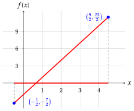
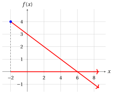
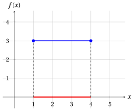

# Exercises · Linear optimization problems

**Exercises · Chapter 3** · each solution opens with a click · [:material-book-open-variant: Chapter 3](../lp-problems/03-linear-optimization-problems.md) · [:material-file-pdf-box: Exercises, volume 1 (PDF)](../pdf/exercises-1-linear-programming-problems.pdf)

!!! esercizio "Exercise 3.1: Linear optimization problem (E1)"

    Consider the following linear objective function and feasible region:

    $$
    f:\R \to \R,~ f: x \mapsto 3x - 2
    \qquad \text{and} \qquad
    F=\Big\{\, x \in \R : -\frac{1}{2} \le x \le \frac{9}{2} \,\Big\} = \left[-\frac{1}{2},\frac{9}{2}\right].
    $$

    **Questions**

    1. Write the associated optimization problems in minimization and maximization forms.

    2. Draw the graph of the objective function over the feasible region.

    3. Find all optimal solutions and the optimal value for both forms.

??? soluzione "Solution"

    1. The associated optimization problems in minimization and maximization forms are:

        \begin{equation*}
        \min \bigg\{\, 3x - 2 \ \text{ subject to } -\frac{1}{2} \le x \le \frac{9}{2} \,\bigg\}
        \end{equation*}

        \begin{equation*}
        \max \bigg\{\, 3x - 2 \ \text{ subject to } -\frac{1}{2} \le x \le \frac{9}{2} \,\bigg\}
        \end{equation*}

    2. The graph of the objective function over the feasible region is red; the feasible region is the red part of the $x$-axis and the optimal solutions are marked in blue.

        { .fig .ovale loading=lazy style="width:50%" }

    3. The feasible region is the interval $F=\left[-\frac{1}{2},\frac{9}{2}\right]$ and the linear function $f$ is strictly increasing: if $x$ increases by $1$, $f(x)$ increases by $3$.

        - For the minimization form, since for every feasible $x$ we have $x \ge -\frac{1}{2}$ and then $f(x) = 3x - 2 \ge -\frac{3}{2} - 2 = -\frac{7}{2} = f\big(-\frac{1}{2}\big)$, the unique optimal solution and the optimal value are:

            $$
            \tilde{\boldsymbol x}(LP) = \left(-\frac{1}{2}\right)
            \quad \text{and} \quad
            z(LP) = -\frac{7}{2}.
            $$

        - For the maximization form, since for every feasible $x$ we have $x \le \frac{9}{2}$ and then $f(x) = 3x - 2 \le \frac{27}{2} - 2 = \frac{23}{2} = f\big(\frac{9}{2}\big)$, the unique optimal solution and the optimal value are:

            $$
            \tilde{\boldsymbol x}(LP) = \left(\frac{9}{2}\right)
            \quad \text{and} \quad
            z(LP) = \frac{23}{2}.
            $$

!!! esercizio "Exercise 3.2: Linear optimization problem (E2)"

    Consider the following linear objective function and feasible region:

    $$
    f:\R \to \R,~ f: x \mapsto 3 - \frac{1}{2}\,x
    \qquad \text{and} \qquad
    F=\{\, x \in \R : x \ge -2 \,\} = [-2,+\infty).
    $$

    **Questions**

    1. Write the associated optimization problems in minimization and maximization forms.

    2. Draw the graph of the objective function over the feasible region.

    3. Find all optimal solutions and the optimal value for both forms.

??? soluzione "Solution"

    1. The associated optimization problems in minimization and maximization forms are:

        \begin{equation*}
        \min \bigg\{\, 3 - \frac{1}{2}\,x \ \text{ subject to } x \ge -2 \,\bigg\}
        \end{equation*}

        \begin{equation*}
        \max \bigg\{\, 3 - \frac{1}{2}\,x \ \text{ subject to } x \ge -2 \,\bigg\}
        \end{equation*}

    2. The graph of the objective function over the feasible region is red; the feasible region is the red part of the $x$-axis and the optimal solutions are marked in blue. The feasible region is a half-line: the arrows mean that the graph and the feasible region continue to the right.

        { .fig .ovale loading=lazy style="width:50%" }

    3. The feasible region is the half-line $F=[-2,+\infty)$ and the linear function $f$ is strictly decreasing: if $x$ increases by $2$, $f(x)$ decreases by $1$.

        - For the minimization form, the objective function decreases indefinitely on the feasible region: for every $k \in \{1,2,3,\dots\}$ the point $x = 2k$ is feasible and $f(2k) = 3 - k$. The problem is <strong>unbounded</strong>, there is no optimal solution and

            $$
            \argmin \Big\{\, 3 - \frac{1}{2}\,x \ \text{ subject to } x \ge -2 \,\Big\} = \emptyset
            \quad \text{and} \quad
            z(LP) = -\infty.
            $$

        - For the maximization form, since for every feasible $x$ we have $x \ge -2$ and then $f(x) = 3 - \frac{1}{2}\,x \le 3 + 1 = 4 = f(-2)$, the unique optimal solution and the optimal value are:

            $$
            \tilde{\boldsymbol x}(LP) = \left(-2\right)
            \quad \text{and} \quad
            z(LP) = 4.
            $$

!!! esercizio "Exercise 3.3: Linear optimization problem (E3)"

    Consider the following linear objective function and feasible region:

    $$
    f:\R \to \R,~ f: x \mapsto 2x + 1
    \qquad \text{and} \qquad
    F=\R.
    $$

    **Questions**

    1. Write the associated optimization problems in minimization and maximization forms.

    2. Draw the graph of the objective function over the feasible region.

    3. Find all optimal solutions and the optimal value for both forms.

??? soluzione "Solution"

    1. The associated optimization problems in minimization and maximization forms are:

        \begin{equation*}
        \min \bigg\{\, 2x + 1 \ \text{ subject to } x \in \R \,\bigg\}
        \end{equation*}

        \begin{equation*}
        \max \bigg\{\, 2x + 1 \ \text{ subject to } x \in \R \,\bigg\}
        \end{equation*}

    2. The graph of the objective function over the feasible region is red; the feasible region is the whole $x$-axis (red). The arrows mean that the graph and the feasible region continue in both directions.

        { .fig .ovale loading=lazy style="width:50%" }

    3. The feasible region is the whole line $F=\R$ and the linear function $f$ is strictly increasing: if $x$ increases by $1$, $f(x)$ increases by $2$.

        - For the minimization form, the objective function decreases indefinitely on the feasible region: for every $k \in \{1,2,3,\dots\}$ the point $x = -k$ is feasible and $f(-k) = 1 - 2k$. The problem is <strong>unbounded</strong>, there is no optimal solution and

            $$
            \argmin \big\{\, 2x + 1 \ \text{ subject to } x \in \R \,\big\} = \emptyset
            \quad \text{and} \quad
            z(LP) = -\infty.
            $$

        - For the maximization form, the objective function increases indefinitely on the feasible region: for every $k \in \{1,2,3,\dots\}$ the point $x = k$ is feasible and $f(k) = 2k + 1$. The problem is <strong>unbounded</strong>, there is no optimal solution and

            $$
            \argmax \big\{\, 2x + 1 \ \text{ subject to } x \in \R \,\big\} = \emptyset
            \quad \text{and} \quad
            z(LP) = +\infty.
            $$

!!! esercizio "Exercise 3.4: Linear optimization problem (E4)"

    Consider the following linear objective function and feasible region:

    $$
    f:\R \to \R,~ f: x \mapsto 3
    \qquad \text{and} \qquad
    F=\{\, x \in \R : 1 \le x \le 4 \,\} = [1,4].
    $$

    **Questions**

    1. Write the associated optimization problems in minimization and maximization forms.

    2. Draw the graph of the objective function over the feasible region.

    3. Find all optimal solutions and the optimal value for both forms.

??? soluzione "Solution"

    1. The associated optimization problems in minimization and maximization forms are:

        \begin{equation*}
        \min \bigg\{\, 3 \ \text{ subject to } 1 \le x \le 4 \,\bigg\}
        \end{equation*}

        \begin{equation*}
        \max \bigg\{\, 3 \ \text{ subject to } 1 \le x \le 4 \,\bigg\}
        \end{equation*}

    2. The graph of the objective function over the feasible region is a horizontal segment, blue since every feasible point is an optimal solution; the feasible region is the red part of the $x$-axis.

        { .fig .ovale loading=lazy style="width:50%" }

    3. The feasible region is the interval $F=[1,4]$ and the objective function is constant: $f(x) = 3$ for every $x \in F$ (a linear function whose coefficient of $x$ is $0$).

        - For the minimization form, since $f(x) = 3 \le 3 = f(y)$ for every $x, y \in F$, every feasible solution is optimal: the problem has <strong>infinitely many</strong> optimal solutions and

            $$
            \argmin \big\{\, 3 \ \text{ subject to } 1 \le x \le 4 \,\big\} = [1,4]
            \quad \text{and} \quad
            z(LP) = 3.
            $$

        - For the maximization form, since $f(x) = 3 \ge 3 = f(y)$ for every $x, y \in F$, every feasible solution is optimal: the problem has <strong>infinitely many</strong> optimal solutions and

            $$
            \argmax \big\{\, 3 \ \text{ subject to } 1 \le x \le 4 \,\big\} = [1,4]
            \quad \text{and} \quad
            z(LP) = 3.
            $$

        - Every point of $[1,4]$ is at the same time a point of minimum and a point of maximum of $f$ in $F$, and the minimum and the maximum of $f$ in $F$ coincide.

!!! esercizio "Exercise 3.5: Linear optimization problem (E5)"

    Consider the following linear objective function and feasible region:

    $$
    f:\R \to \R,~ f: x \mapsto -1
    \qquad \text{and} \qquad
    F=\{\, x \in \R : x \ge 2 \,\} = [2,+\infty).
    $$

    **Questions**

    1. Write the associated optimization problems in minimization and maximization forms.

    2. Draw the graph of the objective function over the feasible region.

    3. Find all optimal solutions and the optimal value for both forms.

??? soluzione "Solution"

    1. The associated optimization problems in minimization and maximization forms are:

        \begin{equation*}
        \min \bigg\{\, -1 \ \text{ subject to } x \ge 2 \,\bigg\}
        \end{equation*}

        \begin{equation*}
        \max \bigg\{\, -1 \ \text{ subject to } x \ge 2 \,\bigg\}
        \end{equation*}

    2. The graph of the objective function over the feasible region is a horizontal half-line, blue since every feasible point is an optimal solution; the feasible region is the red part of the $x$-axis. The arrows mean that the graph and the feasible region continue to the right.

        { .fig .ovale loading=lazy style="width:50%" }

    3. The feasible region is the half-line $F=[2,+\infty)$ and the objective function is constant: $f(x) = -1$ for every $x \in F$. Although the feasible region is unbounded, the objective function neither decreases nor increases indefinitely.

        - For the minimization form, since $f(x) = -1 \le -1 = f(y)$ for every $x, y \in F$, every feasible solution is optimal: the problem has <strong>infinitely many</strong> optimal solutions and

            $$
            \argmin \big\{\, -1 \ \text{ subject to } x \ge 2 \,\big\} = [2,+\infty)
            \quad \text{and} \quad
            z(LP) = -1.
            $$

        - For the maximization form, since $f(x) = -1 \ge -1 = f(y)$ for every $x, y \in F$, every feasible solution is optimal: the problem has <strong>infinitely many</strong> optimal solutions and

            $$
            \argmax \big\{\, -1 \ \text{ subject to } x \ge 2 \,\big\} = [2,+\infty)
            \quad \text{and} \quad
            z(LP) = -1.
            $$

        - The same holds with the feasible region $F = \R$: every $x \in \R$ is optimal in both forms and $z(LP) = -1$. Compare with the previous two exercises, where a non-constant linear objective function on a half-line or on the whole line makes the problem unbounded.

!!! esercizio "Exercise 3.6: Linear optimization problem (E6)"

    Consider the following linear objective function and feasible region:

    $$
    f:\R \to \R,~ f: x \mapsto x + 1
    \qquad \text{and} \qquad
    F=\{\, x \in \R : x \ge 3 \text{ and } x \le 1 \,\}.
    $$

    **Questions**

    1. Write the associated optimization problems in minimization and maximization forms.

    2. Draw the graph of the objective function over the feasible region.

    3. Find all optimal solutions and the optimal value for both forms.

??? soluzione "Solution"

    1. The associated optimization problems in minimization and maximization forms are:

        \begin{equation*}
        \min \bigg\{\, x + 1 \ \text{ subject to } x \ge 3,~ x \le 1 \,\bigg\}
        \end{equation*}

        \begin{equation*}
        \max \bigg\{\, x + 1 \ \text{ subject to } x \ge 3,~ x \le 1 \,\bigg\}
        \end{equation*}

    2. The two constraints define the half-lines $[3,+\infty)$ (orange) and $(-\infty,1]$ (cyan) on the $x$-axis: they have no common point, so the feasible region is empty and the graph of the objective function over the feasible region is empty too. The dashed line is the graph of $f$ on the whole line, which is never reached by a feasible point.

        { .fig .ovale loading=lazy style="width:50%" }

    3. The feasible region is empty: no $x \in \R$ satisfies at the same time $x \ge 3$ and $x \le 1$ (it would give $3 \le x \le 1$). Hence $F = \emptyset$.

        - For the minimization form, the problem is <strong>infeasible</strong>: there is no feasible solution, hence no optimal solution, and

            $$
            \argmin \big\{\, x + 1 \ \text{ subject to } x \ge 3,~ x \le 1 \,\big\} = \emptyset
            \quad \text{and} \quad
            z(LP) \text{ is not defined}.
            $$

        - For the maximization form, the problem is <strong>infeasible</strong>: there is no feasible solution, hence no optimal solution, and

            $$
            \argmax \big\{\, x + 1 \ \text{ subject to } x \ge 3,~ x \le 1 \,\big\} = \emptyset
            \quad \text{and} \quad
            z(LP) \text{ is not defined}.
            $$
