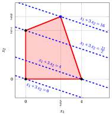
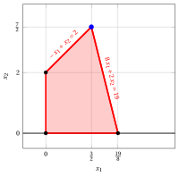
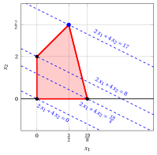
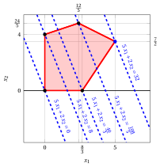
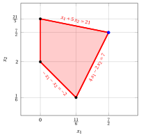
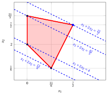

# Exercises · Linear Programming problems

**Exercises · Chapter 4** · each solution opens with a click · [:material-book-open-variant: Chapter 4: Linear Programming problems](../lp-problems/04-lp-problems.md) · [:material-file-pdf-box: Exercises, volume 1 (PDF)](../pdf/exercises-1-linear-programming-problems.pdf)

!!! esercizio "Exercise 4.1: Graphical solution method (P0)"

    Consider the following LP problem in canonical maximization form with $n=2$ variables and $m=2$ constraints:

    $$
    \begin{array}{rrrrrrrrrrrrr}
    {\max} & 2 \, {x_1} & {+} & 4 \, {x_2} \\[2ex]
    \text{subject to} & 2 \, {x_1} & {+} & 3 \, {x_2} & {\le} & 4 \\[2ex]
    & {x_1,} &  & {x_2} & { \ge} & { 0 }
    \end{array}
    $$

    **Questions**

    1. Write the objective function of the LP problem and compute its gradient.

    2. Write the feasible region of the LP problem.

    3. Find graphically an optimal solution of this LP problem. Determine the optimal value.

??? soluzione "Solution"

    - The  objective function of the LP problem is the  scalar linear function:

        $$
        f: \R^2 \rr \R, \quad
        f\!:\!
        \begin{pmatrix}
        x_1 \\[1ex]
        x_2
        \end{pmatrix}
        \mapsto
        2\,x_1 + 4\,x_2
        \quad
        \text{its  gradient  is}
        \quad
        \nabla f\!\left(
        \begin{pmatrix}
        x_1\\[1ex]
        x_2
        \end{pmatrix}
        \right)
        =
        \begin{pmatrix}
        2 \\[1ex] 4
        \end{pmatrix}.
        $$

    - The feasible region of the LP problem  is the polyhedron:

        $$
        F = \left\{~
        \begin{pmatrix}
        x_1 \\[0.5ex]
        x_2
        \end{pmatrix}
        \in \R^2 :
        2\,x_1+3\,x_2 \le 4,~~
        x_1 \ge 0,~~
        x_2 \ge 0
        ~\right\}.
        $$

        It is a bounded polyhedron, since, for instance, we have:

        $$
        0\le x_1 \le 2,~~ \forall {\boldsymbol x} \in F
        $$

        $$
        0\le x_2 \le \frac{4}{3},~~ \forall {\boldsymbol x} \in F
        $$

        then it is also a polytope.

    - This is the polyhedron of the feasible region:

        { .fig .cornice loading=lazy style="width:65%" }

        These are the contour lines at the vertices of the polyhedron:

        { .fig .cornice loading=lazy style="width:65%" }

        An optimal solution ${\tilde{\boldsymbol x}}(\, LP \,)$ is:

        $$
        \tilde{x}_1=0,~~\tilde{x}_2=\frac{4}{3}
        $$

        the optimal value $z(\, LP \,)$ is $\frac{16}{3}$.

!!! esercizio "Exercise 4.2: Graphical solution method (P2)"

    Consider the following LP problem in canonical maximization form with $n=2$ variables and $m=2$ constraints:

    $$
    \begin{array}{rrrrrrrrrrrrr}
    {\max} & {x_1} & {+} & 3 \, {x_2} \\[2ex]
    \text{subject to} & {-}4 \, {x_1} & {+} & 10 \, {x_2} & {\le} & 35 \\[2ex]
    & 3 \, {x_1} & {+} & \, {x_2} & {\le} & 12 \\[2ex]
    & {x_1,} &  & {x_2} & { \ge} & { 0 }
    \end{array}
    $$

    **Questions**

    1. Write the objective function of the LP problem and compute its gradient.

    2. Write the feasible region of the LP problem.

    3. Find graphically an optimal solution of this LP problem. Determine the optimal value.

??? soluzione "Solution"

    - The  objective function of the LP problem is the  scalar linear function:

        $$
        f: \R^2 \rr \R, \quad
        f\!:\!
        \begin{pmatrix}
        x_1 \\[1ex]
        x_2
        \end{pmatrix}
        \mapsto
        x_1 + 3\,x_2
        \quad
        \text{its  gradient  is}
        \quad
        \nabla f\!\left(
        \begin{pmatrix}
        x_1\\[1ex]
        x_2
        \end{pmatrix}
        \right)
        =
        \begin{pmatrix}
        1 \\[1ex] 3
        \end{pmatrix}.
        $$

    - The feasible region of the LP problem  is the polyhedron:

        $$
        F = \left\{~
        \begin{pmatrix}
        x_1 \\[0.5ex]
        x_2
        \end{pmatrix}
        \in \R^2 :
        -4\,x_1 +10\,x_2 \le 35,~~
        3\,x_1+x_2 \le 12,~~
        x_1 \ge 0,~~
        x_2 \ge 0
        ~\right\}.
        $$

        It is a bounded polyhedron, since, for instance, we have:

        $$
        0\le x_1 \le 4,~~ \forall {\boldsymbol x} \in F
        $$

        $$
        0\le x_2 \le 5,~~ \forall {\boldsymbol x} \in F
        $$

        then it is also a polytope.

    - This is the polyhedron of the feasible region:

        { .fig .cornice loading=lazy style="width:63%" }

        These are the contour lines at the vertices of the polyhedron:

        { .fig .cornice loading=lazy style="width:63%" }

        An optimal solution ${\tilde{\boldsymbol x}}(\, LP \,)$ is:

        $$
        \tilde{x}_1=\frac{5}{2},~~\tilde{x}_2=\frac{9}{2}
        $$

        the optimal value $z(\, LP \,)$ is $16$.

!!! esercizio "Exercise 4.3: Graphical solution method (P3)"

    Consider the following LP problem in canonical maximization form with $n=2$ variables and $m=2$ constraints:

    $$
    \begin{array}{rrrrrrrrrrrrr}
    {\max} & {2} \, {x_1} & {+} & {4} \, {x_2} \\[2ex]
    \text{subject to} & {-} \, {x_1} & {+} & \, {x_2} & {\le} & {2} \\[2ex]
    & {8} \, {x_1} & {+} & {2} \, {x_2} & {\le} & {19} \\[2ex]
    & {x_1,} &  & {x_2} & { \ge} & { 0 }
    \end{array}
    $$

    **Questions**

    1. Write the objective function of the LP problem and compute its gradient.

    2. Write the feasible region of the LP problem.

    3. Find graphically an optimal solution of this LP problem. Determine the optimal value.

??? soluzione "Solution"

    - The  objective function of the LP problem is the  scalar linear function:

        $$
        f: \R^2 \rr \R, \quad
        f\!:\!
        \begin{pmatrix}
        x_1 \\[1ex]
        x_2
        \end{pmatrix}
        \mapsto
        2\,x_1 + 4\,x_2
        \quad
        \text{its  gradient  is}
        \quad
        \nabla f\!\left(
        \begin{pmatrix}
        x_1\\[1ex]
        x_2
        \end{pmatrix}
        \right)
        =
        \begin{pmatrix}
        2 \\[1ex] 4
        \end{pmatrix}.
        $$

    - The feasible region of the LP problem  is the polyhedron:

        $$
        F = \left\{~
        \begin{pmatrix}
        x_1 \\[0.5ex]
        x_2
        \end{pmatrix}
        \in \R^2 :
        -x_1+ x_2 \le 2,~~
        8\,x_1+2\,x_2 \le 19,~~
        x_1 \ge 0,~~
        x_2 \ge 0
        ~\right\}.
        $$

        It is a bounded polyhedron, since, for instance, we have:

        $$
        0\le x_1 \le 4,~~ \forall {\boldsymbol x} \in F
        $$

        $$
        0\le x_2 \le 4,~~ \forall {\boldsymbol x} \in F
        $$

        then it is also a polytope.

    - This is the polyhedron of the feasible region:

        { .fig .cornice loading=lazy style="width:65%" }

        These are the contour lines at the vertices of the polyhedron:

        { .fig .cornice loading=lazy style="width:65%" }

        An optimal solution ${\tilde{\boldsymbol x}}(\, LP \,)$ is:

        $$
        \tilde{x}_1=\frac{3}{2},~~\tilde{x}_2=\frac{7}{2}
        $$

        the optimal value $z(\, LP \,)$ is $17$.

!!! esercizio "Exercise 4.4: Graphical solution method (P10)"

    Consider the following LP problem in canonical maximization form with $n=2$ variables and $m=3$ constraints:

    $$
    \begin{array}{rrrrrrrrrrrrr}
    {\max} & 5 \, {x_1} & {+} & 2 \, {x_2} \\[2ex]
    \text{subject to} & {-} \, {x_1} & {+} & 3 \, {x_2} & {\le} & 12 \\[2ex]
    & {x_1} & {+} & 2 \, {x_2} & {\le} & 12 \\[2ex]
    & {3} \, {x_1} & {-} & 2 \, {x_2} & {\le} & {8} \\[2ex]
    & {x_1,} &  & {x_2} & { \ge} & {0}
    \end{array}
    $$

    **Questions**

    1. Write the objective function of the LP problem and compute its gradient.

    2. Write the feasible region of the LP problem.

    3. Find graphically an optimal solution of this LP problem. Determine the optimal value.

??? soluzione "Solution"

    - The  objective function of the LP problem is the  scalar linear function:

        $$
        f: \R^2 \rr \R, \quad
        f\!:\!
        \begin{pmatrix}
        x_1 \\[1ex]
        x_2
        \end{pmatrix}
        \mapsto
        5\,x_1 + 2\,x_2
        \quad
        \text{its  gradient  is}
        \quad
        \nabla f\!\left(
        \begin{pmatrix}
        x_1\\[1ex]
        x_2
        \end{pmatrix}
        \right)
        =
        \begin{pmatrix}
        5 \\[1ex] 2
        \end{pmatrix}.
        $$

    - The feasible region of the LP problem  is the polyhedron:

        $$
        F = \left\{~
        \begin{pmatrix}
        x_1 \\[0.5ex]
        x_2
        \end{pmatrix}
        \in \R^2 :~
        \begin{array}{l}
        -x_1+3\,x_2 \le 12,~~
        x_1+2\,x_2 \le 12,~~
        3\,x_1-2\,x_2 \le 8,\\[0.5ex]
        x_1 \ge 0,~~
        x_2 \ge 0
        \end{array}
        ~\right\}.
        $$

        It is a bounded polyhedron, since, for instance, we have:

        $$
        0\le x_1 \le 5,~~ \forall {\boldsymbol x} \in F
        $$

        $$
        0\le x_2 \le 5,~~ \forall {\boldsymbol x} \in F
        $$

        then it is also a polytope.

    - This is the polyhedron of the feasible region:

        { .fig .cornice loading=lazy style="width:65%" }

        These are the contour lines at the vertices of the polyhedron:

        { .fig .cornice loading=lazy style="width:65%" }

        An optimal solution ${\tilde{\boldsymbol x}}(\, LP \,)$ is:

        $$
        \tilde{x}_1=5,~~\tilde{x}_2=\frac{7}{2}
        $$

        the optimal value $z(\, LP \,)$ is $32$.

!!! esercizio "Exercise 4.5: Graphical solution method (P11)"

    Consider the following LP problem in canonical maximization form with $n=2$ variables and $m=2$ constraints:

    $$
    \begin{array}{rrrrrrrrrrrrr}
    {\max} & {-2} \, {x_1} & {-} & {4} \, {x_2} \\[2ex]
    \text{subject to} & {-} \, {x_1} & {-} & \, {x_2} & {\le} & {-2} \\[2ex]
    & \, {x_1} & {-} & \, {x_2} & {\le} & {0} \\[2ex]
    & {x_1,} &  & {x_2} & { \ge} & { 0 }
    \end{array}
    $$

    **Questions**

    1. Write the objective function of the LP problem and compute its gradient.

    2. Write the feasible region of the LP problem.

    3. Find graphically an optimal solution of this LP problem. Determine the optimal value.

    4. Verify that $\bar{\boldsymbol x} = (1,~2)'$ is a feasible solution and compute the lower bound it gives on the optimal value.

??? soluzione "Solution"

    - The  objective function of the LP problem is the  scalar linear function:

        $$
        f: \R^2 \rr \R, \quad
        f\!:\!
        \begin{pmatrix}
        x_1 \\[1ex]
        x_2
        \end{pmatrix}
        \mapsto
        -2\,x_1 -4\,x_2
        \quad
        \text{its  gradient  is}
        \quad
        \nabla f\!\left(
        \begin{pmatrix}
        x_1\\[1ex]
        x_2
        \end{pmatrix}
        \right)
        =
        \begin{pmatrix}
        -2 \\[1ex] -4
        \end{pmatrix}.
        $$

    - The feasible region of the LP problem  is the polyhedron:

        $$
        F = \left\{~
        \begin{pmatrix}
        x_1 \\[0.5ex]
        x_2
        \end{pmatrix}
        \in \R^2 :
        -x_1 -x_2 \le -2,~~
        x_1-x_2 \le 0,~~
        x_1 \ge 0,~~
        x_2 \ge 0
        ~\right\}.
        $$

        It is not a bounded polyhedron, then it is not a polytope.

    - This is the polyhedron of the feasible region:

        { .fig .cornice loading=lazy style="width:65%" }

        These are the contour lines at the vertices of the polyhedron:

        { .fig .cornice loading=lazy style="width:65%" }

        An optimal solution ${\tilde{\boldsymbol x}}(\, LP \,)$ is:

        $$
        \tilde{x}_1=1,~~\tilde{x}_2=1
        $$

        the optimal value $z(\, LP \,)$ is $-6$.

    - The point ${\bar{\boldsymbol x}}(\, LP \,)=\begin{pmatrix} 1 \\ 2 \end{pmatrix}$  (where $\bar{x}_1=1$ and $\bar{x}_2=2$) is a feasible solution, since:

        $$
        - 1 - 2 = -3 \le -2,~~~  1 - 2 = -1 \le 0,~~~ 1\ge 0 \text{   and   } 2 \ge 0 .
        $$

        Accordingly, a lower bound $LB(\bar{\boldsymbol x})$ on the optimal value $z(\, LP \,)$ of the LP problem is:

        $$
        LB(\bar{\boldsymbol x})= -2 \cdot 1 - 4 \cdot 2 = -10 \le z(\, LP \,) = -6 .
        $$

!!! esercizio "Exercise 4.6: Graphical solution method (P12)"

    Consider the following LP problem in canonical maximization form with $n=2$ variables and $m=2$ constraints:

    $$
    \begin{array}{rrrrrrrrrrrrr}
    {\max} & {-} \, {x_1} & {-} & {2} \, {x_2} \\[1.5ex]
    \text{subject to} & {-} \, {x_1} & {-} & \, {x_2} & {\le} & {-3} \\[1.5ex]
    & \, {x_1} & {-} & {2} \, {x_2} & {\le} & {-1} \\[1.5ex]
    & {x_1,} &  & {x_2} & { \ge} & { 0 }
    \end{array}
    $$

    **Questions**

    1. Write the objective function of the LP problem and compute its gradient.

    2. Write the feasible region of the LP problem.

    3. Find graphically an optimal solution of this LP problem. Determine the optimal value.

??? soluzione "Solution"

    - The  objective function of the LP problem is the  scalar linear function:

        $$
        f: \R^2 \rr \R, \quad
        f\!:\!
        \begin{pmatrix}
        x_1 \\[1ex]
        x_2
        \end{pmatrix}
        \mapsto
        -\,x_1 - 2\,x_2
        \quad
        \text{its  gradient  is}
        \quad
        \nabla f\!\left(
        \begin{pmatrix}
        x_1\\[1ex]
        x_2
        \end{pmatrix}
        \right)
        =
        \begin{pmatrix}
        -1 \\[1ex] -2
        \end{pmatrix}.
        $$

    - The feasible region of the LP problem  is the polyhedron:

        $$
        F = \left\{~
        \begin{pmatrix}
        x_1 \\[0.5ex]
        x_2
        \end{pmatrix}
        \in \R^2 :
        -x_1 -x_2 \le -3,~~
        x_1-2\,x_2 \le -1,~~
        x_1 \ge 0,~~
        x_2 \ge 0
        ~\right\}.
        $$

        It is not a bounded polyhedron, since, for instance, the points $\begin{pmatrix} t \\ t \end{pmatrix}$ belong to $F$ for every value $t \ge 3$, then it is not a polytope.

    - This is the polyhedron of the feasible region:

        { .fig .cornice loading=lazy style="width:65%" }

        These are the contour lines at the vertices of the polyhedron:

        { .fig .cornice loading=lazy style="width:65%" }

        Since $-x_1 - 2\,x_2 \le 0$ along every direction in which $F$ is unbounded, the objective function attains its maximum at a vertex of $F$. An optimal solution ${\tilde{\boldsymbol x}}(\, LP \,)$ is:

        $$
        \tilde{x}_1=\frac{5}{3},~~\tilde{x}_2=\frac{4}{3}
        $$

        the optimal value $z(\, LP \,)$ is:

        $$
        z(\, LP \,) = -\frac{5}{3} - 2 \cdot \frac{4}{3} = -\frac{13}{3}.
        $$

!!! esercizio "Exercise 4.7: Graphical solution method (P21)"

    Consider the following LP problem in canonical maximization form with $n=2$ variables and $m=3$ constraints:

    $$
    \begin{array}{rrrrrrrrrrrrr}
    {\max} & \, {x_1} & {+} & {2} \, {x_2} \\[2ex]
    \text{subject to} & {- }\, {x_1} & {-} & \, {x_2} & {\le} & {-2} \\[2ex]
    & {4} \, {x_1} & {-} & {2} \, {x_2} & {\le} & {7} \\[2ex]
    & {x_1} & {+} & {5} \, {x_2} & {\le} & {21} \\[2ex]
    & {x_1,} &  & {x_2} & { \ge} & {0 }
    \end{array}
    $$

    **Questions**

    1. Write the objective function of the LP problem and compute its gradient.

    2. Write the feasible region of the LP problem.

    3. Find graphically an optimal solution of this LP problem. Determine the optimal value.

??? soluzione "Solution"

    - The  objective function of the LP problem  is the  scalar linear function:

        $$
        f: \R^2 \rr \R, \quad
        f\!:\!
        \begin{pmatrix}
        x_1 \\[1ex]
        x_2
        \end{pmatrix}
        \mapsto
        x_1 + 2\,x_2
        \quad
        \text{its  gradient  is}
        \quad
        \nabla f\!\left(
        \begin{pmatrix}
        x_1\\[1ex]
        x_2
        \end{pmatrix}
        \right)
        =
        \begin{pmatrix}
        1 \\[1ex] 2
        \end{pmatrix}.
        $$

    - The feasible region of the LP problem  is the polyhedron:

        $$
        F = \left\{~
        \begin{pmatrix}
        x_1 \\[0.5ex]
        x_2
        \end{pmatrix}
        \in \R^2 :~
        \begin{array}{l}
        -x_1 -x_2 \le -2,~~
        4\,x_1-2\,x_2 \le 7,~~
        x_1+5\,x_2 \le 21,\\[0.5ex]
        x_1 \ge 0,~~
        x_2 \ge 0
        \end{array}
        ~\right\}.
        $$

        It is a bounded polyhedron, since, for instance, we have:

        $$
        0\le x_1 \le 5,~~ \forall {\boldsymbol x} \in F
        $$

        $$
        0\le x_2 \le 5,~~ \forall {\boldsymbol x} \in F
        $$

        then it is also a polytope.

    - This is the polyhedron of the feasible region:

        { .fig .cornice loading=lazy style="width:65%" }

        These are the contour lines at the vertices of the polyhedron:

        { .fig .cornice loading=lazy style="width:65%" }

        An optimal solution ${\tilde{\boldsymbol x}}(\, LP \,)$ is:

        $$
        \tilde{x}_1=\frac{7}{2},~~\tilde{x}_2=\frac{7}{2}
        $$

        the optimal value $z(\, LP \,)$ is $\frac{21}{2}.$

!!! esercizio "Exercise 4.8: Graphical solution method (P22)"

    Consider the following LP problem in canonical maximization form with $n=2$ variables and $m=3$ constraints:

    $$
    \begin{array}{rrrrrrrrrrrrr}
    {\max} & {3\; x_1} & {+} & {x_2} \\[2ex]
    \text{subject to} & {x_1} & {-} & {x_2} & {\le} & {-}1 \\[2ex]
    & {-} \, {x_1} & {-} & \, {x_2} & {\le} & {-}3 \\[2ex]
    & {2\;x_1} & {+} & {x_2} & {\le} & 4 \\[2ex]
    & {x_1,} &  & {x_2} & { \ge} & { 0 }
    \end{array}
    $$

    **Questions**

    1. Write the objective function of the LP problem and compute its gradient.

    2. Write the feasible region of the LP problem.

    3. Find graphically an optimal solution of this LP problem. Determine the optimal value.

??? soluzione "Solution"

    - The  objective function of the LP problem is the  scalar linear function:

        $$
        f: \R^2 \rr \R, \quad
        f\!:\!
        \begin{pmatrix}
        x_1 \\[1ex]
        x_2
        \end{pmatrix}
        \mapsto
        3\,x_1 + x_2
        \quad
        \text{its  gradient  is}
        \quad
        \nabla f\!\left(
        \begin{pmatrix}
        x_1\\[1ex]
        x_2
        \end{pmatrix}
        \right)
        =
        \begin{pmatrix}
        3 \\[1ex] 1
        \end{pmatrix}.
        $$

    - The feasible region of the LP problem  is the polyhedron:

        $$
        F = \left\{~
        \begin{pmatrix}
        x_1 \\[0.5ex]
        x_2
        \end{pmatrix}
        \in \R^2 :~
        \begin{array}{l}
        x_1 -x_2 \le -1,~~
        -x_1-x_2 \le -3,~~
        2\,x_1+x_2 \le 4,\\[0.5ex]
        x_1 \ge 0,~~
        x_2 \ge 0
        \end{array}
        ~\right\}.
        $$

        It is a bounded polyhedron, since, for instance, we have:

        $$
        0\le x_1 \le 5,~~ \forall {\boldsymbol x} \in F
        $$

        $$
        0\le x_2 \le 5,~~ \forall {\boldsymbol x} \in F
        $$

        then it is also a polytope.

    - This is the polyhedron of the feasible region:

        { .fig .cornice loading=lazy style="width:65%" }

        These are the contour lines at the vertices of the polyhedron:

        { .fig .cornice loading=lazy style="width:65%" }

        An optimal solution ${\tilde{\boldsymbol x}}(\, LP \,)$ is:

        $$
        \tilde{x}_1=1,~~\tilde{x}_2=2
        $$

        the optimal value $z(\, LP \,)$ is $5$.
