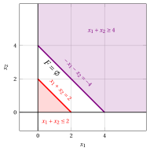
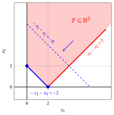

# Exercises · Possible outcomes and equivalent formulations

**Exercises · Chapter 5** · each solution opens with a click · [:material-book-open-variant: Chapter 5](../lp-problems/05-outcomes-equivalences.md) · [:material-file-pdf-box: Exercises, volume 1 (PDF)](../pdf/exercises-1-linear-programming-problems.pdf)

## Graphical method

!!! esercizio "Exercise 5.1: Graphical solution method (P31)"

    Consider the following LP problem in canonical maximization form with $n=2$ variables and $m=2$ constraints:

    $$
    \begin{array}{rrrrrrrrrrrrr}
    {\max} & {x_1} & {+} & \, {x_2} \\[2ex]
    \text{subject to} & {-} \, {x_1} & {+} & \, {x_2} & {\le} & {1} \\[2ex]
    & \, {x_1} & {-} & \, {x_2} & {\le} & {1} \\[2ex]
    & {x_1,} &  & {x_2} & { \ge} & { 0 }
    \end{array}
    $$

    **Questions**

    1. Write the objective function of the LP problem and compute its gradient.

    2. Write the feasible region of the LP problem.

    3. Determine graphically whether the LP problem admits an optimal solution. If it does, find an optimal solution and the optimal value; otherwise, state whether the LP problem is infeasible or unbounded.

??? soluzione "Solution"

    - The objective function of the LP problem is the scalar linear function:

        $$
        f: \R^2 \rr \R, \quad
        f\!:\!
        \begin{pmatrix} x_1 \\[1ex] x_2 \end{pmatrix}
        \mapsto
        x_1 + x_2
        \quad
        \text{its  gradient  is}
        \quad
        \nabla f\!\left( \begin{pmatrix} x_1\\[1ex] x_2 \end{pmatrix} \right)
        =
        \begin{pmatrix} 1 \\[1ex] 1 \end{pmatrix}.
        $$

    - The feasible region of the LP problem is the polyhedron:

        $$
        F = \left\{~
        \begin{pmatrix} x_1 \\[0.5ex] x_2 \end{pmatrix} \in \R^2 :
        -\,x_1 + x_2 \le 1,~~ x_1 - x_2 \le 1,~~ x_1 \ge 0,~~ x_2 \ge 0 ~\right\}.
        $$

    - For every value $t \ge 0$, the point $\bar{\boldsymbol x}(\, LP \,) = \begin{pmatrix} t \\[0.5ex] t \end{pmatrix}$ is a feasible solution, since

        $$
        - t + t = 0 \le 1, \qquad t - t = 0 \le 1, \qquad t \ge 0 \text{   and   } t \ge 0,
        $$

        and its objective value is $LB(\bar{\boldsymbol x}) = t + t = 2 \, t$. Accordingly, for every value $M \in \R$, the feasible solution obtained with $t > \frac{M}{2}$ has an objective value larger than $M$, and then this LP problem is <strong>unbounded</strong>.

        { .fig .cornice loading=lazy style="width:59%" }

!!! esercizio "Exercise 5.2: Graphical solution method (P33)"

    Consider the following LP problem in canonical maximization form with $n=2$ variables and $m=2$ constraints:

    $$
    \begin{array}{rrrrrrrrrrrrr}
    {\max} & {x_1} & {+} & \, {x_2} \\[2ex]
    \text{subject to} & \, {x_1} & {+} & \, {x_2} & {\le} & {2} \\[2ex]
    & {-} \, {x_1} & {-} & \, {x_2} & {\le} & {-4} \\[2ex]
    & {x_1,} &  & {x_2} & { \ge} & { 0 }
    \end{array}
    $$

    **Questions**

    1. Write the objective function of the LP problem and compute its gradient.

    2. Write the feasible region of the LP problem.

    3. Determine graphically whether the LP problem admits an optimal solution. If it does, find an optimal solution and the optimal value; otherwise, state whether the LP problem is infeasible or unbounded.

??? soluzione "Solution"

    - The objective function of the LP problem is the scalar linear function:

        $$
        f: \R^2 \rr \R, \quad
        f\!:\!
        \begin{pmatrix} x_1 \\[1ex] x_2 \end{pmatrix}
        \mapsto
        x_1 + x_2
        \quad
        \text{its  gradient  is}
        \quad
        \nabla f\!\left( \begin{pmatrix} x_1\\[1ex] x_2 \end{pmatrix} \right)
        =
        \begin{pmatrix} 1 \\[1ex] 1 \end{pmatrix}.
        $$

    - The feasible region of the LP problem is the polyhedron:

        $$
        F = \left\{~
        \begin{pmatrix} x_1 \\[0.5ex] x_2 \end{pmatrix} \in \R^2 :
        x_1 + x_2 \le 2,~~ -\,x_1 - x_2 \le -4,~~ x_1 \ge 0,~~ x_2 \ge 0 ~\right\}.
        $$

    - The first constraint imposes $x_1 + x_2 \le 2$, while the second one, multiplied by $-1$, imposes $x_1 + x_2 \ge 4$. No point of $\R^2$ satisfies both of them, and then we have $F = \emptyset$: this LP problem is <strong>infeasible</strong>.

        { .fig .cornice loading=lazy style="width:59%" }

!!! esercizio "Exercise 5.3: Graphical solution method (P36)"

    Consider the following LP problem in canonical maximization form with $n=2$ variables and $m=2$ constraints:

    $$
    \begin{array}{rrrrrrrrrrrrr}
    {\max} & {-} \, {x_1} & {-} & \, {x_2} \\[2ex]
    \text{subject to} & {-} \, {x_1} & {-} & \, {x_2} & {\le} & {-2} \\[2ex]
    & \, {x_1} & {-} & \, {x_2} & {\le} & {2} \\[2ex]
    & {x_1,} &  & {x_2} & { \ge} & { 0 }
    \end{array}
    $$

    **Questions**

    1. Write the objective function of the LP problem and compute its gradient.

    2. Write the feasible region of the LP problem.

    3. Determine graphically whether the LP problem admits an optimal solution. If it does, find an optimal solution and the optimal value; otherwise, state whether the LP problem is infeasible or unbounded.

??? soluzione "Solution"

    - The objective function of the LP problem is the scalar linear function:

        $$
        f: \R^2 \rr \R, \quad
        f\!:\!
        \begin{pmatrix} x_1 \\[1ex] x_2 \end{pmatrix}
        \mapsto
        -\,x_1 - x_2
        \quad
        \text{its  gradient  is}
        \quad
        \nabla f\!\left( \begin{pmatrix} x_1\\[1ex] x_2 \end{pmatrix} \right)
        =
        \begin{pmatrix} -1 \\[1ex] -1 \end{pmatrix}.
        $$

    - The feasible region of the LP problem is the polyhedron:

        $$
        F = \left\{~
        \begin{pmatrix} x_1 \\[0.5ex] x_2 \end{pmatrix} \in \R^2 :
        -\,x_1 - x_2 \le -2,~~ x_1 - x_2 \le 2,~~ x_1 \ge 0,~~ x_2 \ge 0 ~\right\}.
        $$

    - The feasible region $F$ is unbounded, but the LP problem is not unbounded. The first constraint imposes $x_1 + x_2 \ge 2$ for every feasible solution, and then

        $$
        - x_1 - x_2 \le -2, \qquad \forall \begin{pmatrix} x_1 \\ x_2\end{pmatrix} \in F .
        $$

        The two feasible solutions $\begin{pmatrix} 0 \\ 2\end{pmatrix}$ and $\begin{pmatrix} 2 \\ 0\end{pmatrix}$ attain this value, and then they are two <strong>optimal solutions</strong> and the optimal value is $z(\, LP \,) = -2$. Moreover, every point of the segment joining them is an optimal solution as well, and then this LP problem admits <strong>infinitely many optimal solutions</strong>.

        { .fig .cornice loading=lazy style="width:59%" }

## Equivalences

!!! esercizio "Exercise 5.4: Equivalent reformulations (E1)"

    Consider the following LP problem in minimization form with $n=2$ non-negative variables and $m=2$ greater-than-or-equal-to linear constraints:

    $$
    \begin{array}{rrrrrrrrrrrrr}
    {\min} & {2} \, {x_1} & {+} & {3} \, {x_2} \\[2ex]
    \text{subject to} & \, {x_1} & {+} & {2} \, {x_2} & {\ge} & {4} \\[2ex]
    & {3} \, {x_1} & {+} & \, {x_2} & {\ge} & {6} \\[2ex]
    & {x_1,} &  & {x_2} & { \ge} & { 0 }
    \end{array}
    $$

    **Questions**

    1. Write an equivalent LP problem in canonical maximization form.

    2. Write an equivalent LP problem in standard maximization form.

    3. Knowing that an optimal solution of the LP problem in canonical maximization form is $\tilde{\boldsymbol x}(\, LP \,) = \begin{pmatrix} \frac{8}{5} \\[0.5ex] \frac{6}{5} \end{pmatrix}$, determine the optimal value of the original LP problem in minimization form.

??? soluzione "Solution"

    - The objective function is minimized, and then we maximize the opposite objective function. The two linear constraints are greater-than-or-equal-to constraints, and then we multiply each of them by $-1$. We obtain the following equivalent LP problem in canonical maximization form with $n=2$ non-negative variables and $m=2$ less-than-or-equal-to linear constraints:

        $$
        \begin{array}{rrrrrrrrrrrrr}
        {-} {\max} & {-2} \, {x_1} & {-} & {3} \, {x_2} \\[2ex]
        \text{subject to} & {-} \, {x_1} & {-} & {2} \, {x_2} & {\le} & {-4} \\[2ex]
        & {-3} \, {x_1} & {-} & \, {x_2} & {\le} & {-6} \\[2ex]
        & {x_1,} &  & {x_2} & { \ge} & { 0 }
        \end{array}
        $$

    - By adding $m=2$ slack variables $x_3$ and $x_4$, we obtain the following equivalent LP problem in standard maximization form with $n+m=4$ non-negative variables and $m=2$ equality linear constraints:

        $$
        \begin{array}{rrrrrrrrrrrrr}
        {-} {\max} & {-2} \, {x_1} & {-} & {3} \, {x_2} \\[2ex]
        \text{subject to} & {-} \, {x_1} & {-} & {2} \, {x_2} & {+} & {x_3} &  &  & {=} & {-4} \\[2ex]
        & {-3} \, {x_1} & {-} & \, {x_2} &  &  & {+} & {x_4} & {=} & {-6} \\[2ex]
        & {x_1,} &  & {x_2,} &  & {x_3,} &  & {x_4} & { \ge} & { 0 }
        \end{array}
        $$

    - The two LP problems have the same optimal solutions, and their optimal values are opposite numbers. The optimal value of the LP problem in canonical maximization form is:

        $$
        z(\, LP_{\max} \,) = -2 \cdot \frac{8}{5} - 3 \cdot \frac{6}{5} = -\frac{16}{5} - \frac{18}{5} = -\frac{34}{5},
        $$

        and then the optimal value of the original LP problem in minimization form is:

        $$
        z(\, LP_{\min} \,) = - \, z(\, LP_{\max} \,) = \frac{34}{5}.
        $$

!!! esercizio "Exercise 5.5: Equivalent reformulations (E2)"

    Consider the following LP problem with $n=2$ non-negative variables and three linear constraints of three different types:

    $$
    \begin{array}{rrrrrrrrrrrrr}
    {\max} & {3} \, {x_1} & {+} & \, {x_2} \\[2ex]
    \text{subject to} & \, {x_1} & {+} & \, {x_2} & {\le} & {5} \\[2ex]
    & \, {x_1} & {-} & \, {x_2} & {\ge} & {1} \\[2ex]
    & {2} \, {x_1} & {+} & \, {x_2} & {=} & {8} \\[2ex]
    & {x_1,} &  & {x_2} & { \ge} & { 0 }
    \end{array}
    $$

    **Questions**

    1. Write an equivalent LP problem in canonical maximization form.

    2. Write an equivalent LP problem in standard maximization form.

    3. Verify that $\bar{\boldsymbol x}(\, LP \,) = \begin{pmatrix} 4 \\ 0 \end{pmatrix}$ is a feasible solution of the original LP problem and compute the values of the slack and surplus variables associated with it in the standard maximization form.

??? soluzione "Solution"

    - The objective function is already maximized and the variables are already non-negative. The first constraint is a less-than-or-equal-to constraint and is left unchanged; the second one is a greater-than-or-equal-to constraint and we multiply it by $-1$; the third one is an equality constraint and we split it into two less-than-or-equal-to constraints. We obtain the following equivalent LP problem in canonical maximization form with $n=2$ non-negative variables and $m=4$ less-than-or-equal-to linear constraints:

        $$
        \begin{array}{rrrrrrrrrrrrr}
        {\max} & {3} \, {x_1} & {+} & \, {x_2} \\[2ex]
        \text{subject to} & \, {x_1} & {+} & \, {x_2} & {\le} & {5} \\[2ex]
        & {-} \, {x_1} & {+} & \, {x_2} & {\le} & {-1} \\[2ex]
        & {2} \, {x_1} & {+} & \, {x_2} & {\le} & {8} \\[2ex]
        & {-2} \, {x_1} & {-} & \, {x_2} & {\le} & {-8} \\[2ex]
        & {x_1,} &  & {x_2} & { \ge} & { 0 }
        \end{array}
        $$

    - Starting from the original LP problem, we add one slack variable $x_3$ to the first constraint, we subtract one surplus variable $x_4$ from the second constraint, and we leave the third constraint unchanged. We obtain the following equivalent LP problem in standard maximization form with $4$ non-negative variables and $3$ equality linear constraints:

        $$
        \begin{array}{rrrrrrrrrrrrr}
        {\max} & {3} \, {x_1} & {+} & \, {x_2} \\[2ex]
        \text{subject to} & \, {x_1} & {+} & \, {x_2} & {+} & {x_3} &  &  & {=} & {5} \\[2ex]
        & \, {x_1} & {-} & \, {x_2} &  &  & {-} & {x_4} & {=} & {1} \\[2ex]
        & {2} \, {x_1} & {+} & \, {x_2} &  &  &  &  & {=} & {8} \\[2ex]
        & {x_1,} &  & {x_2,} &  & {x_3,} &  & {x_4} & { \ge} & { 0 }
        \end{array}
        $$

        !!! chiave ""

            The equality constraint does <u>not</u> require any additional variable: only the inequality constraints do.

    - The point $\bar{\boldsymbol x}(\, LP \,) = \begin{pmatrix} 4 \\ 0 \end{pmatrix}$ is a feasible solution, since:

        $$
        4 + 0 = 4 \le 5, \qquad 4 - 0 = 4 \ge 1, \qquad 2 \cdot 4 + 0 = 8 = 8, \qquad 4 \ge 0 \text{   and   } 0 \ge 0 .
        $$

        The values of the slack variable $x_3$ and of the surplus variable $x_4$ are obtained from the two equality constraints of the standard maximization form:

        $$
        \bar x_3 = 5 - \bar x_1 - \bar x_2 = 5 - 4 - 0 = 1
        \qquad \text{and} \qquad
        \bar x_4 = \bar x_1 - \bar x_2 - 1 = 4 - 0 - 1 = 3 .
        $$

!!! esercizio "Exercise 5.6: Equivalent reformulations (E3)"

    Consider the following LP problem with one non-negative variable $x_1 \ge 0$, one non-positive variable $x_2 \le 0$ and one free variable $x_3 \gtreqless 0$:

    $$
    \begin{array}{rrrrrrrrrrrrr}
    {\max} & \, {x_1} & {-} & {2} \, {x_2} & {+} & \, {x_3} \\[2ex]
    \text{subject to} & \, {x_1} & {+} & \, {x_2} & {+} & {x_3} & {=} & {3} \\[2ex]
    & \, {x_1} &  &  & {-} & {x_3} & {\le} & {2} \\[2ex]
    & {x_1} &  &  &  &  & { \ge} & { 0 } \\[2ex]
    &  &  & {x_2} &  &  & { \le} & { 0 } \\[2ex]
    &  &  &  &  & {x_3} & { \gtreqless} & { 0 }
    \end{array}
    $$

    **Questions**

    1. Write an equivalent LP problem with only non-negative variables.

    2. Write an equivalent LP problem in standard maximization form.

    3. Verify that $\bar x_1 = 1$, $\bar x_2 = -1$, $\bar x_3 = 3$ is a feasible solution of the original LP problem and compute the corresponding feasible solution of the LP problem of the first question.

??? soluzione "Solution"

    - The variable $x_2$ is non-positive, and then we set $x_2 = -\,x_2^{+}$ with $x_2^{+} \ge 0$. The variable $x_3$ is free, and then we set $x_3 = x_3^{+} - x_3^{-}$ with $x_3^{+}, x_3^{-} \ge 0$. By performing these substitutions in the objective function and in the two linear constraints, we obtain the following equivalent LP problem with only non-negative variables:

        $$
        \begin{array}{rrrrrrrrrrrrr}
        {\max} & \, {x_1} & {+} & {2} \, {x_2^{+}} & {+} & \, {x_3^{+}} & {-} & \, {x_3^{-}} \\[2ex]
        \text{subject to} & \, {x_1} & {-} & \, {x_2^{+}} & {+} & {x_3^{+}} & {-} & {x_3^{-}} & {=} & {3} \\[2ex]
        & \, {x_1} &  &  & {-} & {x_3^{+}} & {+} & {x_3^{-}} & {\le} & {2} \\[2ex]
        & {x_1,} &  & {x_2^{+},} &  & {x_3^{+},} &  & {x_3^{-}} & { \ge} & { 0 }
        \end{array}
        $$

    - The first constraint is already an equality constraint. By adding one slack variable $x_5$ to the second constraint, we obtain the following equivalent LP problem in standard maximization form with $5$ non-negative variables and $2$ equality linear constraints:

        $$
        \begin{array}{rrrrrrrrrrrrrrr}
        {\max} & \, {x_1} & {+} & {2} \, {x_2^{+}} & {+} & \, {x_3^{+}} & {-} & \, {x_3^{-}} \\[2ex]
        \text{subject to} & \, {x_1} & {-} & \, {x_2^{+}} & {+} & {x_3^{+}} & {-} & {x_3^{-}} &  &  & {=} & {3} \\[2ex]
        & \, {x_1} &  &  & {-} & {x_3^{+}} & {+} & {x_3^{-}} & {+} & {x_5} & {=} & {2} \\[2ex]
        & {x_1,} &  & {x_2^{+},} &  & {x_3^{+},} &  & {x_3^{-},} &  & {x_5} & { \ge} & { 0 }
        \end{array}
        $$

    - The point $\bar x_1 = 1$, $\bar x_2 = -1$, $\bar x_3 = 3$ is a feasible solution of the original LP problem, since:

        $$
        1 - 1 + 3 = 3 = 3, \qquad 1 - 3 = -2 \le 2, \qquad 1 \ge 0, \qquad -1 \le 0 .
        $$

        The corresponding feasible solution of the LP problem with only non-negative variables is obtained by setting:

        $$
        \bar x_1 = 1, \qquad \bar x_2^{+} = - \bar x_2 = 1, \qquad \bar x_3^{+} = 3, \qquad \bar x_3^{-} = 0 .
        $$

        The two solutions have the same objective value:

        $$
        1 - 2 \cdot (-1) + 3 = 6
        \qquad \text{and} \qquad
        1 + 2 \cdot 1 + 3 - 0 = 6 .
        $$

        !!! chiave ""

            The values of $x_3^{+}$ and $x_3^{-}$ are not unique: every pair of non-negative numbers whose difference is $\bar x_3 = 3$ gives a feasible solution with the same objective value.

!!! esercizio "Exercise 5.7: Equivalent reformulations (E4)"

    Consider the following generic LP problem with one non-positive variable $x_1 \le 0$, one non-negative variable $x_2 \ge 0$ and one free variable $x_3 \gtreqless 0$:

    $$
    \begin{array}{rrrrrrrrrrrrr}
    {\min} & {4} \, {x_1} & {-} & \, {x_2} & {+} & {2} \, {x_3} \\[2ex]
    \text{subject to} & {-} \, {x_1} & {+} & \, {x_2} &  &  & {\ge} & {2} \\[2ex]
    & {2} \, {x_1} &  &  & {+} & {x_3} & {=} & {5} \\[2ex]
    & \, {x_1} & {+} & \, {x_2} & {+} & {x_3} & {\le} & {8} \\[2ex]
    & {x_1} &  &  &  &  & { \le} & { 0 } \\[2ex]
    &  &  & {x_2} &  &  & { \ge} & { 0 } \\[2ex]
    &  &  &  &  & {x_3} & { \gtreqless} & { 0 }
    \end{array}
    $$

    **Questions**

    1. Write an equivalent LP problem in canonical maximization form.

    2. Write an equivalent LP problem in standard maximization form.

    3. Verify that $\bar x_1 = -2$, $\bar x_2 = 0$, $\bar x_3 = 9$ is a feasible solution of the original LP problem, compute the corresponding feasible solution of the LP problem in canonical maximization form and check that the two objective values are opposite numbers.

??? soluzione "Solution"

    - We apply the transformations one at a time:

        1. the objective function is minimized, and then we maximize the opposite objective function;

        2. the variable $x_1$ is non-positive, and then we set $x_1 = -\,x_1^{+}$ with $x_1^{+} \ge 0$;

        3. the variable $x_3$ is free, and then we set $x_3 = x_3^{+} - x_3^{-}$ with $x_3^{+}, x_3^{-} \ge 0$;

        4. the first constraint is a greater-than-or-equal-to constraint, and then we multiply it by $-1$;

        5. the second constraint is an equality constraint, and then we split it into two less-than-or-equal-to constraints;

        6. the third constraint is a less-than-or-equal-to constraint, and it is left unchanged.

        We obtain the following equivalent LP problem in canonical maximization form with $n=4$ non-negative variables and $m=4$ less-than-or-equal-to linear constraints:

        $$
        \begin{array}{rrrrrrrrrrrrr}
        {-} {\max} & {4} \, {x_1^{+}} & {+} & \, {x_2} & {-} & {2} \, {x_3^{+}} & {+} & {2} \, {x_3^{-}} \\[2ex]
        \text{subject to} & {-} \, {x_1^{+}} & {-} & \, {x_2} &  &  &  &  & {\le} & {-2} \\[2ex]
        & {-2} \, {x_1^{+}} &  &  & {+} & {x_3^{+}} & {-} & {x_3^{-}} & {\le} & {5} \\[2ex]
        & {2} \, {x_1^{+}} &  &  & {-} & {x_3^{+}} & {+} & {x_3^{-}} & {\le} & {-5} \\[2ex]
        & {-} \, {x_1^{+}} & {+} & \, {x_2} & {+} & {x_3^{+}} & {-} & {x_3^{-}} & {\le} & {8} \\[2ex]
        & {x_1^{+},} &  & {x_2,} &  & {x_3^{+},} &  & {x_3^{-}} & { \ge} & { 0 }
        \end{array}
        $$

    - By adding $m=4$ slack variables $x_5, x_6, x_7, x_8$, we obtain an equivalent LP problem in standard maximization form with $8$ non-negative variables and $4$ equality linear constraints:

        $$
        \begin{array}{rrcrcrcrcrcrcrcrcr}
        {-} {\max} & {4} \, {x_1^{+}} & {+} & \, {x_2} & {-} & {2} \, {x_3^{+}} & {+} & {2} \, {x_3^{-}} &  &  &  &  &  &  &  &  &  &  \\[2ex]
        \text{subject to} & {-} \, {x_1^{+}} & {-} & \, {x_2} &  &  &  &  & {+} & {x_5} &  &  &  &  &  &  & {=} & {-2} \\[2ex]
        & {-2} \, {x_1^{+}} &  &  & {+} & {x_3^{+}} & {-} & {x_3^{-}} &  &  & {+} & {x_6} &  &  &  &  & {=} & {5} \\[2ex]
        & {2} \, {x_1^{+}} &  &  & {-} & {x_3^{+}} & {+} & {x_3^{-}} &  &  &  &  & {+} & {x_7} &  &  & {=} & {-5} \\[2ex]
        & {-} \, {x_1^{+}} & {+} & \, {x_2} & {+} & {x_3^{+}} & {-} & {x_3^{-}} &  &  &  &  &  &  & {+} & {x_8} & {=} & {8} \\[2ex]
        & {x_1^{+},} &  & {x_2,} &  & {x_3^{+},} &  & {x_3^{-},} &  & {x_5,} &  & {x_6,} &  & {x_7,} &  & {x_8} & {\ge} & {0}
        \end{array}
        $$

    - The point $\bar x_1 = -2$, $\bar x_2 = 0$, $\bar x_3 = 9$ is a feasible solution of the original LP problem, since:

        $$
        - (-2) + 0 = 2 \ge 2, \qquad 2 \cdot (-2) + 9 = 5 = 5, \qquad -2 + 0 + 9 = 7 \le 8,
        $$

        $$
        -2 \le 0, \qquad 0 \ge 0 .
        $$

        The corresponding feasible solution of the LP problem in canonical maximization form is:

        $$
        \bar x_1^{+} = - \bar x_1 = 2, \qquad \bar x_2 = 0, \qquad \bar x_3^{+} = 9, \qquad \bar x_3^{-} = 0 ,
        $$

        and it is feasible, since:

        $$
        -2 - 0 = -2 \le -2, \qquad -4 + 9 - 0 = 5 \le 5,
        $$

        $$
        4 - 9 + 0 = -5 \le -5, \qquad -2 + 0 + 9 - 0 = 7 \le 8 .
        $$

        Finally, the two objective values are opposite numbers:

        $$
        4 \cdot (-2) - 0 + 2 \cdot 9 = 10
        \qquad \text{and} \qquad
        4 \cdot 2 + 0 - 2 \cdot 9 + 2 \cdot 0 = -10 .
        $$
