# Exercises · Simplex algorithm

<div class="info-capitolo" markdown>

**Exercises · Chapter 6** · each solution opens with a click · [:material-book-open-variant: Chapter 6](../simplex/06-simplex.md) · [:material-file-pdf-box: Exercises, volume 2 (PDF)](../pdf/exercises-2-simplex.pdf)

</div>

## Dictionaries

<a id="esercizio-6-1"></a>

!!! esercizio "Exercise 6.1: Simplex dictionaries (P3)"

    Consider the following LP problem in canonical maximization form with $n=2$ variables and $m=2$ constraints:

    $$
    \begin{array}{rrrrrrrrrrrrr}
    {\max} & {2} \, {x_1} & {+} & {4} \, {x_2} \\[2ex]
    \text{subject to} & {-} \, {x_1} & {+} & \, {x_2} & {\le} & {2} \\[2ex]
    & {8} \, {x_1} & {+} & {2} \, {x_2} & {\le} & {19} \\[2ex]
    & {x_1,} &  & {x_2} & { \ge} & { 0 }
    \end{array}
    $$

    By introducing the slack variables, we get its standard form with $n+m=4$ variables and $m=2$ constraints:

    $$
    \begin{array}{rrrrrrrrrrrrr}
    {\max} & {2} \, {x_1} & {+} & {4} \, {x_2} \\[2ex]
    \text{subject to} & {-} \, {x_1} & {+} & \, {x_2} & {+} & {x_3} &  &  & {=} & 2 \\[2ex]
    & {8} \, {x_1} & {+} & {2} \, {x_2} &  &  & {+} & {x_4} & {=} & {19} \\[2ex]
    & {x_1,} &  & {x_2,} &  & {x_3,} &  & {x_4} & { \ge} & { 0 }
    \end{array}
    $$

    **Questions**

    1. Considering the following partition of the variable indices

        $$
        \pazocal{B}= \{1,~~3\} \text{    and   } \pazocal{N}= \{2,~~4\}
        $$

        verify that the matrix

        $$
        {\boldsymbol  A}_{\pazocal{B}}=
        \begin{pmatrix}
        -1 & 1\\
        8 & 0\\
        \end{pmatrix}
        $$

        is a basis of the LP problem.

    2. Compute the inverse matrix ${\boldsymbol  A}_{\pazocal{B}}^{-1}$ then write the associated dictionary.

    !!! nota ""

        A <strong>simplex dictionary</strong> is a system of linear equations in which the basic variables and the objective-function are written in function of the non-basic variables:

        \begin{equation*}
        \begin{cases} {\boldsymbol  x}_{\pazocal{B}} = {{\bar{\boldsymbol b}}} - {{\bar{\boldsymbol A}}} \; {{\boldsymbol  x}_{\pazocal{N}}}\\[2ex]
        z = {\bar{z}} + { \bar{\boldsymbol c}}' \; {{\boldsymbol  x}_{\pazocal{N}}} \end{cases}
        \qquad \text{where} \qquad \qquad
        \begin{cases}
        {{\bar{\boldsymbol b}}} = {\boldsymbol  A}_{\pazocal{B}}^{-1} \; {\boldsymbol b}\\[2ex]
        {{\bar{\boldsymbol A}}} =  {{\boldsymbol  A}_{\pazocal{B}}^{-1} \;{\boldsymbol  A}_{\pazocal{N}}}\\[2ex]
        {\bar{z}} =
        {\boldsymbol c}'_{\pazocal{B}} \; {\boldsymbol  A}_{\pazocal{B}}^{-1} \; {\boldsymbol b}   \\[2ex]
        {{ \bar{\boldsymbol c}}'}  = {\boldsymbol c}'_{\pazocal{N}} -  {\boldsymbol c}'_{\pazocal{B}} \; {\boldsymbol  A}_{\pazocal{B}}^{-1} \;{\boldsymbol  A}_{\pazocal{N}}
        \end{cases}
        \end{equation*}

??? soluzione "Solution"

    1. In the LP problem the input data are:

        $$
        {\boldsymbol  c}=
        \begin{pmatrix}
        2 \\[0.1ex]
        4 \\[0.1ex]
        0  \\[0.1ex]
        0
        \end{pmatrix}
        \quad
        {\boldsymbol  A}=
        \begin{pmatrix}
        -1 & 1 & 1 & 0\\[1ex]
        8 & 2 & 0 & 1\\
        \end{pmatrix}
        \quad
        {\boldsymbol b}=
        \begin{pmatrix}
        2 \\[1ex]
        19 \\
        \end{pmatrix}
        $$

        With $\pazocal{B}= \{1,~~3\}$ and $\pazocal{N}= \{2,~~4\}$, we have:

        $$
        {\boldsymbol  x}_{\pazocal{B}}=
        \begin{pmatrix}
        x_1 \\
        x_3 \\
        \end{pmatrix} ~~~
        {\boldsymbol  x}_{\pazocal{N}}=
        \begin{pmatrix}
        x_2 \\
        x_4 \\
        \end{pmatrix} ~~~
        {\boldsymbol  A}_{\pazocal{B}}=
        \begin{pmatrix}
        -1 & 1\\
        8 & 0\\
        \end{pmatrix} ~~~
        {\boldsymbol  A}_{\pazocal{N}}=
        \begin{pmatrix}
        1 & 0\\
        2 & 1\\
        \end{pmatrix} ~~~
        {\boldsymbol c}_{\pazocal{B}}=
        \begin{pmatrix}
        2 \\
        0 \\
        \end{pmatrix} ~~~
        {\boldsymbol c}_{\pazocal{N}}=
        \begin{pmatrix}
        4 \\
        0 \\
        \end{pmatrix}
        $$

        We have:

        $$
        {\boldsymbol  A}_{\pazocal{B}}=
        \begin{pmatrix}
        -1 & 1\\
        8 & 0\\
        \end{pmatrix}
        \text{   and }
        \det
        \left(
        {\boldsymbol  A}_{\pazocal{B}}
        \right)
        =
        -1 \cdot 0 - 1 \cdot 8 = -8 \neq 0 \text{   then  } \rank({\boldsymbol  A}_{\pazocal{B}}) = 2
        $$

        accordingly, the matrix ${\boldsymbol  A}_{\pazocal{B}}$ is invertible and it is  a basis of the LP problem.

    2. We compute the inverse matrix:

        \begin{align*}
        &\left(
        \begin{array}{cc|cc}
        {-1} & {1} & {1} & {0} \\[1ex]
        {8} & {0} & {0} & {1}
        \end{array}
        \right) \\[2ex]
        &\left(
        \begin{array}{cc|cc}
        {1} & {-1} & {-1} & {0} \\[1ex]
        {8} & {0} & {0} & {1}
        \end{array}
        \right) \hspace{1em} \text{(} R_1 \leftarrow -R_1 \text{)} \\[2ex]
        &\left(
        \begin{array}{cc|cc}
        {1} & {-1} & {-1} & {0} \\[1ex]
        {0} & {8} & {8} & {1}
        \end{array}
        \right) \hspace{1em} \text{(} R_2 \leftarrow R_2 - 8 R_1 \text{)} \\[2ex]
        &\left(
        \begin{array}{cc|cc}
        {1} & {-1} & {-1} & {0} \\[1ex]
        {0} & {1} & {1} & {\tfrac{1}{8}}
        \end{array}
        \right) \hspace{1em} \text{(} R_2 \leftarrow \tfrac{1}{8} R_2 \text{)} \\[2ex]
        &\left(
        \begin{array}{cc|cc}
        {1} & {0} & {0} & {\tfrac{1}{8}} \\[1ex]
        {0} & {1} & {1} & {\tfrac{1}{8}}
        \end{array}
        \right) \hspace{1em} \text{(} R_1 \leftarrow R_1 + R_2 \text{)}
        \end{align*}

        Accordingly, we have:

        $$
        {\boldsymbol A}_{\pazocal{B}}^{-1} =
        \begin{pmatrix}
        0 & \tfrac{1}{8} \\[1ex]
        1 & \tfrac{1}{8}
        \end{pmatrix}
        $$

        and we can compute:

        \begin{align*}
        {{\bar{\boldsymbol b}}} &= {\boldsymbol  A}_{\pazocal{B}}^{-1} \; {\boldsymbol b} = \begin{pmatrix}
        0 & \frac{1}{8}\\[1ex]
        1 & \frac{1}{8}\\
        \end{pmatrix} \begin{pmatrix}
        2 \\[1ex]
        19 \\
        \end{pmatrix} = \begin{pmatrix}
        \frac{19}{8} \\[1ex]
        \frac{35}{8} \\
        \end{pmatrix}\\[2ex]
        {{\bar{\boldsymbol A}}} &=  {{\boldsymbol  A}_{\pazocal{B}}^{-1} \;{\boldsymbol  A}_{\pazocal{N}}} = \begin{pmatrix}
        0 & \frac{1}{8}\\[1ex]
        1 & \frac{1}{8}\\
        \end{pmatrix} \begin{pmatrix}
        1 & 0\\[1ex]
        2 & 1\\
        \end{pmatrix}
        =
        \begin{pmatrix}
        \frac{1}{4} & \frac{1}{8}\\[1ex]
        \frac{5}{4} & \frac{1}{8}\\
        \end{pmatrix}
        \\[2ex]
        {\bar{z}} &=
        {\boldsymbol c}'_{\pazocal{B}} \; {\boldsymbol  A}_{\pazocal{B}}^{-1} \; {\boldsymbol b}    =
        \begin{pmatrix}
        2 & 0\\
        \end{pmatrix}
        \begin{pmatrix}
        0 & \frac{1}{8}\\[1ex]
        1 & \frac{1}{8}\\
        \end{pmatrix} \begin{pmatrix}
        2 \\[1ex]
        19 \\
        \end{pmatrix} =  \begin{pmatrix}
        0 & \frac{1}{4}
        \end{pmatrix} \begin{pmatrix}
        2 \\[1ex]
        19 \\
        \end{pmatrix} = \frac{19}{4}
        \\[2ex]
        {{ \bar{\boldsymbol c}}'}  &= {\boldsymbol c}'_{\pazocal{N}} -  {\boldsymbol c}'_{\pazocal{B}} \; {\boldsymbol  A}_{\pazocal{B}}^{-1} \;{\boldsymbol  A}_{\pazocal{N}} = \begin{pmatrix}
        4 & 0\\
        \end{pmatrix}
        -
        \begin{pmatrix}
        2 & 0\\
        \end{pmatrix}
        \begin{pmatrix}
        0 & \frac{1}{8}\\[1ex]
        1 & \frac{1}{8}\\
        \end{pmatrix}
        \begin{pmatrix}
        1 & 0\\[1ex]
        2 & 1\\
        \end{pmatrix} \\[2ex]
        &= \begin{pmatrix}
        4 & 0 \\
        \end{pmatrix} - \begin{pmatrix}
        0 & \frac{1}{4} \\
        \end{pmatrix} \begin{pmatrix}
        1 & 0\\[1ex]
        2 & 1\\
        \end{pmatrix} \\[2ex]
        &=
        \begin{pmatrix}
        4 & 0
        \end{pmatrix}
        -
        \begin{pmatrix}
        \frac{1}{2} & \frac{1}{4}
        \end{pmatrix}
        =
        \begin{pmatrix}
        \frac{7}{2} & -\frac{1}{4}
        \end{pmatrix}
        \end{align*}

        The dictionary is:

        \begin{equation*}
        \begin{cases}
        \begin{pmatrix}
        x_1 \\[1ex]
        x_3 \\
        \end{pmatrix}=\begin{pmatrix}
        \frac{19}{8} \\[1ex]
        \frac{35}{8} \\
        \end{pmatrix} - \begin{pmatrix}
        \frac{1}{4} & \frac{1}{8}\\[1ex]
        \frac{5}{4} & \frac{1}{8}\\
        \end{pmatrix} \;\begin{pmatrix}
        x_2 \\[1ex]
        x_4 \\
        \end{pmatrix}\\[4ex]
        z=  \frac{19}{4}  + \begin{pmatrix}
        \frac{7}{2} & -\frac{1}{4}
        \end{pmatrix} \;\begin{pmatrix}
        x_2 \\[1ex]
        x_4 \\
        \end{pmatrix}\\[2ex]
        \end{cases}
        \end{equation*}

        or, equivalently:

        \begin{equation*}
        \begin{cases}
        \begin{array}{rrrrrrrrrrrrr}
        {x_1=\frac{19}{8}} & {-} & {\frac{1}{4}} \, {x_2} & {-} & {\frac{1}{8}}\, {x_4} \\[2ex]
        {x_3=\frac{35}{8}} & {-} & {\frac{5}{4}}\, {x_2} & {-} & {\frac{1}{8}}\, {x_4} \\[2ex]
        {z =\frac{19}{4}} & {+} & {\frac{7}{2}} \, {x_2} & {-} & {\frac{1}{4}} \, {x_4}
        \end{array}
        \end{cases}
        \end{equation*}

        where $\pazocal{B}=\{1,3\}$ and $\pazocal{N}=\{2,4\}$. The basic feasible solution is:

        $$
        \bar x_1=\dfrac{19}{8},~~
        \bar x_3=\dfrac{35}{8},~~~~
        \bar x_2=0,~~
        \bar x_4=0
        ~~~\text{of value   } \dfrac{19}{4}
        $$

    <strong>Graphical solution:</strong>

    The feasible region of  the LP problem (in canonical form) is the polyhedron shaded in red: 

    { .fig .ovale loading=lazy style="width:65%" }

    In blue the basic feasible solution associated with the basis $\pazocal{B}=\{1,3\}$, that is the vertex:

    $$
    \begin{pmatrix} \frac{19}{8} \\[1ex] 0 \end{pmatrix}.
    $$

<a id="esercizio-6-2"></a>

!!! esercizio "Exercise 6.2: Simplex dictionaries (P10)"

    Consider the following LP problem in canonical maximization form with $n=2$ variables and $m=3$ constraints:

    $$
    \begin{array}{rrrrrrrrrrrrr}
    {\max} & 5 \, {x_1} & {+} & 2 \, {x_2} \\[2ex]
    \text{subject to} & {-} \, {x_1} & {+} & 3 \, {x_2} & {\le} & 12 \\[2ex]
    & {x_1} & {+} & 2 \, {x_2} & {\le} & 12 \\[2ex]
    & {3} \, {x_1} & {-} & 2 \, {x_2} & {\le} & {8} \\[2ex]
    & {x_1,} &  & {x_2} & { \ge} & {0}
    \end{array}
    $$

    By introducing the slack variables we get its standard form with $n+m=5$ variables and $m=3$ constraints:

    $$
    \begin{array}{rrrrrrrrrrrrrrr}
    {\max} & 5 \, {x_1} & {+} & 2 \, {x_2} \\[2ex]
    \text{subject to} & {-} \, {x_1} & {+} & 3 \, {x_2} & {+} & {x_3} &  &  &  &  & {=} & 12 \\[2ex]
    & {x_1} & {+} & 2 \, {x_2} &  &  & {+} & {x_4} &  &  & {=} & 12 \\[2ex]
    & 3 \, {x_1} & {-} & 2 \, {x_2} &  &  &  &  & {+} & {x_5} & {=} & 8 \\[2ex]
    & {x_1,} &  & {x_2,} &  & {x_3,} &  & {x_4,} &  & {x_5} & {\ge} & {0}
    \end{array}
    $$

    **Questions**

    1. Considering the following partition of the variable indices

        $$
        \pazocal{B}= \{2,~~4,~~5\} \text{    and   } \pazocal{N}= \{1,~~3\}
        $$

        verify that the matrix

        $$
        {\boldsymbol  A}_{\pazocal{B}}=
        \begin{pmatrix}
        3 & 0 & 0 \\
        2 & 1 & 0 \\
        -2 & 0 & 1 \\
        \end{pmatrix}
        $$

        is a basis of the LP problem.

    2. Compute the inverse matrix ${\boldsymbol  A}_{\pazocal{B}}^{-1}$ then write the associated dictionary. Is the associated basic solution feasible?

    !!! nota ""

        A <strong>simplex dictionary</strong> is a system of linear equations in which the basic variables and the objective-function are written in function of the non-basic variables:

        \begin{equation*}
        \begin{cases} {\boldsymbol  x}_{\pazocal{B}} = {{\bar{\boldsymbol b}}} - {{\bar{\boldsymbol A}}} \; {{\boldsymbol  x}_{\pazocal{N}}}\\[2ex]
        z = {\bar{z}} + { \bar{\boldsymbol c}}' \; {{\boldsymbol  x}_{\pazocal{N}}} \end{cases}
        \qquad \text{where} \qquad \qquad
        \begin{cases}
        {{\bar{\boldsymbol b}}} = {\boldsymbol  A}_{\pazocal{B}}^{-1} \; {\boldsymbol b}\\[2ex]
        {{\bar{\boldsymbol A}}} =  {{\boldsymbol  A}_{\pazocal{B}}^{-1} \;{\boldsymbol  A}_{\pazocal{N}}}\\[2ex]
        {\bar{z}} =
        {\boldsymbol c}'_{\pazocal{B}} \; {\boldsymbol  A}_{\pazocal{B}}^{-1} \; {\boldsymbol b}   \\[2ex]
        {{ \bar{\boldsymbol c}}'}  = {\boldsymbol c}'_{\pazocal{N}} -  {\boldsymbol c}'_{\pazocal{B}} \; {\boldsymbol  A}_{\pazocal{B}}^{-1} \;{\boldsymbol  A}_{\pazocal{N}}
        \end{cases}
        \end{equation*}

??? soluzione "Solution"

    1. In the LP problem the input data are:

        $$
        {\boldsymbol  c}=
        \begin{pmatrix}
        5 \\[0.5ex]
        2 \\[0.5ex]
        0  \\[0.5ex]
        0  \\[0.5ex]
        0
        \end{pmatrix}
        \quad
        {\boldsymbol  A}=
        \begin{pmatrix}
        -1 & 3 & 1 & 0 & 0\\[1ex]
        1 & 2 & 0 & 1 & 0\\[1ex]
        3 & -2 & 0 & 0 & 1\\
        \end{pmatrix}
        \quad
        {\boldsymbol b}=
        \begin{pmatrix}
        12 \\[1ex]
        12 \\[1ex]
        8 \\
        \end{pmatrix}
        $$

        With $\pazocal{B}= \{2,~~4,~~5\}$, we have:

        $$
        {\boldsymbol  A}_{\pazocal{B}}=
        \begin{pmatrix}
        3 & 0 & 0 \\
        2 & 1 & 0 \\
        -2 & 0 & 1 \\
        \end{pmatrix}
        $$

        and

        \begin{align*}
        \det
        \left(
        {\boldsymbol  A}_{\pazocal{B}}
        \right)
        &=
        3 \cdot (1 \cdot 1 - 0 \cdot 0) - 0 \cdot (2 \cdot 1 - 0 \cdot (-2)) + 0 \cdot (2 \cdot 0 - 1 \cdot (-2)) \\
        &= 3 \cdot 1 = 3 \neq 0
        \end{align*}

        and then $\rank({\boldsymbol  A}_{\pazocal{B}}) = 3$. Accordingly, the matrix ${\boldsymbol  A}_{\pazocal{B}}$ is invertible and it is  a basis of the LP problem.

    2. We compute the inverse matrix ${\boldsymbol  A}_{\pazocal{B}}^{-1}$ with the method of Gauss-Jordan:

        \begin{align*}
        &\left(
        \begin{array}{ccc|ccc}
        {3} & {0} & {0} & {1} & {0} & {0} \\
        {2} & {1} & {0} & {0} & {1} & {0} \\
        {-2} & {0} & {1} & {0} & {0} & {1}
        \end{array}
        \right) \\[1ex]
        &\left(
        \begin{array}{ccc|ccc}
        {1} & {0} & {0} & {\frac{1}{3}} & {0} & {0} \\
        {2} & {1} & {0} & {0} & {1} & {0} \\
        {-2} & {0} & {1} & {0} & {0} & {1}
        \end{array}
        \right) \hspace{1em} \text{(} R_1 \leftarrow \tfrac{1}{3} R_1 \text{)} \\[1ex]
        &\left(
        \begin{array}{ccc|ccc}
        {1} & {0} & {0} & {\frac{1}{3}} & {0} & {0} \\[0.5ex]
        {0} & {1} & {0} & {-\frac{2}{3}} & {1} & {0} \\[0.5ex]
        {0} & {0} & {1} & {\frac{2}{3}} & {0} & {1}
        \end{array}
        \right) \hspace{1em} \text{(} R_2 \leftarrow R_2 - 2R_1,\ R_3 \leftarrow R_3 + 2R_1 \text{)}
        \end{align*}

        Since $\pazocal{B}= \{2,~~4,~~5\}$, we have:

        $$
        {\boldsymbol x}_{\pazocal{B}}=
        \begin{pmatrix}
        x_2 \\[1ex]
        x_4 \\[1ex]
        x_5 \\
        \end{pmatrix}
        \quad\quad
        {\boldsymbol A}_{\pazocal{B}}=
        \begin{pmatrix}
        3 & 0 & 0 \\[1ex]
        2 & 1 & 0 \\[1ex]
        -2 & 0 & 1 \\
        \end{pmatrix}
        \quad\quad
        {\boldsymbol c}_{\pazocal{B}}=
        \begin{pmatrix}
        2 \\[1ex]
        0 \\[1ex]
        0 \\
        \end{pmatrix}
        $$

        and

        $$
        \boldsymbol{A}_{\pazocal{B}}^{-1} =
        \begin{pmatrix}
        \frac{1}{3} & 0 & 0 \\[1ex]
        -\frac{2}{3} & 1 & 0 \\[1ex]
        \frac{2}{3} & 0 & 1
        \end{pmatrix}
        $$

        accordingly    $\pazocal{N}= \{1,~~3\}$ and we have:

        $$
        {\boldsymbol x}_{\pazocal{N}}=
        \begin{pmatrix}
        x_1 \\[1ex]
        x_3 \\
        \end{pmatrix}
        \quad\quad
        {\boldsymbol A}_{\pazocal{N}}=
        \begin{pmatrix}
        -1 & 1 \\[1ex]
        1 & 0 \\[1ex]
        3 & 0 \\
        \end{pmatrix}
        \quad\quad
        {\boldsymbol c}_{\pazocal{N}}=
        \begin{pmatrix}
        5 \\[1ex]
        0 \\
        \end{pmatrix}
        $$

        We can compute:

        \begin{align*}
        {{{\bar{\boldsymbol b}}}} &= {\boldsymbol  A}_{\pazocal{B}}^{-1} \; {\boldsymbol b} = \begin{pmatrix}
        \frac{1}{3} & 0 & 0\\[1ex]
        -\frac{2}{3} & 1 & 0\\[1ex]
        \frac{2}{3} & 0 & 1\\
        \end{pmatrix} \begin{pmatrix}
        12 \\[1ex]
        12 \\[1ex]
        8 \\
        \end{pmatrix} = \begin{pmatrix}
        4 \\[1ex]
        4 \\[1ex]
        16 \\
        \end{pmatrix}\\[2ex]
        {{\bar{\boldsymbol A}}} &=  {{{\boldsymbol  A}_{\pazocal{B}}^{-1} \;{\boldsymbol  A}_{\pazocal{N}}}} = \begin{pmatrix}
        \frac{1}{3} & 0 & 0\\[1ex]
        -\frac{2}{3} & 1 & 0\\[1ex]
        \frac{2}{3} & 0 & 1\\
        \end{pmatrix} \begin{pmatrix}
        -1 & 1 \\[1ex]
        1 & 0 \\[1ex]
        3 & 0 \\
        \end{pmatrix}
        =
        \begin{pmatrix}
        -\frac{1}{3} & \frac{1}{3}\\[1ex]
        \frac{5}{3} & -\frac{2}{3}\\[1ex]
        \frac{7}{3} & \frac{2}{3}
        \end{pmatrix}
        \\[2ex]
        {\bar{z}} &=
        {\boldsymbol c}'_{\pazocal{B}} \; {\boldsymbol  A}_{\pazocal{B}}^{-1} \; {\boldsymbol b}    =
        \begin{pmatrix}
        2 & 0 & 0\\
        \end{pmatrix}
        \begin{pmatrix}
        \frac{1}{3} & 0 & 0\\[1ex]
        -\frac{2}{3} & 1 & 0\\[1ex]
        \frac{2}{3} & 0 & 1\\
        \end{pmatrix} \begin{pmatrix}
        12 \\[1ex]
        12 \\[1ex]
        8
        \end{pmatrix} =  \begin{pmatrix}
        \frac{2}{3} & 0 & 0
        \end{pmatrix} \begin{pmatrix}
        12 \\[1ex]
        12 \\[1ex]
        8 \\
        \end{pmatrix} = 8
        \end{align*}

        \begin{align*}
        {{ \bar{\boldsymbol c}}'}  &= {\boldsymbol c}'_{\pazocal{N}} -  {\boldsymbol c}'_{\pazocal{B}} \; {\boldsymbol  A}_{\pazocal{B}}^{-1} \;{\boldsymbol  A}_{\pazocal{N}} = \begin{pmatrix}
        5 & 0\\
        \end{pmatrix}
        -
        \begin{pmatrix}
        2 & 0 & 0\\
        \end{pmatrix}
        \begin{pmatrix}
        \frac{1}{3} & 0 & 0\\[1ex]
        -\frac{2}{3} & 1 & 0\\[1ex]
        \frac{2}{3} & 0 & 1\\
        \end{pmatrix}
        \begin{pmatrix}
        -1 & 1 \\[1ex]
        1 & 0 \\[1ex]
        3 & 0 \\
        \end{pmatrix}\\[1ex]
        &= \begin{pmatrix}
        5 & 0 \\
        \end{pmatrix} - \begin{pmatrix}
        \frac{2}{3} & 0 & 0 \\
        \end{pmatrix} \begin{pmatrix}
        -1 & 1 \\[1ex]
        1 & 0 \\[1ex]
        3 & 0 \\
        \end{pmatrix} =
        \begin{pmatrix}
        5 & 0  \\
        \end{pmatrix}
        -
        \begin{pmatrix}
        -\frac{2}{3} & \frac{2}{3} \\
        \end{pmatrix}
        =
        \begin{pmatrix}
        \frac{17}{3} & -\frac{2}{3} \\
        \end{pmatrix}
        \end{align*}

        Accordingly, the associated dictionary is:

        \begin{equation*}
        \begin{cases}
        \begin{pmatrix}
        x_2 \\[1ex]
        x_4 \\[1ex]
        x_5 \\
        \end{pmatrix}=\begin{pmatrix}
        4 \\[1ex]
        4 \\[1ex]
        16 \\
        \end{pmatrix} - \begin{pmatrix}
        -\frac{1}{3} & \frac{1}{3}\\[1ex]
        \frac{5}{3} & -\frac{2}{3}\\[1ex]
        \frac{7}{3} & \frac{2}{3}
        \end{pmatrix} \;\begin{pmatrix}
        x_1 \\[1ex]
        x_3 \\
        \end{pmatrix}\\[5ex]
        z=  8  + \begin{pmatrix}
        \frac{17}{3} & -\frac{2}{3}
        \end{pmatrix} \;\begin{pmatrix}
        x_1 \\[1ex]
        x_3 \\
        \end{pmatrix}\\[2ex]
        \end{cases}
        \end{equation*}

        or, equivalently:

        \begin{equation*}
        \begin{cases}
        \begin{array}{rrrrrrrrrrrrr}
        {x_2} & {=} & {4} & {+} & {\frac{1}{3}}\, {x_1} & {-} & {\frac{1}{3}}\, {x_3} \\[2ex]
        {x_4} & {=} & {4} & {-} & {\frac{5}{3}}\, {x_1} & {+} & {\frac{2}{3}}\, {x_3} \\[2ex]
        {x_5} & {=} & {16} & {-} & {\frac{7}{3}}\, {x_1} & {-} & {\frac{2}{3}}\, {x_3} \\[2ex]
        {z} & {=} & {8} & {+} & {\frac{17}{3}}\, {x_1} & {-} & {\frac{2}{3}}\, \, {x_3}
        \end{array}
        \end{cases}
        \end{equation*}

        where $\pazocal{B}=\{2,4,5\}$ and $\pazocal{N}=\{1,3\}$. Since ${\bar{\boldsymbol b}} \ge {\boldsymbol 0}$, the associated basic solution is feasible. The basic feasible solution is:

        $$
        \bar x_2=4,~~
        \bar x_4=4,~~
        \bar x_5=16,~~~~
        \bar x_1=0,~~
        \bar x_3=0
        ~~~\text{of value   } 8
        $$

    <strong>Graphical solution:</strong>

    The feasible region of  the LP problem (in canonical form) is the polyhedron shaded in red: 

    { .fig .ovale loading=lazy style="width:65%" }

    In blue the basic feasible solution associated with the basis $\pazocal{B}=\{2,4,5\}$, that is the vertex:

    $$
    \begin{pmatrix} 0 \\[1ex] 4 \end{pmatrix}.
    $$

<a id="esercizio-6-3"></a>

!!! esercizio "Exercise 6.3: Simplex dictionaries (P11)"

    Consider the following LP problem in canonical maximization form with $n=2$ variables and $m=2$ constraints:

    $$
    \begin{array}{rrrrrrrrrrrrr}
    {\max} & {-2} \, {x_1} & {-} & {4} \, {x_2} \\[2ex]
    \text{subject to} & {-} \, {x_1} & {-} & \, {x_2} & {\le} & {-2} \\[2ex]
    & \, {x_1} & {-} & \, {x_2} & {\le} & {0} \\[2ex]
    & {x_1,} &  & {x_2} & { \ge} & { 0 }
    \end{array}
    $$

    By introducing the slack variables, we get its standard form with $n+m=4$ variables and $m=2$ constraints:

    $$
    \begin{array}{rrrrrrrrrrrrr}
    {\max} & {-2} \, {x_1} & {-} & {4} \, {x_2} \\[2ex]
    \text{subject to} & {-} \, {x_1} & {-} & \, {x_2} & {+} & {x_3} &  &  & {=} & {-2} \\[2ex]
    & {x_1} & {-} & {x_2} &  &  & {+} & {x_4} & {=} & {0} \\[2ex]
    & {x_1,} &  & {x_2,} &  & {x_3,} &  & {x_4} & { \ge} & { 0 }
    \end{array}
    $$

    **Questions**

    1. Considering the following partition of the variable indices

        $$
        \pazocal{B}= \{1,~~2\} \text{    and   } \pazocal{N}= \{3,~~4\}
        $$

        verify that the matrix

        $$
        {\boldsymbol  A}_{\pazocal{B}}=
        \begin{pmatrix}
        -1 & -1\\
        1 & -1\\
        \end{pmatrix}
        $$

        is a basis of the LP problem.

    2. Compute the inverse matrix ${\boldsymbol  A}_{\pazocal{B}}^{-1}$ then write the associated dictionary.

    !!! nota ""

        A <strong>simplex dictionary</strong> is a system of linear equations in which the basic variables and the objective-function are written in function of the non-basic variables:

        \begin{equation*}
        \begin{cases} {\boldsymbol  x}_{\pazocal{B}} = {{\bar{\boldsymbol b}}} - {{\bar{\boldsymbol A}}} \; {{\boldsymbol  x}_{\pazocal{N}}}\\[2ex]
        z = {\bar{z}} + { \bar{\boldsymbol c}}' \; {{\boldsymbol  x}_{\pazocal{N}}} \end{cases}
        \qquad \text{where} \qquad \qquad
        \begin{cases}
        {{\bar{\boldsymbol b}}} = {\boldsymbol  A}_{\pazocal{B}}^{-1} \; {\boldsymbol b}\\[2ex]
        {{\bar{\boldsymbol A}}} =  {{\boldsymbol  A}_{\pazocal{B}}^{-1} \;{\boldsymbol  A}_{\pazocal{N}}}\\[2ex]
        {\bar{z}} =
        {\boldsymbol c}'_{\pazocal{B}} \; {\boldsymbol  A}_{\pazocal{B}}^{-1} \; {\boldsymbol b}   \\[2ex]
        {{ \bar{\boldsymbol c}}'}  = {\boldsymbol c}'_{\pazocal{N}} -  {\boldsymbol c}'_{\pazocal{B}} \; {\boldsymbol  A}_{\pazocal{B}}^{-1} \;{\boldsymbol  A}_{\pazocal{N}}
        \end{cases}
        \end{equation*}

??? soluzione "Solution"

    1. In the LP problem the input data are:

        $$
        {\boldsymbol  c}=
        \begin{pmatrix}
        -2 \\[0.1ex]
        -4 \\[0.1ex]
        0  \\[0.1ex]
        0
        \end{pmatrix}
        \quad
        {\boldsymbol  A}=
        \begin{pmatrix}
        -1 & -1 & 1 & 0\\[1ex]
        1 & -1 & 0 & 1\\
        \end{pmatrix}
        \quad
        {\boldsymbol b}=
        \begin{pmatrix}
        -2 \\[1ex]
        0 \\
        \end{pmatrix}
        $$

        With $\pazocal{B}= \{1,~~2\}$ and $\pazocal{N}= \{3,~~4\}$, we have:

        $$
        {\boldsymbol  x}_{\pazocal{B}}=
        \begin{pmatrix}
        x_1 \\
        x_2 \\
        \end{pmatrix} ~~~
        {\boldsymbol  x}_{\pazocal{N}}=
        \begin{pmatrix}
        x_3 \\
        x_4 \\
        \end{pmatrix} ~~~
        {\boldsymbol  A}_{\pazocal{B}}=
        \begin{pmatrix}
        -1 & -1\\
        1 & -1\\
        \end{pmatrix}
        $$

        $$
        {\boldsymbol  A}_{\pazocal{N}}=
        \begin{pmatrix}
        1 & 0\\
        0 & 1\\
        \end{pmatrix} ~~~
        {\boldsymbol c}_{\pazocal{B}}=
        \begin{pmatrix}
        -2 \\
        -4 \\
        \end{pmatrix} ~~~
        {\boldsymbol c}_{\pazocal{N}}=
        \begin{pmatrix}
        0 \\
        0 \\
        \end{pmatrix}
        $$

        We have:

        $$
        {\boldsymbol  A}_{\pazocal{B}}=
        \begin{pmatrix}
        -1 & -1\\
        1 & -1\\
        \end{pmatrix}
        \text{  and  }
        \det
        \left(
        {\boldsymbol  A}_{\pazocal{B}}
        \right)
        =
        -1 \cdot (-1) - (-1) \cdot 1 = 2 \neq 0 \text{  then  } \rank({\boldsymbol  A}_{\pazocal{B}}) = 2
        $$

        accordingly, the matrix ${\boldsymbol  A}_{\pazocal{B}}$ is invertible and it is  a basis of the LP problem.

    2. We compute the inverse matrix:

        \begin{align*}
        &\left(
        \begin{array}{cc|cc}
        {-1} & {-1} & {1} & {0} \\[1ex]
        {1} & {-1} & {0} & {1}
        \end{array}
        \right) \\[2ex]
        &\left(
        \begin{array}{cc|cc}
        {1} & {1} & {-1} & {0} \\[1ex]
        {1} & {-1} & {0} & {1}
        \end{array}
        \right) \hspace{1em} \text{(} R_1 \leftarrow -R_1 \text{)} \\[2ex]
        &\left(
        \begin{array}{cc|cc}
        {1} & {1} & {-1} & {0} \\[1ex]
        {0} & {-2} & {1} & {1}
        \end{array}
        \right) \hspace{1em} \text{(} R_2 \leftarrow R_2 - R_1 \text{)} \\[2ex]
        &\left(
        \begin{array}{cc|cc}
        {1} & {1} & {-1} & {0} \\[1ex]
        {0} & {1} & {-\tfrac{1}{2}} & {-\tfrac{1}{2}}
        \end{array}
        \right) \hspace{1em} \text{(} R_2 \leftarrow -\tfrac{1}{2} R_2 \text{)} \\[2ex]
        &\left(
        \begin{array}{cc|cc}
        {1} & {0} & {-\tfrac{1}{2}} & {\tfrac{1}{2}} \\[1ex]
        {0} & {1} & {-\tfrac{1}{2}} & {-\tfrac{1}{2}}
        \end{array}
        \right) \hspace{1em} \text{(} R_1 \leftarrow R_1 - R_2 \text{)}
        \end{align*}

        Accordingly, we have:

        $$
        \boldsymbol{A}_{\pazocal{B}}^{-1} =
        \begin{pmatrix}
        -\tfrac{1}{2} & \tfrac{1}{2} \\[1ex]
        -\tfrac{1}{2} & -\tfrac{1}{2}
        \end{pmatrix}
        $$

        and we can compute:

        \begin{align*}
        {{\bar{\boldsymbol b}}} &= {\boldsymbol  A}_{\pazocal{B}}^{-1} \; {\boldsymbol b} = \begin{pmatrix}
        -\frac{1}{2} & \frac{1}{2}\\[1ex]
        -\frac{1}{2} & -\frac{1}{2}
        \end{pmatrix} \begin{pmatrix}
        -2 \\[1ex]
        0 \\
        \end{pmatrix} = \begin{pmatrix}
        1 \\[1ex]
        1 \\
        \end{pmatrix}\\[2ex]
        {{\bar{\boldsymbol A}}} &=  {{\boldsymbol  A}_{\pazocal{B}}^{-1} \;{\boldsymbol  A}_{\pazocal{N}}} = \begin{pmatrix}
        -\frac{1}{2} & \frac{1}{2}\\[1ex]
        -\frac{1}{2} & -\frac{1}{2}
        \end{pmatrix} \begin{pmatrix}
        1 & 0\\[1ex]
        0 & 1\\
        \end{pmatrix}
        =
        \begin{pmatrix}
        -\frac{1}{2} & \frac{1}{2}\\[1ex]
        -\frac{1}{2} & -\frac{1}{2}
        \end{pmatrix}
        \\[2ex]
        {\bar{z}} &=
        {\boldsymbol c}'_{\pazocal{B}} \; {\boldsymbol  A}_{\pazocal{B}}^{-1} \; {\boldsymbol b}    =
        \begin{pmatrix}
        -2 & -4\\
        \end{pmatrix}
        \begin{pmatrix}
        -\frac{1}{2} & \frac{1}{2}\\[1ex]
        -\frac{1}{2} & -\frac{1}{2}
        \end{pmatrix} \begin{pmatrix}
        -2 \\[1ex]
        0 \\
        \end{pmatrix} =  \begin{pmatrix}
        3 & 1
        \end{pmatrix} \begin{pmatrix}
        -2 \\[1ex]
        0 \\
        \end{pmatrix} = -6
        \\[2ex]
        {{ \bar{\boldsymbol c}}'}  &= {\boldsymbol c}'_{\pazocal{N}} -  {\boldsymbol c}'_{\pazocal{B}} \; {\boldsymbol  A}_{\pazocal{B}}^{-1} \;{\boldsymbol  A}_{\pazocal{N}} = \begin{pmatrix}
        0 & 0\\
        \end{pmatrix}
        -
        \begin{pmatrix}
        -2 & -4\\
        \end{pmatrix}
        \begin{pmatrix}
        -\frac{1}{2} & \frac{1}{2}\\[1ex]
        -\frac{1}{2} & -\frac{1}{2}
        \end{pmatrix}
        \begin{pmatrix}
        1 & 0\\[1ex]
        0 & 1\\
        \end{pmatrix} \\[2ex]
        &= \begin{pmatrix}
        0 & 0 \\
        \end{pmatrix} - \begin{pmatrix}
        3 & 1 \\
        \end{pmatrix} \begin{pmatrix}
        1 & 0\\[1ex]
        0 & 1\\
        \end{pmatrix} \\[2ex]
        &=
        \begin{pmatrix}
        0 & 0
        \end{pmatrix}
        -
        \begin{pmatrix}
        3 & 1
        \end{pmatrix}
        =
        \begin{pmatrix}
        -3 & -1
        \end{pmatrix}
        \end{align*}

        The dictionary is:

        \begin{equation*}
        \begin{cases}
        \begin{pmatrix}
        x_1 \\[1ex]
        x_2 \\
        \end{pmatrix}=\begin{pmatrix}
        1 \\[1ex]
        1 \\
        \end{pmatrix} - \begin{pmatrix}
        -\frac{1}{2} & \frac{1}{2}\\[1ex]
        -\frac{1}{2} & -\frac{1}{2}\\
        \end{pmatrix} \;\begin{pmatrix}
        x_3 \\[1ex]
        x_4 \\
        \end{pmatrix}\\[4ex]
        z=  -6  + \begin{pmatrix}
        -3 & -1
        \end{pmatrix} \;\begin{pmatrix}
        x_3 \\[1ex]
        x_4 \\
        \end{pmatrix}\\[2ex]
        \end{cases}
        \end{equation*}

        or, equivalently:

        \begin{equation*}
        \begin{cases}
        \begin{array}{rrrrrrrrrrrrr}
        {x_1=1} & {+} & {\frac{1}{2}} \, {x_3} & {-} & {\frac{1}{2}}\, {x_4} \\[2ex]
        {x_2=1} & {+} & {\frac{1}{2}} \, {x_3} & {+} & {\frac{1}{2}} \, {x_4} \\[2ex]
        {z=-6} & {-} & 3\, {x_3} & {-} & \, {x_4}
        \end{array}
        \end{cases}
        \end{equation*}

        where $\pazocal{B}=\{1,2\}$ and $\pazocal{N}=\{3,4\}$. The basic feasible solution is:

        $$
        \bar x_1=1,~~
        \bar x_2=1,~~~~
        \bar x_3=0,~~
        \bar x_4=0
        ~~~\text{of value   } -6
        $$

    <strong>Graphical solution:</strong>

    The feasible region of  the LP problem (in canonical form) is the polyhedron shaded in red: 

    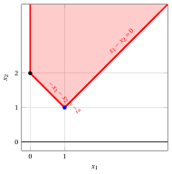{ .fig .ovale loading=lazy style="width:65%" }

    In blue the basic feasible solution associated with the basis $\pazocal{B}=\{1,2\}$, that is the vertex:

    $$
    \begin{pmatrix} 1 \\[1ex] 1 \end{pmatrix}.
    $$

<a id="esercizio-6-4"></a>

!!! esercizio "Exercise 6.4: Simplex dictionaries (P43)"

    Consider the following LP problem in canonical maximization form with $n=3$ variables and $m=2$ constraints:

    $$
    \begin{array}{rrrrrrrrrrrrr}
    {\max} & {x_1} & {+} & 2 \, {x_2} & {+} & 7 \, {x_3} \\[2ex]
    \text{subject to} & {x_1} &  &  & {+} & 2 \, {x_3} & {\le} 2 \\[2ex]
    &  &  & {x_2} & {+} & 2 \, {x_3} & {\le} 2 \\[2ex]
    & {x_1,} &  & {x_2,} &  & {x_3} & { \ge} {0}
    \end{array}
    $$

    By introducing the slack variables, we get its standard form with $n+m=5$ variables and $m=2$ constraints:

    $$
    \begin{array}{rrrrrrrrrrrrr}
    {\max} & {x_1} & {+} & 2 \, {x_2} & {+} & 7 \, {x_3} \\[2ex]
    \text{subject to} & {x_1} &  &  & {+} & 2 \, {x_3} & {+} \, {x_4} &  & {=} 2 \\[2ex]
    &  &  & {x_2} & {+} & 2 \, {x_3} &  & {+} \, {x_5} & {=} 2 \\[2ex]
    & {x_1,} &  & {x_2,} &  & {x_3,} & {x_4,} & {x_5} & { \ge} {0}
    \end{array}
    $$

    **Questions**

    1. Considering the following partitions of the variable indices

        $$
        \pazocal{B}= \{2,~~3\},~~ \pazocal{N}= \{1,~~4,~~5\} \text{    and   }  \pazocal{B}= \{3,~~5\},~~ \pazocal{N}= \{1,~~2,~~4\}
        $$

        verify that the matrices

        $$
        {\boldsymbol  A}_{\pazocal{B}}=
        \begin{pmatrix}
        0 & 2\\
        1 & 2\\
        \end{pmatrix}
        \text{    and   }
        {\boldsymbol  A}_{\pazocal{B}}=
        \begin{pmatrix}
        2 & 0\\
        2 & 1\\
        \end{pmatrix}
        $$

        are bases of the LP problem.

    2. Compute the inverse matrices ${\boldsymbol  A}_{\pazocal{B}}^{-1}$ then write the associated dictionaries.

    !!! nota ""

        A <strong>simplex dictionary</strong> is a system of linear equations in which the basic variables and the objective-function are written in function of the non-basic variables:

        \begin{equation*}
        \begin{cases} {\boldsymbol  x}_{\pazocal{B}} = {{\bar{\boldsymbol b}}} - {{\bar{\boldsymbol A}}} \; {{\boldsymbol  x}_{\pazocal{N}}}\\[2ex]
        z = {\bar{z}} + { \bar{\boldsymbol c}}' \; {{\boldsymbol  x}_{\pazocal{N}}} \end{cases}
        \qquad \text{where} \qquad \qquad
        \begin{cases}
        {{\bar{\boldsymbol b}}} = {\boldsymbol  A}_{\pazocal{B}}^{-1} \; {\boldsymbol b}\\[2ex]
        {{\bar{\boldsymbol A}}} =  {{\boldsymbol  A}_{\pazocal{B}}^{-1} \;{\boldsymbol  A}_{\pazocal{N}}}\\[2ex]
        {\bar{z}} =
        {\boldsymbol c}'_{\pazocal{B}} \; {\boldsymbol  A}_{\pazocal{B}}^{-1} \; {\boldsymbol b}   \\[2ex]
        {{ \bar{\boldsymbol c}}'}  = {\boldsymbol c}'_{\pazocal{N}} -  {\boldsymbol c}'_{\pazocal{B}} \; {\boldsymbol  A}_{\pazocal{B}}^{-1} \;{\boldsymbol  A}_{\pazocal{N}}
        \end{cases}
        \end{equation*}

??? soluzione "Solution"

    In the LP problem the input data are:

    $$
    {\boldsymbol  c} =
    \begin{pmatrix}
    1 \\[0.1ex]
    2 \\[0.1ex]
    7 \\[0.1ex]
    0 \\[0.1ex]
    0
    \end{pmatrix}
    \quad
    {\boldsymbol  A} =
    \begin{pmatrix}
    1 & 0 & 2 & 1 & 0 \\[1ex]
    0 & 1 & 2 & 0 & 1
    \end{pmatrix}
    \quad
    {\boldsymbol b} =
    \begin{pmatrix}
    2 \\[1ex]
    2
    \end{pmatrix}
    $$

    1. With

        $$
        \pazocal{B} = \{2,~~3\} \quad \text{and} \quad \pazocal{N} = \{1,~~4,~~5\}
        $$

        we have:

        $$
        {\boldsymbol  x}_{\pazocal{B}} =
        \begin{pmatrix}
        x_2 \\
        x_3
        \end{pmatrix}
        \qquad
        {\boldsymbol  x}_{\pazocal{N}} =
        \begin{pmatrix}
        x_1 \\
        x_4 \\
        x_5
        \end{pmatrix}
        \qquad
        {\boldsymbol  A}_{\pazocal{B}} =
        \begin{pmatrix}
        0 & 2 \\
        1 & 2
        \end{pmatrix}
        \qquad
        {\boldsymbol  A}_{\pazocal{N}} =
        \begin{pmatrix}
        1 & 1 & 0 \\
        0 & 0 & 1
        \end{pmatrix}
        $$

        $$
        {\boldsymbol c}_{\pazocal{B}} =
        \begin{pmatrix}
        2 \\
        7
        \end{pmatrix}
        \qquad
        {\boldsymbol c}_{\pazocal{N}} =
        \begin{pmatrix}
        1 \\
        0 \\
        0
        \end{pmatrix}
        $$

        We have:

        $$
        {\boldsymbol  A}_{\pazocal{B}} =
        \begin{pmatrix}
        0 & 2 \\
        1 & 2
        \end{pmatrix}
        \qquad \text{and} \qquad
        \det\left( {\boldsymbol  A}_{\pazocal{B}} \right)
        = 0 \cdot 2 - 1 \cdot 2 = -2 \neq 0
        $$

        then $\rank({\boldsymbol  A}_{\pazocal{B}}) = 2$, accordingly the matrix ${\boldsymbol  A}_{\pazocal{B}}$ is invertible and it is a basis of the LP problem.

        We compute the inverse matrix:

        \begin{align*}
        &\left(
        \begin{array}{cc|cc}
        {0} & {2} & {1} & {0} \\[1ex]
        {1} & {2} & {0} & {1}
        \end{array}
        \right) \\[2ex]
        &\left(
        \begin{array}{cc|cc}
        {1} & {2} & {0} & {1} \\[1ex]
        {0} & {2} & {1} & {0}
        \end{array}
        \right) \hspace{1em} \text{(exchange $R_1 \leftrightarrow R_2$)} \\[2ex]
        &\left(
        \begin{array}{cc|cc}
        {1} & {2} & {0} & {1} \\[1ex]
        {0} & {1} & {\tfrac{1}{2}} & {0}
        \end{array}
        \right) \hspace{1em} \text{(} R_2 \leftarrow \tfrac{1}{2} R_2 \text{)} \\[2ex]
        &\left(
        \begin{array}{cc|cc}
        {1} & {0} & {-1} & {1} \\[1ex]
        {0} & {1} & {\tfrac{1}{2}} & {0}
        \end{array}
        \right) \hspace{1em} \text{(} R_1 \leftarrow R_1 - 2 R_2 \text{)}
        \end{align*}

        Accordingly, we have:

        $$
        {\boldsymbol A}_{\pazocal{B}}^{-1} =
        \begin{pmatrix}
        -1 & 1 \\[1ex]
        \frac{1}{2} & 0
        \end{pmatrix}
        $$

        and we can compute:

        \begin{align*}
        {{\bar{\boldsymbol b}}} &= {\boldsymbol  A}_{\pazocal{B}}^{-1} \; {\boldsymbol b} = \begin{pmatrix}
        -1 & 1 \\[1ex]
        \frac{1}{2} & 0
        \end{pmatrix}
        \begin{pmatrix}
        2 \\[1ex]
        2
        \end{pmatrix} = \begin{pmatrix}
        0 \\[1ex]
        1
        \end{pmatrix}\\[3ex]
        {{\bar{\boldsymbol A}}} &=  {{\boldsymbol  A}_{\pazocal{B}}^{-1} \;{\boldsymbol  A}_{\pazocal{N}}} = {{\boldsymbol  A}_{\pazocal{B}}^{-1} \;{\boldsymbol  A}_{\pazocal{N}}} = \begin{pmatrix}
        -1 & 1 \\[1ex]
        \frac{1}{2} & 0
        \end{pmatrix} \begin{pmatrix}
        1 & 1 & 0 \\[1ex]
        0 & 0 & 1
        \end{pmatrix}
        =
        \begin{pmatrix}
        -1 & -1 & 1\\[1ex]
        \frac{1}{2} & \frac{1}{2} & 0
        \end{pmatrix}
        \\[3ex]
        {\bar{z}} &=
        {\boldsymbol c}'_{\pazocal{B}} \; {\boldsymbol  A}_{\pazocal{B}}^{-1} \; {\boldsymbol b}    =
        \begin{pmatrix}
        2 & 7 \\
        \end{pmatrix}
        \begin{pmatrix}
        -1 & 1 \\[1ex]
        \frac{1}{2} & 0
        \end{pmatrix}
        \begin{pmatrix}
        2 \\[1ex]
        2
        \end{pmatrix}
        =
        \begin{pmatrix}
        \frac{3}{2} & 2 \\
        \end{pmatrix}
        \begin{pmatrix}
        2 \\[1ex]
        2
        \end{pmatrix}
        =7
        \end{align*}

        \begin{align*}
        {{ \bar{\boldsymbol c}}'}  &= {\boldsymbol c}'_{\pazocal{N}} -  {\boldsymbol c}'_{\pazocal{B}} \; {\boldsymbol  A}_{\pazocal{B}}^{-1} \;{\boldsymbol  A}_{\pazocal{N}} = \begin{pmatrix}
        1 & 0 & 0\\
        \end{pmatrix}
        -
        \begin{pmatrix}
        2 & 7 \\
        \end{pmatrix}
        \begin{pmatrix}
        -1 & 1 \\[1ex]
        \frac{1}{2} & 0
        \end{pmatrix}
        \begin{pmatrix}
        1 & 1 & 0 \\[1ex]
        0 & 0 & 1
        \end{pmatrix}\\[1ex]
        &= \begin{pmatrix}
        1 & 0 & 0
        \end{pmatrix}
        -
        \begin{pmatrix}
        \frac{3}{2} & 2 \\
        \end{pmatrix}
        \begin{pmatrix}
        1 & 1 & 0 \\[1ex]
        0 & 0 & 1
        \end{pmatrix}
        =
        \begin{pmatrix}
        1 & 0 & 0
        \end{pmatrix}
        -
        \begin{pmatrix}
        \frac{3}{2} & \frac{3}{2} & 2
        \end{pmatrix}
        =
        \begin{pmatrix}
        -\frac{1}{2} & -\frac{3}{2} & -2
        \end{pmatrix}
        \end{align*}

        The dictionary is:

        \begin{equation*}
        \begin{cases}
        \begin{pmatrix}
        x_2 \\[1ex]
        x_3
        \end{pmatrix}
        =
        \begin{pmatrix}
        0 \\[1ex]
        1
        \end{pmatrix}
        -
        \begin{pmatrix}
        -1 & -1 & 1 \\[1ex]
        \frac{1}{2} & \frac{1}{2} & 0
        \end{pmatrix}
        \begin{pmatrix}
        x_1 \\[1ex]
        x_4 \\[1ex]
        x_5
        \end{pmatrix}
        \\[4ex]
        z = 7 +
        \begin{pmatrix}
        -\frac{1}{2} & -\frac{3}{2} & -2
        \end{pmatrix}
        \begin{pmatrix}
        x_1 \\[1ex]
        x_4 \\[1ex]
        x_5
        \end{pmatrix}
        \end{cases}
        \end{equation*}

        or, equivalently:

        \begin{equation*}
        \begin{cases}
        \begin{array}{rrrrrrrrrrrr}
        {x_2 = 0} & {+} & \, {x_1} & {+} & \, {x_4} & {-} & \, {x_5} \\[2ex]
        {x_3 = 1} & {-} & {\frac{1}{2}}\, {x_1} & {-} & {\frac{1}{2}}\, {x_4} \\[2ex]
        {z = 7} & {-} & {\frac{1}{2}}\, {x_1} & {-} & {\frac{3}{2}}\, {x_4} & {-} & {2}\, {x_5}
        \end{array}
        \end{cases}
        \end{equation*}

        where $\pazocal{B}=\{2,3\}$ and $\pazocal{N}=\{1,4,5\}$. The basic feasible solution is:

        $$
        \bar x_2=0,~~
        \bar x_3=1,~~~~
        \bar x_1=0,~~
        \bar x_4=0,~~
        \bar x_5=0
        ~~~\text{of value   } 7
        $$

    2. With

        $$
        \pazocal{B} = \{3,~~5\} \quad \text{and} \quad \pazocal{N} = \{1,~~2,~~4\}
        $$

        we have:

        $$
        {\boldsymbol  x}_{\pazocal{B}} =
        \begin{pmatrix}
        x_3 \\
        x_5
        \end{pmatrix}
        \qquad
        {\boldsymbol  x}_{\pazocal{N}} =
        \begin{pmatrix}
        x_1 \\
        x_2 \\
        x_4
        \end{pmatrix}
        \qquad
        {\boldsymbol  A}_{\pazocal{B}} =
        \begin{pmatrix}
        2 & 0 \\
        2 & 1
        \end{pmatrix}
        \qquad
        {\boldsymbol  A}_{\pazocal{N}} =
        \begin{pmatrix}
        1 & 0 & 1 \\
        0 & 1 & 0
        \end{pmatrix}
        $$

        $$
        {\boldsymbol c}_{\pazocal{B}} =
        \begin{pmatrix}
        7 \\
        0
        \end{pmatrix}
        \qquad
        {\boldsymbol c}_{\pazocal{N}} =
        \begin{pmatrix}
        1 \\
        2 \\
        0
        \end{pmatrix}
        $$

        We have:

        $$
        {\boldsymbol  A}_{\pazocal{B}} =
        \begin{pmatrix}
        2 & 0 \\
        2 & 1
        \end{pmatrix}
        \qquad \text{and} \qquad
        \det\left( {\boldsymbol  A}_{\pazocal{B}} \right)
        = 2 \cdot 1 - 2 \cdot 0 = 2 \neq 0
        $$

        then $\rank({\boldsymbol  A}_{\pazocal{B}}) = 2$, accordingly the matrix ${\boldsymbol  A}_{\pazocal{B}}$ is invertible and it is a basis of the LP problem.

        We compute the inverse matrix:

        \begin{align*}
        &\left(
        \begin{array}{cc|cc}
        {2} & {0} & {1} & {0} \\[1ex]
        {2} & {1} & {0} & {1}
        \end{array}
        \right) \\[2ex]
        &\left(
        \begin{array}{cc|cc}
        {1} & {0} & {\tfrac{1}{2}} & {0} \\[1ex]
        {2} & {1} & {0} & {1}
        \end{array}
        \right)
        \hspace{1em} \text{(} R_1 \leftarrow \tfrac{1}{2} R_1 \text{)} \\[2ex]
        &\left(
        \begin{array}{cc|cc}
        {1} & {0} & {\tfrac{1}{2}} & {0} \\[1ex]
        {0} & {1} & {-1} & {1}
        \end{array}
        \right)
        \hspace{1em} \text{(} R_2 \leftarrow R_2 - 2 R_1 \text{)}
        \end{align*}

        Accordingly, we have:

        $$
        {\boldsymbol A}_{\pazocal{B}}^{-1} =
        \begin{pmatrix}
        \frac{1}{2} & 0 \\[1ex]
        -1 & 1
        \end{pmatrix}
        $$

        and we can compute:

        \begin{align*}
        {{\bar{\boldsymbol b}}} &= {\boldsymbol  A}_{\pazocal{B}}^{-1} \; {\boldsymbol b} = \begin{pmatrix}
        \frac{1}{2} & 0 \\[1ex]
        -1 & 1
        \end{pmatrix}
        \begin{pmatrix}
        2 \\[1ex]
        2
        \end{pmatrix} = \begin{pmatrix}
        1 \\[1ex]
        0
        \end{pmatrix}\\[3ex]
        {{\bar{\boldsymbol A}}} &=  {{\boldsymbol  A}_{\pazocal{B}}^{-1} \;{\boldsymbol  A}_{\pazocal{N}}} = {{\boldsymbol  A}_{\pazocal{B}}^{-1} \;{\boldsymbol  A}_{\pazocal{N}}}=  \begin{pmatrix}
        \frac{1}{2} & 0 \\[1ex]
        -1 & 1
        \end{pmatrix} \begin{pmatrix}
        1 & 0 & 1 \\[1ex]
        0 & 1 & 0
        \end{pmatrix}
        =
        \begin{pmatrix}
        \frac{1}{2} & 0 & \frac{1}{2}\\[1ex]
        -1 & 1 & -1
        \end{pmatrix}
        \\[3ex]
        {\bar{z}} &=
        {\boldsymbol c}'_{\pazocal{B}} \; {\boldsymbol  A}_{\pazocal{B}}^{-1} \; {\boldsymbol b}    =
        \begin{pmatrix}
        7 & 0 \\
        \end{pmatrix}
        \begin{pmatrix}
        \frac{1}{2} & 0 \\[1ex]
        -1 & 1
        \end{pmatrix}
        \begin{pmatrix}
        2 \\[1ex]
        2
        \end{pmatrix}
        =
        \begin{pmatrix}
        \frac{7}{2} & 0 \\
        \end{pmatrix}
        \begin{pmatrix}
        2 \\[1ex]
        2
        \end{pmatrix}
        =7
        \end{align*}

        \begin{align*}
        {{ \bar{\boldsymbol c}}'}  &= {\boldsymbol c}'_{\pazocal{N}} -  {\boldsymbol c}'_{\pazocal{B}} \; {\boldsymbol  A}_{\pazocal{B}}^{-1} \;{\boldsymbol  A}_{\pazocal{N}} = \begin{pmatrix}
        1 & 2 & 0\\
        \end{pmatrix}
        -
        \begin{pmatrix}
        7 & 0 \\
        \end{pmatrix}
        \begin{pmatrix}
        \frac{1}{2} & 0 \\[1ex]
        -1 & 1
        \end{pmatrix}
        \begin{pmatrix}
        1 & 0 & 1 \\[1ex]
        0 & 1 & 0
        \end{pmatrix}\\[1ex]
        &= \begin{pmatrix}
        1 & 2 & 0
        \end{pmatrix}
        -
        \begin{pmatrix}
        \frac{7}{2} & 0 \\
        \end{pmatrix}
        \begin{pmatrix}
        1 & 0 & 1 \\[1ex]
        0 & 1 & 0
        \end{pmatrix}
        =
        \begin{pmatrix}
        1 & 2 & 0
        \end{pmatrix}
        -
        \begin{pmatrix}
        \frac{7}{2} & 0 & \frac{7}{2}
        \end{pmatrix}
        =
        \begin{pmatrix}
        -\frac{5}{2} & 2 & -\frac{7}{2}
        \end{pmatrix}
        \end{align*}

        The dictionary is:

        \begin{equation*}
        \begin{cases}
        \begin{pmatrix}
        x_3 \\[1ex]
        x_5
        \end{pmatrix}
        =
        \begin{pmatrix}
        1 \\[1ex]
        0
        \end{pmatrix}
        -
        \begin{pmatrix}
        \frac{1}{2} & 0 & \frac{1}{2} \\[1ex]
        -1 & 1 & -1
        \end{pmatrix}
        \begin{pmatrix}
        x_1 \\[1ex]
        x_2 \\[1ex]
        x_4
        \end{pmatrix}
        \\[4ex]
        z = 7 +
        \begin{pmatrix}
        -\frac{5}{2} & 2 & -\frac{7}{2}
        \end{pmatrix}
        \begin{pmatrix}
        x_1 \\[1ex]
        x_2 \\[1ex]
        x_4
        \end{pmatrix}
        \end{cases}
        \end{equation*}

        or, equivalently:

        \begin{equation*}
        \begin{cases}
        \begin{array}{rrrrrrrrrrrr}
        {x_3 = 1} & {-} & {\frac{1}{2}}\, {x_1} &  &  & {-} & {\frac{1}{2}}\, {x_4} \\[2ex]
        {x_5 = 0} & {+} & \, {x_1} & {-} & \, {x_2} & {+} & \, {x_4} \\[2ex]
        {z = 7} & {-} & {\frac{5}{2}}\, {x_1} & {+} & {2}\, {x_2} & {-} & {\frac{7}{2}}\, {x_4}
        \end{array}
        \end{cases}
        \end{equation*}

        where $\pazocal{B}=\{3,5\}$ and $\pazocal{N}=\{1,2,4\}$. The basic feasible solution is:

        $$
        \bar x_3=1,~~
        \bar x_5=0,~~~~
        \bar x_1=0,~~
        \bar x_2=0,~~
        \bar x_4=0
        ~~~\text{of value   } 7
        $$

    <strong>Graphical solution:</strong>

    The feasible region of  the LP problem (in canonical form) is the polyhedron shaded in red: 

    { .fig .ovale loading=lazy style="width:71%" }

    In blue the basic feasible solution associated with both bases $\pazocal{B}=\{2,3\}$ and $\pazocal{B}=\{3,5\}$, that is the vertex

    $$
    \begin{pmatrix} 0 \\[1ex] 0 \\[1ex] 1 \end{pmatrix}
    $$

    of the polyhedron: the two bases are associated with the same basic solution (with $\pazocal{B}=\{2,3\}$ the basic variable $x_2$ takes the value $0$, with $\pazocal{B}=\{3,5\}$ the basic variable $x_5$ takes the value $0$).

## Problems with two variables

<a id="esercizio-6-5"></a>

!!! esercizio "Exercise 6.5: Simplex algorithm (P0)"

    Consider the following LP problem in canonical maximization form with $n=2$ variables and $m=1$ constraint:

    $$
    \begin{array}{rrrrrrrrrrrrr}
    {\max} & 2 \, {x_1} & {+} & 4 \, {x_2} \\[2ex]
    \text{subject to} & 2 \, {x_1} & {+} & 3 \, {x_2} & {\le} & 4 \\[2ex]
    & {x_1,} &  & {x_2} & { \ge} & { 0 }
    \end{array}
    $$

    By introducing the slack variable, we get the following starting dictionary:

    \begin{equation*}
    \begin{cases}
    \begin{array}{rrrrrrrrrrrrr}
    {x_3} & {=} & {4} & {-} & 2\, {x_1} & {-} & 3\, {x_2} \\[2ex]
    {z} & {=} & {0} & {+} & 2\, {x_1} & {+} & 4 \, {x_2}
    \end{array}
    \end{cases}
    \end{equation*}

    The associated feasible  solution is:

    $$
    \bar x_1=0,~~
    \bar x_2=0,~~
    \bar x_3=4~~
    ~~~\text{of value   } 0
    $$

    **Questions**

    - Execute the simplex algorithm to find an optimal solution of this LP problem.

??? soluzione "Solution"

    - <span style="color:#e03131"><strong>Initialization</strong></span>

        Consider the starting dictionary:

        \begin{equation*}
        \begin{cases}
        \begin{array}{rrrrrrrrrrrrr}
        {x_3} & {=} & {4} & {-} & 2\, {x_1} & {-} & 3\, {x_2} \\[2ex]
        {z} & {=} & {0} & {+} & 2\, {x_1} & {+} & 4 \, {x_2}
        \end{array}
        \end{cases}
        \end{equation*}

        where $\pazocal{B}=\{3\}$ and $\pazocal{N}=\{1,2\}$. The basic feasible solution is:

        $$
        \bar x_3=4,~~~~~~
        \bar x_1=0,~~
        \bar x_2=0~~
        ~~~\text{of value   } 0
        $$

    - <span style="color:#e03131"><strong>Iteration 1</strong></span>

        If we increase the value of the variable $x_1$, we can get a better solution. We have:

        $$
        x_3 = 4 - 2\: x_1
        \qquad
        \qquad
        \underbrace{ 4 - 2\: x_1 \ge 0}_{x_3 \ge 0}
        \qquad
        \qquad
        x_1 \le 2
        $$

        By increasing the value of $x_1$ to $2$,  the value of $x_3$ decreases to 0.

        Then, we have that:

        - $x_1$ becomes basic and accordingly $x_3$ becomes non-basic

        We have:

        $$
        x_3 = 4 - 2\; x_1 - 3\; x_2 \text{    then     } x_1= 2 -\dfrac{3}{2}\: x_2 -\dfrac{1}{2}\: x_3.
        $$

        Substituting in the other equation of the dictionary, we get:

        $$
        z =  2 \; \left(2 -\dfrac{3}{2}\: x_2 -\dfrac{1}{2}\: x_3 \right) + 4 \:x_2= 4  + x_2 - x_3
        $$

        Accordingly, we now have the following dictionary:

        \begin{equation*}
        \begin{cases}
        \begin{array}{rrrrrrrrrrrrr}
        {x_1} & {=} & {2} & {-} & {\dfrac{3}{2}}\, {x_2} & {-} & {\dfrac{1}{2}}\, {x_3} \\[2ex]
        {z} & {=} & {4} & {+} & \, {x_2} & {-} & \, \, {x_3}
        \end{array}
        \end{cases}
        \end{equation*}

        where $\pazocal{B}=\{1\}$ and $\pazocal{N}=\{2,3\}$. The basic feasible solution is:

        $$
        \bar x_1=2,~~~~
        \bar x_2=0,~~
        \bar x_3=0~~
        ~~~\text{of value   } 4
        $$

    - <span style="color:#e03131"><strong>Iteration 2</strong></span>

        If we increase the value of the variable $x_2$, we can get a better solution. We have:

        $$
        x_1 = 2 - \dfrac{3}{2}\: x_2
        \qquad
        \qquad
        \underbrace{ 2 - \dfrac{3}{2}\: x_2 \ge 0}_{x_1 \ge 0}
        \qquad
        \qquad
        x_2 \le \dfrac{4}{3}
        $$

        By increasing the value of $x_2$ to $\dfrac{4}{3}$,  the value of $x_1$ decreases to 0.

        Then, we have that:

        - $x_2$ becomes basic and accordingly $x_1$ becomes non-basic

        We have:

        $$
        x_1 = 2 - \dfrac{3}{2}\; x_2 - \dfrac{1}{2}\; x_3 \text{    then     } x_2= \dfrac{4}{3} -\dfrac{2}{3}\: x_1 -\dfrac{1}{3}\: x_3.
        $$

        Substituting in the other equation of the dictionary, we get:

        $$
        z = 4 + \left( \dfrac{4}{3} -\dfrac{2}{3}\: x_1 -\dfrac{1}{3}\: x_3 \right) -  \:x_3= \dfrac{16}{3}  - \dfrac{2}{3}  x_1 - \dfrac{4}{3} x_3
        $$

        Accordingly, we obtained an optimal solution (no further improvement is possible) and this is an optimal dictionary:

        \begin{equation*}
        \begin{cases}
        \begin{array}{rrrrrrrrrrrrr}
        {x_2} & {=} & {\dfrac{4}{3}} & {-} & {\dfrac{2}{3}}\, {x_1} & {-} & {\dfrac{1}{3}}\, {x_3} \\[2ex]
        {z} & {=} & {\dfrac{16}{3}} & {-} & {\dfrac{2}{3}}\, {x_1} & {-} & {\dfrac{4}{3}}\, {x_3}
        \end{array}
        \end{cases}
        \end{equation*}

        where $\pazocal{B}=\{2\}$ and $\pazocal{N}=\{1,3\}$. The basic optimal solution is:

        $$
        \tilde x_2=\dfrac{4}{3},~~~~
        \tilde x_1=0,~~
        \tilde x_3=0~~
        ~~~\text{of value   } \dfrac{16}{3}
        $$

    <strong>Graphical solution:</strong>

    The feasible region of  the LP problem (in canonical form) is the polyhedron shaded in red: 

    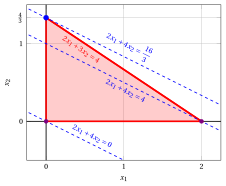{ .fig .ovale loading=lazy style="width:76%" }

    An optimal solution ${ \tilde{\boldsymbol x}}(\, LP\,)$   is:

    $$
    \tilde{x}_1=0,~~\tilde{x}_2=\dfrac{4}{3}
    $$

    the optimal value $z(\, LP\,)$ is $\dfrac{16}{3}.$

    In violet the first and the second vertex explored by the previous execution of the simplex algorithm (before reaching the optimal one depicted in blue).

    In dashed blue,  the contour lines of the objective function associated with the values taken in the three vertices.

<a id="esercizio-6-6"></a>

!!! esercizio "Exercise 6.6: Simplex algorithm (P1)"

    Consider the following LP problem in canonical maximization form with $n=2$ variables and $m=1$ constraint:

    $$
    \begin{array}{rrrrrrrrrrrrr}
    {\max} & {x_1} & {+} & 8 \, {x_2} \\[2ex]
    \text{subject to} & 3 \, {x_1} & {+} & 6 \, {x_2} & {\le} & 16 \\[2ex]
    & {x_1,} &  & {x_2} & { \ge} & { 0 }
    \end{array}
    $$

    By introducing the slack variable, we get the following starting dictionary:

    \begin{equation*}
    \begin{cases}
    \begin{array}{rrrrrrrrrrrrr}
    {x_3} & {=} & {16} & {-} & 3\, {x_1} & {-} & 6\, {x_2} \\[2ex]
    {z} & {=} & {0} & {+} & {x_1} & {+} & 8 \, {x_2}
    \end{array}
    \end{cases}
    \end{equation*}

    The associated feasible  solution is:

    $$
    \bar x_1=0,~~
    \bar x_2=0,~~
    \bar x_3=16~~
    ~~~\text{of value   } 0
    $$

    **Questions**

    - Execute the simplex algorithm to find an optimal solution of this LP problem.

??? soluzione "Solution"

    - <span style="color:#e03131"><strong>Initialization</strong></span>

        Consider the starting dictionary:

        \begin{equation*}
        \begin{cases}
        \begin{array}{rrrrrrrrrrrrr}
        {x_3} & {=} & {16} & {-} & 3\, {x_1} & {-} & 6\, {x_2} \\[2ex]
        {z} & {=} & {0} & {+} & {x_1} & {+} & 8 \, {x_2}
        \end{array}
        \end{cases}
        \end{equation*}

        where $\pazocal{B}=\{3\}$ and $\pazocal{N}=\{1,2\}$. The basic feasible solution is:

        $$
        \bar x_3=16,~~~~~~
        \bar x_1=0,~~
        \bar x_2=0~~
        ~~~\text{of value   } 0
        $$

    - <span style="color:#e03131"><strong>Iteration 1</strong></span>

        If we increase the value of the variable $x_1$, we can get a better solution. We have:

        $$
        x_3 = 16 - 3\: x_1
        \qquad
        \qquad
        \underbrace{ 16 - 3\: x_1 \ge 0}_{x_3 \ge 0}
        \qquad
        \qquad
        x_1 \le \dfrac{16}{3}
        $$

        By increasing the value of $x_1$ to $\dfrac{16}{3}$,  the value of $x_3$ decreases to 0.

        Then, we have that:

        - $x_1$ becomes basic and accordingly $x_3$ becomes non-basic

        We have:

        $$
        x_3 = 16 - 3\; x_1 - 6\; x_2 \text{    then     } x_1 = \dfrac{16}{3} - 2x_2 - \dfrac{1}{3}x_3.
        $$

        Substituting in the other equation of the dictionary, we get:

        \begin{align*}
        z &= \left(\dfrac{16}{3} - 2x_2 - \dfrac{1}{3}x_3 \right) + 8x_2
        = \dfrac{16}{3} + 6x_2 - \dfrac{1}{3}x_3
        \end{align*}

        Accordingly, we now have the following dictionary:

        \begin{equation*}
        \begin{cases}
        \begin{array}{rrrrrrrrrrrrr}
        {x_1} & {=} & {\dfrac{16}{3}} & {-} & {2}\, {x_2} & {-} & {\dfrac{1}{3}}\, {x_3} \\[2ex]
        {z} & {=} & {\dfrac{16}{3}} & {+} & {6}\, {x_2} & {-} & {\dfrac{1}{3}}\, {x_3}
        \end{array}
        \end{cases}
        \end{equation*}

        where $\pazocal{B}=\{1\}$ and $\pazocal{N}=\{2,3\}$. The current basic feasible solution is:

        $$
        \bar x_1=\dfrac{16}{3},~~~~
        \bar x_2=0,~~
        \bar x_3=0~~
        ~~~\text{of value   } \dfrac{16}{3}
        $$

    - <span style="color:#e03131"><strong>Iteration 2</strong></span>

        If we increase the value of the variable $x_2$, we can get a better solution. We have:

        $$
        x_1 = \dfrac{16}{3} - 2\: x_2
        \qquad
        \qquad
        \underbrace{ \dfrac{16}{3} - 2\: x_2 \ge 0}_{x_1 \ge 0}
        \qquad
        \qquad
        x_2 \le \dfrac{8}{3}
        $$

        By increasing the value of $x_2$ to $\dfrac{8}{3}$,  the value of $x_1$ decreases to 0.

        Then, we have that:

        - $x_2$ becomes basic and accordingly $x_1$ becomes non-basic

        We have:

        $$
        x_1 = \dfrac{16}{3} - 2x_2 - \dfrac{1}{3}x_3 \text{    then     } x_2 = \dfrac{8}{3} - \dfrac{1}{2}x_1 - \dfrac{1}{6}x_3.
        $$

        Substituting in the other equation of the dictionary, we get:

        \begin{align*}
        z &= \dfrac{16}{3} + 6 \left( \dfrac{8}{3} - \dfrac{1}{2}x_1 - \dfrac{1}{6}x_3 \right) - \dfrac{1}{3}x_3
        = \dfrac{64}{3} - 3x_1 - \dfrac{4}{3}x_3
        \end{align*}

        Accordingly, we obtained an optimal solution (no further improvement is possible) and this is an optimal dictionary:

        \begin{equation*}
        \begin{cases}
        \begin{array}{rrrrrrrrrrrrr}
        {x_2} & {=} & {\dfrac{8}{3}} & {-} & {\dfrac{1}{2}}\, {x_1} & {-} & {\dfrac{1}{6}}\, {x_3} \\[2ex]
        {z} & {=} & {\dfrac{64}{3}} & {-} & {3}\, {x_1} & {-} & {\dfrac{4}{3}}\, {x_3}
        \end{array}
        \end{cases}
        \end{equation*}

        where $\pazocal{B}=\{2\}$ and $\pazocal{N}=\{1,3\}$. The basic optimal solution is:

        $$
        \tilde x_2=\dfrac{8}{3},~~~~
        \tilde x_1=0,~~
        \tilde x_3=0~~
        ~~~\text{of value   } \dfrac{64}{3}
        $$

    <strong>Graphical solution:</strong>

    The feasible region of  the LP problem (in canonical form) is the polyhedron shaded in red: 

    { .fig .ovale loading=lazy style="width:82%" }

    An optimal solution ${ \tilde{\boldsymbol x}}(\, LP\,)$   is:

    $$
    \tilde{x}_1=0,~~\tilde{x}_2=\dfrac{8}{3}
    $$

    the optimal value $z(\, LP\,)$ is $\dfrac{64}{3}.$

    In violet the first and the second vertex explored by the previous execution of the simplex algorithm (before reaching the optimal one depicted in blue).

    In dashed blue,  the contour lines of the objective function associated with the values taken in the three vertices.

<a id="esercizio-6-7"></a>

!!! esercizio "Exercise 6.7: Simplex algorithm (P2)"

    Consider the following LP problem in canonical maximization form with $n=2$ variables and $m=2$ constraints:

    $$
    \begin{array}{rrrrrrrrrrrrr}
    {\max} & {x_1} & {+} & 3 \, {x_2} \\[2ex]
    \text{subject to} & {-}4 \, {x_1} & {+} & 10 \, {x_2} & {\le} & 35 \\[2ex]
    & 3 \, {x_1} & {+} & \, {x_2} & {\le} & 12 \\[2ex]
    & {x_1,} &  & {x_2} & { \ge} & { 0 }
    \end{array}
    $$

    By introducing the slack variables, we get the following starting dictionary:

    \begin{equation*}
    \begin{cases}
    \begin{array}{rrrrrrrrrrrrr}
    {x_3} & {=} & {35} & {+} & 4\, {x_1} & {-} & 10\, {x_2} \\[2ex]
    {x_4} & {=} & {12} & {-} & 3\, {x_1} & {-} & {x_2} \\[2ex]
    {z} & {=} & {0} & {+} & {x_1} & {+} & 3 \, {x_2}
    \end{array}
    \end{cases}
    \end{equation*}

    The associated feasible  solution is:

    $$
    \bar x_1=0,~~
    \bar x_2=0,~~
    \bar x_3=35,~~
    \bar x_4=12
    ~~~\text{of value   } 0
    $$

    **Questions**

    - Execute the simplex algorithm to find an optimal solution of this LP problem.

??? soluzione "Solution"

    - <span style="color:#e03131"><strong>Initialization</strong></span>

        Consider the starting dictionary:

        \begin{equation*}
        \begin{cases}
        \begin{array}{rrrrrrrrrrrrr}
        {x_3} & {=} & {35} & {+} & 4\, {x_1} & {-} & 10\, {x_2} \\[2ex]
        {x_4} & {=} & {12} & {-} & 3\, {x_1} & {-} & {x_2} \\[2ex]
        {z} & {=} & {0} & {+} & {x_1} & {+} & 3 \, {x_2}
        \end{array}
        \end{cases}
        \end{equation*}

        where $\pazocal{B}=\{3,4\}$ and $\pazocal{N}=\{1,2\}$. The basic feasible solution is:

        $$
        \bar x_3=35,~~
        \bar x_4=12,~~~~
        \bar x_1=0,~~
        \bar x_2=0~~
        ~~~\text{of value   } 0
        $$

    - <span style="color:#e03131"><strong>Iteration 1</strong></span>

        If we increase the value of the variable $x_1$, we can get a better solution. We have:

        $$
        \begin{cases}
        x_3 &= 35 + 4\: x_1 \\[2ex]
        x_4 &= 12 - 3\: x_1
        \end{cases}
        \qquad
        \qquad
        \begin{cases}
        \underbrace{ 35 + 4\: x_1 \ge 0}_{x_3 \ge 0} \\[2ex]
        \underbrace{  12 - 3\: x_1 \ge 0}_{x_4 \ge 0}
        \end{cases}
        \qquad
        \qquad
        \begin{cases}
        x_1 &\ge - \dfrac{35}{4} \\[2ex]
        x_1 &\le 4
        \end{cases}
        $$

        By increasing the value of $x_1$ to $4$,  the value of $x_4$ decreases to 0.

        Then, we have that:

        - $x_1$ becomes basic and accordingly $x_4$ becomes non-basic

        We have:

        $$
        x_4 = 12 - 3\; x_1 -  x_2 \text{    then     } x_1= 4 -\dfrac{1}{3}\: x_2 -\dfrac{1}{3}\: x_4.
        $$

        Substituting in the other equations of the dictionary, we get:

        $$
        x_3 = 35 + 4 \; \left(4 -\dfrac{1}{3}\: x_2 -\dfrac{1}{3}\: x_4 \right) - 10 \:x_2= 51  -\dfrac{34}{3}\: x_2 -\dfrac{4}{3}\: x_4
        $$

        $$
        z = 4 -\dfrac{1}{3}\: x_2 -\dfrac{1}{3}\: x_4 + 3 \: x_2 = 4 +\dfrac{8}{3}\: x_2 -\dfrac{1}{3}\: x_4
        $$

        Accordingly, we now have the following dictionary:

        \begin{equation*}
        \begin{cases}
        \begin{array}{rrrrrrrrrrrrr}
        {x_1} & {=} & {4} & {-} & {\dfrac{1}{3}}\, {x_2} & {-} & {\dfrac{1}{3}}\, {x_4} \\[2ex]
        {x_3} & {=} & {51} & {-} & {\dfrac{34}{3}}\, {x_2} & {-} & {\dfrac{4}{3}}\, {x_4} \\[2ex]
        {z} & {=} & {4} & {+} & {\dfrac{8}{3}}\, {x_2} & {-} & {\dfrac{1}{3}}\, \, {x_4}
        \end{array}
        \end{cases}
        \end{equation*}

        where $\pazocal{B}=\{1,3\}$ and $\pazocal{N}=\{2,4\}$. The basic feasible solution is:

        $$
        \bar x_1=4,~~
        \bar x_3=51,~~~~
        \bar x_2=0,~~
        \bar x_4=0
        ~~~\text{of value   } 4
        $$

    - <span style="color:#e03131"><strong>Iteration 2</strong></span>

        If we increase the value of the variable $x_2$, we can get a better solution. We have:

        $$
        \begin{cases}
        x_1 &= 4 - \dfrac{1}{3}\: x_2 \\[2ex]
        x_3 &= 51 - \dfrac{34}{3}\: x_2
        \end{cases}
        \qquad
        \qquad
        \begin{cases}
        \overbrace{ 4 - \dfrac{1}{3}\: x_2 \ge 0}^{x_1 \ge 0} \\[2ex]
        \underbrace{  51 - \dfrac{34}{3}\: x_2 \ge 0}_{x_3 \ge 0}
        \end{cases}
        \qquad
        \qquad
        \begin{cases}
        x_2 &\le  12 \\[2ex]
        x_2 &\le  \dfrac{9}{2}
        \end{cases}
        $$

        By increasing the value of $x_2$ to $\min \left\{12,\dfrac{9}{2}\right\}=\dfrac{9}{2}$,  the value of $x_3$ decreases to 0.

        Then, we have that:

        - $x_2$ becomes basic and accordingly $x_3$ becomes non-basic

        We have:

        $$
        x_3 = 51  -\dfrac{34}{3}\: x_2 -\dfrac{4}{3}\: x_4 \text{    then     } x_2= \dfrac{9}{2} -\dfrac{3}{34}\: x_3 -\dfrac{4}{34}\: x_4.
        $$

        Substituting in the other equations of the dictionary, we get:

        $$
        x_1 = 4 - \dfrac{1}{3} \; \left( \dfrac{9}{2} -\dfrac{3}{34}\: x_3 -\dfrac{4}{34}\: x_4 \right) - \dfrac{1}{3} \:x_4= \dfrac{5}{2}  +\dfrac{1}{34}\: x_3 - \dfrac{5}{17}\: x_4
        $$

        $$
        z =  4  + \dfrac{8}{3} \; \left( \dfrac{9}{2} -\dfrac{3}{34}\: x_3 -\dfrac{4}{34}\: x_4 \right) -\dfrac{1}{3}\: x_4 = 16 -\dfrac{4}{17}\: x_3  -\dfrac{11}{17}\: x_4
        $$

        Accordingly, we obtained an optimal solution (no further improvement is possible) and this is an optimal dictionary:

        \begin{equation*}
        \begin{cases}
        \begin{array}{rrrrrrrrrrrrr}
        {x_1=\dfrac{5}{2}} & {+} & {\dfrac{1}{34}} \, {x_3} & {-} & {\dfrac{5}{17}}\, {x_4} \\[2ex]
        {x_2=\dfrac{9}{2}} & {-} & {\dfrac{3}{34}}\, {x_3} & {-} & {\dfrac{4}{34}}\, {x_4} \\[2ex]
        {z= 16} & {-} & {\dfrac{4}{17}} \, {x_3} & {-} & {\dfrac{11}{17}} \, {x_4}
        \end{array}
        \end{cases}
        \end{equation*}

        where $\pazocal{B}=\{1,2\}$ and $\pazocal{N}=\{3,4\}$. The basic optimal solution is:

        $$
        \tilde{x}_1=\dfrac{5}{2},~~
        \tilde{x}_2=\dfrac{9}{2},~~~~
        \tilde{x}_3=0,~~
        \tilde{x}_4=0
        ~~~\text{of value   } 16
        $$

    <strong>Graphical solution:</strong>

    The feasible region of  the LP problem (in canonical form) is the polyhedron shaded in red: 

    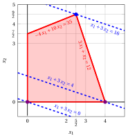{ .fig .ovale loading=lazy style="width:65%" }

    An optimal solution ${ \tilde{\boldsymbol x}}(\, LP\,)$   is:

    $$
    \tilde{x}_1=\dfrac{5}{2},~~\tilde{x}_2=\dfrac{9}{2}
    $$

    the optimal value $z(\, LP\,)$ is $16.$

    In violet the first and the second vertex explored by the previous execution of the simplex algorithm (before reaching the optimal one depicted in blue).

    In dashed blue,  the contour lines of the objective function associated with the values taken in the three vertices.

<a id="esercizio-6-8"></a>

!!! esercizio "Exercise 6.8: Simplex algorithm (P3)"

    Consider the following LP problem in canonical maximization form with $n=2$ variables and $m=2$ constraints:

    $$
    \begin{array}{rrrrrrrrrrrrr}
    {\max} & {2} \, {x_1} & {+} & {4} \, {x_2} \\[2ex]
    \text{subject to} & {-} \, {x_1} & {+} & \, {x_2} & {\le} & {2} \\[2ex]
    & {8} \, {x_1} & {+} & {2} \, {x_2} & {\le} & {19} \\[2ex]
    & {x_1,} &  & {x_2} & { \ge} & { 0 }
    \end{array}
    $$

    By introducing the slack variables, we get the following starting dictionary:

    \begin{equation*}
    \begin{cases}
    \begin{array}{rrrrrrrrrrrrr}
    {x_3} & {=} & {2} & {+} & {x_1} & {-} & {x_2} \\[2ex]
    {x_4} & {=} & {19} & {-} & 8\; {x_1} & {-} & {2\;x_2} \\[2ex]
    {z} & {=} & {0} & {+} & {2\,x_1} & {+} & {4\,x_2}
    \end{array}
    \end{cases}
    \end{equation*}

    The associated feasible   solution is:

    $$
    \bar x_1=0,~~
    \bar x_2=0,~~
    \bar x_3=2,~~
    \bar x_4=19~~
    ~~~\text{of value   } 0
    $$

    **Questions**

    - Execute the simplex algorithm to find an optimal solution of this LP problem.

??? soluzione "Solution"

    - <span style="color:#e03131"><strong>Initialization</strong></span>

        Consider the starting dictionary:

        \begin{equation*}
        \begin{cases}
        \begin{array}{rrrrrrrrrrrrr}
        {x_3} & {=} & {2} & {+} & {x_1} & {-} & {x_2} \\[2ex]
        {x_4} & {=} & {19} & {-} & 8\; {x_1} & {-} & {2\;x_2} \\[2ex]
        {z} & {=} & {0} & {+} & {2\,x_1} & {+} & {4\,x_2}
        \end{array}
        \end{cases}
        \end{equation*}

        where $\pazocal{B}=\{3,4\}$ and $\pazocal{N}=\{1,2\}$. The basic feasible solution is:

        $$
        \bar x_3=2,~~
        \bar x_4=19,~~~~
        \bar x_1=0,~~
        \bar x_2=0~~
        ~~~\text{of value   } 0
        $$

    - <span style="color:#e03131"><strong>Iteration 1</strong></span>

        If we increase the value of the variable $x_1$, we can get a better solution. We have:

        $$
        \begin{cases}
        x_3 &= 2 + x_1 \\[2ex]
        x_4 &= 19 - 8\: x_1
        \end{cases}
        \qquad
        \qquad
        \begin{cases}
        \underbrace{ 2 + x_1 \ge 0}_{x_3 \ge 0} \\[2ex]
        \underbrace{  19 - 8\: x_1 \ge 0}_{x_4 \ge 0}
        \end{cases}
        \qquad
        \qquad
        \begin{cases}
        x_1 &\ge  -2 \\[2ex]
        x_1 &\le  \dfrac{19}{8}
        \end{cases}
        $$

        By increasing the value of $x_1$ to $\dfrac{19}{8}$,  the value of $x_4$ decreases to 0.

        Then, we have that:

        - $x_1$ becomes basic and accordingly $x_4$ becomes non-basic

        We have:

        $$
        x_4 = 19 - 8\; x_1 - 2\; x_2 \text{    then     } x_1= \dfrac{19}{8} -\dfrac{1}{4}\: x_2 -\dfrac{1}{8}\: x_4.
        $$

        Substituting in the other equations of the dictionary, we get:

        $$
        x_3 = 2 +  \left( \dfrac{19}{8} -\dfrac{1}{4}\: x_2 -\dfrac{1}{8}\: x_4 \right) -  \:x_2= \dfrac{35}{8}  -\dfrac{5}{4}\: x_2 -\dfrac{1}{8}\: x_4
        $$

        $$
        z = 2\; \left(\dfrac{19}{8} -\dfrac{1}{4}\: x_2 -\dfrac{1}{8}\: x_4 \right) + 4 \: x_2 = \dfrac{19}{4} +\dfrac{7}{2}\: x_2 -\dfrac{1}{4}\: x_4
        $$

        Accordingly, we obtain the following dictionary:

        \begin{equation*}
        \begin{cases}
        \begin{array}{rrrrrrrrrrrrr}
        {x_1=\dfrac{19}{8}} & {-} & {\dfrac{1}{4}} \, {x_2} & {-} & {\dfrac{1}{8}}\, {x_4} \\[2ex]
        {x_3=\dfrac{35}{8}} & {-} & {\dfrac{5}{4}}\, {x_2} & {-} & {\dfrac{1}{8}}\, {x_4} \\[2ex]
        {z =\dfrac{19}{4}} & {+} & {\dfrac{7}{2}} \, {x_2} & {-} & {\dfrac{1}{4}} \, {x_4}
        \end{array}
        \end{cases}
        \end{equation*}

        where $\pazocal{B}=\{1,3\}$ and $\pazocal{N}=\{2,4\}$. The basic feasible solution is:

        $$
        \bar x_1=\dfrac{19}{8},~~
        \bar x_3=\dfrac{35}{8},~~~~
        \bar x_2=0,~~
        \bar x_4=0
        ~~~\text{of value   } \dfrac{19}{4}
        $$

    - <span style="color:#e03131"><strong>Iteration 2</strong></span>

        If we increase the value of the variable $x_2$, we can get a better solution. We have:

        $$
        \begin{cases}
        x_1 &= \dfrac{19}{8} - \dfrac{1}{4}\: x_2\\[2ex]
        x_3 &= \dfrac{35}{8} -  \dfrac{5}{4}\, x_2
        \end{cases}
        \qquad
        \qquad
        \begin{cases}
        \overbrace{  \dfrac{19}{8} - \dfrac{1}{4}\: x_2 \ge 0}^{x_1 \ge 0}\\[2ex]
        \underbrace{ \dfrac{35}{8} -  \dfrac{5}{4}\, x_2 \ge 0}_{x_3 \ge 0}
        \end{cases}
        \qquad
        \qquad
        \begin{cases}
        x_2 &\le  \dfrac{19}{2}\\[2ex]
        x_2 &\le  \dfrac{7}{2}
        \end{cases}
        $$

        By increasing the value of $x_2$ to $\min \left\{\dfrac{7}{2},\dfrac{19}{2}\right\}=\dfrac{7}{2}$,  the value of $x_3$ decreases to 0.

        Then, we have that:

        - $x_2$ becomes basic and accordingly $x_3$ becomes non-basic

        We have:

        $$
        x_3 = \dfrac{35}{8}  -\dfrac{5}{4}\: x_2 -\dfrac{1}{8}\: x_4 \text{    then     } x_2= \dfrac{7}{2} -\dfrac{4}{5}\: x_3 -\dfrac{1}{10}\: x_4.
        $$

        Substituting in the other equations of the dictionary, we get:

        $$
        x_1 = \dfrac{19}{8} - \dfrac{1}{4} \; \left( \dfrac{7}{2} -\dfrac{4}{5}\: x_3 -\dfrac{1}{10}\: x_4 \right) - \dfrac{1}{8} \:x_4= \dfrac{3}{2}  +\dfrac{1}{5}\: x_3 - \dfrac{1}{10}\: x_4
        $$

        $$
        z =  \dfrac{19}{4}  + \dfrac{7}{2} \; \left( \dfrac{7}{2} -\dfrac{4}{5}\: x_3 -\dfrac{1}{10}\: x_4 \right) -\dfrac{1}{4}\: x_4 = 17 -\dfrac{14}{5}\: x_3  -\dfrac{3}{5}\: x_4
        $$

        Accordingly, we have an optimal solution (no further improvement is possible) and this is an optimal dictionary:

        \begin{equation*}
        \begin{cases}
        \begin{array}{rrrrrrrrrrrrr}
        {x_1=\dfrac{3}{2}} & {+} & {\dfrac{1}{5}} \, {x_3} & {-} & {\dfrac{1}{10}}\, {x_4} \\[2ex]
        {x_2=\dfrac{7}{2}} & {-} & {\dfrac{4}{5}}\, {x_3} & {-} & {\dfrac{1}{10}}\, {x_4} \\[2ex]
        {z = 17} & {-} & {\dfrac{14}{5}} \, {x_3} & {-} & {\dfrac{3}{5}} \, {x_4}
        \end{array}
        \end{cases}
        \end{equation*}

        where $\pazocal{B}=\{1,2\}$ and $\pazocal{N}=\{3,4\}$. The basic optimal solution is:

        $$
        \tilde x_1=\dfrac{3}{2},~~
        \tilde x_2=\dfrac{7}{2},~~~~
        \tilde x_3=0,~~
        \tilde x_4=0
        ~~~\text{of value   } 17
        $$

    <strong>Graphical solution:</strong>

    The feasible region of  the LP problem (in canonical form) is the polyhedron shaded in red: 

    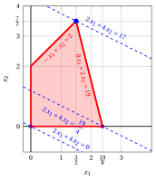{ .fig .ovale loading=lazy style="width:65%" }

    An optimal solution ${ \tilde{\boldsymbol x}}(\, LP \,)$   is:

    $$
    \tilde{x}_1=\dfrac{3}{2},~~\tilde{x}_2=\dfrac{7}{2}
    $$

    the optimal value $z(\, LP\,)$ is $17.$

    In violet the first and the second vertex explored by the previous execution of the simplex algorithm (before reaching the optimal one depicted in blue).

    In dashed blue,  the contour lines of the objective function associated with the values taken in the three vertices.

<a id="esercizio-6-9"></a>

!!! esercizio "Exercise 6.9: Simplex algorithm (P4)"

    Consider the following LP problem in canonical maximization form with $n=2$ variables and $m=2$ constraints:

    $$
    \begin{array}{rrrrrrrrrrrrr}
    {\max} & 5 {x_1} & {+} & 3 \, {x_2} \\[2ex]
    \text{subject to} & 2 \, {x_1} & {+} & \, {x_2} & {\le} & 14 \\[2ex]
    & \, {x_1} & {+} & 8 \, {x_2} & {\le} & 32 \\[2ex]
    & {x_1,} &  & {x_2} & { \ge} & { 0 }
    \end{array}
    $$

    By introducing the slack variables, we get the following starting dictionary:

    \begin{equation*}
    \begin{cases}
    \begin{array}{rrrrrrrrrrrrr}
    {x_3} & {=} & {14} & {-} & 2\, {x_1} & {-} & \, {x_2} \\[2ex]
    {x_4} & {=} & {32} & {-} & \, {x_1} & {-} & 8\, {x_2} \\[2ex]
    {z} & {=} & {0} & {+} & 5\, {x_1} & {+} & 3 \, {x_2}
    \end{array}
    \end{cases}
    \end{equation*}

    The associated feasible  solution is:

    $$
    \bar x_1=0,~~
    \bar x_2=0,~~
    \bar x_3=14,~~
    \bar x_4=32
    ~~~\text{of value   } 0
    $$

    **Questions**

    - Execute the simplex algorithm to find an optimal solution of this LP problem.

??? soluzione "Solution"

    - <span style="color:#e03131"><strong>Initialization</strong></span>

        Consider the starting dictionary:

        \begin{equation*}
        \begin{cases}
        \begin{array}{rrrrrrrrrrrrr}
        {x_3} & {=} & {14} & {-} & 2\, {x_1} & {-} & \, {x_2} \\[2ex]
        {x_4} & {=} & {32} & {-} & \, {x_1} & {-} & 8 \, {x_2} \\[2ex]
        {z} & {=} & {0} & {+} & 5 \, {x_1} & {+} & 3 \, {x_2}
        \end{array}
        \end{cases}
        \end{equation*}

        where $\pazocal{B}=\{3,4\}$ and $\pazocal{N}=\{1,2\}$. The basic feasible solution is:

        $$
        \bar x_3=14,~~
        \bar x_4=32,~~~
        \bar x_1=0,~~
        \bar x_2=0~~
        ~~~\text{of value   } 0
        $$

    - <span style="color:#e03131"><strong>Iteration 1</strong></span>

        If we increase the value of the variable $x_1$, we can get a better solution. We have:

        $$
        \begin{cases}
        x_3 &= 14 - 2\: x_1 \\[2ex]
        x_4 &= 32 - \: x_1
        \end{cases}
        \qquad
        \qquad
        \begin{cases}
        \underbrace{ 14 - 2\: x_1 \ge 0}_{x_3 \ge 0} \\[2ex]
        \underbrace{ 32 - \: x_1 \ge 0}_{x_4 \ge 0}
        \end{cases}
        \qquad
        \qquad
        \begin{cases}
        x_1 &\le 7 \\[2ex]
        x_1 &\le 32
        \end{cases}
        $$

        By increasing the value of $x_1$ to $7$,  the value of $x_3$ decreases to 0.

        Then, we have that:

        - $x_1$ becomes basic and accordingly $x_3$ becomes non-basic

        We have:

        $$
        x_3 = 14 - 2\; x_1 -  \,x_2 \text{    then     } x_1= 7 -\dfrac{1}{2}\: x_2 -\dfrac{1}{2}\: x_3.
        $$

        Substituting in the other equations of the dictionary, we get:

        $$
        x_4 = 32 -  \; \left(7 -\dfrac{1}{2}\: x_2 -\dfrac{1}{2}\: x_3 \right) - 8\:x_2 = 25  - \dfrac{15}{2}\: x_2 + \dfrac{1}{2}\: x_3
        $$

        $$
        z = 5 \, \left(7 -\dfrac{1}{2}\: x_2 -\dfrac{1}{2}\: x_3 \right) + 3 \: x_2 = 35 + \dfrac{1}{2}\,x_2 - \dfrac{5}{2} \, x_3
        $$

        Accordingly, we now have the following dictionary:

        \begin{equation*}
        \begin{cases}
        \begin{array}{rrrrrrrrrrrrr}
        {x_1} & {=} & {7} & {-} & {\dfrac{1}{2}}\, {x_2} & {-} & {\dfrac{1}{2}}\, {x_3} \\[2ex]
        {x_4} & {=} & {25} & {-} & {\dfrac{15}{2}}\, {x_2} & {+} & {\dfrac{1}{2}}\, {x_3} \\[2ex]
        {z} & {=} & {35} & {+} & {\dfrac{1}{2}}\, {x_2} & {-} & {\dfrac{5}{2}}\, \, {x_3}
        \end{array}
        \end{cases}
        \end{equation*}

        where $\pazocal{B}=\{1,4\}$ and $\pazocal{N}=\{2,3\}$. The basic feasible solution is:

        $$
        \bar x_1=7,~~
        \bar x_4=25,~~~~
        \bar x_2=0,~~
        \bar x_3=0
        ~~~\text{of value   } 35
        $$

    - <span style="color:#e03131"><strong>Iteration 2</strong></span>

        If we increase the value of the variable $x_2$, we can get a better solution. We have:

        $$
        \begin{cases}
        x_1 &= 7 - \dfrac{1}{2}\: x_2 \\[2ex]
        x_4 &= 25 - \dfrac{15}{2}\: x_2
        \end{cases}
        \qquad
        \qquad
        \begin{cases}
        \overbrace{ 7 - \dfrac{1}{2}\: x_2 \ge 0}^{x_1 \ge 0} \\[2ex]
        \underbrace{  25 - \dfrac{15}{2}\: x_2 \ge 0}_{x_4 \ge 0}
        \end{cases}
        \qquad
        \qquad
        \begin{cases}
        x_2 &\le  14 \\[2ex]
        x_2 &\le  \dfrac{10}{3}
        \end{cases}
        $$

        By increasing the value of $x_2$ to $\min \left\{14,\dfrac{10}{3}\right\}=\dfrac{10}{3}$,  the value of $x_4$ decreases to 0.

        Then, we have that:

        - $x_2$ becomes basic and accordingly $x_4$ becomes non-basic

        We have:

        $$
        x_4 = 25  -\dfrac{15}{2}\: x_2 +\dfrac{1}{2}\: x_3 \text{    then     } x_2 = \dfrac{10}{3} +\dfrac{1}{15}\: x_3 - \dfrac{2}{15}\: x_4.
        $$

        Substituting in the other equations of the dictionary, we get:

        $$
        x_1 = 7 - \dfrac{1}{2} \; \left( \dfrac{10}{3} +\dfrac{1}{15}\: x_3 - \dfrac{2}{15}\: x_4 \right) - \dfrac{1}{2} \:x_3= \dfrac{16}{3}  - \dfrac{8}{15}\: x_3 + \dfrac{1}{15}\: x_4
        $$

        $$
        z =  35  + \dfrac{1}{2} \; \left( \dfrac{10}{3} +\dfrac{1}{15}\: x_3 - \dfrac{2}{15}\: x_4 \right) -\dfrac{5}{2}\: x_3 = \dfrac{110}{3} -\dfrac{37}{15}\: x_3  -\dfrac{1}{15}\: x_4
        $$

        Accordingly, we obtained an optimal solution (no further improvement is possible) and this is an optimal dictionary:

        \begin{equation*}
        \begin{cases}
        \begin{array}{rrrrrrrrrrrrr}
        {x_1=\dfrac{16}{3}} & {-} & {\dfrac{8}{15}} \, {x_3} & {+} & {\dfrac{1}{15}}\, {x_4} \\[2ex]
        {x_2=\dfrac{10}{3}} & {+} & {\dfrac{1}{15}}\, {x_3} & {-} & {\dfrac{2}{15}}\, {x_4} \\[2ex]
        {z= \dfrac{110}{3}} & {-} & {\dfrac{37}{15}} \, {x_3} & {-} & {\dfrac{1}{15}} \, {x_4}
        \end{array}
        \end{cases}
        \end{equation*}

        where $\pazocal{B}=\{1,2\}$ and $\pazocal{N}=\{3,4\}$. The basic optimal solution is:

        $$
        \tilde{x}_1=\dfrac{16}{3},~~
        \tilde{x}_2=\dfrac{10}{3},~~~~
        \tilde{x}_3=0,~~
        \tilde{x}_4=0
        ~~~\text{of value   } \dfrac{110}{3}
        $$

    <strong>Graphical solution:</strong>

    The feasible region of  the LP problem (in canonical form) is the polyhedron shaded in red: 

    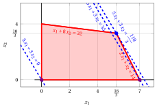{ .fig .ovale loading=lazy style="width:82%" }

    An optimal solution ${ \tilde{\boldsymbol x}}(\, LP\,)$   is:

    $$
    \tilde{x}_1=\dfrac{16}{3},~~\tilde{x}_2=\dfrac{10}{3}
    $$

    the optimal value $z(\, LP\,)$ is $\dfrac{110}{3}.$

    In violet the first and the second vertex explored by the previous execution of the simplex algorithm (before reaching the optimal one depicted in blue).

    In dashed blue,  the contour lines of the objective function associated with the values taken in the three vertices.

<a id="esercizio-6-10"></a>

!!! esercizio "Exercise 6.10: Simplex algorithm (P5)"

    Consider the following LP problem in canonical maximization form with $n=2$ variables and $m=2$ constraints:

    $$
    \begin{array}{rrrrrrrrrrrrr}
    {\max} & 2 {x_1} & {+} & 3 \, {x_2} \\[2ex]
    \text{subject to} & 6 \, {x_1} & {+} & 21 \, {x_2} & {\le} & 77 \\[2ex]
    & 8 \, {x_1} & {+} & 3 \, {x_2} & {\le} & 36 \\[2ex]
    & {x_1,} &  & {x_2} & { \ge} & { 0 }
    \end{array}
    $$

    By introducing the slack variables, we get the following starting dictionary:

    \begin{equation*}
    \begin{cases}
    \begin{array}{rrrrrrrrrrrrr}
    {x_3} & {=} & {77} & {-} & 6\, {x_1} & {-} & 21\, {x_2} \\[2ex]
    {x_4} & {=} & {36} & {-} & 8\, {x_1} & {-} & 3\, {x_2} \\[2ex]
    {z} & {=} & {0} & {+} & 2\, {x_1} & {+} & 3 \, {x_2}
    \end{array}
    \end{cases}
    \end{equation*}

    The associated feasible  solution is:

    $$
    \bar x_1=0,~~
    \bar x_2=0,~~
    \bar x_3=77,~~
    \bar x_4=36
    ~~~\text{of value   } 0
    $$

    **Questions**

    - Execute the simplex algorithm to find an optimal solution of this LP problem.

??? soluzione "Solution"

    - <span style="color:#e03131"><strong>Initialization</strong></span>

        Consider the starting dictionary:

        \begin{equation*}
        \begin{cases}
        \begin{array}{rrrrrrrrrrrrr}
        {x_3} & {=} & {77} & {-} & 6\, {x_1} & {-} & 21\, {x_2} \\[2ex]
        {x_4} & {=} & {36} & {-} & 8\, {x_1} & {-} & 3 \, {x_2} \\[2ex]
        {z} & {=} & {0} & {+} & 2 \, {x_1} & {+} & 3 \, {x_2}
        \end{array}
        \end{cases}
        \end{equation*}

        where $\pazocal{B}=\{3,4\}$ and $\pazocal{N}=\{1,2\}$. The basic feasible solution is:

        $$
        \bar x_3=77,~~
        \bar x_4=36,~~~~
        \bar x_1=0,~~
        \bar x_2=0~~
        ~~~\text{of value   } 0
        $$

    - <span style="color:#e03131"><strong>Iteration 1</strong></span>

        If we increase the value of the variable $x_1$, we can get a better solution. We have:

        $$
        \begin{cases}
        x_3 &= 77 - 6\: x_1 \\[2ex]
        x_4 &= 36 - 8\: x_1
        \end{cases}
        \qquad
        \qquad
        \begin{cases}
        \underbrace{ 77 - 6\: x_1 \ge 0}_{x_3 \ge 0} \\[2ex]
        \underbrace{ 36 - 8\: x_1 \ge 0}_{x_4 \ge 0}
        \end{cases}
        \qquad
        \qquad
        \begin{cases}
        x_1 &\le \dfrac{77}{6} \\[2ex]
        x_1 &\le \dfrac{9}{2}
        \end{cases}
        $$

        By increasing the value of $x_1$ to $\dfrac{9}{2}$,  the value of $x_4$ decreases to 0.

        Then, we have that:

        - $x_1$ becomes basic and accordingly $x_4$ becomes non-basic

        We have:

        $$
        x_4 = 36 - 8\; x_1 -  3\,x_2 \text{    then     } x_1= \dfrac{9}{2} -\dfrac{3}{8}\: x_2 -\dfrac{1}{8}\: x_4.
        $$

        Substituting in the other equations of the dictionary, we get:

        $$
        x_3 = 77 - 6 \; \left(\dfrac{9}{2} -\dfrac{3}{8}\: x_2 -\dfrac{1}{8}\: x_4 \right) - 21 \:x_2= 50  -\dfrac{75}{4}\: x_2 +\dfrac{3}{4}\: x_4
        $$

        $$
        z = 2 \, \left(\dfrac{9}{2} -\dfrac{3}{8}\: x_2 -\dfrac{1}{8}\: x_4 \right) + 3 \: x_2 = 9 + \dfrac{9}{4}\,x_2 - \dfrac{1}{4} \, x_4
        $$

        Accordingly, we now have the following dictionary:

        \begin{equation*}
        \begin{cases}
        \begin{array}{rrrrrrrrrrrrr}
        {x_1} & {=} & {\dfrac{9}{2}} & {-} & {\dfrac{3}{8}}\, {x_2} & {-} & {\dfrac{1}{8}}\, {x_4} \\[2ex]
        {x_3} & {=} & {50} & {-} & {\dfrac{75}{4}}\, {x_2} & {+} & {\dfrac{3}{4}}\, {x_4} \\[2ex]
        {z} & {=} & {9} & {+} & {\dfrac{9}{4}}\, {x_2} & {-} & {\dfrac{1}{4}}\, \, {x_4}
        \end{array}
        \end{cases}
        \end{equation*}

        where $\pazocal{B}=\{1,3\}$ and $\pazocal{N}=\{2,4\}$. The basic feasible solution is:

        $$
        \bar x_1=\dfrac{9}{2},~~
        \bar x_3=50,~~~~
        \bar x_2=0,~~
        \bar x_4=0
        ~~~\text{of value   } 9
        $$

    - <span style="color:#e03131"><strong>Iteration 2</strong></span>

        If we increase the value of the variable $x_2$, we can get a better solution. We have:

        $$
        \begin{cases}
        x_1 &= \dfrac{9}{2} - \dfrac{3}{8}\: x_2 \\[2ex]
        x_3 &= 50 - \dfrac{75}{4}\: x_2
        \end{cases}
        \qquad
        \qquad
        \begin{cases}
        \overbrace{ \dfrac{9}{2} - \dfrac{3}{8}\: x_2 \ge 0}^{x_1 \ge 0} \\[2ex]
        \underbrace{  50 - \dfrac{75}{4}\: x_2 \ge 0}_{x_3 \ge 0}
        \end{cases}
        \qquad
        \qquad
        \begin{cases}
        x_2 &\le  12 \\[2ex]
        x_2 &\le  \dfrac{8}{3}
        \end{cases}
        $$

        By increasing the value of $x_2$ to $\min \left\{12,\dfrac{8}{3}\right\}=\dfrac{8}{3}$,  the value of $x_3$ decreases to 0.

        Then, we have that:

        - $x_2$ becomes basic and accordingly $x_3$ becomes non-basic

        We have:

        $$
        x_3 = 50  -\dfrac{75}{4}\: x_2 +\dfrac{3}{4}\: x_4 \text{    then     } x_2= \dfrac{8}{3} -\dfrac{4}{75}\: x_3 +\dfrac{1}{25}\: x_4.
        $$

        Substituting in the other equations of the dictionary, we get:

        $$
        x_1 = \dfrac{9}{2} - \dfrac{3}{8} \; \left( \dfrac{8}{3} -\dfrac{4}{75}\: x_3 +\dfrac{1}{25}\: x_4 \right) - \dfrac{1}{8} \:x_4= \dfrac{7}{2}  +\dfrac{1}{50}\: x_3 - \dfrac{7}{50}\: x_4
        $$

        $$
        z =  9  + \dfrac{9}{4} \; \left( \dfrac{8}{3} -\dfrac{4}{75}\: x_3 +\dfrac{1}{25}\: x_4 \right) -\dfrac{1}{4}\: x_4 = 15 -\dfrac{3}{25}\: x_3  -\dfrac{4}{25}\: x_4
        $$

        Accordingly, we obtained an optimal solution (no further improvement is possible) and this is an optimal dictionary:

        \begin{equation*}
        \begin{cases}
        \begin{array}{rrrrrrrrrrrrr}
        {x_1=\dfrac{7}{2}} & {+} & {\dfrac{1}{50}} \, {x_3} & {-} & {\dfrac{7}{50}}\, {x_4} \\[2ex]
        {x_2=\dfrac{8}{3}} & {-} & {\dfrac{4}{75}}\, {x_3} & {+} & {\dfrac{1}{25}}\, {x_4} \\[2ex]
        {z= 15} & {-} & {\dfrac{3}{25}} \, {x_3} & {-} & {\dfrac{4}{25}} \, {x_4}
        \end{array}
        \end{cases}
        \end{equation*}

        where $\pazocal{B}=\{1,2\}$ and $\pazocal{N}=\{3,4\}$. The basic optimal solution is:

        $$
        \tilde{x}_1=\dfrac{7}{2},~~
        \tilde{x}_2=\dfrac{8}{3},~~~~
        \tilde{x}_3=0,~~
        \tilde{x}_4=0
        ~~~\text{of value   } 15
        $$

    <strong>Graphical solution:</strong>

    The feasible region of  the LP problem (in canonical form) is the polyhedron shaded in red: 

    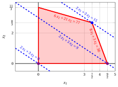{ .fig .ovale loading=lazy style="width:76%" }

    An optimal solution ${ \tilde{\boldsymbol x}}(\,LP\,)$   is:

    $$
    \tilde{x}_1=\dfrac{7}{2},~~\tilde{x}_2=\dfrac{8}{3}
    $$

    the optimal value $z(\, LP\,)$ is $15.$

    In violet the first and the second vertex explored by the previous execution of the simplex algorithm (before reaching the optimal one depicted in blue).

    In dashed blue,  the contour lines of the objective function associated with the values taken in the three vertices.

<a id="esercizio-6-11"></a>

!!! esercizio "Exercise 6.11: Simplex algorithm (P6)"

    Consider the following LP problem in canonical maximization form with $n=2$ variables and $m=2$ constraints:

    $$
    \begin{array}{rrrrrrrrrrrrr}
    {\max} & {x_1} & {+} & {x_2} \\[2ex]
    \text{subject to} & {4} \, {x_1} & {+} & {15} \, {x_2} & {\le} & {70} \\[2ex]
    & {12}\, {x_1} & {+} & {3} \, {x_2} & {\le} & {52} \\[2ex]
    & {x_1,} &  & {x_2} & { \ge} & {0}
    \end{array}
    $$

    By introducing the slack variables, we get the following starting dictionary:

    \begin{equation*}
    \begin{cases}
    \begin{array}{rrrrrrrrrrrrr}
    {x_3} & {=} & {70} & {-} & {4\,x_1} & {-} & {15\,x_2} \\[2ex]
    {x_4} & {=} & {52} & {-} & {12\,x_1} & {-} & {3\,x_2} \\[2ex]
    {z} & {=} & {0} & {+} & {x_1} & {+} & {x_2}
    \end{array}
    \end{cases}
    \end{equation*}

    The associated feasible  solution is:

    $$
    \bar x_1=0,~~
    \bar x_2=0,~~
    \bar x_3=70,~~
    \bar x_4=52
    ~~~\text{of value   } 0
    $$

    **Questions**

    - Execute the simplex algorithm to find an optimal solution of this LP problem.

??? soluzione "Solution"

    - <span style="color:#e03131"><strong>Initialization</strong></span>

        Consider the starting dictionary:

        \begin{equation*}
        \begin{cases}
        \begin{array}{rrrrrrrrrrrrr}
        {x_3} & {=} & {70} & {-} & {4\,x_1} & {-} & {15\,x_2} \\[2ex]
        {x_4} & {=} & {52} & {-} & {12\,x_1} & {-} & {3\,x_2} \\[2ex]
        {z} & {=} & {0} & {+} & {x_1} & {+} & {x_2}
        \end{array}
        \end{cases}
        \end{equation*}

        where $\pazocal{B}=\{3,4\}$ and $\pazocal{N}=\{1,2\}$. The basic feasible solution is:

        $$
        \bar x_3=70,~~
        \bar x_4=52,~~~~~
        \bar x_1=0,~~
        \bar x_2=0~~
        ~~~\text{of value   } 0
        $$

    - <span style="color:#e03131"><strong>Iteration 1</strong></span>

        If we increase the value of the variable $x_1$, we can get a better solution. We have:

        $$
        \begin{cases}
        x_3 &= 70 - 4\: x_1 \\[2ex]
        x_4 &= 52 - 12\: x_1
        \end{cases}
        \qquad
        \qquad
        \begin{cases}
        \underbrace{ 70 - 4\: x_1 \ge 0}_{x_3 \ge 0} \\[2ex]
        \underbrace{ 52 - 12\: x_1 \ge 0}_{x_4 \ge 0}
        \end{cases}
        \qquad
        \qquad
        \begin{cases}
        x_1 &\le  \dfrac{35}{2} \\[2ex]
        x_1 &\le \dfrac{13}{3}
        \end{cases}
        $$

        By increasing the value of $x_1$ to $\min \left\{\dfrac{35}{2},\dfrac{13}{3}\right\}=\dfrac{13}{3}$,  the value of $x_4$ decreases to 0.

        Then, we have that:

        - $x_1$ becomes basic and accordingly $x_4$ becomes non-basic

        We have:

        $$
        x_4 = 52 - 12\; x_1 - 3\; x_2 \text{    then     } x_1= \dfrac{13}{3} -\dfrac{1}{4}\: x_2 -\dfrac{1}{12}\: x_4.
        $$

        Substituting in the other equations of the dictionary, we get:

        $$
        x_3 = 70 - 4\left(\dfrac{13}{3} -\dfrac{1}{4}\: x_2 -\dfrac{1}{12}\: x_4 \right) - 15 \:x_2= \dfrac{158}{3}  -14\: x_2 +\dfrac{1}{3}\: x_4
        $$

        $$
        z =  \left(\dfrac{13}{3} -\dfrac{1}{4}\: x_2 -\dfrac{1}{12}\: x_4 \right) + x_2 = \dfrac{13}{3} +\dfrac{3}{4}\: x_2 -\dfrac{1}{12}\: x_4
        $$

        Accordingly, we now have the following dictionary:

        \begin{equation*}
        \begin{cases}
        \begin{array}{rrrrrrrrrrrrr}
        {x_1} & {=} & {\dfrac{13}{3}} & {-} & {\dfrac{1}{4}}\, {x_2} & {-} & {\dfrac{1}{12}}\, {x_4} \\[2ex]
        {x_3} & {=} & {\dfrac{158}{3}} & {-} & {14}\, {x_2} & {+} & {\dfrac{1}{3}}\, {x_4} \\[2ex]
        {z} & {=} & {\dfrac{13}{3}} & {+} & {\dfrac{3}{4}}\, {x_2} & {-} & {\dfrac{1}{12}}\, \, {x_4}
        \end{array}
        \end{cases}
        \end{equation*}

        where $\pazocal{B}=\{1,3\}$ and $\pazocal{N}=\{2,4\}$. The basic feasible solution is:

        $$
        \bar x_1=\dfrac{13}{3},~~
        \bar x_3=\dfrac{158}{3},~~~~
        \bar x_2=0,~~
        \bar x_4=0
        ~~~\text{of value   } \dfrac{13}{3}
        $$

    - <span style="color:#e03131"><strong>Iteration 2</strong></span>

        If we increase the value of the variable $x_2$, we can get a better solution. We have:

        $$
        \begin{cases}
        x_1 &= \dfrac{13}{3} - \dfrac{1}{4}\: x_2 \\[2ex]
        x_3 &= \dfrac{158}{3} - 14\: x_2
        \end{cases}
        \qquad
        \qquad
        \begin{cases}
        \underbrace{ \dfrac{13}{3} - \dfrac{1}{4}\: x_2 \ge 0}_{x_1 \ge 0} \\[2ex]
        \underbrace{  \dfrac{158}{3} - 14\: x_2 \ge 0}_{x_3 \ge 0}
        \end{cases}
        \qquad
        \qquad
        \begin{cases}
        x_2 &\le  \dfrac{52}{3} \\[2ex]
        x_2 &\le  \dfrac{79}{21}
        \end{cases}
        $$

        By increasing the value of $x_2$ to $\min \left\{\dfrac{52}{3},\dfrac{79}{21}\right\}=\dfrac{79}{21}$,  the value of $x_3$ decreases to 0.

        Then, we have that:

        - $x_2$ becomes basic and accordingly $x_3$ becomes non-basic

        We have:

        $$
        x_3 = \dfrac{158}{3}  -14\: x_2 +\dfrac{1}{3}\: x_4 \text{    then     } x_2= \dfrac{79}{21} -\dfrac{1}{14}\: x_3 +\dfrac{1}{42}\: x_4.
        $$

        Substituting in the other equations of the dictionary, we get:

        $$
        x_1 = \dfrac{13}{3} - \dfrac{1}{4} \; \left(  \dfrac{79}{21} -\dfrac{1}{14}\: x_3 +\dfrac{1}{42}\: x_4 \right) - \dfrac{1}{12} \:x_4= \dfrac{95}{28}  +\dfrac{1}{56}\: x_3 - \dfrac{5}{56}\: x_4
        $$

        $$
        z =  \dfrac{13}{3}  + \dfrac{3}{4} \; \left(  \dfrac{79}{21} -\dfrac{1}{14}\: x_3 +\dfrac{1}{42}\: x_4 \right) -\dfrac{1}{12}\: x_4 = \dfrac{601}{84} -\dfrac{3}{56}\: x_3  -\dfrac{11}{168}\: x_4
        $$

        Accordingly, we obtained an optimal solution (no further improvement is possible) and this is an optimal dictionary:

        \begin{equation*}
        \begin{cases}
        \begin{array}{rrrrrrrrrrrrr}
        {x_1=\dfrac{95}{28}} & {+} & {\dfrac{1}{56}} \, {x_3} & {-} & {\dfrac{5}{56}}\, {x_4} \\[2ex]
        {x_2=\dfrac{79}{21}} & {-} & {\dfrac{1}{14}}\, {x_3} & {+} & {\dfrac{1}{42}}\, {x_4} \\[2ex]
        {z= \dfrac{601}{84}} & {-} & {\dfrac{3}{56}} \, {x_3} & {-} & {\dfrac{11}{168}} \, {x_4}
        \end{array}
        \end{cases}
        \end{equation*}

        where $\pazocal{B}=\{1,2\}$ and $\pazocal{N}=\{3,4\}$. The basic optimal solution is:

        $$
        \tilde{x}_1=\dfrac{95}{28},~~
        \tilde{x}_2=\dfrac{79}{21},~~~~~
        \tilde{x}_3=0,~~
        \tilde{x}_4=0
        ~~~\text{of value   } \dfrac{601}{84}
        $$

    <strong>Graphical solution:</strong>

    The feasible region of  the LP problem (in canonical form) is the polyhedron shaded in red: 

    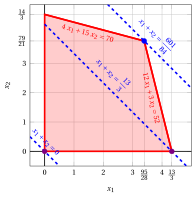{ .fig .ovale loading=lazy style="width:76%" }

    An optimal solution ${ \tilde{\boldsymbol x}}(\,LP\,)$   is:

    $$
    \tilde{x}_1=\dfrac{95}{28},~~\tilde{x}_2=\dfrac{79}{21}
    $$

    the optimal value $z(\, LP\,)$ is $\dfrac{601}{84}.$

    In violet the first and the second vertex explored by the previous execution of the simplex algorithm (before reaching the optimal one depicted in blue).

    In dashed blue,  the contour lines of the objective function associated with the values taken in the three vertices.

<a id="esercizio-6-12"></a>

!!! esercizio "Exercise 6.12: Simplex algorithm (P7)"

    Consider the following LP problem in canonical maximization form with $n=2$ variables and $m=2$ constraints:

    $$
    \begin{array}{rrrrrrrrrrrrr}
    {\max} & 3 \, {x_1} & {+} & \, {x_2} \\[2ex]
    \text{subject to} & \, {x_1} & {+} & 4 \, {x_2} & {\le} & 12 \\[2ex]
    & 2 \, {x_1} & {+} & \, {x_2} & {\le} & 5 \\[2ex]
    & {x_1,} &  & {x_2} & { \ge} & { 0 }
    \end{array}
    $$

    By introducing the slack variables, we get the following starting dictionary:

    \begin{equation*}
    \begin{cases}
    \begin{array}{rrrrrrrrrrrrr}
    {x_3} & {=} & {12} & {-} & \, {x_1} & {-} & 4\, {x_2} \\[2ex]
    {x_4} & {=} & {5} & {-} & 2\, {x_1} & {-} & \, {x_2} \\[2ex]
    {z} & {=} & {0} & {+} & 3\, {x_1} & {+} & \, {x_2}
    \end{array}
    \end{cases}
    \end{equation*}

    The associated feasible  solution is:

    $$
    \bar x_1=0,~~
    \bar x_2=0,~~
    \bar x_3=12,~~
    \bar x_4=5
    ~~~\text{of value   } 0
    $$

    **Questions**

    - Execute the simplex algorithm to find an optimal solution of this LP problem.

??? soluzione "Solution"

    - <span style="color:#e03131"><strong>Initialization</strong></span>

        Consider the starting dictionary:

        \begin{equation*}
        \begin{cases}
        \begin{array}{rrrrrrrrrrrrr}
        {x_3} & {=} & {12} & {-} & \, {x_1} & {-} & 4\, {x_2} \\[2ex]
        {x_4} & {=} & {5} & {-} & 2\, {x_1} & {-} & \, {x_2} \\[2ex]
        {z} & {=} & {0} & {+} & 3\, {x_1} & {+} & \, {x_2}
        \end{array}
        \end{cases}
        \end{equation*}

        where $\pazocal{B}=\{3,4\}$ and $\pazocal{N}=\{1,2\}$. The basic feasible solution is:

        $$
        \bar x_3=12~~
        \bar x_4=5,~~~~
        \bar x_1=0,~~
        \bar x_2=0~~
        ~~~\text{of value   } 0
        $$

    - <span style="color:#e03131"><strong>Iteration 1</strong></span>

        If we increase the value of the variable $x_1$, we can get a better solution. We have:

        $$
        \begin{cases}
        x_3 &= 12 - \: x_1 \\[2ex]
        x_4 &= 5 - 2\: x_1
        \end{cases}
        \qquad
        \qquad
        \begin{cases}
        \underbrace{ 12 - \: x_1 \ge 0}_{x_3 \ge 0} \\[2ex]
        \underbrace{  5 - 2\: x_1 \ge 0}_{x_4 \ge 0}
        \end{cases}
        \qquad
        \qquad
        \begin{cases}
        x_1 &\le 12 \\[2ex]
        x_1 &\le \dfrac{5}{2}
        \end{cases}
        $$

        By increasing the value of $x_1$ to $\dfrac{5}{2}$,  the value of $x_4$ decreases to 0.

        Then, we have that:

        - $x_1$ becomes basic and accordingly $x_4$ becomes non-basic

        We have:

        $$
        x_4 = 5 - 2\; x_1 -  x_2 \text{    then     } x_1= \dfrac{5}{2} -\dfrac{1}{2}\: x_2 -\dfrac{1}{2}\: x_4.
        $$

        Substituting in the other equations of the dictionary, we get:

        $$
        x_3 = 12 - \; \left(\dfrac{5}{2} -\dfrac{1}{2}\: x_2 -\dfrac{1}{2}\: x_4 \right) - 4 \:x_2= \dfrac{19}{2}  -\dfrac{7}{2}\: x_2 +\dfrac{1}{2}\: x_4
        $$

        $$
        z = 3 \; \left(\dfrac{5}{2} -\dfrac{1}{2}\: x_2 -\dfrac{1}{2}\: x_4 \right) + \, x_2 = \dfrac{15}{2} - \dfrac{1}{2}\: x_2 -\dfrac{3}{2}\: x_4
        $$

        Accordingly, we obtained an optimal solution (no further improvement is possible) and this is an optimal dictionary:

        \begin{equation*}
        \begin{cases}
        \begin{array}{rrrrrrrrrrrrr}
        {x_1= \dfrac{5}{2}} & {-} & {\dfrac{1}{2}} \, {x_2} & {-} & {\dfrac{1}{2}}\, {x_4} \\[2ex]
        {x_3=\dfrac{19}{2}} & {-} & {\dfrac{7}{2}}\, {x_2} & {+} & {\dfrac{1}{2}}\, {x_4} \\[2ex]
        {z= \dfrac{15}{2}} & {-} & {\dfrac{1}{2}} \, {x_2} & {-} & {\dfrac{3}{2}} \, {x_4}
        \end{array}
        \end{cases}
        \end{equation*}

        where $\pazocal{B}=\{1,3\}$ and $\pazocal{N}=\{2,4\}$. The basic optimal solution is:

        $$
        \tilde{x}_1=\dfrac{5}{2},~~
        \tilde{x}_3=\dfrac{19}{2},~~~~
        \tilde{x}_2=0,~~
        \tilde{x}_4=0
        ~~~\text{of value   } \dfrac{15}{2}
        $$

    <strong>Graphical solution:</strong>

    The feasible region of  the LP problem (in canonical form) is the polyhedron shaded in red: 

    { .fig .ovale loading=lazy style="width:65%" }

    An optimal solution ${ \tilde{\boldsymbol x}}(\, LP\,)$   is:

    $$
    \tilde{x}_1=\dfrac{5}{2},~~\tilde{x}_2=0
    $$

    the optimal value $z(\, LP\,)$ is $\dfrac{15}{2}.$

    In violet the first vertex explored by the previous execution of the simplex algorithm (before reaching the optimal one depicted in blue).

    In dashed blue,  the contour lines of the objective function associated with the values taken in the two vertices.

<a id="esercizio-6-13"></a>

!!! esercizio "Exercise 6.13: Simplex algorithm (P8)"

    Consider the following LP problem in canonical maximization form with $n=2$ variables and $m=2$ constraints:

    $$
    \begin{array}{rrrrrrrrrrrrr}
    {\max} & {x_1} & {+} & 2 \, {x_2} \\[2ex]
    \text{subject to} & {-} \, {x_1} & {+} & {2} \, {x_2} & {\le} & {2} \\[2ex]
    & {x_1} & {+} & {x_2} & {\le} & {3} \\[2ex]
    & {x_1,} &  & {x_2} & { \ge} & {0}
    \end{array}
    $$

    By introducing the slack variables, we get the following starting dictionary:

    \begin{equation*}
    \begin{cases}
    \begin{array}{rrrrrrrrrrrrr}
    {x_3} & {=} & {2} & {+} & {x_1} & {-} & {2\,x_2} \\[2ex]
    {x_4} & {=} & {3} & {-} & {x_1} & {-} & {x_2} \\[2ex]
    {z} & {=} & {0} & {+} & {x_1} & {+} & {2\,x_2}
    \end{array}
    \end{cases}
    \end{equation*}

    The associated feasible  solution is:

    $$
    \bar x_1=0,~~
    \bar x_2=0,~~
    \bar x_3=2,~~
    \bar x_4=3
    ~~~\text{of value   } 0
    $$

    **Questions**

    - Execute the simplex algorithm to find an optimal solution of this LP problem.

??? soluzione "Solution"

    - <span style="color:#e03131"><strong>Initialization</strong></span>

        Consider the starting dictionary:

        \begin{equation*}
        \begin{cases}
        \begin{array}{rrrrrrrrrrrrr}
        {x_3} & {=} & {2} & {+} & {x_1} & {-} & {2\,x_2} \\[2ex]
        {x_4} & {=} & {3} & {-} & {x_1} & {-} & {x_2} \\[2ex]
        {z} & {=} & {0} & {+} & {x_1} & {+} & {2\,x_2}
        \end{array}
        \end{cases}
        \end{equation*}

        where $\pazocal{B}=\{3,4\}$ and $\pazocal{N}=\{1,2\}$. The basic feasible solution is:

        $$
        \bar x_3=2,~~
        \bar x_4=3,~~~~~
        \bar x_1=0,~~
        \bar x_2=0~~
        ~~~\text{of value   } 0
        $$

    - <span style="color:#e03131"><strong>Iteration 1</strong></span>

        If we increase the value of the variable $x_1$, we can get a better solution. We have:

        $$
        \begin{cases}
        x_3 &= 2 + x_1 \\[2ex]
        x_4 &= 3 - x_1
        \end{cases}
        \qquad
        \qquad
        \begin{cases}
        \overbrace{ 2 + x_1 \ge 0}^{x_3 \ge 0} \\[2ex]
        \underbrace{ 3 - x_1 \ge 0}_{x_4 \ge 0}
        \end{cases}
        \qquad
        \qquad
        \begin{cases}
        x_1 &\ge  -2 \\[2ex]
        x_1 &\le 3
        \end{cases}
        $$

        By increasing the value of $x_1$ to $3$,  the value of $x_4$ decreases to 0.

        Then, we have that:

        - $x_1$ becomes basic and accordingly $x_4$ becomes non-basic

        We have:

        $$
        x_4 = 3 - x_1 - x_2 \text{    then     } x_1= 3 - x_2 - x_4.
        $$

        Substituting in the other equations of the dictionary, we get:

        $$
        x_3 = 2 + \left( 3 - x_2 - x_4 \right) - 2 \:x_2= 5  -3\: x_2 - x_4
        $$

        $$
        z =  \left( 3 - x_2 - x_4 \right) + 2\: x_2 = 3 + x_2 - x_4
        $$

        Accordingly, we now have the following dictionary:

        \begin{equation*}
        \begin{cases}
        \begin{array}{rrrrrrrrrrrrr}
        {x_1} & {=} & {3} & {-} & {x_2} & {-} & {x_4} \\[2ex]
        {x_3} & {=} & {5} & {-} & {3}\, {x_2} & {-} & {x_4} \\[2ex]
        {z} & {=} & {3} & {+} & {x_2} & {-} & {x_4}
        \end{array}
        \end{cases}
        \end{equation*}

        where $\pazocal{B}=\{1,3\}$ and $\pazocal{N}=\{2,4\}$. The basic feasible solution is:

        $$
        \bar x_1=3,~~
        \bar x_3=5,~~~~
        \bar x_2=0,~~
        \bar x_4=0
        ~~~\text{of value   } 3
        $$

    - <span style="color:#e03131"><strong>Iteration 2</strong></span>

        If we increase the value of the variable $x_2$, we can get a better solution. We have:

        $$
        \begin{cases}
        x_1 &= 3 - x_2 \\[2ex]
        x_3 &= 5 - 3\: x_2
        \end{cases}
        \qquad
        \qquad
        \begin{cases}
        \underbrace{ 3 - x_2 \ge 0}_{x_1 \ge 0} \\[2ex]
        \underbrace{  5 - 3\: x_2 \ge 0}_{x_3 \ge 0}
        \end{cases}
        \qquad
        \qquad
        \begin{cases}
        x_2 &\le  3 \\[2ex]
        x_2 &\le  \dfrac{5}{3}
        \end{cases}
        $$

        By increasing the value of $x_2$ to $\min \left\{3,\dfrac{5}{3}\right\}=\dfrac{5}{3}$,  the value of $x_3$ decreases to 0.

        Then, we have that:

        - $x_2$ becomes basic and accordingly $x_3$ becomes non-basic

        We have:

        $$
        x_3 = 5  -3\: x_2 - x_4 \text{    then     } x_2= \dfrac{5}{3} -\dfrac{1}{3}\: x_3 -\dfrac{1}{3}\: x_4.
        $$

        Substituting in the other equations of the dictionary, we get:

        $$
        x_1 = 3 - \left( \dfrac{5}{3} -\dfrac{1}{3}\: x_3 -\dfrac{1}{3}\: x_4 \right) - x_4= \dfrac{4}{3}  +\dfrac{1}{3}\: x_3 - \dfrac{2}{3}\: x_4
        $$

        $$
        z =  3  + \left(  \dfrac{5}{3} -\dfrac{1}{3}\: x_3 -\dfrac{1}{3}\: x_4 \right) - x_4 = \dfrac{14}{3} -\dfrac{1}{3}\: x_3  -\dfrac{4}{3}\: x_4
        $$

        Accordingly, we obtained an optimal solution (no further improvement is possible) and this is an optimal dictionary:

        \begin{equation*}
        \begin{cases}
        \begin{array}{rrrrrrrrrrrrr}
        {x_1=\dfrac{4}{3}} & {+} & {\dfrac{1}{3}} \, {x_3} & {-} & {\dfrac{2}{3}}\, {x_4} \\[2ex]
        {x_2=\dfrac{5}{3}} & {-} & {\dfrac{1}{3}}\, {x_3} & {-} & {\dfrac{1}{3}}\, {x_4} \\[2ex]
        {z= \dfrac{14}{3}} & {-} & {\dfrac{1}{3}} \, {x_3} & {-} & {\dfrac{4}{3}} \, {x_4}
        \end{array}
        \end{cases}
        \end{equation*}

        where $\pazocal{B}=\{1,2\}$ and $\pazocal{N}=\{3,4\}$. The basic optimal solution is:

        $$
        \tilde{x}_1=\dfrac{4}{3},~~
        \tilde{x}_2=\dfrac{5}{3},~~~~~
        \tilde{x}_3=0,~~
        \tilde{x}_4=0
        ~~~\text{of value   } \dfrac{14}{3}
        $$

    <strong>Graphical solution:</strong>

    The feasible region of  the LP problem (in canonical form) is the polyhedron shaded in red: 

    { .fig .ovale loading=lazy style="width:76%" }

    An optimal solution ${ \tilde{\boldsymbol x}}(\,LP\,)$   is:

    $$
    \tilde{x}_1=\dfrac{4}{3},~~\tilde{x}_2=\dfrac{5}{3}
    $$

    the optimal value $z(\, LP\,)$ is $\dfrac{14}{3}.$

    In violet the first and the second vertex explored by the previous execution of the simplex algorithm (before reaching the optimal one depicted in blue).

    In dashed blue,  the contour lines of the objective function associated with the values taken in the three vertices.

<a id="esercizio-6-14"></a>

!!! esercizio "Exercise 6.14: Simplex algorithm (P9)"

    Consider the following LP problem in canonical maximization form with $n=2$ variables and $m=2$ constraints:

    $$
    \begin{array}{rrrrrrrrrrrrr}
    {\max} & {2}\, {x_1} & {+} & {x_2} \\[2ex]
    \text{subject to} & {-} \, {x_1} & {+} & {x_2} & {\le} & {1} \\[2ex]
    & {6}\, {x_1} & {+} & {4}\, {x_2} & {\le} & {39} \\[2ex]
    & {x_1,} &  & {x_2} & { \ge} & {0}
    \end{array}
    $$

    By introducing the slack variables, we get the following starting dictionary:

    \begin{equation*}
    \begin{cases}
    \begin{array}{rrrrrrrrrrrrr}
    {x_3} & {=} & {1} & {+} & {x_1} & {-} & {x_2} \\[2ex]
    {x_4} & {=} & {39} & {-} & {6\,x_1} & {-} & {4\,x_2} \\[2ex]
    {z} & {=} & {0} & {+} & {2\,x_1} & {+} & {x_2}
    \end{array}
    \end{cases}
    \end{equation*}

    The associated feasible  solution is:

    $$
    \bar x_1=0,~~
    \bar x_2=0,~~
    \bar x_3=1,~~
    \bar x_4=39
    ~~~\text{of value   } 0
    $$

    **Questions**

    - Execute the simplex algorithm to find an optimal solution of this LP problem.

??? soluzione "Solution"

    - <span style="color:#e03131"><strong>Initialization</strong></span>

        Consider the starting dictionary:

        \begin{equation*}
        \begin{cases}
        \begin{array}{rrrrrrrrrrrrr}
        {x_3} & {=} & {1} & {+} & {x_1} & {-} & {x_2} \\[2ex]
        {x_4} & {=} & {39} & {-} & {6\,x_1} & {-} & {4\,x_2} \\[2ex]
        {z} & {=} & {0} & {+} & {2\,x_1} & {+} & {x_2}
        \end{array}
        \end{cases}
        \end{equation*}

        where $\pazocal{B}=\{3,4\}$ and $\pazocal{N}=\{1,2\}$. The basic feasible solution is:

        $$
        \bar x_3=1,~~
        \bar x_4=39,~~~~~
        \bar x_1=0,~~
        \bar x_2=0~~
        ~~~\text{of value   } 0
        $$

    - <span style="color:#e03131"><strong>Iteration 1</strong></span>

        If we increase the value of the variable $x_1$, we can get a better solution. We have:

        $$
        \begin{cases}
        x_3 &= 1 + x_1 \\[2ex]
        x_4 &= 39 - 6\: x_1
        \end{cases}
        \qquad
        \qquad
        \begin{cases}
        \overbrace{ 1 + x_1 \ge 0}^{x_3 \ge 0} \\[2ex]
        \underbrace{ 39 - 6\: x_1 \ge 0}_{x_4 \ge 0}
        \end{cases}
        \qquad
        \qquad
        \begin{cases}
        x_1 &\ge  -1 \\[2ex]
        x_1 &\le \dfrac{13}{2}
        \end{cases}
        $$

        By increasing the value of $x_1$ to $\dfrac{13}{2}$,  the value of $x_4$ decreases to 0.

        Then, we have that:

        - $x_1$ becomes basic and accordingly $x_4$ becomes non-basic

        We have:

        $$
        x_4 = 39 - 6\; x_1 - 4\; x_2 \text{    then     } x_1= \dfrac{13}{2} -\dfrac{2}{3}\: x_2 -\dfrac{1}{6}\: x_4.
        $$

        Substituting in the other equations of the dictionary, we get:

        $$
        x_3 = 1 +  \left(\dfrac{13}{2} -\dfrac{2}{3}\: x_2 -\dfrac{1}{6}\: x_4 \right) - x_2= \dfrac{15}{2}  -\dfrac{5}{3}\: x_2 -\dfrac{1}{6}\: x_4
        $$

        $$
        z = 2 \: \left(\dfrac{13}{2} -\dfrac{2}{3}\: x_2 -\dfrac{1}{6}\: x_4 \right) + x_2 = 13 -\dfrac{1}{3}\: x_2 -\dfrac{1}{3}\: x_4
        $$

        Accordingly, we obtained an optimal solution (no further improvement is possible) and this is an optimal dictionary:

        \begin{equation*}
        \begin{cases}
        \begin{array}{rrrrrrrrrrrrr}
        {x_1=\dfrac{13}{2}} & {-} & {\dfrac{2}{3}} \, {x_2} & {-} & {\dfrac{1}{6}}\, {x_4} \\[2ex]
        {x_3=\dfrac{15}{2}} & {-} & {\dfrac{5}{3}}\, {x_2} & {-} & {\dfrac{1}{6}}\, {x_4} \\[2ex]
        {z= 13} & {-} & {\dfrac{1}{3}} \, {x_2} & {-} & {\dfrac{1}{3}} \, {x_4}
        \end{array}
        \end{cases}
        \end{equation*}

        where $\pazocal{B}=\{1,3\}$ and $\pazocal{N}=\{2,4\}$. The basic optimal solution is:

        $$
        \tilde{x}_1=\dfrac{13}{2},~~
        \tilde{x}_2=0,~~
        \tilde{x}_3=\dfrac{15}{2},~~~~~
        \tilde{x}_4=0
        ~~~\text{of value   } 13
        $$

    <strong>Graphical solution:</strong>

    The feasible region of  the LP problem (in canonical form) is the polyhedron shaded in red: 

    { .fig .ovale loading=lazy style="width:76%" }

    An optimal solution ${ \tilde{\boldsymbol x}}(\,LP\,)$   is:

    $$
    \tilde{x}_1=\dfrac{13}{2},~~\tilde{x}_2=0
    $$

    the optimal value $z(\, LP\,)$ is $13.$

    In violet the first vertex explored by the previous execution of the simplex algorithm (before reaching the optimal one depicted in blue).

    In dashed blue,  the contour lines of the objective function associated with the values taken in the two vertices.

<a id="esercizio-6-15"></a>

!!! esercizio "Exercise 6.15: Simplex algorithm (P10)"

    Consider the following LP problem in canonical maximization form with $n=2$ variables and $m=3$ constraints:

    $$
    \begin{array}{rrrrrrrrrrrrr}
    {\max} & 5 \, {x_1} & {+} & 2 \, {x_2} \\[2ex]
    \text{subject to} & {-} \, {x_1} & {+} & 3 \, {x_2} & {\le} & 12 \\[2ex]
    & {x_1} & {+} & 2 \, {x_2} & {\le} & 12 \\[2ex]
    & {3} \, {x_1} & {-} & 2 \, {x_2} & {\le} & {8} \\[2ex]
    & {x_1,} &  & {x_2} & { \ge} & {0}
    \end{array}
    $$

    By introducing the slack variables, we get the following starting dictionary:

    \begin{equation*}
    \begin{cases}
    \begin{array}{rrrrrrrrrrrrr}
    {x_3} & {=} & {12} & {+} & {x_1} & {-} & {3\,x_2} \\[2ex]
    {x_4} & {=} & {12} & {-} & {x_1} & {-} & {2\;x_2} \\[2ex]
    {x_5} & {=} & {8} & {-} & {3\,x_1} & {+} & {2\;x_2} \\[2ex]
    {z} & {=} & {0} & {+} & {5\,x_1} & {+} & {2\,x_2}
    \end{array}
    \end{cases}
    \end{equation*}

    The associated feasible  solution is:

    $$
    \bar x_1=0,~~
    \bar x_2=0,~~
    \bar x_3=12,~~
    \bar x_4=12,~~
    \bar x_5=8
    ~~~\text{of value   } 0
    $$

    **Questions**

    - Execute the simplex algorithm to find an optimal solution of this LP problem.

??? soluzione "Solution"

    - <span style="color:#e03131"><strong>Initialization</strong></span>

        Consider the starting dictionary:

        \begin{equation*}
        \begin{cases}
        \begin{array}{rrrrrrrrrrrrr}
        {x_3} & {=} & {12} & {+} & {x_1} & {-} & {3\,x_2} \\[2ex]
        {x_4} & {=} & {12} & {-} & {x_1} & {-} & {2\;x_2} \\[2ex]
        {x_5} & {=} & {8} & {-} & {3\,x_1} & {+} & {2\;x_2} \\[2ex]
        {z} & {=} & {0} & {+} & {5\,x_1} & {+} & {2\,x_2}
        \end{array}
        \end{cases}
        \end{equation*}

        where $\pazocal{B}=\{3,4,5\}$ and $\pazocal{N}=\{1,2\}$. The basic feasible solution is:

        $$
        \bar x_3=12,~~
        \bar x_4=12,~~
        \bar x_5=8,~~~~~
        \bar x_1=0,~~
        \bar x_2=0~~
        ~~~\text{of value   } 0
        $$

    - <span style="color:#e03131"><strong>Iteration 1</strong></span>

        If we increase the value of the variable $x_1$, we can get a better solution. We have:

        $$
        \begin{cases}
        x_3 &= 12 +  x_1 \\[2ex]
        x_4 &= 12 -  x_1 \\[2ex]
        x_5 &= 8 - 3\: x_1
        \end{cases}
        \qquad
        \qquad
        \begin{cases}
        \underbrace{ 12 +  x_1 \ge 0}_{x_3 \ge 0} \\[2ex]
        \underbrace{ 12 -  x_1 \ge 0}_{x_4 \ge 0} \\[2ex]
        \underbrace{  8 - 3\: x_1 \ge 0}_{x_5 \ge 0}
        \end{cases}
        \qquad
        \qquad
        \begin{cases}
        x_1 &\ge  -12 \\[2ex]
        x_1 &\le  12 \\[2ex]
        x_1 &\le \dfrac{8}{3}
        \end{cases}
        $$

        By increasing the value of $x_1$ to $\min \left\{12,\dfrac{8}{3}\right\}=\dfrac{8}{3}$,  the value of $x_5$ decreases to 0.

        Then, we have that:

        - $x_1$ becomes basic and accordingly $x_5$ becomes non-basic

        We have:

        $$
        x_5 = 8 - 3\; x_1 + 2\; x_2 \text{    then     } x_1= \dfrac{8}{3} +\dfrac{2}{3}\: x_2 -\dfrac{1}{3}\: x_5.
        $$

        Substituting in the other equations of the dictionary, we get:

        $$
        x_3 = 12 +  \left(\dfrac{8}{3} +\dfrac{2}{3}\: x_2 -\dfrac{1}{3}\: x_5 \right) - 3 \:x_2= \dfrac{44}{3}  -\dfrac{7}{3}\: x_2 -\dfrac{1}{3}\: x_5
        $$

        $$
        x_4 = 12 -  \left(\dfrac{8}{3} +\dfrac{2}{3}\: x_2 -\dfrac{1}{3}\: x_5 \right) - 2 \:x_2= \dfrac{28}{3}  -\dfrac{8}{3}\: x_2 +\dfrac{1}{3}\: x_5
        $$

        $$
        z = 5 \: \left(\dfrac{8}{3} +\dfrac{2}{3}\: x_2 -\dfrac{1}{3}\: x_5 \right) + 2 \: x_2 = \dfrac{40}{3} +\dfrac{16}{3}\: x_2 -\dfrac{5}{3}\: x_5
        $$

        Accordingly, we now have the following dictionary:

        \begin{equation*}
        \begin{cases}
        \begin{array}{rrrrrrrrrrrrr}
        {x_1} & {=} & {\dfrac{8}{3}} & {+} & {\dfrac{2}{3}}\, {x_2} & {-} & {\dfrac{1}{3}}\, {x_5} \\[2ex]
        {x_3} & {=} & {\dfrac{44}{3}} & {-} & {\dfrac{7}{3}}\, {x_2} & {-} & {\dfrac{1}{3}}\, {x_5} \\[2ex]
        {x_4} & {=} & {\dfrac{28}{3}} & {-} & {\dfrac{8}{3}}\, {x_2} & {+} & {\dfrac{1}{3}}\, {x_5} \\[2ex]
        {z} & {=} & {\dfrac{40}{3}} & {+} & {\dfrac{16}{3}}\, {x_2} & {-} & {\dfrac{5}{3}}\, \, {x_5}
        \end{array}
        \end{cases}
        \end{equation*}

        where $\pazocal{B}=\{1,3,4\}$ and $\pazocal{N}=\{2,5\}$. The basic feasible solution is:

        $$
        \bar x_1=\dfrac{8}{3},~~
        \bar x_3=\dfrac{44}{3},~~
        \bar x_4=\dfrac{28}{3},~~~~
        \bar x_2=0,~~
        \bar x_5=0
        ~~~\text{of value   } \dfrac{40}{3}
        $$

    - <span style="color:#e03131"><strong>Iteration 2</strong></span>

        If we increase the value of the variable $x_2$, we can get a better solution. We have:

        $$
        \begin{cases}
        x_1 &= \dfrac{8}{3} + \dfrac{2}{3}\: x_2 \\[2ex]
        x_3 &= \dfrac{44}{3} - \dfrac{7}{3}\: x_2\\[2ex]
        x_4 &= \dfrac{28}{3} - \dfrac{8}{3}\: x_2
        \end{cases}
        \qquad
        \qquad
        \begin{cases}
        \overbrace{ \dfrac{8}{3} + \dfrac{2}{3}\: x_2 \ge 0}^{x_1 \ge 0} \\[2ex]
        \underbrace{  \dfrac{44}{3} - \dfrac{7}{3}\: x_2 \ge 0}_{x_3 \ge 0}\\[2ex]
        \underbrace{  \dfrac{28}{3} - \dfrac{8}{3}\: x_2 \ge 0}_{x_4 \ge 0}
        \end{cases}
        \qquad
        \qquad
        \begin{cases}
        x_2 &\ge  -4 \\[2ex]
        x_2 &\le  \dfrac{44}{7} \\[2ex]
        x_2 &\le  \dfrac{7}{2}
        \end{cases}
        $$

        By increasing the value of $x_2$ to $\min \left\{\dfrac{44}{7},\dfrac{7}{2}\right\}=\dfrac{7}{2}$,  the value of $x_4$ decreases to 0.

        Then, we have that:

        - $x_2$ becomes basic and accordingly $x_4$ becomes non-basic

        We have:

        $$
        x_4 = \dfrac{28}{3}  -\dfrac{8}{3}\: x_2 +\dfrac{1}{3}\: x_5 \text{    then     } x_2= \dfrac{7}{2} -\dfrac{3}{8}\: x_4 +\dfrac{1}{8}\: x_5.
        $$

        Substituting in the other equations of the dictionary, we get:

        $$
        x_1 = \dfrac{8}{3} + \dfrac{2}{3} \; \left(  \dfrac{7}{2} -\dfrac{3}{8}\: x_4 +\dfrac{1}{8}\: x_5 \right) - \dfrac{1}{3} \:x_5= 5  -\dfrac{1}{4}\: x_4 - \dfrac{1}{4}\: x_5
        $$

        $$
        x_3 = \dfrac{44}{3} - \dfrac{7}{3} \; \left(  \dfrac{7}{2} -\dfrac{3}{8}\: x_4 +\dfrac{1}{8}\: x_5 \right) - \dfrac{1}{3} \:x_5= \dfrac{13}{2}  +\dfrac{7}{8}\: x_4 - \dfrac{5}{8}\: x_5
        $$

        $$
        z =  \dfrac{40}{3}  + \dfrac{16}{3} \; \left(  \dfrac{7}{2} -\dfrac{3}{8}\: x_4 +\dfrac{1}{8}\: x_5 \right) -\dfrac{5}{3}\: x_5 = 32 -2\: x_4  -x_5
        $$

        Accordingly, we obtained an optimal solution (no further improvement is possible) and this is an optimal dictionary:

        \begin{equation*}
        \begin{cases}
        \begin{array}{rrrrrrrrrrrrr}
        {x_1=5} & {-} & {\dfrac{1}{4}} \, {x_4} & {-} & {\dfrac{1}{4}}\, {x_5} \\[2ex]
        {x_2=\dfrac{7}{2}} & {-} & {\dfrac{3}{8}}\, {x_4} & {+} & {\dfrac{1}{8}}\, {x_5} \\[2ex]
        {x_3=\dfrac{13}{2}} & {+} & {\dfrac{7}{8}}\, {x_4} & {-} & {\dfrac{5}{8}}\, {x_5} \\[2ex]
        {z= 32} & {-} & {2} \, {x_4} & {-} & \, {x_5}
        \end{array}
        \end{cases}
        \end{equation*}

        where $\pazocal{B}=\{1,2,3\}$ and $\pazocal{N}=\{4,5\}$. The basic optimal solution is:

        $$
        \tilde{x}_1=5,~~
        \tilde{x}_2=\dfrac{7}{2},~~
        \tilde{x}_3=\dfrac{13}{2},~~~~~
        \tilde{x}_4=0,~~
        \tilde{x}_5=0
        ~~~\text{of value   } 32
        $$

    <strong>Graphical solution:</strong>

    The feasible region of  the LP problem (in canonical form) is the polyhedron shaded in red: 

    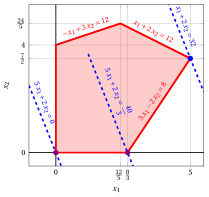{ .fig .ovale loading=lazy style="width:76%" }

    An optimal solution ${ \tilde{\boldsymbol x}}(\,LP\,)$   is:

    $$
    \tilde{x}_1=5,~~\tilde{x}_2=\dfrac{7}{2}
    $$

    the optimal value $z(\, LP\,)$ is $32.$

    In violet the first and the second vertex explored by the previous execution of the simplex algorithm (before reaching the optimal one depicted in blue).

    In dashed blue,  the contour lines of the objective function associated with the values taken in the three vertices.

<a id="esercizio-6-16"></a>

!!! esercizio "Exercise 6.16: Simplex algorithm with a different pivot column (P10)"

    Consider the following LP problem in canonical maximization form with $n=2$ variables and $m=3$ constraints:

    $$
    \begin{array}{rrrrrrrrrrrrr}
    {\max} & 5 \, {x_1} & {+} & 2 \, {x_2} \\[2ex]
    \text{subject to} & {-} \, {x_1} & {+} & 3 \, {x_2} & {\le} & 12 \\[2ex]
    & {x_1} & {+} & 2 \, {x_2} & {\le} & 12 \\[2ex]
    & {3} \, {x_1} & {-} & 2 \, {x_2} & {\le} & {8} \\[2ex]
    & {x_1,} &  & {x_2} & { \ge} & {0}
    \end{array}
    $$

    By introducing the slack variables, we get the following starting dictionary:

    \begin{equation*}
    \begin{cases}
    \begin{array}{rrrrrrrrrrrrr}
    {x_3} & {=} & {12} & {+} & {x_1} & {-} & {3\,x_2} \\[2ex]
    {x_4} & {=} & {12} & {-} & {x_1} & {-} & {2\;x_2} \\[2ex]
    {x_5} & {=} & {8} & {-} & {3\,x_1} & {+} & {2\;x_2} \\[2ex]
    {z} & {=} & {0} & {+} & {5\,x_1} & {+} & {2\,x_2}
    \end{array}
    \end{cases}
    \end{equation*}

    The associated feasible  solution is:

    $$
    \bar x_1=0,~~
    \bar x_2=0,~~
    \bar x_3=12,~~
    \bar x_4=12,~~
    \bar x_5=8
    ~~~\text{of value   } 0
    $$

    **Questions**

    1. Execute the simplex algorithm to find an optimal solution of this LP problem, choosing $x_2$ as the pivot column at the first iteration.

    2. Compare the number of iterations with the execution of the simplex algorithm that chooses $x_1$ as the pivot column at the first iteration (exercise <em>Simplex algorithm</em> ($P10$)).

??? soluzione "Solution"

    1. - <span style="color:#e03131"><strong>Initialization</strong></span>

            Consider the dictionary:

            \begin{equation*}
            \begin{cases}
            \begin{array}{rrrrrrrrrrrrr}
            {x_3} & {=} & {12} & {+} & {x_1} & {-} & {3\,x_2} \\[2ex]
            {x_4} & {=} & {12} & {-} & {x_1} & {-} & {2\;x_2} \\[2ex]
            {x_5} & {=} & {8} & {-} & {3\,x_1} & {+} & {2\;x_2} \\[2ex]
            {z} & {=} & {0} & {+} & {5\,x_1} & {+} & {2\,x_2}
            \end{array}
            \end{cases}
            \end{equation*}

            where $\pazocal{B}=\{3,4,5\}$ and $\pazocal{N}=\{1,2\}$. The  basic feasible  solution is:

            $$
            \bar x_3=12,~~
            \bar x_4=12,~~
            \bar x_5=8,~~~~~
            \bar x_1=0,~~
            \bar x_2=0~~
            ~~~\text{of value   } 0
            $$

        - <span style="color:#e03131"><strong>Iteration 1</strong></span>

            If we increase the value of the variable $x_2$ (the pivot column required by the question), we can get a better solution. We have:

            $$
            \begin{cases}
            x_3 &= 12 - 3\: x_2 \\[2ex]
            x_4 &= 12 - 2\: x_2 \\[2ex]
            x_5 &= 8 + 2\: x_2
            \end{cases}
            \qquad
            \qquad
            \begin{cases}
            \underbrace{ 12 - 3\: x_2 \ge 0}_{x_3 \ge 0} \\[2ex]
            \underbrace{ 12 - 2\: x_2 \ge 0}_{x_4 \ge 0} \\[2ex]
            \overbrace{  8 + 2\: x_2 \ge 0}^{x_5 \ge 0}
            \end{cases}
            \qquad
            \qquad
            \begin{cases}
            x_2 &\le  4 \\[2ex]
            x_2 &\le  6 \\[2ex]
            x_2 &\ge -4
            \end{cases}
            $$

            By increasing the value of $x_2$ to $\min \left\{4,6\right\}=4$,  the value of $x_3$ decreases to 0.

            Then, we have that:

            - $x_2$ becomes basic and accordingly $x_3$ becomes  non-basic

            We have:

            $$
            x_3 = 12 + x_1 - 3\; x_2 \text{    then     } x_2= 4 +\dfrac{1}{3}\: x_1 -\dfrac{1}{3}\: x_3.
            $$

            Substituting in the other equations of the dictionary, we get:

            $$
            x_4 = 12 - x_1 - 2\,x_2 = 12 - x_1 - 2\left(4 + \dfrac{1}{3}\,x_1 - \dfrac{1}{3}\,x_3\right) = 4 - \dfrac{5}{3}\,x_1 + \dfrac{2}{3}\,x_3
            $$

            $$
            x_5 = 8 - 3\,x_1 + 2\,x_2 = 8 - 3\,x_1 + 2\left(4 + \dfrac{1}{3}\,x_1 - \dfrac{1}{3}\,x_3\right) = 16 - \dfrac{7}{3}\,x_1 - \dfrac{2}{3}\,x_3
            $$

            $$
            z = 5\,x_1 + 2\,x_2 = 5\,x_1 + 2\left(4 + \dfrac{1}{3}\,x_1 - \dfrac{1}{3}\,x_3\right) = 8 + \dfrac{17}{3}\,x_1 - \dfrac{2}{3}\,x_3
            $$

        - <span style="color:#e03131"><strong>Iteration 2</strong></span>

            Consider the dictionary:

            \begin{equation*}
            \begin{cases}
            \begin{array}{rrrrrrrrrrrrr}
            {x_2} & {=} & {4} & {+} & {\dfrac{1}{3}}\, {x_1} & {-} & {\dfrac{1}{3}}\, {x_3} \\[2ex]
            {x_4} & {=} & {4} & {-} & {\dfrac{5}{3}}\, {x_1} & {+} & {\dfrac{2}{3}}\, {x_3} \\[2ex]
            {x_5} & {=} & {16} & {-} & {\dfrac{7}{3}}\, {x_1} & {-} & {\dfrac{2}{3}}\, {x_3} \\[2ex]
            {z} & {=} & {8} & {+} & {\dfrac{17}{3}}\, {x_1} & {-} & {\dfrac{2}{3}}\, {x_3}
            \end{array}
            \end{cases}
            \end{equation*}

            where $\pazocal{B}=\{2,4,5\}$ and $\pazocal{N}=\{1,3\}$. The  basic feasible  solution is:

            $$
            \bar x_2=4,~~
            \bar x_4=4,~~
            \bar x_5=16,~~~~
            \bar x_1=0,~~
            \bar x_3=0
            ~~~\text{of value   } 8
            $$

            If we increase  the value of the variable $x_1$, we can get a better solution. We have:

            $$
            \begin{cases}
            x_2 &= 4 + \dfrac{1}{3}\: x_1 \\[2ex]
            x_4 &= 4 - \dfrac{5}{3}\: x_1\\[2ex]
            x_5 &= 16 - \dfrac{7}{3}\: x_1
            \end{cases}
            \qquad
            \qquad
            \begin{cases}
            \overbrace{ 4 + \dfrac{1}{3}\: x_1 \ge 0}^{x_2 \ge 0} \\[2ex]
            \underbrace{  4 - \dfrac{5}{3}\: x_1 \ge 0}_{x_4 \ge 0}\\[2ex]
            \underbrace{  16 - \dfrac{7}{3}\: x_1 \ge 0}_{x_5 \ge 0}
            \end{cases}
            \qquad
            \qquad
            \begin{cases}
            x_1 &\ge  -12 \\[2ex]
            x_1 &\le  \dfrac{12}{5} \\[2ex]
            x_1 &\le  \dfrac{48}{7}
            \end{cases}
            $$

            By increasing the value of $x_1$ to $\min \left\{\dfrac{12}{5},\dfrac{48}{7}\right\}=\dfrac{12}{5}$,  the value of $x_4$ decreases to 0.

            Then, we have that:

            - $x_1$ becomes basic and accordingly $x_4$ becomes  non-basic

            We have:

            $$
            x_4 = 4 - \dfrac{5}{3}\: x_1 +\dfrac{2}{3}\: x_3 \text{    then     } x_1= \dfrac{12}{5} +\dfrac{2}{5}\: x_3 -\dfrac{3}{5}\: x_4.
            $$

            Substituting in the other equations of the dictionary, we get:

            $$
            x_2 = 4 + \dfrac{1}{3}\left(\dfrac{12}{5} + \dfrac{2}{5}\,x_3 - \dfrac{3}{5}\,x_4\right) - \dfrac{1}{3}\,x_3 = \dfrac{24}{5} - \dfrac{1}{5}\,x_3 - \dfrac{1}{5}\,x_4
            $$

            $$
            x_5 = 16 - \dfrac{7}{3}\left(\dfrac{12}{5} + \dfrac{2}{5}\,x_3 - \dfrac{3}{5}\,x_4\right) - \dfrac{2}{3}\,x_3 = \dfrac{52}{5} - \dfrac{8}{5}\,x_3 + \dfrac{7}{5}\,x_4
            $$

            $$
            z = 8 + \dfrac{17}{3}\left(\dfrac{12}{5} + \dfrac{2}{5}\,x_3 - \dfrac{3}{5}\,x_4\right) - \dfrac{2}{3}\,x_3 = \dfrac{108}{5} + \dfrac{8}{5}\,x_3 - \dfrac{17}{5}\,x_4
            $$

        - <span style="color:#e03131"><strong>Iteration 3</strong></span>

            Consider the dictionary:

            \begin{equation*}
            \begin{cases}
            \begin{array}{rrrrrrrrrrrrr}
            {x_1} & {=} & {\dfrac{12}{5}} & {+} & {\dfrac{2}{5}}\, {x_3} & {-} & {\dfrac{3}{5}}\, {x_4} \\[2ex]
            {x_2} & {=} & {\dfrac{24}{5}} & {-} & {\dfrac{1}{5}}\, {x_3} & {-} & {\dfrac{1}{5}}\, {x_4} \\[2ex]
            {x_5} & {=} & {\dfrac{52}{5}} & {-} & {\dfrac{8}{5}}\, {x_3} & {+} & {\dfrac{7}{5}}\, {x_4} \\[2ex]
            {z} & {=} & {\dfrac{108}{5}} & {+} & {\dfrac{8}{5}}\, {x_3} & {-} & {\dfrac{17}{5}}\, {x_4}
            \end{array}
            \end{cases}
            \end{equation*}

            where $\pazocal{B}=\{1,2,5\}$ and $\pazocal{N}=\{3,4\}$. The  basic feasible  solution is:

            $$
            \bar x_1=\dfrac{12}{5},~~
            \bar x_2=\dfrac{24}{5},~~
            \bar x_5=\dfrac{52}{5},~~~~
            \bar x_3=0,~~
            \bar x_4=0
            ~~~\text{of value   } \dfrac{108}{5}
            $$

            If we increase  the value of the variable $x_3$, we can get a better solution. We have:

            $$
            \begin{cases}
            x_1 &= \dfrac{12}{5} + \dfrac{2}{5}\: x_3 \\[2ex]
            x_2 &= \dfrac{24}{5} - \dfrac{1}{5}\: x_3\\[2ex]
            x_5 &= \dfrac{52}{5} - \dfrac{8}{5}\: x_3
            \end{cases}
            \qquad
            \qquad
            \begin{cases}
            \overbrace{ \dfrac{12}{5} + \dfrac{2}{5}\: x_3 \ge 0}^{x_1 \ge 0} \\[2ex]
            \underbrace{  \dfrac{24}{5} - \dfrac{1}{5}\: x_3 \ge 0}_{x_2 \ge 0}\\[2ex]
            \underbrace{  \dfrac{52}{5} - \dfrac{8}{5}\: x_3 \ge 0}_{x_5 \ge 0}
            \end{cases}
            \qquad
            \qquad
            \begin{cases}
            x_3 &\ge  -6 \\[2ex]
            x_3 &\le  24 \\[2ex]
            x_3 &\le  \dfrac{13}{2}
            \end{cases}
            $$

            By increasing the value of $x_3$ to $\min \left\{24,\dfrac{13}{2}\right\}=\dfrac{13}{2}$,  the value of $x_5$ decreases to 0.

            Then, we have that:

            - $x_3$ becomes basic and accordingly $x_5$ becomes  non-basic

            We have:

            $$
            x_5 = \dfrac{52}{5} - \dfrac{8}{5}\: x_3 +\dfrac{7}{5}\: x_4 \text{    then     } x_3= \dfrac{13}{2} +\dfrac{7}{8}\: x_4 -\dfrac{5}{8}\: x_5.
            $$

            Substituting in the other equations of the dictionary, we get:

            $$
            x_1 = \dfrac{12}{5} + \dfrac{2}{5}\left(\dfrac{13}{2} + \dfrac{7}{8}\,x_4 - \dfrac{5}{8}\,x_5\right) - \dfrac{3}{5}\,x_4 = 5 - \dfrac{1}{4}\,x_4 - \dfrac{1}{4}\,x_5
            $$

            $$
            x_2 = \dfrac{24}{5} - \dfrac{1}{5}\left(\dfrac{13}{2} + \dfrac{7}{8}\,x_4 - \dfrac{5}{8}\,x_5\right) - \dfrac{1}{5}\,x_4 = \dfrac{7}{2} - \dfrac{3}{8}\,x_4 + \dfrac{1}{8}\,x_5
            $$

            $$
            z = \dfrac{108}{5} + \dfrac{8}{5}\left(\dfrac{13}{2} + \dfrac{7}{8}\,x_4 - \dfrac{5}{8}\,x_5\right) - \dfrac{17}{5}\,x_4 = 32 - 2\,x_4 - x_5
            $$

            Accordingly, we obtained an optimal solution and this is the optimal dictionary:

            \begin{equation*}
            \begin{cases}
            \begin{array}{rrrrrrrrrrrrr}
            {x_1=5} & {-} & {\dfrac{1}{4}} \, {x_4} & {-} & {\dfrac{1}{4}}\, {x_5} \\[2ex]
            {x_2=\dfrac{7}{2}} & {-} & {\dfrac{3}{8}}\, {x_4} & {+} & {\dfrac{1}{8}}\, {x_5} \\[2ex]
            {x_3=\dfrac{13}{2}} & {+} & {\dfrac{7}{8}}\, {x_4} & {-} & {\dfrac{5}{8}}\, {x_5} \\[2ex]
            {z= 32} & {-} & {2} \, {x_4} & {-} & \, {x_5}
            \end{array}
            \end{cases}
            \end{equation*}

            where $\pazocal{B}=\{1,2,3\}$ and $\pazocal{N}=\{4,5\}$. The  optimal  solution is:

            $$
            \tilde{x}_1=5,~~
            \tilde{x}_2=\dfrac{7}{2},~~
            \tilde{x}_3=\dfrac{13}{2},~~~~~
            \tilde{x}_4=0,~~
            \tilde{x}_5=0
            ~~~\text{of value   } 32
            $$

    2. The execution that chooses $x_2$ as the first pivot column performs three pivoting operations and visits the vertices $(0,0)$, $(0,4)$ and $\left(\frac{12}{5},\frac{24}{5}\right)$ before reaching the optimal one. The execution that chooses $x_1$ as the first pivot column performs only two pivoting operations and visits the vertices $(0,0)$ and $\left(\frac{8}{3},0\right)$. Both executions reach the same optimal solution of value $32$: the choice of the pivot column changes the path followed on the polyhedron, not the optimal value.

    <strong>Graphical solution:</strong>

    The feasible region of  the LP problem (in canonical form) is the polyhedron shaded in red: 

    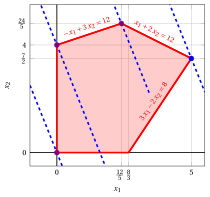{ .fig .ovale loading=lazy style="width:76%" }

    An optimal solution ${ \tilde{\boldsymbol x}}(\,LP\,)$   is:

    $$
    \tilde{x}_1=5,~~\tilde{x}_2=\dfrac{7}{2}
    $$

    the optimal value $z(\, LP\,)$ is $32.$

    In violet the first, second and third vertex explored by the execution of the simplex algorithm (before reaching the optimal one depicted in blue).

    In dashed blue,  the contour lines $5\,x_1 + 2\,x_2 = 0$, $5\,x_1 + 2\,x_2 = 8$, $5\,x_1 + 2\,x_2 = \frac{108}{5}$ and $5\,x_1 + 2\,x_2 = 32$ of the objective function associated with the values taken in the four vertices.

<a id="esercizio-6-17"></a>

!!! esercizio "Exercise 6.17: Simplex algorithm (B1)"

    Consider the following LP problem in canonical maximization form with $n=2$ variables and $m=2$ constraints:

    $$
    \begin{array}{rrrrrrrrrrrrr}
    {\max} & 25\, {x_1} & {+} & 16 \, {x_2} \\[2ex]
    \text{subject to} & 50 \, {x_1} & {+} & 31 \, {x_2} & {\le} & 250 \\[2ex]
    & {-}3 \, {x_1} & {+} & 2 \, {x_2} & {\le} & 4 \\[2ex]
    & {x_1,} &  & {x_2} & { \ge} & { 0 }
    \end{array}
    $$

    By introducing the slack variables, we get the following starting dictionary:

    \begin{equation*}
    \begin{cases}
    \begin{array}{rrrrrrrrrrrrr}
    {x_3} & {=} & {250} & {-} & 50\, {x_1} & {-} & 31\, {x_2} \\[2ex]
    {x_4} & {=} & {4} & {+} & 3\, {x_1} & {-} & 2\, {x_2} \\[2ex]
    {z} & {=} & {0} & {+} & 25 {x_1} & {+} & 16 \, {x_2}
    \end{array}
    \end{cases}
    \end{equation*}

    The associated feasible  solution is:

    $$
    \bar x_1=0,~~
    \bar x_2=0,~~
    \bar x_3=250,~~
    \bar x_4=4
    ~~~\text{of value   } 0
    $$

    **Questions**

    - Execute the simplex algorithm to find an optimal solution of this LP problem.

??? soluzione "Solution"

    - <span style="color:#e03131"><strong>Initialization</strong></span>

        Consider the starting dictionary:

        \begin{equation*}
        \begin{cases}
        \begin{array}{rrrrrrrrrrrrr}
        {x_3} & {=} & {250} & {-} & 50\, {x_1} & {-} & 31\, {x_2} \\[2ex]
        {x_4} & {=} & {4} & {+} & 3\, {x_1} & {-} & 2\, {x_2} \\[2ex]
        {z} & {=} & {0} & {+} & 25 {x_1} & {+} & 16 \, {x_2}
        \end{array}
        \end{cases}
        \end{equation*}

        where $\pazocal{B}=\{3,4\}$ and $\pazocal{N}=\{1,2\}$. The basic feasible solution is:

        $$
        \bar x_3=250,~~
        \bar x_4=4,~~~~
        \bar x_1=0,~~
        \bar x_2=0,~~
        ~~~\text{of value   } 0
        $$

    - <span style="color:#e03131"><strong>Iteration 1</strong></span>

        If we increase the value of the variable $x_1$, we can get a better solution. We have:

        $$
        \begin{cases}
        x_3 &= 250 - 50\: x_1 \\[2ex]
        x_4 &= 4 + 3\: x_1
        \end{cases}
        \qquad
        \qquad
        \begin{cases}
        \underbrace{ 250 - 50\: x_1 \ge 0}_{x_3 \ge 0} \\[2ex]
        \underbrace{  4 + 3\: x_1 \ge 0}_{x_4 \ge 0}
        \end{cases}
        \qquad
        \qquad
        \begin{cases}
        x_1 &\le  5 \\[2ex]
        x_1 &\ge - \dfrac{4}{3}
        \end{cases}
        $$

        By increasing the value of $x_1$ to $5$,  the value of $x_3$ decreases to 0.

        Then, we have that:

        - $x_1$ becomes basic and accordingly $x_3$ becomes non-basic

        We have:

        $$
        x_3 = 250 - 50\; x_1 - 31\; x_2 \text{    then     } x_1= 5 -\dfrac{31}{50}\: x_2 -\dfrac{1}{50}\: x_3.
        $$

        Substituting in the other equations of the dictionary, we get:

        $$
        x_4 = 4 + 3 \; \left( 5 -\dfrac{31}{50}\: x_2 -\dfrac{1}{50}\: x_3 \right) - 2 \:x_2= 19  -\dfrac{193}{50}\: x_2 -\dfrac{3}{50}\: x_3
        $$

        $$
        z = 25\; \left(5  -\dfrac{31}{50}\: x_2 -\dfrac{1}{50}\: x_3 \right) + 16 \: x_2 = 125 +\dfrac{1}{2}\: x_2 -\dfrac{1}{2}\: x_3
        $$

        Accordingly, we now have the following dictionary:

        \begin{equation*}
        \begin{cases}
        \begin{array}{rrrrrrrrrrrrr}
        {x_1=5} & {-} & {\dfrac{31}{50}} \, {x_2} & {-} & {\dfrac{1}{50}}\, {x_3} \\[2ex]
        {x_4=19} & {-} & {\dfrac{193}{50}}\, {x_2} & {-} & {\dfrac{3}{50}}\, {x_3} \\[2ex]
        {z=125} & {+} & {\dfrac{1}{2}} \, {x_2} & {-} & {\dfrac{1}{2}} \, {x_3}
        \end{array}
        \end{cases}
        \end{equation*}

        where $\pazocal{B}=\{1,4\}$ and $\pazocal{N}=\{2,3\}$. The basic feasible solution is:

        $$
        \bar x_1=5,~~
        \bar x_4=19,~~~~~
        \bar x_2=0,~~
        \bar x_3=0~~
        ~~~\text{of value   } 125
        $$

    - <span style="color:#e03131"><strong>Iteration 2</strong></span>

        If we increase the value of the variable $x_2$, we can get a better solution. We have:

        $$
        \begin{cases}
        x_1 &= 5 - \dfrac{31}{50}\: x_2 \\[2ex]
        x_4 &= 19 - \dfrac{193}{50}\: x_2
        \end{cases}
        \qquad
        \qquad
        \begin{cases}
        \overbrace{ 5 - \dfrac{31}{50}\: x_2 \ge 0}^{x_1 \ge 0} \\[2ex]
        \underbrace{  19 - \dfrac{193}{50}\: x_2 \ge 0}_{x_4 \ge 0}
        \end{cases}
        \qquad
        \qquad
        \begin{cases}
        x_2 &\le  \dfrac{250}{31} \\[2ex]
        x_2 &\le  \dfrac{950}{193}
        \end{cases}
        $$

        By increasing the value of $x_2$ to $\min \left\{\dfrac{250}{31},\dfrac{950}{193}\right\}=\dfrac{950}{193}$,  the value of $x_4$ decreases to 0.

        Then, we have that:

        - $x_2$ becomes basic and accordingly $x_4$ becomes non-basic

        We have:

        $$
        x_4 = 19  -\dfrac{193}{50}\: x_2 -\dfrac{3}{50}\: x_3 \text{    then     } x_2= \dfrac{950}{193} -\dfrac{3}{193}\: x_3 -\dfrac{50}{193}\: x_4.
        $$

        Substituting in the other equations of the dictionary, we get:

        $$
        x_1 = 5 - \dfrac{31}{50} \; \left( \dfrac{950}{193} -\dfrac{3}{193}\: x_3 -\dfrac{50}{193}\: x_4 \right) - \dfrac{1}{50} \:x_3= \dfrac{376}{193}  -\dfrac{2}{193}\: x_3 + \dfrac{31}{193}\: x_4
        $$

        $$
        z =  125  + \dfrac{1}{2} \; \left( \dfrac{950}{193} -\dfrac{3}{193}\: x_3 -\dfrac{50}{193}\: x_4 \right) -\dfrac{1}{2}\: x_3 = \dfrac{24600}{193} -\dfrac{98}{193}\: x_3  -\dfrac{25}{193}\: x_4
        $$

        Accordingly, we obtained an optimal solution (no further improvement is possible) and this is an optimal dictionary:

        \begin{equation*}
        \begin{cases}
        \begin{array}{rrrrrrrrrrrrr}
        {x_1=\dfrac{376}{193}} & {-} & {\dfrac{2}{193}} \, {x_3} & {+} & {\dfrac{31}{193}}\, {x_4} \\[2ex]
        {x_2=\dfrac{950}{193}} & {-} & {\dfrac{3}{193}}\, {x_3} & {-} & {\dfrac{50}{193}}\, {x_4} \\[2ex]
        {z= \dfrac{24600}{193}} & {-} & {\dfrac{98}{193}} \, {x_3} & {-} & {\dfrac{25}{193}} \, {x_4}
        \end{array}
        \end{cases}
        \end{equation*}

        where $\pazocal{B}=\{1,2\}$ and $\pazocal{N}=\{3,4\}$. The basic optimal solution is:

        $$
        \tilde{x}_1=\dfrac{376}{193},~~
        \tilde{x}_2=\dfrac{950}{193},~~
        \tilde{x}_3=0,~~
        \tilde{x}_4=0
        ~~~\text{of value   } \dfrac{24600}{193}
        $$

    <strong>Graphical solution:</strong>

    The feasible region of  the LP problem (in canonical form) is the polyhedron shaded in red: 

    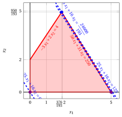{ .fig .ovale loading=lazy style="width:76%" }

    An optimal solution ${ \tilde{\boldsymbol x}}(\,LP\,)$   is:

    $$
    \tilde{x}_1=\dfrac{376}{193},~~
    \tilde{x}_2=\dfrac{950}{193}
    $$

    the optimal value $z(\, LP\,)$ is $\dfrac{24600}{193}.$

    In violet the first and the second vertex explored by the previous execution of the simplex algorithm (before reaching the optimal one depicted in blue).

    In dashed blue,  the contour lines of the objective function associated with the values taken in the three vertices.

## Problems with three variables

<a id="esercizio-6-18"></a>

!!! esercizio "Exercise 6.18: Simplex algorithm (P41)"

    Consider the following LP problem in canonical maximization form with $n=3$ variables and $m=4$ constraints:

    $$
    \begin{array}{rrrrrrrrrrrrr}
    {\max} & 2\; {x_1} & {+} & {x_2} & {+} & 3\; {x_3} \\[1.5ex]
    \text{subject to} & \, {x_1} & {+} & \, {x_2} & {+} & \, {x_3} & {\le} & {4} \\[1.5ex]
    &  &  & \, {x_2} &  &  & {\le} & {2} \\[1.5ex]
    &  &  &  &  & \, {x_3} & {\le} & {3} \\[1.5ex]
    & 3\, {x_1} &  &  & {+} & \, {x_3} & {\le} & {6} \\[1.5ex]
    & {x_1,} &  & {x_2,} &  & {x_3} & { \ge} & { 0 }
    \end{array}
    $$

    By introducing the slack variables, we get the following starting dictionary:

    \begin{equation*}
    \begin{cases}
    \begin{array}{rrrrrrrrrrrrr}
    {x_4=4} & {-} & \, {x_1} & {-} & \, {x_2} & {-} & {x_3} \\[2ex]
    {x_5=2} &  &  & {-} & \, {x_2} &  &  \\[2ex]
    {x_6=3} &  &  &  &  & {-} & {x_3} \\[2ex]
    {x_7=6} & {-} & 3\, {x_1} &  &  & {-} & \, {x_3} \\[2ex]
    {z=0} & {+} & 2\, {x_1} & {+} & {x_2} & {+} & 3\, {x_3}
    \end{array}
    \end{cases}
    \end{equation*}

    The associated feasible  solution is:

    $$
    \bar x_1=0,~~
    \bar x_2=0,~~
    \bar x_3=0,~~
    \bar x_4=4,~~
    \bar x_5=2,~~
    \bar x_6=3,~~
    \bar x_7=6
    ~~~\text{of value   } 0
    $$

    **Questions**

    - Execute the simplex algorithm to find an optimal solution of this LP problem.

??? soluzione "Solution"

    - <span style="color:#e03131"><strong>Initialization</strong></span>

        Consider the starting dictionary:

        \begin{equation*}
        \begin{cases}
        \begin{array}{rrrrrrrrrrrrr}
        {x_4=4} & {-} & \, {x_1} & {-} & \, {x_2} & {-} & {x_3} \\[2ex]
        {x_5=2} &  &  & {-} & \, {x_2} &  &  \\[2ex]
        {x_6=3} &  &  &  &  & {-} & {x_3} \\[2ex]
        {x_7=6} & {-} & 3\, {x_1} &  &  & {-} & \, {x_3} \\[2ex]
        {z=0} & {+} & 2\, {x_1} & {+} & {x_2} & {+} & 3\, {x_3}
        \end{array}
        \end{cases}
        \end{equation*}

        where $\pazocal{B}=\{4,5,6,7\}$ and $\pazocal{N}=\{1,2,3\}$. The basic feasible solution is:

        $$
        \bar x_4=4,~~
        \bar x_5=2,~~
        \bar x_6=3,~~
        \bar x_7=6,~~~~~
        \bar x_1=0,~~
        \bar x_2=0,~~
        \bar x_3=0~~
        ~~~\text{of value   } 0
        $$

    - <span style="color:#e03131"><strong>Iteration 1</strong></span>

        If we increase the value of the variable $x_1$, we can get a better solution. We have:

        $$
        \begin{cases}
        x_4 &= 4 -  x_1 \\[2ex]
        x_7 &= 6 - 3\: x_1
        \end{cases}
        \qquad
        \qquad
        \begin{cases}
        \underbrace{ 4 -  x_1 \ge 0}_{x_4 \ge 0} \\[2ex]
        \underbrace{ 6 - 3\: x_1 \ge 0}_{x_7 \ge 0}
        \end{cases}
        \qquad
        \qquad
        \begin{cases}
        x_1 &\le  4 \\[2ex]
        x_1 &\le 2
        \end{cases}
        $$

        By increasing the value of $x_1$ to $\min\left\{4,2\right\}=2$,  the value of $x_7$ decreases to 0.

        Then, we have that:

        - $x_1$ becomes basic and accordingly $x_7$ becomes non-basic

        We have:

        $$
        x_7 = 6 - 3\; x_1 -  x_3 \text{    then     } x_1= 2 -\dfrac{1}{3}\: x_3 -\dfrac{1}{3}\: x_7.
        $$

        Substituting in the other equations of the dictionary, we get:

        $$
        x_4 = 4 - \left( 2 -\dfrac{1}{3}\: x_3 -\dfrac{1}{3}\: x_7 \right) -x_2 -  x_3 = 2 -  x_2  - \dfrac{2}{3} x_3 + \dfrac{1}{3} x_7
        $$

        $$
        z =  2\: \left( 2 -\dfrac{1}{3}\: x_3 -\dfrac{1}{3}\: x_7 \right) + x_2 +3\; x_3 = 4 + x_2 + \dfrac{7}{3} \;x_3 - \dfrac{2}{3} \;x_7
        $$

        Accordingly, we now have the following dictionary:

        \begin{equation*}
        \begin{cases}
        \begin{array}{rrrrrrrrrrrrr}
        {x_1=2} &  &  & {-} & {\dfrac{1}{3}}\, {x_3} & {-} & {\dfrac{1}{3}}\; {x_7} \\[2ex]
        {x_4=2} & {-} & \, {x_2} & {-} & {\dfrac{2}{3}}\, {x_3} & {+} & {\dfrac{1}{3}}\; {x_7} \\[2ex]
        {x_5=2} & {-} & \, {x_2} &  &  \\[2ex]
        {x_6=3} &  &  & {-} & {x_3} \\[2ex]
        {z=4} & {+} & {x_2} & {+} & {\dfrac{7}{3}} \; {x_3} & {-} & {\dfrac{2}{3}} \, {x_7}
        \end{array}
        \end{cases}
        \end{equation*}

        where $\pazocal{B}=\{1,4,5,6\}$ and $\pazocal{N}=\{2,3,7\}$. The basic feasible solution is:

        $$
        \bar x_1=2,~~
        \bar x_4=2,~~
        \bar x_5=2,~~
        \bar x_6=3,~~~~
        \bar x_2=0,~~
        \bar x_3=0,~~
        \bar x_7=0~~
        \text{  of value   }4
        $$

    - <span style="color:#e03131"><strong>Iteration 2</strong></span>

        If we increase the value of the variable $x_2$, we can get a better solution. We have:

        $$
        \begin{cases}
        x_4 &= 2 -  x_2 \\[2ex]
        x_5 &= 2 - \: x_2
        \end{cases}
        \qquad
        \qquad
        \begin{cases}
        \underbrace{ 2 -  x_2 \ge 0}_{x_4 \ge 0} \\[2ex]
        \underbrace{ 2 -  x_2 \ge 0}_{x_5 \ge 0}
        \end{cases}
        \qquad
        \qquad
        \begin{cases}
        x_2 &\le 2 \\[2ex]
        x_2 &\le 2
        \end{cases}
        $$

        By increasing the value of $x_2$ to $\min\left\{2,2\right\}=2$,  the value of $x_4$ decreases to 0.

        Then, we have that:

        - $x_2$ becomes basic and accordingly $x_4$ becomes non-basic

        We have:

        $$
        x_4 = 2 -  x_2 - \dfrac{2}{3} \; x_3 + \dfrac{1}{3} \; x_7 \text{    then     } x_2 = 2  - \dfrac{2}{3} \; x_3 - x_4 + \dfrac{1}{3} \; x_7.
        $$

        Substituting in the other equations of the dictionary, we get:

        $$
        x_5 = 2 - \left( 2  - \dfrac{2}{3} \; x_3 - x_4 + \dfrac{1}{3} \; x_7 \right) =
        \dfrac{2}{3} \; x_3 + x_4 -\dfrac{1}{3} \; x_7
        $$

        $$
        z =  4+ \left( 2  - \dfrac{2}{3} \; x_3 - x_4 + \dfrac{1}{3} \; x_7 \right) + \dfrac{7}{3} \; x_3 - \dfrac{2}{3} \; x_7 = 6  + \dfrac{5}{3} \; x_3 -x_4 - \dfrac{1}{3} \; x_7
        $$

        Accordingly, we now have the following dictionary:

        \begin{equation*}
        \begin{cases}
        \begin{array}{rrrrrrrrrrrrr}
        {x_1=2} & {-} & {\dfrac{1}{3}}\, {x_3} &  &  & {-} & {\dfrac{1}{3}}\; {x_7} \\[2ex]
        {x_2=2} & {-} & {\dfrac{2}{3}}\; {x_3} & {-} & \; {x_4} & {+} & {\dfrac{1}{3}} \, {x_7} \\[2ex]
        {x_5=0} & {+} & {\dfrac{2}{3}}\; {x_3} & {+} & \; {x_4} & {-} & {\dfrac{1}{3}} \, {x_7} \\[2ex]
        {x_6=3} & {-} & {x_3} \\[2ex]
        {z=6} & {+} & {\dfrac{5}{3}}\; {x_3} & {-} & \; {x_4} & {-} & {\dfrac{1}{3}} \, {x_7}
        \end{array}
        \end{cases}
        \end{equation*}

        where $\pazocal{B}=\{1,2,5,6\}$ and $\pazocal{N}=\{3,4,7\}$. The basic feasible solution is:

        $$
        \bar x_1=2,~~
        \bar x_2=2,~~
        \bar x_5=0,~~
        \bar x_6=3,~~~~~
        \bar x_3=0,~~
        \bar x_4=0,~~
        \bar x_7=0~~
        \text{  of value   }6
        $$

    - <span style="color:#e03131"><strong>Iteration 3</strong></span>

        If we increase the value of the variable $x_3$, we can get a better solution. We have:

        $$
        \begin{cases}
        x_1 &= 2 - \dfrac{1}{3}\; x_3 \\[2ex]
        x_2 &= 2 - \dfrac{2}{3}\;  x_3 \\[2ex]
        x_5 &= 0 + \dfrac{2}{3}\;  x_3 \\[2ex]
        x_6 &= 3 - \: x_3
        \end{cases}
        \qquad
        \qquad
        \begin{cases}
        \underbrace{ 2 - \dfrac{1}{3}\; x_3 \ge 0}_{x_1 \ge 0} \\[2ex]
        \underbrace{ 2 - \dfrac{2}{3}\;  x_3 \ge 0}_{x_2 \ge 0} \\[2ex]
        \underbrace{ 0 + \dfrac{2}{3}\;  x_3 \ge 0}_{x_5 \ge 0} \\[2ex]
        \underbrace{ 3 -  x_3 \ge 0}_{x_6 \ge 0}
        \end{cases}
        \qquad
        \qquad
        \begin{cases}
        x_3 &\le 6 \\[2ex]
        x_3 &\le 3 \\[2ex]
        x_3 &\ge 0 \\[2ex]
        x_3 &\le 3
        \end{cases}
        $$

        By increasing the value of $x_3$ to $\min\left\{6,3,3\right\}=3$,  the value of $x_2$ decreases to 0.

        Then, we have that:

        - $x_3$ becomes basic and accordingly $x_2$ becomes non-basic

        We have:

        $$
        x_2 = 2 - \dfrac{2}{3} \; x_3 - x_4 + \dfrac{1}{3} \; x_7 \text{    then     } x_3 = 3  - \dfrac{3}{2} \; x_2 - \dfrac{3}{2} x_4 + \dfrac{1}{2} \; x_7.
        $$

        Substituting in the other equations of the dictionary, we get:

        $$
        x_1 =  2- \dfrac{1}{3} \; \left( 3  - \dfrac{3}{2} \; x_2 - \dfrac{3}{2} \;x_4 + \dfrac{1}{2} \; x_7 \right) - \dfrac{1}{3} \; x_7 =  1 + \dfrac{1}{2} \;x_2 + \dfrac{1}{2} \;x_4 - \dfrac{1}{2} \;x_7
        $$

        $$
        x_5 =   \dfrac{2}{3} \; \left( 3  - \dfrac{3}{2} \; x_2 - \dfrac{3}{2} \;x_4 + \dfrac{1}{2} \; x_7 \right) +x_4 - \dfrac{1}{3} \; x_7 =   2 - x_2
        $$

        $$
        x_6 =  3 - \; \left( 3  - \dfrac{3}{2} \; x_2 - \dfrac{3}{2} \;x_4 + \dfrac{1}{2} \; x_7 \right) =  \dfrac{3}{2} \; x_2 + \dfrac{3}{2} \;x_4 - \dfrac{1}{2} \; x_7
        $$

        $$
        z =  6+ \dfrac{5}{3} \; \left( 3  - \dfrac{3}{2} \; x_2 - \dfrac{3}{2} \;x_4 + \dfrac{1}{2} \; x_7 \right) - x_4 - \dfrac{1}{3} \; x_7 =  11 - \dfrac{5}{2} \;x_2 - \dfrac{7}{2} \;x_4 + \dfrac{1}{2} \;x_7
        $$

        Accordingly, we now have the following dictionary:

        \begin{equation*}
        \begin{cases}
        \begin{array}{rrrrrrrrrrrrr}
        {x_1=1} & {+} & {\dfrac{1}{2}}\; {x_2} & {+} & {\dfrac{1}{2}}\; \; {x_4} & {-} & {\dfrac{1}{2}} \, {x_7} \\[2ex]
        {x_3=3} & {-} & {\dfrac{3}{2}}\; {x_2} & {-} & {\dfrac{3}{2}}\; \; {x_4} & {+} & {\dfrac{1}{2}} \, {x_7} \\[2ex]
        {x_5=2} & {-} & {x_2} \\[2ex]
        {x_6=0} & {+} & {\dfrac{3}{2}}\; {x_2} & {+} & {\dfrac{3}{2}}\; \; {x_4} & {-} & {\dfrac{1}{2}} \, {x_7} \\[2ex]
        {z=11} & {-} & {\dfrac{5}{2}}\; {x_2} & {-} & {\dfrac{7}{2}}\; \; {x_4} & {+} & {\dfrac{1}{2}} \, {x_7}
        \end{array}
        \end{cases}
        \end{equation*}

        where $\pazocal{B}=\{1,3,5,6\}$ and $\pazocal{N}=\{2,4,7\}$. The basic feasible solution is:

        $$
        \bar x_1=1,~~
        \bar x_3=3,~~
        \bar x_5=2,~~
        \bar x_6=0,~~~~~
        \bar x_2=0,~~
        \bar x_4=0,~~
        \bar x_7=0~~
        \text{  of value   }11
        $$

    - <span style="color:#e03131"><strong>Iteration 4</strong></span>

        If we increase the value of the variable $x_7$, we can get a better solution. We have:

        $$
        \begin{cases}
        x_1 &= 1 - \dfrac{1}{2}\; x_7 \\[2ex]
        x_3 &= 3 + \dfrac{1}{2}\;  x_7 \\[2ex]
        x_6 &= 0 - \dfrac{1}{2}\; x_7
        \end{cases}
        \qquad
        \qquad
        \begin{cases}
        \underbrace{ 1 - \dfrac{1}{2}\; x_7 \ge 0}_{x_1 \ge 0} \\[2ex]
        \underbrace{ 3 + \dfrac{1}{2}\;  x_7 \ge 0}_{x_3 \ge 0} \\[2ex]
        \underbrace{ 0 - \dfrac{1}{2}\; x_7 \ge 0}_{x_6 \ge 0}
        \end{cases}
        \qquad
        \qquad
        \begin{cases}
        x_7 &\le 2 \\[2ex]
        x_7 &\ge -6 \\[2ex]
        x_7 &\le 0
        \end{cases}
        $$

        By increasing the value of $x_7$ to $\min\left\{2,0\right\}=0$,  the value of $x_6$ decreases to 0.

        Then, we have that:

        - $x_7$ becomes basic and accordingly $x_6$ becomes non-basic

        We have:

        $$
        x_6 = \dfrac{3}{2} \; x_2 + \dfrac{3}{2} \; x_4 - \dfrac{1}{2} \; x_7 \text{    then     } x_7 = 3 \; x_2 + 3 x_4 - 2 \; x_6.
        $$

        Substituting in the other equations of the dictionary, we get:

        $$
        x_1 =  1 + \dfrac{1}{2} \; x_2 + \dfrac{1}{2} \; x_4  - \dfrac{1}{2} \; \left( 3 \; x_2 + 3 x_4 - 2 \; x_6 \right) = 1- x_2 - x_4 + x_6
        $$

        $$
        x_3 =  3 - \dfrac{3}{2} \; x_2 - \dfrac{3}{2} \; x_4  + \dfrac{1}{2} \; \left( 3 \; x_2 + 3 x_4 - 2 \; x_6 \right) = 3 - x_6
        $$

        $$
        z =  11 - \dfrac{5}{2} \; x_2 - \dfrac{7}{2} \; x_4  + \dfrac{1}{2} \; \left( 3 \; x_2 + 3 x_4 - 2 \; x_6 \right) = 11 - x_2 - 2\; x_4 - x_6
        $$

        Accordingly, we obtained an optimal solution (no further improvement is possible) and this is an optimal dictionary:

        \begin{equation*}
        \begin{cases}
        \begin{array}{rrrrrrrrrrrrr}
        {x_1=1} & {-} & {x_2} & {-} & \; {x_4} & {+} & \, {x_6} \\[2ex]
        {x_3=3} &  &  &  &  & {-} & {x_6} \\[2ex]
        {x_5=2} & {-} & {x_2} \\[2ex]
        {x_7=0} & {+} & {3}\; {x_2} & {+} & {3}\; \; {x_4} & {-} & {2} \, {x_6} \\[2ex]
        {z=11} & {-} & {x_2} & {-} & {2}\; \; {x_4} & {-} & {x_6}
        \end{array}
        \end{cases}
        \end{equation*}

        where $\pazocal{B}=\{1,3,5,7\}$ and $\pazocal{N}=\{2,4,6\}$. The basic optimal solution is:

        $$
        \tilde{x}_1=1,~~
        \tilde{x}_3=3,~~
        \tilde{x}_5=2,~~
        \tilde{x}_7=0,~~~~~
        \tilde{x}_4=0,~~
        \tilde{x}_6=0,~~
        \tilde{x}_2=0~~
        \text{  of value   } 11
        $$

    <strong>Graphical solution:</strong>

    The feasible region of  the LP problem (in canonical form) is the polyhedron shaded in red: 

    { .fig .ovale loading=lazy style="width:53%" }

    An optimal solution ${ \tilde{\boldsymbol x}}(\, LP \,)$   is:

    $$
    \tilde{x}_1=1,~~
    \tilde{x}_2=0,~~
    \tilde{x}_3=3
    $$

    the optimal value $z(\, LP \,)$ is $11.$

    In violet the first and the second vertex explored by the previous execution of the  algorithm (before reaching the optimal one depicted in blue).

    ??? codice "SageMath Code: 3D Polyhedra (sagecell.sagemath.org/)"

        ```python
        # Define the polyhedron using inequalities (Hyperplane Representation)
        p = Polyhedron(ieqs=[
            (4, -1, -1, -1),   # (-1, -1, -1) x + 4 >= 0
            (2,  0, -1,  0),   # (0, -1, 0) x + 2 >= 0
            (3,  0,  0, -1),   # (0, 0, -1) x + 3 >= 0
            (6, -3,  0, -1),   # (-3, 0, -1) x + 6 >= 0
            (0,  1,  0,  0),   # (1, 0, 0) x + 0 >= 0
            (0,  0,  1,  0),   # (0, 1, 0) x + 0 >= 0
            (0,  0,  0,  1)    # (0, 0, 1) x + 0 >= 0
        ])

        # Display the inequalities of the polyhedron
        p.Hrepresentation()

        # Display the extreme points and extreme rays of the polyhedron
        p.Vrepresentation()

        # Plot the polyhedron (3D)
        p.plot()
        ```

<a id="esercizio-6-19"></a>

!!! esercizio "Exercise 6.19: Simplex algorithm (P42)"

    Consider the following LP problem in canonical maximization form with $n=3$ variables and $m=3$ constraints:

    $$
    \begin{array}{rrrrrrrrrrrrr}
    {\max} & 3 \, {x_1} & {+} & 2 \, {x_2} & {+} & 4 \, {x_3} \\[2ex]
    \text{subject to} & \, {x_1} & {+} & \, {x_2} & {+} & 2 \, {x_3} & {\le} & 4 \\[2ex]
    & 2 \, {x_1} &  &  & {+} & 3 \, {x_3} & {\le} & 5 \\[2ex]
    & 2 \, {x_1} & {+} & \, {x_2} & {+} & 3 \, {x_3} & {\le} & 7 \\[2ex]
    & {x_1,} &  & {x_2,} &  & \, {x_3} & { \ge} & { 0 }
    \end{array}
    $$

    By introducing the slack variables, we get the following starting dictionary:

    \begin{equation*}
    \begin{cases}
    \begin{array}{rrrrrrrrrrrrr}
    {x_4=4} & {-} & \, {x_1} & {-} & \, {x_2} & {-} & 2\, {x_3} \\[2ex]
    {x_5=5} & {-} & 2\, {x_1} &  &  & {-} & 3\, {x_3} \\[2ex]
    {x_6=7} & {-} & 2\, {x_1} & {-} & \, {x_2} & {-} & 3\, {x_3} \\[2ex]
    {z=0} & {+} & 3\, {x_1} & {+} & 2\, {x_2} & {+} & 4\, {x_3}
    \end{array}
    \end{cases}
    \end{equation*}

    The associated feasible  solution is:

    $$
    \bar x_1=0,~~
    \bar x_2=0,~~
    \bar x_3=0,~~
    \bar x_4=4,~~
    \bar x_5=5,~~
    \bar x_6=7
    ~~~\text{of value   } 0
    $$

    **Questions**

    - Execute the simplex algorithm to find an optimal solution of this LP problem.

??? soluzione "Solution"

    - <span style="color:#e03131"><strong>Initialization</strong></span>

        Consider the starting dictionary:

        \begin{equation*}
        \begin{cases}
        \begin{array}{rrrrrrrrrrrrr}
        {x_4=4} & {-} & \, {x_1} & {-} & \, {x_2} & {-} & 2\, {x_3} \\[2ex]
        {x_5=5} & {-} & 2\, {x_1} &  &  & {-} & 3\, {x_3} \\[2ex]
        {x_6=7} & {-} & 2\, {x_1} & {-} & \, {x_2} & {-} & 3\, {x_3} \\[2ex]
        {z=0} & {+} & 3\, {x_1} & {+} & 2\, {x_2} & {+} & 4\, {x_3}
        \end{array}
        \end{cases}
        \end{equation*}

        where $\pazocal{B}=\{4,5,6\}$ and $\pazocal{N}=\{1,2,3\}$. The basic feasible solution is:

        $$
        \bar x_4=4,~~
        \bar x_5=5,~~
        \bar x_6=7,~~~~
        \bar x_1=0,~~
        \bar x_2=0,~~
        \bar x_3=0~~
        ~~~\text{of value   } 0
        $$

    - <span style="color:#e03131"><strong>Iteration 1</strong></span>

        If we increase the value of the variable $x_1$, we can get a better solution. We have:

        $$
        \begin{cases}
        x_4 &= 4 -  x_1 \\[2ex]
        x_5 &= 5 - 2\: x_1 \\[2ex]
        x_6 &= 7 - 2\: x_1
        \end{cases}
        \qquad
        \qquad
        \begin{cases}
        \underbrace{ 4 -  x_1 \ge 0}_{x_4 \ge 0} \\[2ex]
        \underbrace{ 5 - 2\: x_1 \ge 0}_{x_5 \ge 0} \\[2ex]
        \underbrace{ 7 - 2\: x_1 \ge 0}_{x_6 \ge 0}
        \end{cases}
        \qquad
        \qquad
        \begin{cases}
        x_1 &\le  4 \\[2ex]
        x_1 &\le \dfrac{5}{2} \\[2ex]
        x_1 &\le \dfrac{7}{2}
        \end{cases}
        $$

        By increasing the value of $x_1$ to $\min\left\{4,\dfrac{5}{2},\dfrac{7}{2}\right\}=\dfrac{5}{2}$,  the value of $x_5$ decreases to 0.

        Then, we have that:

        - $x_1$ becomes basic and accordingly $x_5$ becomes non-basic

        We have:

        $$
        x_5 = 5 - 2\; x_1 - 3\; x_3 \text{    then     } x_1= \dfrac{5}{2} -\dfrac{3}{2}\: x_3 -\dfrac{1}{2}\: x_5.
        $$

        Substituting in the other equations of the dictionary, we get:

        $$
        x_4 = 4 - \left( \dfrac{5}{2} -\dfrac{3}{2}\: x_3 -\dfrac{1}{2}\: x_5 \right) -x_2 - 2\; x_3 = \dfrac{3}{2} - x_2 - \dfrac{1}{2} x_3  + \dfrac{1}{2} x_5
        $$

        $$
        x_6 = 7 - 2\: \left( \dfrac{5}{2} -\dfrac{3}{2}\: x_3 -\dfrac{1}{2}\: x_5 \right) -x_2 - 3 \;x_3 = 2 - x_2 + x_5
        $$

        $$
        z =  3\: \left( \dfrac{5}{2} -\dfrac{3}{2}\: x_3 -\dfrac{1}{2}\: x_5 \right) +2\: x_2 +4\; x_3 = \dfrac{15}{2} + 2\;x_2 - \dfrac{1}{2} \;x_3 - \dfrac{3}{2} \;x_5
        $$

        Accordingly, we now have the following dictionary:

        \begin{equation*}
        \begin{cases}
        \begin{array}{rrrrrrrrrrrrr}
        {x_1=\dfrac{5}{2}} &  &  & {-} & {\dfrac{3}{2}}\; {x_3} & {-} & {\dfrac{1}{2}} \, {x_5} \\[2ex]
        {x_4=\dfrac{3}{2}} & {-} & \, {x_2} & {-} & {\dfrac{1}{2}} \, {x_3} & {+} & {\dfrac{1}{2}} \, {x_5} \\[2ex]
        {x_6=2} & {-} & \, {x_2} &  &  & {+} & \, {x_5} \\[2ex]
        {z=\dfrac{15}{2}} & {+} & 2 \, {x_2} & {-} & {\dfrac{1}{2}}\, {x_3} & {-} & { \dfrac{3}{2}} \, {x_5}
        \end{array}
        \end{cases}
        \end{equation*}

        where $\pazocal{B}=\{1,4,6\}$ and $\pazocal{N}=\{2,3,5\}$. The basic feasible solution is:

        $$
        \bar x_1=\dfrac{5}{2},~~
        \bar x_4=\dfrac{3}{2},~~
        \bar x_6=2,~~~~~
        \bar x_2=0,~~
        \bar x_3=0,~~
        \bar x_5=0~~
        \text{  of value   } \dfrac{15}{2}
        $$

    - <span style="color:#e03131"><strong>Iteration 2</strong></span>

        If we increase the value of the variable $x_2$, we can get a better solution. We have:

        $$
        \begin{cases}
        x_4 &= \dfrac{3}{2} - \: x_2 \\[2ex]
        x_6 &= 2 -  x_2
        \end{cases}
        \qquad
        \qquad
        \begin{cases}
        \underbrace{ \dfrac{3}{2} - \: x_2 \ge 0}_{x_4 \ge 0} \\[2ex]
        \underbrace{  2 -  x_2 \ge 0}_{x_6 \ge 0}
        \end{cases}
        \qquad
        \qquad
        \begin{cases}
        x_2 &\le  \dfrac{3}{2} \\[2ex]
        x_2 &\le 2
        \end{cases}
        $$

        By increasing the value of $x_2$ to $\dfrac{3}{2}$,  the value of $x_4$ decreases to 0.

        Then, we have that:

        - $x_2$ becomes basic and accordingly $x_4$ becomes non-basic

        We have:

        $$
        x_4 = \dfrac{3}{2} - x_2 - \dfrac{1}{2}\: x_3 + \dfrac{1}{2}\: x_5 \text{    then     } x_2= \dfrac{3}{2} -\dfrac{1}{2}\; x_3 - x_4 + \dfrac{1}{2}\: x_5
        $$

        Substituting in the other equations of the dictionary, we get:

        $$
        x_6 =  2 - \; \left( \dfrac{3}{2} -\dfrac{1}{2}\; x_3 - x_4 + \dfrac{1}{2}\: x_5 \right ) + x_5 = \dfrac{1}{2} + \dfrac{1}{2} \; x_3 + x_4 + \dfrac{1}{2} \; x_5
        $$

        $$
        z = \dfrac{15}{2}  + 2\; \left( \dfrac{3}{2} -\dfrac{1}{2}\; x_3 - x_4 + \dfrac{1}{2}\: x_5 \right ) - \dfrac{1}{2} \; x_3 - \dfrac{3}{2}\; x_5 = \dfrac{21}{2} - \dfrac{3}{2} \: x_3 - 2 \; x_4 - \dfrac{1}{2} \; x_5
        $$

        Accordingly, we obtained an optimal solution (no further improvement is possible) and this is an optimal dictionary:

        \begin{equation*}
        \begin{cases}
        \begin{array}{rrrrrrrrrrrrr}
        {x_1=\dfrac{5}{2}} & {-} & { \dfrac{3}{2}} \, {x_3} &  &  & {-} & {\dfrac{1}{2}} \, {x_5} \\[2ex]
        {x_2=\dfrac{3}{2}} & {-} & {\dfrac{1}{2}} \, {x_3} & {-} & \, {x_4} & {+} & {\dfrac{1}{2}} \, {x_5} \\[2ex]
        {x_6=\dfrac{1}{2}} & {+} & {\dfrac{1}{2}} \: {x_3} & {+} & \, {x_4} & {+} & {\dfrac{1}{2}}\, {x_5} \\[2ex]
        {z=\dfrac{21}{2}} & {-} & {\dfrac{3}{2}} \, {x_3} & {-} & 2\, {x_4} & {-} & {\dfrac{1}{2}} \: {x_5}
        \end{array}
        \end{cases}
        \end{equation*}

        where $\pazocal{B}=\{1,2,6\}$ and $\pazocal{N}=\{3,4,5\}$. The basic optimal solution is:

        $$
        \tilde{x}_1=\dfrac{5}{2},~~
        \tilde{x}_2=\dfrac{3}{2},~~
        \tilde{x}_3=0,~~
        \tilde{x}_4=0,~~
        \tilde{x}_5=0,~~
        \tilde{x}_6=\dfrac{1}{2}
        \text{  of value   }  \dfrac{21}{2}
        $$

    <strong>Graphical solution:</strong>

    The feasible region of  the LP problem (in canonical  form) is the polyhedron shaded in red: 

    { .fig .ovale loading=lazy style="width:76%" }

    An optimal solution ${ \tilde{\boldsymbol x}}(\, LP \,)$   is:

    $$
    \tilde{x}_1=\dfrac{5}{2},~~
    \tilde{x}_2=\dfrac{3}{2},~~
    \tilde{x}_3=0
    $$

    the optimal value $z(\, LP \,)$ is $\dfrac{21}{2}.$

    In violet the first and the second vertex explored by the previous execution of the  algorithm (before reaching the optimal one depicted in blue).

    !!! nota ""

        This is another possible execution of the simplex algorithm, selecting non-basic variables with the largest reduced cost instead of following the natural order.

    - <span style="color:#e03131"><strong>Initialization</strong></span>

        Consider the starting dictionary:

        \begin{equation*}
        \begin{cases}
        \begin{array}{rrrrrrrrrrrrr}
        {x_4=4} & {-} & \, {x_1} & {-} & \, {x_2} & {-} & 2\, {x_3} \\[2ex]
        {x_5=5} & {-} & 2\, {x_1} &  &  & {-} & 3\, {x_3} \\[2ex]
        {x_6=7} & {-} & 2\, {x_1} & {-} & \, {x_2} & {-} & 3\, {x_3} \\[2ex]
        {z=0} & {+} & 3\, {x_1} & {+} & 2\, {x_2} & {+} & 4\, {x_3}
        \end{array}
        \end{cases}
        \end{equation*}

        where $\pazocal{B}=\{4,5,6\}$ and $\pazocal{N}=\{1,2,3\}$. The basic feasible solution is:

        $$
        \bar x_4=4,~~
        \bar x_5=5,~~
        \bar x_6=7,~~~~
        \bar x_1=0,~~
        \bar x_2=0,~~
        \bar x_3=0~~
        ~~~\text{of value   } 0
        $$

    - <span style="color:#e03131"><strong>Iteration 1</strong></span>

        If we increase the value of the variable $x_3$, we can get a better solution. We have:

        $$
        \begin{cases}
        x_4 &= 4 - 2\: x_3 \\[2ex]
        x_5 &= 5 - 3\: x_3 \\[2ex]
        x_6 &= 7 - 3\: x_3
        \end{cases}
        \qquad
        \qquad
        \begin{cases}
        \underbrace{ 4 - 2\: x_3 \ge 0}_{x_4 \ge 0} \\[2ex]
        \underbrace{  5 - 3\: x_3 \ge 0}_{x_5 \ge 0} \\[2ex]
        \underbrace{  7 - 3\: x_3 \ge 0}_{x_6 \ge 0}
        \end{cases}
        \qquad
        \qquad
        \begin{cases}
        x_3 &\le  2 \\[2ex]
        x_3 &\le \dfrac{5}{3} \\[2ex]
        x_3 &\le \dfrac{7}{3}
        \end{cases}
        $$

        By increasing the value of $x_3$ to $\dfrac{5}{3}$,  the value of $x_5$ decreases to 0.

        Then, we have that:

        - $x_3$ becomes basic and accordingly $x_5$ becomes non-basic

        We have:

        $$
        x_5 = 5 - 2\; x_1 - 3\; x_3 \text{    then     } x_3= \dfrac{5}{3} -\dfrac{2}{3}\: x_1 -\dfrac{1}{3}\: x_5.
        $$

        Substituting in the other equations of the dictionary, we get:

        $$
        x_4 = 4 - x_1 -x_2 - 2\; \left( \dfrac{5}{3} -\dfrac{2}{3}\: x_1 -\dfrac{1}{3}\: x_5 \right)
        = \dfrac{2}{3} +\dfrac{1}{3} \: x_1 - x_2 + \dfrac{2}{3} \: x_5
        $$

        $$
        x_6 = 7 - 2\: x_1 -x_2 - 3\; \left( \dfrac{5}{3} -\dfrac{2}{3}\: x_1 -\dfrac{1}{3}\: x_5 \right)
        = 2 -  x_2 +  x_5
        $$

        $$
        z =  3\: x_1 +2\: x_2 +4\; \left( \dfrac{5}{3} -\dfrac{2}{3}\: x_1 -\dfrac{1}{3}\: x_5 \right)
        = \dfrac{20}{3} + \dfrac{1}{3} \: x_1 + 2\: x_2 - \dfrac{4}{3} \: x_5
        $$

        Accordingly, we now have the following dictionary:

        \begin{equation*}
        \begin{cases}
        \begin{array}{rrrrrrrrrrrrr}
        {x_3=\dfrac{5}{3}} & {-} & { \dfrac{2}{3}} \, {x_1} &  &  & {-} & {\dfrac{1}{3}} \, {x_5} \\[2ex]
        {x_4=\dfrac{2}{3}} & {+} & {\dfrac{1}{3}} \, {x_1} & {-} & \, {x_2} & {+} & {\dfrac{2}{3}} \, {x_5} \\[2ex]
        {x_6=2} &  &  & {-} & \, {x_2} & {+} & \, {x_5} \\[2ex]
        {z=\dfrac{20}{3}} & {+} & {\dfrac{1}{3}} \, {x_1} & {+} & 2\, {x_2} & {-} & { \dfrac{4}{3}} \, {x_5}
        \end{array}
        \end{cases}
        \end{equation*}

        where $\pazocal{B}=\{3,4,6\}$ and $\pazocal{N}=\{1,2,5\}$. The basic feasible solution is:

        $$
        \bar x_3=\dfrac{5}{3},~~
        \bar x_4=\dfrac{2}{3},~~
        \bar x_6=2,~~~~~
        \bar x_1=0,~~
        \bar x_2=0,~~
        \bar x_5=0,~~
        \text{  of value   } \dfrac{20}{3}
        $$

    - <span style="color:#e03131"><strong>Iteration 2</strong></span>

        If we increase the value of the variable $x_2$, we can get a better solution. We have:

        $$
        \begin{cases}
        x_4 &= \dfrac{2}{3} - \: x_2 \\[2ex]
        x_6 &= 2 -  x_2
        \end{cases}
        \qquad
        \qquad
        \begin{cases}
        \underbrace{ \dfrac{2}{3} - \: x_2 \ge 0}_{x_4 \ge 0} \\[2ex]
        \underbrace{  2 -  x_2 \ge 0}_{x_6 \ge 0}
        \end{cases}
        \qquad
        \qquad
        \begin{cases}
        x_2 &\le  \dfrac{2}{3} \\[2ex]
        x_2 &\le 2
        \end{cases}
        $$

        By increasing the value of $x_2$ to $\dfrac{2}{3}$,  the value of $x_4$ decreases to 0.

        Then, we have that:

        - $x_2$ becomes basic and accordingly $x_4$ becomes non-basic

        We have:

        $$
        x_4 = \dfrac{2}{3} + \dfrac{1}{3}\; x_1 - x_2 + \dfrac{2}{3}\: x_5 \text{    then     } x_2= \dfrac{2}{3} + \dfrac{1}{3}\; x_1 - x_4 + \dfrac{2}{3}\: x_5
        $$

        Substituting in the other equations of the dictionary, we get:

        $$
        x_6 = 2 -  \left( \dfrac{2}{3} + \dfrac{1}{3}\; x_1 - x_4 + \dfrac{2}{3}\: x_5 \right) + x_5
        = \dfrac{4}{3} - \dfrac{1}{3} \; x_1 + x_4 +  \dfrac{1}{3} \:  x_5
        $$

        $$
        z = \dfrac{20}{3} +  \dfrac{1}{3}\: x_1 +2\: \left( \dfrac{2}{3} + \dfrac{1}{3}\; x_1 - x_4 + \dfrac{2}{3}\: x_5  \right) - \dfrac{4}{3} \: x_5
        = 8 +  x_1 - 2\: x_4
        $$

        Accordingly, we now have the following dictionary:

        \begin{equation*}
        \begin{cases}
        \begin{array}{rrrrrrrrrrrrr}
        {x_2=\dfrac{2}{3}} & {+} & {\dfrac{1}{3}} \, {x_1} & {-} & \, {x_4} & {+} & {\dfrac{2}{3}} \, {x_5} \\[2ex]
        {x_3=\dfrac{5}{3}} & {-} & { \dfrac{2}{3}} \, {x_1} &  &  & {-} & {\dfrac{1}{3}} \, {x_5} \\[2ex]
        {x_6=\dfrac{4}{3}} & {-} & {\dfrac{1}{3}} \: {x_1} & {+} & \, {x_4} & {+} & {\dfrac{1}{3}}\, {x_5} \\[2ex]
        {z=8} & {+} & \, {x_1} & {-} & 2\, {x_4} &  &
        \end{array}
        \end{cases}
        \end{equation*}

        where $\pazocal{B}=\{2,3,6\}$ and $\pazocal{N}=\{1,4,5\}$. The basic feasible solution is:

        $$
        \bar x_2=\dfrac{2}{3},~~
        \bar x_3=\dfrac{5}{3},~~
        \bar x_6=\dfrac{4}{3}~~~~
        \bar x_1=0,~~
        \bar x_4=0,~~
        \bar x_5=0,~~
        \text{  of value   } 8
        $$

    - <span style="color:#e03131"><strong>Iteration 3</strong></span>

        If we increase the value of the variable $x_1$, we can get a better solution. We have:

        $$
        \begin{cases}
        x_2 &= \dfrac{2}{3} + \dfrac{1}{3}\: x_1 \\[2ex]
        x_3 &= \dfrac{5}{3} - \dfrac{2}{3} \: x_1 \\[2ex]
        x_6 &= \dfrac{4}{3} - \dfrac{1}{3} x_1
        \end{cases}
        \qquad
        \qquad
        \begin{cases}
        \underbrace{ \dfrac{2}{3} + \dfrac{1}{3}\: x_1 \ge 0}_{x_2 \ge 0} \\[4ex]
        \underbrace{ \dfrac{5}{3} - \dfrac{2}{3} \: x_1 \ge 0}_{x_3 \ge 0} \\[4ex]
        \underbrace{  \dfrac{4}{3} - \dfrac{1}{3} x_1 \ge 0}_{x_6 \ge 0}
        \end{cases}
        \qquad
        \qquad
        \begin{cases}
        x_1 &\ge  -2 \\[2ex]
        x_1 &\le  \dfrac{5}{2} \\[2ex]
        x_1 &\le 4
        \end{cases}
        $$

        By increasing the value of $x_1$ to $\dfrac{5}{2}$,  the value of $x_3$ decreases to 0.

        Then, we have that:

        - $x_1$ becomes basic and accordingly $x_3$ becomes non-basic

        We have:

        $$
        x_3 = \dfrac{5}{3} - \dfrac{2}{3}\; x_1 - \dfrac{1}{3}\: x_5 \text{    then     } x_1= \dfrac{5}{2} - \dfrac{3}{2}\; x_3 - \dfrac{1}{2}\: x_5
        $$

        Substituting in the other equations of the dictionary, we get:

        $$
        x_2 = \dfrac{2}{3} +\dfrac{1}{3}  \left(  \dfrac{5}{2} - \dfrac{3}{2}\; x_3 - \dfrac{1}{2}\: x_5  \right) - x_4 + \dfrac{2}{3} \: x_5
        = \dfrac{3}{2} - \dfrac{1}{2} \; x_3 - x_4 +  \dfrac{1}{2} \:  x_5
        $$

        $$
        x_6 = \dfrac{4}{3} -\dfrac{1}{3}  \left(  \dfrac{5}{2} - \dfrac{3}{2}\; x_3 - \dfrac{1}{2}\: x_5  \right) + x_4 + \dfrac{1}{3} \: x_5
        = \dfrac{1}{2} + \dfrac{1}{2} \; x_3 + x_4 +  \dfrac{1}{2} \:  x_5
        $$

        $$
        z = 8 +  \left(  \dfrac{5}{2} - \dfrac{3}{2}\; x_3 - \dfrac{1}{2}\: x_5  \right) - 2\: x_4
        = \dfrac{21}{2} - \dfrac{3}{2} \; x_3 - 2\:  x_4 -  \dfrac{1}{2} \:  x_5
        $$

        Accordingly, we obtained an optimal solution (no further improvement is possible) and this is an optimal dictionary:

        \begin{equation*}
        \begin{cases}
        \begin{array}{rrrrrrrrrrrrr}
        {x_1=\dfrac{5}{2}} & {-} & { \dfrac{3}{2}} \, {x_3} &  &  & {-} & {\dfrac{1}{2}} \, {x_5} \\[2ex]
        {x_2=\dfrac{3}{2}} & {-} & {\dfrac{1}{2}} \, {x_3} & {-} & \, {x_4} & {+} & {\dfrac{1}{2}} \, {x_5} \\[2ex]
        {x_6=\dfrac{1}{2}} & {+} & {\dfrac{1}{2}} \: {x_3} & {+} & \, {x_4} & {+} & {\dfrac{1}{2}}\, {x_5} \\[2ex]
        {z=\dfrac{21}{2}} & {-} & {\dfrac{3}{2}} \, {x_3} & {-} & 2\, {x_4} & {-} & {\dfrac{1}{2}} \: {x_5}
        \end{array}
        \end{cases}
        \end{equation*}

        where $\pazocal{B}=\{1,2,6\}$ and $\pazocal{N}=\{3,4,5\}$. The basic optimal solution is:

        $$
        \tilde{x}_1=\dfrac{5}{2},~~
        \tilde{x}_2=\dfrac{3}{2},~~
        \tilde{x}_6=\dfrac{1}{2},~~~~~
        \tilde{x}_3=0,~~
        \tilde{x}_4=0,~~
        \tilde{x}_5=0~~
        \text{  of value   } \dfrac{21}{2}
        $$

    <strong>Graphical solution:</strong>

    The feasible region of  the LP problem (in canonical form) is the polyhedron shaded in red: 

    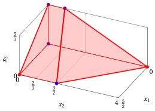{ .fig .ovale loading=lazy style="width:76%" }

    An optimal solution ${ \tilde{\boldsymbol x}}(\, LP \,)$   is:

    $$
    \tilde{x}_1=\dfrac{5}{2},~~
    \tilde{x}_2=\dfrac{3}{2},~~
    \tilde{x}_3=0
    $$

    the optimal value $z(\, LP \,)$ is $\dfrac{21}{2}.$

    In violet the first, the second and the third vertex explored by the previous execution of the  algorithm (before reaching the optimal one depicted in blue).

    ??? codice "SageMath Code: 3D Polyhedra (sagecell.sagemath.org/)"

        ```python
        # Define the polyhedron using inequalities (Hyperplane Representation)
        p = Polyhedron(ieqs=[
            (4, -1, -1, -2),   # (-1, -1, -2) x + 4 >= 0    
            (5, -2,  0, -3),   # (-2,  0, -3) x + 5 >= 0    
            (7, -2, -1, -3),   # (-2, -1, -3) x + 7 >= 0    
            (0,  1,  0,  0),   # (1, 0, 0) x + 0 >= 0       
            (0,  0,  1,  0),   # (0, 1, 0) x + 0 >= 0       
            (0,  0,  0,  1)    # (0, 0, 1) x + 0 >= 0   
        ])

        # Display the inequalities of the polyhedron
        p.Hrepresentation()

        # Display the extreme points and extreme rays of the polyhedron
        p.Vrepresentation()

        # Plot the polyhedron (3D)
        p.plot()
        ```

<a id="esercizio-6-20"></a>

!!! esercizio "Exercise 6.20: Simplex algorithm (P43)"

    Consider the following LP problem in canonical maximization form with $n=3$ variables and $m=2$ constraints:

    $$
    \begin{array}{rrrrrrrrrrrrr}
    {\max} & {x_1} & {+} & 2 \, {x_2} & {+} & 7 \, {x_3} \\[2ex]
    \text{subject to} & {x_1} &  &  & {+} & 2 \, {x_3} & {\le} & {2} \\[2ex]
    &  &  & {x_2} & {+} & 2 \, {x_3} & {\le} & {2} \\[2ex]
    & {x_1,} &  & {x_2,} &  & {x_3} & { \ge} & {0}
    \end{array}
    $$

    By introducing the slack variables, we get the following starting dictionary:

    \begin{equation*}
    \begin{cases}
    \begin{array}{rrrrrrrrrrrrr}
    {x_4=2} & {-} & \, {x_1} &  &  & {-} & 2\, {x_3} \\[2ex]
    {x_5=2} &  &  & {-} & \, {x_2} & {-} & 2\, {x_3} \\[2ex]
    {z=0} & {+} & \, {x_1} & {+} & 2\, {x_2} & {+} & 7\, {x_3}
    \end{array}
    \end{cases}
    \end{equation*}

    The associated feasible  solution is:

    $$
    \bar x_1=0,~~
    \bar x_2=0,~~
    \bar x_3=0,~~
    \bar x_4=2,~~
    \bar x_5=2
    ~~~\text{of value   } 0
    $$

    **Questions**

    - Execute the simplex algorithm to find an optimal solution of this LP problem.

??? soluzione "Solution"

    - <span style="color:#e03131"><strong>Initialization</strong></span>

        Consider the starting dictionary:

        \begin{equation*}
        \begin{cases}
        \begin{array}{rrrrrrrrrrrrr}
        {x_4=2} & {-} & \, {x_1} &  &  & {-} & 2\, {x_3} \\[2ex]
        {x_5=2} &  &  & {-} & \, {x_2} & {-} & 2\, {x_3} \\[2ex]
        {z=0} & {+} & \, {x_1} & {+} & 2\, {x_2} & {+} & 7\, {x_3}
        \end{array}
        \end{cases}
        \end{equation*}

        where $\pazocal{B}=\{4,5\}$ and $\pazocal{N}=\{1,2,3\}$. The basic feasible solution is:

        $$
        \bar x_4=2,~~
        \bar x_5=2,~~~~
        \bar x_1=0,~~
        \bar x_2=0,~~
        \bar x_3=0~~
        ~~~\text{of value   } 0
        $$

    - <span style="color:#e03131"><strong>Iteration 1</strong></span>

        If we increase the value of the variable $x_1$, we can get a better solution. We have:

        $$
        \begin{cases}
        x_4 &= 2 -  x_1
        \end{cases}
        \qquad
        \qquad
        \begin{cases}
        \underbrace{ 2 -  x_1 \ge 0}_{x_4 \ge 0}
        \end{cases}
        \qquad
        \qquad
        \begin{cases}
        x_1 &\le  2
        \end{cases}
        $$

        By increasing the value of $x_1$ to $2$,  the value of $x_4$ decreases to 0.

        Then, we have that:

        - $x_1$ becomes basic and accordingly $x_4$ becomes non-basic

        We have:

        $$
        x_4 = 2 - x_1 - 2\; x_3 \text{    then     } x_1= 2 -2\: x_3 - x_4.
        $$

        Substituting in the other equations of the dictionary, we get:

        $$
        z =  \left( 2 -2\: x_3 - x_4 \right) + 2\:x_2 +7\; x_3
        = 2 + 2\:x_2 +5\:x_3 - x_4
        $$

        Accordingly, we now have the following dictionary:

        \begin{equation*}
        \begin{cases}
        \begin{array}{rrrrrrrrrrrrr}
        {x_1=2} &  &  &  &  & {-} & 2\, {x_3} & {-} & \, {x_4} \\[2ex]
        {x_5=2} &  &  & {-} & \, {x_2} & {-} & 2\, {x_3} &  &  \\[2ex]
        {z=2} &  &  & {+} & 2\, {x_2} & {+} & 5\, {x_3} & {-} & \, {x_4}
        \end{array}
        \end{cases}
        \end{equation*}

        where $\pazocal{B}=\{1,5\}$ and $\pazocal{N}=\{2,3,4\}$. The basic feasible solution is:

        $$
        \bar x_1=2,~~
        \bar x_5=2,~~~~
        \bar x_2=0,~~
        \bar x_3=0,~~
        \bar x_4=0~~
        \text{  of value   }2
        $$

    - <span style="color:#e03131"><strong>Iteration 2</strong></span>

        If we increase the value of the variable $x_2$, we can get a better solution. We have:

        $$
        \begin{cases}
        x_5 &= 2 -  x_2
        \end{cases}
        \qquad
        \qquad
        \begin{cases}
        \underbrace{ 2 -  x_2 \ge 0}_{x_5 \ge 0}
        \end{cases}
        \qquad
        \qquad
        \begin{cases}
        x_2 &\le  2
        \end{cases}
        $$

        By increasing the value of $x_2$ to $2$,  the value of $x_5$ decreases to 0.

        Then, we have that:

        - $x_2$ becomes basic and accordingly $x_5$ becomes non-basic

        We have:

        $$
        x_5 = 2 - x_2 - 2\; x_3 \text{    then     } x_2= 2 -2\: x_3 - x_5.
        $$

        Substituting in the other equations of the dictionary, we get:

        $$
        z = 2 +2\left(2 -2\:x_3 - x_5 \right) +5\:x_3 - x_4
        = 6 + x_3 - x_4 -2\:x_5
        $$

        Accordingly, we now have the following dictionary:

        \begin{equation*}
        \begin{cases}
        \begin{array}{rrrrrrrrrrrrr}
        {x_1=2} &  &  & {-} & 2\, {x_3} & {-} & \, {x_4} &  &  \\[2ex]
        {x_2=2} &  &  & {-} & 2\, {x_3} &  &  & {-} & \, {x_5} \\[2ex]
        {z=6} &  &  & {+} & \, {x_3} & {-} & \, {x_4} & {-} & 2\, {x_5}
        \end{array}
        \end{cases}
        \end{equation*}

        where $\pazocal{B}=\{1,2\}$ and $\pazocal{N}=\{3,4,5\}$. The basic feasible solution is:

        $$
        \bar x_1=2,~~
        \bar x_2=2,~~~~
        \bar x_3=0,~~
        \bar x_4=0,~~
        \bar x_5=0~~
        \text{  of value   }6
        $$

    - <span style="color:#e03131"><strong>Iteration 3</strong></span>

        If we increase the value of the variable $x_3$, we can get a better solution. We have:

        $$
        \begin{cases}
        x_1 &= 2 - 2\: x_3 \\[2ex]
        x_2 &= 2 - 2\: x_3
        \end{cases}
        \qquad
        \qquad
        \begin{cases}
        \underbrace{ 2 - 2\: x_3 \ge 0}_{x_1 \ge 0} \\[2ex]
        \underbrace{ 2 - 2\: x_3 \ge 0}_{x_2 \ge 0}
        \end{cases}
        \qquad
        \qquad
        \begin{cases}
        x_3 &\le  1 \\[2ex]
        x_3 &\le 1
        \end{cases}
        $$

        By increasing the value of $x_3$ to $1$,  the value of both $x_1$ and $x_2$ decreases to 0. We choose $x_1$ as the leaving variable.

        Then, we have that:

        - $x_3$ becomes basic and accordingly $x_1$ becomes non-basic

        We have:

        $$
        x_1 = 2 - 2\: x_3 - x_4 \text{    then     } x_3= 1 -\dfrac{1}{2}\:x_1 -\dfrac{1}{2}\:x_4.
        $$

        Substituting in the other equations of the dictionary, we get:

        $$
        x_2 = 2 -2\left(1 -\dfrac{1}{2}\:x_1 -\dfrac{1}{2}\:x_4 \right) - x_5
        = x_1 + x_4 - x_5
        $$

        $$
        z = 6 + \left(1 -\dfrac{1}{2}\:x_1 -\dfrac{1}{2}\:x_4 \right) -x_4 -2\:x_5
        = 7 -\dfrac{1}{2}\:x_1 -\dfrac{3}{2}\:x_4 -2\:x_5
        $$

        Accordingly, we obtained an optimal solution (no further improvement is possible) and this is an optimal dictionary:

        \begin{equation*}
        \begin{cases}
        \begin{array}{rrrrrrrrrrrrr}
        {x_2=0} & {+} & \, {x_1} & {+} & \, {x_4} & {-} & \, {x_5} \\[2ex]
        {x_3=1} & {-} & {\dfrac{1}{2}}\, {x_1} & {-} & {\dfrac{1}{2}}\, {x_4} &  &  \\[2ex]
        {z=7} & {-} & {\dfrac{1}{2}}\, {x_1} & {-} & {\dfrac{3}{2}}\, {x_4} & {-} & 2\, {x_5}
        \end{array}
        \end{cases}
        \end{equation*}

        where $\pazocal{B}=\{2,3\}$ and $\pazocal{N}=\{1,4,5\}$. The basic optimal solution is:

        $$
        \tilde{x}_1=0,~~
        \tilde{x}_2=0,~~
        \tilde{x}_3=1,~~~~~
        \tilde{x}_4=0,~~
        \tilde{x}_5=0
        ~~~\text{of value   } 7
        $$

    <strong>Graphical solution:</strong>

    The feasible region of  the LP problem (in canonical form) is the polyhedron shaded in red: 

    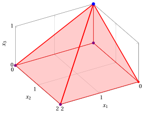{ .fig .ovale loading=lazy style="width:71%" }

    An optimal solution ${ \tilde{\boldsymbol x}}(\, LP \,)$   is:

    $$
    \tilde{x}_1=0,~~\tilde{x}_2=0,~~\tilde{x}_3=1
    $$

    the optimal value $z(\, LP \,)$ is $7.$

    In violet the first, the second and the third vertex explored by the previous execution of the simplex algorithm (before reaching the optimal one depicted in blue).

    ??? codice "SageMath Code: 3D Polyhedra (sagecell.sagemath.org/)"

        ```python
        # Define the polyhedron using inequalities (Hyperplane Representation)
        p = Polyhedron(ieqs=[
            (2, -1,  0, -2),   # (-1, 0, -2) x + 2 >= 0
            (2,  0, -1, -2),   # (0, -1, -2) x + 2 >= 0
            (0,  1,  0,  0),   # (1, 0, 0) x + 0 >= 0
            (0,  0,  1,  0),   # (0, 1, 0) x + 0 >= 0
            (0,  0,  0,  1)    # (0, 0, 1) x + 0 >= 0
        ])

        # Display the inequalities of the polyhedron
        p.Hrepresentation()

        # Display the extreme points and extreme rays of the polyhedron
        p.Vrepresentation()

        # Plot the polyhedron (3D)
        p.plot()
        ```

<a id="esercizio-6-21"></a>

!!! esercizio "Exercise 6.21: Simplex algorithm (P44)"

    Consider the following LP problem in canonical maximization form with $n=3$ variables and $m=3$ constraints:

    $$
    \begin{array}{rrrrrrrrrrrrr}
    {\max} & {x_1} & {+} & 2 \, {x_2} & {+} & 3 \, {x_3} \\[2ex]
    \text{subject to} & {x_1} & {+} & 2 \, {x_2} & {-} & 2 \, {x_3} & {\le} & {1} \\[2ex]
    & 2 \, {x_1} & {-} & {x_2} & {-} & 3 \, {x_3} & {\le} & {4} \\[2ex]
    & {x_1} & {+} & 2 \, {x_2} & {+} & 5 \, {x_3} & {\le} & {2} \\[2ex]
    & {x_1,} &  & {x_2,} &  & {x_3} & { \ge} & {0}
    \end{array}
    $$

    By introducing the slack variables, we get the following starting dictionary:

    \begin{equation*}
    \begin{cases}
    \begin{array}{rrrrrrrrrrrrr}
    {x_4=1} & {-} & \, {x_1} & {-} & 2\, {x_2} & {+} & 2\, {x_3} \\[2ex]
    {x_5=4} & {-} & 2\, {x_1} & {+} & \, {x_2} & {+} & 3\, {x_3} \\[2ex]
    {x_6=2} & {-} & \, {x_1} & {-} & 2\, {x_2} & {-} & 5\, {x_3} \\[2ex]
    {z=0} & {+} & \, {x_1} & {+} & 2\, {x_2} & {+} & 3\, {x_3}
    \end{array}
    \end{cases}
    \end{equation*}

    The associated feasible  solution is:

    $$
    \bar x_1=0,~~
    \bar x_2=0,~~
    \bar x_3=0,~~
    \bar x_4=1,~~
    \bar x_5=4,~~
    \bar x_6=2
    ~~~\text{of value   } 0
    $$

    **Questions**

    - Execute the simplex algorithm to find an optimal solution of this LP problem.

??? soluzione "Solution"

    - <span style="color:#e03131"><strong>Initialization</strong></span>

        Consider the starting dictionary:

        \begin{equation*}
        \begin{cases}
        \begin{array}{rrrrrrrrrrrrr}
        {x_4=1} & {-} & \, {x_1} & {-} & 2\, {x_2} & {+} & 2\, {x_3} \\[2ex]
        {x_5=4} & {-} & 2\, {x_1} & {+} & \, {x_2} & {+} & 3\, {x_3} \\[2ex]
        {x_6=2} & {-} & \, {x_1} & {-} & 2\, {x_2} & {-} & 5\, {x_3} \\[2ex]
        {z=0} & {+} & \, {x_1} & {+} & 2\, {x_2} & {+} & 3\, {x_3}
        \end{array}
        \end{cases}
        \end{equation*}

        where $\pazocal{B}=\{4,5,6\}$ and $\pazocal{N}=\{1,2,3\}$. The basic feasible solution is:

        $$
        \bar x_4=1,~~
        \bar x_5=4,~~
        \bar x_6=2,~~~~
        \bar x_1=0,~~
        \bar x_2=0,~~
        \bar x_3=0~~
        ~~~\text{of value   } 0
        $$

    - <span style="color:#e03131"><strong>Iteration 1</strong></span>

        If we increase the value of the variable $x_1$, we can get a better solution. We have:

        $$
        \begin{cases}
        x_4 &= 1 -  x_1 \\[2ex]
        x_5 &= 4 - 2\: x_1 \\[2ex]
        x_6 &= 2 -  x_1
        \end{cases}
        \qquad
        \qquad
        \begin{cases}
        \underbrace{ 1 -  x_1 \ge 0}_{x_4 \ge 0} \\[2ex]
        \underbrace{ 4 - 2\: x_1 \ge 0}_{x_5 \ge 0} \\[2ex]
        \underbrace{ 2 -  x_1 \ge 0}_{x_6 \ge 0}
        \end{cases}
        \qquad
        \qquad
        \begin{cases}
        x_1 &\le  1 \\[2ex]
        x_1 &\le  2 \\[2ex]
        x_1 &\le  2
        \end{cases}
        $$

        By increasing the value of $x_1$ to $1$,  the value of $x_4$ decreases to 0.

        Then, we have that:

        - $x_1$ becomes basic and accordingly $x_4$ becomes non-basic

        We have:

        $$
        x_4 = 1 - x_1 -2\:x_2 +2\:x_3 \text{    then     } x_1= 1 -2\:x_2 +2\:x_3 - x_4.
        $$

        Substituting in the other equations of the dictionary, we get:

        $$
        x_5 = 4 -2\left(1 -2\:x_2 +2\:x_3 - x_4 \right) +x_2+3\:x_3
        = 2 +5\:x_2 -x_3 +2\:x_4
        $$

        $$
        x_6 = 2 - \left(1 -2\:x_2 +2\:x_3 - x_4 \right) -2\:x_2 -5\:x_3
        = 1 -7\:x_3 +x_4
        $$

        $$
        z =  \left(1 -2\:x_2 +2\:x_3 - x_4 \right) +2\:x_2 +3\:x_3
        = 1 +5\:x_3 -x_4
        $$

        Accordingly, we now have the following dictionary:

        \begin{equation*}
        \begin{cases}
        \begin{array}{rrrrrrrrrrrrr}
        {x_1=1} & {-} & 2\, {x_2} & {+} & 2\, {x_3} & {-} & \, {x_4} \\[2ex]
        {x_5=2} & {+} & 5\, {x_2} & {-} & \, {x_3} & {+} & 2\, {x_4} \\[2ex]
        {x_6=1} &  &  & {-} & 7\, {x_3} & {+} & \, {x_4} \\[2ex]
        {z=1} &  &  & {+} & 5\, {x_3} & {-} & \, {x_4}
        \end{array}
        \end{cases}
        \end{equation*}

        where $\pazocal{B}=\{1,5,6\}$ and $\pazocal{N}=\{2,3,4\}$. The basic feasible solution is:

        $$
        \bar x_1=1,~~
        \bar x_5=2,~~
        \bar x_6=1,~~~~
        \bar x_2=0,~~
        \bar x_3=0,~~
        \bar x_4=0~~
        \text{  of value   }1
        $$

    - <span style="color:#e03131"><strong>Iteration 2</strong></span>

        If we increase the value of the variable $x_3$, we can get a better solution. We have:

        $$
        \begin{cases}
        x_1 &= 1 + 2\:x_3 \\[2ex]
        x_5 &= 2 - x_3 \\[2ex]
        x_6 &= 1 - 7\:x_3
        \end{cases}
        \qquad
        \qquad
        \begin{cases}
        \overbrace{ 1 + 2\:x_3 \ge 0}^{x_1 \ge 0} \\[2ex]
        \underbrace{ 2 - x_3 \ge 0}_{x_5 \ge 0} \\[2ex]
        \underbrace{ 1 - 7\:x_3 \ge 0}_{x_6 \ge 0}
        \end{cases}
        \qquad
        \qquad
        \begin{cases}
        x_3 &\ge  -\dfrac{1}{2} \\[2ex]
        x_3 &\le  2 \\[2ex]
        x_3 &\le  \dfrac{1}{7}
        \end{cases}
        $$

        By increasing the value of $x_3$ to $\dfrac{1}{7}$,  the value of $x_6$ decreases to 0.

        Then, we have that:

        - $x_3$ becomes basic and accordingly $x_6$ becomes non-basic

        We have:

        $$
        x_6 = 1 -7\:x_3 +x_4 \text{    then     } x_3= \dfrac{1}{7} +\dfrac{1}{7}\:x_4 -\dfrac{1}{7}\:x_6.
        $$

        Substituting in the other equations of the dictionary, we get:

        $$
        x_1 = 1 -2\:x_2 +2\left(\dfrac{1}{7} +\dfrac{1}{7}\:x_4 -\dfrac{1}{7}\:x_6 \right) -x_4
        = \dfrac{9}{7} -2\:x_2 -\dfrac{5}{7}\:x_4 -\dfrac{2}{7}\:x_6
        $$

        $$
        x_5 = 2 +5\:x_2 -\left(\dfrac{1}{7} +\dfrac{1}{7}\:x_4 -\dfrac{1}{7}\:x_6 \right) +2\:x_4
        = \dfrac{13}{7} +5\:x_2 +\dfrac{13}{7}\:x_4 +\dfrac{1}{7}\:x_6
        $$

        $$
        z = 1 +5\left(\dfrac{1}{7} +\dfrac{1}{7}\:x_4 -\dfrac{1}{7}\:x_6 \right) -x_4
        = \dfrac{12}{7} -\dfrac{2}{7}\:x_4 -\dfrac{5}{7}\:x_6
        $$

        Accordingly, we obtained an optimal solution (no further improvement is possible) and this is an optimal dictionary:

        \begin{equation*}
        \begin{cases}
        \begin{array}{rrrrrrrrrrrrr}
        {x_1=\dfrac{9}{7}} & {-} & 2\, {x_2} & {-} & {\dfrac{5}{7}}\, {x_4} & {-} & {\dfrac{2}{7}}\, {x_6} \\[2ex]
        {x_3=\dfrac{1}{7}} &  &  & {+} & {\dfrac{1}{7}}\, {x_4} & {-} & {\dfrac{1}{7}}\, {x_6} \\[2ex]
        {x_5=\dfrac{13}{7}} & {+} & 5\, {x_2} & {+} & {\dfrac{13}{7}}\, {x_4} & {+} & {\dfrac{1}{7}}\, {x_6} \\[2ex]
        {z=\dfrac{12}{7}} &  &  & {-} & {\dfrac{2}{7}}\, {x_4} & {-} & {\dfrac{5}{7}}\, {x_6}
        \end{array}
        \end{cases}
        \end{equation*}

        where $\pazocal{B}=\{1,3,5\}$ and $\pazocal{N}=\{2,4,6\}$. The basic optimal solution is:

        $$
        \tilde{x}_1=\dfrac{9}{7},~~
        \tilde{x}_2=0,~~
        \tilde{x}_3=\dfrac{1}{7},~~~~~
        \tilde{x}_4=0,~~
        \tilde{x}_5=\dfrac{13}{7},~~
        \tilde{x}_6=0
        ~~~\text{of value   } \dfrac{12}{7}
        $$

    - <span style="color:#e03131"><strong>Multiple optimal solutions</strong></span>

        In the optimal dictionary the non-basic variable $x_2$ has reduced cost $\bar c_2 = 0$. Accordingly, increasing the value of $x_2$ does not change the value of $z$. We have:

        $$
        x_1 = \dfrac{9}{7} - 2\: x_2
        \qquad
        \qquad
        \underbrace{ \dfrac{9}{7} - 2\: x_2 \ge 0}_{x_1 \ge 0}
        \qquad
        \qquad
        x_2 \le \dfrac{9}{14}
        $$

        ($x_3=\tfrac{1}{7}$ does not change and $x_5$ increases). By increasing the value of $x_2$ to $\tfrac{9}{14}$, the value of $x_1$ decreases to 0 and we obtain the vertex

        $$
        \tilde{x}_1=0,~~
        \tilde{x}_2=\dfrac{9}{14},~~
        \tilde{x}_3=\dfrac{1}{7}
        ~~~\text{of value   } \dfrac{12}{7}
        $$

        which is optimal as well. Then, the optimal solution is <strong>not unique</strong>: every point of the edge joining $\left(\dfrac{9}{7},0,\dfrac{1}{7}\right)$ and $\left(0,\dfrac{9}{14},\dfrac{1}{7}\right)$ is optimal, of value $\dfrac{12}{7}$.

    <strong>Graphical solution:</strong>

    The feasible region of  the LP problem (in canonical form) is the polyhedron shaded in red: 

    { .fig .ovale loading=lazy style="width:71%" }

    An optimal solution ${ \tilde{\boldsymbol x}}(\, LP \,)$   is:

    $$
    \tilde{x}_1=\dfrac{9}{7},~~\tilde{x}_2=0,~~\tilde{x}_3=\dfrac{1}{7}
    $$

    the optimal value $z(\, LP \,)$ is $\dfrac{12}{7}.$

    In violet the first and the second vertex explored by the previous execution of the simplex algorithm (before reaching the optimal one depicted in blue).

    ??? codice "SageMath Code: 3D Polyhedra (sagecell.sagemath.org/)"

        ```python
        # Define the polyhedron using inequalities (Hyperplane Representation)
        p = Polyhedron(ieqs=[
            (1, -1, -2,  2),   # 1 - x1 - 2*x2 + 2*x3 >= 0
            (4, -2,  1,  3),   # 4 - 2*x1 + x2 + 3*x3 >= 0
            (2, -1, -2, -5),   # 2 - x1 - 2*x2 - 5*x3 >= 0
            (0,  1,  0,  0),   # x1 >= 0
            (0,  0,  1,  0),   # x2 >= 0
            (0,  0,  0,  1)    # x3 >= 0
        ])

        # Display the inequalities of the polyhedron
        p.Hrepresentation()

        # Display the extreme points and extreme rays of the polyhedron
        p.Vrepresentation()

        # Plot the polyhedron (3D)
        p.plot()
        ```

<a id="esercizio-6-22"></a>

!!! esercizio "Exercise 6.22: Simplex algorithm (P45)"

    Consider the following LP problem in canonical maximization form with $n=3$ variables and $m=2$ constraints:

    $$
    \begin{array}{rrrrrrrrrrrrr}
    {\max} & {4} \, {x_1} & {-} & {13} \, {x_2} & {+} & {7} \, {x_3} \\[2ex]
    \text{subject to} & {3} \, {x_1} & {+} & {2} \, {x_2} & {+} & {5} \, {x_3} & {\le} & {5} \\[2ex]
    & {x_1} & {-} & {3} \, {x_2} & {+} & {5} \, {x_3} & {\le} & {3} \\[2ex]
    & {x_1,} &  & {x_2,} &  & {x_3} & { \ge} & {0}
    \end{array}
    $$

    By introducing the slack variables, we get the following starting dictionary:

    \begin{equation*}
    \begin{cases}
    \begin{array}{rrrrrrrrrrrrr}
    {x_4=5} & {-} & 3\, {x_1} & {-} & 2\, {x_2} & {-} & 5\, {x_3} \\[2ex]
    {x_5=3} & {-} & \, {x_1} & {+} & 3\, {x_2} & {-} & 5\, {x_3} \\[2ex]
    {z=0} & {+} & 4\, {x_1} & {-} & 13\, {x_2} & {+} & 7\, {x_3}
    \end{array}
    \end{cases}
    \end{equation*}

    The associated feasible  solution is:

    $$
    \bar x_1=0,~~
    \bar x_2=0,~~
    \bar x_3=0,~~
    \bar x_4=5,~~
    \bar x_5=3
    ~~~\text{of value   } 0
    $$

    **Questions**

    - Execute the simplex algorithm to find an optimal solution of this LP problem.

??? soluzione "Solution"

    - <span style="color:#e03131"><strong>Initialization</strong></span>

        Consider the starting dictionary:

        \begin{equation*}
        \begin{cases}
        \begin{array}{rrrrrrrrrrrrr}
        {x_4=5} & {-} & 3\, {x_1} & {-} & 2\, {x_2} & {-} & 5\, {x_3} \\[2ex]
        {x_5=3} & {-} & \, {x_1} & {+} & 3\, {x_2} & {-} & 5\, {x_3} \\[2ex]
        {z=0} & {+} & 4\, {x_1} & {-} & 13\, {x_2} & {+} & 7\, {x_3}
        \end{array}
        \end{cases}
        \end{equation*}

        where $\pazocal{B}=\{4,5\}$ and $\pazocal{N}=\{1,2,3\}$. The basic feasible solution is:

        $$
        \bar x_4=5,~~
        \bar x_5=3,~~~~
        \bar x_1=0,~~
        \bar x_2=0,~~
        \bar x_3=0~~
        ~~~\text{of value   } 0
        $$

    - <span style="color:#e03131"><strong>Iteration 1</strong></span>

        If we increase the value of the variable $x_1$, we can get a better solution. We have:

        $$
        \begin{cases}
        x_4 &= 5 - 3\: x_1 \\[2ex]
        x_5 &= 3 - x_1
        \end{cases}
        \qquad
        \qquad
        \begin{cases}
        \underbrace{ 5 - 3\: x_1 \ge 0}_{x_4 \ge 0} \\[2ex]
        \underbrace{ 3 - x_1 \ge 0}_{x_5 \ge 0}
        \end{cases}
        \qquad
        \qquad
        \begin{cases}
        x_1 &\le  \dfrac{5}{3} \\[2ex]
        x_1 &\le  3
        \end{cases}
        $$

        By increasing the value of $x_1$ to $\dfrac{5}{3}$,  the value of $x_4$ decreases to 0.

        Then, we have that:

        - $x_1$ becomes basic and accordingly $x_4$ becomes non-basic

        We have:

        $$
        x_4 = 5 -3\:x_1 -2\:x_2 -5\:x_3 \text{    then     } x_1= \dfrac{5}{3} -\dfrac{2}{3}\:x_2 -\dfrac{5}{3}\:x_3 -\dfrac{1}{3}\:x_4.
        $$

        Substituting in the other equations of the dictionary, we get:

        $$
        x_5 = 3 -\left(\dfrac{5}{3} -\dfrac{2}{3}\:x_2 -\dfrac{5}{3}\:x_3 -\dfrac{1}{3}\:x_4 \right)+3\:x_2 -5\:x_3
        = \dfrac{4}{3}+\dfrac{11}{3}\:x_2-\dfrac{10}{3}\:x_3+\dfrac{1}{3}\:x_4
        $$

        $$
        z = 4\left(\dfrac{5}{3} -\dfrac{2}{3}\:x_2 -\dfrac{5}{3}\:x_3 -\dfrac{1}{3}\:x_4 \right)-13\:x_2+7\:x_3
        = \dfrac{20}{3}-\dfrac{47}{3}\:x_2+\dfrac{1}{3}\:x_3-\dfrac{4}{3}\:x_4
        $$

        Accordingly, we now have the following dictionary:

        \begin{equation*}
        \begin{cases}
        \begin{array}{rrrrrrrrrrrrr}
        {x_1=\dfrac{5}{3}} & {-} & {\dfrac{2}{3}}\, {x_2} & {-} & {\dfrac{5}{3}}\, {x_3} & {-} & {\dfrac{1}{3}}\, {x_4} \\[2ex]
        {x_5=\dfrac{4}{3}} & {+} & {\dfrac{11}{3}}\, {x_2} & {-} & {\dfrac{10}{3}}\, {x_3} & {+} & {\dfrac{1}{3}}\, {x_4} \\[2ex]
        {z=\dfrac{20}{3}} & {-} & {\dfrac{47}{3}}\, {x_2} & {+} & {\dfrac{1}{3}}\, {x_3} & {-} & {\dfrac{4}{3}}\, {x_4}
        \end{array}
        \end{cases}
        \end{equation*}

        where $\pazocal{B}=\{1,5\}$ and $\pazocal{N}=\{2,3,4\}$. The basic feasible solution is:

        $$
        \bar x_1=\dfrac{5}{3},~~
        \bar x_5=\dfrac{4}{3},~~~~
        \bar x_2=0,~~
        \bar x_3=0,~~
        \bar x_4=0~~
        \text{  of value   }\dfrac{20}{3}
        $$

    - <span style="color:#e03131"><strong>Iteration 2</strong></span>

        If we increase the value of the variable $x_3$, we can get a better solution. We have:

        $$
        \begin{cases}
        x_1 &= \dfrac{5}{3} - \dfrac{5}{3}\:x_3 \\[2ex]
        x_5 &= \dfrac{4}{3} - \dfrac{10}{3}\:x_3
        \end{cases}
        \qquad
        \qquad
        \begin{cases}
        \underbrace{ \dfrac{5}{3} - \dfrac{5}{3}\:x_3 \ge 0}_{x_1 \ge 0} \\[2ex]
        \underbrace{ \dfrac{4}{3} - \dfrac{10}{3}\:x_3 \ge 0}_{x_5 \ge 0}
        \end{cases}
        \qquad
        \qquad
        \begin{cases}
        x_3 &\le  1 \\[2ex]
        x_3 &\le  \dfrac{2}{5}
        \end{cases}
        $$

        By increasing the value of $x_3$ to $\dfrac{2}{5}$,  the value of $x_5$ decreases to 0.

        Then, we have that:

        - $x_3$ becomes basic and accordingly $x_5$ becomes non-basic

        We have:

        $$
        x_5 = \dfrac{4}{3}+\dfrac{11}{3}\:x_2-\dfrac{10}{3}\:x_3+\dfrac{1}{3}\:x_4 \text{    then     } x_3= \dfrac{2}{5}+\dfrac{11}{10}\:x_2+\dfrac{1}{10}\:x_4-\dfrac{3}{10}\:x_5.
        $$

        Substituting in the other equations of the dictionary, we get:

        $$
        x_1 = \dfrac{5}{3}-\dfrac{2}{3}\:x_2-\dfrac{5}{3}\left(\dfrac{2}{5}+\dfrac{11}{10}\:x_2+\dfrac{1}{10}\:x_4-\dfrac{3}{10}\:x_5 \right)-\dfrac{1}{3}\:x_4
        = 1-\dfrac{5}{2}\:x_2-\dfrac{1}{2}\:x_4+\dfrac{1}{2}\:x_5
        $$

        $$
        z = \dfrac{20}{3}-\dfrac{47}{3}\:x_2+\dfrac{1}{3}\left(\dfrac{2}{5}+\dfrac{11}{10}\:x_2+\dfrac{1}{10}\:x_4-\dfrac{3}{10}\:x_5 \right)-\dfrac{4}{3}\:x_4
        = \dfrac{34}{5}-\dfrac{153}{10}\:x_2-\dfrac{13}{10}\:x_4-\dfrac{1}{10}\:x_5
        $$

        Accordingly, we obtained an optimal solution (no further improvement is possible) and this is an optimal dictionary:

        \begin{equation*}
        \begin{cases}
        \begin{array}{rrrrrrrrrrrrr}
        {x_1=1} & {-} & {\dfrac{5}{2}}\, {x_2} & {-} & {\dfrac{1}{2}}\, {x_4} & {+} & {\dfrac{1}{2}}\, {x_5} \\[2ex]
        {x_3=\dfrac{2}{5}} & {+} & {\dfrac{11}{10}}\, {x_2} & {+} & {\dfrac{1}{10}}\, {x_4} & {-} & {\dfrac{3}{10}}\, {x_5} \\[2ex]
        {z=\dfrac{34}{5}} & {-} & {\dfrac{153}{10}}\, {x_2} & {-} & {\dfrac{13}{10}}\, {x_4} & {-} & {\dfrac{1}{10}}\, {x_5}
        \end{array}
        \end{cases}
        \end{equation*}

        where $\pazocal{B}=\{1,3\}$ and $\pazocal{N}=\{2,4,5\}$. The basic optimal solution is:

        $$
        \tilde{x}_1=1,~~
        \tilde{x}_2=0,~~
        \tilde{x}_3=\dfrac{2}{5},~~~~~
        \tilde{x}_4=0,~~
        \tilde{x}_5=0
        ~~~\text{of value   } \dfrac{34}{5}
        $$

    <strong>Graphical solution:</strong>

    The feasible region of  the LP problem (in canonical form) is the polyhedron shaded in red: 

    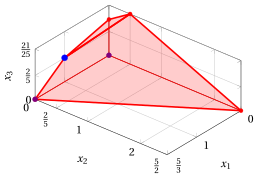{ .fig .ovale loading=lazy style="width:71%" }

    An optimal solution ${ \tilde{\boldsymbol x}}(\, LP \,)$   is:

    $$
    \tilde{x}_1=1,~~\tilde{x}_2=0,~~\tilde{x}_3=\dfrac{2}{5}
    $$

    the optimal value $z(\, LP \,)$ is $\dfrac{34}{5}.$

    In violet the first and the second vertex explored by the previous execution of the simplex algorithm (before reaching the optimal one depicted in blue).

    ??? codice "SageMath Code: 3D Polyhedra (sagecell.sagemath.org/)"

        ```python
        # Define the polyhedron using inequalities (Hyperplane Representation)
        p = Polyhedron(ieqs=[
            (5, -3, -2, -5),   # 5 - 3*x1 - 2*x2 - 5*x3 >= 0
            (3, -1,  3, -5),   # 3 - x1 + 3*x2 - 5*x3 >= 0
            (0,  1,  0,  0),   # x1 >= 0
            (0,  0,  1,  0),   # x2 >= 0
            (0,  0,  0,  1)    # x3 >= 0
        ])

        # Display the inequalities of the polyhedron
        p.Hrepresentation()

        # Display the extreme points and extreme rays of the polyhedron
        p.Vrepresentation()

        # Plot the polyhedron (3D)
        p.plot()
        ```

<a id="esercizio-6-23"></a>

!!! esercizio "Exercise 6.23: Simplex algorithm (P46)"

    Consider the following LP problem in canonical maximization form with $n=3$ variables and $m=3$ constraints:

    $$
    \begin{array}{rrrrrrrrrrrrr}
    {\max} & {5} \, {x_1} & {+} & {6} \, {x_2} & {+} & {10} \, {x_3} \\[2ex]
    \text{subject to} & {9} \, {x_1} & {+} & {2} \, {x_2} & {+} & {2} \, {x_3} & {\le} & {11} \\[2ex]
    & {2} \, {x_1} & {+} & {6} \, {x_2} & {+} & {6} \, {x_3} & {\le} & {16} \\[2ex]
    & {4} \, {x_1} & {+} & {2} \, {x_2} & {+} & {7} \, {x_3} & {\le} & {10} \\[2ex]
    & {x_1,} &  & {x_2,} &  & {x_3} & { \ge} & {0}
    \end{array}
    $$

    By introducing the slack variables, we get the following starting dictionary:

    \begin{equation*}
    \begin{cases}
    \begin{array}{rrrrrrrrrrrrr}
    {x_4=11} & {-} & 9\, {x_1} & {-} & 2\, {x_2} & {-} & 2\, {x_3} \\[2ex]
    {x_5=16} & {-} & 2\, {x_1} & {-} & 6\, {x_2} & {-} & 6\, {x_3} \\[2ex]
    {x_6=10} & {-} & 4\, {x_1} & {-} & 2\, {x_2} & {-} & 7\, {x_3} \\[2ex]
    {z=0} & {+} & 5\, {x_1} & {+} & 6\, {x_2} & {+} & 10\, {x_3}
    \end{array}
    \end{cases}
    \end{equation*}

    The associated feasible  solution is:

    $$
    \bar x_1=0,~~
    \bar x_2=0,~~
    \bar x_3=0,~~
    \bar x_4=11,~~
    \bar x_5=16,~~
    \bar x_6=10
    ~~~\text{of value   } 0
    $$

    **Questions**

    - Execute the simplex algorithm to find an optimal solution of this LP problem.

??? soluzione "Solution"

    - <span style="color:#e03131"><strong>Initialization</strong></span>

        Consider the starting dictionary:

        \begin{equation*}
        \begin{cases}
        \begin{array}{rrrrrrrrrrrrr}
        {x_4=11} & {-} & 9\, {x_1} & {-} & 2\, {x_2} & {-} & 2\, {x_3} \\[2ex]
        {x_5=16} & {-} & 2\, {x_1} & {-} & 6\, {x_2} & {-} & 6\, {x_3} \\[2ex]
        {x_6=10} & {-} & 4\, {x_1} & {-} & 2\, {x_2} & {-} & 7\, {x_3} \\[2ex]
        {z=0} & {+} & 5\, {x_1} & {+} & 6\, {x_2} & {+} & 10\, {x_3}
        \end{array}
        \end{cases}
        \end{equation*}

        where $\pazocal{B}=\{4,5,6\}$ and $\pazocal{N}=\{1,2,3\}$. The basic feasible solution is:

        $$
        \bar x_4=11,~~
        \bar x_5=16,~~
        \bar x_6=10,~~~~
        \bar x_1=0,~~
        \bar x_2=0,~~
        \bar x_3=0~~
        ~~~\text{of value   } 0
        $$

    - <span style="color:#e03131"><strong>Iteration 1</strong></span>

        If we increase the value of the variable $x_1$, we can get a better solution. We have:

        $$
        \begin{cases}
        x_4 &= 11 - 9\: x_1 \\[2ex]
        x_5 &= 16 - 2\: x_1 \\[2ex]
        x_6 &= 10 - 4\: x_1
        \end{cases}
        \qquad
        \qquad
        \begin{cases}
        \underbrace{ 11 - 9\: x_1 \ge 0}_{x_4 \ge 0} \\[2ex]
        \underbrace{ 16 - 2\: x_1 \ge 0}_{x_5 \ge 0} \\[2ex]
        \underbrace{ 10 - 4\: x_1 \ge 0}_{x_6 \ge 0}
        \end{cases}
        \qquad
        \qquad
        \begin{cases}
        x_1 &\le  \dfrac{11}{9} \\[2ex]
        x_1 &\le  8 \\[2ex]
        x_1 &\le  \dfrac{5}{2}
        \end{cases}
        $$

        By increasing the value of $x_1$ to $\dfrac{11}{9}$,  the value of $x_4$ decreases to 0.

        Then, we have that:

        - $x_1$ becomes basic and accordingly $x_4$ becomes non-basic

        We have:

        $$
        x_4 = 11 -9\:x_1 -2\:x_2 -2\:x_3 \text{    then     } x_1= \dfrac{11}{9} -\dfrac{2}{9}\:x_2 -\dfrac{2}{9}\:x_3 -\dfrac{1}{9}\:x_4.
        $$

        Substituting in the other equations of the dictionary, we get:

        $$
        x_5 = 16 -2\left(\dfrac{11}{9} -\dfrac{2}{9}\:x_2 -\dfrac{2}{9}\:x_3 -\dfrac{1}{9}\:x_4 \right)-6\:x_2-6\:x_3
        = \dfrac{122}{9}-\dfrac{50}{9}\:x_2-\dfrac{50}{9}\:x_3+\dfrac{2}{9}\:x_4
        $$

        $$
        x_6 = 10 -4\left(\dfrac{11}{9} -\dfrac{2}{9}\:x_2 -\dfrac{2}{9}\:x_3 -\dfrac{1}{9}\:x_4 \right)-2\:x_2-7\:x_3
        = \dfrac{46}{9}-\dfrac{10}{9}\:x_2-\dfrac{55}{9}\:x_3+\dfrac{4}{9}\:x_4
        $$

        $$
        z = 5\left(\dfrac{11}{9} -\dfrac{2}{9}\:x_2 -\dfrac{2}{9}\:x_3 -\dfrac{1}{9}\:x_4 \right)+6\:x_2+10\:x_3
        = \dfrac{55}{9}+\dfrac{44}{9}\:x_2+\dfrac{80}{9}\:x_3-\dfrac{5}{9}\:x_4
        $$

        Accordingly, we now have the following dictionary:

        \begin{equation*}
        \begin{cases}
        \begin{array}{rrrrrrrrrrrrr}
        {x_1=\dfrac{11}{9}} & {-} & {\dfrac{2}{9}}\, {x_2} & {-} & {\dfrac{2}{9}}\, {x_3} & {-} & {\dfrac{1}{9}}\, {x_4} \\[2ex]
        {x_5=\dfrac{122}{9}} & {-} & {\dfrac{50}{9}}\, {x_2} & {-} & {\dfrac{50}{9}}\, {x_3} & {+} & {\dfrac{2}{9}}\, {x_4} \\[2ex]
        {x_6=\dfrac{46}{9}} & {-} & {\dfrac{10}{9}}\, {x_2} & {-} & {\dfrac{55}{9}}\, {x_3} & {+} & {\dfrac{4}{9}}\, {x_4} \\[2ex]
        {z=\dfrac{55}{9}} & {+} & {\dfrac{44}{9}}\, {x_2} & {+} & {\dfrac{80}{9}}\, {x_3} & {-} & {\dfrac{5}{9}}\, {x_4}
        \end{array}
        \end{cases}
        \end{equation*}

        where $\pazocal{B}=\{1,5,6\}$ and $\pazocal{N}=\{2,3,4\}$. The basic feasible solution is:

        $$
        \bar x_1=\dfrac{11}{9},~~
        \bar x_5=\dfrac{122}{9},~~
        \bar x_6=\dfrac{46}{9},~~~~
        \bar x_2=0,~~
        \bar x_3=0,~~
        \bar x_4=0~~
        \text{  of value   }\dfrac{55}{9}
        $$

    - <span style="color:#e03131"><strong>Iteration 2</strong></span>

        If we increase the value of the variable $x_2$, we can get a better solution. We have:

        $$
        \begin{cases}
        x_1 &= \dfrac{11}{9} - \dfrac{2}{9}\:x_2 \\[2ex]
        x_5 &= \dfrac{122}{9} - \dfrac{50}{9}\:x_2 \\[2ex]
        x_6 &= \dfrac{46}{9} - \dfrac{10}{9}\:x_2
        \end{cases}
        \qquad
        \qquad
        \begin{cases}
        \underbrace{ \dfrac{11}{9} - \dfrac{2}{9}\:x_2 \ge 0}_{x_1 \ge 0} \\[2ex]
        \underbrace{ \dfrac{122}{9} - \dfrac{50}{9}\:x_2 \ge 0}_{x_5 \ge 0} \\[2ex]
        \underbrace{ \dfrac{46}{9} - \dfrac{10}{9}\:x_2 \ge 0}_{x_6 \ge 0}
        \end{cases}
        \qquad
        \qquad
        \begin{cases}
        x_2 &\le  \dfrac{11}{2} \\[2ex]
        x_2 &\le  \dfrac{61}{25} \\[2ex]
        x_2 &\le  \dfrac{23}{5}
        \end{cases}
        $$

        By increasing the value of $x_2$ to $\dfrac{61}{25}$,  the value of $x_5$ decreases to 0.

        Then, we have that:

        - $x_2$ becomes basic and accordingly $x_5$ becomes non-basic

        We have:

        $$
        x_5 = \dfrac{122}{9}-\dfrac{50}{9}\:x_2-\dfrac{50}{9}\:x_3+\dfrac{2}{9}\:x_4 \text{    then     } x_2= \dfrac{61}{25}-x_3+\dfrac{1}{25}\:x_4-\dfrac{9}{50}\:x_5.
        $$

        Substituting in the other equations of the dictionary, we get:

        $$
        x_1 = \dfrac{11}{9}-\dfrac{2}{9}\left(\dfrac{61}{25}-x_3+\dfrac{1}{25}\:x_4-\dfrac{9}{50}\:x_5\right)-\dfrac{2}{9}\:x_3-\dfrac{1}{9}\:x_4
        = \dfrac{17}{25}-\dfrac{3}{25}\:x_4+\dfrac{1}{25}\:x_5
        $$

        $$
        x_6 = \dfrac{46}{9}-\dfrac{10}{9}\left(\dfrac{61}{25}-x_3+\dfrac{1}{25}\:x_4-\dfrac{9}{50}\:x_5\right)-\dfrac{55}{9}\:x_3+\dfrac{4}{9}\:x_4
        = \dfrac{12}{5}-5\:x_3+\dfrac{2}{5}\:x_4+\dfrac{1}{5}\:x_5
        $$

        $$
        z = \dfrac{55}{9}+\dfrac{44}{9}\left(\dfrac{61}{25}-x_3+\dfrac{1}{25}\:x_4-\dfrac{9}{50}\:x_5\right)+\dfrac{80}{9}\:x_3-\dfrac{5}{9}\:x_4
        = \dfrac{451}{25}+4\:x_3-\dfrac{9}{25}\:x_4-\dfrac{22}{25}\:x_5
        $$

        Accordingly, we now have the following dictionary:

        \begin{equation*}
        \begin{cases}
        \begin{array}{rrrrrrrrrrrrr}
        {x_1=\dfrac{17}{25}} &  &  &  &  & {-} & {\dfrac{3}{25}}\, {x_4} & {+} & {\dfrac{1}{25}}\, {x_5} \\[2ex]
        {x_2=\dfrac{61}{25}} &  &  & {-} & \, {x_3} & {+} & {\dfrac{1}{25}}\, {x_4} & {-} & {\dfrac{9}{50}}\, {x_5} \\[2ex]
        {x_6=\dfrac{12}{5}} &  &  & {-} & 5\, {x_3} & {+} & {\dfrac{2}{5}}\, {x_4} & {+} & {\dfrac{1}{5}}\, {x_5} \\[2ex]
        {z=\dfrac{451}{25}} &  &  & {+} & 4\, {x_3} & {-} & {\dfrac{9}{25}}\, {x_4} & {-} & {\dfrac{22}{25}}\, {x_5}
        \end{array}
        \end{cases}
        \end{equation*}

        where $\pazocal{B}=\{1,2,6\}$ and $\pazocal{N}=\{3,4,5\}$. The basic feasible solution is:

        $$
        \bar x_1=\dfrac{17}{25},~~
        \bar x_2=\dfrac{61}{25},~~
        \bar x_6=\dfrac{12}{5},~~~~
        \bar x_3=0,~~
        \bar x_4=0,~~
        \bar x_5=0~~
        \text{  of value   }\dfrac{451}{25}
        $$

    - <span style="color:#e03131"><strong>Iteration 3</strong></span>

        If we increase the value of the variable $x_3$, we can get a better solution. We have:

        $$
        \begin{cases}
        x_2 &= \dfrac{61}{25} - x_3 \\[2ex]
        x_6 &= \dfrac{12}{5} - 5\:x_3
        \end{cases}
        \qquad
        \qquad
        \begin{cases}
        \underbrace{ \dfrac{61}{25} - x_3 \ge 0}_{x_2 \ge 0} \\[2ex]
        \underbrace{ \dfrac{12}{5} - 5\:x_3 \ge 0}_{x_6 \ge 0}
        \end{cases}
        \qquad
        \qquad
        \begin{cases}
        x_3 &\le  \dfrac{61}{25} \\[2ex]
        x_3 &\le  \dfrac{12}{25}
        \end{cases}
        $$

        By increasing the value of $x_3$ to $\dfrac{12}{25}$,  the value of $x_6$ decreases to 0.

        Then, we have that:

        - $x_3$ becomes basic and accordingly $x_6$ becomes non-basic

        We have:

        $$
        x_6 = \dfrac{12}{5}-5\:x_3+\dfrac{2}{5}\:x_4+\dfrac{1}{5}\:x_5 \text{    then     } x_3= \dfrac{12}{25}+\dfrac{2}{25}\:x_4+\dfrac{1}{25}\:x_5-\dfrac{1}{5}\:x_6.
        $$

        Substituting in the other equations of the dictionary, we get:

        $$
        x_2 = \dfrac{61}{25}-\left(\dfrac{12}{25}+\dfrac{2}{25}\:x_4+\dfrac{1}{25}\:x_5-\dfrac{1}{5}\:x_6\right)+\dfrac{1}{25}\:x_4-\dfrac{9}{50}\:x_5
        = \dfrac{49}{25}-\dfrac{1}{25}\:x_4-\dfrac{11}{50}\:x_5+\dfrac{1}{5}\:x_6
        $$

        $$
        z = \dfrac{451}{25}+4\left(\dfrac{12}{25}+\dfrac{2}{25}\:x_4+\dfrac{1}{25}\:x_5-\dfrac{1}{5}\:x_6\right)-\dfrac{9}{25}\:x_4-\dfrac{22}{25}\:x_5
        = \dfrac{499}{25}-\dfrac{1}{25}\:x_4-\dfrac{18}{25}\:x_5-\dfrac{4}{5}\:x_6
        $$

        Accordingly, we obtained an optimal solution (no further improvement is possible) and this is an optimal dictionary:

        \begin{equation*}
        \begin{cases}
        \begin{array}{rrrrrrrrrrrrr}
        {x_1=\dfrac{17}{25}} &  &  & {-} & {\dfrac{3}{25}}\, {x_4} & {+} & {\dfrac{1}{25}}\, {x_5} &  &  \\[2ex]
        {x_2=\dfrac{49}{25}} &  &  & {-} & {\dfrac{1}{25}}\, {x_4} & {-} & {\dfrac{11}{50}}\, {x_5} & {+} & {\dfrac{1}{5}}\, {x_6} \\[2ex]
        {x_3=\dfrac{12}{25}} &  &  & {+} & {\dfrac{2}{25}}\, {x_4} & {+} & {\dfrac{1}{25}}\, {x_5} & {-} & {\dfrac{1}{5}}\, {x_6} \\[2ex]
        {z=\dfrac{499}{25}} &  &  & {-} & {\dfrac{1}{25}}\, {x_4} & {-} & {\dfrac{18}{25}}\, {x_5} & {-} & {\dfrac{4}{5}}\, {x_6}
        \end{array}
        \end{cases}
        \end{equation*}

        where $\pazocal{B}=\{1,2,3\}$ and $\pazocal{N}=\{4,5,6\}$. The basic optimal solution is:

        $$
        \tilde{x}_1=\dfrac{17}{25},~~
        \tilde{x}_2=\dfrac{49}{25},~~
        \tilde{x}_3=\dfrac{12}{25},~~~~~
        \tilde{x}_4=0,~~
        \tilde{x}_5=0,~~
        \tilde{x}_6=0
        ~~~\text{of value   } \dfrac{499}{25}
        $$

    <strong>Graphical solution:</strong>

    The feasible region of  the LP problem (in canonical form) is the polyhedron shaded in red: 

    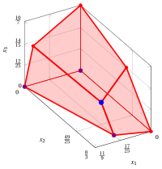{ .fig .ovale loading=lazy style="width:71%" }

    An optimal solution ${ \tilde{\boldsymbol x}}(\, LP \,)$   is:

    $$
    \tilde{x}_1=\dfrac{17}{25},~~\tilde{x}_2=\dfrac{49}{25},~~\tilde{x}_3=\dfrac{12}{25}
    $$

    the optimal value $z(\, LP \,)$ is $\dfrac{499}{25}.$

    In violet the first, the second and the third vertex explored by the previous execution of the simplex algorithm (before reaching the optimal one depicted in blue).

    ??? codice "SageMath Code: 3D Polyhedra (sagecell.sagemath.org/)"

        ```python
        # Define the polyhedron using inequalities (Hyperplane Representation)
        p = Polyhedron(ieqs=[
            (11, -9, -2, -2),   # 11 - 9*x1 - 2*x2 - 2*x3 >= 0
            (16, -2, -6, -6),   # 16 - 2*x1 - 6*x2 - 6*x3 >= 0
            (10, -4, -2, -7),   # 10 - 4*x1 - 2*x2 - 7*x3 >= 0
            (0,   1,  0,  0),   # x1 >= 0
            (0,   0,  1,  0),   # x2 >= 0
            (0,   0,  0,  1)    # x3 >= 0
        ])

        # Display the inequalities of the polyhedron
        p.Hrepresentation()

        # Display the extreme points and extreme rays of the polyhedron
        p.Vrepresentation()

        # Plot the polyhedron (3D)
        p.plot()
        ```
