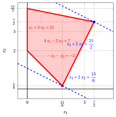

# Exercises · Phase 0 of the simplex algorithm

<div class="info-capitolo" markdown>

**Exercises · Chapter 8** · each solution opens with a click · [:material-book-open-variant: Chapter 8: Phase 0 of the simplex algorithm](../simplex/08-phase-zero.md) · [:material-file-pdf-box: Exercises, volume 2 (PDF)](../pdf/exercises-2-simplex.pdf)

</div>

<a id="esercizio-8-1"></a>

!!! esercizio "Exercise 8.1: Phase zero of the simplex algorithm (P11)"

    Consider the following LP problem in canonical maximization form with $n=2$ variables and $m=2$ constraints:

    $$
    \begin{array}{rrrrrrrrrrrrr}
    {\max} & {-2} \, {x_1} & {-} & {4} \, {x_2} \\[2ex]
    \text{subject to} & {-} \, {x_1} & {-} & \, {x_2} & {\le} & {-2} \\[2ex]
    & \, {x_1} & {-} & \, {x_2} & {\le} & {0} \\[2ex]
    & {x_1,} &  & {x_2} & { \ge} & { 0 }
    \end{array}
    $$

    **Questions**

    1. Execute the  phase zero of the simplex algorithm to obtain a feasible solution and the associated dictionary for the LP problem.

    2. Starting from the obtained dictionary, execute the simplex algorithm  to solve the LP problem.

??? soluzione "Solution"

    1. <strong>First phase of the simplex algorithm</strong>

        We write the auxiliary problem in standard form:

        $$
        \begin{array}{rrrrrrrrrrrrrrr}
        {\max} & {-} & {x_0} &  &  &  &  &  &  &  &  \\[2ex]
        \text{subject to} & {-} & {x_0} & {-} & {x_1} & {-} & {x_2} & {+} & {x_3} &  &  & {=} & {-2} \\[2ex]
        & {-} & {x_0} & {+} & {x_1} & {-} & {x_2} &  &  & {+} & {x_4} & {=} & {0} \\[2ex]
        &  & {x_0,} &  & {x_1,} &  & {x_2,} &  & {x_3,} &  & {x_4} & {\ge} & {0}
        \end{array}
        $$

        and its starting dictionary is:

        \begin{equation*}
        \begin{cases}
        \begin{array}{rrrrrrrrrrrrr}
        {x_3} & {=} & {-2} & {+} & \, {x_0} & {+} & \, {x_1} & {+} & \, {x_2} \\[2ex]
        {x_4} & {=} & {0} & {+} & \, {x_0} & {-} & \, {x_1} & {+} & \, {x_2} \\[2ex]
        {z} & {=} & {0} & {-} & \, {x_0}
        \end{array}
        \end{cases}
        \end{equation*}

        where $\pazocal{B}=\{3,4\}$ and $\pazocal{N}=\{0,1,2\}$. The basic <strong>non-feasible</strong> solution is:

        $$
        \bar x_3=-2,~~
        \bar x_4=0,~~~~~
        \bar x_0=0,~~
        \bar x_1=0,~~
        \bar x_2=0~~
        ~~~\text{of value   } 0
        $$

        - <span style="color:#e03131"><strong>Initialization</strong></span>

            To obtain a feasible  solution of the auxiliary problem we increase the value of $x_0$. We have:

            $$
            \begin{cases}
            x_3 &= -2 +  \:x_0 \\[2ex]
            x_4 &= \:x_0
            \end{cases}
            \qquad
            \qquad
            \begin{cases}
            \underbrace{ -2 + \: x_0 \ge 0}_{x_3 \ge 0} \\[2ex]
            \underbrace{ \: x_0 \ge 0}_{x_4 \ge 0}
            \end{cases}
            \qquad
            \qquad
            \begin{cases}
            x_0 & \ge  2 \\[2ex]
            x_0 & \ge  0
            \end{cases}
            $$

            By increasing the value of $x_0$ to $2$,  the value of $x_3$ increases to 0, so  $x_3$ leaves the basis. 

            We have:

            $$
            x_3 = -2 + x_0 + x_1 + x_2 \text{    then     } x_0= 2  - x_1 - x_2 + x_3
            $$

            Substituting in the other equations of the dictionary, we get:

            $$
            x_4 = \left(2  - x_1 - x_2 + x_3\right) -  \:x_1 + \:x_2 = 2 - 2\: x_1 + x_3
            $$

            $$
            z = - \left(2 - x_1 - x_2 + x_3 \right) = - 2 + x_1 + x_2 - x_3
            $$

            Accordingly, we now have the following dictionary:

            \begin{equation*}
            \begin{cases}
            \begin{array}{rrrrrrrrrrrrr}
            {x_0} & {=} & {2} & {-} & \, {x_1} & {-} & \, {x_2} & {+} & \, {x_3} \\[2ex]
            {x_4} & {=} & {2} & {-} & 2\, {x_1} &  &  & {+} & \, {x_3} \\[2ex]
            {z} & {=} & {-2} & {+} & \, {x_1} & {+} & \, {x_2} & {-} & \, {x_3}
            \end{array}
            \end{cases}
            \end{equation*}

            where $\pazocal{B}=\{0,4\}$ and $\pazocal{N}=\{1,2,3\}$. The basic feasible solution is:

            $$
            \bar x_0=2,~~
            \bar x_4=2,~~~~~
            \bar x_1=0,~~
            \bar x_2=0,~~
            \bar x_3=0~~
            ~~~\text{of value   } -2
            $$

        - <span style="color:#e03131"><strong>Iteration 1</strong></span>

            If we increase the value of the variable $x_1$, we can get a better solution. We have:

            $$
            \begin{cases}
            x_0 &= 2 -  \:x_1 \\[2ex]
            x_4 &= 2 -  2\:x_1
            \end{cases}
            \qquad
            \qquad
            \begin{cases}
            \underbrace{ 2 - \: x_1 \ge 0}_{x_0 \ge 0} \\[2ex]
            \underbrace{ 2 - 2\: x_1 \ge 0}_{x_4 \ge 0}
            \end{cases}
            \qquad
            \qquad
            \begin{cases}
            x_1 & \le  2 \\[2ex]
            x_1 & \le  1
            \end{cases}
            $$

            By increasing the value of $x_1$ to $\min \left\{2, 1\right\}=1$,  the value of $x_4$ decreases to 0.

            Then, we have that:

            - $x_1$ becomes basic and accordingly $x_4$ becomes non-basic

            We have:

            $$
            x_4 = 2 - 2\: x_1 + x_3 \text{    then     } x_1=1 + \dfrac{1}{2}\: x_3 - \dfrac{1}{2}\: x_4.
            $$

            Substituting in the other equations of the dictionary, we get:

            \begin{align*}
            x_0 &= 2 - \left(1 + \dfrac{1}{2} x_3 - \dfrac{1}{2} x_4\right) - x_2 + x_3 = 1 - x_2 + \dfrac{1}{2} x_3 + \dfrac{1}{2} x_4\\
            z &= -2 + \left(1 + \dfrac{1}{2} x_3 - \dfrac{1}{2} x_4\right) + x_2 - x_3 = -1 + x_2 - \dfrac{1}{2} x_3 - \dfrac{1}{2} x_4
            \end{align*}

            Accordingly, we now have the following dictionary:

            \begin{equation*}
            \begin{cases}
            \begin{array}{rrrrrrrrrrrrrr}
            {x_0} & {=} & {1} & {-} & {x_2} & {+} & {\dfrac{1}{2} x_3} & {+} & {\dfrac{1}{2} x_4} \\[2ex]
            {x_1} & {=} & {1} &  &  & {+} & { \dfrac{1}{2} x_3} & {-} & {\dfrac{1}{2} x_4} \\[2ex]
            {z} & {=} & {-1} & {+} & { x_2} & {-} & {\dfrac{1}{2} x_3} & {-} & {\dfrac{1}{2} x_4}
            \end{array}
            \end{cases}
            \end{equation*}

            where $\pazocal{B}=\{0,1\}$ and $\pazocal{N}=\{2,3,4\}$. The basic feasible solution is:

            $$
            \bar x_0=1,~~
            \bar x_1=1,~~~~~
            \bar x_2=0,~~
            \bar x_3=0,~~
            \bar x_4=0
            ~~~\text{of value   } -1
            $$

        - <span style="color:#e03131"><strong>Iteration 2</strong></span>

            If we increase the value of the variable $x_2$, we can get a better solution. We have:

            $$
            \begin{cases}
            x_0 &= 1 -  x_2 \\[2ex]
            x_1 &= 1
            \end{cases}
            \qquad
            \qquad
            \begin{cases}
            \underbrace{ 1 -  x_2 \ge 0}_{x_0 \ge 0} \\[2ex]
            \underbrace{ x_1 = 1 \ge 0}_{x_1 \ge 0}
            \end{cases}
            \qquad
            \qquad
            \begin{cases}
            x_2 & \le  1
            \end{cases}
            $$

            By increasing the value of $x_2$ to $1$,  the value of $x_0$ decreases to 0.

            Then, we have that:

            - $x_2$ becomes basic and accordingly $x_0$ becomes non-basic

            We have:

            $$
            x_0 = 1 - x_2 + \dfrac{1}{2} x_3 + \dfrac{1}{2} x_4 \text{    then     } x_2=1 - x_0 + \dfrac{1}{2} x_3 + \dfrac{1}{2} x_4
            $$

            Substituting in the other equation of the dictionary, we get:

            \begin{align*}
            z &= -1 + \left(1 + \dfrac{1}{2} x_3 + \dfrac{1}{2} x_4 - x_0 \right) - \dfrac{1}{2} x_3 - \dfrac{1}{2} x_4 = - x_0
            \end{align*}

            Accordingly, we obtained an optimal solution of the auxiliary problem (no further improvement is possible) and this is an optimal dictionary:

            \begin{equation*}
            \begin{cases}
            \begin{array}{rrrrrrrrrrrrr}
            {x_1} & {=} & {1} &  &  &  &  & {+} & {\dfrac{1}{2}}\, {x_3} & {-} & {\dfrac{1}{2}}\, {x_4} \\[2ex]
            {x_2} & {=} & {1} & {-} & {x_0} &  &  & {+} & {\dfrac{1}{2}}\, {x_3} & {+} & {\dfrac{1}{2}}\, {x_4} \\[2ex]
            {z} & {=} & {0} & {-} & {x_0} &
            \end{array}
            \end{cases}
            \end{equation*}

            where $\pazocal{B}=\{1,2\}$ and $\pazocal{N}=\{0,3,4\}$. The basic optimal solution is:

            $$
            \tilde{x}_1=1,~~
            \tilde{x}_2=1,~~~~~~
            \tilde{x}_0=0,~~
            \tilde{x}_3=0,~~
            \tilde{x}_4=0
            ~~~\text{of value   } 0
            $$

            !!! nota ""

                Given an optimal dictionary of the auxiliary problem with optimal value zero, we can construct a dictionary of the original LP that corresponds to a feasible solution of the original LP problem.

            By removing the auxiliary variable $x_0$, we  obtain:

            $$
            x_1 = 1 + \dfrac{1}{2} \, x_3 - \dfrac{1}{2} \, x_4
            $$

            $$
            x_2 = 1 + \dfrac{1}{2} \, x_3 + \dfrac{1}{2} \, x_4
            $$

            Substituting in the objective function of the original problem, we can express it as a function of the non-basic variables $x_3$ and $x_4$:

            $$
            z = -2 x_1 - 4 x_2 = -2 \left(1 + \dfrac{1}{2} x_3 - \dfrac{1}{2} x_4 \right) - 4 \left(1 + \dfrac{1}{2} x_3 + \dfrac{1}{2} x_4 \right) = -6 - 3 x_3 - x_4
            $$

            Accordingly, we obtained an optimal solution (no further improvement is possible) and this is an optimal dictionary:

            \begin{equation*}
            \begin{cases}
            \begin{array}{rrrrrrrrrrrrr}
            {x_1 =} & {1} &  &  & {+} & {\dfrac{1}{2}}\, {x_3} & {-} & {\dfrac{1}{2}}\, {x_4} \\[2ex]
            {x_2 =} & {1} &  &  & {+} & {\dfrac{1}{2}}\, {x_3} & {+} & {\dfrac{1}{2}}\, {x_4} \\[2ex]
            {z =} & {-6} &  &  & {-} & {3}\, {x_3} & {-} & {x_4}
            \end{array}
            \end{cases}
            \end{equation*}

            where $\pazocal{B}=\{1,2\}$ and $\pazocal{N}=\{3,4\}$. The basic optimal solution is:

            $$
            \tilde x_1 = 1,~~
            \tilde x_2 = 1,~~
            \tilde x_3 = 0,~~
            \tilde x_4 = 0
            ~~~\text{of value   } -6
            $$

    2. <strong>Second phase of the simplex algorithm</strong>

        An optimal dictionary and an optimal solution of the LP problem  have been determined in the first phase of the simplex algorithm, so the second phase is not executed.

        <strong>Graphical solution:</strong>

        The feasible region of  the LP problem (in canonical form) is the polyhedron shaded in red: 

        { .fig .ovale loading=lazy style="width:65%" }

        An optimal solution  ${\tilde{\boldsymbol x}}(\, LP \,)$ is:

        $$
        \tilde{x}_1=1,~~\tilde{x}_2=1
        $$

        the optimal value $z(\, LP \,)$ is $-6.$

        In blue the optimal vertex obtained by the first phase of the simplex algorithm. In dashed blue, the contour line of the objective function associated with the value taken in the vertex.

<a id="esercizio-8-2"></a>

!!! esercizio "Exercise 8.2: Phase zero of the simplex algorithm (P21)"

    Consider the following LP problem in canonical maximization form with $n=2$ variables and $m=3$ constraints:

    $$
    \begin{array}{rrrrrrrrrrrrr}
    {\max} & \, {x_1} & {+} & {2} \, {x_2} \\[2ex]
    \text{subject to} & {- }\, {x_1} & {-} & \, {x_2} & {\le} & {-2} \\[2ex]
    & {4} \, {x_1} & {-} & {2} \, {x_2} & {\le} & {7} \\[2ex]
    & {x_1} & {+} & {5} \, {x_2} & {\le} & {21} \\[2ex]
    & {x_1,} &  & {x_2} & { \ge} & {0 }
    \end{array}
    $$

    **Questions**

    1. Execute the  phase zero of the simplex algorithm to obtain a feasible solution and the associated dictionary for the LP problem.

    2. Starting from the obtained dictionary, execute the simplex algorithm  to solve the LP problem.

??? soluzione "Solution"

    1. <strong>First phase of the simplex algorithm</strong>

        We write the auxiliary problem in standard form:

        $$
        \begin{array}{rrrrrrrrrrrrrrr}
        {\max} & {-} & {x_0} &  &  &  &  &  &  &  &  \\[2ex]
        \text{subject to} & {-} & {x_0} & {- } & \, {x_1} & {-} & \, {x_2} & {+} & \, {x_3} &  &  &  &  & {=} & {-2} \\[2ex]
        & {-} & {x_0} & {+} & {4} \, {x_1} & {-} & {2} \, {x_2} &  &  & {+} & \, {x_4} &  &  & {=} & {7} \\[2ex]
        & {-} & {x_0} & {+} & {x_1} & {+} & {5} \, {x_2} &  &  &  &  & {+} & \, {x_5} & {=} & {21} \\[2ex]
        &  & {x_0,} &  & {x_1,} &  & {x_2,} &  & {x_3,} &  & {x_4,} &  & \, {x_5} & { \ge} & {0 }
        \end{array}
        $$

        and its starting dictionary is:

        \begin{equation*}
        \begin{cases}
        \begin{array}{rrrrrrrrrrrrr}
        {x_3} & {=} & {-2} & {+} & \, {x_0} & {+} & \, {x_1} & {+} & \, {x_2} \\[2ex]
        {x_4} & {=} & {7} & {+} & \, {x_0} & {-} & 4\, {x_1} & {+} & 2\, {x_2} \\[2ex]
        {x_5} & {=} & {21} & {+} & \, {x_0} & {-} & \, {x_1} & {-} & 5\, {x_2} \\[2ex]
        {z} & {=} & {0} & {-} & \, {x_0} &  &  &  &
        \end{array}
        \end{cases}
        \end{equation*}

        where $\pazocal{B}=\{3,4,5\}$ and $\pazocal{N}=\{0,1,2\}$. The basic <strong>non-feasible</strong> solution is:

        $$
        \bar x_3=-2,~~
        \bar x_4=7,~~
        \bar x_5=21,~~~~
        \bar x_0=0,~~
        \bar x_1=0,~~
        \bar x_2=0~~
        ~~~\text{of value   } 0
        $$

        - <span style="color:#e03131"><strong>Initialization</strong></span>

            To obtain a feasible  solution of the auxiliary problem we increase the value of $x_0$. We have:

            $$
            \begin{cases}
            x_3 &= -2 +  \:x_0 \\[2ex]
            x_4 &= 7  +  \:x_0 \\[2ex]
            x_5 &= 21 +  \:x_0
            \end{cases}
            \qquad
            \qquad
            \begin{cases}
            \underbrace{ -2 + \: x_0 \ge 0}_{x_3 \ge 0} \\[2ex]
            \underbrace{ 7 + \: x_0 \ge 0}_{x_4 \ge 0} \\[2ex]
            \underbrace{ 21 + \: x_0 \ge 0}_{x_5 \ge 0}
            \end{cases}
            \qquad
            \qquad
            \begin{cases}
            x_0 & \ge  2 \\[2ex]
            x_0 & \ge  -7 \\[2ex]
            x_0 & \ge  -21 \\[2ex]
            \end{cases}
            $$

            By increasing the value of $x_0$ to $2$,  the value of $x_3$ increases to 0, so  $x_3$ leaves the basis. 

            We have:

            $$
            x_3 = -2 + x_0 + x_1 + x_2 \text{    then     } x_0= 2  - x_1 - x_2 + x_3
            $$

            Substituting in the other equations of the dictionary, we get:

            $$
            x_4 = 7 + \left(2  - x_1 - x_2 + x_3\right) - 4 \:x_1 + 2\:x_2 = 9 - 5\: x_1 + x_2 +x_3
            $$

            $$
            x_5 = 21 + \left(2 - x_1 - x_2 + x_3 \right) -  \:x_1 - 5 \:x_2 = 23 - 2\: x_1 - 6\: x_2 + x_3
            $$

            $$
            z = - \left(2 - x_1 - x_2 + x_3 \right) = - 2 + x_1 + x_2 - x_3
            $$

            Accordingly, we now have the following dictionary:

            \begin{equation*}
            \begin{cases}
            \begin{array}{rrrrrrrrrrrrr}
            {x_0} & {=} & {2} & {-} & \, {x_1} & {-} & \, {x_2} & {+} & \, {x_3} \\[2ex]
            {x_4} & {=} & {9} & {-} & 5\, {x_1} & {+} & {x_2} & {+} & \, {x_3} \\[2ex]
            {x_5} & {=} & {23} & {-} & 2\, {x_1} & {-} & 6\, {x_2} & {+} & \, {x_3} \\[2ex]
            {z} & {=} & {-2} & {+} & \, {x_1} & {+} & \, {x_2} & {-} & \, {x_3}
            \end{array}
            \end{cases}
            \end{equation*}

            where $\pazocal{B}=\{0,4,5\}$ and $\pazocal{N}=\{1,2,3\}$. The basic feasible solution is:

            $$
            \bar x_0=2,~~
            \bar x_4=9,~~
            \bar x_5=23,~~~~~
            \bar x_1=0,~~
            \bar x_2=0,~~
            \bar x_3=0~~
            ~~~\text{of value   } -2
            $$

        - <span style="color:#e03131"><strong>Iteration 1</strong></span>

            If we increase the value of the variable $x_1$, we can get a better solution. We have:

            $$
            \begin{cases}
            x_0 &= 2 -  \:x_1 \\[2ex]
            x_4 &= 9 -  5\:x_1 \\[2ex]
            x_5 &= 23 -  2\:x_1
            \end{cases}
            \qquad
            \qquad
            \begin{cases}
            \underbrace{ 2 - \: x_1 \ge 0}_{x_0 \ge 0} \\[2ex]
            \underbrace{ 9 - 5\: x_1 \ge 0}_{x_4 \ge 0} \\[2ex]
            \underbrace{ 23 - 2\: x_1 \ge 0}_{x_5 \ge 0}
            \end{cases}
            \qquad
            \qquad
            \begin{cases}
            x_1 & \le  2 \\[2ex]
            x_1 & \le  \dfrac{9}{5} \\[2ex]
            x_1 & \le  \dfrac{23}{2} \\[2ex]
            \end{cases}
            $$

            By increasing the value of $x_1$ to $\min \left\{2,\dfrac{9}{5},\dfrac{23}{2}\right\}=\dfrac{9}{5}$,  the value of $x_4$ decreases to 0.

            Then, we have that:

            - $x_1$ becomes basic and accordingly $x_4$ becomes non-basic

            We have:

            $$
            x_4 = 9 - 5\: x_1 + x_2 +x_3 \text{    then     } x_1= \dfrac{9}{5} + \dfrac{1}{5}\: x_2 + \dfrac{1}{5}\: x_3 - \dfrac{1}{5}\: x_4.
            $$

            Substituting in the other equations of the dictionary, we get:

            $$
            x_0 = 2 - \left(\dfrac{9}{5} + \dfrac{1}{5}\: x_2 + \dfrac{1}{5}\: x_3 - \dfrac{1}{5}\: x_4\right) - \:x_2 + \:x_3 = \dfrac{1}{5} - \dfrac{6}{5} \: x_2 + \dfrac{4}{5} \: x_3 + \dfrac{1}{5} \: x_4
            $$

            $$
            x_5 = 23 - 2\: \left(\dfrac{9}{5} + \dfrac{1}{5}\: x_2 + \dfrac{1}{5}\: x_3 - \dfrac{1}{5}\: x_4 \right) - 6 \:x_2 + \:x_3 =
            \dfrac{97}{5} - \dfrac{32}{5}\: x_2 + \dfrac{3}{5}\: x_3 + \dfrac{2}{5} \: x_4
            $$

            $$
            z = - 2 + \left(\dfrac{9}{5} + \dfrac{1}{5}\: x_2 + \dfrac{1}{5}\: x_3 - \dfrac{1}{5}\: x_4 \right) + x_2 - x_3 = - \dfrac{1}{5} + \dfrac{6}{5} \; x_2 - \dfrac{4}{5} \: x_3 - \dfrac{1}{5}\: x_4
            $$

            Accordingly, we now have the following dictionary:

            \begin{equation*}
            \begin{cases}
            \begin{array}{rrrrrrrrrrrrrr}
            {x_0} & {=} & {\dfrac{1}{5}} & {-} & {\dfrac{6}{5} \: x_2} & {+} & {\dfrac{4}{5} \: x_3} & {+} & {\dfrac{1}{5}\: x_4} \\[2ex]
            {x_1} & {=} & {\dfrac{9}{5}} & {+} & { \dfrac{1}{5}\: x_2} & {+} & { \dfrac{1}{5}\: x_3} & {-} & {\dfrac{1}{5}\: x_4} \\[2ex]
            {x_5} & {=} & {\dfrac{97}{5}} & {-} & {\dfrac{32}{5}\: x_2} & {+} & {\dfrac{3}{5}\: x_3} & {+} & {\dfrac{2}{5} \: x_4} \\[2ex]
            {z} & {=} & {- \dfrac{1}{5} } & {+} & { \dfrac{6}{5} \; x_2} & {-} & {\dfrac{4}{5} \: x_3} & {-} & {\dfrac{1}{5}\: x_4}
            \end{array}
            \end{cases}
            \end{equation*}

            where $\pazocal{B}=\{0,1,5\}$ and $\pazocal{N}=\{2,3,4\}$. The basic feasible solution is:

            $$
            \bar x_0=\dfrac{1}{5},~~
            \bar x_1=\dfrac{9}{5},~~
            \bar x_5=\dfrac{97}{5},~~~~~
            \bar x_2=0,~~
            \bar x_3=0,~~
            \bar x_4=0~~
            ~~~\text{of value   } - \dfrac{1}{5}
            $$

        - <span style="color:#e03131"><strong>Iteration 2</strong></span>

            If we increase the value of the variable $x_2$, we can get a better solution. We have:

            $$
            \begin{cases}
            x_0 &= \dfrac{1}{5} -  \dfrac{6}{5} \:x_2 \\[2ex]
            x_1 &= \dfrac{9}{5} +  \dfrac{1}{5}\:x_2 \\[2ex]
            x_5 &= \dfrac{97}{5} -  \dfrac{32}{5}\:x_2
            \end{cases}
            \qquad
            \qquad
            \begin{cases}
            \underbrace{ \dfrac{1}{5} -  \dfrac{6}{5}\:x_2 \ge 0}_{x_0 \ge 0} \\[2ex]
            \underbrace{\dfrac{9}{5} +  \dfrac{1}{5}\:x_2 \ge 0}_{x_1 \ge 0} \\[2ex]
            \underbrace{\dfrac{97}{5} -  \dfrac{32}{5}\:x_2 \ge 0}_{x_5 \ge 0}
            \end{cases}
            \qquad
            \qquad
            \begin{cases}
            x_2 & \le  \dfrac{1}{6}  \\[2ex]
            x_2 & \ge - 9 \\[2ex]
            x_2 & \le  \dfrac{97}{32} \\[2ex]
            \end{cases}
            $$

            By increasing the value of $x_2$ to $\min \left\{\dfrac{1}{6},\dfrac{97}{32}\right\}=\dfrac{1}{6}$, the value of $x_0$ decreases to 0.

            Then, we have that:

            - $x_2$ becomes basic and accordingly $x_0$ becomes non-basic

            We have:

            $$
            x_0 = \dfrac{1}{5} - \dfrac{6}{5} \: x_2 + \dfrac{4}{5} \: x_3 + \dfrac{1}{5} \: x_4 \text{    then     } x_2= \dfrac{1}{6} - \dfrac{5}{6} \: x_0 + \dfrac{2}{3} \: x_3 + \dfrac{1}{6} \: x_4.
            $$

            Substituting in the other equations of the dictionary, we get:

            $$
            x_1 = \dfrac{9}{5} + \dfrac{1}{5} \: \left(\dfrac{1}{6} - \dfrac{5}{6} \: x_0 + \dfrac{2}{3} \: x_3 + \dfrac{1}{6} \: x_4 \right) + \dfrac{1}{5} \: x_3 - \dfrac{1}{5} \: x_4 = \dfrac{11}{6} - \dfrac{1}{6} \: x_0 + \dfrac{1}{3} \: x_3 - \dfrac{1}{6} \: x_4
            $$

            $$
            x_5 = \dfrac{97}{5} - \dfrac{32}{5}\: \left( \dfrac{1}{6} - \dfrac{5}{6} \: x_0 + \dfrac{2}{3} \: x_3 + \dfrac{1}{6} \: x_4  \right) + \dfrac{3}{5}\: x_3 + \dfrac{2}{5} \: x_4 = \dfrac{55}{3} + \dfrac{16}{3} \: x_0  - \dfrac{11}{3} \: x_3  - \dfrac{2}{3} \: x_4
            $$

            $$
            z = - \dfrac{1}{5} + \dfrac{6}{5} \; \left( \dfrac{1}{6} - \dfrac{5}{6} \: x_0 + \dfrac{2}{3} \: x_3 + \dfrac{1}{6} \: x_4  \right) - \dfrac{4}{5} \: x_3 - \dfrac{1}{5}\: x_4 =- x_0
            $$

            Accordingly, we obtained an optimal solution of the auxiliary problem (no further improvement is possible) and this is an optimal dictionary:

            \begin{equation*}
            \begin{cases}
            \begin{array}{rrrrrrrrrrrrr}
            {x_1=} & {\dfrac{11}{6}} & {-} & {\dfrac{1}{6} \: x_0} & {+} & {\dfrac{1}{3}} \, {x_3} & {-} & {\dfrac{1}{6}}\, {x_4} \\[2ex]
            {x_2=} & {\dfrac{1}{6}} & {-} & {\dfrac{5}{6} \: x_0} & {+} & {\dfrac{2}{3}}\, {x_3} & {+} & {\dfrac{1}{6}}\, {x_4} \\[2ex]
            {x_5=} & {\dfrac{55}{3}} & {+} & {\dfrac{16}{3} \: x_0} & {-} & {\dfrac{11}{3}}\, {x_3} & {-} & {\dfrac{2}{3}}\, {x_4} \\[2ex]
            {z= } & {0} & {-} & {\: x_0} &  &  &  &  &
            \end{array}
            \end{cases}
            \end{equation*}

            where $\pazocal{B}=\{1,2,5\}$ and $\pazocal{N}=\{0,3,4\}$. The basic optimal solution is:

            $$
            \tilde{x}_1=\dfrac{11}{6},~~
            \tilde{x}_2=\dfrac{1}{6},~~
            \tilde{x}_5=\dfrac{55}{3},~~~~
            \tilde{x}_0=0,~~
            \tilde{x}_3=0,~~
            \tilde{x}_4=0~~
            ~~~\text{of value   } 0
            $$

            !!! nota ""

                Given an optimal dictionary of the auxiliary problem with optimal value zero, we can construct a dictionary of the original LP that corresponds to a feasible solution of the original LP problem.

            By removing the auxiliary variable $x_0$, we  obtain:

            $$
            x_1= \dfrac{11}{6}   +  \dfrac{1}{3} \, x_3  -  \dfrac{1}{6}\, x_4
            $$

            $$
            x_2=\dfrac{1}{6}  +  \dfrac{2}{3}\, x_3  +  \dfrac{1}{6}\, x_4
            $$

            $$
            x_5=\dfrac{55}{3}  -  \dfrac{11}{3}\, x_3  -  \dfrac{2}{3}\, x_4
            $$

            Substituting in the objective function of the original problem, we can express it as a function of the non-basic variables $x_3$ and $x_4$:

            $$
            z = x_1 + 2\: x_2 = \dfrac{11}{6}   +  \dfrac{1}{3} \, x_3  -  \dfrac{1}{6}\, x_4 + 2 \left( \:\dfrac{1}{6}  +  \dfrac{2}{3}\, x_3  +  \dfrac{1}{6}\, x_4 \right) = \dfrac{13}{6} + \dfrac{5}{3} \, x_3 + \dfrac{1}{6}\, x_4
            $$

            Accordingly, we have the following dictionary of the original LP problem:

            \begin{equation*}
            \begin{cases}
            \begin{array}{rrrrrrrrrrrrr}
            {x_1=} & {\dfrac{11}{6}} & {+} & {\dfrac{1}{3}} \, {x_3} & {-} & {\dfrac{1}{6}}\, {x_4} \\[2ex]
            {x_2=} & {\dfrac{1}{6}} & {+} & {\dfrac{2}{3}}\, {x_3} & {+} & {\dfrac{1}{6}}\, {x_4} \\[2ex]
            {x_5=} & {\dfrac{55}{3}} & {-} & {\dfrac{11}{3}}\, {x_3} & {-} & {\dfrac{2}{3}}\, {x_4} \\[2ex]
            {z= } & {\dfrac{13}{6}} & {+} & {\dfrac{5}{3}} \, {x_3} & {+} & {\dfrac{1}{6}}\, {x_4}
            \end{array}
            \end{cases}
            \end{equation*}

            where $\pazocal{B}=\{1,2,5\}$ and $\pazocal{N}=\{3,4\}$. The basic feasible solution is:

            $$
            \bar x_1=\dfrac{11}{6},~~
            \bar x_2=\dfrac{1}{6},~~
            \bar x_5=\dfrac{55}{3},~~~~~~~
            \bar x_3=0,~~
            \bar x_4=0
            ~~~\text{of value   } \dfrac{13}{6}
            $$

    2. <strong>Second phase of the simplex algorithm</strong>

        We execute the simplex algorithm for the original LP problem.

        - <span style="color:#e03131"><strong>Initialization</strong></span>

            We start from the dictionary obtained by the first phase of the simplex algorithm.

        - <span style="color:#e03131"><strong>Iteration 1</strong></span>

            If we increase the value of the variable $x_3$, we can get a better solution. We have:

            $$
            \begin{cases}
            x_1 =& \dfrac{11}{6} + \dfrac{1}{3} \, x_3\\[2ex]
            x_2 =& \dfrac{1}{6}  + \dfrac{2}{3} \, x_3 \\[2ex]
            x_5 =& \dfrac{55}{3} - \dfrac{11}{3} \, x_3
            \end{cases}
            \qquad
            \qquad
            \begin{cases}
            \underbrace{ \dfrac{11}{6} + \dfrac{1}{3} \, x_3 \ge 0}_{x_1 \ge 0} \\[2ex]
            \underbrace{  \dfrac{1}{6}  + \dfrac{2}{3} \, x_3 \ge 0}_{x_2 \ge 0} \\[2ex]
            \underbrace{ \dfrac{55}{3} - \dfrac{11}{3} \, x_3 \ge 0}_{x_5 \ge 0}
            \end{cases}
            \qquad
            \qquad
            \begin{cases}
            x_3 &\ge - \dfrac{11}{3} \\[2ex]
            x_3 &\ge  -\dfrac{1}{4} \\[2ex]
            x_3 &\le 5
            \end{cases}
            $$

            By increasing the value of $x_3$ to $5$, the value of $x_5$ decreases to 0.

            Then, we have that:

            - $x_3$ becomes basic and accordingly $x_5$ becomes non-basic

            We have:

            $$
            x_5 = \dfrac{55}{3} - \dfrac{11}{3}\, x_3 - \dfrac{2}{3}\, x_4  \text{    then     } x_3 = 5 - \dfrac{2}{11}\: x_4 -\dfrac{3}{11}\: x_5~ .
            $$

            Substituting in the other equations of the dictionary, we get:

            $$
            x_1 = \dfrac{11}{6} + \dfrac{1}{3} \; \left(5 - \dfrac{2}{11}\: x_4 -\dfrac{3}{11}\: x_5 \right) - \dfrac{1}{6} \:x_4 =  \dfrac{7}{2}  -\dfrac{5}{22}\: x_4 -\dfrac{1}{11}\: x_5
            $$

            $$
            x_2 = \dfrac{1}{6} + \dfrac{2}{3} \; \left(5 - \dfrac{2}{11}\: x_4 -\dfrac{3}{11}\: x_5 \right) + \dfrac{1}{6} \:x_4 =  \dfrac{7}{2}  + \dfrac{1}{22}\: x_4 -\dfrac{2}{11}\: x_5
            $$

            $$
            z = \dfrac{13}{6} + \dfrac{5}{3}\: \; \left(5 - \dfrac{2}{11}\: x_4 -\dfrac{3}{11}\: x_5 \right) + \dfrac{1}{6} \: x_4 = \dfrac{21}{2} - \dfrac{3}{22}\: x_4 -\dfrac{5}{11}\: x_5
            $$

            Accordingly, we obtained an optimal solution (no further improvement is possible) and this is an optimal dictionary:

            \begin{equation*}
            \begin{cases}
            \begin{array}{rrrrrrrrrrrrr}
            {x_1} & {=} & {\dfrac{7}{2}} & {-} & {\dfrac{5}{22}}\, {x_4} & {-} & {\dfrac{1}{11}}\, {x_5} \\[2ex]
            {x_2} & {=} & {\dfrac{7}{2}} & {+} & {\dfrac{1}{22}}\, {x_4} & {-} & {\dfrac{2}{11}}\, {x_5} \\[2ex]
            {x_3} & {=} & {5} & {-} & {\dfrac{2}{11}}\, {x_4} & {-} & {\dfrac{3}{11}}\, {x_5} \\[2ex]
            {z} & {=} & {\dfrac{21}{2}} & {-} & {\dfrac{3}{22}}\, {x_4} & {-} & {\dfrac{5}{11}}\, {x_5}
            \end{array}
            \end{cases}
            \end{equation*}

            where $\pazocal{B}=\{1,2,3\}$ and $\pazocal{N}=\{4,5\}$. The basic optimal solution is:

            $$
            \tilde{x}_1=\dfrac{7}{2},~~
            \tilde{x}_2=\dfrac{7}{2},~~
            \tilde{x}_3=5,~~~~~~
            \tilde{x}_4=0,~~
            \tilde{x}_5=0
            ~~~\text{of value   } \dfrac{21}{2}
            $$

    <strong>Graphical solution:</strong>

    The feasible region of  the LP problem (in canonical form) is the polyhedron shaded in red: 

    { .fig .ovale loading=lazy style="width:65%" }

    An optimal solution  ${\tilde{\boldsymbol x}}(\, LP \,)$ is:

    $$
    \tilde{x}_1=\dfrac{7}{2},~~\tilde{x}_2=\dfrac{7}{2}
    $$

    the optimal value $z(\, LP \,)$ is $\dfrac{21}{2}.$

    In violet the first vertex obtained by the first phase of the simplex algorithm, in blue the optimal one. In dashed blue, the contour lines of the objective function associated with the values taken in the two vertices.

<a id="esercizio-8-3"></a>

!!! esercizio "Exercise 8.3: Phase zero of the simplex algorithm (P22)"

    Consider the following LP problem in canonical maximization form with $n=2$ variables and $m=3$ constraints:

    $$
    \begin{array}{rrrrrrrrrrrrr}
    {\max} & {3\; x_1} & {+} & {x_2} \\[2ex]
    \text{subject to} & {x_1} & {-} & {x_2} & {\le} & {-}1 \\[2ex]
    & {-} \, {x_1} & {-} & \, {x_2} & {\le} & {-}3 \\[2ex]
    & {2\;x_1} & {+} & {x_2} & {\le} & 4 \\[2ex]
    & {x_1,} &  & {x_2} & { \ge} & { 0 }
    \end{array}
    $$

    **Questions**

    1. Execute the  phase zero of the simplex algorithm to obtain a feasible solution and the associated dictionary for the LP problem.

    2. Starting from the obtained dictionary, execute the simplex algorithm  to solve the LP problem.

??? soluzione "Solution"

    1. <strong>First phase of the simplex algorithm</strong>

        We write the auxiliary problem in standard form:

        $$
        \begin{array}{rrrrrrrrrrrrrrr}
        {\max} & {-} & {x_0} &  &  &  &  &  &  &  &  \\[2ex]
        \text{subject to} & {-} & {x_0} & {+} & \, {x_1} & {-} & {x_2} & {+} & \, {x_3} &  &  &  &  & {=} & {-1} \\[2ex]
        & {-} & {x_0} & {-} & \, {x_1} & {-} & {x_2} &  &  & {+} & \, {x_4} &  &  & {=} & {-3} \\[2ex]
        & {-} & {x_0} & {+} & {2}\, {x_1} & {+} & {x_2} &  &  &  &  & {+} & \, {x_5} & {=} & {4} \\[2ex]
        &  & {x_0,} &  & {x_1,} &  & {x_2,} &  & {x_3,} &  & {x_4,} &  & \, {x_5} & { \ge} & {0 }
        \end{array}
        $$

        and its starting dictionary is:

        \begin{equation*}
        \begin{cases}
        \begin{array}{rrrrrrrrrrrrr}
        {x_3} & {=} & {-1} & {+} & \, {x_0} & {-} & \, {x_1} & {+} & \, {x_2} \\[2ex]
        {x_4} & {=} & {-3} & {+} & \, {x_0} & {+} & \, {x_1} & {+} & \, {x_2} \\[2ex]
        {x_5} & {=} & {4} & {+} & \, {x_0} & {-} & 2\, {x_1} & {-} & \, {x_2} \\[2ex]
        {z} & {=} & {0} & {-} & \, {x_0}
        \end{array}
        \end{cases}
        \end{equation*}

        where $\pazocal{B}=\{3,4,5\}$ and $\pazocal{N}=\{0,1,2\}$. The basic <strong>non-feasible</strong> solution is:

        $$
        \bar x_3=-1,~~
        \bar x_4=-3,~~
        \bar x_5=4,~~~~~
        \bar x_0=0,~~
        \bar x_1=0,~~
        \bar x_2=0~~
        ~~~\text{of value   } 0
        $$

        - <span style="color:#e03131"><strong>Initialization</strong></span>

            To obtain a feasible  solution of the auxiliary problem we increase the value of $x_0$. We have:

            $$
            \begin{cases}
            x_3 &= -1 + x_0 \\[2ex]
            x_4 &= -3 + x_0 \\[2ex]
            x_5 &=  4 + x_0
            \end{cases}
            \qquad
            \qquad
            \begin{cases}
            \underbrace{ -1 + x_0 \ge 0}_{x_3 \ge 0} \\[2ex]
            \underbrace{ -3 + x_0 \ge 0}_{x_4 \ge 0} \\[2ex]
            \underbrace{ 4 + x_0 \ge 0}_{x_5 \ge 0}
            \end{cases}
            \qquad
            \qquad
            \begin{cases}
            x_0 \ge 1 \\[2ex]
            x_0 \ge 3 \\[2ex]
            x_0 \ge -4
            \end{cases}
            $$

            By increasing the value of $x_0$ to $3$,  the value of $x_4$ increases to $0$, so $x_4$ leaves the basis.

            We have:

            $$
            x_4 = -3 + x_0 + x_1 + x_2 \text{    then     } x_0 = 3 - x_1 - x_2 + x_4
            $$

            Substituting in the other equations of the dictionary, we get:

            \begin{align*}
            x_3 &= -1 + (3 - x_1 - x_2 + x_4) - x_1 + x_2 = 2 - 2 x_1 + x_4 \\[1ex]
            x_5 &= 4 + (3 - x_1 - x_2 + x_4) - 2 x_1 - x_2 = 7 - 3 x_1 - 2 x_2 + x_4 \\[1ex]
            z &= - (3 - x_1 - x_2 + x_4) = -3 + x_1 + x_2 - x_4
            \end{align*}

            Accordingly, we now have the following dictionary:

            \begin{equation*}
            \begin{cases}
            \begin{array}{rrrrrrrrrrrrr}
            {x_0} & {=} & {3} & {-} & {x_1} & {-} & {x_2} & {+} & {x_4} \\[2ex]
            {x_3} & {=} & {2} & {-} & {2}\, {x_1} &  &  & {+} & {x_4} \\[2ex]
            {x_5} & {=} & {7} & {-} & {3}\, {x_1} & {-} & {2}\, {x_2} & {+} & {x_4} \\[2ex]
            {z} & {=} & {-3} & {+} & {x_1} & {+} & {x_2} & {-} & {x_4}
            \end{array}
            \end{cases}
            \end{equation*}

            where $\pazocal{B}=\{0,3,5\}$ and $\pazocal{N}=\{1,2,4\}$. The basic feasible solution is:

            $$
            \bar x_0 = 3,~~
            \bar x_3 = 2,~~
            \bar x_5 = 7,~~~
            \bar x_1 = 0,~~
            \bar x_2 = 0,~~
            \bar x_4 = 0~~
            \qquad \text{of value} \quad -3
            $$

        - <span style="color:#e03131"><strong>Iteration 1</strong></span>

            If we increase the value of the variable $x_1$, we can get a better solution. We have:

            $$
            \begin{cases}
            x_0 &= 3 - x_1 \\[2ex]
            x_3 &= 2 - 2 x_1 \\[2ex]
            x_5 &= 7 - 3 x_1
            \end{cases}
            \qquad
            \qquad
            \begin{cases}
            \underbrace{ 3 - x_1 \ge 0}_{x_0 \ge 0} \\[2ex]
            \underbrace{ 2 - 2 x_1 \ge 0}_{x_3 \ge 0} \\[2ex]
            \underbrace{  7 - 3 x_1 \ge 0}_{x_5 \ge 0}
            \end{cases}
            \qquad
            \qquad
            \begin{cases}
            x_1 \le 3 \\[2ex]
            x_1 \le 1 \\[2ex]
            x_1 \le \dfrac{7}{3}
            \end{cases}
            $$

            By increasing the value of $x_1$ to $1$, the value of $x_3$ decreases to $0$, so $x_3$ leaves the basis.

            $$
            x_3 = 2 - 2 x_1 + x_4 \text{    then     } x_1 = 1 + \dfrac{1}{2} x_4 - \dfrac{1}{2} x_3
            $$

            Substituting in the other equations of the dictionary, we get:

            \begin{align*}
            x_0 &= 3 - \left(1 + \dfrac{1}{2} x_4 - \dfrac{1}{2} x_3 \right) - x_2 + x_4
            = 2 - x_2 + \dfrac{1}{2} x_3 + \dfrac{1}{2} x_4 \\[1ex]
            x_5 &= 7 - 3\left(1 + \dfrac{1}{2} x_4 - \dfrac{1}{2} x_3 \right) - 2 x_2 + x_4
            = 4 - 2 x_2 + \dfrac{3}{2} x_3 - \dfrac{1}{2} x_4 \\[1ex]
            z &= -3 + \left(1 + \dfrac{1}{2} x_4 - \dfrac{1}{2} x_3 \right) + x_2 - x_4
            = -2 + x_2 - \dfrac{1}{2} x_3 - \dfrac{1}{2} x_4
            \end{align*}

            Accordingly, we now have the following dictionary:

            \begin{equation*}
            \begin{cases}
            \begin{array}{rrrrrrrrrrrrr}
            {x_0} & {=} & {2} & {-} & {x_2} & {+} & {\dfrac{1}{2}}\, {x_3} & {+} & {\dfrac{1}{2}}\, {x_4} \\[2ex]
            {x_1} & {=} & {1} &  &  & {-} & {\dfrac{1}{2}}\, {x_3} & {+} & {\dfrac{1}{2}}\, {x_4} \\[2ex]
            {x_5} & {=} & {4} & {-} & {2}\, {x_2} & {+} & {\dfrac{3}{2}}\, {x_3} & {-} & {\dfrac{1}{2}}\, {x_4} \\[2ex]
            {z} & {=} & {-2} & {+} & {x_2} & {-} & {\dfrac{1}{2}}\, {x_3} & {-} & {\dfrac{1}{2}}\, {x_4}
            \end{array}
            \end{cases}
            \end{equation*}

            where $\pazocal{B}=\{0,1,5\}$ and $\pazocal{N}=\{2,3,4\}$. The basic feasible solution is:

            $$
            \bar x_0 = 2,~~
            \bar x_1 = 1,~~
            \bar x_5 = 4,~~~~
            \bar x_2 = 0,~~
            \bar x_3 = 0,~~
            \bar x_4 = 0~~
            \qquad \text{of value } -2
            $$

        - <span style="color:#e03131"><strong>Iteration 2</strong></span>

            If we increase the value of the variable $x_2$, we can get a better solution. We have:

            $$
            \begin{cases}
            x_0 &= 2 - x_2 \\[2ex]
            x_5 &= 4 - 2 x_2
            \end{cases}
            \qquad
            \qquad
            \begin{cases}
            \underbrace{ 2 - x_2 \ge 0}_{x_0 \ge 0} \\[2ex]
            \underbrace{  4 - 2 x_2 \ge 0}_{x_5 \ge 0}
            \end{cases}
            \qquad
            \qquad
            \begin{cases}
            x_2 \le 2 \\[2ex]
            x_2 \le 2
            \end{cases}
            $$

            By increasing the value of $x_2$ to $\min \left\{2, 2\right\}=2$, the value of both $x_0$ and $x_5$ decreases to $0$. We choose $x_0$ as the leaving variable, so that the auxiliary variable leaves the basis (accordingly, $x_5$ stays basic with value $0$).

            Then, we have that:

            - $x_2$ becomes basic and accordingly $x_0$ becomes non-basic

            We have:

            $$
            x_0 = 2 - x_2 + \dfrac{1}{2} x_3 + \dfrac{1}{2} x_4
            \text{    then     }
            x_2 = 2 - x_0 + \dfrac{1}{2} x_3 + \dfrac{1}{2} x_4
            $$

            Substituting in the other equations of the dictionary, we get:

            \begin{align*}
            x_5 &= 4 - 2 \left(2 - x_0 + \dfrac{1}{2} x_3 + \dfrac{1}{2} x_4 \right)
            + \dfrac{3}{2} x_3 - \dfrac{1}{2} x_4 = 2 x_0 + \dfrac{1}{2} x_3 - \dfrac{3}{2} x_4 \\[1ex]
            z &= -2 + \left(2 - x_0 + \dfrac{1}{2} x_3 + \dfrac{1}{2} x_4 \right)
            - \dfrac{1}{2} x_3 - \dfrac{1}{2} x_4 =  - x_0
            \end{align*}

            Accordingly, we obtained an optimal solution of the auxiliary problem (no further improvement is possible) and this is an optimal dictionary:

            \begin{equation*}
            \begin{cases}
            \begin{array}{rrrrrrrrrrrrr}
            {x_1} & {=} & {1} &  &  & {-} & {\dfrac{1}{2}}\, {x_3} & {+} & {\dfrac{1}{2}}\, {x_4} \\[2ex]
            {x_2} & {=} & {2} & {-} & {x_0} & {+} & {\dfrac{1}{2}}\, {x_3} & {+} & {\dfrac{1}{2}}\, {x_4} \\[2ex]
            {x_5} & {=} & {0} & {+} & {2}\, {x_0} & {+} & {\dfrac{1}{2}}\, {x_3} & {-} & {\dfrac{3}{2}}\, {x_4} \\[2ex]
            {z} & {=} & {0} & {-} & {x_0}
            \end{array}
            \end{cases}
            \end{equation*}

            where $\pazocal{B}=\{1,2,5\}$ and $\pazocal{N}=\{0,3,4\}$. The basic optimal solution is:

            $$
            \tilde{x}_1 = 1, \quad
            \tilde{x}_2 = 2, \quad
            \tilde{x}_5 = 0, \quad~~~~~
            \tilde{x}_0 = 0, \quad
            \tilde{x}_3 = 0, \quad
            \tilde{x}_4 = 0, \quad
            \qquad \text{of value } 0
            $$

            !!! nota ""

                Given an optimal dictionary of the auxiliary problem with optimal value zero, we can construct a dictionary of the original LP that corresponds to a feasible solution of the original LP problem.

            By removing the auxiliary variable $x_0$, while keeping the basic variables $x_1, x_2, x_5$, we obtain:

            \begin{align*}
            x_1 &= 1 - \dfrac{1}{2} x_3 + \dfrac{1}{2} x_4 \\[1ex]
            x_2 &= 2 + \dfrac{1}{2} x_3 + \dfrac{1}{2} x_4 \\[1ex]
            x_5 &=  \dfrac{1}{2} x_3 - \dfrac{3}{2} x_4
            \end{align*}

            Substituting in the objective function of the original problem, we can express it as a function of the non-basic variables $x_3$ and $x_4$:

            \begin{align*}
            z = 3\left(1 - \dfrac{1}{2} x_3 + \dfrac{1}{2} x_4\right) + \left(2 + \dfrac{1}{2} x_3 + \dfrac{1}{2} x_4\right)
            = 5 - x_3 + 2 x_4
            \end{align*}

            Accordingly, we have the following dictionary of the original LP problem:

            \begin{equation*}
            \begin{cases}
            \begin{array}{rrrrrrrrrrrrr}
            {x_1 =} & {1} & {-} & {\dfrac{1}{2}}\, {x_3} & {+} & {\dfrac{1}{2}}\, {x_4} \\[2ex]
            {x_2 =} & {2} & {+} & {\dfrac{1}{2}}\, {x_3} & {+} & {\dfrac{1}{2}}\, {x_4} \\[2ex]
            {x_5 =} & {0} & {+} & {\dfrac{1}{2}}\, {x_3} & {-} & {\dfrac{3}{2}}\, {x_4} \\[2ex]
            {z =} & {5} & {-} & {x_3} & {+} & {2}\, {x_4}
            \end{array}
            \end{cases}
            \end{equation*}

            where $\pazocal{B}=\{1,2,5\}$ and $\pazocal{N}=\{3,4\}$. The basic feasible solution is:

            $$
            \bar x_1 = 1, \quad
            \bar x_2 = 2, \quad
            \bar x_3 = 0, \quad
            \bar x_4 = 0, \quad
            \bar x_5 = 0
            \qquad \text{of value } 5
            $$

    2. <strong>Second phase of the simplex algorithm</strong>

        We execute the simplex algorithm for the original LP problem.

        - <span style="color:#e03131"><strong>Initialization</strong></span>

            We start from the dictionary obtained by the first phase of the simplex algorithm.

        - <span style="color:#e03131"><strong>Iteration 1</strong></span>

            If we increase the value of the variable $x_4$, we can get a better solution. We have:

            $$
            \begin{cases}
            x_1 &= 1 + \dfrac{1}{2}\, x_4 \\[2ex]
            x_2 &= 2 + \dfrac{1}{2}\, x_4 \\[2ex]
            x_5 &= - \dfrac{3}{2}\, x_4
            \end{cases}
            \qquad
            \qquad
            \begin{cases}
            \underbrace{1 + \dfrac{1}{2}\, x_4 \ge 0}_{x_1 \ge 0}\\[2ex]
            \underbrace{2 + \dfrac{1}{2}\, x_4 \ge 0}_{x_2 \ge 0}\\[2ex]
            \underbrace{- \dfrac{3}{2}\, x_4 \ge 0}_{x_5 \ge 0}
            \end{cases}
            \qquad
            \qquad
            \begin{cases}
            x_4 &\ge -2\\[2ex]
            x_4 &\ge -4\\[2ex]
            x_4 &\le 0
            \end{cases}
            $$

            By increasing the value of $x_4$ to $0$ (a <strong>degenerate</strong> pivoting operation, $t_m=0$), the value of $x_5$ remains $0$: the only bound on $x_4$ comes from $x_5 \ge 0$, so $x_5$ leaves the basis.

            Then, we have that:

            - $x_4$ becomes basic and accordingly $x_5$ becomes non-basic

            We have:

            $$
            x_5 = \dfrac{1}{2} x_3 - \dfrac{3}{2} x_4 \text{    then     } x_4 = \dfrac{1}{3} x_3 - \dfrac{2}{3} x_5
            $$

            Substituting in the other equations of the dictionary, we get:

            \begin{align*}
            x_1 &= 1 - \dfrac{1}{2} x_3 + \dfrac{1}{2} \left( \dfrac{1}{3} x_3 - \dfrac{2}{3} x_5 \right)
            = 1 - \dfrac{1}{3} x_3 - \dfrac{1}{3} x_5 \\[1ex]
            x_2 &= 2 + \dfrac{1}{2} x_3 + \dfrac{1}{2} \left( \dfrac{1}{3} x_3 - \dfrac{2}{3} x_5 \right)
            = 2 + \dfrac{2}{3} x_3 - \dfrac{1}{3} x_5 \\[1ex]
            z &= 5 - x_3 + 2 \left( \dfrac{1}{3} x_3 - \dfrac{2}{3} x_5 \right)
            = 5 - \dfrac{1}{3} x_3 - \dfrac{4}{3} x_5
            \end{align*}

            Accordingly, we obtained an optimal solution (no further improvement is possible) and this is an optimal dictionary:

            \begin{equation*}
            \begin{cases}
            \begin{array}{rrrrrrrrrrrrr}
            {x_1} & {=} & {1} & {-} & {\dfrac{1}{3}}\, {x_3} & {-} & {\dfrac{1}{3}}\, {x_5} \\[2ex]
            {x_2} & {=} & {2} & {+} & {\dfrac{2}{3}}\, {x_3} & {-} & {\dfrac{1}{3}}\, {x_5} \\[2ex]
            {x_4} & {=} & {0} & {+} & {\dfrac{1}{3}}\, {x_3} & {-} & {\dfrac{2}{3}}\, {x_5} \\[2ex]
            {z} & {=} & {5} & {-} & {\dfrac{1}{3}}\, {x_3} & {-} & {\dfrac{4}{3}}\, {x_5}
            \end{array}
            \end{cases}
            \end{equation*}

            where $\pazocal{B}=\{1,2,4\}$ and $\pazocal{N}=\{3,5\}$. The basic optimal solution is:

            $$
            \tilde{x}_1 = 1, \quad
            \tilde{x}_2 = 2, \quad
            \tilde{x}_4 = 0,~~~~ \quad
            \tilde{x}_3 = 0, \quad
            \tilde{x}_5 = 0
            \qquad \text{of value } 5
            $$

    <strong>Graphical solution:</strong>

    The feasible region of  the LP problem (in canonical form) is the polyhedron shaded in red: 

    { .fig .ovale loading=lazy style="width:65%" }

    An optimal solution  ${\tilde{\boldsymbol x}}(\, LP \,)$ is:

    $$
    \tilde{x}_1=1,~~\tilde{x}_2=2
    $$

    the optimal value $z(\, LP \,)$ is $5.$

    In blue the optimal vertex obtained by the first phase of the simplex algorithm. In dashed blue, the contour line of the objective function associated with the value taken in the vertex.

<a id="esercizio-8-4"></a>

!!! esercizio "Exercise 8.4: Phase zero of the simplex algorithm (P51)"

    Consider the following LP problem in canonical maximization form with $n=3$ variables and $m=2$ constraints:

    $$
    \begin{array}{rrrrrrrrrrrrrrrr}
    {\max} & {-} & {2\,x_1} & {-} & {\,x_2} &  &  \\[2ex]
    \text{subject to} &  & \, {x_1} & {-} & {x_2} & {-} & 3 \, {x_3} & {\le} & {-} 5 \\[2ex]
    & {-} & 3 \, {x_1} & {-} & 2 \, {x_2} & {+} & 2 \, {x_3} & {\le} & {-}2 \\[2ex]
    &  & {x_1,} &  & {x_2,} &  & {x_3} & { \ge} & { 0 }
    \end{array}
    $$

    **Questions**

    1. Execute the  phase zero of the simplex algorithm to obtain a feasible solution and the associated dictionary for the LP problem.

    2. Starting from the obtained dictionary, execute the simplex algorithm  to solve the LP problem.

??? soluzione "Solution"

    1. <strong>First phase of the simplex algorithm</strong>

        We write the auxiliary problem in standard form:

        $$
        \begin{array}{rrrrrrrrrrrrrrrr}
        {\max} & {-} & {x_0} &  \\[2ex]
        \text{subject to} & {-} & {x_0} & {+} & \, {x_1} & {-} & {x_2} & {-} & 3 \, {x_3} & {+} & \, {x_4} &  &  & {=} & {-}5 \\[2ex]
        & {-} & {x_0} & {-} & 3 \, {x_1} & {-} & 2 \, {x_2} & {+} & 2 \, {x_3} &  &  & {+} & \, {x_5} & {=} & {-}2 \\[2ex]
        &  & {x_0,} &  & {x_1,} &  & {x_2,} &  & {x_3,} &  & {x_4,} &  & {x_5} & { \ge} & { 0 }
        \end{array}
        $$

        and its starting dictionary is:

        \begin{equation*}
        \begin{cases}
        \begin{array}{rrrrrrrrrrrrr}
        {x_4} & = & {-5} & {+} & {x_0} & {-} & {x_1} & {+} & {x_2} & {+} & {3x_3} \\[2ex]
        {x_5} & = & {-2} & {+} & {x_0} & {+} & {3x_1} & {+} & {2x_2} & {-} & {2x_3} \\[2ex]
        {z} & = & {0} & {-} & {x_0}
        \end{array}
        \end{cases}
        \end{equation*}

        where $\pazocal{B}=\{4,5\}$ and $\pazocal{N}=\{0,1,2,3\}$. The basic <strong>non-feasible</strong> solution is:

        $$
        \bar x_4=-5,~~
        \bar x_5=-2~~~~~
        \bar x_0=0,~~
        \bar x_1=0,~~
        \bar x_2=0,~~
        \bar x_3=0~~
        \text{  of value   }0
        $$

        - <span style="color:#e03131"><strong>Initialization</strong></span>

            To obtain a feasible basic solution of the auxiliary problem we increase the value of $x_0$. We have:

            $$
            \begin{cases}
            x_4 =& -5 +  \:x_0 \\[2ex]
            x_5 =& -2 +  \:x_0
            \end{cases}
            \qquad
            \qquad
            \begin{cases}
            \underbrace{ -5 +  \:x_0 \ge 0}_{x_4 \ge 0} \\[2ex]
            \underbrace{ -2 +  \:x_0 \ge 0}_{x_5 \ge 0}
            \end{cases}
            \qquad
            \qquad
            \begin{cases}
            x_0 \ge &  5\\[2ex]
            x_0 \ge &  2
            \end{cases}
            $$

            By increasing the value of $x_0$ to $5$, the value of $x_4$ increases to 0, so  $x_4$ leaves the basis. This variable is the slack variable associated with the largest negative RHS. We have:

            $$
            x_4 = -5 + x_0 - x_1 + x_2 + 3\,x_3 \text{    then     } x_0 = 5 + x_1 - x_2 - 3\,x_3 + x_4
            $$

            Substituting in the other equations of the dictionary, we get:

            $$
            x_5 = -2 + \left( 5 + x_1 - x_2 - 3\,x_3 + x_4 \right) + 3\,x_1 + 2\,x_2 - 2\,x_3 = 3 + 4\,x_1 + x_2 -5 \, x_3 + x_4
            $$

            $$
            z = 0 - \left( 5 + x_1 - x_2 - 3\,x_3 + x_4 \right) = - 5 - x_1 + x_2 + 3\,x_3 - x_4
            $$

            Accordingly, we now have the following dictionary:

            \begin{equation*}
            \begin{cases}
            \begin{array}{rrrrrrrrrrrrr}
            {x_0=} & \, {5} & {+} & \, {x_1} & {-} & \, {x_2} & {-} & 3\, {x_3} & {+} & \, {x_4} \\[2ex]
            {x_5=} & \, {3} & {+} & 4\, {x_1} & {+} & \, {x_2} & {-} & 5\, {x_3} & {+} & \, {x_4} \\[2ex]
            {z=} & {-}\, {5} & {-} & \, {x_1} & {+} & \, {x_2} & {+} & 3\, {x_3} & {-} & \, {x_4}
            \end{array}
            \end{cases}
            \end{equation*}

            where $\pazocal{B}=\{0,5\}$ and $\pazocal{N}=\{1,2,3,4\}$. The basic feasible solution is:

            $$
            \bar x_0=5,~~
            \bar x_5=3,~~~~~~
            \bar x_1=0,~~
            \bar x_2=0,~~
            \bar x_3=0,~~
            \bar x_4=0~~
            \text{  of value   }-5
            $$

        - <span style="color:#e03131"><strong>Iteration 1</strong></span>

            If we increase the value of the variable $x_2$, we can get a better solution. We have:

            $$
            \begin{cases}
            x_0 = & 5 -  \:x_2 \\[2ex]
            x_5 = & 3 +  \:x_2
            \end{cases}
            \qquad
            \qquad
            \begin{cases}
            \underbrace{  5 -  \:x_2 \ge 0}_{x_0 \ge 0} \\[2ex]
            \underbrace{  3 +  \:x_2 \ge 0}_{x_5 \ge 0} \\[2ex]
            \end{cases}
            \qquad
            \qquad
            \begin{cases}
            x_2\le &   5 \\[2ex]
            x_2\ge &  - 3
            \end{cases}
            $$

            By increasing the value of $x_2$ to $5$,  the value of $x_0$ decreases to 0.

            Then, we have that:

            - $x_2$ becomes basic and accordingly $x_0$ becomes non-basic

            We have:

            $$
            x_0 = 5 + x_1 - x_2 - 3\,x_3 + x_4 \text{    then     } x_2 = 5 - x_0 + x_1 - 3\,x_3 + x_4
            $$

            Substituting in the other equations of the dictionary, we get:

            $$
            x_5 = 3 + 4\: x_1 + \left( 5 - x_0 + x_1 - 3\,x_3 + x_4 \right) - 5 \:x_3 + \:x_4 = 8 - x_0 + 5\:x_1 - 8\:x_3 + 2\:x_4
            $$

            $$
            z =- 5 - x_1 + \left( 5 - x_0 + x_1 - 3\,x_3 + x_4 \right) + 3\:x_3 - x_4 = - x_0
            $$

            Accordingly, we obtained an optimal solution of the auxiliary problem (no further improvement is possible) and this is an optimal dictionary:

            \begin{equation*}
            \begin{cases}
            \begin{array}{rrrrrrrrrrrrrr}
            {x_2} & {=} & {5} & {-} & {x_0} & {+} & {x_1} & {-} & {3\: x_3} & {+} & {x_4} \\[2ex]
            {x_5} & {=} & {8} & {-} & {x_0} & {+} & {5 \: x_1} & {-} & {8\: x_3} & {+} & {2\: x_4} \\[2ex]
            {z} & {=} & {0} & {-} & {\: x_0 } &
            \end{array}
            \end{cases}
            \end{equation*}

            where $\pazocal{B}=\{2,5\}$ and $\pazocal{N}=\{0,1,3,4\}$. The basic optimal solution is:

            $$
            \tilde x_2=5,~~
            \tilde x_5=8,~~~~~~
            \tilde x_0=0,~~
            \tilde x_1=0,~~
            \tilde x_3=0,~~
            \tilde x_4=0~~
            \text{  of value   }0
            $$

            !!! nota ""

                Given an optimal dictionary of the auxiliary problem with optimal value zero, we can construct a dictionary of the original LP that corresponds to a feasible solution of the original LP problem.

            By removing the auxiliary variable $x_0$, we obtain:

            \begin{equation*}
            \begin{array}{rrrrrrrrrrrrrr}
            {x_2} & {=} & {5} & {+} & {x_1} & {-} & {3\: x_3} & {+} & {x_4} \\[2ex]
            {x_5} & {=} & {8} & {+} & {5 \: x_1} & {-} & {8\: x_3} & {+} & {2\: x_4}
            \end{array}
            \end{equation*}

            Substituting in the objective function of the original problem, we can express it as a function of the non-basic variables $x_1$, $x_3$ and $x_4$:

            $$
            z= -2\: x_1 - (5 + x_1 - 3\,x_3 + x_4) = - 5 - 3\: x_1 + 3\:x_3 - \:x_4
            $$

            Accordingly, we have the following dictionary of the original LP problem:

            \begin{equation*}
            \begin{cases}
            \begin{array}{rrrrrrrrrrrrrr}
            {x_2} & {=} & {5} & {+} & {x_1} & {-} & {3\: x_3} & {+} & {x_4} \\[2ex]
            {x_5} & {=} & {8} & {+} & {5 \: x_1} & {-} & {8\: x_3} & {+} & {2\: x_4} \\[2ex]
            {z} & {=} & {-5} & {-} & {3 \: x_1} & {+} & {3\: x_3} & {-} & { x_4}
            \end{array}
            \end{cases}
            \end{equation*}

            where $\pazocal{B}=\{2,5\}$ and $\pazocal{N}=\{1,3,4\}$. The basic feasible solution is:

            $$
            \bar x_2=5,~~
            \bar x_5=8,~~~~~
            \bar x_1=0,~~
            \bar x_3=0,~~
            \bar x_4=0~~
            \text{  of value   } -5
            $$

    2. <strong>Second phase of the simplex algorithm</strong>

        We execute the simplex algorithm for the original LP problem.

        - <span style="color:#e03131"><strong>Initialization</strong></span>

            We start from the dictionary obtained by the first phase of the simplex algorithm.

        - <span style="color:#e03131"><strong>Iteration 1</strong></span>

            If we increase the value of the variable $x_3$, we can get a better solution. We have:

            $$
            \begin{cases}
            x_2 =& 5 - 3\,x_3\\[2ex]
            x_5 =& 8 - 8\,x_3
            \end{cases}
            \qquad
            \qquad
            \begin{cases}
            \underbrace{5 - 3\,x_3 \ge 0}_{x_2 \ge 0} \\[2ex]
            \underbrace{8 - 8\,x_3 \ge 0}_{x_5 \ge 0}
            \end{cases}
            \qquad
            \qquad
            \begin{cases}
            x_3 &\le \dfrac{5}{3} \\[2ex]
            x_3 &\le 1
            \end{cases}
            $$

            By increasing the value of $x_3$ to $1$, the value of $x_5$ decreases to $0$.

            Then, we have that:

            - $x_3$ becomes basic and accordingly $x_5$ becomes non-basic

            We have:

            $$
            x_5 = 8 + 5x_1 - 8x_3 + 2x_4
            \text{    then     }
            x_3 = 1 + \dfrac{5}{8}x_1 + \dfrac{1}{4}x_4 - \dfrac{1}{8}x_5
            $$

            Substituting in the other equations of the dictionary, we get:

            \begin{align*}
            x_2 &= 5 + x_1 - 3 \left(1 + \dfrac{5}{8}x_1 + \dfrac{1}{4}x_4 - \dfrac{1}{8}x_5\right) + x_4
            = 2 - \dfrac{7}{8}x_1 + \dfrac{1}{4}x_4 + \dfrac{3}{8}x_5 \\[1ex]
            z   &= -5 - 3x_1 + 3 \left(1 + \dfrac{5}{8}x_1 + \dfrac{1}{4}x_4 - \dfrac{1}{8}x_5 \right) - x_4
            = -2 - \dfrac{9}{8}x_1 - \dfrac{1}{4}x_4 - \dfrac{3}{8}x_5
            \end{align*}

            Accordingly, we obtained an optimal solution (no further improvement is possible) and this is an optimal dictionary:

            \begin{equation*}
            \begin{cases}
            \begin{array}{rrrrrrrrrrrrr}
            {x_2} & {=} & {2} & {-} & {\dfrac{7}{8}}\, {x_1} & {+} & {\dfrac{1}{4}}\, {x_4} & {+} & {\dfrac{3}{8}}\, {x_5} \\[2ex]
            {x_3} & {=} & {1} & {+} & {\dfrac{5}{8}}\, {x_1} & {+} & {\dfrac{1}{4}}\, {x_4} & {-} & {\dfrac{1}{8}}\, {x_5} \\[2ex]
            {z} & {=} & {-2} & {-} & {\dfrac{9}{8}}\, {x_1} & {-} & {\dfrac{1}{4}}\, {x_4} & {-} & {\dfrac{3}{8}}\, {x_5}
            \end{array}
            \end{cases}
            \end{equation*}

            where $\pazocal{B}=\{2,3\}$ and $\pazocal{N}=\{1,4,5\}$. The basic optimal solution is:

            $$
            \tilde x_2=2,~~
            \tilde x_3=1,~~~~~
            \tilde x_1=0,~~
            \tilde x_4=0,~~
            \tilde x_5=0~~
            \text{  of value   } -2
            $$

    <strong>Graphical solution:</strong>

    The feasible region of  the LP problem (in canonical form) is the polyhedron shaded in red: 

    { .fig .ovale loading=lazy style="width:85%" }

    An optimal solution  ${\tilde{\boldsymbol x}}(\, LP \,)$ is:

    $$
    \tilde{x}_1=0,~~\tilde{x}_2=2,~~\tilde{x}_3=1
    $$

    the optimal value $z(\, LP \,)$ is $-2.$

    In violet the first vertex obtained by the first phase of the simplex algorithm, in blue the optimal one.

    ??? codice "SageMath Code: 3D Polyhedra (sagecell.sagemath.org/)"

        ```python
        # Define the polyhedron using inequalities (Hyperplane Representation)
        p = Polyhedron(ieqs=[
            (-5, -1, 1, 3),     # (-1, 1, 3) x - 5 >= 0
            (-2, 3, 2, -2),     # (3, 2, -2) x - 2 >= 0
            (0, 1, 0, 0),       # (1, 0, 0) x + 0 >= 0
            (0, 0, 1, 0),       # (0, 1, 0) x + 0 >= 0
            (0, 0, 0, 1)        # (0, 0, 1) x + 0 >= 0
        ])

        # Display the inequalities of the polyhedron
        p.Hrepresentation()

        # Display the extreme points and extreme rays of the polyhedron
        p.Vrepresentation()

        # Plot the polyhedron (3D)
        p.plot()
        ```
