# Exercises · Duality theory

**Exercises · Chapter 9** · each solution opens with a click · [:material-book-open-variant: Chapter 9: Duality theory](../duality/09-duality.md) · [:material-file-pdf-box: Exercises, volume 3 (PDF)](../pdf/exercises-3-duality.pdf)

## Building the dual

!!! esercizio "Exercise 9.1: Dual problem (P71)"

    Consider the following primal LP problem in canonical maximization form with $n=4$ variables and $m=3$ constraints:

    $$
    \begin{array}{rrrrrrrrrrrrr}
    {\max} & 4 \, {x_1} & {+} & \, {x_2} & {+} & 5 \, {x_3} & {+} & 3 \, {x_4} \\[2ex]
    \text{subject to} & \, {x_1} & {-} & \, {x_2} & {-} & \, {x_3} & {+} & 3 \, {x_4} & {\le} & 1 \\[2ex]
    & 5 \, {x_1} & {+} & \, {x_2} & {+} & 3 \, {x_3} & {+} & 8 \, {x_4} & {\le} & 55 \\[2ex]
    & {-} \, {x_1} & {+} & 2 \, {x_2} & {+} & 3 \, {x_3} & {-} & 5 \, {x_4} & {\le} & 3 \\[2ex]
    & {x_1,} &  & {x_2,} &  & {x_3,} &  & {x_4} & { \ge} & { 0 }
    \end{array}
    $$

    The optimal dictionary of LP problem in standard form is:

    \begin{equation*}
    \begin{cases}
    \begin{array}{rrrrrrrrrrrrr}
    {x_2=14} & {-} & 2\, {x_1} & {-} & 4\, {x_3} & {-} & 5\, {x_5} & {-} & 3\, {x_7} \\[2ex]
    {x_4=5} & {-} & \, {x_1} & {-} & {x_3} & {-} & 2\, {x_5} & {-} & \, {x_7} \\[2ex]
    {x_6=1} & {+} & 5\, {x_1} & {+} & 9\, {x_3} & {+} & 21\, {x_5} & {+} & 11\, {x_7} \\[2ex]
    {z=29} & {-} & \, {x_1} & {-} & 2\, {x_3} & {-} & 11\, {x_5} & {-} & 6\, {x_7}
    \end{array}
    \end{cases}
    \end{equation*}

    **Questions**

    1. Compute lower bounds and upper bounds on the optimal solution value $z(\,\text{LP}\,)$ of the LP problem.

    2. Compute the linear combination of the three constraints using the multipliers $\pi_1$, $\pi_2$ and $\pi_3$. Give the necessary conditions under which the RHS  of the linear combination provides an upper bound for the optimal solution value $z(\,\text{LP}\,)$ of the LP problem.

    3. Write the dual problem of the LP problem. Then, using the optimal dictionary, find an optimal solution of the dual problem.

??? soluzione "Solution"

    1. A lower bound on the optimal solution value is given, for example, by the following feasible solution:

        $$
        \bar x_{1}= 0, ~~~ \bar x_{2}= 1, ~~~ \bar x_{3}= 2, ~~~~ \bar x_{4}= 1  \text{   with value   } 14 \, .
        $$

        Hence, we have $z(\,\text{LP}\,) \ge 14$.

        We can improve the lower bound using, for example, the following feasible solution:

        $$
        \bar x_{1}= 5, ~~~ \bar x_{2}= 4, ~~~ \bar x_{3}= 0, ~~~~ \bar x_{4}= 0  \text{   with value   } 24 \, .
        $$

        Hence, we have $z(\,\text{LP}\,) \ge 24$.

        An upper bound on the optimal solution value can be obtained, for example, multiplying the second constraint by $\frac{5}{3}$:

        $$
        \underbrace{\frac{25}{3} \; x_1 + \frac{5}{3} \; x_2 +5 x_3 +\frac{40}{3} \; x_4}_{\ge 4 \;x_{1}  + x_{2}  + 5 \;x_3 + 3 \;x_4} ~~\le~~ \frac{275}{3}
        $$

        Hence, we have $z(\,\text{LP}\,) \le \frac{275}{3}$.

        We can improve the upper bound using, for example, summing up the second and third constraints:

        $$
        \underbrace{4 \; x_1 + 3\; x_2 +6 \;x_3 +3 \;x_4}_{\ge  4 \; x_{1}  + x_{2}  + 5 \;x_3 + 3\; x_4} ~~\le~~ 58
        $$

        Hence, we have $z(\,\text{LP}\,) \le 58$.

    2. Multiplying each constraint by its multiplier we get:

        $$
        \begin{array}{rrrrrrrrrrrrr}
        ( & \, {x_1} & {-} & \, {x_2} & {-} & \, {x_3} & {+} & 3 \, {x_4} ) \; {\pi_1} & {\le} & 1 \, {\pi_1} \\[2ex]
        ( & 5 \, {x_1} & {+} & \, {x_2} & {+} & 3 \, {x_3} & {+} & 8 \, {x_4} ) \, {\pi_2} & {\le} & 55 \, {\pi_2} \\[2ex]
        ( & {-} \, {x_1} & {+} & 2 \, {x_2} & {+} & 3 \, {x_3} & {-} & 5 \, {x_4} )\; {\pi_3} & {\le} & 3 \, {\pi_3}
        \end{array}
        $$

        The linear combination of the three constraints generates the following inequality:

        \begin{align*}
        (\pi_1 + 5 \pi_2 - \pi_3) \; x_1 + ( - \pi_1 +  \pi_2 + 2 \pi_3) \; x_2 + \\[2ex] +(- \pi_1 +  3 \pi_2 + 3 \pi_3) \; x_3 +( 3 \pi_1 +  8 \pi_2 -5  \pi_3) \; x_4 \le\\[2ex]
        \le \pi_1 + 55 \pi_2 + 3 \pi_3
        \end{align*}

        The RHS $\pi_1 + 55 \pi_2 + 3 \pi_3$ of this inequality is an  upper bound for $z(\,\text{LP}\,)$  if and only if:

        $$
        \begin{array}{rrrrrrrrrrrrr}
        & \, {\pi_1} & {+} & 5 \, {\pi_2} & {-} & \, {\pi_3} & {\ge} & 4 \\[2ex]
        {-} & \, {\pi_1} & {+} & \, {\pi_2} & {+} & 2\, {\pi_3} & {\ge} & 1 \\[2ex]
        {-} & \, {\pi_1} & {+} & 3 \, {\pi_2} & {+} & 3 \, {\pi_3} & {\ge} & 5 \\[2ex]
        & 3 \, {\pi_1} & {+} & 8 \, {\pi_2} & {-} & 5 \, {\pi_3} & {\ge} & 3 \\[2ex]
        & {\pi_1,} &  & {\pi_2,} &  & {\pi_3} & {\ge} & 0
        \end{array}
        $$

    3. The dual problem of the LP problem  with $m=3$ non-negative variables and $n=4$ greater-than-or-equal-to constraints reads as follows:

        $$
        \begin{array}{rrrrrrrrrrrrr}
        {\min} & \, {\pi_1} & {+} & 55 \, {\pi_2} & {+} & 3 \, {\pi_3} \\[2ex]
        \text{subject to} & \, {\pi_1} & {+} & 5 \, {\pi_2} & {-} & \, {\pi_3} & {\ge} & 4 \\[2ex]
        & {-} \, {\pi_1} & {+} & \, {\pi_2} & {+} & 2\, {\pi_3} & {\ge} & 1 \\[2ex]
        & {-}\, {\pi_1} & {+} & 3 \, {\pi_2} & {+} & 3 \, {\pi_3} & {\ge} & 5 \\[2ex]
        & 3 \, {\pi_1} & {+} & 8 \, {\pi_2} & {-} & 5 \, {\pi_3} & {\ge} & 3 \\[2ex]
        & {\pi_1,} &  & {\pi_2,} &  & \, {\pi_3} & { \ge} & { 0 }
        \end{array}
        $$

        An optimal dual solution is given by

        $$
        \tilde{\pi}_i = - \hat{c}_{n+i} ,~~~~ \forall i \in \{1,2,\dots,m\} \text{    where    } \quad \hat{c}_j =
        \begin{cases}
        \bar{c}_j & \text{if  } j \in  \pazocal{N} \\
        0 & \text{otherwise}
        \end{cases}
        $$

        The values $\bar{c}_j$ are the reduced costs of the non-basic variables.

        In the optimal dictionary we have $\pazocal{N}=\{1,3,5,7\}$, accordingly:

        $$
        \hat{c}_5=-11,~~
        \hat{c}_6=0,~~
        \hat{c}_7=-6
        \quad
        \text{  and  }
        \quad
        \tilde{\pi}_1=11,~~
        \tilde{\pi}_2=0,~~
        \tilde{\pi}_3=6
        $$

        is an optimal solution of the dual problem.

## Graphical solution of primal and dual

!!! esercizio "Exercise 9.2: Primal and dual problems (P2)"

    Consider the following primal LP problem in canonical maximization form with $n=2$ variables and $m=2$ constraints:

    $$
    \begin{array}{rrrrrrrrrrrrr}
    {\max} & {x_1} & {+} & 3 \, {x_2} \\[2ex]
    \text{subject to} & {-}4 \, {x_1} & {+} & 10 \, {x_2} & {\le} & 35 \\[2ex]
    & 3 \, {x_1} & {+} & \, {x_2} & {\le} & 12 \\[2ex]
    & {x_1,} &  & {x_2} & { \ge} & { 0 }
    \end{array}
    $$

    and its dual LP problem in canonical minimization form with $m=2$ variables and $n=2$ constraints:

    $$
    \begin{array}{rrrrrrrrrrrrr}
    {\min} & 35 \, {\pi_1} & {+} & 12 \, {\pi_2} \\[2ex]
    \text{subject to} & {-} 4\, {\pi_1} & {+} & 3 \, {\pi_2} & {\ge} & 1 \\[2ex]
    & 10 \, {\pi_1} & {+} & \, {\pi_2} & {\ge} & 3 \\[2ex]
    & {\pi_1,} &  & {\pi_2} & { \ge} & { 0 }
    \end{array}
    $$

    **Questions**

    1. Find graphically an optimal solution of the primal problem and an optimal solution of the dual problem. Compute the optimal values of the two problems.

??? soluzione "Solution"

    - For the primal LP problem, we have:

        { .fig .ovale loading=lazy  }

        An optimal primal LP solution is:

        $$
        \tilde{x}_1=\frac{5}{2},~~\tilde{x}_2=\frac{9}{2}
        \text{     and     }
        z(~LP~) =  \tilde{x}_1 + 3 \; \tilde{x}_2 = \frac{5}{2} + 3 \cdot \frac{9}{2} = 16
        $$

    - For the dual LP problem, we have:

        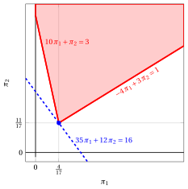{ .fig .ovale loading=lazy  }

        An optimal dual LP solution is:

        $$
        \tilde{\pi}_1=\frac{4}{17},~~\tilde{\pi}_2=\frac{11}{17}
        \text{     and     }
        z(~D(LP)~) = 35\; \tilde{\pi}_1 + 12 \; \tilde{\pi}_2 = 35\cdot \frac{4}{17} + 12 \cdot \frac{11}{17} = 16
        $$

    - The two optimal values coincide, $z(~LP~) = z(~D(LP)~) = 16$, as stated by the Strong Duality theorem.

!!! esercizio "Exercise 9.3: Primal and dual problems (P3)"

    Consider the following primal LP problem in canonical maximization form with $n=2$ variables and $m=2$ constraints:

    $$
    \begin{array}{rrrrrrrrrrrrr}
    {\max} & 2 \, {x_1} & {+} & 4 \, {x_2} \\[2ex]
    \text{subject to} & {-}\, {x_1} & {+} & \, {x_2} & {\le} & 2 \\[2ex]
    & 8 \, {x_1} & {+} & 2 \, {x_2} & {\le} & 19 \\[2ex]
    & {x_1,} &  & {x_2} & { \ge} & { 0 }
    \end{array}
    $$

    and its dual LP problem in canonical minimization form with $m=2$ variables and $n=2$ constraints:

    $$
    \begin{array}{rrrrrrrrrrrrr}
    {\min} & 2 \, {\pi_1} & {+} & 19 \, {\pi_2} \\[2ex]
    \text{subject to} & {-} \, {\pi_1} & {+} & 8 \, {\pi_2} & {\ge} & 2 \\[2ex]
    & \, {\pi_1} & {+} & 2 \, {\pi_2} & {\ge} & 4 \\[2ex]
    & {\pi_1,} &  & {\pi_2} & { \ge} & { 0 }
    \end{array}
    $$

    **Questions**

    1. Find graphically an optimal solution of the primal problem and an optimal solution of the dual problem. Compute the optimal values of the two problems.

??? soluzione "Solution"

    - For the primal LP problem, we have:

        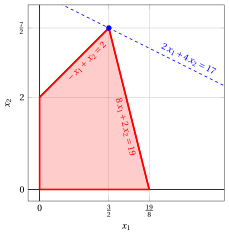{ .fig .ovale loading=lazy  }

        An optimal primal LP solution is:

        $$
        \tilde{x}_1=\frac{3}{2},~~\tilde{x}_2=\frac{7}{2}
        \text{     and     }
        z(~LP~) =  2\; \tilde{x}_1 + 4 \; \tilde{x}_2 = 2\cdot \frac{3}{2} + 4 \cdot \frac{7}{2} = 17
        $$

    - For the dual LP problem, we have:

        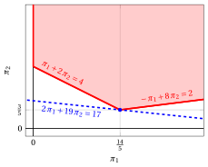{ .fig .ovale loading=lazy  }

        An optimal dual LP solution is:

        $$
        \tilde{\pi}_1=\frac{14}{5},~~\tilde{\pi}_2=\frac{3}{5}
        \text{     and     }
        z(~D(LP)~) =  2\; \tilde{\pi}_1 + 19 \; \tilde{\pi}_2 = 2\cdot \frac{14}{5} + 19 \cdot \frac{3}{5} = 17
        $$

    - The two optimal values coincide, $z(~LP~) = z(~D(LP)~) = 17$, as stated by the Strong Duality theorem.

!!! esercizio "Exercise 9.4: Primal and dual problems (P4)"

    Consider the following primal LP problem in canonical maximization form with $n=2$ variables and $m=2$ constraints:

    $$
    \begin{array}{rrrrrrrrrrrrr}
    {\max} & 5 {x_1} & {+} & 3 \, {x_2} \\[2ex]
    \text{subject to} & 2 \, {x_1} & {+} & \, {x_2} & {\le} & 14 \\[2ex]
    & \, {x_1} & {+} & 8 \, {x_2} & {\le} & 32 \\[2ex]
    & {x_1,} &  & {x_2} & { \ge} & { 0 }
    \end{array}
    $$

    and its dual LP problem in canonical minimization form with $m=2$ variables and $n=2$ constraints:

    $$
    \begin{array}{rrrrrrrrrrrrr}
    {\min} & 14 \, {\pi_1} & {+} & 32 \, {\pi_2} \\[2ex]
    \text{subject to} & 2 \, {\pi_1} & {+} & \, {\pi_2} & {\ge} & 5 \\[2ex]
    & {\pi_1} & {+} & 8 \, {\pi_2} & {\ge} & 3 \\[2ex]
    & {\pi_1,} &  & {\pi_2} & { \ge} & { 0 }
    \end{array}
    $$

    **Questions**

    1. Find graphically an optimal solution of the primal problem and an optimal solution of the dual problem. Compute the optimal values of the two problems.

??? soluzione "Solution"

    - For the primal LP problem, we have:

        { .fig .ovale loading=lazy  }

        An optimal primal LP solution is:

        $$
        \tilde{x}_1=\frac{16}{3},~~\tilde{x}_2=\frac{10}{3}
        \text{     and     }
        z(~LP~) =  5\; \tilde{x}_1 + 3 \; \tilde{x}_2 = 5\cdot \frac{16}{3} + 3 \cdot \frac{10}{3} = \frac{110}{3}
        $$

    - For the dual LP problem, we have:

        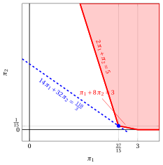{ .fig .ovale loading=lazy  }

        An optimal dual LP solution is:

        $$
        \tilde{\pi}_1=\frac{37}{15},~~\tilde{\pi}_2=\frac{1}{15}
        \text{     and     }
        z(~D(LP)~) = 14\; \tilde{\pi}_1 + 32 \; \tilde{\pi}_2 = 14\cdot \frac{37}{15} + 32 \cdot \frac{1}{15} = \frac{110}{3}
        $$

    - The two optimal values coincide, $z(~LP~) = z(~D(LP)~) = \frac{110}{3}$, as stated by the Strong Duality theorem.

!!! esercizio "Exercise 9.5: Primal and dual problems (P5)"

    Consider the following primal LP problem in canonical maximization form with $n=2$ variables and $m=2$ constraints:

    $$
    \begin{array}{rrrrrrrrrrrrr}
    {\max} & 2 {x_1} & {+} & 3 \, {x_2} \\[2ex]
    \text{subject to} & 6 \, {x_1} & {+} & 21 \, {x_2} & {\le} & 77 \\[2ex]
    & 8 \, {x_1} & {+} & 3 \, {x_2} & {\le} & 36 \\[2ex]
    & {x_1,} &  & {x_2} & { \ge} & { 0 }
    \end{array}
    $$

    and its dual LP problem in canonical minimization form with $m=2$ variables and $n=2$ constraints:

    $$
    \begin{array}{rrrrrrrrrrrrr}
    {\min} & 77 \, {\pi_1} & {+} & 36 \, {\pi_2} \\[2ex]
    \text{subject to} & 6 \, {\pi_1} & {+} & 8 \, {\pi_2} & {\ge} & 2 \\[2ex]
    & 21 \, {\pi_1} & {+} & 3 \, {\pi_2} & {\ge} & 3 \\[2ex]
    & {\pi_1,} &  & {\pi_2} & { \ge} & { 0 }
    \end{array}
    $$

    **Questions**

    1. Find graphically an optimal solution of the primal problem and an optimal solution of the dual problem. Compute the optimal values of the two problems.

??? soluzione "Solution"

    - For the primal LP problem, we have:

        { .fig .ovale loading=lazy  }

        An optimal primal LP solution is:

        $$
        \tilde{x}_1=\frac{7}{2},~~\tilde{x}_2=\frac{8}{3}
        \text{     and     }
        z(~LP~) =  2\; \tilde{x}_1 + 3 \; \tilde{x}_2 = 2\cdot \frac{7}{2} + 3 \cdot \frac{8}{3} = 15
        $$

    - For the dual LP problem, we have:

        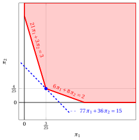{ .fig .ovale loading=lazy  }

        An optimal dual LP solution is:

        $$
        \tilde{\pi}_1=\frac{3}{25},~~\tilde{\pi}_2=\frac{4}{25}
        \text{     and     }
        z(~D(LP)~) = 77\; \tilde{\pi}_1 + 36 \; \tilde{\pi}_2 = 77\cdot \frac{3}{25} + 36 \cdot \frac{4}{25} = 15
        $$

    - The two optimal values coincide, $z(~LP~) = z(~D(LP)~) = 15$, as stated by the Strong Duality theorem.

!!! esercizio "Exercise 9.6: Primal and dual problems (P6)"

    Consider the following primal LP problem in canonical maximization form with $n=2$ variables and $m=2$ constraints:

    $$
    \begin{array}{rrrrrrrrrrrrr}
    {\max} & {x_1} & {+} & \, {x_2} \\[2ex]
    \text{subject to} & {4} \, {x_1} & {+} & {15} \, {x_2} & {\le} & {70} \\[2ex]
    & {12} \, {x_1} & {+} & {3} \, {x_2} & {\le} & {52} \\[2ex]
    & {x_1,} &  & {x_2} & {\ge} & { 0 }
    \end{array}
    $$

    and its dual LP problem in canonical minimization form with $m=2$ variables and $n=2$ constraints:

    $$
    \begin{array}{rrrrrrrrrrrrr}
    {\min} & 70 \, {\pi_1} & {+} & 52 \, {\pi_2} \\[2ex]
    \text{subject to} & 4 \, {\pi_1} & {+} & 12 \, {\pi_2} & {\ge} & 1 \\[2ex]
    & 15 \, {\pi_1} & {+} & 3 \, {\pi_2} & {\ge} & 1 \\[2ex]
    & {\pi_1,} &  & {\pi_2} & { \ge} & { 0 }
    \end{array}
    $$

    **Questions**

    1. Find graphically an optimal solution of the primal problem and an optimal solution of the dual problem. Compute the optimal values of the two problems.

??? soluzione "Solution"

    - For the primal LP problem, we have:

        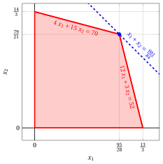{ .fig .ovale loading=lazy  }

        An optimal primal LP solution is:

        $$
        \tilde{x}_1=\frac{95}{28},~~\tilde{x}_2=\frac{79}{21}
        \text{     and     }
        z(~LP~) =  \tilde{x}_1 + \tilde{x}_2 = \frac{95}{28} + \frac{79}{21} = \frac{601}{84}
        $$

    - For the dual LP problem, we have:

        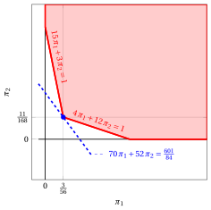{ .fig .ovale loading=lazy  }

        An optimal dual LP solution is:

        $$
        \tilde{\pi}_1=\frac{3}{56},~~\tilde{\pi}_2=\frac{11}{168}
        \text{     and     }
        z(~D(LP)~) = 70\; \tilde{\pi}_1 + 52 \; \tilde{\pi}_2 = 70\cdot \frac{3}{56} + 52 \cdot \frac{11}{168} = \frac{601}{84}
        $$

    - The two optimal values coincide, $z(~LP~) = z(~D(LP)~) = \frac{601}{84}$, as stated by the Strong Duality theorem.

!!! esercizio "Exercise 9.7: Primal and dual problems (P7)"

    Consider the following primal LP problem in canonical maximization form with $n=2$ variables and $m=2$ constraints:

    $$
    \begin{array}{rrrrrrrrrrrrr}
    {\max} & 3 \, {x_1} & {+} & {x_2} \\[2ex]
    \text{subject to} & {x_1} & {+} & {4} \, {x_2} & {\le} & {12} \\[2ex]
    & 2 \, {x_1} & {+} & \, {x_2} & {\le} & 5 \\[2ex]
    & {x_1,} &  & {x_2} & {\ge} & {0}
    \end{array}
    $$

    and its dual LP problem in canonical minimization form with $m=2$ variables and $n=2$ constraints:

    $$
    \begin{array}{rrrrrrrrrrrrr}
    {\min} & 12 \, {\pi_1} & {+} & 5 \, {\pi_2} \\[2ex]
    \text{subject to} & {\pi_1} & {+} & 2 \, {\pi_2} & {\ge} & 3 \\[2ex]
    & 4 \, {\pi_1} & {+} & \, {\pi_2} & {\ge} & 1 \\[2ex]
    & {\pi_1,} &  & {\pi_2} & { \ge} & { 0 }
    \end{array}
    $$

    **Questions**

    1. Find graphically an optimal solution of the primal problem and an optimal solution of the dual problem. Compute the optimal values of the two problems.

??? soluzione "Solution"

    - For the primal LP problem, we have:

        { .fig .ovale loading=lazy  }

        An optimal primal LP solution is:

        $$
        \tilde{x}_1=\frac{5}{2},~~\tilde{x}_2=0
        \text{     and     }
        z(~LP~) =  3\; \tilde{x}_1 + \tilde{x}_2 = 3\cdot \frac{5}{2} + 0 = \frac{15}{2}
        $$

    - For the dual LP problem, we have:

        { .fig .ovale loading=lazy  }

        An optimal dual LP solution is:

        $$
        \tilde{\pi}_1=0,~~\tilde{\pi}_2=\frac{3}{2}
        \text{     and     }
        z(~D(LP)~) = 12\; \tilde{\pi}_1 + 5 \; \tilde{\pi}_2 = 12\cdot 0 + 5 \cdot \frac{3}{2} = \frac{15}{2}
        $$

    - The two optimal values coincide, $z(~LP~) = z(~D(LP)~) = \frac{15}{2}$, as stated by the Strong Duality theorem.

!!! esercizio "Exercise 9.8: Primal and dual problems (P8)"

    Consider the following primal LP problem in canonical maximization form with $n=2$ variables and $m=2$ constraints:

    $$
    \begin{array}{rrrrrrrrrrrrr}
    {\max} & \, {x_1} & {+} & 2 \, {x_2} \\[2ex]
    \text{subject to} & {-} {x_1} & {+} & {2} \, {x_2} & {\le} & {2} \\[2ex]
    & \, {x_1} & {+} & \, {x_2} & {\le} & 3 \\[2ex]
    & \, {x_1,} &  & {x_2} & { \ge } & { 0 }
    \end{array}
    $$

    and its dual LP problem in canonical minimization form with $m=2$ variables and $n=2$ constraints:

    $$
    \begin{array}{rrrrrrrrrrrrr}
    {\min} & 2 \, {\pi_1} & {+} & 3 \, {\pi_2} \\[2ex]
    \text{subject to} & {-} {\pi_1} & {+} & {\pi_2} & {\ge} & 1 \\[2ex]
    & 2 \, {\pi_1} & {+} & \, {\pi_2} & {\ge} & 2 \\[2ex]
    & {\pi_1,} &  & {\pi_2} & { \ge} & { 0 }
    \end{array}
    $$

    **Questions**

    1. Find graphically an optimal solution of the primal problem and an optimal solution of the dual problem. Compute the optimal values of the two problems.

??? soluzione "Solution"

    - For the primal LP problem, we have:

        { .fig .ovale loading=lazy  }

        An optimal primal LP solution is:

        $$
        \tilde{x}_1=\frac{4}{3},~~\tilde{x}_2=\frac{5}{3}
        \text{     and     }
        z(~LP~) =  \tilde{x}_1 + 2\; \tilde{x}_2 = \frac{4}{3} + 2 \cdot \frac{5}{3} = \frac{14}{3}
        $$

    - For the dual LP problem, we have:

        { .fig .ovale loading=lazy  }

        An optimal dual LP solution is:

        $$
        \tilde{\pi}_1=\frac{1}{3},~~\tilde{\pi}_2=\frac{4}{3}
        \text{     and     }
        z(~D(LP)~) = 2\; \tilde{\pi}_1 + 3 \; \tilde{\pi}_2 = 2\cdot \frac{1}{3} + 3 \cdot \frac{4}{3} = \frac{14}{3}
        $$

    - The two optimal values coincide, $z(~LP~) = z(~D(LP)~) = \frac{14}{3}$, as stated by the Strong Duality theorem.

!!! esercizio "Exercise 9.9: Primal and dual problems (P9)"

    Consider the following primal LP problem in canonical maximization form with $n=2$ variables and $m=2$ constraints:

    $$
    \begin{array}{rrrrrrrrrrrrr}
    {\max} & 2 \, {x_1} & {+} & {x_2} \\[2ex]
    \text{subject to} & {-} \, {x_1} & {+} & \, {x_2} & {\le} & 1 \\[2ex]
    & {6} \, {x_1} & {+} & {4} \, {x_2} & {\le} & {39} \\[2ex]
    & {x_1,} &  & {x_2} & { \ge} & {0}
    \end{array}
    $$

    and its dual LP problem in canonical minimization form with $m=2$ variables and $n=2$ constraints:

    $$
    \begin{array}{rrrrrrrrrrrrr}
    {\min} & {\pi_1} & {+} & 39 \, {\pi_2} \\[2ex]
    \text{subject to} & {-} \, {\pi_1} & {+} & 6 \, {\pi_2} & {\ge} & 2 \\[2ex]
    & {\pi_1} & {+} & 4 \, {\pi_2} & {\ge} & 1 \\[2ex]
    & {\pi_1,} &  & {\pi_2} & { \ge} & { 0 }
    \end{array}
    $$

    **Questions**

    1. Find graphically an optimal solution of the primal problem and an optimal solution of the dual problem. Compute the optimal values of the two problems.

??? soluzione "Solution"

    - For the primal LP problem, we have:

        { .fig .ovale loading=lazy  }

        An optimal primal LP solution is:

        $$
        \tilde{x}_1=\frac{13}{2},~~\tilde{x}_2=0
        \text{     and     }
        z(~LP~) =  2\; \tilde{x}_1 + \tilde{x}_2 = 2\cdot \frac{13}{2} + 0 = 13
        $$

    - For the dual LP problem, we have:

        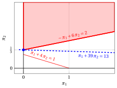{ .fig .ovale loading=lazy  }

        An optimal dual LP solution is:

        $$
        \tilde{\pi}_1=0,~~\tilde{\pi}_2=\frac{1}{3}
        \text{     and     }
        z(~D(LP)~) = \tilde{\pi}_1 + 39 \; \tilde{\pi}_2 = 0 + 39 \cdot \frac{1}{3} = 13
        $$

    - The two optimal values coincide, $z(~LP~) = z(~D(LP)~) = 13$, as stated by the Strong Duality theorem.

!!! esercizio "Exercise 9.10: Primal and dual problems (P10)"

    Consider the following primal problem in canonical maximization form with $n=2$ variables and $m=3$ constraints:

    $$
    \begin{array}{rrrrrrrrrrrrr}
    {\max} & 5 \, {x_1} & {+} & 2 \, {x_2} \\[2ex]
    \text{subject to} & {-} \, {x_1} & {+} & 3 \, {x_2} & {\le} & 12 \\[2ex]
    & {x_1} & {+} & 2 \, {x_2} & {\le} & 12 \\[2ex]
    & {3} \, {x_1} & {-} & 2 \, {x_2} & {\le} & {8} \\[2ex]
    & {x_1,} &  & {x_2} & { \ge} & {0}
    \end{array}
    $$

    and its dual LP problem in canonical minimization form with $m=3$ variables and $n=2$ constraints:

    $$
    \begin{array}{rrrrrrrrrrrrr}
    {\min} & 12\, {\pi_1} & {+} & 12 \, {\pi_2} & {+} & 8 \, {\pi_3} \\[2ex]
    \text{subject to} & {-} \, {\pi_1} & {+} & \, {\pi_2} & {+} & 3 \, {\pi_3} & {\ge} & 5 \\[2ex]
    & 3 \, {\pi_1} & {+} & 2 \, {\pi_2} & {-} & 2\, {\pi_3} & {\ge} & 2 \\[2ex]
    & {\pi_1,} &  & {\pi_2,} &  & \, {\pi_3} & { \ge} & { 0 }
    \end{array}
    $$

    **Questions**

    1. Find graphically an optimal solution of the primal problem and an optimal solution of the dual problem. Compute the optimal values of the two problems.

??? soluzione "Solution"

    - For the primal LP problem we have:

        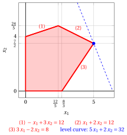{ .fig .ovale loading=lazy style="width:50%" }

        An optimal primal solution is:

        $$
        \tilde{x}_1=5,~~\tilde{x}_2=\frac{7}{2}
        $$

        and the optimal value of the primal problem is:

        $$
        z(~\text{LP}~) =  5\; \tilde{x}_1 + 2 \; \tilde{x}_2 = 5 \cdot 5 + 2 \cdot \frac{7}{2} = 32
        $$

    - For the dual LP problem we have:

        { .fig .ovale loading=lazy style="width:59%" }

        The feasible region of the dual problem is unbounded, and the optimal solution is the vertex marked in blue:

        $$
        \tilde{\pi}_1=0,~~ \tilde{\pi}_2=2,~~\tilde{\pi}_3=1
        $$

        and the optimal value of the dual problem is:

        $$
        z(~\text{D(LP)}~) = 12\; \tilde{\pi}_1 + 12 \; \tilde{\pi}_2 + 8 \; \tilde{\pi}_3 = 12 \cdot 0 + 12 \cdot 2 + 8 \cdot 1 = 32
        $$

    - The two optimal values coincide, $z(~\text{LP}~) = z(~\text{D(LP)}~) = 32$, as stated by the Strong Duality theorem.

!!! esercizio "Exercise 9.11: Primal and dual problems (P11)"

    Consider the following primal LP problem in canonical maximization form with $n=2$ variables and $m=2$ constraints:

    $$
    \begin{array}{rrrrrrrrrrrrr}
    {\max} & {-2} \, {x_1} & {-} & {4} \, {x_2} \\[2ex]
    \text{subject to} & {-} \, {x_1} & {-} & \, {x_2} & {\le} & {-2} \\[2ex]
    & \, {x_1} & {-} & \, {x_2} & {\le} & {0} \\[2ex]
    & {x_1,} &  & {x_2} & { \ge} & { 0 }
    \end{array}
    $$

    and its dual LP problem in canonical minimization form with $m=2$ variables and $n=2$ constraints:

    $$
    \begin{array}{rrrrrrrrrrrrr}
    {\min} & {-}2 \, {\pi_1} &  &  \\[2ex]
    \text{subject to} & {-} \, {\pi_1} & {+} & \, {\pi_2} & {\ge} & {-}2 \\[2ex]
    & {-} \, {\pi_1} & {-} & \, {\pi_2} & {\ge} & {-}4 \\[2ex]
    & {\pi_1,} &  & {\pi_2} & { \ge} & { 0 }
    \end{array}
    $$

    **Questions**

    1. Find graphically an optimal solution of the primal problem and an optimal solution of the dual problem. Compute the optimal values of the two problems.

??? soluzione "Solution"

    - For the primal LP problem, we have:

        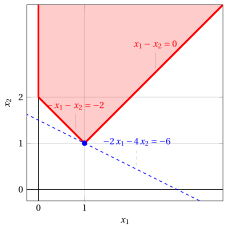{ .fig .ovale loading=lazy  }

        An optimal primal LP solution is:

        $$
        \tilde{x}_1=1,~~\tilde{x}_2=1
        \text{     and     }
        z(~\text{LP}~) =  -2\; \tilde{x}_1 - 4 \; \tilde{x}_2 = -2 \cdot 1 - 4 \cdot 1 = -6
        $$

    - For the dual LP problem, we have:

        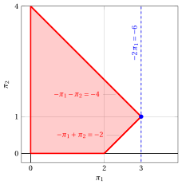{ .fig .ovale loading=lazy  }

        An optimal dual LP solution is:

        $$
        \tilde{\pi}_1=3,~~\tilde{\pi}_2=1
        \text{     and     }
        z(~\text{D(LP)}~) =  -2\; \tilde{\pi}_1 + 0 \; \tilde{\pi}_2 = -2\cdot 3 + 0 \cdot 1 = -6
        $$

    - The two optimal values coincide, $z(~\text{LP}~) = z(~\text{D(LP)}~) = -6$, as stated by the Strong Duality theorem.

## Complementary slackness

!!! esercizio "Exercise 9.12: Complementary slackness (P3)"

    Consider the following LP problem in canonical maximization form with $n=2$ variables and $m=2$ constraints:

    $$
    \begin{array}{rrrrrrrrrrrrr}
    {\max} & 2 \, {x_1} & {+} & 4 \, {x_2} \\[2ex]
    \text{subject to} & {-}\, {x_1} & {+} & \, {x_2} & {\le} & 2 \\[2ex]
    & 8 \, {x_1} & {+} & 2 \, {x_2} & {\le} & 19 \\[2ex]
    & {x_1,} &  & {x_2} & { \ge} & { 0 }
    \end{array}
    $$

    **Questions**

    1. Using the Complementary Slackness theorem, check whether the feasible solution

        $$
        \bar {x}_1=0,~~\bar{x}_2=2
        $$

        is an optimal solution of the LP problem.

    2. Using the Complementary Slackness theorem, check whether the feasible solution

        $$
        \bar {x}_1=\frac{3}{2},~~\bar{x}_2=\frac{7}{2}
        $$

        is an optimal solution of the LP problem.

??? soluzione "Solution"

    - We check if the feasible solution

        $$
        \bar {x}_1=0,~~\bar{x}_2=2
        $$

        of the LP problem  is optimal.

        1. Since

            $$
            \sum_{i=1}^m a_{ij} \bar  \pi_i = c_j \text{   if   }\bar  x_j>0,~\forall
            j \in \{1,2,\dots,n\}
            $$

            we build the following linear equation with two variables:

            $$
            \begin{array}{rrrrrrrrrrrrr}
            & \, {\bar \pi_1} & {+} & 2 \, {\bar \pi_2} & {=} & 4 &  & {\left(\bar x_2=2>0\right)}
            \end{array}
            $$

        2. Since

            $$
            \bar \pi_i = 0  \text{       if       } \sum_{j=1}^n a_{ij} \bar  x_j < b_i,~\forall
            i \in \{1,2,\dots,m\}
            $$

            we compute:

            $$
            \begin{array}{rrrrrrrrrrrrr}
            & {-1} {\cdot} {0} & {+} & 1 {\cdot} {2} & {=} & {2 \nless 2} &  \\[2ex]
            & 8 {\cdot} {0} & {+} & 2 {\cdot} {2} & {=} & {4 < 19} & { \text{       so       } \bar \pi_2 = 0}
            \end{array}
            $$

            We then solve the previous equation with one variable and we get:

            $$
            \bar \pi_1=4, ~~\bar \pi_2=0
            $$

        3. We need to check

            $$
            \sum_{i=1}^m a_{ij} \bar  \pi_i \ge c_j, \quad \forall j \in \{1,2,\dots,n\}
            $$

            so we compute:

            $$
            \begin{array}{rrrrrrrrrrrrr}
            & {-1} {\cdot} {4} & {+} & 8 {\cdot} {0} & {=} & {-}4 { \ngeq 2} \\[2ex]
            & {1} {\cdot} {4} & {+} & 2 {\cdot} {0} & {=} & 4 { \ge 4}
            \end{array}
            $$

            so we stop the check and conclude that the solution is not optimal.

    - We check if the feasible solution

        $$
        \bar {x}_1=\frac{3}{2},~~\bar{x}_2=\frac{7}{2}
        $$

        of the LP problem  is optimal.

        1. Since

            $$
            \sum_{i=1}^m a_{ij} \bar  \pi_i = c_j \text{   if   }\bar  x_j>0,~\forall
            j \in \{1,2,\dots,n\}
            $$

            we build the following system of two linear equations with two variables:

            $$
            \begin{array}{rrrrrrrrrrrrr}
            & {-} \, {\bar \pi_1} & {+} & 8 \, {\bar \pi_2} & {=} & 2 &  & {\left(\bar x_1=\frac{3}{2}>0\right)} \\[2ex]
            & \, {\bar \pi_1} & {+} & 2 \, {\bar \pi_2} & {=} & 4 &  & {\left(\bar x_2=\frac{7}{2}>0\right)}
            \end{array}
            $$

        2. Since

            $$
            \bar \pi_i = 0  \text{       if       } \sum_{j=1}^n a_{ij} \bar  x_j < b_i,~\forall
            i \in \{1,2,\dots,m\}
            $$

            we compute:

            $$
            \begin{array}{rrrrrrrrrrrrr}
            & {-1} {\cdot} {\frac{3}{2} } & {+} & 1 {\cdot} {\frac{7}{2}} & {=} & 2 & {\nless 2} \\[2ex]
            & 8 {\cdot} {\frac{3}{2} } & {+} & 2 {\cdot} {\frac{7}{2}} & {=} & 19 & {\nless 19}
            \end{array}
            $$

            We then solve the previous system of two equations with two variables and we get:

            $$
            \bar \pi_1=\frac{14}{5}, ~~\bar \pi_2=\frac{3}{5}
            $$

        3. We need to check

            $$
            \sum_{i=1}^m a_{ij} \bar  \pi_i \ge c_j, \quad \forall j \in \{1,2,\dots,n\}
            $$

            so we compute:

            $$
            \begin{array}{rrrrrrrrrrrrr}
            & {-1} {\cdot} {\frac{14}{5}} & {+} & 8 {\cdot} {\frac{3}{5}} & {=} & 2 { \ge 2} \\[2ex]
            & {1} {\cdot} {\frac{14}{5}} & {+} & 2 {\cdot} {\frac{3}{5}} & {=} & 4 { \ge 4}
            \end{array}
            $$

        4. We need to check

            $$
            \bar  \pi_i \ge 0, \quad \forall i \in \{1,2,\dots,m\}
            $$

            so since

            $$
            \bar \pi_1=\frac{14}{5} \ge 0, ~~\bar \pi_2=\frac{3}{5} \ge 0
            $$

            the  solution is optimal.

    - <strong>Graphical solution:</strong> the feasible region of the LP problem is the polyhedron shaded in red; the solution $\bar x_1=0$, $\bar x_2=2$, which is not optimal, is marked in violet and the optimal solution $\tilde x_1=\frac{3}{2}$, $\tilde x_2=\frac{7}{2}$, of value $17$, is marked in blue, together with the level curve of value $17$.

        { .fig .ovale loading=lazy  }

        The feasible region of the dual LP problem in canonical minimization form is the polyhedron shaded in red. The dual solution $\bar \pi_1=4$, $\bar \pi_2=0$ obtained from the first solution (in violet) violates the first dual constraint, while the dual solution $\bar \pi_1=\frac{14}{5}$, $\bar \pi_2=\frac{3}{5}$ obtained from the second solution (in blue) is feasible and has value $17$, equal to the value of the primal solution.

        { .fig .ovale loading=lazy  }

!!! esercizio "Exercise 9.13: Complementary slackness (P10)"

    Consider the following LP problem in canonical maximization form with $n=2$ variables and $m=3$ constraints:

    $$
    \begin{array}{rrrrrrrrrrrrr}
    {\max} & 5 \, {x_1} & {+} & 2 \, {x_2} \\[2ex]
    \text{subject to} & {-} \, {x_1} & {+} & 3 \, {x_2} & {\le} & 12 \\[2ex]
    & {x_1} & {+} & 2 \, {x_2} & {\le} & 12 \\[2ex]
    & {3} \, {x_1} & {-} & 2 \, {x_2} & {\le} & {8} \\[2ex]
    & {x_1,} &  & {x_2} & { \ge} & {0}
    \end{array}
    $$

    **Questions**

    1. Using the Complementary Slackness theorem, check whether the feasible solution

        $$
        \bar {x}_1=\frac{8}{3},~~\bar{x}_2=0
        $$

        is an optimal solution of the LP problem.

    2. Using the Complementary Slackness theorem, check whether the feasible solution

        $$
        \bar {x}_1=3,~~\bar{x}_2=4
        $$

        is an optimal solution of the LP problem.

??? soluzione "Solution"

    - We check if the feasible solution

        $$
        \bar {x}_1=\frac{8}{3},~~\bar{x}_2=0
        $$

        of the LP problem is optimal.

        1. Since

            $$
            \sum_{i=1}^m a_{ij} \bar  \pi_i = c_j \text{   if   }\bar  x_j>0,~\forall
            j \in \{1,2,\dots,n\}
            $$

            we build the following system of one linear equation with three variables:

            $$
            \begin{array}{rrrrrrrrrrrrr}
            & {-} \, {\bar \pi_1} & {+} & \, {\bar \pi_2} & {+} & 3 \, {\bar \pi_3} & {=} & 5 &  & {\left(\bar x_1=\frac{8}{3}>0\right)}
            \end{array}
            $$

        2. Since

            $$
            \bar \pi_i = 0  \text{       if       } \sum_{j=1}^n a_{ij} \bar  x_j < b_i,~\forall
            i \in \{1,2,\dots,m\}
            $$

            we compute:

            $$
            \begin{array}{rrrrrrrrrrrrr}
            & {-1} {\cdot} {\frac{8}{3}} & {+} & 3 {\cdot} {0} & {=} & {-\frac{8}{3} < 12} & { \text{       so       } \bar \pi_1 = 0} \\[2ex]
            & 1 {\cdot} {\frac{8}{3}} & {+} & 2 {\cdot} {0} & {=} & {\frac{8}{3} < 12} & { \text{       so       } \bar \pi_2 = 0} \\[2ex]
            & 3 {\cdot} {\frac{8}{3}} & {-} & 2 {\cdot} {0} & {=} & {8 \nless 8} &
            \end{array}
            $$

            We then solve the previous equation with one variable and we get:

            $$
            \bar{\pi}_1=0,~~ \bar{\pi}_2=0,~~\bar{\pi}_3=\frac{5}{3}
            $$

        3. We need to check

            $$
            \sum_{i=1}^m a_{ij} \bar  \pi_i \ge c_j, \quad \forall j \in \{1,2,\dots,n\}
            $$

            so we compute:

            $$
            \begin{array}{rrrrrrrrrrrrr}
            & {-1} {\cdot} {0} & {+} & 1 {\cdot} {0} & {+} & 3 {\cdot} {\frac{5}{3}} & {=} & 5 { \ge 5} \\[2ex]
            & {3} {\cdot} {0} & {+} & 2 {\cdot} {0} & {-} & 2 {\cdot} {\frac{5}{3}} & {=} & {-\frac{10}{3}} { \ngeq 2}
            \end{array}
            $$

            Since the second dual constraint is violated, we stop the check and conclude that the solution is not optimal.

    - We check if the feasible solution

        $$
        \bar {x}_1=3,~~\bar{x}_2=4
        $$

        of the LP problem is optimal.

        1. Since

            $$
            \sum_{i=1}^m a_{ij} \bar  \pi_i = c_j \text{   if   }\bar  x_j>0,~\forall
            j \in \{1,2,\dots,n\}
            $$

            we build the following system of two linear equations with three variables:

            $$
            \begin{array}{rrrrrrrrrrrrr}
            & {-} \, {\bar \pi_1} & {+} & \, {\bar \pi_2} & {+} & 3 \, {\bar \pi_3} & {=} & 5 &  & {\left(\bar x_1=3>0\right)} \\[2ex]
            & 3\, {\bar \pi_1} & {+} & 2 \, {\bar \pi_2} & {-} & 2 \, {\bar \pi_3} & {=} & 2 &  & {\left(\bar x_2=4>0\right)}
            \end{array}
            $$

        2. Since

            $$
            \bar \pi_i = 0  \text{       if       } \sum_{j=1}^n a_{ij} \bar  x_j < b_i,~\forall
            i \in \{1,2,\dots,m\}
            $$

            we compute:

            $$
            \begin{array}{rrrrrrrrrrrrr}
            & {-1} {\cdot} {3} & {+} & 3 {\cdot} {4} & {=} & {9 < 12} & { \text{       so       } \bar \pi_1 = 0} \\[2ex]
            & 1 {\cdot} {3} & {+} & 2 {\cdot} {4} & {=} & {11 < 12} & { \text{       so       } \bar \pi_2 = 0} \\[2ex]
            & 3 {\cdot} {3} & {-} & 2 {\cdot} {4} & {=} & {1 < 8} & { \text{       so       } \bar \pi_3 = 0}
            \end{array}
            $$

            With $\bar \pi_1=\bar \pi_2=\bar \pi_3=0$ the two equations of the previous system read $0=5$ and $0=2$. Since the system cannot be solved, we stop the check and conclude that the solution is not optimal.

    - <strong>Graphical solution:</strong> the feasible region is the polygon shaded in red; the two solutions checked above are marked in violet and the optimal solution $\tilde x_1=5$, $\tilde x_2=\frac{7}{2}$, of value $32$, is marked in blue, together with the level curve of value $32$.

        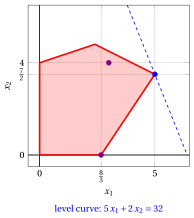{ .fig .ovale loading=lazy style="width:50%" }

!!! esercizio "Exercise 9.14: Complementary slackness (P11)"

    Consider the following LP problem in canonical maximization form with $n=2$ variables and $m=2$ constraints:

    $$
    \begin{array}{rrrrrrrrrrrrr}
    {\max} & {-2} \, {x_1} & {-} & {4} \, {x_2} \\[2ex]
    \text{subject to} & {-} \, {x_1} & {-} & \, {x_2} & {\le} & {-2} \\[2ex]
    & \, {x_1} & {-} & \, {x_2} & {\le} & {0} \\[2ex]
    & {x_1,} &  & {x_2} & { \ge} & { 0 }
    \end{array}
    $$

    **Questions**

    1. Using the Complementary Slackness theorem, check whether the feasible solution

        $$
        \bar {x}_1=1,~~\bar{x}_2=1
        $$

        is an optimal solution of the LP problem.

    2. Using the Complementary Slackness theorem, check whether the feasible solution

        $$
        \bar {x}_1=1,~~\bar{x}_2=2
        $$

        is an optimal solution of the LP problem.

??? soluzione "Solution"

    - We check if the feasible solution

        $$
        \bar {x}_1=1,~~\bar{x}_2=1
        $$

        of the LP problem  is optimal.

        1. Since

            $$
            \sum_{i=1}^m a_{ij} \bar  \pi_i = c_j \text{   if   }\bar  x_j>0,~\forall
            j \in \{1,2,\dots,n\}
            $$

            we build the following system of two linear equations with two variables:

            $$
            \begin{array}{rrrrrrrrrrrrr}
            & {-} \, {\bar \pi_1} & {+} & {\bar \pi_2} & {=} & {-}2 &  & {\left(\bar x_1=1>0\right)} \\[2ex]
            & {-} \, {\bar \pi_1} & {-} & \, {\bar \pi_2} & {=} & {-}4 &  & {\left(\bar x_2=1>0\right)}
            \end{array}
            $$

        2. Since

            $$
            \bar \pi_i = 0  \text{       if       } \sum_{j=1}^n a_{ij} \bar  x_j < b_i,~\forall
            i \in \{1,2,\dots,m\}
            $$

            we compute:

            $$
            \begin{array}{rrrrrrrrrrrrr}
            & {-1} {\cdot} {1} & {-} & 1 {\cdot} {1} & {=} & {-}2 & {\nless -2} \\[2ex]
            & 1 {\cdot} {1} & {-} & 1 {\cdot} {1} & {=} & 0 & {\nless 0}
            \end{array}
            $$

            We then solve the previous system of two equations with two variables and we get:

            $$
            \bar \pi_1=3, ~~\bar \pi_2=1
            $$

        3. We need to check

            $$
            \sum_{i=1}^m a_{ij} \bar  \pi_i \ge c_j, \quad \forall j \in \{1,2,\dots,n\}
            $$

            so we compute:

            $$
            \begin{array}{rrrrrrrrrrrrr}
            & {-1} {\cdot} {3} & {+} & 1 {\cdot} {1} & {=} & {-}2 { \ge -2} \\[2ex]
            & {-1} {\cdot} {3} & {-} & 1 {\cdot} {1} & {=} & {-}4 { \ge -4}
            \end{array}
            $$

        4. We need to check

            $$
            \bar  \pi_i \ge 0, \quad \forall i \in \{1,2,\dots,m\}
            $$

            so since

            $$
            \bar \pi_1=3 \ge 0, ~~\bar \pi_2=1 \ge 0
            $$

            the  solution is optimal.

    - We check if the feasible solution

        $$
        \bar {x}_1=1,~~\bar{x}_2=2
        $$

        of the LP problem  is optimal.

        1. Since

            $$
            \sum_{i=1}^m a_{ij} \bar  \pi_i = c_j \text{   if   }\bar  x_j>0,~\forall
            j \in \{1,2,\dots,n\}
            $$

            we build the following system of two linear equations with two variables:

            $$
            \begin{array}{rrrrrrrrrrrrr}
            & {-} \, {\bar \pi_1} & {+} & {\bar \pi_2} & {=} & {-}2 &  & {\left(\bar x_1=1>0\right)} \\[2ex]
            & {-} \, {\bar \pi_1} & {-} & \, {\bar \pi_2} & {=} & {-}4 &  & {\left(\bar x_2=2>0\right)}
            \end{array}
            $$

        2. Since

            $$
            \bar \pi_i = 0  \text{       if       } \sum_{j=1}^n a_{ij} \bar  x_j < b_i,~\forall
            i \in \{1,2,\dots,m\}
            $$

            we compute:

            $$
            \begin{array}{rrrrrrrrrrrrr}
            & {-1} {\cdot} {1} & {-} & 1 {\cdot} {2} & {=} & {-}3 & {< -2 \text{       so       } \bar \pi_1 = 0} \\[2ex]
            & 1 {\cdot} {1} & {-} & 1 {\cdot} {2} & {=} & {-1} & {< 0 \text{       so       } \bar \pi_2 = 0}
            \end{array}
            $$

            Since the previous system of equations cannot be solved, we stop the check and conclude that the solution is not optimal.

    - <strong>Graphical solution:</strong> the feasible region of the LP problem is the polyhedron shaded in red (it is unbounded); the solution $\bar x_1=1$, $\bar x_2=2$, which is not optimal, is marked in violet and the optimal solution $\tilde x_1=1$, $\tilde x_2=1$, of value $-6$, is marked in blue, together with the level curve of value $-6$.

        { .fig .ovale loading=lazy  }

        The feasible region of the dual LP problem in canonical minimization form is the polyhedron shaded in red. The dual solution $\bar \pi_1=3$, $\bar \pi_2=1$ obtained from the first solution is marked in blue: it is feasible and has value $-6$, equal to the value of the primal solution.

        { .fig .ovale loading=lazy  }

!!! esercizio "Exercise 9.15: Complementary slackness (P44)"

    Consider the following LP problem in canonical maximization form with $n=3$ variables and $m=3$ constraints:

    $$
    \begin{array}{rrrrrrrrrrrrr}
    {\max} & {x_1} & {+} & 2 \, {x_2} & {+} & 3 \, {x_3} \\[2ex]
    \text{subject to} & {x_1} & {+} & 2 \, {x_2} & {-} & 2 \, {x_3} & {\le} & 1 \\[2ex]
    & 2 \, {x_1} & {-} & \, {x_2} & {-} & 3 \, {x_3} & {\le} & 4 \\[2ex]
    & {x_1} & {+} & 2 \, {x_2} & {+} & 5 \, {x_3} & {\le} & 2 \\[2ex]
    & {x_1,} &  & {x_2,} &  & \, {x_3} & {\ge} & { 0 }
    \end{array}
    $$

    **Questions**

    1. Using the Complementary Slackness theorem, check whether the following feasible solutions are optimal solutions of the LP problem:

        $$
        \bar x_1=\frac{9}{7},~~
        \bar x_2=0,~~
        \bar x_3=\frac{1}{7}~~
        \text{     and     }
        \bar x_1=0,~~
        \bar x_2=\frac{9}{14},~~
        \bar x_3=\frac{1}{7}~~
        $$

    2. Calculate the objective function values of the two solutions.

    3. Replace the objective function with the following one:

        $$
        \max ~~ 7\; x_1 + 14\; x_2 + 30\; x_3
        $$

        and check whether the following feasible solutions are optimal solutions of the LP problem:

        $$
        \bar x_1=\frac{9}{7},~~
        \bar x_2=0,~~
        \bar x_3=\frac{1}{7}~~
        \text{     and     }
        \bar x_1=0,~~
        \bar x_2=0,~~
        \bar x_3=\frac{2}{5}
        $$

??? soluzione "Solution"

    1. We check if the feasible solution

        $$
        \bar x_1=\frac{9}{7},~~
        \bar x_2=0,~~
        \bar x_3=\frac{1}{7}~~
        $$

        of the LP problem  is optimal.

        1. Since

            $$
            \sum_{i=1}^m a_{ij} \bar  \pi_i = c_j \text{   if   }\bar  x_j>0,~\forall
            j \in \{1,2,\dots,n\}
            $$

            we build the following system of two linear equations with three variables:

            $$
            \begin{array}{rrrrrrrrrrrrr}
            & 1 \, {\bar{\pi}_1} & {+} & 2 \, {\bar{\pi}_2} & {+} & 1 \, {\bar{\pi}_3} & {=} & 1 &  & {\left(\bar x_1=\frac{9}{7}>0\right)} \\[2ex]
            & {-}2 \, {\bar{\pi}_1} & {-} & 3 \, {\bar{\pi}_2} & {+} & 5 \, {\bar{\pi}_3} & {=} & 3 &  & {\left(\bar x_3=\frac{1}{7}>0\right)}
            \end{array}
            $$

        2. Since

            $$
            \bar \pi_i = 0  \text{       if       } \sum_{j=1}^n a_{ij} \bar  x_j < b_i,~\forall
            i \in \{1,2,\dots,m\}
            $$

            we compute:

            $$
            \begin{array}{rrrrrrrrrrrrr}
            & 1 {\cdot} {\frac{9}{7}} & {+} & 2 {\cdot} {0} & {-} & 2 {\cdot} {\frac{1}{7}} & {=} & {1 \nless 1} &  \\[2ex]
            & 2 {\cdot} {\frac{9}{7}} & {-} & 1 {\cdot} {0} & {-} & 3 {\cdot} {\frac{1}{7}} & {=} & {\frac{15}{7} < 4} & { \text{       so       } \bar \pi_2 = 0} \\[2ex]
            & 1 {\cdot} {\frac{9}{7}} & {+} & 2 {\cdot} {0} & {+} & 5 {\cdot} {\frac{1}{7}} & {=} & {2 \nless 2} &
            \end{array}
            $$

            We then solve the previous system of two equations with two variables and we get:

            $$
            \bar \pi_1=\frac{2}{7}, ~~\bar \pi_2=0, ~~\bar \pi_3=\frac{5}{7}
            $$

        3. We need to check

            $$
            \sum_{i=1}^m a_{ij} \bar  \pi_i \ge c_j, \quad \forall j \in \{1,2,\dots,n\}
            $$

            so we compute:

            $$
            \begin{array}{rrrrrrrrrrrrr}
            & {1} {\cdot} {\frac{2}{7}} & {+} & 2 {\cdot} {0} & {+} & 1 {\cdot} {\frac{5}{7}} & {=} & 1 { \ge 1} \\[2ex]
            & {2} {\cdot} {\frac{2}{7}} & {-} & 1 {\cdot} {0} & {+} & 2 {\cdot} {\frac{5}{7}} & {=} & 2 { \ge 2} \\[2ex]
            & {-2} {\cdot} {\frac{2}{7}} & {-} & 3 {\cdot} {0} & {+} & 5 {\cdot} {\frac{5}{7}} & {=} & 3 { \ge 3}
            \end{array}
            $$

        4. We need to check

            $$
            \bar  \pi_i \ge 0, \quad \forall i \in \{1,2,\dots,m\}
            $$

            so since

            $$
            \bar \pi_1=\frac{2}{7} \ge 0, ~~\bar \pi_2=0\ge 0, ~~\bar \pi_3=\frac{5}{7}\ge 0
            $$

            the solution is optimal.

        We check if the feasible solution

        $$
        \bar x_1=0,~~
        \bar x_2=\frac{9}{14},~~
        \bar x_3=\frac{1}{7}~~
        $$

        of the LP problem  is optimal.

        1. Since

            $$
            \sum_{i=1}^m a_{ij} \bar  \pi_i = c_j \text{   if   }\bar  x_j>0,~\forall
            j \in \{1,2,\dots,n\}
            $$

            we build the following system of two linear equations with three variables:

            $$
            \begin{array}{rrrrrrrrrrrrr}
            & 2 \, {\bar{\pi}_1} & {-} & 1 \, {\bar{\pi}_2} & {+} & 2 \, {\bar{\pi}_3} & {=} & 2 &  & {\left(\bar x_2=\frac{9}{14}>0\right)} \\[2ex]
            & {-}2 \, {\bar{\pi}_1} & {-} & 3 \, {\bar{\pi}_2} & {+} & 5 \, {\bar{\pi}_3} & {=} & 3 &  & {\left(\bar x_3=\frac{1}{7}>0\right)}
            \end{array}
            $$

        2. Since

            $$
            \bar \pi_i = 0  \text{       if       } \sum_{j=1}^n a_{ij} \bar  x_j < b_i,~\forall
            i \in \{1,2,\dots,m\}
            $$

            we compute:

            $$
            \begin{array}{rrrrrrrrrrrrr}
            & 1 {\cdot} {0} & {+} & 2 {\cdot} {\frac{9}{14}} & {-} & 2 {\cdot} {\frac{1}{7}} & {=} & {1 \nless 1} &  \\[2ex]
            & 2 {\cdot} {0} & {-} & 1 {\cdot} {\frac{9}{14}} & {-} & 3 {\cdot} {\frac{1}{7}} & {=} & {-\frac{15}{14} < 4} & { \text{       so       } \bar \pi_2 = 0} \\[2ex]
            & {1} {\cdot} {0} & {+} & 2 {\cdot} {\frac{9}{14}} & {+} & 5 {\cdot} {\frac{1}{7}} & {=} & {2 \nless 2} &
            \end{array}
            $$

            We then solve the previous system of two equations with two variables and we get:

            $$
            \bar \pi_1=\frac{2}{7}, ~~\bar \pi_2=0, ~~\bar \pi_3=\frac{5}{7}
            $$

        3. We need to check

            $$
            \sum_{i=1}^m a_{ij} \bar  \pi_i \ge c_j, \quad \forall j \in \{1,2,\dots,n\}
            $$

            so we compute:

            $$
            \begin{array}{rrrrrrrrrrrrr}
            & {1} {\cdot} {\frac{2}{7}} & {+} & 2 {\cdot} {0} & {+} & 1 {\cdot} {\frac{5}{7}} & {=} & 1 { \ge 1} \\[2ex]
            & {2} {\cdot} {\frac{2}{7}} & {-} & 1 {\cdot} {0} & {+} & 2 {\cdot} {\frac{5}{7}} & {=} & 2 { \ge 2} \\[2ex]
            & {-2} {\cdot} {\frac{2}{7}} & {-} & 3 {\cdot} {0} & {+} & 5 {\cdot} {\frac{5}{7}} & {=} & 3 { \ge 3}
            \end{array}
            $$

        4. We need to check

            $$
            \bar  \pi_i \ge 0, \quad \forall i \in \{1,2,\dots,m\}
            $$

            so since

            $$
            \bar \pi_1=\frac{2}{7} \ge 0, ~~\bar \pi_2=0\ge 0, ~~\bar \pi_3=\frac{5}{7}\ge 0
            $$

            the  solution is optimal.

    2. The objective function value of the first solution is:

        $$
        \bar x_1 ~+~ 2\, \bar x_2 ~+~ 3 \, \bar x_3 ~=~ \frac{9}{7} ~+~ 0 ~+~ 3 \cdot \frac{1}{7} ~=~  \frac{12}{7}
        $$

        and the objective function value of the second is:

        $$
        \bar x_1 ~+~ 2\, \bar x_2 ~+~ 3 \, \bar x_3 ~=~ 0 ~+~ 2 \cdot \frac{9}{14} ~+~ 3 \cdot \frac{1}{7} ~=~  \frac{12}{7}
        $$

        Since the solutions are both optimal, the two values must coincide. Moreover, both solutions satisfy the first and the third constraints at equality, and every point of the segment joining them,

        $$
        \bar{\boldsymbol x}(\lambda) = \lambda \begin{pmatrix} \frac{9}{7} \\[1ex] 0 \\[1ex] \frac{1}{7} \end{pmatrix} + (1-\lambda) \begin{pmatrix} 0 \\[1ex] \frac{9}{14} \\[1ex] \frac{1}{7} \end{pmatrix}, \qquad \lambda \in [0,1],
        $$

        is a feasible solution of value $\frac{12}{7}$. Accordingly, the LP problem has infinitely many optimal solutions: the whole edge of the polyhedron between the two solutions is optimal.

    3. We check if the feasible solution

        $$
        \bar x_1=\frac{9}{7},~~
        \bar x_2=0,~~
        \bar x_3=\frac{1}{7}~~
        $$

        of the LP problem is optimal when considering the new objective function:

        $$
        \max ~~ 7\; x_1 + 14\; x_2 + 30\; x_3
        $$

        1. Since

            $$
            \sum_{i=1}^m a_{ij} \bar  \pi_i = c_j \text{   if   }\bar  x_j>0,~\forall
            j \in \{1,2,\dots,n\}
            $$

            we build the following system of two linear equations with three variables:

            $$
            \begin{array}{rrrrrrrrrrrrr}
            & 1 \, {\bar{\pi}_1} & {+} & 2 \, {\bar{\pi}_2} & {+} & 1 \, {\bar{\pi}_3} & {=} & 7 &  & {\left(\bar x_1=\frac{9}{7}>0\right)} \\[2ex]
            & {-}2 \, {\bar{\pi}_1} & {-} & 3 \, {\bar{\pi}_2} & {+} & 5 \, {\bar{\pi}_3} & {=} & 30 &  & {\left(\bar x_3=\frac{1}{7}>0\right)}
            \end{array}
            $$

        2. From point 1(b) we have that $\bar \pi_2 = 0$. We then solve the previous system of two equations with two variables and we get:

            $$
            \bar \pi_1=\frac{5}{7}, ~~\bar \pi_2=0, ~~\bar \pi_3=\frac{44}{7}
            $$

        3. We need to check

            $$
            \sum_{i=1}^m a_{ij} \bar  \pi_i \ge c_j, \quad \forall j \in \{1,2,\dots,n\}
            $$

            so we compute:

            $$
            \begin{array}{rrrrrrrrrrrrr}
            & {1} {\cdot} {\frac{5}{7}} & {+} & 2 {\cdot} {0} & {+} & 1 {\cdot} {\frac{44}{7}} & {=} & 7 {\ge 7} \\[2ex]
            & {2} {\cdot} {\frac{5}{7}} & {-} & 1 {\cdot} {0} & {+} & 2 {\cdot} {\frac{44}{7}} & {=} & 14 { \ge 14} \\[2ex]
            & {-2} {\cdot} {\frac{5}{7}} & {-} & 3 {\cdot} {0} & {+} & 5 {\cdot} {\frac{44}{7}} & {=} & 30 { \ge 30}
            \end{array}
            $$

        4. We need to check

            $$
            \bar  \pi_i \ge 0, \quad \forall i \in \{1,2,\dots,m\}
            $$

            so since

            $$
            \bar \pi_1=\frac{5}{7} \ge 0, ~~\bar \pi_2=0\ge 0, ~~\bar \pi_3=\frac{44}{7}\ge 0
            $$

            the solution is optimal.

        We then check if the feasible solution

        $$
        \bar x_1=0,~~ \bar x_2=0,~~\bar x_3=\frac{2}{5}~~
        $$

        of the LP problem is optimal when considering the new objective function:

        $$
        \max ~~ 7\; x_1 + 14\; x_2 + 30\; x_3
        $$

        1. Since

            $$
            \sum_{i=1}^m a_{ij} \bar  \pi_i = c_j \text{   if   }\bar  x_j>0,~\forall
            j \in \{1,2,\dots,n\}
            $$

            we build the following linear equation with three variables:

            $$
            \begin{array}{rrrrrrrrrrrrr}
            & {-}2 \, {\bar{\pi}_1} & {-} & 3 \, {\bar{\pi}_2} & {+} & 5 \, {\bar{\pi}_3} & {=} & 30 &  & {\left(\bar x_3=\frac{2}{5}>0\right)}
            \end{array}
            $$

        2. Since

            $$
            \bar \pi_i = 0  \text{       if       } \sum_{j=1}^n a_{ij} \bar  x_j < b_i,~\forall
            i \in \{1,2,\dots,m\}
            $$

            we compute:

            $$
            \begin{array}{rrrrrrrrrrrrr}
            & 1 {\cdot} {0} & {+} & 2 {\cdot} {0} & {-} & 2 {\cdot} {\frac{2}{5}} & {=} & {-\frac{4}{5} < 1} & { \text{       so       } \bar \pi_1 = 0} \\[2ex]
            & 2 {\cdot} {0} & {-} & 1 {\cdot} {0} & {-} & 3 {\cdot} {\frac{2}{5}} & {=} & {-\frac{6}{5} < 4} & { \text{       so       } \bar \pi_2 = 0} \\[2ex]
            & 1 {\cdot} {0} & {+} & 2 {\cdot} {0} & {+} & 5 {\cdot} {\frac{2}{5}} & {=} & { 2 \nless 2} &
            \end{array}
            $$

            We then solve the previous equation with one variable and we get:

            $$
            \bar \pi_1=0, ~~\bar \pi_2=0, ~~\bar \pi_3=6
            $$

        3. We need to check

            $$
            \sum_{i=1}^m a_{ij} \bar  \pi_i \ge c_j, \quad \forall j \in \{1,2,\dots,n\}
            $$

            so we compute:

            $$
            \begin{array}{rrrrrrrrrrrrr}
            & {1} {\cdot} {0} & {+} & 2 {\cdot} {0} & {+} & 1 {\cdot} {6} & {=} & 6 { \ngeq 7}
            \end{array}
            $$

            we stop the check and conclude that the solution is not optimal.

!!! esercizio "Exercise 9.16: Complementary slackness (P71)"

    Consider the following LP problem in canonical maximization form with $n=4$ variables and $m=3$ constraints:

    $$
    \begin{array}{rrrrrrrrrrrrr}
    {\max} & 4 \, {x_1} & {+} & \, {x_2} & {+} & 5 \, {x_3} & {+} & 3 \, {x_4} \\[2ex]
    \text{subject to} & \, {x_1} & {-} & \, {x_2} & {-} & \, {x_3} & {+} & 3 \, {x_4} & {\le} & 1 \\[2ex]
    & 5 \, {x_1} & {+} & \, {x_2} & {+} & 3 \, {x_3} & {+} & 8 \, {x_4} & {\le} & 55 \\[2ex]
    & {-} \, {x_1} & {+} & 2 \, {x_2} & {+} & 3 \, {x_3} & {-} & 5 \, {x_4} & {\le} & 3 \\[2ex]
    & {x_1,} &  & {x_2,} &  & {x_3,} &  & {x_4} & { \ge} & { 0 }
    \end{array}
    $$

    **Questions**

    1. Using the Complementary Slackness theorem, check whether the feasible solution

        $$
        \bar {x}_1=0,~~\bar{x}_2=14,~~\bar{x}_3=0,~~\bar{x}_4=5
        $$

        is an optimal solution of the LP problem.

    2. Using the Complementary Slackness theorem, check whether the feasible solution

        $$
        \bar {x}_1=0,~~\bar{x}_2=1,~~\bar{x}_3=2,~~\bar{x}_4=1
        $$

        is an optimal solution of the LP problem.

    3. Using the Complementary Slackness theorem, check whether the feasible solution

        $$
        \bar x_{1}= 5, ~~ \bar x_{2}= 4, ~~ \bar x_{3}= 0, ~~ \bar x_{4}= 0
        $$

        is an optimal solution of the LP problem.

??? soluzione "Solution"

    - We check if the feasible solution

        $$
        \bar {x}_1=0,~~\bar{x}_2=14,~~\bar{x}_3=0,~~\bar{x}_4=5
        $$

        of the LP problem  is optimal.

        1. Since

            $$
            \sum_{i=1}^m a_{ij} \bar  \pi_i = c_j \text{   if   }\bar  x_j>0,~\forall
            j \in \{1,2,\dots,n\}
            $$

            we build the following system of two linear equations with three variables:

            $$
            \begin{array}{rrrrrrrrrrrrr}
            & {-} \, {\bar \pi_1} & {+} & \, {\bar \pi_2} & {+} & 2 \, {\bar \pi_3} & {=} & 1 &  & {\left(\bar x_2=14>0\right)} \\[2ex]
            & 3\, {\bar \pi_1} & {+} & 8 \, {\bar \pi_2} & {-} & 5 \, {\bar \pi_3} & {=} & 3 &  & {\left(\bar x_4=5>0\right)}
            \end{array}
            $$

        2. Since

            $$
            \bar \pi_i = 0  \text{       if       } \sum_{j=1}^n a_{ij} \bar  x_j < b_i,~\forall
            i \in \{1,2,\dots,m\}
            $$

            we compute:

            $$
            \begin{array}{rrrrrrrrrrrrr}
            & 1 {\cdot} {0} & {-} & 1 {\cdot} {14} & {-} & 1 {\cdot} {0} & {+} & 3 {\cdot} {5} & {=} & {1 \nless 1} &  \\[2ex]
            & 5 {\cdot} {0} & {+} & 1 {\cdot} {14} & {+} & 3 {\cdot} {0} & {+} & 8 {\cdot} {5} & {=} & {54 < 55} & { \text{       so       } \bar \pi_2 = 0} \\[2ex]
            & {-1} {\cdot} {0} & {+} & 2 {\cdot} {14} & {+} & 3 {\cdot} {0} & {-} & 5 {\cdot} {5} & {=} & {3 \nless 3} &
            \end{array}
            $$

            We then solve the previous system of two equations with two variables and we get:

            $$
            \bar \pi_1=11, ~~\bar \pi_2=0, ~~\bar \pi_3=6
            $$

        3. We need to check

            $$
            \sum_{i=1}^m a_{ij} \bar  \pi_i \ge c_j, \quad \forall j \in \{1,2,\dots,n\}
            $$

            so we compute:

            $$
            \begin{array}{rrrrrrrrrrrrr}
            & {1} {\cdot} {11} & {+} & 5 {\cdot} {0} & {-} & 1 {\cdot} {6} & {=} & 5 { \ge 4} \\[2ex]
            & {-1} {\cdot} {11} & {+} & 1 {\cdot} {0} & {+} & 2 {\cdot} {6} & {=} & 1 { \ge 1} \\[2ex]
            & {-1} {\cdot} {11} & {+} & 3 {\cdot} {0} & {+} & 3 {\cdot} {6} & {=} & 7 { \ge 5} \\[2ex]
            & {3} {\cdot} {11} & {+} & 8 {\cdot} {0} & {-} & 5 {\cdot} {6} & {=} & 3 { \ge 3}
            \end{array}
            $$

        4. We need to check

            $$
            \bar  \pi_i \ge 0, \quad \forall i \in \{1,2,\dots,m\}
            $$

            so since

            $$
            \bar \pi_1=11 \ge 0, ~~\bar \pi_2=0\ge 0, ~~\bar \pi_3=6\ge 0
            $$

            the solution is optimal.

    - We check if the feasible solution

        $$
        \bar {x}_1=0,~~\bar{x}_2=1,~~\bar{x}_3=2,~~\bar{x}_4=1
        $$

        of the LP problem  is optimal.

        1. Since

            $$
            \sum_{i=1}^m a_{ij} \bar  \pi_i = c_j \text{   if   }\bar  x_j>0,~\forall
            j \in \{1,2,\dots,n\}
            $$

            we build the following system of three linear equations with three variables:

            $$
            \begin{array}{rrrrrrrrrrrrr}
            & {-} \, {\bar \pi_1} & {+} & \, {\bar \pi_2} & {+} & 2 \, {\bar \pi_3} & {=} & 1 &  & {\left(\bar x_2=1>0\right)} \\[2ex]
            & {-} \, {\bar \pi_1} & {+} & 3 \, {\bar \pi_2} & {+} & 3 \, {\bar \pi_3} & {=} & 5 &  & {\left(\bar x_3=2>0\right)} \\[2ex]
            & 3\, {\bar \pi_1} & {+} & 8 \, {\bar \pi_2} & {-} & 5 \, {\bar \pi_3} & {=} & 3 &  & {\left(\bar x_4=1>0\right)}
            \end{array}
            $$

        2. Since

            $$
            \bar \pi_i = 0  \text{       if       } \sum_{j=1}^n a_{ij} \bar  x_j < b_i,~\forall
            i \in \{1,2,\dots,m\}
            $$

            we compute:

            $$
            \begin{array}{rrrrrrrrrrrrr}
            & 1 {\cdot} {0} & {-} & 1 {\cdot} {1} & {-} & 1 {\cdot} {2} & {+} & 3 {\cdot} {1} & {=} & {0 < 1} & { \text{       so       } \bar \pi_1 = 0} \\[2ex]
            & 5 {\cdot} {0} & {+} & 1 {\cdot} {1} & {+} & 3 {\cdot} {2} & {+} & 8 {\cdot} {1} & {=} & {15 < 55} & { \text{       so       } \bar \pi_2 = 0} \\[2ex]
            & {-1} {\cdot} {0} & {+} & 2 {\cdot} {1} & {+} & 3 {\cdot} {2} & {-} & 5 {\cdot} {1} & {=} & { 3 \nless 3} &
            \end{array}
            $$

            Since the previous system of equations cannot be solved, we stop the check and conclude that the solution is not optimal.

    - We check if the feasible solution

        $$
        \bar {x}_1=5,~~\bar{x}_2=4,~~\bar{x}_3=0,~~\bar{x}_4=0
        $$

        of the LP problem  is optimal.

        1. Since

            $$
            \sum_{i=1}^m a_{ij} \bar  \pi_i = c_j \text{   if   }\bar  x_j>0,~\forall
            j \in \{1,2,\dots,n\}
            $$

            we build the following system of two linear equations with three variables:

            $$
            \begin{array}{rrrrrrrrrrrrr}
            & \, {\bar \pi_1} & {+} & 5\, {\bar \pi_2} & {-} & \, {\bar \pi_3} & {=} & 4 &  & {\left(\bar x_1=5>0\right)} \\[2ex]
            & {-}\, {\bar \pi_1} & {+} & \, {\bar \pi_2} & {+} & 2 \, {\bar \pi_3} & {=} & 1 &  & {\left(\bar x_2=4>0\right)}
            \end{array}
            $$

        2. Since

            $$
            \bar \pi_i = 0  \text{       if       } \sum_{j=1}^n a_{ij} \bar  x_j < b_i,~\forall
            i \in \{1,2,\dots,m\}
            $$

            we compute:

            $$
            \begin{array}{rrrrrrrrrrrrr}
            & 1 {\cdot} {5} & {-} & 1 {\cdot} {4} & {-} & 1 {\cdot} {0} & {+} & 3 {\cdot} {0} & {=} & {1 \nless 1} &  \\[2ex]
            & 5 {\cdot} {5} & {+} & 1 {\cdot} {4} & {+} & 3 {\cdot} {0} & {+} & 8 {\cdot} {0} & {=} & {29 < 55} & { \text{       so       } \bar \pi_2 = 0} \\[2ex]
            & {-1} {\cdot} {5} & {+} & 2 {\cdot} {4} & {+} & 3 {\cdot} {0} & {-} & 5 {\cdot} {0} & {=} & {3 \nless 3} &
            \end{array}
            $$

            We then solve the previous system of two equations with two variables and we get:

            $$
            \bar \pi_1=9, ~~\bar \pi_2=0, ~~\bar \pi_3=5
            $$

        3. We need to check

            $$
            \sum_{i=1}^m a_{ij} \bar  \pi_i \ge c_j, \quad \forall j \in \{1,2,\dots,n\}
            $$

            so we compute:

            $$
            \begin{array}{rrrrrrrrrrrrr}
            & {1} {\cdot} {9} & {+} & 5 {\cdot} {0} & {-} & 1 {\cdot} {5} & {=} & 4 { \ge 4} \\[2ex]
            & {-1} {\cdot} {9} & {+} & 1 {\cdot} {0} & {+} & 2 {\cdot} {5} & {=} & 1 { \ge 1} \\[2ex]
            & {-1} {\cdot} {9} & {+} & 3 {\cdot} {0} & {+} & 3 {\cdot} {5} & {=} & 6 { \ge 5} \\[2ex]
            & {3} {\cdot} {9} & {+} & 8 {\cdot} {0} & {-} & 5 {\cdot} {5} & {=} & 2 { \ngeq 3}
            \end{array}
            $$

            so we stop the check and conclude that the solution is not optimal.

!!! esercizio "Exercise 9.17: Complementary slackness (P72)"

    Consider the following LP problem in canonical maximization form with $n=5$ variables and $m=4$ constraints:

    $$
    \begin{array}{rrrrrrrrrrrrr}
    {\max} & 7 \, {x_1} & {+} & 6 \, {x_2} & {+} & 5 \, {x_3} & {-} & 2 \, {x_4} & {+} & 3 \, {x_5} \\[2ex]
    \text{subject to} & \, {x_1} & {+} & 3 \, {x_2} & {+} & 5 \, {x_3} & {-} & 2 \, {x_4} & {+} & 2 \, {x_5} & {\le} & 4 \\[2ex]
    & 4 \, {x_1} & {+} & 2 \, {x_2} & {-} & 2 \, {x_3} & {+} & \, {x_4} & {+} & \, {x_5} & {\le} & 3 \\[2ex]
    & 2 \, {x_1} & {+} & 4 \, {x_2} & {+} & 4 \, {x_3} & {-} & 2 \, {x_4} & {+} & 5 \, {x_5} & {\le} & 5 \\[2ex]
    & 3 \, {x_1} & {+} & \, {x_2} & {+} & 2 \, {x_3} & {-} & \, {x_4} & {-} & 2 \, {x_5} & {\le} & 1 \\[2ex]
    & {x_1,} &  & {x_2,} &  & \, {x_3,} &  & \, {x_4,} &  & \, {x_5} & { \ge} & { 0 }
    \end{array}
    $$

    **Questions**

    1. Using the Complementary Slackness theorem, check whether the feasible solution

        $$
        \bar x_1=0,~~\bar x_2=\frac{4}{3},~~\bar x_3=\frac{2}{3},~~\bar x_4=\frac{5}{3},~~\bar x_5=0
        $$

        is an optimal solution of the LP problem.

    2. Using the Complementary Slackness theorem, check whether the feasible solution

        $$
        \bar x_1=\frac{39}{59},~~\bar x_2=0,~~\bar x_3=\frac{91}{59},~~\bar x_4=\frac{166}{59},~~\bar x_5=\frac{37}{59}
        $$

        is an optimal solution of the LP problem.

??? soluzione "Solution"

    - We check if the feasible solution

        $$
        \bar x_1=0,~~
        \bar x_2=\frac{4}{3},~~
        \bar x_3=\frac{2}{3},~~
        \bar x_4=\frac{5}{3},~~
        \bar x_5=0
        $$

        of the LP problem  is optimal.

        1. Since

            $$
            \sum_{i=1}^m a_{ij} \bar  \pi_i = c_j \text{   if   }\bar  x_j>0,~\forall
            j \in \{1,2,\dots,n\}
            $$

            we build the following system of three linear equations with four variables:

            $$
            \begin{array}{rrrrrrrrrrrrr}
            & 3 \, {\bar{\pi}_1} & {+} & 2 \, {\bar{\pi}_2} & {+} & 4 \, {\bar{\pi}_3} & {+} & \, {\bar{\pi}_4} & {=} & 6 &  & {\left(\bar x_2=\frac{4}{3}>0\right)} \\[2ex]
            & 5 \, {\bar{\pi}_1} & {-} & 2 \, {\bar{\pi}_2} & {+} & 4 \, {\bar{\pi}_3} & {+} & 2 \, {\bar{\pi}_4} & {=} & 5 &  & {\left(\bar x_3=\frac{2}{3}>0\right)} \\[2ex]
            & {-}2 \, {\bar{\pi}_1} & {+} & \, {\bar{\pi}_2} & {-} & 2 \, {\bar{\pi}_3} & {-} & \, {\bar{\pi}_4} & {=} & {-}2 &  & {\left(\bar x_4=\frac{5}{3}>0\right)}
            \end{array}
            $$

        2. Since

            $$
            \bar \pi_i = 0  \text{       if       } \sum_{j=1}^n a_{ij} \bar  x_j < b_i,~\forall
            i \in \{1,2,\dots,m\}
            $$

            we compute:

            $$
            \begin{array}{rrrrrrrrrrrrr}
            & 1 {\cdot} {0} & {+} & 3 {\cdot} {\frac{4}{3}} & {+} & 5 {\cdot} {\frac{2}{3}} & {-} & 2 {\cdot} {\frac{5}{3}} & {+} & 2 {\cdot} {0} & {=} & {4 \nless 4} &  \\[2ex]
            & 4 {\cdot} {0} & {+} & 2 {\cdot} {\frac{4}{3}} & {-} & 2 {\cdot} {\frac{2}{3}} & {+} & 1 {\cdot} {\frac{5}{3}} & {+} & 1 {\cdot} {0} & {=} & {3 \nless 3} &  \\[2ex]
            & 2 {\cdot} {0} & {+} & 4 {\cdot} {\frac{4}{3}} & {+} & 4 {\cdot} {\frac{2}{3}} & {-} & 2 {\cdot} {\frac{5}{3}} & {+} & 5 {\cdot} {0} & {=} & {\frac{14}{3} < 5 } & { \text{       so       } \bar \pi_3 = 0} \\[2ex]
            & 3 {\cdot} {0} & {+} & 1 {\cdot} {\frac{4}{3}} & {+} & 2 {\cdot} {\frac{2}{3}} & {-} & 1 {\cdot} {\frac{5}{3}} & {-} & 2 {\cdot} {0} & {=} & {1 \nless 1} &
            \end{array}
            $$

            We then solve the previous system of three equations with three variables and we get:

            $$
            \bar \pi_1=1, ~~\bar \pi_2=1, ~~\bar \pi_3=0, ~~\bar \pi_4=1
            $$

        3. We need to check

            $$
            \sum_{i=1}^m a_{ij} \bar  \pi_i \ge c_j, \quad \forall j \in \{1,2,\dots,n\}
            $$

            so we compute:

            $$
            \begin{array}{rrrrrrrrrrrrr}
            & {1} {\cdot} {1} & {+} & 4 {\cdot} {1} & {+} & 2 {\cdot} {0} & {+} & 3 {\cdot} {1} & {=} & 8 { \ge 7} \\[2ex]
            & {3} {\cdot} {1} & {+} & 2 {\cdot} {1} & {+} & 4 {\cdot} {0} & {+} & 1 {\cdot} {1} & {=} & 6 { \ge 6} \\[2ex]
            & {5} {\cdot} {1} & {-} & 2 {\cdot} {1} & {+} & 4 {\cdot} {0} & {+} & 2 {\cdot} {1} & {=} & 5 { \ge 5} \\[2ex]
            & {-2} {\cdot} {1} & {+} & 1 {\cdot} {1} & {-} & 2 {\cdot} {0} & {-} & 1 {\cdot} {1} & {=} & {-}2 { \ge -2} \\[2ex]
            & {2} {\cdot} {1} & {+} & 1 {\cdot} {1} & {+} & 5 {\cdot} {0} & {-} & 2 {\cdot} {1} & {=} & 1 { \ngeq 3}
            \end{array}
            $$

            so we stop the check and conclude that the solution is not optimal.

    - We check if the feasible solution

        $$
        \bar x_1=\frac{39}{59},~~
        \bar x_2=0,~~
        \bar x_3=\frac{91}{59},~~
        \bar x_4=\frac{166}{59},~~
        \bar x_5=\frac{37}{59}
        $$

        of the LP problem  is optimal.

        1. Since

            $$
            \sum_{i=1}^m a_{ij} \bar  \pi_i = c_j \text{   if   }\bar  x_j>0,~\forall
            j \in \{1,2,\dots,n\}
            $$

            we build the following system of four linear equations with four variables:

            $$
            \begin{array}{rrrrrrrrrrrrr}
            & \, {\bar{\pi}_1} & {+} & 4 \, {\bar{\pi}_2} & {+} & 2 \, {\bar{\pi}_3} & {+} & 3 \, {\bar{\pi}_4} & {=} & 7 &  & {\left(\bar x_1=\frac{39}{59}>0\right)} \\[2ex]
            & 5 \, {\bar{\pi}_1} & {-} & 2 \, {\bar{\pi}_2} & {+} & 4 \, {\bar{\pi}_3} & {+} & 2 \, {\bar{\pi}_4} & {=} & 5 &  & {\left(\bar x_3=\frac{91}{59}>0\right)} \\[2ex]
            & {-}2 \, {\bar{\pi}_1} & {+} & \, {\bar{\pi}_2} & {-} & 2 \, {\bar{\pi}_3} & {-} & \, {\bar{\pi}_4} & {=} & {-2} &  & {\left(\bar x_4=\frac{166}{59}>0\right)} \\[2ex]
            & 2 \, {\bar{\pi}_1} & {+} & \, {\bar{\pi}_2} & {+} & 5 \, {\bar{\pi}_3} & {-} & 2 \, {\bar{\pi}_4} & {=} & 3 &  & {\left(\bar x_5=\frac{37}{59}>0\right)}
            \end{array}
            $$

        2. Since

            $$
            \bar \pi_i = 0  \text{       if       } \sum_{j=1}^n a_{ij} \bar  x_j < b_i,~\forall
            i \in \{1,2,\dots,m\}
            $$

            we compute:

            $$
            \begin{array}{rrrrrrrrrrrrr}
            & 1 {\cdot} {\frac{39}{59}} & {+} & 3 {\cdot} {0} & {+} & 5 {\cdot} {\frac{91}{59}} & {-} & 2 {\cdot} {\frac{166}{59}} & {+} & 2 {\cdot} {\frac{37}{59}} & {=} & 4 & {\nless 4} \\[2ex]
            & 4 {\cdot} {\frac{39}{59}} & {+} & 2 {\cdot} {0} & {-} & 2 {\cdot} {\frac{91}{59}} & {+} & 1 {\cdot} {\frac{166}{59}} & {+} & 1 {\cdot} {\frac{37}{59}} & {=} & 3 & {\nless 3} \\[2ex]
            & 2 {\cdot} {\frac{39}{59}} & {+} & 4 {\cdot} {0} & {+} & 4 {\cdot} {\frac{91}{59}} & {-} & 2 {\cdot} {\frac{166}{59}} & {+} & 5 {\cdot} {\frac{37}{59}} & {=} & 5 & {\nless 5} \\[2ex]
            & 3 {\cdot} {\frac{39}{59}} & {+} & 1 {\cdot} {0} & {+} & 2 {\cdot} {\frac{91}{59}} & {-} & 1 {\cdot} {\frac{166}{59}} & {-} & 2 {\cdot} {\frac{37}{59}} & {=} & 1 & {\nless 1}
            \end{array}
            $$

            We then solve the previous system of four equations with four variables and we get:

            $$
            \bar{\pi}_1=1,~~\bar{\pi}_2=\frac{58}{59},~~\bar{\pi}_3=\frac{13}{59},~~\bar{\pi}_4=\frac{32}{59}
            $$

        3. We need to check

            $$
            \sum_{i=1}^m a_{ij} \bar  \pi_i \ge c_j, \quad \forall j \in \{1,2,\dots,n\}
            $$

            so we compute:

            $$
            \begin{array}{rrrrrrrrrrrrr}
            & {1} {\cdot} {1} & {+} & 4 {\cdot} {\frac{58}{59}} & {+} & 2 {\cdot} {\frac{13}{59}} & {+} & 3 {\cdot} {\frac{32}{59}} & {=} & 7 { \ge 7} \\[2ex]
            & {3} {\cdot} {1} & {+} & 2 {\cdot} {\frac{58}{59}} & {+} & 4 {\cdot} {\frac{13}{59}} & {+} & 1 {\cdot} {\frac{32}{59}} & {=} & {\frac{377}{59}} { \ge 6} \\[2ex]
            & {5} {\cdot} {1} & {-} & 2 {\cdot} {\frac{58}{59}} & {+} & 4 {\cdot} {\frac{13}{59}} & {+} & 2 {\cdot} {\frac{32}{59}} & {=} & 5 { \ge 5} \\[2ex]
            & {-2} {\cdot} {1} & {+} & 1 {\cdot} {\frac{58}{59}} & {-} & 2 {\cdot} {\frac{13}{59}} & {-} & 1 {\cdot} {\frac{32}{59}} & {=} & {-}2 { \ge -2} \\[2ex]
            & {2} {\cdot} {1} & {+} & 1 {\cdot} {\frac{58}{59}} & {+} & 5 {\cdot} {\frac{13}{59}} & {-} & 2 {\cdot} {\frac{32}{59}} & {=} & 3 { \ge 3}
            \end{array}
            $$

        4. We need to check

            $$
            \bar  \pi_i \ge 0, \quad \forall i \in \{1,2,\dots,m\}
            $$

            so since

            $$
            \bar{\pi}_1=1 \ge 0,~~\bar{\pi}_2=\frac{58}{59} \ge 0,~~\bar{\pi}_3=\frac{13}{59} \ge 0,~~\bar{\pi}_4=\frac{32}{59} \ge 0
            $$

            the  solution is optimal.

!!! esercizio "Exercise 9.18: Complementary slackness (B1)"

    Consider the following LP problem in canonical maximization form with $n=2$ variables and $m=3$ constraints:

    $$
    \begin{array}{rrrrrrrrrrrrr}
    {\max} & 3 \, {x_1} & {+} & 3 \, {x_2} \\[2ex]
    \text{subject to} & {x_1} & {+} & 2 \, {x_2} & {\le} & 6 \\[2ex]
    & 2 \, {x_1} & {+} & \, {x_2} & {\le} & 6 \\[2ex]
    & {x_1} & {+} & \, {x_2} & {\le} & 4 \\[2ex]
    & {x_1,} &  & {x_2} & { \ge} & { 0 }
    \end{array}
    $$

    **Questions**

    1. Using the Complementary Slackness theorem, check whether the feasible solution

        $$
        \bar {x}_1=2,~~\bar{x}_2=2
        $$

        is an optimal solution of the LP problem.

    2. Using the Complementary Slackness theorem, check whether the feasible solution

        $$
        \bar {x}_1=3,~~\bar{x}_2=0
        $$

        is an optimal solution of the LP problem.

??? soluzione "Solution"

    - We check if the feasible solution

        $$
        \bar {x}_1=2,~~\bar{x}_2=2
        $$

        of the LP problem  is optimal.

        1. Since

            $$
            \sum_{i=1}^m a_{ij} \bar  \pi_i = c_j \text{   if   }\bar  x_j>0,~\forall
            j \in \{1,2,\dots,n\}
            $$

            we build the following system of two linear equations with three variables:

            $$
            \begin{array}{rrrrrrrrrrrrr}
            & 1 \, {\bar{\pi}_1} & {+} & 2 \, {\bar{\pi}_2} & {+} & 1 \, {\bar{\pi}_3} & {=} & 3 &  & {\left(\bar x_1=2>0\right)} \\[2ex]
            & 2 \, {\bar{\pi}_1} & {+} & 1 \, {\bar{\pi}_2} & {+} & 1 \, {\bar{\pi}_3} & {=} & 3 &  & {\left(\bar x_2=2>0\right)}
            \end{array}
            $$

        2. Since

            $$
            \bar \pi_i = 0  \text{       if       } \sum_{j=1}^n a_{ij} \bar  x_j < b_i,~\forall
            i \in \{1,2,\dots,m\}
            $$

            we compute:

            $$
            \begin{array}{rrrrrrrrrrrrr}
            & 1 {\cdot} {2} & {+} & 2 {\cdot} {2} & {=} & {6 \nless 6} &  \\[2ex]
            & 2 {\cdot} {2} & {+} & 1 {\cdot} {2} & {=} & {6 \nless 6} &  \\[2ex]
            & 1 {\cdot} {2} & {+} & 1 {\cdot} {2} & {=} & {4 \nless 4} &
            \end{array}
            $$

            All three constraints are active, so no dual variable is forced to zero. The system of step 1 has two equations and three unknowns and therefore has <strong>infinitely many solutions</strong>. Subtracting the second equation from the first we get $\bar \pi_2 - \bar \pi_1 = 0$, i.e., $\bar \pi_1 = \bar \pi_2$. Setting $\bar \pi_1 = \bar \pi_2 = s$ and substituting into the first equation we get $\bar \pi_3 = 3 - 3s$. We choose $s=1$ and we get:

            $$
            \bar \pi_1 = 1, \quad \bar \pi_2 = 1, \quad \bar \pi_3 = 0
            $$

        3. We need to check

            $$
            \sum_{i=1}^m a_{ij} \bar  \pi_i \ge c_j, \quad \forall j \in \{1,2,\dots,n\}
            $$

            so we compute:

            $$
            \begin{array}{rrrrrrrrrrrrr}
            & {1} {\cdot} {1} & {+} & {2} {\cdot} {1} & {+} & {1} {\cdot} {0} & {=} & 3 { \ge 3} \\[2ex]
            & {2} {\cdot} {1} & {+} & {1} {\cdot} {1} & {+} & {1} {\cdot} {0} & {=} & 3 { \ge 3}
            \end{array}
            $$

        4. We need to check

            $$
            \bar  \pi_i \ge 0, \quad \forall i \in \{1,2,\dots,m\}
            $$

            so since

            $$
            \bar \pi_1=1 \ge 0, ~~\bar \pi_2=1 \ge 0, ~~\bar \pi_3=0 \ge 0
            $$

            the solution is optimal.

    - We check if the feasible solution

        $$
        \bar {x}_1=3,~~\bar{x}_2=0
        $$

        of the LP problem  is optimal.

        1. Since

            $$
            \sum_{i=1}^m a_{ij} \bar  \pi_i = c_j \text{   if   }\bar  x_j>0,~\forall
            j \in \{1,2,\dots,n\}
            $$

            we build the following linear equation with three variables:

            $$
            \begin{array}{rrrrrrrrrrrrr}
            & 1 \, {\bar{\pi}_1} & {+} & 2 \, {\bar{\pi}_2} & {+} & 1 \, {\bar{\pi}_3} & {=} & 3 &  & {\left(\bar x_1=3>0\right)}
            \end{array}
            $$

        2. Since

            $$
            \bar \pi_i = 0  \text{       if       } \sum_{j=1}^n a_{ij} \bar  x_j < b_i,~\forall
            i \in \{1,2,\dots,m\}
            $$

            we compute:

            $$
            \begin{array}{rrrrrrrrrrrrr}
            & 1 {\cdot} {3} & {+} & 2 {\cdot} {0} & {=} & {3 < 6} & { \text{       so       } \bar \pi_1 = 0} \\[2ex]
            & 2 {\cdot} {3} & {+} & 1 {\cdot} {0} & {=} & {6 \nless 6} &  \\[2ex]
            & 1 {\cdot} {3} & {+} & 1 {\cdot} {0} & {=} & {3 < 4} & { \text{       so       } \bar \pi_3 = 0}
            \end{array}
            $$

            We then solve the previous equation with one variable and we get:

            $$
            \bar \pi_1=0, ~~\bar \pi_2=\frac{3}{2}, ~~\bar \pi_3=0
            $$

        3. We need to check

            $$
            \sum_{i=1}^m a_{ij} \bar  \pi_i \ge c_j, \quad \forall j \in \{1,2,\dots,n\}
            $$

            so we compute:

            $$
            \begin{array}{rrrrrrrrrrrrr}
            & {1} {\cdot} {0} & {+} & {2} {\cdot} {\frac{3}{2}} & {+} & {1} {\cdot} {0} & {=} & 3 { \ge 3} \\[2ex]
            & {2} {\cdot} {0} & {+} & {1} {\cdot} {\frac{3}{2}} & {+} & {1} {\cdot} {0} & {=} & {\frac{3}{2}} { \ngeq 3}
            \end{array}
            $$

            so we stop the check and conclude that the solution is not optimal.

    - <strong>Graphical solution:</strong> the feasible region of the LP problem is the polyhedron shaded in red; the solution $\bar x_1=3$, $\bar x_2=0$, which is not optimal, is marked in violet and the optimal solution $\tilde x_1=2$, $\tilde x_2=2$, of value $12$, is marked in blue, together with the level curve of value $12$. The level curve coincides with the line $x_1+x_2=4$ of the third constraint, which touches the feasible region only at the optimal vertex: the optimal vertex is degenerate, since the three constraints are all active at it.

        { .fig .ovale loading=lazy  }

## Primal-dual outcomes

!!! esercizio "Exercise 9.19: Primal and dual outcomes (P31)"

    Consider the following LP problem in canonical maximization form with $n=2$ variables and $m=2$ constraints:

    $$
    \begin{array}{rrrrrrrrrrrrr}
    {\max} & \, {x_1} & {+} & \, {x_2} \\[2ex]
    \text{subject to} & {-} \, {x_1} & {+} & \, {x_2} & {\le} & {1} \\[2ex]
    & \, {x_1} & {-} & \, {x_2} & {\le} & {1} \\[2ex]
    & {x_1,} &  & {x_2} & { \ge} & { 0 }
    \end{array}
    $$

    **Questions**

    1. Write the dual problem.

    2. Determine the outcome of the primal problem (optimal solution, unbounded or infeasible).

    3. Determine the outcome of the dual problem and check that the pair is one of the four cases of the Theorem on the possible outcomes of a pair of primal and dual problems.

??? soluzione "Solution"

    - The dual problem has $m=2$ non-negative variables and $n=2$ greater-than-or-equal-to linear constraints, obtained by transposing the constraint matrix:

        $$
        \begin{array}{rrrrrrrrrrrrr}
        {\min} & \, {\pi_1} & {+} & \, {\pi_2} \\[2ex]
        \text{subject to} & {-} \, {\pi_1} & {+} & \, {\pi_2} & {\ge} & {1} \\[2ex]
        & \, {\pi_1} & {-} & \, {\pi_2} & {\ge} & {1} \\[2ex]
        & {\pi_1,} &  & {\pi_2} & { \ge} & { 0 }
        \end{array}
        $$

    - The primal problem is <strong>unbounded</strong>. Indeed, for every value $t \ge 0$ the point $\bar x_1 = \bar x_2 = t$ is a feasible solution, since

        $$
        - t + t = 0 \le 1, \qquad t - t = 0 \le 1, \qquad t \ge 0 ,
        $$

        and its objective value is $2 \, t$, which is larger than any fixed value $M$ for $t$ large enough.

    - The dual problem is <strong>infeasible</strong>. Indeed, by summing its two constraints we obtain

        $$
        \underbrace{(-\pi_1 + \pi_2)}_{\ge \, 1} + \underbrace{(\pi_1 - \pi_2)}_{\ge \, 1} = 0 \ge 2 ,
        $$

        which is never satisfied.

        The pair is then in the case “<em>primal unbounded, dual infeasible</em>”, as predicted by the Corollary: if the primal problem is unbounded, then the dual problem is infeasible.

    - <strong>Graphical solution:</strong> the feasible region of the primal problem is the unbounded polyhedron shaded in red; the level curve $x_1+x_2=3$ is drawn in blue, and the level curves $x_1+x_2=k$ intersect the feasible region for every value of $k \ge 0$, so the objective function can increase without limit.

        { .fig .ovale loading=lazy  }

        The two half-planes defined by the dual constraints, lightly shaded in red, have no point in common in the non-negative orthant: the dual feasible region is empty.

        { .fig .ovale loading=lazy  }

!!! esercizio "Exercise 9.20: Primal and dual outcomes (P33)"

    Consider the following LP problem in canonical maximization form with $n=2$ variables and $m=2$ constraints:

    $$
    \begin{array}{rrrrrrrrrrrrr}
    {\max} & \, {x_1} & {+} & \, {x_2} \\[2ex]
    \text{subject to} & \, {x_1} & {+} & \, {x_2} & {\le} & {2} \\[2ex]
    & {-} \, {x_1} & {-} & \, {x_2} & {\le} & {-4} \\[2ex]
    & {x_1,} &  & {x_2} & { \ge} & { 0 }
    \end{array}
    $$

    **Questions**

    1. Write the dual problem.

    2. Determine the outcome of the primal problem (optimal solution, unbounded or infeasible).

    3. Determine the outcome of the dual problem and check that the pair is one of the four cases of the Theorem on the possible outcomes of a pair of primal and dual problems.

??? soluzione "Solution"

    - The dual problem has $m=2$ non-negative variables and $n=2$ greater-than-or-equal-to linear constraints, obtained by transposing the constraint matrix:

        $$
        \begin{array}{rrrrrrrrrrrrr}
        {\min} & {2} \, {\pi_1} & {-} & {4} \, {\pi_2} \\[2ex]
        \text{subject to} & \, {\pi_1} & {-} & \, {\pi_2} & {\ge} & {1} \\[2ex]
        & \, {\pi_1} & {-} & \, {\pi_2} & {\ge} & {1} \\[2ex]
        & {\pi_1,} &  & {\pi_2} & { \ge} & { 0 }
        \end{array}
        $$

        (the two dual constraints coincide, since the two columns of the primal constraint matrix are equal).

    - The primal problem is <strong>infeasible</strong>: the first constraint imposes $x_1 + x_2 \le 2$ and the second one, multiplied by $-1$, imposes $x_1 + x_2 \ge 4$.

    - The dual problem is <strong>unbounded</strong>. Indeed, for every value $t \ge 0$ the point $\bar \pi_1 = 1 + t$ and $\bar \pi_2 = t$ is a feasible solution, since $\bar \pi_1 - \bar \pi_2 = 1 \ge 1$, and its objective value is

        $$
        2 \, (1+t) - 4 \, t = 2 - 2 \, t ,
        $$

        which tends to $-\infty$ as $t$ grows. Since the dual problem is a minimization problem, it is unbounded.

        The pair is then in the case “<em>primal infeasible, dual unbounded</em>”.

    - <strong>Graphical solution:</strong> the two half-planes defined by the primal constraints, lightly shaded in red, have no point in common: the primal feasible region is empty.

        { .fig .ovale loading=lazy  }

        The dual feasible region is the unbounded polyhedron shaded in red (the two dual constraints coincide). The level curve $2\,\pi_1-4\,\pi_2=-2$ is drawn in blue: moving along the direction $(1,1)$ the objective function decreases without limit.

        { .fig .ovale loading=lazy  }

!!! esercizio "Exercise 9.21: Primal and dual outcomes (P35)"

    Consider the following LP problem in canonical maximization form with $n=2$ variables and $m=2$ constraints:

    $$
    \begin{array}{rrrrrrrrrrrrr}
    {\max} & \, {x_1} & {+} & \, {x_2} \\[2ex]
    \text{subject to} & \, {x_1} & {-} & \, {x_2} & {\le} & {1} \\[2ex]
    & {-} \, {x_1} & {+} & \, {x_2} & {\le} & {-2} \\[2ex]
    & {x_1,} &  & {x_2} & { \ge} & { 0 }
    \end{array}
    $$

    **Questions**

    1. Write the dual problem.

    2. Determine the outcome of the primal problem (optimal solution, unbounded or infeasible).

    3. Determine the outcome of the dual problem and check that the pair is one of the four cases of the Theorem on the possible outcomes of a pair of primal and dual problems.

??? soluzione "Solution"

    - The dual problem has $m=2$ non-negative variables and $n=2$ greater-than-or-equal-to linear constraints, obtained by transposing the constraint matrix:

        $$
        \begin{array}{rrrrrrrrrrrrr}
        {\min} & \, {\pi_1} & {-} & {2} \, {\pi_2} \\[2ex]
        \text{subject to} & \, {\pi_1} & {-} & \, {\pi_2} & {\ge} & {1} \\[2ex]
        & {-} \, {\pi_1} & {+} & \, {\pi_2} & {\ge} & {1} \\[2ex]
        & {\pi_1,} &  & {\pi_2} & { \ge} & { 0 }
        \end{array}
        $$

    - The primal problem is <strong>infeasible</strong>: the two constraints impose $x_1 - x_2 \le 1$ and $x_1 - x_2 \ge 2$.

    - The dual problem is <strong>infeasible</strong> as well: by summing its two constraints we obtain $0 \ge 2$, which is never satisfied.

        The pair is then in the case “<em>both problems infeasible</em>”. This example shows that the infeasibility of the primal problem alone does not determine the outcome of the dual problem: in the exercise $P33$ the primal problem is infeasible and the dual problem is unbounded, while here both are infeasible.

    - <strong>Graphical solution:</strong> the two half-planes defined by the primal constraints, lightly shaded in red, have no point in common: the primal feasible region is empty.

        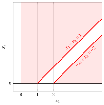{ .fig .ovale loading=lazy  }

        Also the two half-planes defined by the dual constraints have no point in common: the dual feasible region is empty as well.

        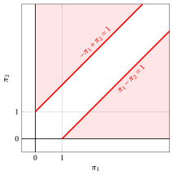{ .fig .ovale loading=lazy  }

!!! esercizio "Exercise 9.22: Primal and dual outcomes (P36)"

    Consider the following LP problem in canonical maximization form with $n=2$ variables and $m=2$ constraints:

    $$
    \begin{array}{rrrrrrrrrrrrr}
    {\max} & {-} \, {x_1} & {-} & \, {x_2} \\[2ex]
    \text{subject to} & {-} \, {x_1} & {-} & \, {x_2} & {\le} & {-2} \\[2ex]
    & \, {x_1} & {-} & \, {x_2} & {\le} & {2} \\[2ex]
    & {x_1,} &  & {x_2} & { \ge} & { 0 }
    \end{array}
    $$

    **Questions**

    1. Write the dual problem.

    2. Determine the outcome of the primal problem (optimal solution, unbounded or infeasible).

    3. Determine the outcome of the dual problem and check that the pair is one of the four cases of the Theorem on the possible outcomes of a pair of primal and dual problems.

??? soluzione "Solution"

    - The dual problem has $m=2$ non-negative variables and $n=2$ greater-than-or-equal-to linear constraints, obtained by transposing the constraint matrix:

        $$
        \begin{array}{rrrrrrrrrrrrr}
        {\min} & {-2} \, {\pi_1} & {+} & {2} \, {\pi_2} \\[2ex]
        \text{subject to} & {-} \, {\pi_1} & {+} & \, {\pi_2} & {\ge} & {-1} \\[2ex]
        & {-} \, {\pi_1} & {-} & \, {\pi_2} & {\ge} & {-1} \\[2ex]
        & {\pi_1,} &  & {\pi_2} & { \ge} & { 0 }
        \end{array}
        $$

    - The primal problem admits an <strong>optimal solution</strong>. Its feasible region is unbounded, but the first constraint imposes $x_1 + x_2 \ge 2$ for every feasible solution, and then

        $$
        - x_1 - x_2 \le -2, \qquad \forall \begin{pmatrix} x_1 \\ x_2\end{pmatrix} \in F .
        $$

        The two feasible solutions $\begin{pmatrix} 0 \\ 2\end{pmatrix}$ and $\begin{pmatrix} 2 \\ 0\end{pmatrix}$ attain this value, and then the optimal value is $z(\, LP \,) = -2$.

    - The dual problem admits an <strong>optimal solution</strong> as well, and by Strong Duality its optimal value is $z(\, D(LP) \,) = -2$. An optimal dual solution is

        $$
        \tilde \pi_1 = 1 \qquad \text{and} \qquad \tilde \pi_2 = 0 ,
        $$

        which is feasible, since $-1 + 0 = -1 \ge -1$ and $-1 - 0 = -1 \ge -1$, and whose objective value is $-2 \cdot 1 + 2 \cdot 0 = -2$.

        The pair is then in the case “<em>both problems admit an optimal solution, with equal optimal values</em>”.

    - <strong>Graphical solution:</strong> the feasible region of the primal problem is the unbounded polyhedron shaded in red. The level curve $-x_1-x_2=-2$, drawn in blue, coincides with the line of the first constraint: all the points of the segment between the two vertices marked in blue are optimal solutions of value $-2$.

        { .fig .ovale loading=lazy  }

        The dual feasible region is the triangle shaded in red; the optimal dual solution $\tilde \pi_1=1$, $\tilde \pi_2=0$ is marked in blue. The level curve $-2\,\pi_1+2\,\pi_2=-2$, drawn in blue, coincides with the line of the first dual constraint, which touches the triangle only at the optimal vertex.

        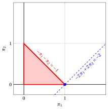{ .fig .ovale loading=lazy  }
