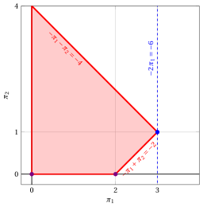
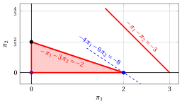
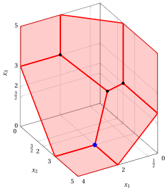

# Exercises · Dual Simplex algorithm

<div class="info-capitolo" markdown>

**Exercises · Chapter 10** · each solution opens with a click · [:material-book-open-variant: Chapter 10](../duality/10-dual-simplex.md) · [:material-file-pdf-box: Exercises, volume 3 (PDF)](../pdf/exercises-3-duality.pdf)

</div>

## Problems with two variables

<a id="esercizio-10-1"></a>

!!! esercizio "Exercise 10.1: Dual simplex algorithm (P11)"

    Consider the following primal LP problem in canonical maximization form with $n=2$ variables and $m=2$ constraints:

    $$
    \begin{array}{rrrrrrrrrrrrr}
    {\max} & {-2}\, {x_1} & {-} & {4}\, {x_2} \\[2ex]
    \text{subject to} & {-}\, {x_1} & {-} & \, {x_2} & {\le} & {-2} \\[1.5ex]
    & \, {x_1} & {-} & \, {x_2} & {\le} & {0} \\[1.5ex]
    & {x_1,} &  & {x_2} & { \ge} & { 0 }
    \end{array}
    $$

    and its dual LP problem in canonical minimization form with $m=2$ variables and $n=2$ constraints:

    $$
    \begin{array}{rrrrrrrrrrrrr}
    {\min} & {-}2\, {\pi_1} &  &  \\[2ex]
    \text{subject to} & {-}\, {\pi_1} & {+} & \, {\pi_2} & {\ge} & {-2} \\[1.5ex]
    & {-}\, {\pi_1} & {-} & \, {\pi_2} & {\ge} & {-4} \\[1.5ex]
    & {\pi_1,} &  & {\pi_2} & { \ge} & { 0 }
    \end{array}
    $$

    Since ${\boldsymbol c} \le {\boldsymbol 0}$, the basis of the $m$ slack variables is <strong>dual feasible</strong> but it is <u>not</u> primal feasible.

    **Questions**

    - Solve the primal LP problem with the dual simplex algorithm and, in parallel, the dual LP problem with the simplex algorithm, showing at each iteration the dual and the primal dictionaries.

??? soluzione "Solution"

    - <span style="color:#e03131"><strong>Initialization</strong></span>

        We shift the indices of the original dual variables by $n=2$ and we add $n=2$ surplus variables in front. We then obtain the following standard maximization form:

        $$
        \begin{array}{rrrrrrrrrrrrr}
        {\max} &  &  &  &  & {2} \, {\pi_3} \\[2ex]
        \text{subject to} & {-}\, {\pi_1} &  &  & {-} & \, {\pi_3} & {+} & \, {\pi_4} & {=} & {-}2 \\[2ex]
        &  & {-} & \, {\pi_2} & {-} & \, {\pi_3} & {-} & \, {\pi_4} & {=} & {-}4 \\[2ex]
        & {\pi_1,} &  & {\pi_2,} &  & {\pi_3,} &  & {\pi_4} & { \ge} & { 0 }
        \end{array}
        $$

        The dual initial dictionary is:

        \begin{equation*}
        \begin{cases}
        \begin{array}{rrrrrrrrrrrrr}
        {\pi_1=2} & {-} & {\pi_3} & {+} & {\pi_4} \\[2ex]
        {\pi_2=4} & {-} & {\pi_3} & {-} & {\pi_4} \\[2ex]
        {-w=0} & {+} & 2\, {\pi_3} &  &
        \end{array}
        \end{cases}
        \end{equation*}

        where  $\pazocal{B}=\{1,2\}$ and $\pazocal{N}=\{3,4\}$. The basic dual feasible solution is:

        $$
        \bar \pi_1=2,~~
        \bar \pi_2=4,~~~~~~
        \bar \pi_3=0,~~
        \bar \pi_4=0~~
        \text{  of value   }0
        $$

        After having added the slack variables to the primal problem, we obtain the following standard form:

        $$
        \begin{array}{rrrrrrrrrrrrr}
        {\max} & {-2}\, {x_1} & {-} & {4}\, {x_2} \\[2ex]
        \text{subject to} & {-}\, {x_1} & {-} & \, {x_2} & {+} & {x_3} &  &  & {=} & {-2} \\[2ex]
        & {x_1} & {-} & \, {x_2} &  &  & {+} & {x_4} & {=} & {0} \\[2ex]
        & {x_1,} &  & {x_2,} &  & {x_3,} &  & {x_4} & { \ge} & { 0 }
        \end{array}
        $$

        The primal initial dictionary is:

        \begin{equation*}
        \begin{cases}
        \begin{array}{rrrrrrrrrrrrr}
        {x_3=-2} & {+} & \, {x_1} & {+} & \, {x_2} \\[2ex]
        {x_4=0} & {-} & {x_1} & {+} & \, {x_2} \\[2ex]
        {z=0} & {-} & 2\, {x_1} & {-} & 4 \, {x_2}
        \end{array}
        \end{cases}
        \end{equation*}

        where $\pazocal{B}=\{3,4\}$ and $\pazocal{N}=\{1,2\}$. The basic primal non-feasible solution is:

        $$
        \bar x_3=-2,~~
        \bar x_4=0,~~~~~~~
        \bar x_1=0,~~
        \bar x_2=0
        \text{  of value   }0
        $$

    - <span style="color:#e03131"><strong>Iteration 1</strong></span>

        The only basic variable with negative value is $x_3$, which is the pivot row. Correspondingly, in the dual dictionary we increase the variable $\pi_3$, and we can get a better dual solution. We have:

        $$
        \begin{cases}
        \pi_1 =& 2 - \pi_3 \\[2ex]
        \pi_2 =& 4 - \pi_3
        \end{cases}
        \qquad
        \qquad
        \begin{cases}
        \underbrace{ 2 - \pi_3 \ge 0}_{\pi_1 \ge 0} \\[2ex]
        \underbrace{  4 -  \pi_3 \ge 0}_{\pi_2 \ge 0}
        \end{cases}
        \qquad
        \qquad
        \begin{cases}
        \pi_3 \le &  2 \\[2ex]
        \pi_3 \le &  4
        \end{cases}
        $$

        These are exactly the ratios of the dual simplex algorithm on the row of $x_3$: $s_m = \min \left\{ \frac{-2}{-1}, \frac{-4}{-1} \right\} = 2$, attained by $x_1$. By increasing the value of $\pi_3$ to $2$, the value of $\pi_1$ decreases to $0$. Then we have that:

        - $\pi_3$ becomes dual basic and, accordingly, $x_3$ becomes primal non-basic;

        - $\pi_1$ becomes dual non-basic and, accordingly, $x_1$ becomes primal basic.

        - For the dual LP problem, we have:

            $$
            \pi_1 = 2 -  \pi_3 + \pi_4 \text{    then     } \pi_3= 2 - \pi_1 + \pi_4 .
            $$

            Substituting in the other equations of the dual dictionary, we get:

            $$
            \pi_2 = 4 -  \left(  2 - \pi_1 + \pi_4  \right) -  \pi_4= 2  + \pi_1 - 2\,\pi_4
            $$

            $$
            -w = 0 + 2\; \left(2 - \pi_1 + \pi_4  \right)  = 4 -2\: \pi_1 +2\: \pi_4
            $$

            Accordingly, we now have the following dual dictionary:

            \begin{equation*}
            \begin{cases}
            \begin{array}{rrrrrrrrrrrrr}
            {\pi_2=2} & {+} & \, {\pi_1} & {-} & 2\, {\pi_4} \\[2ex]
            {\pi_3=2} & {-} & {\pi_1} & {+} & \, {\pi_4} \\[2ex]
            {-w=4} & {-} & {2} \, {\pi_1} & {+} & {2} \, {\pi_4}
            \end{array}
            \end{cases}
            \end{equation*}

            where  $\pazocal{B}=\{2,3\}$ and $\pazocal{N}=\{1,4\}$. The basic dual feasible solution is:

            $$
            \bar  \pi_2=2,~~
            \bar \pi_3=2,~~~~~~~
            \bar \pi_1=0,~~
            \bar \pi_4=0~~
            ~~~\text{of value   } -4
            $$

        - For the primal LP problem, we have:

            $$
            x_3 = -2 +  x_1 + x_2 \text{    then     } x_1= 2 - x_2 + x_3 .
            $$

            Substituting in the other equations of the primal dictionary, we get:

            $$
            x_4 = 0 -   \left(  2 + x_3 - x_2 \right) +   x_2= -2 +2\,x_2 - x_3
            $$

            $$
            z = 0 -  2\; \left(  2 + x_3 - x_2 \right) -  4 \; x_2= - 4 - 2\,x_2 - 2\,x_3
            $$

            Accordingly, we now have the following primal dictionary:

            \begin{equation*}
            \begin{cases}
            \begin{array}{rrrrrrrrrrrrr}
            {x_1=} & {2} & {-} & \, {x_2} & {+} & {x_3} &  \\[2ex]
            {x_4=} & {-2} & {+} & 2\, {x_2} & {-} & \, {x_3} \\[2ex]
            {z=} & {-4} & {-} & 2 \, {x_2} & {-} & 2\, {x_3}
            \end{array}
            \end{cases}
            \end{equation*}

            where $\pazocal{B}=\{1,4\}$ and $\pazocal{N}=\{2,3\}$. The basic primal non-feasible solution is:

            $$
            \bar x_1=2,~~
            \bar x_4=-2,~~~~~~~
            \bar x_2=0,~~
            \bar x_3=0~~
            \text{  of value   }-4
            $$

    - <span style="color:#e03131"><strong>Iteration 2</strong></span>

        The only basic variable with negative value is $x_4$, which is the pivot row. Correspondingly, in the dual dictionary we increase the variable $\pi_4$, and we can get a better dual solution. We have:

        $$
        \begin{cases}
        \pi_2 =& 2 - 2\: \pi_4\\[2ex]
        \pi_3 =& 2 +  \pi_4\\
        \end{cases}
        \qquad
        \qquad
        \begin{cases}
        \underbrace{ 2 - 2\, \pi_4 \ge 0}_{\pi_2 \ge 0}\\[2ex]
        \underbrace{  2 +  \pi_4 \ge 0}_{\pi_3 \ge 0}
        \end{cases}
        \qquad
        \qquad
        \begin{cases}
        \pi_4 \le&  1 \\[2ex]
        \pi_4 \ge&  -2
        \end{cases}
        $$

        These are exactly the ratios of the dual simplex algorithm on the row of $x_4$: $s_m = \frac{-2}{-2} = 1$, attained by $x_2$ ($\bar a_{43} = 1 > 0$ gives no candidate). By increasing the value of $\pi_4$ to $1$, the value of $\pi_2$ decreases to $0$. Then we have that:

        - $\pi_4$ becomes dual basic and, accordingly, $x_4$ becomes primal non-basic;

        - $\pi_2$ becomes dual non-basic and, accordingly, $x_2$ becomes primal basic.

        - For the dual LP problem, we have:

            $$
            \pi_2 = 2  -2\: \pi_4 + \pi_1 \text{    then     } \pi_4= 1 +\dfrac{1}{2}\: \pi_1 -\dfrac{1}{2}\: \pi_2.
            $$

            Substituting in the other equations of the dual dictionary, we get:

            $$
            \pi_3 = 2 +  \left(  1 +\dfrac{1}{2}\: \pi_1 -\dfrac{1}{2}\: \pi_2 \right) - \:\pi_1= 3 - \dfrac{1}{2}\: \pi_1 - \dfrac{1}{2}\: \pi_2
            $$

            $$
            -w =  4  + 2\;  \left(  1 +\dfrac{1}{2}\: \pi_1 -\dfrac{1}{2}\: \pi_2 \right)  -2\: \pi_1 = 6 - \pi_1 - \pi_2
            $$

            Accordingly, we now have the following optimal dual dictionary:

            \begin{equation*}
            \begin{cases}
            \begin{array}{rrrrrrrrrrrrr}
            {\pi_3=} & {3} & {-} & {\dfrac{1}{2}} \, {\pi_1} & {-} & {\dfrac{1}{2}}\, {\pi_2} \\[2ex]
            {\pi_4=} & {1} & {+} & {\dfrac{1}{2}}\, {\pi_1} & {-} & {\dfrac{1}{2}}\, {\pi_2} \\[2ex]
            {-w = } & {6} & {-} & {\pi_1} & {-} & {\pi_2}
            \end{array}
            \end{cases}
            \end{equation*}

            where  $\pazocal{B}=\{3,4\}$ and $\pazocal{N}=\{1,2\}$. All the coefficients of the objective function are non-positive, and then the dual basic optimal solution is:

            $$
            \tilde \pi_3=3,~~
            \tilde \pi_4=1,~~~~~~~
            \tilde \pi_1=0,~~
            \tilde \pi_2=0~~
            ~~~\text{of value   } -6
            $$

            Recalling that the original dual variables are the shifted variables $\pi_3,\pi_4$, the optimal solution of the original dual LP problem is:

            $$
            \tilde{\pi}_1=3,~~
            \tilde{\pi}_2=1,
            \text{   and   }
            z(D(LP))=-6.
            $$

        - For the primal LP problem, we have:

            $$
            x_4 = -2 -  x_3 + 2 \,x_2 \text{    then     } x_2= 1 + \dfrac{1}{2}\,x_3 + \dfrac{1}{2}\,x_4.
            $$

            Substituting in the other equations of the primal dictionary, we get:

            $$
            x_1 = 2 + x_3 -   \left(  1 + \dfrac{1}{2}\,x_3 + \dfrac{1}{2}\,x_4 \right) = 1 + \dfrac{1}{2} \,x_3 - \dfrac{1}{2} \,x_4
            $$

            $$
            z = -4 -2\,x_3-  2\; \left(  1 + \dfrac{1}{2}\,x_3 + \dfrac{1}{2}\,x_4 \right) = -6 -3\,x_3 -x_4
            $$

            Accordingly, we now have the following optimal primal dictionary:

            \begin{equation*}
            \begin{cases}
            \begin{array}{rrrrrrrrrrrrr}
            {x_1=} & {1} & {+} & {\dfrac{1}{2}} \, {x_3} & {-} & {\dfrac{1}{2}}\, {x_4} \\[2ex]
            {x_2=} & {1} & {+} & {\dfrac{1}{2}} \, {x_3} & {+} & {\dfrac{1}{2}} \, {x_4} \\[2ex]
            {z=} & {-6} & {-} & 3\, {x_3} & {-} & \, {x_4}
            \end{array}
            \end{cases}
            \end{equation*}

            where $\pazocal{B}=\{1,2\}$ and $\pazocal{N}=\{3,4\}$. The basic solution is now primal feasible and dual feasible, and then the primal basic optimal solution is:

            $$
            \tilde x_1=1,~~
            \tilde x_2=1,~~~~~~~
            \tilde x_3=0,~~
            \tilde x_4=0~~
            \text{  of value   }-6 ,
            $$

            in accordance with the Strong Duality theorem.

    <strong>Graphical solution:</strong>

    The feasible region of the LP problem in canonical form is the polyhedron shaded in red. The feasible region is unbounded.

    { .fig .ovale loading=lazy  }

    An optimal primal LP solution is:

    $$
    \tilde{x}_1=1,~~
    \tilde{x}_2=1 \text{   and   } z(\,LP\,)=-6
    $$

    The feasible region of the dual LP problem in canonical minimization form is the polyhedron shaded in red. In the following figure we plot the two original dual variables $\pi_1,\pi_2$, corresponding to the variables $\pi_3,\pi_4$ of the dual dictionaries. 

    { .fig .ovale loading=lazy  }

    An optimal dual LP solution is:

    $$
    \tilde{\pi}_1=3,~~
    \tilde{\pi}_2=1
    \text{   and    } z(~ D(LP)~) =-6.
    $$

    In violet, we show the first and the second vertex explored by the previous execution of the dual simplex algorithm, before reaching the optimal one depicted in blue.

<a id="esercizio-10-2"></a>

!!! esercizio "Exercise 10.2: Dual simplex algorithm (P12)"

    Consider the following primal LP problem in canonical maximization form with $n=2$ variables and $m=2$ constraints:

    $$
    \begin{array}{rrrrrrrrrrrrr}
    {\max} & {-} \, {x_1} & {-} & {2} \, {x_2} \\[1.5ex]
    \text{subject to} & {-} \, {x_1} & {-} & {x_2} & {\le} & {-3} \\[1.5ex]
    & \, {x_1} & {-} & {2} \, {x_2} & {\le} & {-1} \\[1.5ex]
    & {x_1,} &  & {x_2} & { \ge} & { 0 }
    \end{array}
    $$

    and its dual LP problem in canonical minimization form with $m=2$ variables and $n=2$ constraints:

    $$
    \begin{array}{rrrrrrrrrrrrr}
    {\min} & {-3}\, {\pi_1} & {-} & {\pi_2} \\[2ex]
    \text{subject to} & {-} \, {\pi_1} & {+} & \, {\pi_2} & {\ge} & {-1} \\[1.5ex]
    & {-} \, {\pi_1} & {-} & {2} \, {\pi_2} & {\ge} & {-2} \\[1.5ex]
    & {\pi_1}, &  & {\pi_2} & { \ge} & { 0 }
    \end{array}
    $$

    Since ${\boldsymbol c} \le {\boldsymbol 0}$, the basis of the $m$ slack variables is <strong>dual feasible</strong> but it is <u>not</u> primal feasible.

    **Questions**

    - Solve the primal LP problem with the dual simplex algorithm and, in parallel, the dual LP problem with the simplex algorithm, showing at each iteration the dual and the primal dictionaries.

??? soluzione "Solution"

    - <span style="color:#e03131"><strong>Initialization</strong></span>

        We shift the indices of the original dual variables by $n=2$ and we add $n=2$ surplus variables in front. We then obtain the following standard maximization form:

        $$
        \begin{array}{rrrrrrrrrrrrr}
        {\max} &  &  &  &  &  & {3}\, {\pi_3} & {+} & {\pi_4} \\[2ex]
        \text{subject to} & {-} & \, {\pi_1} &  &  & {-} & \, {\pi_3} & {+} & \, {\pi_4} & {=} & {-1} \\[1.5ex]
        &  &  & {-} & \, {\pi_2} & {-} & \, {\pi_3} & {-} & {2} \, {\pi_4} & {=} & {-2} \\[1.5ex]
        &  & {\pi_1}, &  & {\pi_2}, &  & {\pi_3}, &  & {\pi_4} & { \ge} & { 0 }
        \end{array}
        $$

        The dual initial dictionary is:

        \begin{equation*}
        \begin{cases}
        \begin{array}{rrrrrrrrrrrrr}
        {\pi_1=} & {1} & {-} & \, {\pi_3} & {+} & \, {\pi_4} \\[2ex]
        {\pi_2=} & {2} & {-} & \, {\pi_3} & {-} & {2} \, {\pi_4} \\[2ex]
        {-w=} & {0} & {+} & {3} \, {\pi_3} & {+} & \, {\pi_4}
        \end{array}
        \end{cases}
        \end{equation*}

        where  $\pazocal{B}=\{1,2\}$ and $\pazocal{N}=\{3,4\}$. The basic dual feasible solution is:

        $$
        \bar \pi_1=1,~~
        \bar \pi_2=2,~~~~~
        \bar \pi_3=0,~~
        \bar \pi_4=0
        $$

        with $-w=0$, i.e., $w=0$.

        After having added the slack variables to the primal problem, we obtain the following standard form:

        $$
        \begin{array}{rrrrrrrrrrrrr}
        {\max} & {-} \, {x_1} & {-} & {2} \, {x_2} \\[1.5ex]
        \text{subject to} & {-} \, {x_1} & {-} & {x_2} & {+} & {x_3} &  &  & {=} & {-3} \\[1.5ex]
        & \, {x_1} & {-} & {2} \, {x_2} &  &  & {+} & {x_4} & {=} & {-1} \\[1.5ex]
        & {x_1,} &  & {x_2,} &  & {x_3,} &  & {x_4} & { \ge} & { 0 }
        \end{array}
        $$

        The primal initial dictionary is:

        \begin{equation*}
        \begin{cases}
        \begin{array}{rrrrrrrrrrrrr}
        {x_3=} & {-3} & {+} & \, {x_1} & {+} & \, {x_2} \\[2ex]
        {x_4=} & {-1} & {-} & \, {x_1} & {+} & {2} \, {x_2} \\[2ex]
        {z=} & {0} & {-} & \, {x_1} & {-} & {2} \, {x_2}
        \end{array}
        \end{cases}
        \end{equation*}

        where $\pazocal{B}=\{3,4\}$ and $\pazocal{N}=\{1,2\}$. The basic primal non-feasible solution is:

        $$
        \bar x_3=-3,~~
        \bar x_4=-1,~~~~~~
        \bar x_1=0,~~
        \bar x_2=0~~
        \text{  of value   }0
        $$

    - <span style="color:#e03131"><strong>Iteration 1</strong></span>

        In the primal dictionary, the basic variables with negative value are $x_3$ and $x_4$: by the smallest-index rule the pivot row is $x_3$. Correspondingly, in the dual dictionary we increase the variable $\pi_3$, and we can get a better dual solution. We have:

        $$
        \begin{cases}
        \pi_1 =& 1 - \, \pi_3 \\[2ex]
        \pi_2 =& 2 - \, \pi_3
        \end{cases}
        \qquad
        \qquad
        \begin{cases}
        \underbrace{ 1 - \, \pi_3 \ge 0}_{\pi_1 \ge 0} \\[2ex]
        \underbrace{ 2 - \, \pi_3 \ge 0}_{\pi_2 \ge 0}
        \end{cases}
        \qquad
        \qquad
        \begin{cases}
        \pi_3 \le&  1 \\[2ex]
        \pi_3 \le&  2
        \end{cases}
        $$

        These are exactly the ratios of the dual simplex algorithm on the row of $x_3$: $s_m = \min \left\{ \frac{-1}{-1}, \frac{-2}{-1} \right\} = 1$, attained by $x_1$. By increasing the value of $\pi_3$ to $1$, the value of $\pi_1$ decreases to $0$. Then we have that:

        - $\pi_3$ becomes dual basic and, accordingly, $x_3$ becomes primal non-basic;

        - $\pi_1$ becomes dual non-basic and, accordingly, $x_1$ becomes primal basic.

        - For the dual LP problem, we have:

            $$
            \pi_1= 1 - \, \pi_3 + \, \pi_4
            \text{    then     }
            \pi_3 = 1 - \pi_1 + \pi_4 .
            $$

            Substituting in the other equations of the dual dictionary, we get:

            $$
            \pi_2 = 2 - \left(1 - \pi_1 + \pi_4 \right) - 2 \, \pi_4
            = 1 + \pi_1 - 3 \, \pi_4
            $$

            $$
            -w = 3 \left(1 - \pi_1 + \pi_4 \right) + \pi_4
            = 3 - 3 \, \pi_1 + 4 \, \pi_4
            $$

            Accordingly, we now have the following dual dictionary:

            \begin{equation*}
            \begin{cases}
            \begin{array}{rrrrrrrrrrrrr}
            {\pi_2=} & {1} & {+} & \, {\pi_1} & {-} & {3} \, {\pi_4} \\[2ex]
            {\pi_3=} & {1} & {-} & \, {\pi_1} & {+} & \, {\pi_4} \\[2ex]
            {-w=} & {3} & {-} & {3} \, {\pi_1} & {+} & {4} \, {\pi_4}
            \end{array}
            \end{cases}
            \end{equation*}

            where  $\pazocal{B}=\{2,3\}$ and $\pazocal{N}=\{1,4\}$. The basic dual feasible solution is:

            $$
            \bar  \pi_2=1,~~
            \bar \pi_3=1,~~~~~~
            \bar \pi_1=0,~~
            \bar \pi_4=0,
            ~~~ -w=3, \quad w=-3.
            $$

        - For the primal LP problem, we have:

            $$
            x_3 = - 3 + x_1 + x_2
            \text{    then     }
            x_1 = 3 - x_2 + x_3 .
            $$

            Substituting in the other equations of the primal dictionary, we get:

            $$
            x_4 = - 1 - \left(3 - x_2 + x_3 \right) + 2 \, x_2
            = - 4 + 3 \, x_2 - x_3
            $$

            $$
            z = - \left(3 - x_2 + x_3 \right) - 2 \, x_2
            = - 3 - x_2 - x_3
            $$

            Accordingly, we now have the following primal dictionary:

            \begin{equation*}
            \begin{cases}
            \begin{array}{rrrrrrrrrrrrr}
            {x_1=} & {3} & {-} & \, {x_2} & {+} & \, {x_3} \\[2ex]
            {x_4=} & {-4} & {+} & {3} \, {x_2} & {-} & \, {x_3} \\[2ex]
            {z=} & {-3} & {-} & \, {x_2} & {-} & \, {x_3}
            \end{array}
            \end{cases}
            \end{equation*}

            where $\pazocal{B}=\{1,4\}$ and $\pazocal{N}=\{2,3\}$. The basic primal non-feasible solution is:

            $$
            \bar x_1=3,~~
            \bar x_4=-4,~~~~~~
            \bar x_2=0,~~
            \bar x_3=0~~
            \text{  of value   }-3
            $$

    - <span style="color:#e03131"><strong>Iteration 2</strong></span>

        The only basic variable with negative value is $x_4$, which is the pivot row. Correspondingly, in the dual dictionary we increase the variable $\pi_4$, and we can get a better dual solution. We have:

        $$
        \begin{cases}
        \pi_2 =& 1 -3\, \pi_4\\[2ex]
        \pi_3 =& 1 + \pi_4
        \end{cases}
        \qquad
        \qquad
        \begin{cases}
        \underbrace{ 1 -3\, \pi_4 \ge 0}_{\pi_2 \ge 0}\\[2ex]
        \underbrace{ 1 + \pi_4 \ge 0}_{\pi_3 \ge 0}
        \end{cases}
        \qquad
        \qquad
        \begin{cases}
        \pi_4 \le&  \frac{1}{3} \\[2ex]
        \pi_4 \ge&  -1
        \end{cases}
        $$

        These are exactly the ratios of the dual simplex algorithm on the row of $x_4$: $s_m = \frac{-1}{-3} = \frac{1}{3}$, attained by $x_2$ ($\bar a_{43} = 1 > 0$ gives no candidate). By increasing the value of $\pi_4$ to $\frac{1}{3}$, the value of $\pi_2$ decreases to $0$. Then we have that:

        - $\pi_4$ becomes dual basic and, accordingly, $x_4$ becomes primal non-basic;

        - $\pi_2$ becomes dual non-basic and, accordingly, $x_2$ becomes primal basic.

        - For the dual LP problem, we have:

            $$
            \pi_2 =  1 + \pi_1 - 3 \pi_4
            \text{    then     }
            \pi_4 =  \frac{1}{3} + \frac{1}{3} \, \pi_1 - \frac{1}{3} \, \pi_2 .
            $$

            Substituting in the other equations of the dual dictionary, we get:

            $$
            \pi_3 = 1 - \pi_1 + \left( \frac{1}{3} + \frac{1}{3} \, \pi_1 - \frac{1}{3} \, \pi_2 \right)
            = \frac{4}{3} - \frac{2}{3}\, \pi_1 - \frac{1}{3} \, \pi_2
            $$

            $$
            -w = 3 - 3 \, \pi_1 + 4 \left( \frac{1}{3} + \frac{1}{3} \, \pi_1 - \frac{1}{3} \, \pi_2 \right)
            = \frac{13}{3} - \frac{5}{3} \, \pi_1 - \frac{4}{3} \, \pi_2 .
            $$

            Accordingly, we now have the following optimal dual dictionary:

            \begin{equation*}
            \begin{cases}
            \begin{array}{rrrrrrrrrrrrr}
            {\pi_3=} & {\frac{4}{3}} & {-} & {\frac{2}{3}\, \pi_1} & {-} & {\frac{1}{3} \, \pi_2} \\[2ex]
            {\pi_4=} & {\frac{1}{3}} & {+} & {\frac{1}{3} \, \pi_1} & {-} & {\frac{1}{3} \, \pi_2} \\[2ex]
            {-w =} & {\frac{13}{3}} & {-} & {\frac{5}{3} \, \pi_1} & {-} & {\frac{4}{3} \, \pi_2}
            \end{array}
            \end{cases}
            \end{equation*}

            where  $\pazocal{B}=\{3,4\}$ and $\pazocal{N}=\{1,2\}$. All the coefficients of the objective function are non-positive, and then the dual basic optimal solution is:

            $$
            \tilde \pi_3=\frac{4}{3},~~
            \tilde \pi_4=\frac{1}{3},~~~~~~
            \tilde \pi_1=0,~~
            \tilde \pi_2=0,
            ~~~ -w=\frac{13}{3},\quad w=-\frac{13}{3}.
            $$

            Recalling that the original dual variables are the shifted variables $\pi_3,\pi_4$, the optimal solution of the original dual LP problem is:

            $$
            \tilde{\pi}_1=\frac{4}{3},~~
            \tilde{\pi}_2=\frac{1}{3},
            \text{   and   }
            z(D(LP))=-\frac{13}{3}.
            $$

        - For the primal LP problem, we have:

            $$
            x_4 = -4 + 3 \, x_2 - x_3
            \text{    then     }
            x_2 = \frac{4}{3} + \frac{1}{3} \, x_3 + \frac{1}{3} \, x_4 .
            $$

            Substituting in the other equations of the primal dictionary, we get:

            $$
            x_1 = 3 - \left( \frac{4}{3} + \frac{1}{3} \, x_3 + \frac{1}{3} \, x_4 \right) + x_3
            = \frac{5}{3} + \frac{2}{3} \, x_3 - \frac{1}{3} \, x_4
            $$

            $$
            z = -3 - \left( \frac{4}{3} + \frac{1}{3} \, x_3 + \frac{1}{3} \, x_4 \right) - x_3
            = - \frac{13}{3} - \frac{4}{3} \, x_3 - \frac{1}{3} \, x_4
            $$

            Accordingly, we now have the following optimal primal dictionary:

            \begin{equation*}
            \begin{cases}
            \begin{array}{rrrrrrrrrrrrr}
            {x_1=} & {\frac{5}{3}} & {+} & {\frac{2}{3}} \, {x_3} & {-} & {\frac{1}{3}\, x_4} \\[2ex]
            {x_2=} & {\frac{4}{3}} & {+} & {\frac{1}{3}} \, {x_3} & {+} & {\frac{1}{3}} \, {x_4} \\[2ex]
            {z=} & {-\frac{13}{3}} & {-} & {\frac{4}{3}} \, {x_3} & {-} & {\frac{1}{3}} \, {x_4}
            \end{array}
            \end{cases}
            \end{equation*}

            where $\pazocal{B}=\{1,2\}$ and $\pazocal{N}=\{3,4\}$. The basic solution is now primal feasible and dual feasible, and then the primal basic optimal solution is:

            $$
            \tilde x_1=\frac{5}{3},~~
            \tilde x_2=\frac{4}{3},~~~~~~
            \tilde x_3=0,~~
            \tilde x_4=0~~
            \text{  of value   } -\frac{13}{3} ,
            $$

            in accordance with the Strong Duality theorem.

    <strong>Graphical solution:</strong>

    The feasible region of the LP problem in canonical form is the polyhedron shaded in red. The feasible region is unbounded. 

    { .fig .ovale loading=lazy  }

    An optimal primal LP solution is:

    $$
    \tilde{x}_1=\frac{5}{3},~~
    \tilde{x}_2=\frac{4}{3}
    \text{   and   }
    z(\,LP\,)=-\frac{13}{3}.
    $$

    The feasible region of the dual LP problem in canonical minimization form is the polyhedron shaded in red. In the following figure we plot the two original dual variables $\pi_1,\pi_2$, corresponding to the variables $\pi_3,\pi_4$ of the dual dictionaries. 

    { .fig .ovale loading=lazy  }

    An optimal dual LP solution is:

    $$
    \tilde{\pi}_1=\frac{4}{3},~~
    \tilde{\pi}_2=\frac{1}{3},
    \text{   and    } z(~ D(LP)~) =-\frac{13}{3}.
    $$

    In violet, we show the first and the second vertex explored by the previous execution of the dual simplex algorithm, before reaching the optimal one depicted in blue.

<a id="esercizio-10-3"></a>

!!! esercizio "Exercise 10.3: Dual simplex algorithm (P13)"

    Consider the following primal LP problem in canonical maximization form with $n=2$ variables and $m=3$ constraints:

    $$
    \begin{array}{rrrrrrrrrrrrr}
    {\max} & {-} \, {x_1} & {-} & {3} \, {x_2} \\[1.5ex]
    \text{subject to} & {-} \, {x_1} & {-} & {2}\, {x_2} & {\le} & {-6} \\[1.5ex]
    & \, {x_1} & {-} & {4} \, {x_2} & {\le} & {-6} \\[1.5ex]
    & {2} \, {x_1} & {-} & {2} \, {x_2} & {\le} & {3} \\[1.5ex]
    & {x_1,} &  & {x_2} & { \ge} & { 0 }
    \end{array}
    $$

    and its dual LP problem in canonical minimization form with $m=3$ variables and $n=2$ constraints:

    $$
    \begin{array}{rrrrrrrrrrrrr}
    {\min} & {-6}\, {\pi_1} & {-} & {6} \, {\pi_2} & {+} & {3} \, {\pi_3} \\[2ex]
    \text{subject to} & {-} \, {\pi_1} & {+} & \, {\pi_2} & {+} & {2}\, {\pi_3} & {\ge} & {-1} \\[1.5ex]
    & {-2} {\pi_1} & {-} & {4} \, {\pi_2} & {-} & {2} \, {\pi_3} & {\ge} & {-3} \\[1.5ex]
    & {\pi_1}, &  & {\pi_2}, &  & {\pi_3} & { \ge} & { 0 }
    \end{array}
    $$

    Since ${\boldsymbol c} \le {\boldsymbol 0}$, the basis of the $m$ slack variables is <strong>dual feasible</strong> but it is <u>not</u> primal feasible.

    **Questions**

    - Solve the primal LP problem with the dual simplex algorithm and, in parallel, the dual LP problem with the simplex algorithm, showing at each iteration the dual and the primal dictionaries.

??? soluzione "Solution"

    - <span style="color:#e03131"><strong>Initialization</strong></span>

        We shift the indices of the original dual variables by $n=2$ and we add $n=2$ surplus variables in front. We then obtain the following standard maximization form:

        $$
        \begin{array}{rrrrrrrrrrrrr}
        {\max} &  &  &  &  &  & {6}\, {\pi_3} & {+} & {6} \, {\pi_4} & {-} & {3} \, {\pi_5} \\[2ex]
        \text{subject to} & {-} & \, {\pi_1} &  &  & {-} & \, {\pi_3} & {+} & \, {\pi_4} & {+} & {2} \, {\pi_5} & {=} & {-1} \\[1.5ex]
        &  &  & {-} & \, {\pi_2} & {-} & {2} \, {\pi_3} & {-} & {4} \, {\pi_4} & {-} & {2} \, {\pi_5} & {=} & {-3} \\[1.5ex]
        &  & {\pi_1}, &  & {\pi_2}, &  & {\pi_3}, &  & {\pi_4}, &  & {\pi_5} & { \ge} & { 0 }
        \end{array}
        $$

        The dual initial dictionary is:

        \begin{equation*}
        \begin{cases}
        \begin{array}{rrrrrrrrrrrrr}
        {\pi_1=} & {1} & {-} & \, {\pi_3} & {+} & \, {\pi_4} & {+} & {2} \, {\pi_5} \\[2ex]
        {\pi_2=} & {3} & {-} & {2} \, {\pi_3} & {-} & {4} \, {\pi_4} & {-} & {2} \, {\pi_5} \\[2ex]
        {-w=} & {0} & {+} & {6} \, {\pi_3} & {+} & {6} \, {\pi_4} & {-} & {3} \, {\pi_5}
        \end{array}
        \end{cases}
        \end{equation*}

        where  $\pazocal{B}=\{1,2\}$ and $\pazocal{N}=\{3,4,5\}$. The basic dual feasible solution is:

        $$
        \bar \pi_1=1,~~
        \bar \pi_2=3,~~~~~
        \bar \pi_3=0,~~
        \bar \pi_4=0,~~
        \bar \pi_5=0
        $$

        with $-w=0$, i.e., $w=0$.

        After having added the slack variables to the primal problem, we obtain the following standard form:

        $$
        \begin{array}{rrrrrrrrrrrrr}
        {\max} & {-} \, {x_1} & {-} & {3} \, {x_2} \\[1.5ex]
        \text{subject to} & {-} \, {x_1} & {-} & {2} \, {x_2} & {+} & {x_3} &  &  &  &  & {=} & {-6} \\[1.5ex]
        & \, {x_1} & {-} & {4} \, {x_2} &  &  & {+} & {x_4} &  &  & {=} & {-6} \\[1.5ex]
        & {2} \, {x_1} & {-} & {2} \, {x_2} &  &  &  &  & {+} & {x_5} & {=} & {3} \\[1.5ex]
        & {x_1,} &  & {x_2,} &  & {x_3,} &  & {x_4,} &  & {x_5} & { \ge} & { 0 }
        \end{array}
        $$

        The primal initial dictionary is:

        \begin{equation*}
        \begin{cases}
        \begin{array}{rrrrrrrrrrrrr}
        {x_3=} & {-6} & {+} & \, {x_1} & {+} & {2} \, {x_2} \\[2ex]
        {x_4=} & {-6} & {-} & \, {x_1} & {+} & {4} \, {x_2} \\[2ex]
        {x_5=} & {3} & {-} & {2} \, {x_1} & {+} & {2} \, {x_2} \\[2ex]
        {z=} & {0} & {-} & \, {x_1} & {-} & {3} \, {x_2}
        \end{array}
        \end{cases}
        \end{equation*}

        where $\pazocal{B}=\{3,4,5\}$ and $\pazocal{N}=\{1,2\}$. The basic primal non-feasible solution is:

        $$
        \bar x_3=-6,~~
        \bar x_4=-6,~~
        \bar x_5=3,~~~~~~
        \bar x_1=0,~~
        \bar x_2=0~~
        \text{  of value   }0
        $$

    - <span style="color:#e03131"><strong>Iteration 1</strong></span>

        In the primal dictionary, the basic variables with negative value are $x_3$ and $x_4$: by the smallest-index rule the pivot row is $x_3$. Correspondingly, in the dual dictionary we increase the variable $\pi_3$, and we can get a better dual solution. We have:

        $$
        \begin{cases}
        \pi_1 =& 1 - \, \pi_3 \\[2ex]
        \pi_2 =& 3 - 2 \,\pi_3
        \end{cases}
        \qquad
        \qquad
        \begin{cases}
        \underbrace{ 1 - \, \pi_3 \ge 0}_{\pi_1 \ge 0} \\[2ex]
        \underbrace{ 3 - 2 \, \pi_3 \ge 0}_{\pi_2 \ge 0}
        \end{cases}
        \qquad
        \qquad
        \begin{cases}
        \pi_3 \le&  1 \\[2ex]
        \pi_3 \le&  \frac{3}{2}
        \end{cases}
        $$

        These are exactly the ratios of the dual simplex algorithm on the row of $x_3$: $s_m = \min \left\{ \frac{-1}{-1}, \frac{-3}{-2} \right\} = 1$, attained by $x_1$. By increasing the value of $\pi_3$ to $1$, the value of $\pi_1$ decreases to $0$. Then we have that:

        - $\pi_3$ becomes dual basic and, accordingly, $x_3$ becomes primal non-basic;

        - $\pi_1$ becomes dual non-basic and, accordingly, $x_1$ becomes primal basic.

        - For the dual LP problem, we have:

            $$
            \pi_1= 1 - \, \pi_3 + \, \pi_4 + 2 \,\pi_5
            \text{    then     } \pi_3 = 1 - \pi_1 + \pi_4 + 2 \, \pi_5 .
            $$

            Substituting in the other equations of the dual dictionary, we get:

            $$
            \pi_2 = 3 -  2 \left(1 - \pi_1 + \pi_4 + 2 \, \pi_5 \right) - 4 \, \pi_4 - 2 \, \pi_5 = 1 + 2 \, \pi_1 - 6 \, \pi_4 - 6 \, \pi_5
            $$

            $$
            -w = 0 + 6 \; \left(1 - \pi_1 + \pi_4 + 2 \, \pi_5 \right) + 6 \, \pi_4 - 3 \, \pi_5 = 6 - 6 \, \pi_1  + 12 \, \pi_4 + 9 \, \pi_5
            $$

            Accordingly, we now have the following dual dictionary:

            \begin{equation*}
            \begin{cases}
            \begin{array}{rrrrrrrrrrrrr}
            {\pi_2=} & {1} & {+} & {2} \, {\pi_1} & {-} & {6} \, {\pi_4} & {-} & {6} \, {\pi_5} \\[2ex]
            {\pi_3=} & {1} & {-} & \, {\pi_1} & {+} & \, {\pi_4} & {+} & {2} \, {\pi_5} \\[2ex]
            {-w=} & {6} & {-} & {6} \, {\pi_1} & {+} & {12} \, {\pi_4} & {+} & {9} \, {\pi_5}
            \end{array}
            \end{cases}
            \end{equation*}

            where  $\pazocal{B}=\{2,3\}$ and $\pazocal{N}=\{1,4,5\}$. The basic dual feasible solution is:

            $$
            \bar  \pi_2=1,~~
            \bar \pi_3=1,~~~~~~
            \bar \pi_1=0,~~
            \bar \pi_4=0,~~
            \bar \pi_5=0,
            ~~~ -w=6, \quad w=-6.
            $$

        - For the primal LP problem, we have:

            $$
            x_3 = - 6 + x_1 + 2 \, x_2 \text{    then     } x_1 = 6 - 2 x_2 + x_3 .
            $$

            Substituting in the other equations of the primal dictionary, we get:

            $$
            x_4 = - 6 - \left( 6 - 2 x_2 + x_3 \right) +  4\, x_2 = - 12  + 6 \,x_2 - x_3
            $$

            $$
            x_5 = 3 - 2 \, \left( 6 - 2 x_2 + x_3 \right) + 2 \, x_2 = - 9 + 6 \, x_2 - 2 \, x_3
            $$

            $$
            z = 0 -  \, \left( 6 - 2 x_2 + x_3 \right) -  3 \; x_2= - 6 - \,x_2 - \,x_3
            $$

            Accordingly, we now have the following primal dictionary:

            \begin{equation*}
            \begin{cases}
            \begin{array}{rrrrrrrrrrrrr}
            {x_1=} & {6} & {-} & {2} \, {x_2} & {+} & {x_3} &  \\[2ex]
            {x_4=} & {-12} & {+} & {6} \, {x_2} & {-} & \, {x_3} \\[2ex]
            {x_5=} & {-9} & {+} & {6} \, {x_2} & {-} & {2} \, {x_3} \\[2ex]
            {z=} & {-6} & {-} & \, {x_2} & {-} & \, {x_3}
            \end{array}
            \end{cases}
            \end{equation*}

            where $\pazocal{B}=\{1,4,5\}$ and $\pazocal{N}=\{2,3\}$. The basic primal non-feasible solution is:

            $$
            \bar x_1=6,~~
            \bar x_4=-12,~~
            \bar x_5=-9,~~~~~~
            \bar x_2=0,~~
            \bar x_3=0~~
            \text{  of value   }-6
            $$

    - <span style="color:#e03131"><strong>Iteration 2</strong></span>

        In the primal dictionary, the basic variables with negative value are $x_4$ and $x_5$: by the smallest-index rule the pivot row is $x_4$. Correspondingly, in the dual dictionary we increase the variable $\pi_4$, and we can get a better dual solution. We have:

        $$
        \begin{cases}
        \pi_2 =& 1 -6\, \pi_4\\[2ex]
        \pi_3 =& 1 +  \pi_4
        \end{cases}
        \qquad
        \qquad
        \begin{cases}
        \underbrace{ 1 -6\, \pi_4 \ge 0}_{\pi_2 \ge 0}\\[2ex]
        \underbrace{ 1 + \pi_4 \ge 0}_{\pi_3 \ge 0}
        \end{cases}
        \qquad
        \qquad
        \begin{cases}
        \pi_4 \le&  \frac{1}{6} \\[2ex]
        \pi_4 \ge&  -1
        \end{cases}
        $$

        These are exactly the ratios of the dual simplex algorithm on the row of $x_4$: $s_m = \frac{-1}{-6} = \frac{1}{6}$, attained by $x_2$ ($\bar a_{43} = 1 > 0$ gives no candidate). By increasing the value of $\pi_4$ to $\frac{1}{6}$, the value of $\pi_2$ decreases to $0$. Then we have that:

        - $\pi_4$ becomes dual basic and, accordingly, $x_4$ becomes primal non-basic;

        - $\pi_2$ becomes dual non-basic and, accordingly, $x_2$ becomes primal basic.

        - For the dual LP problem, we have:

            $$
            \pi_2 =  1 + 2 \, \pi_1 - 6 \, \pi_4 - 6 \, \pi_5 \text{    then     } \pi_4 =  \frac{1}{6} + \frac{1}{3} \, \pi_1 - \frac{1}{6} \, \pi_2 - \, \pi_5.
            $$

            Substituting in the other equations of the dual dictionary, we get:

            $$
            \pi_3 = 1 - \pi_1 + \left( \frac{1}{6} + \frac{1}{3} \, \pi_1 - \frac{1}{6} \, \pi_2 - \, \pi_5 \right) + 2\, \pi_5 = \frac{7}{6} - \frac{2}{3}\: \pi_1 - \frac{1}{6} \, \pi_2 + \pi_5
            $$

            $$
            -w =  6  - 6 \, \pi_1 + 12 \;  \left( \frac{1}{6} + \frac{1}{3} \, \pi_1 - \frac{1}{6} \, \pi_2 - \, \pi_5 \right)  + 9 \, \pi_5 = 8 - 2 \, \pi_1 - 2\, \pi_2 - 3 \, \pi_5 .
            $$

            Accordingly, we now have the following optimal dual dictionary:

            \begin{equation*}
            \begin{cases}
            \begin{array}{rrrrrrrrrrrrr}
            {\pi_3=} & {\frac{7}{6}} & {-} & {\frac{2}{3}\: \pi_1} & {-} & {\frac{1}{6} \, \pi_2} & {+} & \, {\pi_5} \\[2ex]
            {\pi_4=} & {\frac{1}{6}} & {+} & {\frac{1}{3} \, \pi_1} & {-} & {\frac{1}{6} \, \pi_2} & {-} & {\, \pi_5} \\[2ex]
            {-w =} & {8} & {-} & {2} \, {\pi_1} & {-} & {2} \, {\pi_2} & {-} & {3} \, {\pi_5}
            \end{array}
            \end{cases}
            \end{equation*}

            where  $\pazocal{B}=\{3,4\}$ and $\pazocal{N}=\{1,2,5\}$. All the coefficients of the objective function are non-positive, and then the dual basic optimal solution is:

            $$
            \tilde \pi_3=\frac{7}{6},~~
            \tilde \pi_4=\frac{1}{6},~~~~~~
            \tilde \pi_1=0,~~
            \tilde \pi_2=0,~~
            \tilde \pi_5=0,
            ~~~ -w=8,\quad w=-8.
            $$

            Recalling that the original dual variables are the shifted variables $\pi_3,\pi_4,\pi_5$, the optimal solution of the original dual LP problem is:

            $$
            \tilde{\pi}_1=\frac{7}{6},~~
            \tilde{\pi}_2=\frac{1}{6},~~
            \tilde{\pi}_3=0,
            \text{   and   }
            z(D(LP))=-8.
            $$

        - For the primal LP problem, we have:

            $$
            x_4 = -12 + 6 \,x_2 - \, x_3 \text{    then     } x_2 = 2 + \frac{1}{6} \,x_3 + \frac{1}{6} \, x_4.
            $$

            Substituting in the other equations of the primal dictionary, we get:

            $$
            x_1 = 6 - 2 \, \left(  2 + \frac{1}{6} \,x_3 + \frac{1}{6} \, x_4 \right) + x_3 = 2 + \frac{2}{3} \,x_3 - \frac{1}{3} \,x_4
            $$

            $$
            x_5 = - 9 + 6 \, \left(  2 + \frac{1}{6} \,x_3 + \frac{1}{6} \, x_4 \right)  - 2 \, x_3 = 3 - \,x_3 + \,x_4
            $$

            $$
            z = -6 - \left(  2 + \frac{1}{6} \,x_3 + \frac{1}{6} \, x_4 \right) - x_3 = - 8 - \frac{7}{6} \, x_3 - \frac{1}{6} \, x_4
            $$

            Accordingly, we now have the following optimal primal dictionary:

            \begin{equation*}
            \begin{cases}
            \begin{array}{rrrrrrrrrrrrr}
            {x_1=} & {2} & {+} & {\frac{2}{3}} \, {x_3} & {-} & {\frac{1}{3}}\, {x_4} \\[2ex]
            {x_2=} & {2} & {+} & {\frac{1}{6}} \, {x_3} & {+} & {\frac{1}{6}} \, {x_4} \\[2ex]
            {x_5=} & {3} & {-} & \, {x_3} & {+} & \, {x_4} \\[2ex]
            {z=} & {-8} & {-} & {\frac{7}{6}} \, {x_3} & {-} & {\frac{1}{6}} \, {x_4}
            \end{array}
            \end{cases}
            \end{equation*}

            where $\pazocal{B}=\{1,2,5\}$ and $\pazocal{N}=\{3,4\}$. The basic solution is now primal feasible and dual feasible, and then the primal basic optimal solution is:

            $$
            \tilde x_1=2,~~
            \tilde x_2=2,~~
            \tilde x_5=3,~~~~~~
            \tilde x_3=0,~~
            \tilde x_4=0~~
            \text{  of value   } -8 ,
            $$

            in accordance with the Strong Duality theorem.

    <strong>Graphical solution:</strong>

    The feasible region of the LP problem in canonical form is the polyhedron shaded in red. The feasible region is unbounded.

    { .fig .ovale loading=lazy  }

    An optimal primal LP solution is:

    $$
    \tilde{x}_1=2,~~\tilde{x}_2=2 \text{   and   } z(\,LP\,)=-8 .
    $$

    The feasible region of the dual LP problem in canonical minimization form is the polyhedron shaded in red. In the following figure we plot the three original dual variables $\pi_1,\pi_2,\pi_3$, corresponding to the variables $\pi_3,\pi_4,\pi_5$ of the dual dictionaries. 

    { .fig .ovale loading=lazy  }

    An optimal dual LP solution is:

    $$
    \tilde{\pi}_1=\frac{7}{6},~~
    \tilde{\pi}_2=\frac{1}{6},~~
    \tilde{\pi}_3=0,
    \text{   and    } z(~ D(LP)~) =-8.
    $$

    In violet, we show the first and the second vertex explored by the previous execution of the dual simplex algorithm, before reaching the optimal one depicted in blue.

    ??? codice "SageMath Code: 3D Polyhedra (sagecell.sagemath.org/)"

        ```python
        # Variables are (pi_3, pi_4, pi_5), i.e., the original dual variables.
        # Define the polyhedron using inequalities (Hyperplane Representation)
        p = Polyhedron(ieqs=[
            (1, -1, 1, 2),    # 1 - pi_3 + pi_4 + 2*pi_5 >= 0
            (3, -2, -4, -2),  # 3 - 2*pi_3 - 4*pi_4 - 2*pi_5 >= 0
            (0, 1, 0, 0),     # pi_3 >= 0
            (0, 0, 1, 0),     # pi_4 >= 0
            (0, 0, 0, 1)      # pi_5 >= 0
        ])

        # Display the inequalities of the polyhedron
        p.Hrepresentation()

        # Display the extreme points and extreme rays of the polyhedron
        p.Vrepresentation()

        # Plot the polyhedron (3D)
        p.plot()
        ```

<a id="esercizio-10-4"></a>

!!! esercizio "Exercise 10.4: Dual simplex algorithm (P14)"

    Consider the following primal LP problem in canonical maximization form with $n=2$ variables and $m=3$ constraints:

    $$
    \begin{array}{rrrrrrrrrrrrr}
    {\max} & {-} \, {x_1} & {-} & {2} \, {x_2} \\[1.5ex]
    \text{subject to} & {-} \, {x_1} & {+} & {x_2} & {\le} & {2} \\[1.5ex]
    & \, {x_1} & {-} & {2} \, {x_2} & {\le} & {2} \\[1.5ex]
    & {-} \, {x_1} & {-} & {x_2} & {\le} & {-3} \\[1.5ex]
    & {x_1,} &  & {x_2} & { \ge} & { 0 }
    \end{array}
    $$

    and its dual LP problem in canonical minimization form with $m=3$ variables and $n=2$ constraints:

    $$
    \begin{array}{rrrrrrrrrrrrr}
    {\min} & {2}\, {\pi_1} & {+} & {2} \, {\pi_2} & {-} & {3} \, {\pi_3} \\[2ex]
    \text{subject to} & {-} \, {\pi_1} & {+} & \, {\pi_2} & {-} & {\pi_3} & {\ge} & {-1} \\[1.5ex]
    & \, {\pi_1} & {-} & {2} \, {\pi_2} & {-} & {\pi_3} & {\ge} & {-2} \\[1.5ex]
    & {\pi_1}, &  & {\pi_2}, &  & {\pi_3} & { \ge} & { 0 }
    \end{array}
    $$

    Since ${\boldsymbol c} \le {\boldsymbol 0}$, the basis of the $m$ slack variables is <strong>dual feasible</strong> but it is <u>not</u> primal feasible.

    **Questions**

    - Solve the primal LP problem with the dual simplex algorithm and, in parallel, the dual LP problem with the simplex algorithm, showing at each iteration the dual and the primal dictionaries.

??? soluzione "Solution"

    - <span style="color:#e03131"><strong>Initialization</strong></span>

        We shift the indices of the original dual variables by $n=2$ and we add $n=2$ surplus variables in front. We then obtain the following standard maximization form:

        $$
        \begin{array}{rrrrrrrrrrrrr}
        {\max} &  &  &  &  &  & {-} {2}\, {\pi_3} & {-} & {2} \, {\pi_4} & {+} & {3} \, {\pi_5} \\[2ex]
        \text{subject to} & {-} & \, {\pi_1} &  &  & {-} & \, {\pi_3} & {+} & \, {\pi_4} & {-} & \, {\pi_5} & {=} & {-1} \\[1.5ex]
        &  &  & {-} & \, {\pi_2} & {+} & \, {\pi_3} & {-} & {2} \, {\pi_4} & {-} & \, {\pi_5} & {=} & {-2} \\[1.5ex]
        &  & {\pi_1}, &  & {\pi_2}, &  & {\pi_3}, &  & {\pi_4}, &  & {\pi_5} & { \ge} & { 0 }
        \end{array}
        $$

        The dual initial dictionary is:

        \begin{equation*}
        \begin{cases}
        \begin{array}{rrrrrrrrrrrrr}
        {\pi_1=} & {1} & {-} & \, {\pi_3} & {+} & \, {\pi_4} & {-} & \, {\pi_5} \\[2ex]
        {\pi_2=} & {2} & {+} & \, {\pi_3} & {-} & {2} \, {\pi_4} & {-} & \, {\pi_5} \\[2ex]
        {-w=} & {0} & {-} & {2} \, {\pi_3} & {-} & {2} \, {\pi_4} & {+} & {3} \, {\pi_5}
        \end{array}
        \end{cases}
        \end{equation*}

        where  $\pazocal{B}=\{1,2\}$ and $\pazocal{N}=\{3,4,5\}$. The basic dual feasible solution is:

        $$
        \bar \pi_1=1,~~
        \bar \pi_2=2,~~~~~
        \bar \pi_3=0,~~
        \bar \pi_4=0,~~
        \bar \pi_5=0
        $$

        with $-w=0$, i.e., $w=0$.

        After having added the slack variables to the primal problem, we obtain the following standard form:

        $$
        \begin{array}{rrrrrrrrrrrrr}
        {\max} & {-} \, {x_1} & {-} & {2} \, {x_2} \\[1.5ex]
        \text{subject to} & {-} \, {x_1} & {+} & {x_2} & {+} & {x_3} &  &  &  &  & {=} & {2} \\[1.5ex]
        & \, {x_1} & {-} & {2} \, {x_2} &  &  & {+} & {x_4} &  &  & {=} & {2} \\[1.5ex]
        & {-} \, {x_1} & {-} & {x_2} &  &  &  &  & {+} & {x_5} & {=} & {-3} \\[1.5ex]
        & {x_1,} &  & {x_2,} &  & {x_3,} &  & {x_4,} &  & {x_5} & { \ge} & { 0 }
        \end{array}
        $$

        The primal initial dictionary is:

        \begin{equation*}
        \begin{cases}
        \begin{array}{rrrrrrrrrrrrr}
        {x_3=} & {2} & {+} & \, {x_1} & {-} & \, {x_2} \\[2ex]
        {x_4=} & {2} & {-} & \, {x_1} & {+} & {2} \, {x_2} \\[2ex]
        {x_5=} & {-3} & {+} & \, {x_1} & {+} & \, {x_2} \\[2ex]
        {z=} & {0} & {-} & \, {x_1} & {-} & {2} \, {x_2}
        \end{array}
        \end{cases}
        \end{equation*}

        where $\pazocal{B}=\{3,4,5\}$ and $\pazocal{N}=\{1,2\}$. The basic primal non-feasible solution is:

        $$
        \bar x_3=2,~~
        \bar x_4=2,~~
        \bar x_5=-3,~~~~~~
        \bar x_1=0,~~
        \bar x_2=0~~
        \text{  of value   }0
        $$

    - <span style="color:#e03131"><strong>Iteration 1</strong></span>

        The only basic variable with negative value is $x_5$, which is the pivot row. Correspondingly, in the dual dictionary we increase the variable $\pi_5$, and we can get a better dual solution. We have:

        $$
        \begin{cases}
        \pi_1 =& 1 - \, \pi_5 \\[2ex]
        \pi_2 =& 2 - \, \pi_5
        \end{cases}
        \qquad
        \qquad
        \begin{cases}
        \underbrace{ 1 - \, \pi_5 \ge 0}_{\pi_1 \ge 0} \\[2ex]
        \underbrace{ 2 - \, \pi_5 \ge 0}_{\pi_2 \ge 0}
        \end{cases}
        \qquad
        \qquad
        \begin{cases}
        \pi_5 \le&  1 \\[2ex]
        \pi_5 \le&  2
        \end{cases}
        $$

        These are exactly the ratios of the dual simplex algorithm on the row of $x_5$: $s_m = \min \left\{ \frac{-1}{-1}, \frac{-2}{-1} \right\} = 1$, attained by $x_1$. By increasing the value of $\pi_5$ to $1$, the value of $\pi_1$ decreases to $0$. Then we have that:

        - $\pi_5$ becomes dual basic and, accordingly, $x_5$ becomes primal non-basic;

        - $\pi_1$ becomes dual non-basic and, accordingly, $x_1$ becomes primal basic.

        - For the dual LP problem, we have:

            $$
            \pi_1= 1 - \, \pi_3 + \, \pi_4 - \, \pi_5
            \text{    then     }
            \pi_5 = 1 - \pi_3 + \pi_4 - \pi_1 .
            $$

            Substituting in the other equations of the dual dictionary, we get:

            $$
            \pi_2 = 2 + \pi_3 - 2 \pi_4 - \left(1 - \pi_3 + \pi_4 - \pi_1 \right)
            = 1 + \pi_1 + 2 \pi_3 - 3 \pi_4
            $$

            $$
            -w = - 2 \pi_3 - 2 \pi_4 + 3 \left(1 - \pi_3 + \pi_4 - \pi_1 \right)
            = 3 - 3 \pi_1 - 5 \pi_3 + \pi_4
            $$

            Accordingly, we now have the following dual dictionary:

            \begin{equation*}
            \begin{cases}
            \begin{array}{rrrrrrrrrrrrr}
            {\pi_2=} & {1} & {+} & \, {\pi_1} & {+} & {2} \, {\pi_3} & {-} & {3} \, {\pi_4} \\[2ex]
            {\pi_5=} & {1} & {-} & \, {\pi_1} & {-} & \, {\pi_3} & {+} & \, {\pi_4} \\[2ex]
            {-w=} & {3} & {-} & {3} \, {\pi_1} & {-} & {5} \, {\pi_3} & {+} & \, {\pi_4}
            \end{array}
            \end{cases}
            \end{equation*}

            where  $\pazocal{B}=\{2,5\}$ and $\pazocal{N}=\{1,3,4\}$. The basic dual feasible solution is:

            $$
            \bar  \pi_2=1,~~
            \bar \pi_5=1,~~~~~~
            \bar \pi_1=0,~~
            \bar \pi_3=0,~~
            \bar \pi_4=0,
            ~~~ -w=3, \quad w=-3.
            $$

        - For the primal LP problem, we have:

            $$
            x_5 = - 3 + x_1 + x_2
            \text{    then     }
            x_1 = 3 - x_2 + x_5 .
            $$

            Substituting in the other equations of the primal dictionary, we get:

            $$
            x_3 = 2 + \left(3 - x_2 + x_5 \right) - x_2
            = 5 - 2 x_2 + x_5
            $$

            $$
            x_4 = 2 - \left(3 - x_2 + x_5 \right) + 2 x_2
            = -1 + 3 x_2 - x_5
            $$

            $$
            z = - \left(3 - x_2 + x_5 \right) - 2 x_2
            = -3 - x_2 - x_5
            $$

            Accordingly, we now have the following primal dictionary:

            \begin{equation*}
            \begin{cases}
            \begin{array}{rrrrrrrrrrrrr}
            {x_1=} & {3} & {-} & \, {x_2} & {+} & \, {x_5} &  \\[2ex]
            {x_3=} & {5} & {-} & {2} \, {x_2} & {+} & \, {x_5} \\[2ex]
            {x_4=} & {-1} & {+} & {3} \, {x_2} & {-} & \, {x_5} \\[2ex]
            {z=} & {-3} & {-} & \, {x_2} & {-} & \, {x_5}
            \end{array}
            \end{cases}
            \end{equation*}

            where $\pazocal{B}=\{1,3,4\}$ and $\pazocal{N}=\{2,5\}$. The basic primal non-feasible solution is:

            $$
            \bar x_1=3,~~
            \bar x_3=5,~~
            \bar x_4=-1,~~~~~~
            \bar x_2=0,~~
            \bar x_5=0~~
            \text{  of value   }-3
            $$

    - <span style="color:#e03131"><strong>Iteration 2</strong></span>

        The only basic variable with negative value is $x_4$, which is the pivot row. Correspondingly, in the dual dictionary we increase the variable $\pi_4$, and we can get a better dual solution. We have:

        $$
        \begin{cases}
        \pi_2 =& 1 -3\, \pi_4\\[2ex]
        \pi_5 =& 1 + \pi_4
        \end{cases}
        \qquad
        \qquad
        \begin{cases}
        \underbrace{ 1 -3\, \pi_4 \ge 0}_{\pi_2 \ge 0}\\[2ex]
        \underbrace{ 1 + \pi_4 \ge 0}_{\pi_5 \ge 0}
        \end{cases}
        \qquad
        \qquad
        \begin{cases}
        \pi_4 \le&  \frac{1}{3} \\[2ex]
        \pi_4 \ge&  -1
        \end{cases}
        $$

        These are exactly the ratios of the dual simplex algorithm on the row of $x_4$: $s_m = \frac{-1}{-3} = \frac{1}{3}$, attained by $x_2$ ($\bar a_{45} = 1 > 0$ gives no candidate). By increasing the value of $\pi_4$ to $\frac{1}{3}$, the value of $\pi_2$ decreases to $0$. Then we have that:

        - $\pi_4$ becomes dual basic and, accordingly, $x_4$ becomes primal non-basic;

        - $\pi_2$ becomes dual non-basic and, accordingly, $x_2$ becomes primal basic.

        - For the dual LP problem, we have:

            $$
            \pi_2 =  1 + \pi_1 + 2 \pi_3 - 3 \pi_4
            \text{    then     }
            \pi_4 =  \frac{1}{3} + \frac{1}{3} \pi_1 + \frac{2}{3} \pi_3 - \frac{1}{3} \pi_2 .
            $$

            Substituting in the other equations of the dual dictionary, we get:

            $$
            \pi_5
            = 1 - \pi_1 - \pi_3
            + \left( \frac{1}{3} + \frac{1}{3} \pi_1 + \frac{2}{3} \pi_3 - \frac{1}{3} \pi_2 \right)
            = \frac{4}{3} - \frac{2}{3} \pi_1 - \frac{1}{3} \pi_2 - \frac{1}{3} \pi_3
            $$

            $$
            -w
            = 3 - 3 \pi_1 - 5 \pi_3
            + \left( \frac{1}{3} + \frac{1}{3} \pi_1 + \frac{2}{3} \pi_3 - \frac{1}{3} \pi_2 \right)
            = \frac{10}{3} - \frac{8}{3} \pi_1 - \frac{1}{3} \pi_2 - \frac{13}{3} \pi_3 .
            $$

            Accordingly, we now have the following optimal dual dictionary:

            \begin{equation*}
            \begin{cases}
            \begin{array}{rrrrrrrrrrrrr}
            {\pi_4=} & {\frac{1}{3}} & {+} & {\frac{1}{3}\: \pi_1} & {-} & {\frac{1}{3} \, \pi_2} & {+} & {\frac{2}{3} \, \pi_3} \\[2ex]
            {\pi_5=} & {\frac{4}{3}} & {-} & {\frac{2}{3} \, \pi_1} & {-} & {\frac{1}{3} \, \pi_2} & {-} & {\frac{1}{3} \, \pi_3} \\[2ex]
            {-w =} & {\frac{10}{3}} & {-} & {\frac{8}{3}} \, {\pi_1} & {-} & {\frac{1}{3}} \, {\pi_2} & {-} & {\frac{13}{3}} \, {\pi_3}
            \end{array}
            \end{cases}
            \end{equation*}

            where  $\pazocal{B}=\{4,5\}$ and $\pazocal{N}=\{1,2,3\}$. All the coefficients of the objective function are non-positive, and then the dual basic optimal solution is:

            $$
            \tilde \pi_4=\frac{1}{3},~~
            \tilde \pi_5=\frac{4}{3},~~~~~~
            \tilde \pi_1=0,~~
            \tilde \pi_2=0,~~
            \tilde \pi_3=0,
            ~~~ -w=\frac{10}{3},\quad w=-\frac{10}{3}.
            $$

            Recalling that the original dual variables are the shifted variables $\pi_3,\pi_4,\pi_5$, the optimal solution of the original dual LP problem is:

            $$
            \tilde{\pi}_1=0,~~
            \tilde{\pi}_2=\frac{1}{3},~~
            \tilde{\pi}_3=\frac{4}{3},
            \text{   and   }
            z(D(LP))=-\frac{10}{3}.
            $$

        - For the primal LP problem, we have:

            $$
            x_4 = -1 + 3 x_2 - x_5
            \text{    then     }
            x_2 = \frac{1}{3} + \frac{1}{3} x_4 + \frac{1}{3} x_5 .
            $$

            Substituting in the other equations of the primal dictionary, we get:

            $$
            x_1
            = 3 - \left( \frac{1}{3} + \frac{1}{3} x_4 + \frac{1}{3} x_5 \right) + x_5
            = \frac{8}{3} - \frac{1}{3} x_4 + \frac{2}{3} x_5
            $$

            $$
            x_3
            = 5 - 2 \left( \frac{1}{3} + \frac{1}{3} x_4 + \frac{1}{3} x_5 \right) + x_5
            = \frac{13}{3} - \frac{2}{3} x_4 + \frac{1}{3} x_5
            $$

            $$
            z
            = -3 - \left( \frac{1}{3} + \frac{1}{3} x_4 + \frac{1}{3} x_5 \right) - x_5
            = - \frac{10}{3} - \frac{1}{3} x_4 - \frac{4}{3} x_5
            $$

            Accordingly, we now have the following optimal primal dictionary:

            \begin{equation*}
            \begin{cases}
            \begin{array}{rrrrrrrrrrrrr}
            {x_1=} & {\frac{8}{3}} & {-} & {\frac{1}{3}} \, {x_4} & {+} & {\frac{2}{3}}\, {x_5} \\[2ex]
            {x_2=} & {\frac{1}{3}} & {+} & {\frac{1}{3}} \, {x_4} & {+} & {\frac{1}{3}} \, {x_5} \\[2ex]
            {x_3=} & {\frac{13}{3}} & {-} & {\frac{2}{3}} \, {x_4} & {+} & {\frac{1}{3}} \, {x_5} \\[2ex]
            {z=} & {-\frac{10}{3}} & {-} & {\frac{1}{3}} \, {x_4} & {-} & {\frac{4}{3}} \, {x_5}
            \end{array}
            \end{cases}
            \end{equation*}

            where $\pazocal{B}=\{1,2,3\}$ and $\pazocal{N}=\{4,5\}$. The basic solution is now primal feasible and dual feasible, and then the primal basic optimal solution is:

            $$
            \tilde x_1=\frac{8}{3},~~
            \tilde x_2=\frac{1}{3},~~
            \tilde x_3=\frac{13}{3},~~~~~~
            \tilde x_4=0,~~
            \tilde x_5=0~~
            \text{  of value   } -\frac{10}{3} ,
            $$

            in accordance with the Strong Duality theorem.

    <strong>Graphical solution:</strong>

    The feasible region of the LP problem in canonical form is the polyhedron shaded in red. The feasible region is unbounded. 

    { .fig .ovale loading=lazy  }

    An optimal primal LP solution is:

    $$
    \tilde{x}_1=\frac{8}{3},~~
    \tilde{x}_2=\frac{1}{3}
    \text{   and   }
    z(\,LP\,)=-\frac{10}{3}.
    $$

    The feasible region of the dual LP problem in canonical minimization form is the polyhedron shaded in red. In the following figure we plot the three original dual variables $\pi_1,\pi_2,\pi_3$, corresponding to the variables $\pi_3,\pi_4,\pi_5$ of the dual dictionaries. 

    { .fig .ovale loading=lazy  }

    An optimal dual LP solution is:

    $$
    \tilde{\pi}_1=0,~~
    \tilde{\pi}_2=\frac{1}{3},~~
    \tilde{\pi}_3=\frac{4}{3},
    \text{   and    } z(~ D(LP)~) =-\frac{10}{3}.
    $$

    In violet, we show the first and the second vertex explored by the previous execution of the dual simplex algorithm, before reaching the optimal one depicted in blue.

    ??? codice "SageMath Code: 3D Polyhedra (sagecell.sagemath.org/)"

        ```python
        # Variables are (pi_1, pi_2, pi_3), i.e., the original dual variables.
        # Define the polyhedron using inequalities (Hyperplane Representation)
        p = Polyhedron(ieqs=[
            (1, -1, 1, -1),   # 1 - pi_1 + pi_2 - pi_3 >= 0
            (2, 1, -2, -1),   # 2 + pi_1 - 2*pi_2 - pi_3 >= 0
            (0, 1, 0, 0),     # pi_1 >= 0
            (0, 0, 1, 0),     # pi_2 >= 0
            (0, 0, 0, 1)      # pi_3 >= 0
        ])

        # Display the inequalities of the polyhedron
        p.Hrepresentation()

        # Display the extreme points and extreme rays of the polyhedron
        p.Vrepresentation()

        # Plot the polyhedron (3D)
        p.plot()
        ```

<a id="esercizio-10-5"></a>

!!! esercizio "Exercise 10.5: Dual simplex algorithm (P15)"

    Consider the following primal LP problem in canonical maximization form with $n=2$ variables and $m=2$ constraints:

    $$
    \begin{array}{rrrrrrrrrrrrr}
    {\max} & {-3} \, {x_1} & {-} & {2} \, {x_2} \\[1.5ex]
    \text{subject to} & {-} \, {x_1} & {-} & {x_2} & {\le} & {-4} \\[1.5ex]
    & {-} \, {x_1} & {-} & {3} \, {x_2} & {\le} & {-6} \\[1.5ex]
    & {x_1,} &  & {x_2} & { \ge} & { 0 }
    \end{array}
    $$

    and its dual LP problem in canonical minimization form with $m=2$ variables and $n=2$ constraints:

    $$
    \begin{array}{rrrrrrrrrrrrr}
    {\min} & {-4}\, {\pi_1} & {-} & {6} \, {\pi_2} \\[2ex]
    \text{subject to} & {-} \, {\pi_1} & {-} & \, {\pi_2} & {\ge} & {-3} \\[1.5ex]
    & {-} \, {\pi_1} & {-} & {3} \, {\pi_2} & {\ge} & {-2} \\[1.5ex]
    & {\pi_1}, &  & {\pi_2} & { \ge} & { 0 }
    \end{array}
    $$

    Since ${\boldsymbol c} \le {\boldsymbol 0}$, the basis of the $m$ slack variables is <strong>dual feasible</strong> but it is <u>not</u> primal feasible.

    **Questions**

    - Solve the primal LP problem with the dual simplex algorithm and, in parallel, the dual LP problem with the simplex algorithm, showing at each iteration the dual and the primal dictionaries.

??? soluzione "Solution"

    - <span style="color:#e03131"><strong>Initialization</strong></span>

        We shift the indices of the original dual variables by $n=2$ and we add $n=2$ surplus variables in front. We then obtain the following standard maximization form:

        $$
        \begin{array}{rrrrrrrrrrrrr}
        {\max} &  &  &  &  &  & {4}\, {\pi_3} & {+} & {6} \, {\pi_4} \\[2ex]
        \text{subject to} & {-} & \, {\pi_1} &  &  & {-} & \, {\pi_3} & {-} & \, {\pi_4} & {=} & {-3} \\[1.5ex]
        &  &  & {-} & \, {\pi_2} & {-} & \, {\pi_3} & {-} & {3} \, {\pi_4} & {=} & {-2} \\[1.5ex]
        &  & {\pi_1}, &  & {\pi_2}, &  & {\pi_3}, &  & {\pi_4} & { \ge} & { 0 }
        \end{array}
        $$

        The dual initial dictionary is:

        \begin{equation*}
        \begin{cases}
        \begin{array}{rrrrrrrrrrrrr}
        {\pi_1=} & {3} & {-} & \, {\pi_3} & {-} & \, {\pi_4} \\[2ex]
        {\pi_2=} & {2} & {-} & \, {\pi_3} & {-} & {3} \, {\pi_4} \\[2ex]
        {-w=} & {0} & {+} & {4} \, {\pi_3} & {+} & {6} \, {\pi_4}
        \end{array}
        \end{cases}
        \end{equation*}

        where  $\pazocal{B}=\{1,2\}$ and $\pazocal{N}=\{3,4\}$. The basic dual feasible solution is:

        $$
        \bar \pi_1=3,~~
        \bar \pi_2=2,~~~~~
        \bar \pi_3=0,~~
        \bar \pi_4=0
        $$

        with $-w=0$, i.e., $w=0$.

        After having added the slack variables to the primal problem, we obtain the following standard form:

        $$
        \begin{array}{rrrrrrrrrrrrr}
        {\max} & {-3} \, {x_1} & {-} & {2} \, {x_2} \\[1.5ex]
        \text{subject to} & {-} \, {x_1} & {-} & {x_2} & {+} & {x_3} &  &  & {=} & {-4} \\[1.5ex]
        & {-} \, {x_1} & {-} & {3} \, {x_2} &  &  & {+} & {x_4} & {=} & {-6} \\[1.5ex]
        & {x_1,} &  & {x_2,} &  & {x_3,} &  & {x_4} & { \ge} & { 0 }
        \end{array}
        $$

        The primal initial dictionary is:

        \begin{equation*}
        \begin{cases}
        \begin{array}{rrrrrrrrrrrrr}
        {x_3=} & {-4} & {+} & \, {x_1} & {+} & \, {x_2} \\[2ex]
        {x_4=} & {-6} & {+} & \, {x_1} & {+} & {3} \, {x_2} \\[2ex]
        {z=} & {0} & {-} & {3} \, {x_1} & {-} & {2} \, {x_2}
        \end{array}
        \end{cases}
        \end{equation*}

        where $\pazocal{B}=\{3,4\}$ and $\pazocal{N}=\{1,2\}$. The basic primal non-feasible solution is:

        $$
        \bar x_3=-4,~~
        \bar x_4=-6,~~~~~~
        \bar x_1=0,~~
        \bar x_2=0~~
        \text{  of value   }0
        $$

    - <span style="color:#e03131"><strong>Iteration 1</strong></span>

        In the primal dictionary, the basic variables with negative value are $x_3$ and $x_4$: by the smallest-index rule the pivot row is $x_3$. Correspondingly, in the dual dictionary we increase the variable $\pi_3$, and we can get a better dual solution. We have:

        $$
        \begin{cases}
        \pi_1 =& 3 - \, \pi_3 \\[2ex]
        \pi_2 =& 2 - \, \pi_3
        \end{cases}
        \qquad
        \qquad
        \begin{cases}
        \underbrace{ 3 - \, \pi_3 \ge 0}_{\pi_1 \ge 0} \\[2ex]
        \underbrace{ 2 - \, \pi_3 \ge 0}_{\pi_2 \ge 0}
        \end{cases}
        \qquad
        \qquad
        \begin{cases}
        \pi_3 \le&  3 \\[2ex]
        \pi_3 \le&  2
        \end{cases}
        $$

        These are exactly the ratios of the dual simplex algorithm on the row of $x_3$: $s_m = \min \left\{ \frac{-3}{-1}, \frac{-2}{-1} \right\} = 2$, attained by $x_2$. By increasing the value of $\pi_3$ to $2$, the value of $\pi_2$ decreases to $0$. Then we have that:

        - $\pi_3$ becomes dual basic and, accordingly, $x_3$ becomes primal non-basic;

        - $\pi_2$ becomes dual non-basic and, accordingly, $x_2$ becomes primal basic.

        - For the dual LP problem, we have:

            $$
            \pi_2= 2 - \, \pi_3 - 3 \, \pi_4
            \text{    then     }
            \pi_3 = 2 - \pi_2 - 3 \, \pi_4 .
            $$

            Substituting in the other equations of the dual dictionary, we get:

            $$
            \pi_1 = 3 - \left(2 - \pi_2 - 3 \, \pi_4 \right) - \pi_4
            = 1 + \pi_2 + 2 \, \pi_4
            $$

            $$
            -w = 4 \left(2 - \pi_2 - 3 \, \pi_4 \right) + 6 \, \pi_4
            = 8 - 4 \, \pi_2 - 6 \, \pi_4
            $$

            Accordingly, we now have the following optimal dual dictionary:

            \begin{equation*}
            \begin{cases}
            \begin{array}{rrrrrrrrrrrrr}
            {\pi_1=} & {1} & {+} & \, {\pi_2} & {+} & {2} \, {\pi_4} \\[2ex]
            {\pi_3=} & {2} & {-} & \, {\pi_2} & {-} & {3} \, {\pi_4} \\[2ex]
            {-w=} & {8} & {-} & {4} \, {\pi_2} & {-} & {6} \, {\pi_4}
            \end{array}
            \end{cases}
            \end{equation*}

            where  $\pazocal{B}=\{1,3\}$ and $\pazocal{N}=\{2,4\}$. All the coefficients of the objective function are non-positive, and then the dual basic optimal solution is:

            $$
            \tilde \pi_1=1,~~
            \tilde \pi_3=2,~~~~~~
            \tilde \pi_2=0,~~
            \tilde \pi_4=0,
            ~~~ -w=8, \quad w=-8.
            $$

            Recalling that the original dual variables are the shifted variables $\pi_3,\pi_4$, the optimal solution of the original dual LP problem is:

            $$
            \tilde{\pi}_1=2,~~
            \tilde{\pi}_2=0,
            \text{   and   }
            z(D(LP))=-8.
            $$

        - For the primal LP problem, we have:

            $$
            x_3 = - 4 + x_1 + x_2
            \text{    then     }
            x_2 = 4 - x_1 + x_3 .
            $$

            Substituting in the other equations of the primal dictionary, we get:

            $$
            x_4 = - 6 + x_1 + 3 \left(4 - x_1 + x_3 \right)
            = 6 - 2 \, x_1 + 3 \, x_3
            $$

            $$
            z = - 3 \, x_1 - 2 \left(4 - x_1 + x_3 \right)
            = - 8 - x_1 - 2 \, x_3
            $$

            Accordingly, we now have the following optimal primal dictionary:

            \begin{equation*}
            \begin{cases}
            \begin{array}{rrrrrrrrrrrrr}
            {x_2=} & {4} & {-} & \, {x_1} & {+} & \, {x_3} \\[2ex]
            {x_4=} & {6} & {-} & {2} \, {x_1} & {+} & {3} \, {x_3} \\[2ex]
            {z=} & {-8} & {-} & \, {x_1} & {-} & {2} \, {x_3}
            \end{array}
            \end{cases}
            \end{equation*}

            where $\pazocal{B}=\{2,4\}$ and $\pazocal{N}=\{1,3\}$. The basic solution is now primal feasible and dual feasible, and then the primal basic optimal solution is:

            $$
            \tilde x_2=4,~~
            \tilde x_4=6,~~~~~~
            \tilde x_1=0,~~
            \tilde x_3=0~~
            \text{  of value   }-8 ,
            $$

            in accordance with the Strong Duality theorem.

    <strong>Graphical solution:</strong>

    The feasible region of the LP problem in canonical form is the polyhedron shaded in red. The feasible region is unbounded. 

    { .fig .ovale loading=lazy  }

    An optimal primal LP solution is:

    $$
    \tilde{x}_1=0,~~
    \tilde{x}_2=4
    \text{   and   }
    z(\,LP\,)=-8.
    $$

    The feasible region of the dual LP problem in canonical minimization form is the polyhedron shaded in red. In the following figure we plot the two original dual variables $\pi_1,\pi_2$, corresponding to the variables $\pi_3,\pi_4$ of the dual dictionaries. The constraint $-\pi_1-\pi_2 \ge -3$ is redundant. 

    { .fig .ovale loading=lazy  }

    An optimal dual LP solution is:

    $$
    \tilde{\pi}_1=2,~~
    \tilde{\pi}_2=0,
    \text{   and    } z(~ D(LP)~) =-8.
    $$

    In violet, we show the first vertex explored by the previous execution of the dual simplex algorithm, before reaching the optimal one depicted in blue.

<a id="esercizio-10-6"></a>

!!! esercizio "Exercise 10.6: Dual simplex algorithm (P16)"

    Consider the following primal LP problem in canonical maximization form with $n=2$ variables and $m=2$ constraints:

    $$
    \begin{array}{rrrrrrrrrrrrr}
    {\max} & {-} \, {x_1} & {-} & {2} \, {x_2} \\[1.5ex]
    \text{subject to} & {-2} \, {x_1} & {-} & {x_2} & {\le} & {-4} \\[1.5ex]
    & {-} \, {x_1} & {-} & {3} \, {x_2} & {\le} & {-6} \\[1.5ex]
    & {x_1,} &  & {x_2} & { \ge} & { 0 }
    \end{array}
    $$

    and its dual LP problem in canonical minimization form with $m=2$ variables and $n=2$ constraints:

    $$
    \begin{array}{rrrrrrrrrrrrr}
    {\min} & {-4}\, {\pi_1} & {-} & {6} \, {\pi_2} \\[2ex]
    \text{subject to} & {-2} \, {\pi_1} & {-} & \, {\pi_2} & {\ge} & {-1} \\[1.5ex]
    & {-} \, {\pi_1} & {-} & {3} \, {\pi_2} & {\ge} & {-2} \\[1.5ex]
    & {\pi_1}, &  & {\pi_2} & { \ge} & { 0 }
    \end{array}
    $$

    Since ${\boldsymbol c} \le {\boldsymbol 0}$, the basis of the $m$ slack variables is <strong>dual feasible</strong> but it is <u>not</u> primal feasible.

    **Questions**

    - Solve the primal LP problem with the dual simplex algorithm and, in parallel, the dual LP problem with the simplex algorithm, showing at each iteration the dual and the primal dictionaries.

??? soluzione "Solution"

    - <span style="color:#e03131"><strong>Initialization</strong></span>

        We shift the indices of the original dual variables by $n=2$ and we add $n=2$ surplus variables in front. We then obtain the following standard maximization form:

        $$
        \begin{array}{rrrrrrrrrrrrr}
        {\max} &  &  &  &  &  & {4}\, {\pi_3} & {+} & {6} \, {\pi_4} \\[2ex]
        \text{subject to} & {-} & \, {\pi_1} &  &  & {-} & {2} \, {\pi_3} & {-} & \, {\pi_4} & {=} & {-1} \\[1.5ex]
        &  &  & {-} & \, {\pi_2} & {-} & \, {\pi_3} & {-} & {3} \, {\pi_4} & {=} & {-2} \\[1.5ex]
        &  & {\pi_1}, &  & {\pi_2}, &  & {\pi_3}, &  & {\pi_4} & { \ge} & { 0 }
        \end{array}
        $$

        The dual initial dictionary is:

        \begin{equation*}
        \begin{cases}
        \begin{array}{rrrrrrrrrrrrr}
        {\pi_1=} & {1} & {-} & {2} \, {\pi_3} & {-} & \, {\pi_4} \\[2ex]
        {\pi_2=} & {2} & {-} & \, {\pi_3} & {-} & {3} \, {\pi_4} \\[2ex]
        {-w=} & {0} & {+} & {4} \, {\pi_3} & {+} & {6} \, {\pi_4}
        \end{array}
        \end{cases}
        \end{equation*}

        where  $\pazocal{B}=\{1,2\}$ and $\pazocal{N}=\{3,4\}$. The basic dual feasible solution is:

        $$
        \bar \pi_1=1,~~
        \bar \pi_2=2,~~~~~
        \bar \pi_3=0,~~
        \bar \pi_4=0
        $$

        with $-w=0$, i.e., $w=0$.

        After having added the slack variables to the primal problem, we obtain the following standard form:

        $$
        \begin{array}{rrrrrrrrrrrrr}
        {\max} & {-} \, {x_1} & {-} & {2} \, {x_2} \\[1.5ex]
        \text{subject to} & {-2} \, {x_1} & {-} & {x_2} & {+} & {x_3} &  &  & {=} & {-4} \\[1.5ex]
        & {-} \, {x_1} & {-} & {3} \, {x_2} &  &  & {+} & {x_4} & {=} & {-6} \\[1.5ex]
        & {x_1,} &  & {x_2,} &  & {x_3,} &  & {x_4} & { \ge} & { 0 }
        \end{array}
        $$

        The primal initial dictionary is:

        \begin{equation*}
        \begin{cases}
        \begin{array}{rrrrrrrrrrrrr}
        {x_3=} & {-4} & {+} & {2} \, {x_1} & {+} & \, {x_2} \\[2ex]
        {x_4=} & {-6} & {+} & \, {x_1} & {+} & {3} \, {x_2} \\[2ex]
        {z=} & {0} & {-} & \, {x_1} & {-} & {2} \, {x_2}
        \end{array}
        \end{cases}
        \end{equation*}

        where $\pazocal{B}=\{3,4\}$ and $\pazocal{N}=\{1,2\}$. The basic primal non-feasible solution is:

        $$
        \bar x_3=-4,~~
        \bar x_4=-6,~~~~~~
        \bar x_1=0,~~
        \bar x_2=0~~
        \text{  of value   }0
        $$

    - <span style="color:#e03131"><strong>Iteration 1</strong></span>

        In the primal dictionary, the basic variables with negative value are $x_3$ and $x_4$: by the smallest-index rule the pivot row is $x_3$. Correspondingly, in the dual dictionary we increase the variable $\pi_3$, and we can get a better dual solution. We have:

        $$
        \begin{cases}
        \pi_1 =& 1 - 2 \, \pi_3 \\[2ex]
        \pi_2 =& 2 - \, \pi_3
        \end{cases}
        \qquad
        \qquad
        \begin{cases}
        \underbrace{ 1 - 2 \, \pi_3 \ge 0}_{\pi_1 \ge 0} \\[2ex]
        \underbrace{ 2 - \, \pi_3 \ge 0}_{\pi_2 \ge 0}
        \end{cases}
        \qquad
        \qquad
        \begin{cases}
        \pi_3 \le&  \frac{1}{2} \\[2ex]
        \pi_3 \le&  2
        \end{cases}
        $$

        These are exactly the ratios of the dual simplex algorithm on the row of $x_3$: $s_m = \min \left\{ \frac{-1}{-2}, \frac{-2}{-1} \right\} = \frac{1}{2}$, attained by $x_1$. By increasing the value of $\pi_3$ to $\frac{1}{2}$, the value of $\pi_1$ decreases to $0$. Then we have that:

        - $\pi_3$ becomes dual basic and, accordingly, $x_3$ becomes primal non-basic;

        - $\pi_1$ becomes dual non-basic and, accordingly, $x_1$ becomes primal basic.

        - For the dual LP problem, we have:

            $$
            \pi_1= 1 - 2 \, \pi_3 - \pi_4
            \text{    then     }
            \pi_3 = \frac{1}{2} - \frac{1}{2} \, \pi_1 - \frac{1}{2} \, \pi_4 .
            $$

            Substituting in the other equations of the dual dictionary, we get:

            $$
            \pi_2 = 2 - \left(\frac{1}{2} - \frac{1}{2} \, \pi_1 - \frac{1}{2} \, \pi_4 \right) - 3 \, \pi_4
            = \frac{3}{2} + \frac{1}{2} \, \pi_1 - \frac{5}{2} \, \pi_4
            $$

            $$
            -w = 4 \left(\frac{1}{2} - \frac{1}{2} \, \pi_1 - \frac{1}{2} \, \pi_4 \right) + 6 \, \pi_4
            = 2 - 2 \, \pi_1 + 4 \, \pi_4
            $$

            Accordingly, we now have the following dual dictionary:

            \begin{equation*}
            \begin{cases}
            \begin{array}{rrrrrrrrrrrrr}
            {\pi_2=} & {\frac{3}{2}} & {+} & {\frac{1}{2}} \, {\pi_1} & {-} & {\frac{5}{2}} \, {\pi_4} \\[2ex]
            {\pi_3=} & {\frac{1}{2}} & {-} & {\frac{1}{2}} \, {\pi_1} & {-} & {\frac{1}{2}} \, {\pi_4} \\[2ex]
            {-w=} & {2} & {-} & {2} \, {\pi_1} & {+} & {4} \, {\pi_4}
            \end{array}
            \end{cases}
            \end{equation*}

            where  $\pazocal{B}=\{2,3\}$ and $\pazocal{N}=\{1,4\}$. The basic dual feasible solution is:

            $$
            \bar  \pi_2=\frac{3}{2},~~
            \bar \pi_3=\frac{1}{2},~~~~~~
            \bar \pi_1=0,~~
            \bar \pi_4=0,
            ~~~ -w=2, \quad w=-2.
            $$

        - For the primal LP problem, we have:

            $$
            x_3 = - 4 + 2 \, x_1 + x_2
            \text{    then     }
            x_1 = 2 - \frac{1}{2} \, x_2 + \frac{1}{2} \, x_3 .
            $$

            Substituting in the other equations of the primal dictionary, we get:

            $$
            x_4 = - 6 + \left(2 - \frac{1}{2} \, x_2 + \frac{1}{2} \, x_3 \right) + 3 \, x_2
            = - 4 + \frac{5}{2} \, x_2 + \frac{1}{2} \, x_3
            $$

            $$
            z = - \left(2 - \frac{1}{2} \, x_2 + \frac{1}{2} \, x_3 \right) - 2 \, x_2
            = - 2 - \frac{3}{2} \, x_2 - \frac{1}{2} \, x_3
            $$

            Accordingly, we now have the following primal dictionary:

            \begin{equation*}
            \begin{cases}
            \begin{array}{rrrrrrrrrrrrr}
            {x_1=} & {2} & {-} & {\frac{1}{2}} \, {x_2} & {+} & {\frac{1}{2}} \, {x_3} \\[2ex]
            {x_4=} & {-4} & {+} & {\frac{5}{2}} \, {x_2} & {+} & {\frac{1}{2}} \, {x_3} \\[2ex]
            {z=} & {-2} & {-} & {\frac{3}{2}} \, {x_2} & {-} & {\frac{1}{2}} \, {x_3}
            \end{array}
            \end{cases}
            \end{equation*}

            where $\pazocal{B}=\{1,4\}$ and $\pazocal{N}=\{2,3\}$. The basic primal non-feasible solution is:

            $$
            \bar x_1=2,~~
            \bar x_4=-4,~~~~~~
            \bar x_2=0,~~
            \bar x_3=0~~
            \text{  of value   }-2
            $$

    - <span style="color:#e03131"><strong>Iteration 2</strong></span>

        The only basic variable with negative value is $x_4$, which is the pivot row. Correspondingly, in the dual dictionary we increase the variable $\pi_4$, and we can get a better dual solution. We have:

        $$
        \begin{cases}
        \pi_2 =& \frac{3}{2} - \frac{5}{2} \, \pi_4\\[2ex]
        \pi_3 =& \frac{1}{2} - \frac{1}{2} \, \pi_4
        \end{cases}
        \qquad
        \qquad
        \begin{cases}
        \underbrace{ \frac{3}{2} - \frac{5}{2} \, \pi_4 \ge 0}_{\pi_2 \ge 0}\\[2ex]
        \underbrace{ \frac{1}{2} - \frac{1}{2} \, \pi_4 \ge 0}_{\pi_3 \ge 0}
        \end{cases}
        \qquad
        \qquad
        \begin{cases}
        \pi_4 \le&  \frac{3}{5} \\[2ex]
        \pi_4 \le&  1
        \end{cases}
        $$

        These are exactly the ratios of the dual simplex algorithm on the row of $x_4$: $s_m = \min \left\{ \frac{-3/2}{-5/2}, \frac{-1/2}{-1/2} \right\} = \frac{3}{5}$, attained by $x_2$. By increasing the value of $\pi_4$ to $\frac{3}{5}$, the value of $\pi_2$ decreases to $0$. Then we have that:

        - $\pi_4$ becomes dual basic and, accordingly, $x_4$ becomes primal non-basic;

        - $\pi_2$ becomes dual non-basic and, accordingly, $x_2$ becomes primal basic.

        - For the dual LP problem, we have:

            $$
            \pi_2 = \frac{3}{2} + \frac{1}{2} \, \pi_1 - \frac{5}{2} \, \pi_4
            \text{    then     }
            \pi_4 = \frac{3}{5} + \frac{1}{5} \, \pi_1 - \frac{2}{5} \, \pi_2 .
            $$

            Substituting in the other equations of the dual dictionary, we get:

            $$
            \pi_3 = \frac{1}{2} - \frac{1}{2} \, \pi_1 - \frac{1}{2} \left( \frac{3}{5} + \frac{1}{5} \, \pi_1 - \frac{2}{5} \, \pi_2 \right)
            = \frac{1}{5} - \frac{3}{5} \, \pi_1 + \frac{1}{5} \, \pi_2
            $$

            $$
            -w = 2 - 2 \, \pi_1 + 4 \left( \frac{3}{5} + \frac{1}{5} \, \pi_1 - \frac{2}{5} \, \pi_2 \right)
            = \frac{22}{5} - \frac{6}{5} \, \pi_1 - \frac{8}{5} \, \pi_2 .
            $$

            Accordingly, we now have the following optimal dual dictionary:

            \begin{equation*}
            \begin{cases}
            \begin{array}{rrrrrrrrrrrrr}
            {\pi_3=} & {\frac{1}{5}} & {-} & {\frac{3}{5}\, \pi_1} & {+} & {\frac{1}{5} \, \pi_2} \\[2ex]
            {\pi_4=} & {\frac{3}{5}} & {+} & {\frac{1}{5} \, \pi_1} & {-} & {\frac{2}{5} \, \pi_2} \\[2ex]
            {-w =} & {\frac{22}{5}} & {-} & {\frac{6}{5} \, \pi_1} & {-} & {\frac{8}{5} \, \pi_2}
            \end{array}
            \end{cases}
            \end{equation*}

            where  $\pazocal{B}=\{3,4\}$ and $\pazocal{N}=\{1,2\}$. All the coefficients of the objective function are non-positive, and then the dual basic optimal solution is:

            $$
            \tilde \pi_3=\frac{1}{5},~~
            \tilde \pi_4=\frac{3}{5},~~~~~~
            \tilde \pi_1=0,~~
            \tilde \pi_2=0,
            ~~~ -w=\frac{22}{5},\quad w=-\frac{22}{5}.
            $$

            Recalling that the original dual variables are the shifted variables $\pi_3,\pi_4$, the optimal solution of the original dual LP problem is:

            $$
            \tilde{\pi}_1=\frac{1}{5},~~
            \tilde{\pi}_2=\frac{3}{5},
            \text{   and   }
            z(D(LP))=-\frac{22}{5}.
            $$

        - For the primal LP problem, we have:

            $$
            x_4 = -4 + \frac{5}{2} \, x_2 + \frac{1}{2} \, x_3
            \text{    then     }
            x_2 = \frac{8}{5} - \frac{1}{5} \, x_3 + \frac{2}{5} \, x_4 .
            $$

            Substituting in the other equations of the primal dictionary, we get:

            $$
            x_1 = 2 - \frac{1}{2} \left( \frac{8}{5} - \frac{1}{5} \, x_3 + \frac{2}{5} \, x_4 \right) + \frac{1}{2} \, x_3
            = \frac{6}{5} + \frac{3}{5} \, x_3 - \frac{1}{5} \, x_4
            $$

            $$
            z = -2 - \frac{3}{2} \left( \frac{8}{5} - \frac{1}{5} \, x_3 + \frac{2}{5} \, x_4 \right) - \frac{1}{2} \, x_3
            = - \frac{22}{5} - \frac{1}{5} \, x_3 - \frac{3}{5} \, x_4
            $$

            Accordingly, we now have the following optimal primal dictionary:

            \begin{equation*}
            \begin{cases}
            \begin{array}{rrrrrrrrrrrrr}
            {x_1=} & {\frac{6}{5}} & {+} & {\frac{3}{5}} \, {x_3} & {-} & {\frac{1}{5}\, x_4} \\[2ex]
            {x_2=} & {\frac{8}{5}} & {-} & {\frac{1}{5}} \, {x_3} & {+} & {\frac{2}{5}} \, {x_4} \\[2ex]
            {z=} & {-\frac{22}{5}} & {-} & {\frac{1}{5}} \, {x_3} & {-} & {\frac{3}{5}} \, {x_4}
            \end{array}
            \end{cases}
            \end{equation*}

            where $\pazocal{B}=\{1,2\}$ and $\pazocal{N}=\{3,4\}$. The basic solution is now primal feasible and dual feasible, and then the primal basic optimal solution is:

            $$
            \tilde x_1=\frac{6}{5},~~
            \tilde x_2=\frac{8}{5},~~~~~~
            \tilde x_3=0,~~
            \tilde x_4=0~~
            \text{  of value   } -\frac{22}{5} ,
            $$

            in accordance with the Strong Duality theorem.

    <strong>Graphical solution:</strong>

    The feasible region of the LP problem in canonical form is the polyhedron shaded in red. The feasible region is unbounded. 

    { .fig .ovale loading=lazy  }

    An optimal primal LP solution is:

    $$
    \tilde{x}_1=\frac{6}{5},~~
    \tilde{x}_2=\frac{8}{5}
    \text{   and   }
    z(\,LP\,)=-\frac{22}{5}.
    $$

    The feasible region of the dual LP problem in canonical minimization form is the polyhedron shaded in red. In the following figure we plot the two original dual variables $\pi_1,\pi_2$, corresponding to the variables $\pi_3,\pi_4$ of the dual dictionaries. 

    { .fig .ovale loading=lazy  }

    An optimal dual LP solution is:

    $$
    \tilde{\pi}_1=\frac{1}{5},~~
    \tilde{\pi}_2=\frac{3}{5},
    \text{   and    } z(~ D(LP)~) =-\frac{22}{5}.
    $$

    In violet, we show the first and the second vertex explored by the previous execution of the dual simplex algorithm, before reaching the optimal one depicted in blue.

## Problems with three variables

<a id="esercizio-10-7"></a>

!!! esercizio "Exercise 10.7: Dual simplex algorithm (P51)"

    Consider the following primal LP problem in canonical maximization form with $n=3$ variables and $m=2$ constraints:

    $$
    \begin{array}{rrrrrrrrrrrrrrrr}
    {\max} & {-} & {2\,x_1} & {-} & {\,x_2} &  &  \\[2ex]
    \text{subject to} &  & \, {x_1} & {-} & {x_2} & {-} & 3 \, {x_3} & {\le} & {-} 5 \\[2ex]
    & {-} & 3 \, {x_1} & {-} & 2 \, {x_2} & {+} & 2 \, {x_3} & {\le} & {-}2 \\[2ex]
    &  & {x_1,} &  & {x_2,} &  & {x_3} & { \ge} & { 0 }
    \end{array}
    $$

    and its dual LP problem in canonical minimization form with $m=2$ variables and $n=3$ constraints:

    $$
    \begin{array}{rrrrrrrrrrrrr}
    {\min} & {-5}\, {\pi_1} & {-} & {2}\, {\pi_2} \\[2ex]
    \text{subject to} & \, {\pi_1} & {-} & {3}\, {\pi_2} & {\ge} & {-2} \\[1.5ex]
    & {-}\, {\pi_1} & {-} & {2}\, {\pi_2} & {\ge} & {-1} \\[1.5ex]
    & {-3}\, {\pi_1} & {+} & {2}\, {\pi_2} & {\ge} & {0} \\[1.5ex]
    & {\pi_1,} &  & {\pi_2} & { \ge} & { 0 }
    \end{array}
    $$

    Since ${\boldsymbol c} \le {\boldsymbol 0}$, the basis of the $m$ slack variables is <strong>dual feasible</strong> but it is <u>not</u> primal feasible.

    **Questions**

    - Solve the primal LP problem with the dual simplex algorithm and, in parallel, the dual LP problem with the simplex algorithm, showing at each iteration the dual and the primal dictionaries.

??? soluzione "Solution"

    - <span style="color:#e03131"><strong>Initialization</strong></span>

        We shift the indices of the original dual variables by $n=3$ and we add $n=3$ surplus variables in front. We then obtain the following standard maximization form:

        $$
        \begin{array}{rrrrrrrrrrrrr}
        {\max} &  &  &  &  &  &  &  & {5\,\pi_4} & {+} & {2\,\pi_5} \\[2ex]
        \text{subject to} & {-} & {\pi_1} &  &  &  &  & {+} & {\pi_4} & {-} & {3\,\pi_5} & {=} & {-2} \\[2ex]
        &  &  & {-} & {\pi_2} &  &  & {-} & {\pi_4} & {-} & {2\,\pi_5} & {=} & {-1} \\[2ex]
        &  &  &  &  & {-} & {\pi_3} & {-} & {3\,\pi_4} & {+} & {2\,\pi_5} & {=} & {0} \\[2ex]
        &  & {\pi_1,} &  & {\pi_2,} &  & {\pi_3,} &  & {\pi_4,} &  & {\pi_5} & {\ge} & {0}
        \end{array}
        $$

        The dual initial dictionary is:

        \begin{equation*}
        \begin{cases}
        \begin{array}{rrrrrrrrrrrrr}
        {\pi_1=2} & {+} & {\pi_4} & {-} & {3}\, {\pi_5} \\[2ex]
        {\pi_2=1} & {-} & {\pi_4} & {-} & {2}\, {\pi_5} \\[2ex]
        {\pi_3=0} & {-} & {3}\, {\pi_4} & {+} & {2}\, {\pi_5} \\[2ex]
        {-w=0} & {+} & {5}\, {\pi_4} & {+} & {2}\, {\pi_5}
        \end{array}
        \end{cases}
        \end{equation*}

        where  $\pazocal{B}=\{1,2,3\}$ and $\pazocal{N}=\{4,5\}$. The basic dual feasible solution is:

        $$
        \bar \pi_1=2,~~
        \bar \pi_2=1,~~
        \bar \pi_3=0,~~~~~~
        \bar \pi_4=0,~~
        \bar \pi_5=0~~
        \text{  of value   }0
        $$

        After having added the slack variables to the primal problem, we obtain the following standard form:

        $$
        \begin{array}{rrrrrrrrrrrrr}
        {\max} & {-2}\, {x_1} & {-} & {x_2} &  &  &  &  &  &  \\[2ex]
        \text{subject to} & \, {x_1} & {-} & {x_2} & {-} & {3}\, {x_3} & {+} & {x_4} &  &  & {=} & {-5} \\[2ex]
        & {-3}\, {x_1} & {-} & {2}\, {x_2} & {+} & {2}\, {x_3} &  &  & {+} & {x_5} & {=} & {-2} \\[2ex]
        & {x_1,} &  & {x_2,} &  & {x_3,} &  & {x_4,} &  & {x_5} & { \ge} & { 0 }
        \end{array}
        $$

        The primal initial dictionary is:

        \begin{equation*}
        \begin{cases}
        \begin{array}{rrrrrrrrrrrrr}
        {x_4=-5} & {-} & {x_1} & {+} & {x_2} & {+} & {3}\, {x_3} \\[2ex]
        {x_5=-2} & {+} & {3}\, {x_1} & {+} & {2}\, {x_2} & {-} & {2}\, {x_3} \\[2ex]
        {z=0} & {-} & {2}\, {x_1} & {-} & {x_2} &  &
        \end{array}
        \end{cases}
        \end{equation*}

        where $\pazocal{B}=\{4,5\}$ and $\pazocal{N}=\{1,2,3\}$. The basic primal non-feasible solution is:

        $$
        \bar x_4=-5,~~
        \bar x_5=-2,~~~~~~~
        \bar x_1=0,~~
        \bar x_2=0,~~
        \bar x_3=0
        \text{  of value   }0
        $$

    - <span style="color:#e03131"><strong>Iteration 1</strong></span>

        In the primal dictionary, the basic variables with negative value are $x_4$ and $x_5$: by the smallest-index rule the pivot row is $x_4$. Correspondingly, in the dual dictionary we increase the variable $\pi_4$, and we can get a better dual solution. We have:

        $$
        \begin{cases}
        \pi_1 =& 2 + \pi_4 \\[2ex]
        \pi_2 =& 1 - \pi_4 \\[2ex]
        \pi_3 =& -3\, \pi_4
        \end{cases}
        \qquad
        \qquad
        \begin{cases}
        \underbrace{2+\pi_4\ge 0}_{\pi_1 \ge 0}\\[2ex]
        \underbrace{1-\pi_4\ge 0}_{\pi_2 \ge 0}\\[2ex]
        \underbrace{-3\,\pi_4\ge 0}_{\pi_3 \ge 0}
        \end{cases}
        \qquad
        \qquad
        \begin{cases}
        \pi_4 \ge -2 \\[2ex]
        \pi_4 \le 1 \\[2ex]
        \pi_4 \le 0
        \end{cases}
        $$

        These are exactly the ratios of the dual simplex algorithm on the row of $x_4$: $s_m = \min \left\{ \frac{-1}{-1}, \frac{0}{-3} \right\} = 0$, attained by $x_3$ ($\bar a_{41} = 1 > 0$ gives no candidate). By increasing the value of $\pi_4$ to $0$, the value of $\pi_3$ remains equal to $0$. Then we have that:

        - $\pi_4$ becomes dual basic and, accordingly, $x_4$ becomes primal non-basic;

        - $\pi_3$ becomes dual non-basic and, accordingly, $x_3$ becomes primal basic.

        - For the dual LP problem, we have:

            $$
            \pi_3 = -3\,\pi_4 +2\,\pi_5
            \text{    then     }
            \pi_4= -\dfrac{1}{3}\,\pi_3+\dfrac{2}{3}\,\pi_5 .
            $$

            Substituting in the other equations of the dual dictionary, we get:

            $$
            \pi_1 = 2-\dfrac{1}{3}\,\pi_3+\dfrac{2}{3}\,\pi_5-3\,\pi_5
            =2-\dfrac{1}{3}\,\pi_3-\dfrac{7}{3}\,\pi_5
            $$

            $$
            \pi_2 = 1+\dfrac{1}{3}\,\pi_3-\dfrac{2}{3}\,\pi_5-2\,\pi_5
            =1+\dfrac{1}{3}\,\pi_3-\dfrac{8}{3}\,\pi_5
            $$

            $$
            -w = 5\left(-\dfrac{1}{3}\,\pi_3+\dfrac{2}{3}\,\pi_5\right)+2\,\pi_5
            = -\dfrac{5}{3}\,\pi_3+\dfrac{16}{3}\,\pi_5
            $$

            Accordingly, we now have the following dual dictionary:

            \begin{equation*}
            \begin{cases}
            \begin{array}{rrrrrrrrrrrrr}
            {\pi_1=2} & {-} & {\dfrac{1}{3}}\, {\pi_3} & {-} & {\dfrac{7}{3}}\, {\pi_5} \\[2ex]
            {\pi_2=1} & {+} & {\dfrac{1}{3}}\, {\pi_3} & {-} & {\dfrac{8}{3}}\, {\pi_5} \\[2ex]
            {\pi_4=0} & {-} & {\dfrac{1}{3}}\, {\pi_3} & {+} & {\dfrac{2}{3}}\, {\pi_5} \\[2ex]
            {-w=0} & {-} & {\dfrac{5}{3}}\, {\pi_3} & {+} & {\dfrac{16}{3}}\, {\pi_5}
            \end{array}
            \end{cases}
            \end{equation*}

            where  $\pazocal{B}=\{1,2,4\}$ and $\pazocal{N}=\{3,5\}$. The basic dual feasible solution is:

            $$
            \bar  \pi_1=2,~~
            \bar \pi_2=1,~~
            \bar \pi_4=0,~~~~~~~
            \bar \pi_3=0,~~
            \bar \pi_5=0~~
            ~~~\text{of value   } 0
            $$

        - For the primal LP problem, we have:

            $$
            x_4 = -5 -x_1+x_2+3\,x_3
            \text{    then     }
            x_3=\dfrac{5}{3}+\dfrac{1}{3}\,x_1-\dfrac{1}{3}\,x_2+\dfrac{1}{3}\,x_4 .
            $$

            Substituting in the other equations of the primal dictionary, we get:

            $$
            x_5 = -2+3\,x_1+2\,x_2
            -2\left(\dfrac{5}{3}+\dfrac{1}{3}\,x_1-\dfrac{1}{3}\,x_2+\dfrac{1}{3}\,x_4\right)
            = -\dfrac{16}{3}+\dfrac{7}{3}\,x_1+\dfrac{8}{3}\,x_2-\dfrac{2}{3}\,x_4
            $$

            $$
            z = -2\,x_1-x_2
            $$

            Accordingly, we now have the following primal dictionary:

            \begin{equation*}
            \begin{cases}
            \begin{array}{rrrrrrrrrrrrr}
            {x_3=} & {\dfrac{5}{3}} & {+} & {\dfrac{1}{3}}\, {x_1} & {-} & {\dfrac{1}{3}}\, {x_2} & {+} & {\dfrac{1}{3}}\, {x_4} \\[2ex]
            {x_5=} & {-\dfrac{16}{3}} & {+} & {\dfrac{7}{3}}\, {x_1} & {+} & {\dfrac{8}{3}}\, {x_2} & {-} & {\dfrac{2}{3}}\, {x_4} \\[2ex]
            {z=} & {0} & {-} & {2}\, {x_1} & {-} & {x_2} &  &
            \end{array}
            \end{cases}
            \end{equation*}

            where $\pazocal{B}=\{3,5\}$ and $\pazocal{N}=\{1,2,4\}$. The basic primal non-feasible solution is:

            $$
            \bar x_3=\dfrac{5}{3},~~
            \bar x_5=-\dfrac{16}{3},~~~~~~~
            \bar x_1=0,~~
            \bar x_2=0,~~
            \bar x_4=0~~
            \text{  of value   }0
            $$

    - <span style="color:#e03131"><strong>Iteration 2</strong></span>

        The only basic variable with negative value is $x_5$, which is the pivot row. Correspondingly, in the dual dictionary we increase the variable $\pi_5$, and we can get a better dual solution. We have:

        $$
        \begin{cases}
        \pi_1 =& 2-\dfrac{7}{3}\,\pi_5 \\[2ex]
        \pi_2 =& 1-\dfrac{8}{3}\,\pi_5 \\[2ex]
        \pi_4 =& \dfrac{2}{3}\,\pi_5
        \end{cases}
        \qquad
        \qquad
        \begin{cases}
        \underbrace{2-\dfrac{7}{3}\,\pi_5\ge 0}_{\pi_1 \ge 0}\\[2ex]
        \underbrace{1-\dfrac{8}{3}\,\pi_5\ge 0}_{\pi_2 \ge 0}\\[2ex]
        \underbrace{\dfrac{2}{3}\,\pi_5\ge 0}_{\pi_4 \ge 0}
        \end{cases}
        \qquad
        \qquad
        \begin{cases}
        \pi_5 \le \dfrac{6}{7}\\[2ex]
        \pi_5 \le \dfrac{3}{8}\\[2ex]
        \pi_5 \ge 0
        \end{cases}
        $$

        These are exactly the ratios of the dual simplex algorithm on the row of $x_5$: $s_m = \min \left\{ \frac{-2}{-7/3}, \frac{-1}{-8/3} \right\} = \frac{3}{8}$, attained by $x_2$ ($\bar a_{54} = \frac{2}{3} > 0$ gives no candidate). By increasing the value of $\pi_5$ to $\dfrac{3}{8}$, the value of $\pi_2$ decreases to $0$. Then we have that:

        - $\pi_5$ becomes dual basic and, accordingly, $x_5$ becomes primal non-basic;

        - $\pi_2$ becomes dual non-basic and, accordingly, $x_2$ becomes primal basic.

        - For the dual LP problem, we have:

            $$
            \pi_2 = 1+\dfrac{1}{3}\,\pi_3-\dfrac{8}{3}\,\pi_5
            \text{    then     }
            \pi_5=\dfrac{3}{8}+\dfrac{1}{8}\,\pi_3-\dfrac{3}{8}\,\pi_2 .
            $$

            Substituting in the other equations of the dual dictionary, we get:

            $$
            \pi_1 = 2-\dfrac{1}{3}\,\pi_3-\dfrac{7}{3}\left(\dfrac{3}{8}+\dfrac{1}{8}\,\pi_3-\dfrac{3}{8}\,\pi_2\right)
            = \dfrac{9}{8}+\dfrac{7}{8}\,\pi_2-\dfrac{5}{8}\,\pi_3
            $$

            $$
            \pi_4 = -\dfrac{1}{3}\,\pi_3+\dfrac{2}{3}\left(\dfrac{3}{8}+\dfrac{1}{8}\,\pi_3-\dfrac{3}{8}\,\pi_2\right)
            = \dfrac{1}{4}-\dfrac{1}{4}\,\pi_2-\dfrac{1}{4}\,\pi_3
            $$

            $$
            -w = -\dfrac{5}{3}\,\pi_3+\dfrac{16}{3}\left(\dfrac{3}{8}+\dfrac{1}{8}\,\pi_3-\dfrac{3}{8}\,\pi_2\right)
            = 2-2\,\pi_2-\pi_3
            $$

            Accordingly, we now have the following optimal dual dictionary:

            \begin{equation*}
            \begin{cases}
            \begin{array}{rrrrrrrrrrrrr}
            {\pi_1=} & {\dfrac{9}{8}} & {+} & {\dfrac{7}{8}}\, {\pi_2} & {-} & {\dfrac{5}{8}}\, {\pi_3} \\[2ex]
            {\pi_4=} & {\dfrac{1}{4}} & {-} & {\dfrac{1}{4}}\, {\pi_2} & {-} & {\dfrac{1}{4}}\, {\pi_3} \\[2ex]
            {\pi_5=} & {\dfrac{3}{8}} & {-} & {\dfrac{3}{8}}\, {\pi_2} & {+} & {\dfrac{1}{8}}\, {\pi_3} \\[2ex]
            {-w = } & {2} & {-} & {2}\, {\pi_2} & {-} & {\pi_3}
            \end{array}
            \end{cases}
            \end{equation*}

            where  $\pazocal{B}=\{1,4,5\}$ and $\pazocal{N}=\{2,3\}$. All the coefficients of the objective function are non-positive, and then the dual basic optimal solution is:

            $$
            \tilde \pi_1=\dfrac{9}{8},~~
            \tilde \pi_4=\dfrac{1}{4},~~
            \tilde \pi_5=\dfrac{3}{8},~~~~~~~
            \tilde \pi_2=0,~~
            \tilde \pi_3=0~~
            ~~~\text{of value   } -2
            $$

            Recalling that the original dual variables are the shifted variables $\pi_4,\pi_5$, the optimal solution of the original dual LP problem is:

            $$
            \tilde{\pi}_1=\dfrac{1}{4},~~
            \tilde{\pi}_2=\dfrac{3}{8},
            \text{   and   }
            z(D(LP))=-2.
            $$

        - For the primal LP problem, we have:

            $$
            x_5 = -\dfrac{16}{3}+\dfrac{7}{3}\,x_1+\dfrac{8}{3}\,x_2-\dfrac{2}{3}\,x_4
            \text{    then     }
            x_2=2-\dfrac{7}{8}\,x_1+\dfrac{1}{4}\,x_4+\dfrac{3}{8}\,x_5.
            $$

            Substituting in the other equations of the primal dictionary, we get:

            $$
            x_3 =
            \dfrac{5}{3}+\dfrac{1}{3}\,x_1-\dfrac{1}{3}\left(2-\dfrac{7}{8}\,x_1+\dfrac{1}{4}\,x_4+\dfrac{3}{8}\,x_5\right)+\dfrac{1}{3}\,x_4
            =1+\dfrac{5}{8}\,x_1+\dfrac{1}{4}\,x_4-\dfrac{1}{8}\,x_5
            $$

            $$
            z =
            -2\,x_1-\left(2-\dfrac{7}{8}\,x_1+\dfrac{1}{4}\,x_4+\dfrac{3}{8}\,x_5\right)
            =
            -2-\dfrac{9}{8}\,x_1-\dfrac{1}{4}\,x_4-\dfrac{3}{8}\,x_5
            $$

            Accordingly, we now have the following optimal primal dictionary:

            \begin{equation*}
            \begin{cases}
            \begin{array}{rrrrrrrrrrrrr}
            {x_2=} & {2} & {-} & {\dfrac{7}{8}}\, {x_1} & {+} & {\dfrac{1}{4}}\, {x_4} & {+} & {\dfrac{3}{8}}\, {x_5} \\[2ex]
            {x_3=} & {1} & {+} & {\dfrac{5}{8}}\, {x_1} & {+} & {\dfrac{1}{4}}\, {x_4} & {-} & {\dfrac{1}{8}}\, {x_5} \\[2ex]
            {z=} & {-2} & {-} & {\dfrac{9}{8}}\, {x_1} & {-} & {\dfrac{1}{4}}\, {x_4} & {-} & {\dfrac{3}{8}}\, {x_5}
            \end{array}
            \end{cases}
            \end{equation*}

            where $\pazocal{B}=\{2,3\}$ and $\pazocal{N}=\{1,4,5\}$. The basic solution is now primal feasible and dual feasible, and then the primal basic optimal solution is:

            $$
            \tilde x_1=0,~~
            \tilde x_2=2,~~
            \tilde x_3=1,~~~~~~~
            \tilde x_4=0,~~
            \tilde x_5=0~~
            \text{  of value   }-2 ,
            $$

            in accordance with the Strong Duality theorem.

    <strong>Graphical solution:</strong>

    The feasible region of the LP problem in canonical form is the polyhedron shaded in red. The feasible region is unbounded.

    { .fig .ovale loading=lazy  }

    An optimal primal LP solution is:

    $$
    \tilde{x}_1=0,~~
    \tilde{x}_2=2,~~
    \tilde{x}_3=1
    \text{   and   } z(\,LP\,)=-2.
    $$

    The feasible region of the dual LP problem in canonical minimization form is the polyhedron shaded in red. In the following figure we plot the two original dual variables $\pi_1,\pi_2$, corresponding to the variables $\pi_4,\pi_5$ of the dual dictionaries. 

    { .fig .ovale loading=lazy  }

    An optimal dual LP solution is:

    $$
    \tilde{\pi}_1=\dfrac{1}{4},~~
    \tilde{\pi}_2=\dfrac{3}{8}
    \text{   and    } z(~ D(LP)~) =-2.
    $$

    In violet, we show the first vertex explored by the previous execution of the dual simplex algorithm, before reaching the optimal one depicted in blue.

<a id="esercizio-10-8"></a>

!!! esercizio "Exercise 10.8: Dual simplex algorithm (P53)"

    Consider the following primal LP problem in canonical maximization form with $n=3$ variables and $m=3$ constraints:

    $$
    \begin{array}{rrrrrrrrrrrrr}
    {\max} & {-} & {\,x_1} & {-} & {2\,x_2} & {-} & {4\,x_3} &  &  \\[2ex]
    \text{subject to} & {-} & {\,x_1} & {-} & {\,x_2} &  &  & {\le} & {-2} \\[2ex]
    &  &  & {-} & {\,x_2} & {-} & {\,x_3} & {\le} & {-3} \\[2ex]
    & {-} & {\,x_1} &  &  & {-} & {\,x_3} & {\le} & {-2} \\[2ex]
    &  & {x_1,} &  & {x_2,} &  & {x_3} & { \ge} & { 0 }
    \end{array}
    $$

    and its dual LP problem in canonical minimization form with $m=3$ variables and $n=3$ constraints:

    $$
    \begin{array}{rrrrrrrrrrrrr}
    {\min} & {-} & {2\,\pi_1} & {-} & {3\,\pi_2} & {-} & {2\,\pi_3} &  &  \\[2ex]
    \text{subject to} & {-} & {\,\pi_1} &  &  & {-} & {\,\pi_3} & {\ge} & {-1} \\[2ex]
    & {-} & {\,\pi_1} & {-} & {\,\pi_2} &  &  & {\ge} & {-2} \\[2ex]
    &  &  & {-} & {\,\pi_2} & {-} & {\,\pi_3} & {\ge} & {-4} \\[2ex]
    &  & {\pi_1,} &  & {\pi_2,} &  & {\pi_3} & { \ge} & { 0 }
    \end{array}
    $$

    Since ${\boldsymbol c} \le {\boldsymbol 0}$, the basis of the $m$ slack variables is <strong>dual feasible</strong> but it is <u>not</u> primal feasible.

    **Questions**

    - Solve the primal LP problem with the dual simplex algorithm and, in parallel, the dual LP problem with the simplex algorithm, showing at each iteration the dual and the primal dictionaries.

??? soluzione "Solution"

    - <span style="color:#e03131"><strong>Initialization</strong></span>

        We shift the indices of the original dual variables by $n=3$ and we add $n=3$ surplus variables in front. We then obtain the following standard maximization form:

        $$
        \begin{array}{rrrrrrrrrrrrrrrrr}
        {\max} &  &  &  &  &  &  &  & {2\,\pi_4} & {+} & {3\,\pi_5} & {+} & {2\,\pi_6} \\[2ex]
        \text{subject to} & {-} & {\pi_1} &  &  &  &  & {-} & {\pi_4} &  &  & {-} & {\pi_6} & {=} & {-1} \\[2ex]
        &  &  & {-} & {\pi_2} &  &  & {-} & {\pi_4} & {-} & {\pi_5} &  &  & {=} & {-2} \\[2ex]
        &  &  &  &  & {-} & {\pi_3} &  &  & {-} & {\pi_5} & {-} & {\pi_6} & {=} & {-4} \\[2ex]
        &  & {\pi_1,} &  & {\pi_2,} &  & {\pi_3,} &  & {\pi_4,} &  & {\pi_5,} &  & {\pi_6} & {\ge} & {0}
        \end{array}
        $$

        The dual initial dictionary is:

        \begin{equation*}
        \begin{cases}
        \begin{array}{rrrrrrrrr}
        {\pi_{1}} & {=} & {1} & {-} & {\pi_{4}} &  &  & {-} & {\pi_{6}} \\[2ex]
        {\pi_{2}} & {=} & {2} & {-} & {\pi_{4}} & {-} & {\pi_{5}} &  &  \\[2ex]
        {\pi_{3}} & {=} & {4} &  &  & {-} & {\pi_{5}} & {-} & {\pi_{6}} \\[2ex]
        {-w} & {=} & {0} & {+} & {2\,\pi_{4}} & {+} & {3\,\pi_{5}} & {+} & {2\,\pi_{6}}
        \end{array}
        \end{cases}
        \end{equation*}

        where $\pazocal{B}=\{1,2,3\}$ and $\pazocal{N}=\{4,5,6\}$. The basic dual feasible solution is:

        $$
        \bar \pi_{1}=1,~~
        \bar \pi_{2}=2,~~
        \bar \pi_{3}=4,~~~~~~
        \bar \pi_{4}=0,~~
        \bar \pi_{5}=0,~~
        \bar \pi_{6}=0
        $$

        with $-w=0$, i.e., $w=0$.

        After having added the slack variables to the primal problem, we obtain the following standard form:

        $$
        \begin{array}{rrrrrrrrrrrrrrrrr}
        {\max} & {-} & {x_1} & {-} & {2\,x_2} & {-} & {4\,x_3} \\[2ex]
        \text{subject to} & {-} & {x_1} & {-} & {x_2} &  &  & {+} & {x_4} &  &  &  &  & {=} & {-2} \\[2ex]
        &  &  & {-} & {x_2} & {-} & {x_3} &  &  & {+} & {x_5} &  &  & {=} & {-3} \\[2ex]
        & {-} & {x_1} &  &  & {-} & {x_3} &  &  &  &  & {+} & {x_6} & {=} & {-2} \\[2ex]
        &  & {x_1,} &  & {x_2,} &  & {x_3,} &  & {x_4,} &  & {x_5,} &  & {x_6} & {\ge} & {0}
        \end{array}
        $$

        The primal initial dictionary is:

        \begin{equation*}
        \begin{cases}
        \begin{array}{rrrrrrrrr}
        {x_{4}} & {=} & {-2} & {+} & {x_{1}} & {+} & {x_{2}} &  &  \\[2ex]
        {x_{5}} & {=} & {-3} &  &  & {+} & {x_{2}} & {+} & {x_{3}} \\[2ex]
        {x_{6}} & {=} & {-2} & {+} & {x_{1}} &  &  & {+} & {x_{3}} \\[2ex]
        {z} & {=} & {0} & {-} & {x_{1}} & {-} & {2\,x_{2}} & {-} & {4\,x_{3}}
        \end{array}
        \end{cases}
        \end{equation*}

        where $\pazocal{B}=\{4,5,6\}$ and $\pazocal{N}=\{1,2,3\}$. The basic primal non-feasible solution is:

        $$
        \bar x_{4}=-2,~~
        \bar x_{5}=-3,~~
        \bar x_{6}=-2,~~~~~~
        \bar x_{1}=0,~~
        \bar x_{2}=0,~~
        \bar x_{3}=0
        \text{  of value   }0
        $$

    - <span style="color:#e03131"><strong>Iteration 1</strong></span>

        In the primal dictionary, the basic variables with negative value are $x_4$, $x_5$ and $x_6$: by the smallest-index rule the pivot row is $x_4$. Correspondingly, in the dual dictionary we increase the variable $\pi_{4}$, and we can get a better dual solution. We have:

        $$
        \begin{cases}
        \pi_{1} =& 1 - \pi_{4} \\[2ex]
        \pi_{2} =& 2 - \pi_{4} \\[2ex]
        \pi_{3} =& 4
        \end{cases}
        \qquad\qquad
        \begin{cases}
        \underbrace{ 1 - \pi_{4} \ge 0}_{\pi_{1} \ge 0} \\[2ex]
        \underbrace{ 2 - \pi_{4} \ge 0}_{\pi_{2} \ge 0} \\[2ex]
        \underbrace{ 4  \ge 0}_{\pi_{3} \ge 0}
        \end{cases}
        \qquad\qquad
        \begin{cases}
        \pi_{4} \le & 1 \\[2ex]
        \pi_{4} \le & 2 \\[2ex]
        \text{(no condition)}
        \end{cases}
        $$

        These are exactly the ratios of the dual simplex algorithm on the row of $x_4$: $s_m = \min \left\{ \frac{-1}{-1}, \frac{-2}{-1} \right\} = 1$, attained by $x_1$. By increasing the value of $\pi_{4}$ to $1$, the value of $\pi_{1}$ decreases to $0$. Then we have that:

        - $\pi_{4}$ becomes dual basic and, accordingly, $x_{4}$ becomes primal non-basic;

        - $\pi_{1}$ becomes dual non-basic and, accordingly, $x_{1}$ becomes primal basic.

        - For the dual LP problem, we have:

            $$
            \pi_{1} = 1 - \pi_{4} - \pi_{6}
            \text{    then     } \pi_{4} = 1 - \pi_{1} - \pi_{6} .
            $$

            Substituting in the other equations of the dual dictionary, we get:

            $$
            \pi_{2} = 2 - \left( 1 - \pi_{1} - \pi_{6} \right) - \pi_{5} = 1 + \pi_{1} - \pi_{5} + \pi_{6}
            $$

            $$
            \pi_{3} = 4 - \pi_{5} - \pi_{6}
            $$

            $$
            -w = 2 \left( 1 - \pi_{1} - \pi_{6} \right) + 3\,\pi_{5} + 2\,\pi_{6} = 2 - 2\,\pi_{1} + 3\,\pi_{5}
            $$

            Accordingly, we now have the following dual dictionary:

            \begin{equation*}
            \begin{cases}
            \begin{array}{rrrrrrrrr}
            {\pi_{2}} & {=} & {1} & {+} & {\pi_{1}} & {-} & {\pi_{5}} & {+} & {\pi_{6}} \\[2ex]
            {\pi_{3}} & {=} & {4} &  &  & {-} & {\pi_{5}} & {-} & {\pi_{6}} \\[2ex]
            {\pi_{4}} & {=} & {1} & {-} & {\pi_{1}} &  &  & {-} & {\pi_{6}} \\[2ex]
            {-w} & {=} & {2} & {-} & {2\,\pi_{1}} & {+} & {3\,\pi_{5}} &  &
            \end{array}
            \end{cases}
            \end{equation*}

            where $\pazocal{B}=\{2,3,4\}$ and $\pazocal{N}=\{1,5,6\}$. The basic dual feasible solution is:

            $$
            \bar \pi_{2}=1,~~
            \bar \pi_{3}=4,~~
            \bar \pi_{4}=1,~~~~~~
            \bar \pi_{1}=0,~~
            \bar \pi_{5}=0,~~
            \bar \pi_{6}=0,
            ~~~ -w=2, \quad w=-2.
            $$

        - For the primal LP problem, we have:

            $$
            x_{4} = -2 + x_{1} + x_{2}
            \text{    then     } x_{1} = 2 - x_{2} + x_{4} .
            $$

            Substituting in the other equations of the primal dictionary, we get:

            $$
            x_{5} = -3 + x_{2} + x_{3}
            $$

            $$
            x_{6} = -2 + \left( 2 - x_{2} + x_{4} \right) + x_{3} = 0 - x_{2} + x_{3} + x_{4}
            $$

            $$
            z = - \left( 2 - x_{2} + x_{4} \right) - 2\,x_{2} - 4\,x_{3} = -2 - x_{2} - 4\,x_{3} - x_{4}
            $$

            Accordingly, we now have the following primal dictionary:

            \begin{equation*}
            \begin{cases}
            \begin{array}{rrrrrrrrr}
            {x_{1}} & {=} & {2} & {-} & {x_{2}} &  &  & {+} & {x_{4}} \\[2ex]
            {x_{5}} & {=} & {-3} & {+} & {x_{2}} & {+} & {x_{3}} &  &  \\[2ex]
            {x_{6}} & {=} & {0} & {-} & {x_{2}} & {+} & {x_{3}} & {+} & {x_{4}} \\[2ex]
            {z} & {=} & {-2} & {-} & {x_{2}} & {-} & {4\,x_{3}} & {-} & {x_{4}}
            \end{array}
            \end{cases}
            \end{equation*}

            where $\pazocal{B}=\{1,5,6\}$ and $\pazocal{N}=\{2,3,4\}$. The basic primal non-feasible solution is:

            $$
            \bar x_{1}=2,~~
            \bar x_{5}=-3,~~
            \bar x_{6}=0,~~~~~~
            \bar x_{2}=0,~~
            \bar x_{3}=0,~~
            \bar x_{4}=0
            \text{  of value   }-2
            $$

    - <span style="color:#e03131"><strong>Iteration 2</strong></span>

        The only basic variable with negative value is $x_5$, which is the pivot row. Correspondingly, in the dual dictionary we increase the variable $\pi_{5}$, and we can get a better dual solution. We have:

        $$
        \begin{cases}
        \pi_{2} =& 1 - \pi_{5} \\[2ex]
        \pi_{3} =& 4 - \pi_{5} \\[2ex]
        \pi_{4} =& 1
        \end{cases}
        \qquad\qquad
        \begin{cases}
        \underbrace{ 1 - \pi_{5} \ge 0}_{\pi_{2} \ge 0} \\[2ex]
        \underbrace{ 4 - \pi_{5} \ge 0}_{\pi_{3} \ge 0} \\[2ex]
        \underbrace{ 1  \ge 0}_{\pi_{4} \ge 0}
        \end{cases}
        \qquad\qquad
        \begin{cases}
        \pi_{5} \le & 1 \\[2ex]
        \pi_{5} \le & 4 \\[2ex]
        \text{(no condition)}
        \end{cases}
        $$

        These are exactly the ratios of the dual simplex algorithm on the row of $x_5$: $s_m = \min \left\{ \frac{-1}{-1}, \frac{-4}{-1} \right\} = 1$, attained by $x_2$. By increasing the value of $\pi_{5}$ to $1$, the value of $\pi_{2}$ decreases to $0$. Then we have that:

        - $\pi_{5}$ becomes dual basic and, accordingly, $x_{5}$ becomes primal non-basic;

        - $\pi_{2}$ becomes dual non-basic and, accordingly, $x_{2}$ becomes primal basic.

        - For the dual LP problem, we have:

            $$
            \pi_{2} = 1 + \pi_{1} - \pi_{5} + \pi_{6}
            \text{    then     } \pi_{5} = 1 + \pi_{1} - \pi_{2} + \pi_{6} .
            $$

            Substituting in the other equations of the dual dictionary, we get:

            $$
            \pi_{3} = 4 - \left( 1 + \pi_{1} - \pi_{2} + \pi_{6} \right) - \pi_{6} = 3 - \pi_{1} + \pi_{2} - 2\,\pi_{6}
            $$

            $$
            \pi_{4} = 1 - \pi_{1} - \pi_{6}
            $$

            $$
            -w = 2 - 2\,\pi_{1} + 3 \left( 1 + \pi_{1} - \pi_{2} + \pi_{6} \right) = 5 + \pi_{1} - 3\,\pi_{2} + 3\,\pi_{6}
            $$

            Accordingly, we now have the following dual dictionary:

            \begin{equation*}
            \begin{cases}
            \begin{array}{rrrrrrrrr}
            {\pi_{3}} & {=} & {3} & {-} & {\pi_{1}} & {+} & {\pi_{2}} & {-} & {2\,\pi_{6}} \\[2ex]
            {\pi_{4}} & {=} & {1} & {-} & {\pi_{1}} &  &  & {-} & {\pi_{6}} \\[2ex]
            {\pi_{5}} & {=} & {1} & {+} & {\pi_{1}} & {-} & {\pi_{2}} & {+} & {\pi_{6}} \\[2ex]
            {-w} & {=} & {5} & {+} & {\pi_{1}} & {-} & {3\,\pi_{2}} & {+} & {3\,\pi_{6}}
            \end{array}
            \end{cases}
            \end{equation*}

            where $\pazocal{B}=\{3,4,5\}$ and $\pazocal{N}=\{1,2,6\}$. The basic dual feasible solution is:

            $$
            \bar \pi_{3}=3,~~
            \bar \pi_{4}=1,~~
            \bar \pi_{5}=1,~~~~~~
            \bar \pi_{1}=0,~~
            \bar \pi_{2}=0,~~
            \bar \pi_{6}=0,
            ~~~ -w=5, \quad w=-5.
            $$

        - For the primal LP problem, we have:

            $$
            x_{5} = -3 + x_{2} + x_{3}
            \text{    then     } x_{2} = 3 - x_{3} + x_{5} .
            $$

            Substituting in the other equations of the primal dictionary, we get:

            $$
            x_{1} = 2 - \left( 3 - x_{3} + x_{5} \right) + x_{4} = -1 + x_{3} + x_{4} - x_{5}
            $$

            $$
            x_{6} = - \left( 3 - x_{3} + x_{5} \right) + x_{3} + x_{4} = -3 + 2\,x_{3} + x_{4} - x_{5}
            $$

            $$
            z = -2 - \left( 3 - x_{3} + x_{5} \right) - 4\,x_{3} - x_{4} = -5 - 3\,x_{3} - x_{4} - x_{5}
            $$

            Accordingly, we now have the following primal dictionary:

            \begin{equation*}
            \begin{cases}
            \begin{array}{rrrrrrrrr}
            {x_{1}} & {=} & {-1} & {+} & {x_{3}} & {+} & {x_{4}} & {-} & {x_{5}} \\[2ex]
            {x_{2}} & {=} & {3} & {-} & {x_{3}} &  &  & {+} & {x_{5}} \\[2ex]
            {x_{6}} & {=} & {-3} & {+} & {2\,x_{3}} & {+} & {x_{4}} & {-} & {x_{5}} \\[2ex]
            {z} & {=} & {-5} & {-} & {3\,x_{3}} & {-} & {x_{4}} & {-} & {x_{5}}
            \end{array}
            \end{cases}
            \end{equation*}

            where $\pazocal{B}=\{1,2,6\}$ and $\pazocal{N}=\{3,4,5\}$. The basic primal non-feasible solution is:

            $$
            \bar x_{1}=-1,~~
            \bar x_{2}=3,~~
            \bar x_{6}=-3,~~~~~~
            \bar x_{3}=0,~~
            \bar x_{4}=0,~~
            \bar x_{5}=0
            \text{  of value   }-5
            $$

    - <span style="color:#e03131"><strong>Iteration 3</strong></span>

        In the primal dictionary, the basic variables with negative value are $x_1$ and $x_6$: by the smallest-index rule the pivot row is $x_1$ (even if $\bar x_6 = -3$ is more negative). Correspondingly, in the dual dictionary we increase the variable $\pi_{1}$, i.e., the variable with positive coefficient in the objective function having the smallest index, and we can get a better dual solution. We have:

        $$
        \begin{cases}
        \pi_{3} =& 3 - \pi_{1} \\[2ex]
        \pi_{4} =& 1 - \pi_{1} \\[2ex]
        \pi_{5} =& 1 + \pi_{1}
        \end{cases}
        \qquad\qquad
        \begin{cases}
        \underbrace{ 3 - \pi_{1} \ge 0}_{\pi_{3} \ge 0} \\[2ex]
        \underbrace{ 1 - \pi_{1} \ge 0}_{\pi_{4} \ge 0} \\[2ex]
        \underbrace{ 1 + \pi_{1} \ge 0}_{\pi_{5} \ge 0}
        \end{cases}
        \qquad\qquad
        \begin{cases}
        \pi_{1} \le & 3 \\[2ex]
        \pi_{1} \le & 1 \\[2ex]
        \pi_{1} \ge & -1
        \end{cases}
        $$

        These are exactly the ratios of the dual simplex algorithm on the row of $x_1$: $s_m = \min \left\{ \frac{-3}{-1}, \frac{-1}{-1} \right\} = 1$, attained by $x_4$ ($\bar a_{15} = 1 > 0$ gives no candidate). By increasing the value of $\pi_{1}$ to $1$, the value of $\pi_{4}$ decreases to $0$. Then we have that:

        - $\pi_{1}$ becomes dual basic and, accordingly, $x_{1}$ becomes primal non-basic;

        - $\pi_{4}$ becomes dual non-basic and, accordingly, $x_{4}$ becomes primal basic.

        - For the dual LP problem, we have:

            $$
            \pi_{4} = 1 - \pi_{1} - \pi_{6}
            \text{    then     } \pi_{1} = 1 - \pi_{4} - \pi_{6} .
            $$

            Substituting in the other equations of the dual dictionary, we get:

            $$
            \pi_{3} = 3 - \left( 1 - \pi_{4} - \pi_{6} \right) + \pi_{2} - 2\,\pi_{6} = 2 + \pi_{2} + \pi_{4} - \pi_{6}
            $$

            $$
            \pi_{5} = 1 + \left( 1 - \pi_{4} - \pi_{6} \right) - \pi_{2} + \pi_{6} = 2 - \pi_{2} - \pi_{4}
            $$

            $$
            -w = 5 + \left( 1 - \pi_{4} - \pi_{6} \right) - 3\,\pi_{2} + 3\,\pi_{6} = 6 - 3\,\pi_{2} - \pi_{4} + 2\,\pi_{6}
            $$

            Accordingly, we now have the following dual dictionary:

            \begin{equation*}
            \begin{cases}
            \begin{array}{rrrrrrrrr}
            {\pi_{1}} & {=} & {1} &  &  & {-} & {\pi_{4}} & {-} & {\pi_{6}} \\[2ex]
            {\pi_{3}} & {=} & {2} & {+} & {\pi_{2}} & {+} & {\pi_{4}} & {-} & {\pi_{6}} \\[2ex]
            {\pi_{5}} & {=} & {2} & {-} & {\pi_{2}} & {-} & {\pi_{4}} &  &  \\[2ex]
            {-w} & {=} & {6} & {-} & {3\,\pi_{2}} & {-} & {\pi_{4}} & {+} & {2\,\pi_{6}}
            \end{array}
            \end{cases}
            \end{equation*}

            where $\pazocal{B}=\{1,3,5\}$ and $\pazocal{N}=\{2,4,6\}$. The basic dual feasible solution is:

            $$
            \bar \pi_{1}=1,~~
            \bar \pi_{3}=2,~~
            \bar \pi_{5}=2,~~~~~~
            \bar \pi_{2}=0,~~
            \bar \pi_{4}=0,~~
            \bar \pi_{6}=0,
            ~~~ -w=6, \quad w=-6.
            $$

        - For the primal LP problem, we have:

            $$
            x_{1} = -1 + x_{3} + x_{4} - x_{5}
            \text{    then     } x_{4} = 1 + x_{1} - x_{3} + x_{5} .
            $$

            Substituting in the other equations of the primal dictionary, we get:

            $$
            x_{2} = 3 - x_{3} + x_{5}
            $$

            $$
            x_{6} = -3 + 2\,x_{3} + \left( 1 + x_{1} - x_{3} + x_{5} \right) - x_{5} = -2 + x_{1} + x_{3}
            $$

            $$
            z = -5 - 3\,x_{3} - \left( 1 + x_{1} - x_{3} + x_{5} \right) - x_{5} = -6 - x_{1} - 2\,x_{3} - 2\,x_{5}
            $$

            Accordingly, we now have the following primal dictionary:

            \begin{equation*}
            \begin{cases}
            \begin{array}{rrrrrrrrr}
            {x_{2}} & {=} & {3} &  &  & {-} & {x_{3}} & {+} & {x_{5}} \\[2ex]
            {x_{4}} & {=} & {1} & {+} & {x_{1}} & {-} & {x_{3}} & {+} & {x_{5}} \\[2ex]
            {x_{6}} & {=} & {-2} & {+} & {x_{1}} & {+} & {x_{3}} &  &  \\[2ex]
            {z} & {=} & {-6} & {-} & {x_{1}} & {-} & {2\,x_{3}} & {-} & {2\,x_{5}}
            \end{array}
            \end{cases}
            \end{equation*}

            where $\pazocal{B}=\{2,4,6\}$ and $\pazocal{N}=\{1,3,5\}$. The basic primal non-feasible solution is:

            $$
            \bar x_{2}=3,~~
            \bar x_{4}=1,~~
            \bar x_{6}=-2,~~~~~~
            \bar x_{1}=0,~~
            \bar x_{3}=0,~~
            \bar x_{5}=0
            \text{  of value   }-6
            $$

    - <span style="color:#e03131"><strong>Iteration 4</strong></span>

        The only basic variable with negative value is $x_6$, which is the pivot row. Correspondingly, in the dual dictionary we increase the variable $\pi_{6}$, and we can get a better dual solution. We have:

        $$
        \begin{cases}
        \pi_{1} =& 1 - \pi_{6} \\[2ex]
        \pi_{3} =& 2 - \pi_{6} \\[2ex]
        \pi_{5} =& 2
        \end{cases}
        \qquad\qquad
        \begin{cases}
        \underbrace{ 1 - \pi_{6} \ge 0}_{\pi_{1} \ge 0} \\[2ex]
        \underbrace{ 2 - \pi_{6} \ge 0}_{\pi_{3} \ge 0} \\[2ex]
        \underbrace{ 2  \ge 0}_{\pi_{5} \ge 0}
        \end{cases}
        \qquad\qquad
        \begin{cases}
        \pi_{6} \le & 1 \\[2ex]
        \pi_{6} \le & 2 \\[2ex]
        \text{(no condition)}
        \end{cases}
        $$

        These are exactly the ratios of the dual simplex algorithm on the row of $x_6$: $s_m = \min \left\{ \frac{-1}{-1}, \frac{-2}{-1} \right\} = 1$, attained by $x_1$. By increasing the value of $\pi_{6}$ to $1$, the value of $\pi_{1}$ decreases to $0$. Then we have that:

        - $\pi_{6}$ becomes dual basic and, accordingly, $x_{6}$ becomes primal non-basic;

        - $\pi_{1}$ becomes dual non-basic and, accordingly, $x_{1}$ becomes primal basic.

        - For the dual LP problem, we have:

            $$
            \pi_{1} = 1 - \pi_{4} - \pi_{6}
            \text{    then     } \pi_{6} = 1 - \pi_{1} - \pi_{4} .
            $$

            Substituting in the other equations of the dual dictionary, we get:

            $$
            \pi_{3} = 2 + \pi_{2} + \pi_{4} - \left( 1 - \pi_{1} - \pi_{4} \right) = 1 + \pi_{1} + \pi_{2} + 2\,\pi_{4}
            $$

            $$
            \pi_{5} = 2 - \pi_{2} - \pi_{4}
            $$

            $$
            -w = 6 - 3\,\pi_{2} - \pi_{4} + 2 \left( 1 - \pi_{1} - \pi_{4} \right) = 8 - 2\,\pi_{1} - 3\,\pi_{2} - 3\,\pi_{4}
            $$

            Accordingly, we now have the following optimal dual dictionary:

            \begin{equation*}
            \begin{cases}
            \begin{array}{rrrrrrrrr}
            {\pi_{3}} & {=} & {1} & {+} & {\pi_{1}} & {+} & {\pi_{2}} & {+} & {2\,\pi_{4}} \\[2ex]
            {\pi_{5}} & {=} & {2} &  &  & {-} & {\pi_{2}} & {-} & {\pi_{4}} \\[2ex]
            {\pi_{6}} & {=} & {1} & {-} & {\pi_{1}} &  &  & {-} & {\pi_{4}} \\[2ex]
            {-w} & {=} & {8} & {-} & {2\,\pi_{1}} & {-} & {3\,\pi_{2}} & {-} & {3\,\pi_{4}}
            \end{array}
            \end{cases}
            \end{equation*}

            where $\pazocal{B}=\{3,5,6\}$ and $\pazocal{N}=\{1,2,4\}$. All the coefficients of the objective function are non-positive, and then the dual basic optimal solution is:

            $$
            \tilde \pi_{3}=1,~~
            \tilde \pi_{5}=2,~~
            \tilde \pi_{6}=1,~~~~~~
            \tilde \pi_{1}=0,~~
            \tilde \pi_{2}=0,~~
            \tilde \pi_{4}=0,
            ~~~ -w=8, \quad w=-8.
            $$

            Recalling that the original dual variables are the shifted variables $\pi_4,\pi_5,\pi_6$, the optimal solution of the original dual LP problem is:

            $$
            \tilde{\pi}_1=0,~~
            \tilde{\pi}_2=2,~~
            \tilde{\pi}_3=1,
            \text{   and   }
            z(D(LP))=-8.
            $$

        - For the primal LP problem, we have:

            $$
            x_{6} = -2 + x_{1} + x_{3}
            \text{    then     } x_{1} = 2 - x_{3} + x_{6} .
            $$

            Substituting in the other equations of the primal dictionary, we get:

            $$
            x_{2} = 3 - x_{3} + x_{5}
            $$

            $$
            x_{4} = 1 + \left( 2 - x_{3} + x_{6} \right) - x_{3} + x_{5} = 3 - 2\,x_{3} + x_{5} + x_{6}
            $$

            $$
            z = -6 - \left( 2 - x_{3} + x_{6} \right) - 2\,x_{3} - 2\,x_{5} = -8 - x_{3} - 2\,x_{5} - x_{6}
            $$

            Accordingly, we now have the following optimal primal dictionary:

            \begin{equation*}
            \begin{cases}
            \begin{array}{rrrrrrrrr}
            {x_{1}} & {=} & {2} & {-} & {x_{3}} &  &  & {+} & {x_{6}} \\[2ex]
            {x_{2}} & {=} & {3} & {-} & {x_{3}} & {+} & {x_{5}} &  &  \\[2ex]
            {x_{4}} & {=} & {3} & {-} & {2\,x_{3}} & {+} & {x_{5}} & {+} & {x_{6}} \\[2ex]
            {z} & {=} & {-8} & {-} & {x_{3}} & {-} & {2\,x_{5}} & {-} & {x_{6}}
            \end{array}
            \end{cases}
            \end{equation*}

            where $\pazocal{B}=\{1,2,4\}$ and $\pazocal{N}=\{3,5,6\}$. The basic solution is now primal feasible and dual feasible, and then the primal basic optimal solution is:

            $$
            \tilde x_{1}=2,~~
            \tilde x_{2}=3,~~
            \tilde x_{4}=3,~~~~~~
            \tilde x_{3}=0,~~
            \tilde x_{5}=0,~~
            \tilde x_{6}=0
            \text{  of value   }-8 ,
            $$

            in accordance with the Strong Duality theorem.

    <strong>Graphical solution:</strong>

    The feasible region of the LP problem in canonical form is the polyhedron shaded in red. The feasible region is unbounded: we draw only its faces, cut at $x_1 = 4$, $x_2 = 5$ and $x_3 = 5$. 

    { .fig .ovale loading=lazy  }

    An optimal primal LP solution is:

    $$
    \tilde{x}_1=2,~~
    \tilde{x}_2=3,~~
    \tilde{x}_3=0
    \text{   and   } z(\,LP\,)=-8.
    $$

    The feasible region of the dual LP problem in canonical minimization form is the polyhedron shaded in red. In the following figure we plot the three original dual variables $\pi_1,\pi_2,\pi_3$, corresponding to the variables $\pi_4,\pi_5,\pi_6$ of the dual dictionaries. The constraint $-\pi_2-\pi_3 \ge -4$ is redundant. 

    { .fig .ovale loading=lazy  }

    An optimal dual LP solution is:

    $$
    \tilde{\pi}_1=0,~~
    \tilde{\pi}_2=2,~~
    \tilde{\pi}_3=1,
    \text{   and    } z(~ D(LP)~) =-8.
    $$

    In violet, we show the four vertices $(0,0,0) \rightarrow (1,0,0) \rightarrow (1,1,0) \rightarrow (0,2,0)$ explored by the previous execution of the dual simplex algorithm, before reaching the optimal one $(0,2,1)$ depicted in blue. The dual objective values are $0 \rightarrow -2 \rightarrow -5 \rightarrow -6 \rightarrow -8$.

    ??? codice "SageMath Code: 3D Polyhedra (sagecell.sagemath.org/)"

        ```python
        # Variables are (pi_1, pi_2, pi_3), i.e., the original dual variables.
        # Define the polyhedron using inequalities (Hyperplane Representation)
        p = Polyhedron(ieqs=[
            (1, -1, 0, -1),   # 1 - pi_1 - pi_3 >= 0
            (2, -1, -1, 0),   # 2 - pi_1 - pi_2 >= 0
            (4, 0, -1, -1),   # 4 - pi_2 - pi_3 >= 0
            (0, 1, 0, 0),     # pi_1 >= 0
            (0, 0, 1, 0),     # pi_2 >= 0
            (0, 0, 0, 1)      # pi_3 >= 0
        ])

        # Display the inequalities of the polyhedron
        p.Hrepresentation()

        # Display the extreme points and extreme rays of the polyhedron
        p.Vrepresentation()

        # Plot the polyhedron (3D)
        p.plot()
        ```
