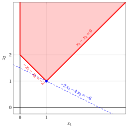
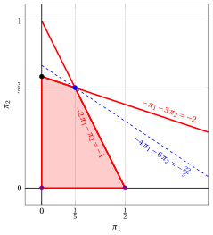
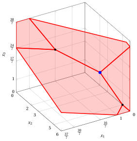

# Exercises · Revised dual simplex algorithm

**Exercises · Chapter 12** · each solution opens with a click · [:material-book-open-variant: Chapter 12: Revised dual simplex algorithm](../advanced-methods/12-revised-dual.md) · [:material-file-pdf-box: Exercises, volume 4 (PDF)](../pdf/exercises-4-advanced-methods.pdf)

!!! esercizio "Exercise 12.1: Revised dual simplex algorithm (P11)"

    Consider the following LP problem in canonical maximization form with $n=2$ variables and $m=2$ constraints:

    $$
    \begin{array}{rrrrrrrrrrrrr}
    {\max} & {-2} \, {x_1} & {-} & {4} \, {x_2} \\[2ex]
    \text{subject to} & {-} \, {x_1} & {-} & {x_2} & {\le} & {-2} \\[2ex]
    & {x_1} & {-} & {x_2} & {\le} & {0} \\[2ex]
    & {x_1,} &  & {x_2} & {\ge} & {0}
    \end{array}
    $$

    Since ${\boldsymbol c} \le {\boldsymbol 0}$, the basis of the $m$ slack variables is <strong>dual feasible</strong> but it is <u>not</u> primal feasible.

    **Questions**

    - Execute the revised dual simplex algorithm to find an optimal solution of this LP problem, solving at each iteration the two systems of linear equations. As pivot row choose the basic variable with the smallest index among those with $\bar b_r < 0$, and break ties in the ratio test for the pivot column by choosing the smallest index.

??? soluzione "Solution"

    We have:

    $$
    {\boldsymbol A}= \begin{pmatrix}
    -1 & -1 & 1 & 0 \\[2ex]
    1 & -1 & 0 & 1 \\
    \end{pmatrix}
    \quad
    {\boldsymbol b}= \begin{pmatrix}
    -2 \\[2ex]
    0 \\
    \end{pmatrix}
    \quad
    {\boldsymbol c}= \begin{pmatrix}
    -2 \\[2ex]
    -4 \\[2ex]
    0 \\[2ex]
    0 \\
    \end{pmatrix}
    \quad
    {\boldsymbol x}= \begin{pmatrix}
    x_{1} \\[2ex]
    x_{2} \\[2ex]
    x_{3} \\[2ex]
    x_{4} \\
    \end{pmatrix}
    $$

    - <strong>Initialization</strong>

        Since it is an LP problem in standard form obtained from an LP problem in canonical form with ${\boldsymbol c} \le {\boldsymbol 0}$ by adding the slack variables, the partition $\pazocal{B} = \{3,~4\}$ and $\pazocal{N} = \{1,~2\}$ is <strong>dual feasible</strong>, since ${\boldsymbol A}_{\pazocal{B}} = {\boldsymbol I}$ and ${\boldsymbol c}_{\pazocal{B}} = {\boldsymbol 0}$ give

        $$
        {\bar{\boldsymbol c}}' = {\boldsymbol c}'_{\pazocal{N}} = \begin{pmatrix}
        -2 & -4 \\
        \end{pmatrix} \le {\boldsymbol 0} .
        $$

        The associated basic solution is <u>not</u> feasible, and then the dual simplex algorithm is used.

    - <strong>Iteration 1</strong>

        With $\pazocal{B}= \{3,~~4\}$ and $\pazocal{N}= \{1,~~2\}$, we have:

        $$
        {\boldsymbol x}_{\pazocal{B}}= \begin{pmatrix}
        x_{3} \\[2ex]
        x_{4} \\
        \end{pmatrix} ~~
        {\boldsymbol A}_{\pazocal{B}}= \begin{pmatrix}
        1 & 0 \\[2ex]
        0 & 1 \\
        \end{pmatrix} ~~
        {\boldsymbol c}_{\pazocal{B}}= \begin{pmatrix}
        0 \\[2ex]
        0 \\
        \end{pmatrix}
        $$

        $$
        {\boldsymbol x}_{\pazocal{N}}= \begin{pmatrix}
        x_{1} \\[2ex]
        x_{2} \\
        \end{pmatrix} ~~
        {\boldsymbol A}_{\pazocal{N}}= \begin{pmatrix}
        -1 & -1 \\[2ex]
        1 & -1 \\
        \end{pmatrix} ~~
        {\bar{\boldsymbol c}}'= \begin{pmatrix}
        -2 & -4 \\
        \end{pmatrix}
        $$

        <strong>Feasibility check</strong>

        We solve ${\boldsymbol A}_{\pazocal{B}} \; {\bar{\boldsymbol b}} = {\boldsymbol b}$ to compute ${\bar{\boldsymbol b}} = {{\boldsymbol A}_{\pazocal{B}}^{-1} \; {\boldsymbol b}}$, <u>first system of linear equations</u>:

        \begin{equation*}
        \begin{cases}
        \begin{array}{rrrr}
        {\bar b_{3}} &  & {=} & {-2} \\[2ex]
        & {\bar b_{4}} & {=} & {0}
        \end{array}
        \end{cases}
        \qquad
        {\bar{\boldsymbol b}}=
        \begin{pmatrix}
        -2 \\[2ex]
        0 \\
        \end{pmatrix}
        \end{equation*}

        Not all the basic variables are non-negative, since $\bar b_{3} = -2 < 0$, then we perform a dual pivoting operation.

        <strong>Dual pivoting operation</strong>

        Since $\bar b_{3} < 0$, $x_{3}$ is the <u>pivot row</u> and we have ${\boldsymbol e}_{3} = \begin{pmatrix} 1 \\[2ex] 0 \\ \end{pmatrix}$

        We solve ${\boldsymbol u} \; {\boldsymbol A}_{\pazocal{B}} = {\boldsymbol e}'_{3}$ to compute ${\boldsymbol u} = {{\boldsymbol e}'_{3} \; {\boldsymbol A}_{\pazocal{B}}^{-1}}$, <u>second system of linear equations</u>:

        \begin{equation*}
        \begin{cases}
        \begin{array}{rrrr}
        {u_{3}} &  & {=} & {1} \\[2ex]
        & {u_{4}} & {=} & {0}
        \end{array}
        \end{cases}
        \qquad
        {\boldsymbol u}=
        \begin{pmatrix}
        1 & 0 \\
        \end{pmatrix}
        \end{equation*}

        We compute the row of ${\bar{\boldsymbol A}}$ associated with $x_{3}$, $\bar a_{3j} = {\boldsymbol u} \; {\boldsymbol A}_{j}$:

        $$
        \underbrace{-1}_{\bar a_{31}} \qquad \underbrace{-1}_{\bar a_{32}}
        $$

        The candidates are the non-basic variables with $\bar a_{3j} < 0$, and the ratio test gives:

        $$
        \min \left\{~\underbrace{\frac{-2}{-1}}_{= \, 2},~\underbrace{\frac{-4}{-1}}_{= \, 4}~\right\} = 2 ,
        $$

        then $x_{1}$ is the <u>pivot column</u>.

        We update the reduced costs with the row ${\bar a}_{3j}$ already computed, $\bar c_j \leftarrow \bar c_j - 2 \; \bar a_{3j}$:

        $$
        \underbrace{-2}_{\bar c_{2}} \qquad \underbrace{-2}_{\bar c_{3}}
        $$

        The new basis is $\pazocal{B}= \{1,~~4\}$.

    - <strong>Iteration 2</strong>

        With $\pazocal{B}= \{1,~~4\}$ and $\pazocal{N}= \{2,~~3\}$, we have:

        $$
        {\boldsymbol x}_{\pazocal{B}}= \begin{pmatrix}
        x_{1} \\[2ex]
        x_{4} \\
        \end{pmatrix} ~~
        {\boldsymbol A}_{\pazocal{B}}= \begin{pmatrix}
        -1 & 0 \\[2ex]
        1 & 1 \\
        \end{pmatrix} ~~
        {\boldsymbol c}_{\pazocal{B}}= \begin{pmatrix}
        -2 \\[2ex]
        0 \\
        \end{pmatrix}
        $$

        $$
        {\boldsymbol x}_{\pazocal{N}}= \begin{pmatrix}
        x_{2} \\[2ex]
        x_{3} \\
        \end{pmatrix} ~~
        {\boldsymbol A}_{\pazocal{N}}= \begin{pmatrix}
        -1 & 1 \\[2ex]
        -1 & 0 \\
        \end{pmatrix} ~~
        {\bar{\boldsymbol c}}'= \begin{pmatrix}
        -2 & -2 \\
        \end{pmatrix}
        $$

        <strong>Feasibility check</strong>

        We solve ${\boldsymbol A}_{\pazocal{B}} \; {\bar{\boldsymbol b}} = {\boldsymbol b}$ to compute ${\bar{\boldsymbol b}} = {{\boldsymbol A}_{\pazocal{B}}^{-1} \; {\boldsymbol b}}$, <u>first system of linear equations</u>:

        \begin{equation*}
        \begin{cases}
        \begin{array}{rrrr}
        {-\bar b_{1}} &  & {=} & {-2} \\[2ex]
        {\bar b_{1}} & {+\bar b_{4}} & {=} & {0}
        \end{array}
        \end{cases}
        \qquad
        {\bar{\boldsymbol b}}=
        \begin{pmatrix}
        2 \\[2ex]
        -2 \\
        \end{pmatrix}
        \end{equation*}

        Not all the basic variables are non-negative, since $\bar b_{4} = -2 < 0$, then we perform a dual pivoting operation.

        <strong>Dual pivoting operation</strong>

        Since $\bar b_{4} < 0$, $x_{4}$ is the <u>pivot row</u> and we have ${\boldsymbol e}_{4} = \begin{pmatrix} 0 \\[2ex] 1 \\ \end{pmatrix}$

        We solve ${\boldsymbol u} \; {\boldsymbol A}_{\pazocal{B}} = {\boldsymbol e}'_{4}$ to compute ${\boldsymbol u} = {{\boldsymbol e}'_{4} \; {\boldsymbol A}_{\pazocal{B}}^{-1}}$, <u>second system of linear equations</u>:

        \begin{equation*}
        \begin{cases}
        \begin{array}{rrrr}
        {-u_{1}} & {+u_{4}} & {=} & {0} \\[2ex]
        & {u_{4}} & {=} & {1}
        \end{array}
        \end{cases}
        \qquad
        {\boldsymbol u}=
        \begin{pmatrix}
        1 & 1 \\
        \end{pmatrix}
        \end{equation*}

        We compute the row of ${\bar{\boldsymbol A}}$ associated with $x_{4}$, $\bar a_{4j} = {\boldsymbol u} \; {\boldsymbol A}_{j}$:

        $$
        \underbrace{-2}_{\bar a_{42}} \qquad \underbrace{1}_{\bar a_{43}}
        $$

        The candidates are the non-basic variables with $\bar a_{4j} < 0$, and the ratio test gives:

        $$
        \min \left\{~\underbrace{\frac{-2}{-2}}_{= \, 1}~\right\} = 1 ,
        $$

        then $x_{2}$ is the <u>pivot column</u>.

        We update the reduced costs with the row ${\bar a}_{4j}$ already computed, $\bar c_j \leftarrow \bar c_j - 1 \; \bar a_{4j}$:

        $$
        \underbrace{-3}_{\bar c_{3}} \qquad \underbrace{-1}_{\bar c_{4}}
        $$

        The new basis is $\pazocal{B}= \{1,~~2\}$.

    - <strong>Iteration 3</strong>

        With $\pazocal{B}= \{1,~~2\}$ and $\pazocal{N}= \{3,~~4\}$, we have:

        $$
        {\boldsymbol x}_{\pazocal{B}}= \begin{pmatrix}
        x_{1} \\[2ex]
        x_{2} \\
        \end{pmatrix} ~~
        {\boldsymbol A}_{\pazocal{B}}= \begin{pmatrix}
        -1 & -1 \\[2ex]
        1 & -1 \\
        \end{pmatrix} ~~
        {\boldsymbol c}_{\pazocal{B}}= \begin{pmatrix}
        -2 \\[2ex]
        -4 \\
        \end{pmatrix}
        $$

        $$
        {\boldsymbol x}_{\pazocal{N}}= \begin{pmatrix}
        x_{3} \\[2ex]
        x_{4} \\
        \end{pmatrix} ~~
        {\boldsymbol A}_{\pazocal{N}}= \begin{pmatrix}
        1 & 0 \\[2ex]
        0 & 1 \\
        \end{pmatrix} ~~
        {\bar{\boldsymbol c}}'= \begin{pmatrix}
        -3 & -1 \\
        \end{pmatrix}
        $$

        <strong>Feasibility check</strong>

        We solve ${\boldsymbol A}_{\pazocal{B}} \; {\bar{\boldsymbol b}} = {\boldsymbol b}$ to compute ${\bar{\boldsymbol b}} = {{\boldsymbol A}_{\pazocal{B}}^{-1} \; {\boldsymbol b}}$, <u>first system of linear equations</u>:

        \begin{equation*}
        \begin{cases}
        \begin{array}{rrrr}
        {-\bar b_{1}} & {-\bar b_{2}} & {=} & {-2} \\[2ex]
        {\bar b_{1}} & {-\bar b_{2}} & {=} & {0}
        \end{array}
        \end{cases}
        \qquad
        {\bar{\boldsymbol b}}=
        \begin{pmatrix}
        1 \\[2ex]
        1 \\
        \end{pmatrix}
        \end{equation*}

        All the basic variables are non-negative, then the basis is primal feasible and dual feasible: it is <strong>optimal</strong>.

        We compute the optimal value ${\bar{z}} = {\boldsymbol c}'_{\pazocal{B}} \; {\bar{\boldsymbol b}} = \begin{pmatrix} -2 & -4 \\ \end{pmatrix} \begin{pmatrix} 1 \\[2ex] 1 \\ \end{pmatrix} = -6$

        An optimal solution of this LP problem is

        $$
        \tilde x_{1}=1,~~\tilde x_{2}=1
        \text{   and   } z(\,LP\,) = -6 .
        $$

    <strong>Graphical solution:</strong>

    The feasible region of the LP problem in canonical form is the polyhedron shaded in red. The feasible region is unbounded.

    { .fig .ovale loading=lazy  }

    An optimal primal LP solution is:

    $$
    \tilde{x}_1=1,~~
    \tilde{x}_2=1 \text{   and   } z(\,LP\,)=-6
    $$

    The feasible region of the dual LP problem in canonical minimization form is the polyhedron shaded in red. In the following figure we plot the two original dual variables: $\pi_1,\pi_2$. 

    { .fig .ovale loading=lazy  }

    An optimal dual LP solution is:

    $$
    \tilde{\pi}_1=3,~~
    \tilde{\pi}_2=1
    \text{   and    } z(~ D(LP)~) =-6.
    $$

    In violet, we show the first and the second vertex explored by the previous execution of the revised dual simplex algorithm, before reaching the optimal one depicted in blue.

!!! esercizio "Exercise 12.2: Revised dual simplex algorithm (P12)"

    Consider the following LP problem in canonical maximization form with $n=2$ variables and $m=2$ constraints:

    $$
    \begin{array}{rrrrrrrrrrrrr}
    {\max} & {-} \, {x_1} & {-} & {2} \, {x_2} \\[2ex]
    \text{subject to} & {-} \, {x_1} & {-} & {x_2} & {\le} & {-3} \\[2ex]
    & {x_1} & {-} & {2} \, {x_2} & {\le} & {-1} \\[2ex]
    & {x_1,} &  & {x_2} & {\ge} & {0}
    \end{array}
    $$

    Since ${\boldsymbol c} \le {\boldsymbol 0}$, the basis of the $m$ slack variables is <strong>dual feasible</strong> but it is <u>not</u> primal feasible.

    **Questions**

    - Execute the revised dual simplex algorithm to find an optimal solution of this LP problem, solving at each iteration the two systems of linear equations. As pivot row choose the basic variable with the smallest index among those with $\bar b_r < 0$, and break ties in the ratio test for the pivot column by choosing the smallest index.

??? soluzione "Solution"

    We have:

    $$
    {\boldsymbol A}= \begin{pmatrix}
    -1 & -1 & 1 & 0 \\[2ex]
    1 & -2 & 0 & 1 \\
    \end{pmatrix}
    \quad
    {\boldsymbol b}= \begin{pmatrix}
    -3 \\[2ex]
    -1 \\
    \end{pmatrix}
    \quad
    {\boldsymbol c}= \begin{pmatrix}
    -1 \\[2ex]
    -2 \\[2ex]
    0 \\[2ex]
    0 \\
    \end{pmatrix}
    \quad
    {\boldsymbol x}= \begin{pmatrix}
    x_{1} \\[2ex]
    x_{2} \\[2ex]
    x_{3} \\[2ex]
    x_{4} \\
    \end{pmatrix}
    $$

    - <strong>Initialization</strong>

        Since it is an LP problem in standard form obtained from an LP problem in canonical form with ${\boldsymbol c} \le {\boldsymbol 0}$ by adding the slack variables, the partition $\pazocal{B} = \{3,~4\}$ and $\pazocal{N} = \{1,~2\}$ is <strong>dual feasible</strong>, since ${\boldsymbol A}_{\pazocal{B}} = {\boldsymbol I}$ and ${\boldsymbol c}_{\pazocal{B}} = {\boldsymbol 0}$ give

        $$
        {\bar{\boldsymbol c}}' = {\boldsymbol c}'_{\pazocal{N}} = \begin{pmatrix}
        -1 & -2 \\
        \end{pmatrix} \le {\boldsymbol 0} .
        $$

        The associated basic solution is <u>not</u> feasible, and then the dual simplex algorithm is used.

    - <strong>Iteration 1</strong>

        With $\pazocal{B}= \{3,~~4\}$ and $\pazocal{N}= \{1,~~2\}$, we have:

        $$
        {\boldsymbol x}_{\pazocal{B}}= \begin{pmatrix}
        x_{3} \\[2ex]
        x_{4} \\
        \end{pmatrix} ~~
        {\boldsymbol A}_{\pazocal{B}}= \begin{pmatrix}
        1 & 0 \\[2ex]
        0 & 1 \\
        \end{pmatrix} ~~
        {\boldsymbol c}_{\pazocal{B}}= \begin{pmatrix}
        0 \\[2ex]
        0 \\
        \end{pmatrix}
        $$

        $$
        {\boldsymbol x}_{\pazocal{N}}= \begin{pmatrix}
        x_{1} \\[2ex]
        x_{2} \\
        \end{pmatrix} ~~
        {\boldsymbol A}_{\pazocal{N}}= \begin{pmatrix}
        -1 & -1 \\[2ex]
        1 & -2 \\
        \end{pmatrix} ~~
        {\bar{\boldsymbol c}}'= \begin{pmatrix}
        -1 & -2 \\
        \end{pmatrix}
        $$

        <strong>Feasibility check</strong>

        We solve ${\boldsymbol A}_{\pazocal{B}} \; {\bar{\boldsymbol b}} = {\boldsymbol b}$ to compute ${\bar{\boldsymbol b}} = {{\boldsymbol A}_{\pazocal{B}}^{-1} \; {\boldsymbol b}}$, <u>first system of linear equations</u>:

        \begin{equation*}
        \begin{cases}
        \begin{array}{rrrr}
        {\bar b_{3}} &  & {=} & {-3} \\[2ex]
        & {\bar b_{4}} & {=} & {-1}
        \end{array}
        \end{cases}
        \qquad
        {\bar{\boldsymbol b}}=
        \begin{pmatrix}
        -3 \\[2ex]
        -1 \\
        \end{pmatrix}
        \end{equation*}

        Not all the basic variables are non-negative, since $\bar b_{3} = -3 < 0$, then we perform a dual pivoting operation.

        <strong>Dual pivoting operation</strong>

        Since $\bar b_{3} < 0$, $x_{3}$ is the <u>pivot row</u> and we have ${\boldsymbol e}_{3} = \begin{pmatrix} 1 \\[2ex] 0 \\ \end{pmatrix}$

        We solve ${\boldsymbol u} \; {\boldsymbol A}_{\pazocal{B}} = {\boldsymbol e}'_{3}$ to compute ${\boldsymbol u} = {{\boldsymbol e}'_{3} \; {\boldsymbol A}_{\pazocal{B}}^{-1}}$, <u>second system of linear equations</u>:

        \begin{equation*}
        \begin{cases}
        \begin{array}{rrrr}
        {u_{3}} &  & {=} & {1} \\[2ex]
        & {u_{4}} & {=} & {0}
        \end{array}
        \end{cases}
        \qquad
        {\boldsymbol u}=
        \begin{pmatrix}
        1 & 0 \\
        \end{pmatrix}
        \end{equation*}

        We compute the row of ${\bar{\boldsymbol A}}$ associated with $x_{3}$, $\bar a_{3j} = {\boldsymbol u} \; {\boldsymbol A}_{j}$:

        $$
        \underbrace{-1}_{\bar a_{31}} \qquad \underbrace{-1}_{\bar a_{32}}
        $$

        The candidates are the non-basic variables with $\bar a_{3j} < 0$, and the ratio test gives:

        $$
        \min \left\{~\underbrace{\frac{-1}{-1}}_{= \, 1},~\underbrace{\frac{-2}{-1}}_{= \, 2}~\right\} = 1 ,
        $$

        then $x_{1}$ is the <u>pivot column</u>.

        We update the reduced costs with the row ${\bar a}_{3j}$ already computed, $\bar c_j \leftarrow \bar c_j - 1 \; \bar a_{3j}$:

        $$
        \underbrace{-1}_{\bar c_{2}} \qquad \underbrace{-1}_{\bar c_{3}}
        $$

        The new basis is $\pazocal{B}= \{1,~~4\}$.

    - <strong>Iteration 2</strong>

        With $\pazocal{B}= \{1,~~4\}$ and $\pazocal{N}= \{2,~~3\}$, we have:

        $$
        {\boldsymbol x}_{\pazocal{B}}= \begin{pmatrix}
        x_{1} \\[2ex]
        x_{4} \\
        \end{pmatrix} ~~
        {\boldsymbol A}_{\pazocal{B}}= \begin{pmatrix}
        -1 & 0 \\[2ex]
        1 & 1 \\
        \end{pmatrix} ~~
        {\boldsymbol c}_{\pazocal{B}}= \begin{pmatrix}
        -1 \\[2ex]
        0 \\
        \end{pmatrix}
        $$

        $$
        {\boldsymbol x}_{\pazocal{N}}= \begin{pmatrix}
        x_{2} \\[2ex]
        x_{3} \\
        \end{pmatrix} ~~
        {\boldsymbol A}_{\pazocal{N}}= \begin{pmatrix}
        -1 & 1 \\[2ex]
        -2 & 0 \\
        \end{pmatrix} ~~
        {\bar{\boldsymbol c}}'= \begin{pmatrix}
        -1 & -1 \\
        \end{pmatrix}
        $$

        <strong>Feasibility check</strong>

        We solve ${\boldsymbol A}_{\pazocal{B}} \; {\bar{\boldsymbol b}} = {\boldsymbol b}$ to compute ${\bar{\boldsymbol b}} = {{\boldsymbol A}_{\pazocal{B}}^{-1} \; {\boldsymbol b}}$, <u>first system of linear equations</u>:

        \begin{equation*}
        \begin{cases}
        \begin{array}{rrrr}
        {-\bar b_{1}} &  & {=} & {-3} \\[2ex]
        {\bar b_{1}} & {+\bar b_{4}} & {=} & {-1}
        \end{array}
        \end{cases}
        \qquad
        {\bar{\boldsymbol b}}=
        \begin{pmatrix}
        3 \\[2ex]
        -4 \\
        \end{pmatrix}
        \end{equation*}

        Not all the basic variables are non-negative, since $\bar b_{4} = -4 < 0$, then we perform a dual pivoting operation.

        <strong>Dual pivoting operation</strong>

        Since $\bar b_{4} < 0$, $x_{4}$ is the <u>pivot row</u> and we have ${\boldsymbol e}_{4} = \begin{pmatrix} 0 \\[2ex] 1 \\ \end{pmatrix}$

        We solve ${\boldsymbol u} \; {\boldsymbol A}_{\pazocal{B}} = {\boldsymbol e}'_{4}$ to compute ${\boldsymbol u} = {{\boldsymbol e}'_{4} \; {\boldsymbol A}_{\pazocal{B}}^{-1}}$, <u>second system of linear equations</u>:

        \begin{equation*}
        \begin{cases}
        \begin{array}{rrrr}
        {-u_{1}} & {+u_{4}} & {=} & {0} \\[2ex]
        & {u_{4}} & {=} & {1}
        \end{array}
        \end{cases}
        \qquad
        {\boldsymbol u}=
        \begin{pmatrix}
        1 & 1 \\
        \end{pmatrix}
        \end{equation*}

        We compute the row of ${\bar{\boldsymbol A}}$ associated with $x_{4}$, $\bar a_{4j} = {\boldsymbol u} \; {\boldsymbol A}_{j}$:

        $$
        \underbrace{-3}_{\bar a_{42}} \qquad \underbrace{1}_{\bar a_{43}}
        $$

        The candidates are the non-basic variables with $\bar a_{4j} < 0$, and the ratio test gives:

        $$
        \min \left\{~\underbrace{\frac{-1}{-3}}_{= \, \frac{1}{3}}~\right\} = \frac{1}{3} ,
        $$

        then $x_{2}$ is the <u>pivot column</u>.

        We update the reduced costs with the row ${\bar a}_{4j}$ already computed, $\bar c_j \leftarrow \bar c_j - \frac{1}{3} \; \bar a_{4j}$:

        $$
        \underbrace{-\frac{4}{3}}_{\bar c_{3}} \qquad \underbrace{-\frac{1}{3}}_{\bar c_{4}}
        $$

        The new basis is $\pazocal{B}= \{1,~~2\}$.

    - <strong>Iteration 3</strong>

        With $\pazocal{B}= \{1,~~2\}$ and $\pazocal{N}= \{3,~~4\}$, we have:

        $$
        {\boldsymbol x}_{\pazocal{B}}= \begin{pmatrix}
        x_{1} \\[2ex]
        x_{2} \\
        \end{pmatrix} ~~
        {\boldsymbol A}_{\pazocal{B}}= \begin{pmatrix}
        -1 & -1 \\[2ex]
        1 & -2 \\
        \end{pmatrix} ~~
        {\boldsymbol c}_{\pazocal{B}}= \begin{pmatrix}
        -1 \\[2ex]
        -2 \\
        \end{pmatrix}
        $$

        $$
        {\boldsymbol x}_{\pazocal{N}}= \begin{pmatrix}
        x_{3} \\[2ex]
        x_{4} \\
        \end{pmatrix} ~~
        {\boldsymbol A}_{\pazocal{N}}= \begin{pmatrix}
        1 & 0 \\[2ex]
        0 & 1 \\
        \end{pmatrix} ~~
        {\bar{\boldsymbol c}}'= \begin{pmatrix}
        -\frac{4}{3} & -\frac{1}{3} \\
        \end{pmatrix}
        $$

        <strong>Feasibility check</strong>

        We solve ${\boldsymbol A}_{\pazocal{B}} \; {\bar{\boldsymbol b}} = {\boldsymbol b}$ to compute ${\bar{\boldsymbol b}} = {{\boldsymbol A}_{\pazocal{B}}^{-1} \; {\boldsymbol b}}$, <u>first system of linear equations</u>:

        \begin{equation*}
        \begin{cases}
        \begin{array}{rrrr}
        {-\bar b_{1}} & {-\bar b_{2}} & {=} & {-3} \\[2ex]
        {\bar b_{1}} & {-2\,\bar b_{2}} & {=} & {-1}
        \end{array}
        \end{cases}
        \qquad
        {\bar{\boldsymbol b}}=
        \begin{pmatrix}
        \frac{5}{3} \\[2ex]
        \frac{4}{3} \\
        \end{pmatrix}
        \end{equation*}

        All the basic variables are non-negative, then the basis is primal feasible and dual feasible: it is <strong>optimal</strong>.

        We compute the optimal value ${\bar{z}} = {\boldsymbol c}'_{\pazocal{B}} \; {\bar{\boldsymbol b}} = \begin{pmatrix} -1 & -2 \\ \end{pmatrix} \begin{pmatrix} \frac{5}{3} \\[2ex] \frac{4}{3} \\ \end{pmatrix} = -\frac{13}{3}$

        An optimal solution of this LP problem is

        $$
        \tilde x_{1}=\frac{5}{3},~~\tilde x_{2}=\frac{4}{3}
        \text{   and   } z(\,LP\,) = -\frac{13}{3} .
        $$

    <strong>Graphical solution:</strong>

    The feasible region of the LP problem in canonical form is the polyhedron shaded in red. The feasible region is unbounded. 

    { .fig .ovale loading=lazy  }

    An optimal primal LP solution is:

    $$
    \tilde{x}_1=\frac{5}{3},~~
    \tilde{x}_2=\frac{4}{3}
    \text{   and   }
    z(\,LP\,)=-\frac{13}{3}.
    $$

    The feasible region of the dual LP problem in canonical minimization form is the polyhedron shaded in red. In the following figure we plot the two original dual variables: $\pi_1,\pi_2$. 

    { .fig .ovale loading=lazy  }

    An optimal dual LP solution is:

    $$
    \tilde{\pi}_1=\frac{4}{3},~~
    \tilde{\pi}_2=\frac{1}{3},
    \text{   and    } z(~ D(LP)~) =-\frac{13}{3}.
    $$

    In violet, we show the first and the second vertex explored by the previous execution of the revised dual simplex algorithm, before reaching the optimal one depicted in blue.

!!! esercizio "Exercise 12.3: Revised dual simplex algorithm (P13)"

    Consider the following LP problem in canonical maximization form with $n=2$ variables and $m=3$ constraints:

    $$
    \begin{array}{rrrrrrrrrrrrr}
    {\max} & {-} \, {x_1} & {-} & {3} \, {x_2} \\[2ex]
    \text{subject to} & {-} \, {x_1} & {-} & {2} \, {x_2} & {\le} & {-6} \\[2ex]
    & {x_1} & {-} & {4} \, {x_2} & {\le} & {-6} \\[2ex]
    & {2} \, {x_1} & {-} & {2} \, {x_2} & {\le} & {3} \\[2ex]
    & {x_1,} &  & {x_2} & {\ge} & {0}
    \end{array}
    $$

    Since ${\boldsymbol c} \le {\boldsymbol 0}$, the basis of the $m$ slack variables is <strong>dual feasible</strong> but it is <u>not</u> primal feasible.

    **Questions**

    - Execute the revised dual simplex algorithm to find an optimal solution of this LP problem, solving at each iteration the two systems of linear equations. As pivot row choose the basic variable with the smallest index among those with $\bar b_r < 0$, and break ties in the ratio test for the pivot column by choosing the smallest index.

??? soluzione "Solution"

    We have:

    $$
    {\boldsymbol A}= \begin{pmatrix}
    -1 & -2 & 1 & 0 & 0 \\[2ex]
    1 & -4 & 0 & 1 & 0 \\[2ex]
    2 & -2 & 0 & 0 & 1 \\
    \end{pmatrix}
    \quad
    {\boldsymbol b}= \begin{pmatrix}
    -6 \\[2ex]
    -6 \\[2ex]
    3 \\
    \end{pmatrix}
    \quad
    {\boldsymbol c}= \begin{pmatrix}
    -1 \\[2ex]
    -3 \\[2ex]
    0 \\[2ex]
    0 \\[2ex]
    0 \\
    \end{pmatrix}
    \quad
    {\boldsymbol x}= \begin{pmatrix}
    x_{1} \\[2ex]
    x_{2} \\[2ex]
    x_{3} \\[2ex]
    x_{4} \\[2ex]
    x_{5} \\
    \end{pmatrix}
    $$

    - <strong>Initialization</strong>

        Since it is an LP problem in standard form obtained from an LP problem in canonical form with ${\boldsymbol c} \le {\boldsymbol 0}$ by adding the slack variables, the partition $\pazocal{B} = \{3,~4,~5\}$ and $\pazocal{N} = \{1,~2\}$ is <strong>dual feasible</strong>, since ${\boldsymbol A}_{\pazocal{B}} = {\boldsymbol I}$ and ${\boldsymbol c}_{\pazocal{B}} = {\boldsymbol 0}$ give

        $$
        {\bar{\boldsymbol c}}' = {\boldsymbol c}'_{\pazocal{N}} = \begin{pmatrix}
        -1 & -3 \\
        \end{pmatrix} \le {\boldsymbol 0} .
        $$

        The associated basic solution is <u>not</u> feasible, and then the dual simplex algorithm is used.

    - <strong>Iteration 1</strong>

        With $\pazocal{B}= \{3,~~4,~~5\}$ and $\pazocal{N}= \{1,~~2\}$, we have:

        $$
        {\boldsymbol x}_{\pazocal{B}}= \begin{pmatrix}
        x_{3} \\[2ex]
        x_{4} \\[2ex]
        x_{5} \\
        \end{pmatrix} ~~
        {\boldsymbol A}_{\pazocal{B}}= \begin{pmatrix}
        1 & 0 & 0 \\[2ex]
        0 & 1 & 0 \\[2ex]
        0 & 0 & 1 \\
        \end{pmatrix} ~~
        {\boldsymbol c}_{\pazocal{B}}= \begin{pmatrix}
        0 \\[2ex]
        0 \\[2ex]
        0 \\
        \end{pmatrix}
        $$

        $$
        {\boldsymbol x}_{\pazocal{N}}= \begin{pmatrix}
        x_{1} \\[2ex]
        x_{2} \\
        \end{pmatrix} ~~
        {\boldsymbol A}_{\pazocal{N}}= \begin{pmatrix}
        -1 & -2 \\[2ex]
        1 & -4 \\[2ex]
        2 & -2 \\
        \end{pmatrix} ~~
        {\bar{\boldsymbol c}}'= \begin{pmatrix}
        -1 & -3 \\
        \end{pmatrix}
        $$

        <strong>Feasibility check</strong>

        We solve ${\boldsymbol A}_{\pazocal{B}} \; {\bar{\boldsymbol b}} = {\boldsymbol b}$ to compute ${\bar{\boldsymbol b}} = {{\boldsymbol A}_{\pazocal{B}}^{-1} \; {\boldsymbol b}}$, <u>first system of linear equations</u>:

        \begin{equation*}
        \begin{cases}
        \begin{array}{rrrrr}
        {\bar b_{3}} &  &  & {=} & {-6} \\[2ex]
        & {\bar b_{4}} &  & {=} & {-6} \\[2ex]
        &  & {\bar b_{5}} & {=} & {3}
        \end{array}
        \end{cases}
        \qquad
        {\bar{\boldsymbol b}}=
        \begin{pmatrix}
        -6 \\[2ex]
        -6 \\[2ex]
        3 \\
        \end{pmatrix}
        \end{equation*}

        Not all the basic variables are non-negative, since $\bar b_{3} = -6 < 0$, then we perform a dual pivoting operation.

        <strong>Dual pivoting operation</strong>

        Since $\bar b_{3} < 0$, $x_{3}$ is the <u>pivot row</u> and we have ${\boldsymbol e}_{3} = \begin{pmatrix} 1 \\[2ex] 0 \\[2ex] 0 \\ \end{pmatrix}$

        We solve ${\boldsymbol u} \; {\boldsymbol A}_{\pazocal{B}} = {\boldsymbol e}'_{3}$ to compute ${\boldsymbol u} = {{\boldsymbol e}'_{3} \; {\boldsymbol A}_{\pazocal{B}}^{-1}}$, <u>second system of linear equations</u>:

        \begin{equation*}
        \begin{cases}
        \begin{array}{rrrrr}
        {u_{3}} &  &  & {=} & {1} \\[2ex]
        & {u_{4}} &  & {=} & {0} \\[2ex]
        &  & {u_{5}} & {=} & {0}
        \end{array}
        \end{cases}
        \qquad
        {\boldsymbol u}=
        \begin{pmatrix}
        1 & 0 & 0 \\
        \end{pmatrix}
        \end{equation*}

        We compute the row of ${\bar{\boldsymbol A}}$ associated with $x_{3}$, $\bar a_{3j} = {\boldsymbol u} \; {\boldsymbol A}_{j}$:

        $$
        \underbrace{-1}_{\bar a_{31}} \qquad \underbrace{-2}_{\bar a_{32}}
        $$

        The candidates are the non-basic variables with $\bar a_{3j} < 0$, and the ratio test gives:

        $$
        \min \left\{~\underbrace{\frac{-1}{-1}}_{= \, 1},~\underbrace{\frac{-3}{-2}}_{= \, \frac{3}{2}}~\right\} = 1 ,
        $$

        then $x_{1}$ is the <u>pivot column</u>.

        We update the reduced costs with the row ${\bar a}_{3j}$ already computed, $\bar c_j \leftarrow \bar c_j - 1 \; \bar a_{3j}$:

        $$
        \underbrace{-1}_{\bar c_{2}} \qquad \underbrace{-1}_{\bar c_{3}}
        $$

        The new basis is $\pazocal{B}= \{1,~~4,~~5\}$.

    - <strong>Iteration 2</strong>

        With $\pazocal{B}= \{1,~~4,~~5\}$ and $\pazocal{N}= \{2,~~3\}$, we have:

        $$
        {\boldsymbol x}_{\pazocal{B}}= \begin{pmatrix}
        x_{1} \\[2ex]
        x_{4} \\[2ex]
        x_{5} \\
        \end{pmatrix} ~~
        {\boldsymbol A}_{\pazocal{B}}= \begin{pmatrix}
        -1 & 0 & 0 \\[2ex]
        1 & 1 & 0 \\[2ex]
        2 & 0 & 1 \\
        \end{pmatrix} ~~
        {\boldsymbol c}_{\pazocal{B}}= \begin{pmatrix}
        -1 \\[2ex]
        0 \\[2ex]
        0 \\
        \end{pmatrix}
        $$

        $$
        {\boldsymbol x}_{\pazocal{N}}= \begin{pmatrix}
        x_{2} \\[2ex]
        x_{3} \\
        \end{pmatrix} ~~
        {\boldsymbol A}_{\pazocal{N}}= \begin{pmatrix}
        -2 & 1 \\[2ex]
        -4 & 0 \\[2ex]
        -2 & 0 \\
        \end{pmatrix} ~~
        {\bar{\boldsymbol c}}'= \begin{pmatrix}
        -1 & -1 \\
        \end{pmatrix}
        $$

        <strong>Feasibility check</strong>

        We solve ${\boldsymbol A}_{\pazocal{B}} \; {\bar{\boldsymbol b}} = {\boldsymbol b}$ to compute ${\bar{\boldsymbol b}} = {{\boldsymbol A}_{\pazocal{B}}^{-1} \; {\boldsymbol b}}$, <u>first system of linear equations</u>:

        \begin{equation*}
        \begin{cases}
        \begin{array}{rrrrr}
        {-\bar b_{1}} &  &  & {=} & {-6} \\[2ex]
        {\bar b_{1}} & {+\bar b_{4}} &  & {=} & {-6} \\[2ex]
        {2\,\bar b_{1}} &  & {+\bar b_{5}} & {=} & {3}
        \end{array}
        \end{cases}
        \qquad
        {\bar{\boldsymbol b}}=
        \begin{pmatrix}
        6 \\[2ex]
        -12 \\[2ex]
        -9 \\
        \end{pmatrix}
        \end{equation*}

        Not all the basic variables are non-negative, since $\bar b_{4} = -12 < 0$, then we perform a dual pivoting operation.

        <strong>Dual pivoting operation</strong>

        Since $\bar b_{4} < 0$, $x_{4}$ is the <u>pivot row</u> and we have ${\boldsymbol e}_{4} = \begin{pmatrix} 0 \\[2ex] 1 \\[2ex] 0 \\ \end{pmatrix}$

        We solve ${\boldsymbol u} \; {\boldsymbol A}_{\pazocal{B}} = {\boldsymbol e}'_{4}$ to compute ${\boldsymbol u} = {{\boldsymbol e}'_{4} \; {\boldsymbol A}_{\pazocal{B}}^{-1}}$, <u>second system of linear equations</u>:

        \begin{equation*}
        \begin{cases}
        \begin{array}{rrrrr}
        {-u_{1}} & {+u_{4}} & {+2\,u_{5}} & {=} & {0} \\[2ex]
        & {u_{4}} &  & {=} & {1} \\[2ex]
        &  & {u_{5}} & {=} & {0}
        \end{array}
        \end{cases}
        \qquad
        {\boldsymbol u}=
        \begin{pmatrix}
        1 & 1 & 0 \\
        \end{pmatrix}
        \end{equation*}

        We compute the row of ${\bar{\boldsymbol A}}$ associated with $x_{4}$, $\bar a_{4j} = {\boldsymbol u} \; {\boldsymbol A}_{j}$:

        $$
        \underbrace{-6}_{\bar a_{42}} \qquad \underbrace{1}_{\bar a_{43}}
        $$

        The candidates are the non-basic variables with $\bar a_{4j} < 0$, and the ratio test gives:

        $$
        \min \left\{~\underbrace{\frac{-1}{-6}}_{= \, \frac{1}{6}}~\right\} = \frac{1}{6} ,
        $$

        then $x_{2}$ is the <u>pivot column</u>.

        We update the reduced costs with the row ${\bar a}_{4j}$ already computed, $\bar c_j \leftarrow \bar c_j - \frac{1}{6} \; \bar a_{4j}$:

        $$
        \underbrace{-\frac{7}{6}}_{\bar c_{3}} \qquad \underbrace{-\frac{1}{6}}_{\bar c_{4}}
        $$

        The new basis is $\pazocal{B}= \{1,~~2,~~5\}$.

    - <strong>Iteration 3</strong>

        With $\pazocal{B}= \{1,~~2,~~5\}$ and $\pazocal{N}= \{3,~~4\}$, we have:

        $$
        {\boldsymbol x}_{\pazocal{B}}= \begin{pmatrix}
        x_{1} \\[2ex]
        x_{2} \\[2ex]
        x_{5} \\
        \end{pmatrix} ~~
        {\boldsymbol A}_{\pazocal{B}}= \begin{pmatrix}
        -1 & -2 & 0 \\[2ex]
        1 & -4 & 0 \\[2ex]
        2 & -2 & 1 \\
        \end{pmatrix} ~~
        {\boldsymbol c}_{\pazocal{B}}= \begin{pmatrix}
        -1 \\[2ex]
        -3 \\[2ex]
        0 \\
        \end{pmatrix}
        $$

        $$
        {\boldsymbol x}_{\pazocal{N}}= \begin{pmatrix}
        x_{3} \\[2ex]
        x_{4} \\
        \end{pmatrix} ~~
        {\boldsymbol A}_{\pazocal{N}}= \begin{pmatrix}
        1 & 0 \\[2ex]
        0 & 1 \\[2ex]
        0 & 0 \\
        \end{pmatrix} ~~
        {\bar{\boldsymbol c}}'= \begin{pmatrix}
        -\frac{7}{6} & -\frac{1}{6} \\
        \end{pmatrix}
        $$

        <strong>Feasibility check</strong>

        We solve ${\boldsymbol A}_{\pazocal{B}} \; {\bar{\boldsymbol b}} = {\boldsymbol b}$ to compute ${\bar{\boldsymbol b}} = {{\boldsymbol A}_{\pazocal{B}}^{-1} \; {\boldsymbol b}}$, <u>first system of linear equations</u>:

        \begin{equation*}
        \begin{cases}
        \begin{array}{rrrrr}
        {-\bar b_{1}} & {-2\,\bar b_{2}} &  & {=} & {-6} \\[2ex]
        {\bar b_{1}} & {-4\,\bar b_{2}} &  & {=} & {-6} \\[2ex]
        {2\,\bar b_{1}} & {-2\,\bar b_{2}} & {+\bar b_{5}} & {=} & {3}
        \end{array}
        \end{cases}
        \qquad
        {\bar{\boldsymbol b}}=
        \begin{pmatrix}
        2 \\[2ex]
        2 \\[2ex]
        3 \\
        \end{pmatrix}
        \end{equation*}

        All the basic variables are non-negative, then the basis is primal feasible and dual feasible: it is <strong>optimal</strong>.

        We compute the optimal value ${\bar{z}} = {\boldsymbol c}'_{\pazocal{B}} \; {\bar{\boldsymbol b}} = \begin{pmatrix} -1 & -3 & 0 \\ \end{pmatrix} \begin{pmatrix} 2 \\[2ex] 2 \\[2ex] 3 \\ \end{pmatrix} = -8$

        An optimal solution of this LP problem is

        $$
        \tilde x_{1}=2,~~\tilde x_{2}=2
        \text{   and   } z(\,LP\,) = -8 .
        $$

    <strong>Graphical solution:</strong>

    The feasible region of the LP problem in canonical form is the polyhedron shaded in red. The feasible region is unbounded.

    { .fig .ovale loading=lazy  }

    An optimal primal LP solution is:

    $$
    \tilde{x}_1=2,~~\tilde{x}_2=2 \text{   and   } z(\,LP\,)=-8 .
    $$

    The feasible region of the dual LP problem in canonical minimization form is the polyhedron shaded in red. In the following figure we plot the three original dual variables: $\pi_1,\pi_2,\pi_3$. 

    { .fig .ovale loading=lazy  }

    An optimal dual LP solution is:

    $$
    \tilde{\pi}_1=\frac{7}{6},~~
    \tilde{\pi}_2=\frac{1}{6},~~
    \tilde{\pi}_3=0,
    \text{   and    } z(~ D(LP)~) =-8.
    $$

    In violet, we show the first and the second vertex explored by the previous execution of the revised dual simplex algorithm, before reaching the optimal one depicted in blue.

!!! esercizio "Exercise 12.4: Revised dual simplex algorithm (P14)"

    Consider the following LP problem in canonical maximization form with $n=2$ variables and $m=3$ constraints:

    $$
    \begin{array}{rrrrrrrrrrrrr}
    {\max} & {-} \, {x_1} & {-} & {2} \, {x_2} \\[2ex]
    \text{subject to} & {-} \, {x_1} & {+} & {x_2} & {\le} & {2} \\[2ex]
    & {x_1} & {-} & {2} \, {x_2} & {\le} & {2} \\[2ex]
    & {-} \, {x_1} & {-} & {x_2} & {\le} & {-3} \\[2ex]
    & {x_1,} &  & {x_2} & {\ge} & {0}
    \end{array}
    $$

    Since ${\boldsymbol c} \le {\boldsymbol 0}$, the basis of the $m$ slack variables is <strong>dual feasible</strong> but it is <u>not</u> primal feasible.

    **Questions**

    - Execute the revised dual simplex algorithm to find an optimal solution of this LP problem, solving at each iteration the two systems of linear equations. As pivot row choose the basic variable with the smallest index among those with $\bar b_r < 0$, and break ties in the ratio test for the pivot column by choosing the smallest index.

??? soluzione "Solution"

    We have:

    $$
    {\boldsymbol A}= \begin{pmatrix}
    -1 & 1 & 1 & 0 & 0 \\[2ex]
    1 & -2 & 0 & 1 & 0 \\[2ex]
    -1 & -1 & 0 & 0 & 1 \\
    \end{pmatrix}
    \quad
    {\boldsymbol b}= \begin{pmatrix}
    2 \\[2ex]
    2 \\[2ex]
    -3 \\
    \end{pmatrix}
    \quad
    {\boldsymbol c}= \begin{pmatrix}
    -1 \\[2ex]
    -2 \\[2ex]
    0 \\[2ex]
    0 \\[2ex]
    0 \\
    \end{pmatrix}
    \quad
    {\boldsymbol x}= \begin{pmatrix}
    x_{1} \\[2ex]
    x_{2} \\[2ex]
    x_{3} \\[2ex]
    x_{4} \\[2ex]
    x_{5} \\
    \end{pmatrix}
    $$

    - <strong>Initialization</strong>

        Since it is an LP problem in standard form obtained from an LP problem in canonical form with ${\boldsymbol c} \le {\boldsymbol 0}$ by adding the slack variables, the partition $\pazocal{B} = \{3,~4,~5\}$ and $\pazocal{N} = \{1,~2\}$ is <strong>dual feasible</strong>, since ${\boldsymbol A}_{\pazocal{B}} = {\boldsymbol I}$ and ${\boldsymbol c}_{\pazocal{B}} = {\boldsymbol 0}$ give

        $$
        {\bar{\boldsymbol c}}' = {\boldsymbol c}'_{\pazocal{N}} = \begin{pmatrix}
        -1 & -2 \\
        \end{pmatrix} \le {\boldsymbol 0} .
        $$

        The associated basic solution is <u>not</u> feasible, and then the dual simplex algorithm is used.

    - <strong>Iteration 1</strong>

        With $\pazocal{B}= \{3,~~4,~~5\}$ and $\pazocal{N}= \{1,~~2\}$, we have:

        $$
        {\boldsymbol x}_{\pazocal{B}}= \begin{pmatrix}
        x_{3} \\[2ex]
        x_{4} \\[2ex]
        x_{5} \\
        \end{pmatrix} ~~
        {\boldsymbol A}_{\pazocal{B}}= \begin{pmatrix}
        1 & 0 & 0 \\[2ex]
        0 & 1 & 0 \\[2ex]
        0 & 0 & 1 \\
        \end{pmatrix} ~~
        {\boldsymbol c}_{\pazocal{B}}= \begin{pmatrix}
        0 \\[2ex]
        0 \\[2ex]
        0 \\
        \end{pmatrix}
        $$

        $$
        {\boldsymbol x}_{\pazocal{N}}= \begin{pmatrix}
        x_{1} \\[2ex]
        x_{2} \\
        \end{pmatrix} ~~
        {\boldsymbol A}_{\pazocal{N}}= \begin{pmatrix}
        -1 & 1 \\[2ex]
        1 & -2 \\[2ex]
        -1 & -1 \\
        \end{pmatrix} ~~
        {\bar{\boldsymbol c}}'= \begin{pmatrix}
        -1 & -2 \\
        \end{pmatrix}
        $$

        <strong>Feasibility check</strong>

        We solve ${\boldsymbol A}_{\pazocal{B}} \; {\bar{\boldsymbol b}} = {\boldsymbol b}$ to compute ${\bar{\boldsymbol b}} = {{\boldsymbol A}_{\pazocal{B}}^{-1} \; {\boldsymbol b}}$, <u>first system of linear equations</u>:

        \begin{equation*}
        \begin{cases}
        \begin{array}{rrrrr}
        {\bar b_{3}} &  &  & {=} & {2} \\[2ex]
        & {\bar b_{4}} &  & {=} & {2} \\[2ex]
        &  & {\bar b_{5}} & {=} & {-3}
        \end{array}
        \end{cases}
        \qquad
        {\bar{\boldsymbol b}}=
        \begin{pmatrix}
        2 \\[2ex]
        2 \\[2ex]
        -3 \\
        \end{pmatrix}
        \end{equation*}

        Not all the basic variables are non-negative, since $\bar b_{5} = -3 < 0$, then we perform a dual pivoting operation.

        <strong>Dual pivoting operation</strong>

        Since $\bar b_{5} < 0$, $x_{5}$ is the <u>pivot row</u> and we have ${\boldsymbol e}_{5} = \begin{pmatrix} 0 \\[2ex] 0 \\[2ex] 1 \\ \end{pmatrix}$

        We solve ${\boldsymbol u} \; {\boldsymbol A}_{\pazocal{B}} = {\boldsymbol e}'_{5}$ to compute ${\boldsymbol u} = {{\boldsymbol e}'_{5} \; {\boldsymbol A}_{\pazocal{B}}^{-1}}$, <u>second system of linear equations</u>:

        \begin{equation*}
        \begin{cases}
        \begin{array}{rrrrr}
        {u_{3}} &  &  & {=} & {0} \\[2ex]
        & {u_{4}} &  & {=} & {0} \\[2ex]
        &  & {u_{5}} & {=} & {1}
        \end{array}
        \end{cases}
        \qquad
        {\boldsymbol u}=
        \begin{pmatrix}
        0 & 0 & 1 \\
        \end{pmatrix}
        \end{equation*}

        We compute the row of ${\bar{\boldsymbol A}}$ associated with $x_{5}$, $\bar a_{5j} = {\boldsymbol u} \; {\boldsymbol A}_{j}$:

        $$
        \underbrace{-1}_{\bar a_{51}} \qquad \underbrace{-1}_{\bar a_{52}}
        $$

        The candidates are the non-basic variables with $\bar a_{5j} < 0$, and the ratio test gives:

        $$
        \min \left\{~\underbrace{\frac{-1}{-1}}_{= \, 1},~\underbrace{\frac{-2}{-1}}_{= \, 2}~\right\} = 1 ,
        $$

        then $x_{1}$ is the <u>pivot column</u>.

        We update the reduced costs with the row ${\bar a}_{5j}$ already computed, $\bar c_j \leftarrow \bar c_j - 1 \; \bar a_{5j}$:

        $$
        \underbrace{-1}_{\bar c_{2}} \qquad \underbrace{-1}_{\bar c_{5}}
        $$

        The new basis is $\pazocal{B}= \{1,~~3,~~4\}$.

    - <strong>Iteration 2</strong>

        With $\pazocal{B}= \{1,~~3,~~4\}$ and $\pazocal{N}= \{2,~~5\}$, we have:

        $$
        {\boldsymbol x}_{\pazocal{B}}= \begin{pmatrix}
        x_{1} \\[2ex]
        x_{3} \\[2ex]
        x_{4} \\
        \end{pmatrix} ~~
        {\boldsymbol A}_{\pazocal{B}}= \begin{pmatrix}
        -1 & 1 & 0 \\[2ex]
        1 & 0 & 1 \\[2ex]
        -1 & 0 & 0 \\
        \end{pmatrix} ~~
        {\boldsymbol c}_{\pazocal{B}}= \begin{pmatrix}
        -1 \\[2ex]
        0 \\[2ex]
        0 \\
        \end{pmatrix}
        $$

        $$
        {\boldsymbol x}_{\pazocal{N}}= \begin{pmatrix}
        x_{2} \\[2ex]
        x_{5} \\
        \end{pmatrix} ~~
        {\boldsymbol A}_{\pazocal{N}}= \begin{pmatrix}
        1 & 0 \\[2ex]
        -2 & 0 \\[2ex]
        -1 & 1 \\
        \end{pmatrix} ~~
        {\bar{\boldsymbol c}}'= \begin{pmatrix}
        -1 & -1 \\
        \end{pmatrix}
        $$

        <strong>Feasibility check</strong>

        We solve ${\boldsymbol A}_{\pazocal{B}} \; {\bar{\boldsymbol b}} = {\boldsymbol b}$ to compute ${\bar{\boldsymbol b}} = {{\boldsymbol A}_{\pazocal{B}}^{-1} \; {\boldsymbol b}}$, <u>first system of linear equations</u>:

        \begin{equation*}
        \begin{cases}
        \begin{array}{rrrrr}
        {-\bar b_{1}} & {+\bar b_{3}} &  & {=} & {2} \\[2ex]
        {\bar b_{1}} &  & {+\bar b_{4}} & {=} & {2} \\[2ex]
        {-\bar b_{1}} &  &  & {=} & {-3}
        \end{array}
        \end{cases}
        \qquad
        {\bar{\boldsymbol b}}=
        \begin{pmatrix}
        3 \\[2ex]
        5 \\[2ex]
        -1 \\
        \end{pmatrix}
        \end{equation*}

        Not all the basic variables are non-negative, since $\bar b_{4} = -1 < 0$, then we perform a dual pivoting operation.

        <strong>Dual pivoting operation</strong>

        Since $\bar b_{4} < 0$, $x_{4}$ is the <u>pivot row</u> and we have ${\boldsymbol e}_{4} = \begin{pmatrix} 0 \\[2ex] 0 \\[2ex] 1 \\ \end{pmatrix}$

        We solve ${\boldsymbol u} \; {\boldsymbol A}_{\pazocal{B}} = {\boldsymbol e}'_{4}$ to compute ${\boldsymbol u} = {{\boldsymbol e}'_{4} \; {\boldsymbol A}_{\pazocal{B}}^{-1}}$, <u>second system of linear equations</u>:

        \begin{equation*}
        \begin{cases}
        \begin{array}{rrrrr}
        {-u_{1}} & {+u_{3}} & {-u_{4}} & {=} & {0} \\[2ex]
        {u_{1}} &  &  & {=} & {0} \\[2ex]
        & {u_{3}} &  & {=} & {1}
        \end{array}
        \end{cases}
        \qquad
        {\boldsymbol u}=
        \begin{pmatrix}
        0 & 1 & 1 \\
        \end{pmatrix}
        \end{equation*}

        We compute the row of ${\bar{\boldsymbol A}}$ associated with $x_{4}$, $\bar a_{4j} = {\boldsymbol u} \; {\boldsymbol A}_{j}$:

        $$
        \underbrace{-3}_{\bar a_{42}} \qquad \underbrace{1}_{\bar a_{45}}
        $$

        The candidates are the non-basic variables with $\bar a_{4j} < 0$, and the ratio test gives:

        $$
        \min \left\{~\underbrace{\frac{-1}{-3}}_{= \, \frac{1}{3}}~\right\} = \frac{1}{3} ,
        $$

        then $x_{2}$ is the <u>pivot column</u>.

        We update the reduced costs with the row ${\bar a}_{4j}$ already computed, $\bar c_j \leftarrow \bar c_j - \frac{1}{3} \; \bar a_{4j}$:

        $$
        \underbrace{-\frac{1}{3}}_{\bar c_{4}} \qquad \underbrace{-\frac{4}{3}}_{\bar c_{5}}
        $$

        The new basis is $\pazocal{B}= \{1,~~2,~~3\}$.

    - <strong>Iteration 3</strong>

        With $\pazocal{B}= \{1,~~2,~~3\}$ and $\pazocal{N}= \{4,~~5\}$, we have:

        $$
        {\boldsymbol x}_{\pazocal{B}}= \begin{pmatrix}
        x_{1} \\[2ex]
        x_{2} \\[2ex]
        x_{3} \\
        \end{pmatrix} ~~
        {\boldsymbol A}_{\pazocal{B}}= \begin{pmatrix}
        -1 & 1 & 1 \\[2ex]
        1 & -2 & 0 \\[2ex]
        -1 & -1 & 0 \\
        \end{pmatrix} ~~
        {\boldsymbol c}_{\pazocal{B}}= \begin{pmatrix}
        -1 \\[2ex]
        -2 \\[2ex]
        0 \\
        \end{pmatrix}
        $$

        $$
        {\boldsymbol x}_{\pazocal{N}}= \begin{pmatrix}
        x_{4} \\[2ex]
        x_{5} \\
        \end{pmatrix} ~~
        {\boldsymbol A}_{\pazocal{N}}= \begin{pmatrix}
        0 & 0 \\[2ex]
        1 & 0 \\[2ex]
        0 & 1 \\
        \end{pmatrix} ~~
        {\bar{\boldsymbol c}}'= \begin{pmatrix}
        -\frac{1}{3} & -\frac{4}{3} \\
        \end{pmatrix}
        $$

        <strong>Feasibility check</strong>

        We solve ${\boldsymbol A}_{\pazocal{B}} \; {\bar{\boldsymbol b}} = {\boldsymbol b}$ to compute ${\bar{\boldsymbol b}} = {{\boldsymbol A}_{\pazocal{B}}^{-1} \; {\boldsymbol b}}$, <u>first system of linear equations</u>:

        \begin{equation*}
        \begin{cases}
        \begin{array}{rrrrr}
        {-\bar b_{1}} & {+\bar b_{2}} & {+\bar b_{3}} & {=} & {2} \\[2ex]
        {\bar b_{1}} & {-2\,\bar b_{2}} &  & {=} & {2} \\[2ex]
        {-\bar b_{1}} & {-\bar b_{2}} &  & {=} & {-3}
        \end{array}
        \end{cases}
        \qquad
        {\bar{\boldsymbol b}}=
        \begin{pmatrix}
        \frac{8}{3} \\[2ex]
        \frac{1}{3} \\[2ex]
        \frac{13}{3} \\
        \end{pmatrix}
        \end{equation*}

        All the basic variables are non-negative, then the basis is primal feasible and dual feasible: it is <strong>optimal</strong>.

        We compute the optimal value ${\bar{z}} = {\boldsymbol c}'_{\pazocal{B}} \; {\bar{\boldsymbol b}} = \begin{pmatrix} -1 & -2 & 0 \\ \end{pmatrix} \begin{pmatrix} \frac{8}{3} \\[2ex] \frac{1}{3} \\[2ex] \frac{13}{3} \\ \end{pmatrix} = -\frac{10}{3}$

        An optimal solution of this LP problem is

        $$
        \tilde x_{1}=\frac{8}{3},~~\tilde x_{2}=\frac{1}{3}
        \text{   and   } z(\,LP\,) = -\frac{10}{3} .
        $$

    <strong>Graphical solution:</strong>

    The feasible region of the LP problem in canonical form is the polyhedron shaded in red. The feasible region is unbounded. 

    { .fig .ovale loading=lazy  }

    An optimal primal LP solution is:

    $$
    \tilde{x}_1=\frac{8}{3},~~
    \tilde{x}_2=\frac{1}{3}
    \text{   and   }
    z(\,LP\,)=-\frac{10}{3}.
    $$

    The feasible region of the dual LP problem in canonical minimization form is the polyhedron shaded in red. In the following figure we plot the three original dual variables: $\pi_1,\pi_2,\pi_3$. 

    { .fig .ovale loading=lazy  }

    An optimal dual LP solution is:

    $$
    \tilde{\pi}_1=0,~~
    \tilde{\pi}_2=\frac{1}{3},~~
    \tilde{\pi}_3=\frac{4}{3},
    \text{   and    } z(~ D(LP)~) =-\frac{10}{3}.
    $$

    In violet, we show the first and the second vertex explored by the previous execution of the revised dual simplex algorithm, before reaching the optimal one depicted in blue.

!!! esercizio "Exercise 12.5: Revised dual simplex algorithm (P15)"

    Consider the following LP problem in canonical maximization form with $n=2$ variables and $m=2$ constraints:

    $$
    \begin{array}{rrrrrrrrrrrrr}
    {\max} & {-3} \, {x_1} & {-} & {2} \, {x_2} \\[2ex]
    \text{subject to} & {-} \, {x_1} & {-} & {x_2} & {\le} & {-4} \\[2ex]
    & {-} \, {x_1} & {-} & {3} \, {x_2} & {\le} & {-6} \\[2ex]
    & {x_1,} &  & {x_2} & {\ge} & {0}
    \end{array}
    $$

    Since ${\boldsymbol c} \le {\boldsymbol 0}$, the basis of the $m$ slack variables is <strong>dual feasible</strong> but it is <u>not</u> primal feasible.

    **Questions**

    - Execute the revised dual simplex algorithm to find an optimal solution of this LP problem, solving at each iteration the two systems of linear equations. As pivot row choose the basic variable with the smallest index among those with $\bar b_r < 0$, and break ties in the ratio test for the pivot column by choosing the smallest index.

??? soluzione "Solution"

    We have:

    $$
    {\boldsymbol A}= \begin{pmatrix}
    -1 & -1 & 1 & 0 \\[2ex]
    -1 & -3 & 0 & 1 \\
    \end{pmatrix}
    \quad
    {\boldsymbol b}= \begin{pmatrix}
    -4 \\[2ex]
    -6 \\
    \end{pmatrix}
    \quad
    {\boldsymbol c}= \begin{pmatrix}
    -3 \\[2ex]
    -2 \\[2ex]
    0 \\[2ex]
    0 \\
    \end{pmatrix}
    \quad
    {\boldsymbol x}= \begin{pmatrix}
    x_{1} \\[2ex]
    x_{2} \\[2ex]
    x_{3} \\[2ex]
    x_{4} \\
    \end{pmatrix}
    $$

    - <strong>Initialization</strong>

        Since it is an LP problem in standard form obtained from an LP problem in canonical form with ${\boldsymbol c} \le {\boldsymbol 0}$ by adding the slack variables, the partition $\pazocal{B} = \{3,~4\}$ and $\pazocal{N} = \{1,~2\}$ is <strong>dual feasible</strong>, since ${\boldsymbol A}_{\pazocal{B}} = {\boldsymbol I}$ and ${\boldsymbol c}_{\pazocal{B}} = {\boldsymbol 0}$ give

        $$
        {\bar{\boldsymbol c}}' = {\boldsymbol c}'_{\pazocal{N}} = \begin{pmatrix}
        -3 & -2 \\
        \end{pmatrix} \le {\boldsymbol 0} .
        $$

        The associated basic solution is <u>not</u> feasible, and then the dual simplex algorithm is used.

    - <strong>Iteration 1</strong>

        With $\pazocal{B}= \{3,~~4\}$ and $\pazocal{N}= \{1,~~2\}$, we have:

        $$
        {\boldsymbol x}_{\pazocal{B}}= \begin{pmatrix}
        x_{3} \\[2ex]
        x_{4} \\
        \end{pmatrix} ~~
        {\boldsymbol A}_{\pazocal{B}}= \begin{pmatrix}
        1 & 0 \\[2ex]
        0 & 1 \\
        \end{pmatrix} ~~
        {\boldsymbol c}_{\pazocal{B}}= \begin{pmatrix}
        0 \\[2ex]
        0 \\
        \end{pmatrix}
        $$

        $$
        {\boldsymbol x}_{\pazocal{N}}= \begin{pmatrix}
        x_{1} \\[2ex]
        x_{2} \\
        \end{pmatrix} ~~
        {\boldsymbol A}_{\pazocal{N}}= \begin{pmatrix}
        -1 & -1 \\[2ex]
        -1 & -3 \\
        \end{pmatrix} ~~
        {\bar{\boldsymbol c}}'= \begin{pmatrix}
        -3 & -2 \\
        \end{pmatrix}
        $$

        <strong>Feasibility check</strong>

        We solve ${\boldsymbol A}_{\pazocal{B}} \; {\bar{\boldsymbol b}} = {\boldsymbol b}$ to compute ${\bar{\boldsymbol b}} = {{\boldsymbol A}_{\pazocal{B}}^{-1} \; {\boldsymbol b}}$, <u>first system of linear equations</u>:

        \begin{equation*}
        \begin{cases}
        \begin{array}{rrrr}
        {\bar b_{3}} &  & {=} & {-4} \\[2ex]
        & {\bar b_{4}} & {=} & {-6}
        \end{array}
        \end{cases}
        \qquad
        {\bar{\boldsymbol b}}=
        \begin{pmatrix}
        -4 \\[2ex]
        -6 \\
        \end{pmatrix}
        \end{equation*}

        Not all the basic variables are non-negative, since $\bar b_{3} = -4 < 0$, then we perform a dual pivoting operation.

        <strong>Dual pivoting operation</strong>

        Since $\bar b_{3} < 0$, $x_{3}$ is the <u>pivot row</u> and we have ${\boldsymbol e}_{3} = \begin{pmatrix} 1 \\[2ex] 0 \\ \end{pmatrix}$

        We solve ${\boldsymbol u} \; {\boldsymbol A}_{\pazocal{B}} = {\boldsymbol e}'_{3}$ to compute ${\boldsymbol u} = {{\boldsymbol e}'_{3} \; {\boldsymbol A}_{\pazocal{B}}^{-1}}$, <u>second system of linear equations</u>:

        \begin{equation*}
        \begin{cases}
        \begin{array}{rrrr}
        {u_{3}} &  & {=} & {1} \\[2ex]
        & {u_{4}} & {=} & {0}
        \end{array}
        \end{cases}
        \qquad
        {\boldsymbol u}=
        \begin{pmatrix}
        1 & 0 \\
        \end{pmatrix}
        \end{equation*}

        We compute the row of ${\bar{\boldsymbol A}}$ associated with $x_{3}$, $\bar a_{3j} = {\boldsymbol u} \; {\boldsymbol A}_{j}$:

        $$
        \underbrace{-1}_{\bar a_{31}} \qquad \underbrace{-1}_{\bar a_{32}}
        $$

        The candidates are the non-basic variables with $\bar a_{3j} < 0$, and the ratio test gives:

        $$
        \min \left\{~\underbrace{\frac{-3}{-1}}_{= \, 3},~\underbrace{\frac{-2}{-1}}_{= \, 2}~\right\} = 2 ,
        $$

        then $x_{2}$ is the <u>pivot column</u>.

        We update the reduced costs with the row ${\bar a}_{3j}$ already computed, $\bar c_j \leftarrow \bar c_j - 2 \; \bar a_{3j}$:

        $$
        \underbrace{-1}_{\bar c_{1}} \qquad \underbrace{-2}_{\bar c_{3}}
        $$

        The new basis is $\pazocal{B}= \{2,~~4\}$.

    - <strong>Iteration 2</strong>

        With $\pazocal{B}= \{2,~~4\}$ and $\pazocal{N}= \{1,~~3\}$, we have:

        $$
        {\boldsymbol x}_{\pazocal{B}}= \begin{pmatrix}
        x_{2} \\[2ex]
        x_{4} \\
        \end{pmatrix} ~~
        {\boldsymbol A}_{\pazocal{B}}= \begin{pmatrix}
        -1 & 0 \\[2ex]
        -3 & 1 \\
        \end{pmatrix} ~~
        {\boldsymbol c}_{\pazocal{B}}= \begin{pmatrix}
        -2 \\[2ex]
        0 \\
        \end{pmatrix}
        $$

        $$
        {\boldsymbol x}_{\pazocal{N}}= \begin{pmatrix}
        x_{1} \\[2ex]
        x_{3} \\
        \end{pmatrix} ~~
        {\boldsymbol A}_{\pazocal{N}}= \begin{pmatrix}
        -1 & 1 \\[2ex]
        -1 & 0 \\
        \end{pmatrix} ~~
        {\bar{\boldsymbol c}}'= \begin{pmatrix}
        -1 & -2 \\
        \end{pmatrix}
        $$

        <strong>Feasibility check</strong>

        We solve ${\boldsymbol A}_{\pazocal{B}} \; {\bar{\boldsymbol b}} = {\boldsymbol b}$ to compute ${\bar{\boldsymbol b}} = {{\boldsymbol A}_{\pazocal{B}}^{-1} \; {\boldsymbol b}}$, <u>first system of linear equations</u>:

        \begin{equation*}
        \begin{cases}
        \begin{array}{rrrr}
        {-\bar b_{2}} &  & {=} & {-4} \\[2ex]
        {-3\,\bar b_{2}} & {+\bar b_{4}} & {=} & {-6}
        \end{array}
        \end{cases}
        \qquad
        {\bar{\boldsymbol b}}=
        \begin{pmatrix}
        4 \\[2ex]
        6 \\
        \end{pmatrix}
        \end{equation*}

        All the basic variables are non-negative, then the basis is primal feasible and dual feasible: it is <strong>optimal</strong>.

        We compute the optimal value ${\bar{z}} = {\boldsymbol c}'_{\pazocal{B}} \; {\bar{\boldsymbol b}} = \begin{pmatrix} -2 & 0 \\ \end{pmatrix} \begin{pmatrix} 4 \\[2ex] 6 \\ \end{pmatrix} = -8$

        An optimal solution of this LP problem is

        $$
        \tilde x_{1}=0,~~\tilde x_{2}=4
        \text{   and   } z(\,LP\,) = -8 .
        $$

    <strong>Graphical solution:</strong>

    The feasible region of the LP problem in canonical form is the polyhedron shaded in red. The feasible region is unbounded. 

    { .fig .ovale loading=lazy  }

    An optimal primal LP solution is:

    $$
    \tilde{x}_1=0,~~
    \tilde{x}_2=4
    \text{   and   }
    z(\,LP\,)=-8.
    $$

    The feasible region of the dual LP problem in canonical minimization form is the polyhedron shaded in red. In the following figure we plot the two original dual variables: $\pi_1,\pi_2$. The constraint $-\pi_1-\pi_2 \ge -3$ is redundant. 

    { .fig .ovale loading=lazy  }

    An optimal dual LP solution is:

    $$
    \tilde{\pi}_1=2,~~
    \tilde{\pi}_2=0,
    \text{   and    } z(~ D(LP)~) =-8.
    $$

    In violet, we show the first vertex explored by the previous execution of the revised dual simplex algorithm, before reaching the optimal one depicted in blue.

!!! esercizio "Exercise 12.6: Revised dual simplex algorithm (P16)"

    Consider the following LP problem in canonical maximization form with $n=2$ variables and $m=2$ constraints:

    $$
    \begin{array}{rrrrrrrrrrrrr}
    {\max} & {-} \, {x_1} & {-} & {2} \, {x_2} \\[2ex]
    \text{subject to} & {-2} \, {x_1} & {-} & {x_2} & {\le} & {-4} \\[2ex]
    & {-} \, {x_1} & {-} & {3} \, {x_2} & {\le} & {-6} \\[2ex]
    & {x_1,} &  & {x_2} & {\ge} & {0}
    \end{array}
    $$

    Since ${\boldsymbol c} \le {\boldsymbol 0}$, the basis of the $m$ slack variables is <strong>dual feasible</strong> but it is <u>not</u> primal feasible.

    **Questions**

    - Execute the revised dual simplex algorithm to find an optimal solution of this LP problem, solving at each iteration the two systems of linear equations. As pivot row choose the basic variable with the smallest index among those with $\bar b_r < 0$, and break ties in the ratio test for the pivot column by choosing the smallest index.

??? soluzione "Solution"

    We have:

    $$
    {\boldsymbol A}= \begin{pmatrix}
    -2 & -1 & 1 & 0 \\[2ex]
    -1 & -3 & 0 & 1 \\
    \end{pmatrix}
    \quad
    {\boldsymbol b}= \begin{pmatrix}
    -4 \\[2ex]
    -6 \\
    \end{pmatrix}
    \quad
    {\boldsymbol c}= \begin{pmatrix}
    -1 \\[2ex]
    -2 \\[2ex]
    0 \\[2ex]
    0 \\
    \end{pmatrix}
    \quad
    {\boldsymbol x}= \begin{pmatrix}
    x_{1} \\[2ex]
    x_{2} \\[2ex]
    x_{3} \\[2ex]
    x_{4} \\
    \end{pmatrix}
    $$

    - <strong>Initialization</strong>

        Since it is an LP problem in standard form obtained from an LP problem in canonical form with ${\boldsymbol c} \le {\boldsymbol 0}$ by adding the slack variables, the partition $\pazocal{B} = \{3,~4\}$ and $\pazocal{N} = \{1,~2\}$ is <strong>dual feasible</strong>, since ${\boldsymbol A}_{\pazocal{B}} = {\boldsymbol I}$ and ${\boldsymbol c}_{\pazocal{B}} = {\boldsymbol 0}$ give

        $$
        {\bar{\boldsymbol c}}' = {\boldsymbol c}'_{\pazocal{N}} = \begin{pmatrix}
        -1 & -2 \\
        \end{pmatrix} \le {\boldsymbol 0} .
        $$

        The associated basic solution is <u>not</u> feasible, and then the dual simplex algorithm is used.

    - <strong>Iteration 1</strong>

        With $\pazocal{B}= \{3,~~4\}$ and $\pazocal{N}= \{1,~~2\}$, we have:

        $$
        {\boldsymbol x}_{\pazocal{B}}= \begin{pmatrix}
        x_{3} \\[2ex]
        x_{4} \\
        \end{pmatrix} ~~
        {\boldsymbol A}_{\pazocal{B}}= \begin{pmatrix}
        1 & 0 \\[2ex]
        0 & 1 \\
        \end{pmatrix} ~~
        {\boldsymbol c}_{\pazocal{B}}= \begin{pmatrix}
        0 \\[2ex]
        0 \\
        \end{pmatrix}
        $$

        $$
        {\boldsymbol x}_{\pazocal{N}}= \begin{pmatrix}
        x_{1} \\[2ex]
        x_{2} \\
        \end{pmatrix} ~~
        {\boldsymbol A}_{\pazocal{N}}= \begin{pmatrix}
        -2 & -1 \\[2ex]
        -1 & -3 \\
        \end{pmatrix} ~~
        {\bar{\boldsymbol c}}'= \begin{pmatrix}
        -1 & -2 \\
        \end{pmatrix}
        $$

        <strong>Feasibility check</strong>

        We solve ${\boldsymbol A}_{\pazocal{B}} \; {\bar{\boldsymbol b}} = {\boldsymbol b}$ to compute ${\bar{\boldsymbol b}} = {{\boldsymbol A}_{\pazocal{B}}^{-1} \; {\boldsymbol b}}$, <u>first system of linear equations</u>:

        \begin{equation*}
        \begin{cases}
        \begin{array}{rrrr}
        {\bar b_{3}} &  & {=} & {-4} \\[2ex]
        & {\bar b_{4}} & {=} & {-6}
        \end{array}
        \end{cases}
        \qquad
        {\bar{\boldsymbol b}}=
        \begin{pmatrix}
        -4 \\[2ex]
        -6 \\
        \end{pmatrix}
        \end{equation*}

        Not all the basic variables are non-negative, since $\bar b_{3} = -4 < 0$, then we perform a dual pivoting operation.

        <strong>Dual pivoting operation</strong>

        Since $\bar b_{3} < 0$, $x_{3}$ is the <u>pivot row</u> and we have ${\boldsymbol e}_{3} = \begin{pmatrix} 1 \\[2ex] 0 \\ \end{pmatrix}$

        We solve ${\boldsymbol u} \; {\boldsymbol A}_{\pazocal{B}} = {\boldsymbol e}'_{3}$ to compute ${\boldsymbol u} = {{\boldsymbol e}'_{3} \; {\boldsymbol A}_{\pazocal{B}}^{-1}}$, <u>second system of linear equations</u>:

        \begin{equation*}
        \begin{cases}
        \begin{array}{rrrr}
        {u_{3}} &  & {=} & {1} \\[2ex]
        & {u_{4}} & {=} & {0}
        \end{array}
        \end{cases}
        \qquad
        {\boldsymbol u}=
        \begin{pmatrix}
        1 & 0 \\
        \end{pmatrix}
        \end{equation*}

        We compute the row of ${\bar{\boldsymbol A}}$ associated with $x_{3}$, $\bar a_{3j} = {\boldsymbol u} \; {\boldsymbol A}_{j}$:

        $$
        \underbrace{-2}_{\bar a_{31}} \qquad \underbrace{-1}_{\bar a_{32}}
        $$

        The candidates are the non-basic variables with $\bar a_{3j} < 0$, and the ratio test gives:

        $$
        \min \left\{~\underbrace{\frac{-1}{-2}}_{= \, \frac{1}{2}},~\underbrace{\frac{-2}{-1}}_{= \, 2}~\right\} = \frac{1}{2} ,
        $$

        then $x_{1}$ is the <u>pivot column</u>.

        We update the reduced costs with the row ${\bar a}_{3j}$ already computed, $\bar c_j \leftarrow \bar c_j - \frac{1}{2} \; \bar a_{3j}$:

        $$
        \underbrace{-\frac{3}{2}}_{\bar c_{2}} \qquad \underbrace{-\frac{1}{2}}_{\bar c_{3}}
        $$

        The new basis is $\pazocal{B}= \{1,~~4\}$.

    - <strong>Iteration 2</strong>

        With $\pazocal{B}= \{1,~~4\}$ and $\pazocal{N}= \{2,~~3\}$, we have:

        $$
        {\boldsymbol x}_{\pazocal{B}}= \begin{pmatrix}
        x_{1} \\[2ex]
        x_{4} \\
        \end{pmatrix} ~~
        {\boldsymbol A}_{\pazocal{B}}= \begin{pmatrix}
        -2 & 0 \\[2ex]
        -1 & 1 \\
        \end{pmatrix} ~~
        {\boldsymbol c}_{\pazocal{B}}= \begin{pmatrix}
        -1 \\[2ex]
        0 \\
        \end{pmatrix}
        $$

        $$
        {\boldsymbol x}_{\pazocal{N}}= \begin{pmatrix}
        x_{2} \\[2ex]
        x_{3} \\
        \end{pmatrix} ~~
        {\boldsymbol A}_{\pazocal{N}}= \begin{pmatrix}
        -1 & 1 \\[2ex]
        -3 & 0 \\
        \end{pmatrix} ~~
        {\bar{\boldsymbol c}}'= \begin{pmatrix}
        -\frac{3}{2} & -\frac{1}{2} \\
        \end{pmatrix}
        $$

        <strong>Feasibility check</strong>

        We solve ${\boldsymbol A}_{\pazocal{B}} \; {\bar{\boldsymbol b}} = {\boldsymbol b}$ to compute ${\bar{\boldsymbol b}} = {{\boldsymbol A}_{\pazocal{B}}^{-1} \; {\boldsymbol b}}$, <u>first system of linear equations</u>:

        \begin{equation*}
        \begin{cases}
        \begin{array}{rrrr}
        {-2\,\bar b_{1}} &  & {=} & {-4} \\[2ex]
        {-\bar b_{1}} & {+\bar b_{4}} & {=} & {-6}
        \end{array}
        \end{cases}
        \qquad
        {\bar{\boldsymbol b}}=
        \begin{pmatrix}
        2 \\[2ex]
        -4 \\
        \end{pmatrix}
        \end{equation*}

        Not all the basic variables are non-negative, since $\bar b_{4} = -4 < 0$, then we perform a dual pivoting operation.

        <strong>Dual pivoting operation</strong>

        Since $\bar b_{4} < 0$, $x_{4}$ is the <u>pivot row</u> and we have ${\boldsymbol e}_{4} = \begin{pmatrix} 0 \\[2ex] 1 \\ \end{pmatrix}$

        We solve ${\boldsymbol u} \; {\boldsymbol A}_{\pazocal{B}} = {\boldsymbol e}'_{4}$ to compute ${\boldsymbol u} = {{\boldsymbol e}'_{4} \; {\boldsymbol A}_{\pazocal{B}}^{-1}}$, <u>second system of linear equations</u>:

        \begin{equation*}
        \begin{cases}
        \begin{array}{rrrr}
        {-2\,u_{1}} & {-u_{4}} & {=} & {0} \\[2ex]
        & {u_{4}} & {=} & {1}
        \end{array}
        \end{cases}
        \qquad
        {\boldsymbol u}=
        \begin{pmatrix}
        -\frac{1}{2} & 1 \\
        \end{pmatrix}
        \end{equation*}

        We compute the row of ${\bar{\boldsymbol A}}$ associated with $x_{4}$, $\bar a_{4j} = {\boldsymbol u} \; {\boldsymbol A}_{j}$:

        $$
        \underbrace{-\frac{5}{2}}_{\bar a_{42}} \qquad \underbrace{-\frac{1}{2}}_{\bar a_{43}}
        $$

        The candidates are the non-basic variables with $\bar a_{4j} < 0$, and the ratio test gives:

        $$
        \min \left\{~\underbrace{\frac{-\frac{3}{2}}{-\frac{5}{2}}}_{= \, \frac{3}{5}},~\underbrace{\frac{-\frac{1}{2}}{-\frac{1}{2}}}_{= \, 1}~\right\} = \frac{3}{5} ,
        $$

        then $x_{2}$ is the <u>pivot column</u>.

        We update the reduced costs with the row ${\bar a}_{4j}$ already computed, $\bar c_j \leftarrow \bar c_j - \frac{3}{5} \; \bar a_{4j}$:

        $$
        \underbrace{-\frac{1}{5}}_{\bar c_{3}} \qquad \underbrace{-\frac{3}{5}}_{\bar c_{4}}
        $$

        The new basis is $\pazocal{B}= \{1,~~2\}$.

    - <strong>Iteration 3</strong>

        With $\pazocal{B}= \{1,~~2\}$ and $\pazocal{N}= \{3,~~4\}$, we have:

        $$
        {\boldsymbol x}_{\pazocal{B}}= \begin{pmatrix}
        x_{1} \\[2ex]
        x_{2} \\
        \end{pmatrix} ~~
        {\boldsymbol A}_{\pazocal{B}}= \begin{pmatrix}
        -2 & -1 \\[2ex]
        -1 & -3 \\
        \end{pmatrix} ~~
        {\boldsymbol c}_{\pazocal{B}}= \begin{pmatrix}
        -1 \\[2ex]
        -2 \\
        \end{pmatrix}
        $$

        $$
        {\boldsymbol x}_{\pazocal{N}}= \begin{pmatrix}
        x_{3} \\[2ex]
        x_{4} \\
        \end{pmatrix} ~~
        {\boldsymbol A}_{\pazocal{N}}= \begin{pmatrix}
        1 & 0 \\[2ex]
        0 & 1 \\
        \end{pmatrix} ~~
        {\bar{\boldsymbol c}}'= \begin{pmatrix}
        -\frac{1}{5} & -\frac{3}{5} \\
        \end{pmatrix}
        $$

        <strong>Feasibility check</strong>

        We solve ${\boldsymbol A}_{\pazocal{B}} \; {\bar{\boldsymbol b}} = {\boldsymbol b}$ to compute ${\bar{\boldsymbol b}} = {{\boldsymbol A}_{\pazocal{B}}^{-1} \; {\boldsymbol b}}$, <u>first system of linear equations</u>:

        \begin{equation*}
        \begin{cases}
        \begin{array}{rrrr}
        {-2\,\bar b_{1}} & {-\bar b_{2}} & {=} & {-4} \\[2ex]
        {-\bar b_{1}} & {-3\,\bar b_{2}} & {=} & {-6}
        \end{array}
        \end{cases}
        \qquad
        {\bar{\boldsymbol b}}=
        \begin{pmatrix}
        \frac{6}{5} \\[2ex]
        \frac{8}{5} \\
        \end{pmatrix}
        \end{equation*}

        All the basic variables are non-negative, then the basis is primal feasible and dual feasible: it is <strong>optimal</strong>.

        We compute the optimal value ${\bar{z}} = {\boldsymbol c}'_{\pazocal{B}} \; {\bar{\boldsymbol b}} = \begin{pmatrix} -1 & -2 \\ \end{pmatrix} \begin{pmatrix} \frac{6}{5} \\[2ex] \frac{8}{5} \\ \end{pmatrix} = -\frac{22}{5}$

        An optimal solution of this LP problem is

        $$
        \tilde x_{1}=\frac{6}{5},~~\tilde x_{2}=\frac{8}{5}
        \text{   and   } z(\,LP\,) = -\frac{22}{5} .
        $$

    <strong>Graphical solution:</strong>

    The feasible region of the LP problem in canonical form is the polyhedron shaded in red. The feasible region is unbounded. 

    { .fig .ovale loading=lazy  }

    An optimal primal LP solution is:

    $$
    \tilde{x}_1=\frac{6}{5},~~
    \tilde{x}_2=\frac{8}{5}
    \text{   and   }
    z(\,LP\,)=-\frac{22}{5}.
    $$

    The feasible region of the dual LP problem in canonical minimization form is the polyhedron shaded in red. In the following figure we plot the two original dual variables: $\pi_1,\pi_2$. 

    { .fig .ovale loading=lazy  }

    An optimal dual LP solution is:

    $$
    \tilde{\pi}_1=\frac{1}{5},~~
    \tilde{\pi}_2=\frac{3}{5},
    \text{   and    } z(~ D(LP)~) =-\frac{22}{5}.
    $$

    In violet, we show the first and the second vertex explored by the previous execution of the revised dual simplex algorithm, before reaching the optimal one depicted in blue.

!!! esercizio "Exercise 12.7: Revised dual simplex algorithm (P51)"

    Consider the following LP problem in canonical maximization form with $n=3$ variables and $m=2$ constraints:

    $$
    \begin{array}{rrrrrrrrrrrrr}
    {\max} & {-2} \, {x_1} & {-} & {x_2} &  &  \\[2ex]
    \text{subject to} & {x_1} & {-} & {x_2} & {-} & {3} \, {x_3} & {\le} & {-5} \\[2ex]
    & {-3} \, {x_1} & {-} & {2} \, {x_2} & {+} & {2} \, {x_3} & {\le} & {-2} \\[2ex]
    & {x_1,} &  & {x_2,} &  & {x_3} & {\ge} & {0}
    \end{array}
    $$

    Since ${\boldsymbol c} \le {\boldsymbol 0}$, the basis of the $m$ slack variables is <strong>dual feasible</strong> but it is <u>not</u> primal feasible.

    **Questions**

    - Execute the revised dual simplex algorithm to find an optimal solution of this LP problem, solving at each iteration the two systems of linear equations. As pivot row choose the basic variable with the smallest index among those with $\bar b_r < 0$, and break ties in the ratio test for the pivot column by choosing the smallest index.

??? soluzione "Solution"

    We have:

    $$
    {\boldsymbol A}= \begin{pmatrix}
    1 & -1 & -3 & 1 & 0 \\[2ex]
    -3 & -2 & 2 & 0 & 1 \\
    \end{pmatrix}
    \quad
    {\boldsymbol b}= \begin{pmatrix}
    -5 \\[2ex]
    -2 \\
    \end{pmatrix}
    \quad
    {\boldsymbol c}= \begin{pmatrix}
    -2 \\[2ex]
    -1 \\[2ex]
    0 \\[2ex]
    0 \\[2ex]
    0 \\
    \end{pmatrix}
    \quad
    {\boldsymbol x}= \begin{pmatrix}
    x_{1} \\[2ex]
    x_{2} \\[2ex]
    x_{3} \\[2ex]
    x_{4} \\[2ex]
    x_{5} \\
    \end{pmatrix}
    $$

    - <strong>Initialization</strong>

        Since it is an LP problem in standard form obtained from an LP problem in canonical form with ${\boldsymbol c} \le {\boldsymbol 0}$ by adding the slack variables, the partition $\pazocal{B} = \{4,~5\}$ and $\pazocal{N} = \{1,~2,~3\}$ is <strong>dual feasible</strong>, since ${\boldsymbol A}_{\pazocal{B}} = {\boldsymbol I}$ and ${\boldsymbol c}_{\pazocal{B}} = {\boldsymbol 0}$ give

        $$
        {\bar{\boldsymbol c}}' = {\boldsymbol c}'_{\pazocal{N}} = \begin{pmatrix}
        -2 & -1 & 0 \\
        \end{pmatrix} \le {\boldsymbol 0} .
        $$

        The associated basic solution is <u>not</u> feasible, and then the dual simplex algorithm is used.

    - <strong>Iteration 1</strong>

        With $\pazocal{B}= \{4,~~5\}$ and $\pazocal{N}= \{1,~~2,~~3\}$, we have:

        $$
        {\boldsymbol x}_{\pazocal{B}}= \begin{pmatrix}
        x_{4} \\[2ex]
        x_{5} \\
        \end{pmatrix} ~~
        {\boldsymbol A}_{\pazocal{B}}= \begin{pmatrix}
        1 & 0 \\[2ex]
        0 & 1 \\
        \end{pmatrix} ~~
        {\boldsymbol c}_{\pazocal{B}}= \begin{pmatrix}
        0 \\[2ex]
        0 \\
        \end{pmatrix}
        $$

        $$
        {\boldsymbol x}_{\pazocal{N}}= \begin{pmatrix}
        x_{1} \\[2ex]
        x_{2} \\[2ex]
        x_{3} \\
        \end{pmatrix} ~~
        {\boldsymbol A}_{\pazocal{N}}= \begin{pmatrix}
        1 & -1 & -3 \\[2ex]
        -3 & -2 & 2 \\
        \end{pmatrix} ~~
        {\bar{\boldsymbol c}}'= \begin{pmatrix}
        -2 & -1 & 0 \\
        \end{pmatrix}
        $$

        <strong>Feasibility check</strong>

        We solve ${\boldsymbol A}_{\pazocal{B}} \; {\bar{\boldsymbol b}} = {\boldsymbol b}$ to compute ${\bar{\boldsymbol b}} = {{\boldsymbol A}_{\pazocal{B}}^{-1} \; {\boldsymbol b}}$, <u>first system of linear equations</u>:

        \begin{equation*}
        \begin{cases}
        \begin{array}{rrrr}
        {\bar b_{4}} &  & {=} & {-5} \\[2ex]
        & {\bar b_{5}} & {=} & {-2}
        \end{array}
        \end{cases}
        \qquad
        {\bar{\boldsymbol b}}=
        \begin{pmatrix}
        -5 \\[2ex]
        -2 \\
        \end{pmatrix}
        \end{equation*}

        Not all the basic variables are non-negative, since $\bar b_{4} = -5 < 0$, then we perform a dual pivoting operation.

        <strong>Dual pivoting operation</strong>

        Since $\bar b_{4} < 0$, $x_{4}$ is the <u>pivot row</u> and we have ${\boldsymbol e}_{4} = \begin{pmatrix} 1 \\[2ex] 0 \\ \end{pmatrix}$

        We solve ${\boldsymbol u} \; {\boldsymbol A}_{\pazocal{B}} = {\boldsymbol e}'_{4}$ to compute ${\boldsymbol u} = {{\boldsymbol e}'_{4} \; {\boldsymbol A}_{\pazocal{B}}^{-1}}$, <u>second system of linear equations</u>:

        \begin{equation*}
        \begin{cases}
        \begin{array}{rrrr}
        {u_{4}} &  & {=} & {1} \\[2ex]
        & {u_{5}} & {=} & {0}
        \end{array}
        \end{cases}
        \qquad
        {\boldsymbol u}=
        \begin{pmatrix}
        1 & 0 \\
        \end{pmatrix}
        \end{equation*}

        We compute the row of ${\bar{\boldsymbol A}}$ associated with $x_{4}$, $\bar a_{4j} = {\boldsymbol u} \; {\boldsymbol A}_{j}$:

        $$
        \underbrace{1}_{\bar a_{41}} \qquad \underbrace{-1}_{\bar a_{42}} \qquad \underbrace{-3}_{\bar a_{43}}
        $$

        The candidates are the non-basic variables with $\bar a_{4j} < 0$, and the ratio test gives:

        $$
        \min \left\{~\underbrace{\frac{-1}{-1}}_{= \, 1},~\underbrace{\frac{0}{-3}}_{= \, 0}~\right\} = 0 ,
        $$

        then $x_{3}$ is the <u>pivot column</u>.

        We update the reduced costs with the row ${\bar a}_{4j}$ already computed, $\bar c_j \leftarrow \bar c_j - 0 \; \bar a_{4j}$:

        $$
        \underbrace{-2}_{\bar c_{1}} \qquad \underbrace{-1}_{\bar c_{2}} \qquad \underbrace{0}_{\bar c_{4}}
        $$

        The new basis is $\pazocal{B}= \{3,~~5\}$.

    - <strong>Iteration 2</strong>

        With $\pazocal{B}= \{3,~~5\}$ and $\pazocal{N}= \{1,~~2,~~4\}$, we have:

        $$
        {\boldsymbol x}_{\pazocal{B}}= \begin{pmatrix}
        x_{3} \\[2ex]
        x_{5} \\
        \end{pmatrix} ~~
        {\boldsymbol A}_{\pazocal{B}}= \begin{pmatrix}
        -3 & 0 \\[2ex]
        2 & 1 \\
        \end{pmatrix} ~~
        {\boldsymbol c}_{\pazocal{B}}= \begin{pmatrix}
        0 \\[2ex]
        0 \\
        \end{pmatrix}
        $$

        $$
        {\boldsymbol x}_{\pazocal{N}}= \begin{pmatrix}
        x_{1} \\[2ex]
        x_{2} \\[2ex]
        x_{4} \\
        \end{pmatrix} ~~
        {\boldsymbol A}_{\pazocal{N}}= \begin{pmatrix}
        1 & -1 & 1 \\[2ex]
        -3 & -2 & 0 \\
        \end{pmatrix} ~~
        {\bar{\boldsymbol c}}'= \begin{pmatrix}
        -2 & -1 & 0 \\
        \end{pmatrix}
        $$

        <strong>Feasibility check</strong>

        We solve ${\boldsymbol A}_{\pazocal{B}} \; {\bar{\boldsymbol b}} = {\boldsymbol b}$ to compute ${\bar{\boldsymbol b}} = {{\boldsymbol A}_{\pazocal{B}}^{-1} \; {\boldsymbol b}}$, <u>first system of linear equations</u>:

        \begin{equation*}
        \begin{cases}
        \begin{array}{rrrr}
        {-3\,\bar b_{3}} &  & {=} & {-5} \\[2ex]
        {2\,\bar b_{3}} & {+\bar b_{5}} & {=} & {-2}
        \end{array}
        \end{cases}
        \qquad
        {\bar{\boldsymbol b}}=
        \begin{pmatrix}
        \frac{5}{3} \\[2ex]
        -\frac{16}{3} \\
        \end{pmatrix}
        \end{equation*}

        Not all the basic variables are non-negative, since $\bar b_{5} = -\frac{16}{3} < 0$, then we perform a dual pivoting operation.

        <strong>Dual pivoting operation</strong>

        Since $\bar b_{5} < 0$, $x_{5}$ is the <u>pivot row</u> and we have ${\boldsymbol e}_{5} = \begin{pmatrix} 0 \\[2ex] 1 \\ \end{pmatrix}$

        We solve ${\boldsymbol u} \; {\boldsymbol A}_{\pazocal{B}} = {\boldsymbol e}'_{5}$ to compute ${\boldsymbol u} = {{\boldsymbol e}'_{5} \; {\boldsymbol A}_{\pazocal{B}}^{-1}}$, <u>second system of linear equations</u>:

        \begin{equation*}
        \begin{cases}
        \begin{array}{rrrr}
        {-3\,u_{3}} & {+2\,u_{5}} & {=} & {0} \\[2ex]
        & {u_{5}} & {=} & {1}
        \end{array}
        \end{cases}
        \qquad
        {\boldsymbol u}=
        \begin{pmatrix}
        \frac{2}{3} & 1 \\
        \end{pmatrix}
        \end{equation*}

        We compute the row of ${\bar{\boldsymbol A}}$ associated with $x_{5}$, $\bar a_{5j} = {\boldsymbol u} \; {\boldsymbol A}_{j}$:

        $$
        \underbrace{-\frac{7}{3}}_{\bar a_{51}} \qquad \underbrace{-\frac{8}{3}}_{\bar a_{52}} \qquad \underbrace{\frac{2}{3}}_{\bar a_{54}}
        $$

        The candidates are the non-basic variables with $\bar a_{5j} < 0$, and the ratio test gives:

        $$
        \min \left\{~\underbrace{\frac{-2}{-\frac{7}{3}}}_{= \, \frac{6}{7}},~\underbrace{\frac{-1}{-\frac{8}{3}}}_{= \, \frac{3}{8}}~\right\} = \frac{3}{8} ,
        $$

        then $x_{2}$ is the <u>pivot column</u>.

        We update the reduced costs with the row ${\bar a}_{5j}$ already computed, $\bar c_j \leftarrow \bar c_j - \frac{3}{8} \; \bar a_{5j}$:

        $$
        \underbrace{-\frac{9}{8}}_{\bar c_{1}} \qquad \underbrace{-\frac{1}{4}}_{\bar c_{4}} \qquad \underbrace{-\frac{3}{8}}_{\bar c_{5}}
        $$

        The new basis is $\pazocal{B}= \{2,~~3\}$.

    - <strong>Iteration 3</strong>

        With $\pazocal{B}= \{2,~~3\}$ and $\pazocal{N}= \{1,~~4,~~5\}$, we have:

        $$
        {\boldsymbol x}_{\pazocal{B}}= \begin{pmatrix}
        x_{2} \\[2ex]
        x_{3} \\
        \end{pmatrix} ~~
        {\boldsymbol A}_{\pazocal{B}}= \begin{pmatrix}
        -1 & -3 \\[2ex]
        -2 & 2 \\
        \end{pmatrix} ~~
        {\boldsymbol c}_{\pazocal{B}}= \begin{pmatrix}
        -1 \\[2ex]
        0 \\
        \end{pmatrix}
        $$

        $$
        {\boldsymbol x}_{\pazocal{N}}= \begin{pmatrix}
        x_{1} \\[2ex]
        x_{4} \\[2ex]
        x_{5} \\
        \end{pmatrix} ~~
        {\boldsymbol A}_{\pazocal{N}}= \begin{pmatrix}
        1 & 1 & 0 \\[2ex]
        -3 & 0 & 1 \\
        \end{pmatrix} ~~
        {\bar{\boldsymbol c}}'= \begin{pmatrix}
        -\frac{9}{8} & -\frac{1}{4} & -\frac{3}{8} \\
        \end{pmatrix}
        $$

        <strong>Feasibility check</strong>

        We solve ${\boldsymbol A}_{\pazocal{B}} \; {\bar{\boldsymbol b}} = {\boldsymbol b}$ to compute ${\bar{\boldsymbol b}} = {{\boldsymbol A}_{\pazocal{B}}^{-1} \; {\boldsymbol b}}$, <u>first system of linear equations</u>:

        \begin{equation*}
        \begin{cases}
        \begin{array}{rrrr}
        {-\bar b_{2}} & {-3\,\bar b_{3}} & {=} & {-5} \\[2ex]
        {-2\,\bar b_{2}} & {+2\,\bar b_{3}} & {=} & {-2}
        \end{array}
        \end{cases}
        \qquad
        {\bar{\boldsymbol b}}=
        \begin{pmatrix}
        2 \\[2ex]
        1 \\
        \end{pmatrix}
        \end{equation*}

        All the basic variables are non-negative, then the basis is primal feasible and dual feasible: it is <strong>optimal</strong>.

        We compute the optimal value ${\bar{z}} = {\boldsymbol c}'_{\pazocal{B}} \; {\bar{\boldsymbol b}} = \begin{pmatrix} -1 & 0 \\ \end{pmatrix} \begin{pmatrix} 2 \\[2ex] 1 \\ \end{pmatrix} = -2$

        An optimal solution of this LP problem is

        $$
        \tilde x_{1}=0,~~\tilde x_{2}=2,~~\tilde x_{3}=1
        \text{   and   } z(\,LP\,) = -2 .
        $$

    <strong>Graphical solution:</strong>

    The feasible region of the LP problem in canonical form is the polyhedron shaded in red. The feasible region is unbounded.

    { .fig .ovale loading=lazy  }

    An optimal primal LP solution is:

    $$
    \tilde{x}_1=0,~~
    \tilde{x}_2=2,~~
    \tilde{x}_3=1
    \text{   and   } z(\,LP\,)=-2.
    $$

    The feasible region of the dual LP problem in canonical minimization form is the polyhedron shaded in red. In the following figure we plot the two original dual variables: $\pi_1,\pi_2$. 

    { .fig .ovale loading=lazy  }

    An optimal dual LP solution is:

    $$
    \tilde{\pi}_1=\dfrac{1}{4},~~
    \tilde{\pi}_2=\dfrac{3}{8}
    \text{   and    } z(~ D(LP)~) =-2.
    $$

    In violet, we show the first vertex explored by the previous execution of the revised dual simplex algorithm, before reaching the optimal one depicted in blue.

!!! esercizio "Exercise 12.8: Revised dual simplex algorithm (P53)"

    Consider the following LP problem in canonical maximization form with $n=3$ variables and $m=3$ constraints:

    $$
    \begin{array}{rrrrrrrrrrrrr}
    {\max} & {-} \, {x_1} & {-} & {2} \, {x_2} & {-} & {4} \, {x_3} \\[2ex]
    \text{subject to} & {-} \, {x_1} & {-} & {x_2} &  &  & {\le} & {-2} \\[2ex]
    &  &  & {-} \, {x_2} & {-} & {x_3} & {\le} & {-3} \\[2ex]
    & {-} \, {x_1} &  &  & {-} & {x_3} & {\le} & {-2} \\[2ex]
    & {x_1,} &  & {x_2,} &  & {x_3} & {\ge} & {0}
    \end{array}
    $$

    Since ${\boldsymbol c} \le {\boldsymbol 0}$, the basis of the $m$ slack variables is <strong>dual feasible</strong> but it is <u>not</u> primal feasible.

    **Questions**

    - Execute the revised dual simplex algorithm to find an optimal solution of this LP problem, solving at each iteration the two systems of linear equations. As pivot row choose the basic variable with the smallest index among those with $\bar b_r < 0$, and break ties in the ratio test for the pivot column by choosing the smallest index.

??? soluzione "Solution"

    We have:

    $$
    {\boldsymbol A}= \begin{pmatrix}
    -1 & -1 & 0 & 1 & 0 & 0 \\[2ex]
    0 & -1 & -1 & 0 & 1 & 0 \\[2ex]
    -1 & 0 & -1 & 0 & 0 & 1 \\
    \end{pmatrix}
    \quad
    {\boldsymbol b}= \begin{pmatrix}
    -2 \\[2ex]
    -3 \\[2ex]
    -2 \\
    \end{pmatrix}
    \quad
    {\boldsymbol c}= \begin{pmatrix}
    -1 \\[2ex]
    -2 \\[2ex]
    -4 \\[2ex]
    0 \\[2ex]
    0 \\[2ex]
    0 \\
    \end{pmatrix}
    \quad
    {\boldsymbol x}= \begin{pmatrix}
    x_{1} \\[2ex]
    x_{2} \\[2ex]
    x_{3} \\[2ex]
    x_{4} \\[2ex]
    x_{5} \\[2ex]
    x_{6} \\
    \end{pmatrix}
    $$

    - <strong>Initialization</strong>

        Since it is an LP problem in standard form obtained from an LP problem in canonical form with ${\boldsymbol c} \le {\boldsymbol 0}$ by adding the slack variables, the partition $\pazocal{B} = \{4,~5,~6\}$ and $\pazocal{N} = \{1,~2,~3\}$ is <strong>dual feasible</strong>, since ${\boldsymbol A}_{\pazocal{B}} = {\boldsymbol I}$ and ${\boldsymbol c}_{\pazocal{B}} = {\boldsymbol 0}$ give

        $$
        {\bar{\boldsymbol c}}' = {\boldsymbol c}'_{\pazocal{N}} = \begin{pmatrix}
        -1 & -2 & -4 \\
        \end{pmatrix} \le {\boldsymbol 0} .
        $$

        The associated basic solution is <u>not</u> feasible, and then the dual simplex algorithm is used.

    - <strong>Iteration 1</strong>

        With $\pazocal{B}= \{4,~~5,~~6\}$ and $\pazocal{N}= \{1,~~2,~~3\}$, we have:

        $$
        {\boldsymbol x}_{\pazocal{B}}= \begin{pmatrix}
        x_{4} \\[2ex]
        x_{5} \\[2ex]
        x_{6} \\
        \end{pmatrix} ~~
        {\boldsymbol A}_{\pazocal{B}}= \begin{pmatrix}
        1 & 0 & 0 \\[2ex]
        0 & 1 & 0 \\[2ex]
        0 & 0 & 1 \\
        \end{pmatrix} ~~
        {\boldsymbol c}_{\pazocal{B}}= \begin{pmatrix}
        0 \\[2ex]
        0 \\[2ex]
        0 \\
        \end{pmatrix}
        $$

        $$
        {\boldsymbol x}_{\pazocal{N}}= \begin{pmatrix}
        x_{1} \\[2ex]
        x_{2} \\[2ex]
        x_{3} \\
        \end{pmatrix} ~~
        {\boldsymbol A}_{\pazocal{N}}= \begin{pmatrix}
        -1 & -1 & 0 \\[2ex]
        0 & -1 & -1 \\[2ex]
        -1 & 0 & -1 \\
        \end{pmatrix} ~~
        {\bar{\boldsymbol c}}'= \begin{pmatrix}
        -1 & -2 & -4 \\
        \end{pmatrix}
        $$

        <strong>Feasibility check</strong>

        We solve ${\boldsymbol A}_{\pazocal{B}} \; {\bar{\boldsymbol b}} = {\boldsymbol b}$ to compute ${\bar{\boldsymbol b}} = {{\boldsymbol A}_{\pazocal{B}}^{-1} \; {\boldsymbol b}}$, <u>first system of linear equations</u>:

        \begin{equation*}
        \begin{cases}
        \begin{array}{rrrrr}
        {\bar b_{4}} &  &  & {=} & {-2} \\[2ex]
        & {\bar b_{5}} &  & {=} & {-3} \\[2ex]
        &  & {\bar b_{6}} & {=} & {-2}
        \end{array}
        \end{cases}
        \qquad
        {\bar{\boldsymbol b}}=
        \begin{pmatrix}
        -2 \\[2ex]
        -3 \\[2ex]
        -2 \\
        \end{pmatrix}
        \end{equation*}

        Not all the basic variables are non-negative, since $\bar b_{4} = -2 < 0$, then we perform a dual pivoting operation.

        <strong>Dual pivoting operation</strong>

        Since $\bar b_{4} < 0$, $x_{4}$ is the <u>pivot row</u> and we have ${\boldsymbol e}_{4} = \begin{pmatrix} 1 \\[2ex] 0 \\[2ex] 0 \\ \end{pmatrix}$

        We solve ${\boldsymbol u} \; {\boldsymbol A}_{\pazocal{B}} = {\boldsymbol e}'_{4}$ to compute ${\boldsymbol u} = {{\boldsymbol e}'_{4} \; {\boldsymbol A}_{\pazocal{B}}^{-1}}$, <u>second system of linear equations</u>:

        \begin{equation*}
        \begin{cases}
        \begin{array}{rrrrr}
        {u_{4}} &  &  & {=} & {1} \\[2ex]
        & {u_{5}} &  & {=} & {0} \\[2ex]
        &  & {u_{6}} & {=} & {0}
        \end{array}
        \end{cases}
        \qquad
        {\boldsymbol u}=
        \begin{pmatrix}
        1 & 0 & 0 \\
        \end{pmatrix}
        \end{equation*}

        We compute the row of ${\bar{\boldsymbol A}}$ associated with $x_{4}$, $\bar a_{4j} = {\boldsymbol u} \; {\boldsymbol A}_{j}$:

        $$
        \underbrace{-1}_{\bar a_{41}} \qquad \underbrace{-1}_{\bar a_{42}} \qquad \underbrace{0}_{\bar a_{43}}
        $$

        The candidates are the non-basic variables with $\bar a_{4j} < 0$, and the ratio test gives:

        $$
        \min \left\{~\underbrace{\frac{-1}{-1}}_{= \, 1},~\underbrace{\frac{-2}{-1}}_{= \, 2}~\right\} = 1 ,
        $$

        then $x_{1}$ is the <u>pivot column</u>.

        We update the reduced costs with the row ${\bar a}_{4j}$ already computed, $\bar c_j \leftarrow \bar c_j - 1 \; \bar a_{4j}$:

        $$
        \underbrace{-1}_{\bar c_{2}} \qquad \underbrace{-4}_{\bar c_{3}} \qquad \underbrace{-1}_{\bar c_{4}}
        $$

        The new basis is $\pazocal{B}= \{1,~~5,~~6\}$.

    - <strong>Iteration 2</strong>

        With $\pazocal{B}= \{1,~~5,~~6\}$ and $\pazocal{N}= \{2,~~3,~~4\}$, we have:

        $$
        {\boldsymbol x}_{\pazocal{B}}= \begin{pmatrix}
        x_{1} \\[2ex]
        x_{5} \\[2ex]
        x_{6} \\
        \end{pmatrix} ~~
        {\boldsymbol A}_{\pazocal{B}}= \begin{pmatrix}
        -1 & 0 & 0 \\[2ex]
        0 & 1 & 0 \\[2ex]
        -1 & 0 & 1 \\
        \end{pmatrix} ~~
        {\boldsymbol c}_{\pazocal{B}}= \begin{pmatrix}
        -1 \\[2ex]
        0 \\[2ex]
        0 \\
        \end{pmatrix}
        $$

        $$
        {\boldsymbol x}_{\pazocal{N}}= \begin{pmatrix}
        x_{2} \\[2ex]
        x_{3} \\[2ex]
        x_{4} \\
        \end{pmatrix} ~~
        {\boldsymbol A}_{\pazocal{N}}= \begin{pmatrix}
        -1 & 0 & 1 \\[2ex]
        -1 & -1 & 0 \\[2ex]
        0 & -1 & 0 \\
        \end{pmatrix} ~~
        {\bar{\boldsymbol c}}'= \begin{pmatrix}
        -1 & -4 & -1 \\
        \end{pmatrix}
        $$

        <strong>Feasibility check</strong>

        We solve ${\boldsymbol A}_{\pazocal{B}} \; {\bar{\boldsymbol b}} = {\boldsymbol b}$ to compute ${\bar{\boldsymbol b}} = {{\boldsymbol A}_{\pazocal{B}}^{-1} \; {\boldsymbol b}}$, <u>first system of linear equations</u>:

        \begin{equation*}
        \begin{cases}
        \begin{array}{rrrrr}
        {-\bar b_{1}} &  &  & {=} & {-2} \\[2ex]
        & {\bar b_{5}} &  & {=} & {-3} \\[2ex]
        {-\bar b_{1}} &  & {+\bar b_{6}} & {=} & {-2}
        \end{array}
        \end{cases}
        \qquad
        {\bar{\boldsymbol b}}=
        \begin{pmatrix}
        2 \\[2ex]
        -3 \\[2ex]
        0 \\
        \end{pmatrix}
        \end{equation*}

        Not all the basic variables are non-negative, since $\bar b_{5} = -3 < 0$, then we perform a dual pivoting operation.

        <strong>Dual pivoting operation</strong>

        Since $\bar b_{5} < 0$, $x_{5}$ is the <u>pivot row</u> and we have ${\boldsymbol e}_{5} = \begin{pmatrix} 0 \\[2ex] 1 \\[2ex] 0 \\ \end{pmatrix}$

        We solve ${\boldsymbol u} \; {\boldsymbol A}_{\pazocal{B}} = {\boldsymbol e}'_{5}$ to compute ${\boldsymbol u} = {{\boldsymbol e}'_{5} \; {\boldsymbol A}_{\pazocal{B}}^{-1}}$, <u>second system of linear equations</u>:

        \begin{equation*}
        \begin{cases}
        \begin{array}{rrrrr}
        {-u_{1}} &  & {-u_{6}} & {=} & {0} \\[2ex]
        & {u_{5}} &  & {=} & {1} \\[2ex]
        &  & {u_{6}} & {=} & {0}
        \end{array}
        \end{cases}
        \qquad
        {\boldsymbol u}=
        \begin{pmatrix}
        0 & 1 & 0 \\
        \end{pmatrix}
        \end{equation*}

        We compute the row of ${\bar{\boldsymbol A}}$ associated with $x_{5}$, $\bar a_{5j} = {\boldsymbol u} \; {\boldsymbol A}_{j}$:

        $$
        \underbrace{-1}_{\bar a_{52}} \qquad \underbrace{-1}_{\bar a_{53}} \qquad \underbrace{0}_{\bar a_{54}}
        $$

        The candidates are the non-basic variables with $\bar a_{5j} < 0$, and the ratio test gives:

        $$
        \min \left\{~\underbrace{\frac{-1}{-1}}_{= \, 1},~\underbrace{\frac{-4}{-1}}_{= \, 4}~\right\} = 1 ,
        $$

        then $x_{2}$ is the <u>pivot column</u>.

        We update the reduced costs with the row ${\bar a}_{5j}$ already computed, $\bar c_j \leftarrow \bar c_j - 1 \; \bar a_{5j}$:

        $$
        \underbrace{-3}_{\bar c_{3}} \qquad \underbrace{-1}_{\bar c_{4}} \qquad \underbrace{-1}_{\bar c_{5}}
        $$

        The new basis is $\pazocal{B}= \{1,~~2,~~6\}$.

    - <strong>Iteration 3</strong>

        With $\pazocal{B}= \{1,~~2,~~6\}$ and $\pazocal{N}= \{3,~~4,~~5\}$, we have:

        $$
        {\boldsymbol x}_{\pazocal{B}}= \begin{pmatrix}
        x_{1} \\[2ex]
        x_{2} \\[2ex]
        x_{6} \\
        \end{pmatrix} ~~
        {\boldsymbol A}_{\pazocal{B}}= \begin{pmatrix}
        -1 & -1 & 0 \\[2ex]
        0 & -1 & 0 \\[2ex]
        -1 & 0 & 1 \\
        \end{pmatrix} ~~
        {\boldsymbol c}_{\pazocal{B}}= \begin{pmatrix}
        -1 \\[2ex]
        -2 \\[2ex]
        0 \\
        \end{pmatrix}
        $$

        $$
        {\boldsymbol x}_{\pazocal{N}}= \begin{pmatrix}
        x_{3} \\[2ex]
        x_{4} \\[2ex]
        x_{5} \\
        \end{pmatrix} ~~
        {\boldsymbol A}_{\pazocal{N}}= \begin{pmatrix}
        0 & 1 & 0 \\[2ex]
        -1 & 0 & 1 \\[2ex]
        -1 & 0 & 0 \\
        \end{pmatrix} ~~
        {\bar{\boldsymbol c}}'= \begin{pmatrix}
        -3 & -1 & -1 \\
        \end{pmatrix}
        $$

        <strong>Feasibility check</strong>

        We solve ${\boldsymbol A}_{\pazocal{B}} \; {\bar{\boldsymbol b}} = {\boldsymbol b}$ to compute ${\bar{\boldsymbol b}} = {{\boldsymbol A}_{\pazocal{B}}^{-1} \; {\boldsymbol b}}$, <u>first system of linear equations</u>:

        \begin{equation*}
        \begin{cases}
        \begin{array}{rrrrr}
        {-\bar b_{1}} & {-\bar b_{2}} &  & {=} & {-2} \\[2ex]
        & {-\bar b_{2}} &  & {=} & {-3} \\[2ex]
        {-\bar b_{1}} &  & {+\bar b_{6}} & {=} & {-2}
        \end{array}
        \end{cases}
        \qquad
        {\bar{\boldsymbol b}}=
        \begin{pmatrix}
        -1 \\[2ex]
        3 \\[2ex]
        -3 \\
        \end{pmatrix}
        \end{equation*}

        Not all the basic variables are non-negative, since $\bar b_{1} = -1 < 0$, then we perform a dual pivoting operation.

        <strong>Dual pivoting operation</strong>

        Since $\bar b_{1} < 0$, $x_{1}$ is the <u>pivot row</u> and we have ${\boldsymbol e}_{1} = \begin{pmatrix} 1 \\[2ex] 0 \\[2ex] 0 \\ \end{pmatrix}$

        We solve ${\boldsymbol u} \; {\boldsymbol A}_{\pazocal{B}} = {\boldsymbol e}'_{1}$ to compute ${\boldsymbol u} = {{\boldsymbol e}'_{1} \; {\boldsymbol A}_{\pazocal{B}}^{-1}}$, <u>second system of linear equations</u>:

        \begin{equation*}
        \begin{cases}
        \begin{array}{rrrrr}
        {-u_{1}} &  & {-u_{6}} & {=} & {1} \\[2ex]
        {-u_{1}} & {-u_{2}} &  & {=} & {0} \\[2ex]
        &  & {u_{6}} & {=} & {0}
        \end{array}
        \end{cases}
        \qquad
        {\boldsymbol u}=
        \begin{pmatrix}
        -1 & 1 & 0 \\
        \end{pmatrix}
        \end{equation*}

        We compute the row of ${\bar{\boldsymbol A}}$ associated with $x_{1}$, $\bar a_{1j} = {\boldsymbol u} \; {\boldsymbol A}_{j}$:

        $$
        \underbrace{-1}_{\bar a_{13}} \qquad \underbrace{-1}_{\bar a_{14}} \qquad \underbrace{1}_{\bar a_{15}}
        $$

        The candidates are the non-basic variables with $\bar a_{1j} < 0$, and the ratio test gives:

        $$
        \min \left\{~\underbrace{\frac{-3}{-1}}_{= \, 3},~\underbrace{\frac{-1}{-1}}_{= \, 1}~\right\} = 1 ,
        $$

        then $x_{4}$ is the <u>pivot column</u>.

        We update the reduced costs with the row ${\bar a}_{1j}$ already computed, $\bar c_j \leftarrow \bar c_j - 1 \; \bar a_{1j}$:

        $$
        \underbrace{-1}_{\bar c_{1}} \qquad \underbrace{-2}_{\bar c_{3}} \qquad \underbrace{-2}_{\bar c_{5}}
        $$

        The new basis is $\pazocal{B}= \{2,~~4,~~6\}$.

    - <strong>Iteration 4</strong>

        With $\pazocal{B}= \{2,~~4,~~6\}$ and $\pazocal{N}= \{1,~~3,~~5\}$, we have:

        $$
        {\boldsymbol x}_{\pazocal{B}}= \begin{pmatrix}
        x_{2} \\[2ex]
        x_{4} \\[2ex]
        x_{6} \\
        \end{pmatrix} ~~
        {\boldsymbol A}_{\pazocal{B}}= \begin{pmatrix}
        -1 & 1 & 0 \\[2ex]
        -1 & 0 & 0 \\[2ex]
        0 & 0 & 1 \\
        \end{pmatrix} ~~
        {\boldsymbol c}_{\pazocal{B}}= \begin{pmatrix}
        -2 \\[2ex]
        0 \\[2ex]
        0 \\
        \end{pmatrix}
        $$

        $$
        {\boldsymbol x}_{\pazocal{N}}= \begin{pmatrix}
        x_{1} \\[2ex]
        x_{3} \\[2ex]
        x_{5} \\
        \end{pmatrix} ~~
        {\boldsymbol A}_{\pazocal{N}}= \begin{pmatrix}
        -1 & 0 & 0 \\[2ex]
        0 & -1 & 1 \\[2ex]
        -1 & -1 & 0 \\
        \end{pmatrix} ~~
        {\bar{\boldsymbol c}}'= \begin{pmatrix}
        -1 & -2 & -2 \\
        \end{pmatrix}
        $$

        <strong>Feasibility check</strong>

        We solve ${\boldsymbol A}_{\pazocal{B}} \; {\bar{\boldsymbol b}} = {\boldsymbol b}$ to compute ${\bar{\boldsymbol b}} = {{\boldsymbol A}_{\pazocal{B}}^{-1} \; {\boldsymbol b}}$, <u>first system of linear equations</u>:

        \begin{equation*}
        \begin{cases}
        \begin{array}{rrrrr}
        {-\bar b_{2}} & {+\bar b_{4}} &  & {=} & {-2} \\[2ex]
        {-\bar b_{2}} &  &  & {=} & {-3} \\[2ex]
        &  & {\bar b_{6}} & {=} & {-2}
        \end{array}
        \end{cases}
        \qquad
        {\bar{\boldsymbol b}}=
        \begin{pmatrix}
        3 \\[2ex]
        1 \\[2ex]
        -2 \\
        \end{pmatrix}
        \end{equation*}

        Not all the basic variables are non-negative, since $\bar b_{6} = -2 < 0$, then we perform a dual pivoting operation.

        <strong>Dual pivoting operation</strong>

        Since $\bar b_{6} < 0$, $x_{6}$ is the <u>pivot row</u> and we have ${\boldsymbol e}_{6} = \begin{pmatrix} 0 \\[2ex] 0 \\[2ex] 1 \\ \end{pmatrix}$

        We solve ${\boldsymbol u} \; {\boldsymbol A}_{\pazocal{B}} = {\boldsymbol e}'_{6}$ to compute ${\boldsymbol u} = {{\boldsymbol e}'_{6} \; {\boldsymbol A}_{\pazocal{B}}^{-1}}$, <u>second system of linear equations</u>:

        \begin{equation*}
        \begin{cases}
        \begin{array}{rrrrr}
        {-u_{2}} & {-u_{4}} &  & {=} & {0} \\[2ex]
        {u_{2}} &  &  & {=} & {0} \\[2ex]
        &  & {u_{6}} & {=} & {1}
        \end{array}
        \end{cases}
        \qquad
        {\boldsymbol u}=
        \begin{pmatrix}
        0 & 0 & 1 \\
        \end{pmatrix}
        \end{equation*}

        We compute the row of ${\bar{\boldsymbol A}}$ associated with $x_{6}$, $\bar a_{6j} = {\boldsymbol u} \; {\boldsymbol A}_{j}$:

        $$
        \underbrace{-1}_{\bar a_{61}} \qquad \underbrace{-1}_{\bar a_{63}} \qquad \underbrace{0}_{\bar a_{65}}
        $$

        The candidates are the non-basic variables with $\bar a_{6j} < 0$, and the ratio test gives:

        $$
        \min \left\{~\underbrace{\frac{-1}{-1}}_{= \, 1},~\underbrace{\frac{-2}{-1}}_{= \, 2}~\right\} = 1 ,
        $$

        then $x_{1}$ is the <u>pivot column</u>.

        We update the reduced costs with the row ${\bar a}_{6j}$ already computed, $\bar c_j \leftarrow \bar c_j - 1 \; \bar a_{6j}$:

        $$
        \underbrace{-1}_{\bar c_{3}} \qquad \underbrace{-2}_{\bar c_{5}} \qquad \underbrace{-1}_{\bar c_{6}}
        $$

        The new basis is $\pazocal{B}= \{1,~~2,~~4\}$.

    - <strong>Iteration 5</strong>

        With $\pazocal{B}= \{1,~~2,~~4\}$ and $\pazocal{N}= \{3,~~5,~~6\}$, we have:

        $$
        {\boldsymbol x}_{\pazocal{B}}= \begin{pmatrix}
        x_{1} \\[2ex]
        x_{2} \\[2ex]
        x_{4} \\
        \end{pmatrix} ~~
        {\boldsymbol A}_{\pazocal{B}}= \begin{pmatrix}
        -1 & -1 & 1 \\[2ex]
        0 & -1 & 0 \\[2ex]
        -1 & 0 & 0 \\
        \end{pmatrix} ~~
        {\boldsymbol c}_{\pazocal{B}}= \begin{pmatrix}
        -1 \\[2ex]
        -2 \\[2ex]
        0 \\
        \end{pmatrix}
        $$

        $$
        {\boldsymbol x}_{\pazocal{N}}= \begin{pmatrix}
        x_{3} \\[2ex]
        x_{5} \\[2ex]
        x_{6} \\
        \end{pmatrix} ~~
        {\boldsymbol A}_{\pazocal{N}}= \begin{pmatrix}
        0 & 0 & 0 \\[2ex]
        -1 & 1 & 0 \\[2ex]
        -1 & 0 & 1 \\
        \end{pmatrix} ~~
        {\bar{\boldsymbol c}}'= \begin{pmatrix}
        -1 & -2 & -1 \\
        \end{pmatrix}
        $$

        <strong>Feasibility check</strong>

        We solve ${\boldsymbol A}_{\pazocal{B}} \; {\bar{\boldsymbol b}} = {\boldsymbol b}$ to compute ${\bar{\boldsymbol b}} = {{\boldsymbol A}_{\pazocal{B}}^{-1} \; {\boldsymbol b}}$, <u>first system of linear equations</u>:

        \begin{equation*}
        \begin{cases}
        \begin{array}{rrrrr}
        {-\bar b_{1}} & {-\bar b_{2}} & {+\bar b_{4}} & {=} & {-2} \\[2ex]
        & {-\bar b_{2}} &  & {=} & {-3} \\[2ex]
        {-\bar b_{1}} &  &  & {=} & {-2}
        \end{array}
        \end{cases}
        \qquad
        {\bar{\boldsymbol b}}=
        \begin{pmatrix}
        2 \\[2ex]
        3 \\[2ex]
        3 \\
        \end{pmatrix}
        \end{equation*}

        All the basic variables are non-negative, then the basis is primal feasible and dual feasible: it is <strong>optimal</strong>.

        We compute the optimal value ${\bar{z}} = {\boldsymbol c}'_{\pazocal{B}} \; {\bar{\boldsymbol b}} = \begin{pmatrix} -1 & -2 & 0 \\ \end{pmatrix} \begin{pmatrix} 2 \\[2ex] 3 \\[2ex] 3 \\ \end{pmatrix} = -8$

        An optimal solution of this LP problem is

        $$
        \tilde x_{1}=2,~~\tilde x_{2}=3,~~\tilde x_{3}=0
        \text{   and   } z(\,LP\,) = -8 .
        $$

    <strong>Graphical solution:</strong>

    The feasible region of the LP problem in canonical form is the polyhedron shaded in red. The feasible region is unbounded: we draw only its faces, cut at $x_1 = 4$, $x_2 = 5$ and $x_3 = 5$. 

    { .fig .ovale loading=lazy  }

    An optimal primal LP solution is:

    $$
    \tilde{x}_1=2,~~
    \tilde{x}_2=3,~~
    \tilde{x}_3=0
    \text{   and   } z(\,LP\,)=-8.
    $$

    The feasible region of the dual LP problem in canonical minimization form is the polyhedron shaded in red. In the following figure we plot the three original dual variables: $\pi_1,\pi_2,\pi_3$. The constraint $-\pi_2-\pi_3 \ge -4$ is redundant. 

    { .fig .ovale loading=lazy  }

    An optimal dual LP solution is:

    $$
    \tilde{\pi}_1=0,~~
    \tilde{\pi}_2=2,~~
    \tilde{\pi}_3=1,
    \text{   and    } z(~ D(LP)~) =-8.
    $$

    In violet, we show the four vertices $(0,0,0) \rightarrow (1,0,0) \rightarrow (1,1,0) \rightarrow (0,2,0)$ explored by the previous execution of the revised dual simplex algorithm, before reaching the optimal one $(0,2,1)$ depicted in blue. The dual objective values are $0 \rightarrow -2 \rightarrow -5 \rightarrow -6 \rightarrow -8$.
