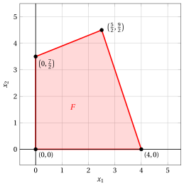

# Exercises · The geometry of Linear Programming

**Exercises · Chapter 15** · each solution opens with a click · [:material-book-open-variant: Chapter 15: The geometry of Linear Programming](../advanced-methods/15-geometry.md) · [:material-file-pdf-box: Exercises, volume 4 (PDF)](../pdf/exercises-4-advanced-methods.pdf)

!!! esercizio "Exercise 15.1: The geometry of Linear Programming (P2)"

    Consider the following LP problem in canonical maximization form with $n=2$ variables and $m=2$ constraints:

    $$
    \begin{array}{rrrrrrrrrrrrr}
    {\max} & \, {x_1} & {+} & {3} \, {x_2} \\[2ex]
    \text{subject to} & {-4} \, {x_1} & {+} & {10} \, {x_2} & {\le} & {35} \\[2ex]
    & {3} \, {x_1} & {+} & \, {x_2} & {\le} & {12} \\[2ex]
    & {x_1,} &  & {x_2} & { \ge} & { 0 }
    \end{array}
    $$

    **Questions**

    1. Determine the dimension of the feasible region $F$ and say whether it is full-dimensional.

    2. Determine the facets and the vertices of $F$.

    3. Write its standard maximization form, enumerate all the bases and say which of them are associated with a basic feasible solution. Check the correspondence with the vertices found at the previous question.

??? soluzione "Solution"

    - The feasible region is

        $$
        F = \left\{~ \begin{pmatrix} x_1 \\[0.5ex] x_2 \end{pmatrix} \in \R^2 :
        -4x_1 + 10x_2 \le 35,~~ 3x_1 + x_2 \le 12,~~ x_1 \ge 0,~~ x_2 \ge 0 ~\right\} .
        $$

        The point $\begin{pmatrix} 1 \\ 1 \end{pmatrix}$ satisfies all four constraints strictly, and then a small disc around it is contained in $F$: we have $\dim(F) = 2$ and $F$ is <strong>full-dimensional</strong>.

    - Since $\dim(F) = 2$, its facets are the faces of dimension $1$, that is, its edges, and its vertices are the faces of dimension $0$. Each of the four constraints defines one facet, and the vertices are

        $$
        \begin{pmatrix} 0 \\ 0 \end{pmatrix}, \qquad
        \begin{pmatrix} 4 \\ 0 \end{pmatrix}, \qquad
        \begin{pmatrix} \frac{5}{2} \\[0.5ex] \frac{9}{2} \end{pmatrix}, \qquad
        \begin{pmatrix} 0 \\[0.5ex] \frac{7}{2} \end{pmatrix} .
        $$

        { .fig .cornice loading=lazy  }

    - By adding $m=2$ slack variables we obtain the standard maximization form with $n+m=4$ non-negative variables and $m=2$ equality linear constraints. A basis is a subset of $2$ indices out of $4$, and there are $\binom{4}{2} = 6$ such subsets, all of them giving an invertible matrix:

        
<table>
        <tr>
        <th>\(\pazocal{B}\)</th>
        <th>\({\boldsymbol x}_{\pazocal{B}}\)</th>
        <th>feasible</th>
        <th>vertex \((x_1,x_2)\)</th>
        </tr>
        <tr>
        <td>\(\{1,2\}\)</td>
        <td>\(\left(\frac{5}{2},~\frac{9}{2}\right)\)</td>
        <td>✓</td>
        <td>\(\left(\frac{5}{2},\frac{9}{2}\right)\)</td>
        </tr>
        <tr>
        <td>\(\{1,3\}\)</td>
        <td>\((4,~51)\)</td>
        <td>✓</td>
        <td>\((4,0)\)</td>
        </tr>
        <tr>
        <td>\(\{1,4\}\)</td>
        <td>\(\left(-\frac{35}{4},~\frac{153}{4}\right)\)</td>
        <td></td>
        <td></td>
        </tr>
        <tr>
        <td>\(\{2,3\}\)</td>
        <td>\((12,~-85)\)</td>
        <td></td>
        <td></td>
        </tr>
        <tr>
        <td>\(\{2,4\}\)</td>
        <td>\(\left(\frac{7}{2},~\frac{17}{2}\right)\)</td>
        <td>✓</td>
        <td>\(\left(0,\frac{7}{2}\right)\)</td>
        </tr>
        <tr>
        <td>\(\{3,4\}\)</td>
        <td>\((35,~12)\)</td>
        <td>✓</td>
        <td>\((0,0)\)</td>
        </tr>
        </table>

        Exactly $4$ of the $6$ bases are feasible, and they correspond to the $4$ vertices found at the previous question. The correspondence is <strong>one-to-one</strong>, since no basic feasible solution is degenerate.

!!! esercizio "Exercise 15.2: The geometry of Linear Programming (G2)"

    Consider the following LP problem in standard maximization form with $n=3$ non-negative variables and $m=1$ equality linear constraint:

    $$
    \begin{array}{rrrrrrrrrrrrr}
    {\max} & {2} \, {x_1} & {+} & {2} \, {x_2} & {+} & \, {x_3} \\[2ex]
    \text{subject to} & {2} \, {x_1} & {+} & {3} \, {x_2} & {+} & \, {x_3} & {=} & {4} \\[2ex]
    & {x_1,} &  & {x_2,} &  & {x_3} & { \ge} & { 0 }
    \end{array}
    $$

    **Questions**

    1. Determine the dimension of the feasible region $F$ and say whether it is full-dimensional.

    2. Determine the vertices of $F$ by enumerating all the bases.

    3. Determine the set of the optimal solutions and say whether it is a face of $F$.

??? soluzione "Solution"

    - All the points of $F$ satisfy the equality constraint $2x_1 + 3x_2 + x_3 = 4$, and then $\mathrm{aff}(F)$ is contained in that plane:

        $$
        \dim(F) \; \le \; n - \rank({\boldsymbol A}) = 3 - 1 = 2 .
        $$

        The three points $\begin{pmatrix} 2 \\ 0 \\ 0\end{pmatrix}$, $\begin{pmatrix} 0 \\ \frac{4}{3} \\ 0\end{pmatrix}$ and $\begin{pmatrix} 0 \\ 0 \\ 4\end{pmatrix}$ belong to $F$ and are not aligned, and then $\dim(F) = 2$. The feasible region is therefore <u>not</u> full-dimensional, as it always happens for the standard maximization form.

    - A basis is a subset of $m=1$ index out of $n=3$, and there are $3$ such subsets, all of them giving an invertible matrix:

        
<table>
        <tr>
        <th>\(\pazocal{B}\)</th>
        <th>\({\boldsymbol x}_{\pazocal{B}}\)</th>
        <th>feasible</th>
        <th>vertex</th>
        </tr>
        <tr>
        <td>\(\{1\}\)</td>
        <td>\((2)\)</td>
        <td>✓</td>
        <td>\((2,0,0)\)</td>
        </tr>
        <tr>
        <td>\(\{2\}\)</td>
        <td>\(\left(\frac{4}{3}\right)\)</td>
        <td>✓</td>
        <td>\(\left(0,\frac{4}{3},0\right)\)</td>
        </tr>
        <tr>
        <td>\(\{3\}\)</td>
        <td>\((4)\)</td>
        <td>✓</td>
        <td>\((0,0,4)\)</td>
        </tr>
        </table>

        All three bases are feasible, and then $F$ has exactly three vertices: it is a triangle.

    - The objective values at the three vertices are

        $$
        2 \cdot 2 = 4, \qquad 2 \cdot \frac{4}{3} = \frac{8}{3}, \qquad 1 \cdot 4 = 4 ,
        $$

        and then the optimal value is $z(\, LP \,) = 4$, attained at two vertices. By the observation on multiple optimal solutions, every point of the segment joining them is optimal:

        $$
        \left\{~ \lambda \begin{pmatrix} 2 \\ 0 \\ 0\end{pmatrix} + (1-\lambda) \begin{pmatrix} 0 \\ 0 \\ 4\end{pmatrix} ~:~ \lambda \in [0,1] ~\right\} .
        $$

        This set is the <strong>face</strong> of $F$ defined by the valid inequality $2x_1 + 2x_2 + x_3 \le 4$, and it has dimension $1$: it is an edge of the triangle.

!!! esercizio "Exercise 15.3: The geometry of Linear Programming (G3)"

    Consider the following LP problem in canonical maximization form with $n=2$ variables and $m=4$ constraints:

    $$
    \begin{array}{rrrrrrrrrrrrr}
    {\max} & \, {x_1} & {+} & {2} \, {x_2} \\[2ex]
    \text{subject to} & \, {x_1} & {+} & \, {x_2} & {\le} & {2} \\[2ex]
    & {-} \, {x_1} & {-} & \, {x_2} & {\le} & {-2} \\[2ex]
    & \, {x_1} & {-} & \, {x_2} & {\le} & {0} \\[2ex]
    & {-} \, {x_1} & {+} & \, {x_2} & {\le} & {0} \\[2ex]
    & {x_1,} &  & {x_2} & { \ge} & { 0 }
    \end{array}
    $$

    **Questions**

    1. Determine the feasible region $F$ and its dimension.

    2. Say how many bases of the standard maximization form are associated with the only point of $F$, and explain why the correspondence between bases and vertices is not one-to-one.

??? soluzione "Solution"

    - The first two constraints impose $x_1 + x_2 \le 2$ and $x_1 + x_2 \ge 2$, that is, $x_1 + x_2 = 2$. The last two impose $x_1 \le x_2$ and $x_1 \ge x_2$, that is, $x_1 = x_2$. The two equalities give $x_1 = x_2 = 1$, and then

        $$
        F = \left\{ \begin{pmatrix} 1 \\ 1 \end{pmatrix} \right\}
        \qquad \text{and} \qquad
        \dim(F) = 0 .
        $$

        The single point of $F$ is therefore a vertex (here the vertex is the face $G = F$ itself, of dimension $0$), and it is the optimal solution, with optimal value $z(\, LP \,) = 1 + 2 = 3$.

    - In standard maximization form the problem has $n+m=6$ non-negative variables and $m=4$ equality linear constraints, and a basis is a subset of $4$ indices out of $6$. At the point $\begin{pmatrix} 1 \\ 1 \end{pmatrix}$ all four constraints are <u>binding</u>, and then all four slack variables take the value $0$. Since $x_1 = x_2 = 1 > 0$, every basis associated with that point contains the indices $1$ and $2$ of the two structural variables, together with two of the four slack variables. Out of the $\binom{4}{2} = 6$ choices, $\{1,2,3,4\}$ and $\{1,2,5,6\}$ give a singular matrix ${\boldsymbol A}_{\pazocal{B}}$ (the columns of $x_1$ and $x_2$ restricted to the rows of the other two slack variables are linearly dependent), while the remaining four are bases:

        $$
        \{1,2,3,5\}, \qquad \{1,2,3,6\}, \qquad \{1,2,4,5\}, \qquad \{1,2,4,6\} ,
        $$

        that is, <strong>four</strong> different bases give the same vertex. In each of them two basic variables take the value $0$: the basic feasible solution is <strong>degenerate</strong>.

        !!! chiave ""

            Every basic feasible solution is a vertex, but a <u>degenerate</u> vertex may be associated with several bases, as in this case: the correspondence between bases and vertices is onto, not one-to-one.
