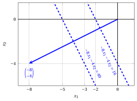
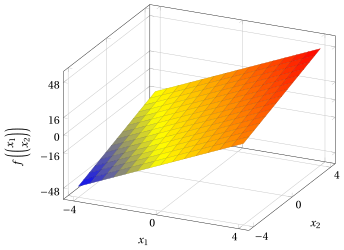

# Linear functions

**Part 1 · Linear functions, polyhedra and linear programming problems · Chapter 1** · [:material-file-pdf-box: Lecture notes, volume 1 (PDF)](../pdf/lecture-notes-1-linear-programming-problems.pdf) · [:material-gesture-tap: App: Level lines](../lab/level-lines.md)

## 1.1 Linear functions

!!! definizione "Definition 1.1: linear function"

    Given a (column) vector

    $$
    \underbrace{
    \begin{pmatrix}
    c_1 \\
    c_2 \\
    \vdots \\
    c_n
    \end{pmatrix}}_{ {\boldsymbol c}} \in \mathbb{R}^{n}
    $$

    the associated (scalar) function

    \begin{align*}
    f: \mathbb{R}^{n} \rightarrow \mathbb{R}, ~~~  f:\underbrace{\begin{pmatrix}
    x_1 \\
    x_2 \\
    \vdots \\
    x_n
    \end{pmatrix}}_{{\boldsymbol x}} \mapsto \underbrace{\sum_{j=1}^n c_j x_j}_{{\boldsymbol c}' {\boldsymbol x}} \tag{1.1}
    \end{align*}

    is called a <strong>linear function</strong>.

!!! definizione "Definition 1.2: gradient of a linear function"

    The <strong>gradient</strong> (vector of the partial derivatives) of the linear function $f({\boldsymbol x}) = {\boldsymbol c}'{\boldsymbol x}$ is:

    \begin{align*}
    \nabla f({\boldsymbol x}) &=
    \begin{pmatrix}
    \frac{ \partial f({\boldsymbol x})}{ \partial x_1} \\[1ex] \frac{ \partial f({\boldsymbol x})}{ \partial x_2} \\[1ex] \vdots \\[1ex]
    \frac{ \partial f({\boldsymbol x})}{ \partial x_n}
    \end{pmatrix}
    =
    \underbrace{\begin{pmatrix}
    c_1 \\[1ex]
    c_2 \\[1ex]
    \vdots \\[1ex]
    c_n
    \end{pmatrix}}_{ {\boldsymbol c}}
    \end{align*}

!!! definizione "Definition 1.3: Hessian of a linear function"

    The <strong>Hessian</strong> (matrix of the second partial derivatives) of the linear function $f({\boldsymbol x}) = {\boldsymbol c}'{\boldsymbol x}$ is the $n \times n$ matrix:

    \begin{align*}
    \nabla^2 f({\boldsymbol x}) =
    \begin{pmatrix}
    \frac{\partial^2 f({\boldsymbol x})}{\partial x_1 \partial x_1} & \frac{\partial^2 f({\boldsymbol x})}{\partial x_1 \partial x_2} & \cdots & \frac{\partial^2 f({\boldsymbol x})}{\partial x_1 \partial x_n} \\[1.5ex]
    \frac{\partial^2 f({\boldsymbol x})}{\partial x_2 \partial x_1} & \frac{\partial^2 f({\boldsymbol x})}{\partial x_2 \partial x_2} & \cdots & \frac{\partial^2 f({\boldsymbol x})}{\partial x_2 \partial x_n} \\[1.5ex]
    \vdots & \vdots & \ddots & \vdots \\[1.5ex]
    \frac{\partial^2 f({\boldsymbol x})}{\partial x_n \partial x_1} & \frac{\partial^2 f({\boldsymbol x})}{\partial x_n \partial x_2} & \cdots & \frac{\partial^2 f({\boldsymbol x})}{\partial x_n \partial x_n}
    \end{pmatrix}
    =
    \begin{pmatrix}
    0 & 0 & \cdots & 0 \\[1ex]
    0 & 0 & \cdots & 0 \\[1ex]
    \vdots & \vdots & \ddots & \vdots \\[1ex]
    0 & 0 & \cdots & 0
    \end{pmatrix}
    \end{align*}

    since every first partial derivative $\frac{\partial f({\boldsymbol x})}{\partial x_j} = c_j$ is a constant.

!!! definizione "Definition 1.4: level sets of a linear function"

    The <strong>level sets</strong> of the linear function $f({\boldsymbol x}) = {\boldsymbol c}'{\boldsymbol x}$ (the sets of points in which the function is <strong>constant</strong>) are:

    \begin{align*}
    \left\{~~{\boldsymbol x} \in \R^{n}:~~ {\boldsymbol c}' \; {\boldsymbol x}= k  ~~\right\} , \qquad \forall k \in \mathbb{R}
    \end{align*}

!!! chiave ""

    - The gradient of a linear function is the same vector ${\boldsymbol c}$ at every point and, accordingly, its <strong>Hessian</strong> (matrix of the second partial derivatives) is the zero matrix everywhere.

    - The level sets of a linear function are the <strong>hyperplanes</strong> perpendicular to the gradient.

!!! esempio "Example 1.1: gradient and level sets of linear functions"

    With ${\boldsymbol c}=\begin{pmatrix} 8\\ 4 \end{pmatrix}$, the associated  linear function is:

    $$
    f: \mathbb{R}^{2} \rightarrow \mathbb{R},~~ f: \begin{pmatrix}
    x_1 \\
    x_2 \\
    \end{pmatrix} \mapsto \begin{pmatrix}
    8 &  4 \\
    \end{pmatrix}
    \;
    \begin{pmatrix}
    x_{1} \\
    x_{2} \\
    \end{pmatrix}= 8\:x_1 + 4\: \, x_2
    $$

    <strong>Gradient:</strong>

    $$
    \nabla f\left(\begin{pmatrix}
    x_1 \\
    x_2 \\
    \end{pmatrix}\right) =
    \begin{pmatrix}
    8 \\[0.5ex] 4
    \end{pmatrix}
    $$

    { .fig .ovale loading=lazy style="width:65%" }

    The figure shows:

    - The gradient evaluated at $\begin{pmatrix} 0 \\ 0 \end{pmatrix}$: $\nabla f\left(\begin{pmatrix} 0 \\ 0 \end{pmatrix}\right) =\begin{pmatrix} 8 \\[0.5ex] 4 \end{pmatrix}$ (blue arrow)

    - Two level sets (blue dashed lines): $8 x_1 +4 x_2 = 16$ and $8 x_1 +4 x_2 = 40$

!!! esempio "Example 1.2: gradient and level sets of linear functions"

    With ${\boldsymbol c}=\begin{pmatrix} -8\\ -4 \end{pmatrix}$, the associated  linear function is:

    $$
    f: \mathbb{R}^{2} \rightarrow \mathbb{R},~~ f: \begin{pmatrix}
    x_1 \\
    x_2 \\
    \end{pmatrix} \mapsto \begin{pmatrix}
    -8 &  -4 \\
    \end{pmatrix}
    \;
    \begin{pmatrix}
    x_{1} \\
    x_{2} \\
    \end{pmatrix}= -8\:x_1 - 4\: \, x_2
    $$

    <strong>Gradient:</strong>

    $$
    \nabla f\left(\begin{pmatrix}
    x_1 \\
    x_2 \\
    \end{pmatrix}\right) =
    \begin{pmatrix}
    -8 \\[0.5ex] -4
    \end{pmatrix}
    $$

    { .fig .ovale loading=lazy style="width:65%" }

    The figure shows:

    - The gradient evaluated at $\begin{pmatrix} 0 \\ 0 \end{pmatrix}$: $\nabla f\left(\begin{pmatrix} 0 \\ 0 \end{pmatrix}\right) =\begin{pmatrix} -8 \\[0.5ex] -4 \end{pmatrix}$ (blue arrow)

    - Two level sets (blue dashed lines): $-8 x_1 -4 x_2 = 16$ and $-8 x_1 -4 x_2 = 40$

!!! esempio "Example 1.3: graphs of linear functions"

    With ${\boldsymbol c}=\begin{pmatrix} 8\\  4 \end{pmatrix}$, we have $f\left(\begin{pmatrix} x_1 \\ x_2 \\ \end{pmatrix}\right)=8\;x_1 + 4\;x_2$. Its graph is:

    { .fig .ovale loading=lazy style="width:59%" }

!!! esempio "Example 1.4: graphs of linear functions"

    With ${\boldsymbol c}=\begin{pmatrix} -8\\ -4 \end{pmatrix}$, we have $f\left(\begin{pmatrix} x_1 \\ x_2 \\ \end{pmatrix}\right)=-8\;x_1- 4\;x_2$. Its graph is:

    { .fig .ovale loading=lazy style="width:59%" }

<!-- laboratorio-interattivo: sezione generata da interattivi.py -->

## Interactive lab { #interactive-lab }

The ideas of the chapter, hands on: move the sliders and drag the points.
Each app also opens full page in the [interactive lab](../lab/index.md): [Level lines](../lab/level-lines.md).

