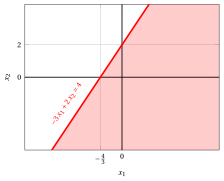
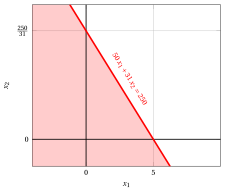
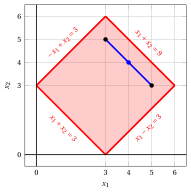

# Half-spaces and polyhedra

**Part 1 · Linear functions, polyhedra and linear programming problems · Chapter 2** · [:material-file-pdf-box: Lecture notes, volume 1 (PDF)](../pdf/lecture-notes-1-linear-programming-problems.pdf) · [:material-pencil: Exercises: Half-spaces and polyhedra](../exercises/ex-02-polyhedra.md) · [:material-gesture-tap: App: Half-spaces and polyhedra](../lab/polyhedra.md)

## 2.1 Half-spaces and supporting hyperplanes

!!! definizione "Definition 2.1: half-space"

    Given  a (row) vector

    $$
    \underbrace{
    \begin{pmatrix}
    a_{1} & a_{2} & \dots &
    a_{n} \\
    \end{pmatrix}}_{{\boldsymbol a}} \in \R^{1 \times n}
    $$

    and a scalar  $b \in \R$, the set

    $$
    \left\{~~ \underbrace{\begin{pmatrix}
    x_{1} \\
    x_{2} \\
    \vdots  \\
    x_{n} \\
    \end{pmatrix}}_{{\boldsymbol x}} \in \R^n:~~~  \underbrace{\sum_{j=1}^n a_j \; x_j \le b}_{ {\boldsymbol a} \: {\boldsymbol x} \le b} ~~\right\}
    $$

    is called an <strong>half-space</strong>.

- Given an half-space,  the set

    $$
    \left\{~~ \underbrace{\begin{pmatrix}
    x_{1} \\
    x_{2} \\
    \vdots  \\
    x_{n} \\
    \end{pmatrix}}_{{\boldsymbol x}} \in \R^n:~~~  \underbrace{\sum_{j=1}^n a_j \; x_j = b}_{{\boldsymbol a} \: {\boldsymbol x} = b} ~~\right\}
    $$

    is called the <strong>supporting hyperplane</strong> of the half-space.

!!! esempio "Example 2.1: half-space and supporting hyper-plane"

    Let us consider the following half-space in $\R^2$:

    $$
    \left\{~~
    \begin{pmatrix} x_1 \\ x_2 \end{pmatrix} \in \R^2 :~~ -3 \; x_1 + 2 \; x_2 \le 4 ~~\right\} \text{   where   }
    {\boldsymbol a}=
    \begin{pmatrix}
    -3 &  2 \\
    \end{pmatrix}
    ~~\text{and}~~
    b=4
    $$

    { .fig .ovale loading=lazy style="width:50%" }

    Let us consider the following half-space in $\R^2$:

    $$
    \left\{~~
    \begin{pmatrix} x_1 \\ x_2 \end{pmatrix} \in \R^2 :~~ 50x_1 + 31 \; x_2 \le 250 ~~\right\} \text{   where   }
    {\boldsymbol a}=
    \begin{pmatrix}
    -3 &  2 \\
    \end{pmatrix}
    ~~\text{and}~~
    b=250
    $$

    { .fig .ovale loading=lazy style="width:50%" }

## 2.2 Polyhedra

!!! definizione "Definition 2.2: polyhedron"

    Given a matrix

    $$
    \underbrace{
    \begin{pmatrix}
    a_{11} & a_{12} & \dots & a_{1n}\\
    a_{21} & a_{22} & \dots & a_{2n}\\
    \vdots  & \vdots  & \ddots & \vdots \\
    a_{m1} & a_{n2} & \dots & a_{mn}\\
    \end{pmatrix}}_{{\boldsymbol A}} \in \R^{m \times n}
    $$

    and a (column) vector

    $$
    \underbrace{\begin{pmatrix}
    b_{1} \\
    b_{2} \\
    \vdots  \\
    b_{m} \\
    \end{pmatrix}}_{{\boldsymbol b}} \in \R^{m}
    $$

    the set

    $$
    \left\{ \underbrace{\begin{pmatrix}
    x_{1} \\
    x_{2} \\
    \vdots  \\
    x_{n} \\
    \end{pmatrix}}_{{\boldsymbol x}} \in \R^n: ~~~ \underbrace{\sum_{j=1}^n a_{ij} \; x_j\le b_i,~~~\forall i \in \{1,2,\dots,m\}}_{{\boldsymbol A} \; {\boldsymbol x} \le {\boldsymbol b}} ~~\right\}
    $$

    is called a  <strong>polyhedron</strong>.

!!! definizione "Definition 2.3: bounded polyhedron"

    A polyhedron $P \subseteq \R^n$ is <strong>bounded</strong> if there exists $\underbrace{\begin{pmatrix} \beta_1 \\ \beta_2 \\ \vdots \\ \beta_n \end{pmatrix}}_{={\boldsymbol \beta}} \in \R^n_{\ge 0}$ such that

    \begin{equation*}
    \underbrace{-\beta_j \le x_j \le \beta_j}_{|x_j| \le \beta_j},
    \qquad \forall {\boldsymbol x} \in P,~ \forall j \in \{1,2,\dots,n\}. \tag{2.1}
    \end{equation*}

    Here, $\beta_j$ is an <strong>upper bound</strong>, while $-\beta_j$ is a <strong>lower bound</strong> of $P$ along dimension $j \in \{1,2,\dots,n\}$.

!!! definizione "Definition 2.4: polytope"

    A bounded polyhedron is called a <strong>polytope</strong>.

!!! esempio "Example 2.2: polyhedron"

    Consider the following polyhedron defined as the intersection of four half-spaces:

    $$
    P = \left\{~~
    \begin{pmatrix} x_1 \\[0.3ex] x_2 \end{pmatrix} \in \R^2 :~~
    -\,x_1 - x_2 \le -3,~~~
    x_1 + x_2 \le 9,~~~
    -\,x_1 + x_2 \le 3,~~~
    x_1 - x_2 \le 3
    ~~\right\}
    $$

    For example, consider two points, $\begin{pmatrix} 3 \\[0.3ex] 5 \end{pmatrix}$ and $\begin{pmatrix} 5 \\[0.3ex] 3 \end{pmatrix}$, in the set $P$. All points on the blue segment in the figure, given by:

    $$
    \lambda \begin{pmatrix} 3 \\[0.3ex] 5 \end{pmatrix} + (1-\lambda) \begin{pmatrix} 5 \\[0.3ex] 3 \end{pmatrix}
    = \begin{pmatrix} 5-2\lambda \\[0.3ex] 3+2\lambda \end{pmatrix}
    \quad \text{for} \quad \lambda \in [0,1],
    $$

    also belong to $P$. Indeed, for every $\lambda \in [0,1]$ we have $x_1 + x_2 = 8$ and $x_1 - x_2 = 2 - 4\lambda \in [-2,2]$, so that all four inequalities defining $P$ are satisfied.

    { .fig .ovale loading=lazy style="width:57%" }

    For example, with $\lambda = \tfrac{1}{2}$, the point of the segment is the one shown in blue

    $$
    \begin{pmatrix}
    \tfrac{1}{2}\,3 + \!\left(1-\tfrac{1}{2}\right)\!5 \\[1ex]
    \tfrac{1}{2}\,5 + \!\left(1-\tfrac{1}{2}\right)\!3
    \end{pmatrix}
    =
    \begin{pmatrix}
    4 \\[0.3ex]
    4
    \end{pmatrix}
    $$

    This polyhedron $P$ is a also polytope, since it is a bounded polyhedron in $\R^2$. Indeed, by setting ${\boldsymbol \beta} = \begin{pmatrix} 6 \\[0.5ex] 6 \end{pmatrix}$ we have

    $$
    |x_1| \le 6 ~~\text{and}~~ |x_2| \le 6 ~~\text{for all}~~
    \begin{pmatrix} x_1 \\[0.3ex] x_2 \end{pmatrix} \in P
    $$

- It is worth noticing that if a polyhedron contains the following two half spaces:

    $$
    \left\{ {\boldsymbol x} \in \R^n:~~  {\boldsymbol a} \; {\boldsymbol x} \le b \right\}~~~~\text{and}~~~~~ \left\{ {\boldsymbol x} \in \R^n:~~  {\boldsymbol a} \; {\boldsymbol x} \ge  b \right\}
    $$

    it contains, <em>de facto</em>, the following  hyperplanes:

    $$
    \left\{ {\boldsymbol x} \in \R^n:~~  {\boldsymbol a} \; {\boldsymbol x} =  b \right\}
    $$

!!! chiave ""

    In general,  a polyhedron is given by the intersection of half-spaces and hyperplanes.

!!! esempio "Example 2.3: polyhedron"

    Consider the following polyhedron given by the intersection of three half-spaces and one hyperplane:

    $$
    P = \left\{~~
    \begin{pmatrix}
    x_1 \\[0.3ex]
    x_2 \\[0.3ex]
    x_3
    \end{pmatrix}
    \in \mathbb{R}^3 :~
    ~x_1 \ge 0,~~
    x_2 \ge 0,~~
    x_3 \ge 0,~~
    2x_1 + 3x_2 + x_3 = 4
    ~~\right\}
    $$

    Its three-dimensional representation corresponds to the hyperplane shown in the figure.

    { .fig .ovale loading=lazy style="width:47%" }

---

**Exercises on this chapter:** [:material-pencil: Half-spaces and polyhedra](../exercises/ex-02-polyhedra.md)

<!-- laboratorio-interattivo: sezione generata da interattivi.py -->

## Interactive lab { #interactive-lab }

The ideas of the chapter, hands on: move the sliders and drag the points.
Each app also opens full page in the [interactive lab](../lab/index.md): [Half-spaces and polyhedra](../lab/polyhedra.md).

