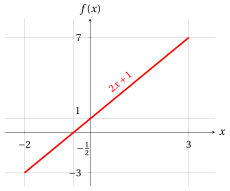
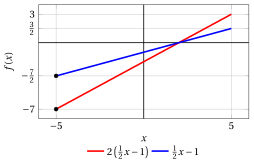

# Linear optimization problems

**Part 1 · Linear functions, polyhedra and linear programming problems · Chapter 3** · [:material-file-pdf-box: Lecture notes, volume 1 (PDF)](../pdf/lecture-notes-1-linear-programming-problems.pdf) · [:material-pencil: Exercises](../exercises/ex-03-linear-optimization-problems.md)

## 3.1 Linear Programming problems

!!! definizione "Definition 3.1: Linear Programming problem in minimization and maximization form"

    Given a polyhedron $F \subseteq \R^n$ and a linear function $f : \R^n \to \R$, the associated <strong>Linear Programming problem</strong> $LP$ consists of,

    - in the <strong>minimization form</strong>, finding a point $\tilde{\boldsymbol{x}}(LP) \in F$ such that

        $$
        f(\tilde{\boldsymbol{x}}(LP)) \le f(\boldsymbol{x}), \qquad \forall \boldsymbol{x} \in F;
        $$

    - in the <strong>maximization form</strong>, finding a point $\tilde{\boldsymbol{x}}(LP) \in F$ such that

        $$
        f(\tilde{\boldsymbol{x}}(LP)) \ge f(\boldsymbol{x}), \qquad \forall \boldsymbol{x} \in F.
        $$

### 3.1.1 Feasible region and objective function

- The polyhedron $F$ is called the <strong>feasible region</strong> of the LP problem; its points $\boldsymbol{x} \in F$ are called the <strong>feasible solutions</strong> of the LP problem.

- The linear function $f$ is the <strong>objective function</strong> of the LP problem; it assigns an objective value to each feasible solution.

- To define the polyhedron of the feasible region of an LP problem, we need the number $m$ of its inequalities/equalities and

    1. a matrix ${\boldsymbol A} \in \R^{m \times n}$ — the <strong>constraint matrix</strong>,

    2. a (column) vector ${\boldsymbol b} \in \R^{m}$ — the <strong>right-hand-side (RHS) vector</strong>.

    $$
    \underbrace{
    \begin{pmatrix}
    a_{11} & a_{12} & \dots & a_{1n}\\
    a_{21} & a_{22} & \dots & a_{2n}\\
    \vdots  & \vdots  & \ddots & \vdots \\
    a_{m1} & a_{m2} & \dots & a_{mn}
    \end{pmatrix}
    }_{\boldsymbol{A}} \in \R^{m \times n }
    \qquad\qquad
    \underbrace{
    \begin{pmatrix}
    b_{1} \\
    b_{2} \\
    \vdots \\
    b_{m}
    \end{pmatrix}
    }_{\boldsymbol{b}} \in \R^{m}
    $$

    Moreover, for each row we need to specify whether it corresponds to a half-space (linear inequality) or a hyperplane (linear equality).

- To define the linear objective function of an LP problem, we need the (column) vector ${\boldsymbol c} \in \R^{n}$, called the <strong>objective-function vector</strong>:

    $$
    \underbrace{
    \begin{pmatrix}
    c_{1} \\
    c_{2} \\
    \vdots \\
    c_{n}
    \end{pmatrix}
    }_{\boldsymbol c} \in \R^{n}.
    $$

!!! chiave ""

    The <strong>input data</strong> of an LP problem are the constraint matrix ${\boldsymbol A} \in \R^{m \times n}$, the right-hand-side vector ${\boldsymbol b} \in \R^{m}$, the objective-function vector ${\boldsymbol c} \in \R^{n}$, and, for each row, the information specifying whether the corresponding constraint is an equality or an inequality.

### 3.1.2 Optimal solutions and optimal value

!!! definizione "Definition 3.2: optimal solution and optimal value of an LP problem"

    - A point $\tilde{\boldsymbol{x}}(LP) \in F$ as in the definition of the LP problem is called an <strong>optimal solution</strong> of the LP problem.

        1. In the minimization form,

            $$
            \tilde{\boldsymbol{x}}(LP) \in
            \argmin \{\, f(\boldsymbol{x}) \;\text{subject to}\; \boldsymbol{x} \in F \,\}.
            $$

        2. In the maximization form,

            $$
            \tilde{\boldsymbol{x}}(LP) \in
            \argmax \{\, f(\boldsymbol{x}) \;\text{subject to}\; \boldsymbol{x} \in F \,\}.
            $$

    - The value $f(\tilde{\boldsymbol{x}}(LP))$ is called the <strong>optimal value</strong> of the LP problem, and it is denoted by $z(LP)$.

        1. In the minimization form,

            $$
            z(LP) =
            \underbrace{\min \{\, f(\boldsymbol{x}) \;\text{subject to}\; \boldsymbol{x} \in F \,\}}_{ =f(\tilde{\boldsymbol{x}}(LP))}.
            $$

        2. In the maximization form,

            $$
            z(LP) =
            \underbrace{\max \{\, f(\boldsymbol{x}) \;\text{subject to}\; \boldsymbol{x} \in F \,\}}_{ =f(\tilde{\boldsymbol{x}}(LP))}.
            $$

- An LP problem may admit multiple (possibly infinitely many) optimal solutions, or none at all. In such cases, the operators $\argmin$ and $\argmax$ return the full set of optimal solutions when they exist, and return the empty set otherwise.

- With a slight abuse of notation:

    1. In the <strong>minimization form</strong>, we write the LP problem as

        $$
        \min \{\, f(\boldsymbol{x}) \;\text{subject to}\; \boldsymbol{x} \in F \,\}.
        $$

    2. In the <strong>maximization form</strong>, we write the LP problem as

        $$
        \max \{\, f(\boldsymbol{x}) \;\text{subject to}\; \boldsymbol{x} \in F \,\}.
        $$

    !!! chiave ""

        Although we use the symbols “$\min$” and “$\max$”, the goal of an LP problem is to <strong>find an optimal solution</strong> $\tilde{\boldsymbol{x}}(LP)$, whenever it exists, rather than merely determining the optimal value $z(LP)$.

- In the <strong>minimization form</strong>, an optimal solution is a <strong>point of minimum</strong>, and the corresponding optimal value is the <strong>minimum</strong> of the objective function over the feasible region. Similarly, in the <strong>maximization form</strong>, an optimal solution is a <strong>point of maximum</strong>, and the corresponding optimal value is the <strong>maximum</strong> of the objective function over the feasible region.

### 3.1.3 LP problems without an optimal solution

- An optimal solution of an LP problem may not exist for one of the following two reasons:

    1. If the objective function decreases indefinitely in the minimization form or increases indefinitely in the maximization form, the LP problem is said to be <strong>unbounded</strong>. In these cases, we write $z(LP) = -\infty$ and $z(LP) = +\infty$, respectively.

    2. If the feasible region is empty, meaning that no feasible solutions exist, the LP problem is said to be <strong>infeasible</strong>. It has no optimal solution and $z(LP)$ is not defined.

- There is no third reason: if an LP problem has feasible solutions and it is not unbounded, the infimum (in the minimization form) or the supremum (in the maximization form) of the objective function over the feasible region is always <strong>attained</strong> by a feasible solution. This is due to the special structure of LP problems: the objective function is linear and the feasible region is a polyhedron, a <strong>closed</strong> set defined by linear inequalities “$\le$”, “$\ge$” and linear equalities “$=$”, never by strict inequalities “$<$”, “$>$”. For example, the interval $(0,1] = \{\, x \in \R : 0 < x \le 1 \,\}$ is not a polyhedron, and $\min \{\, x \text{ subject to } 0 < x \le 1 \,\}$ is not an LP problem: its infimum $0$ is not attained.

- The three possible outcomes of an LP problem (infeasible, unbounded, optimal solution) are formally defined and studied in the chapter «Possible outcomes and equivalent formulations».

!!! esempio "Example 3.1: LP problems without an optimal solution"

    - Consider the objective function $f(x) = 2x+1$ and the feasible region $F = \{\, x \in \R : x \ge -2 \,\}$, a half-line. In the minimization form, $2x+1 \ge -3$ for every feasible $x$, with equality only for $x=-2$: the unique optimal solution is $\tilde{\boldsymbol x}(LP) = (-2)$ and $z(LP) = -3$. In the maximization form, for every value $M \ge 0$ the feasible solution $x = M$ has $f(M) = 2M+1 > M$: the objective function increases indefinitely and the problem is <strong>unbounded</strong>, $z(LP) = +\infty$.

    - Consider the feasible region $F = \{\, x \in \R : x \le -1,~ x \ge 1 \,\}$. No real number satisfies both inequalities, so $F = \emptyset$: for every linear objective function, both the minimization and the maximization form are <strong>infeasible</strong>.

### 3.1.4 Feasible solutions and bounds on the optimal value

- Given

    $$
    \underbrace{
    \begin{pmatrix}
    \bar x_1 \\
    \bar x_2 \\
    \vdots \\
    \bar x_n
    \end{pmatrix}
    }_{\bar{\boldsymbol x}(LP)}
    \in F
    $$

    a <strong>feasible solution</strong> of an LP problem, we have

    1. in <strong>minimization</strong> form, the following <strong>upper bound</strong>:

        $$
        z(LP) \le
        \underbrace{f(\bar{\boldsymbol{x}}(LP))}_{UB(\bar{\boldsymbol x})} .
        $$

    2. in <strong>maximization</strong> form, the following <strong>lower bound</strong>:

        $$
        \underbrace{f(\bar{\boldsymbol{x}}(LP))}_{LB(\bar{\boldsymbol x})}
        \le z(LP) .
        $$

    As an illustrative example, the figure below considers four feasible solutions

    $$
    \bar{\boldsymbol x}^{(1)}, \bar{\boldsymbol x}^{(2)}, \bar{\boldsymbol x}^{(3)}, \bar{\boldsymbol x}^{(4)} \in F
    $$

    and shows how they provide lower bounds in the maximization case and upper bounds in the minimization case for the optimal value $z(LP)$ (the fourth one attains the optimal value).

    { .fig .cornice loading=lazy style="width:62%" }

## 3.2 Examples and properties of linear optimization problems

- The following example is a linear optimization problem in one variable: the feasible region is an interval (a polyhedron in $\R$) and the objective function is linear.

!!! esempio "Example 3.2: LP problem in one variable"

    Let us consider the following objective function and feasible region:

    $$
    f:\R  \rr \R,~f: x \mapsto 2x + 1 \qquad \text{and} \qquad F=[-2,3]
    $$

    { .fig .ovale loading=lazy style="width:59%" }

    The associated LP problems in minimization and maximization forms are:

    \begin{equation*}
    \min \bigg\{\,  2x + 1 \ \text{ subject to } -2 \le x \le 3 \,\bigg\}
    \end{equation*}

    \begin{equation*}
    \max \bigg\{\,  2x + 1 \ \text{ subject to } -2 \le x \le 3 \,\bigg\}
    \end{equation*}

    - For the minimization form, since the linear function is strictly increasing, the unique optimal solution and the optimal value are:

        $$
        \tilde{\boldsymbol x}(LP) = (-2)
        \quad \text{and} \quad
        z(LP) = -3.
        $$

    - For the maximization form, since the linear function is strictly increasing, the unique optimal solution and the optimal value are:

        $$
        \tilde{\boldsymbol x}(LP) = (3)
        \quad \text{and} \quad
        z(LP) = 7.
        $$

    The derivative function is constant:

    $$
    f':\R  \rr \R,~f': x \mapsto 2
    $$

    $$
    f'(x) = 2 > 0 \quad \forall x \in \R,
    $$

### 3.2.1 Properties of LP problems

- The following properties hold for every LP problem with feasible region $F$ and objective function $f(\boldsymbol{x}) = {\boldsymbol c}'\boldsymbol{x}$.

- We state them using $\min$ and $\max$ for LP problems that admit an optimal solution. If one of the two LP problems in an equation is infeasible (unbounded), so is the other one.

- For every LP problem, we have:

    \begin{align*}
    \label{PropMinMaxLP}
    \min \bigg\{\, {\boldsymbol c}'\boldsymbol{x} \text{ subject to } \boldsymbol{x}\in F \,\bigg\}
    &= -\,\max \bigg\{\, -{\boldsymbol c}'\boldsymbol{x} \text{ subject to } \boldsymbol{x}\in F \,\bigg\} \tag{3.1}
    \end{align*}

- The optimal solutions do not change: a point minimizes ${\boldsymbol c}'\boldsymbol{x}$ over $F$ if and only if it maximizes $-{\boldsymbol c}'\boldsymbol{x}$ over $F$.

!!! esempio "Example 3.3: property: minimum and maximum"

    $$
    \begin{aligned}
    &\underbrace{\min \left\{\, \frac{1}{2}x+1 \text{ subject to } -5 \le x \le 5 \,\right\}}_{=-\frac{3}{2}}\\[1ex]
    &\qquad = -\,\underbrace{\max \left\{\, -\left( \frac{1}{2}x+1 \right) \text{ subject to } -5 \le x \le 5 \,\right\}}_{=\frac{3}{2}}
    \end{aligned}
    $$

    Both optima are attained at $x=-5$ (black points in the figure).

    { .fig .ovale loading=lazy style="width:44%" }

- For every LP problem and every $a \in \R$, we have:

    \begin{align*}
    \label{PropAddLP}
    \min \bigg\{\, a + {\boldsymbol c}'\boldsymbol{x} \text{ subject to } \boldsymbol{x}\in F \,\bigg\}
    &= a + \min \bigg\{\, {\boldsymbol c}'\boldsymbol{x} \text{ subject to } \boldsymbol{x}\in F \,\bigg\} \tag{3.2}
    \end{align*}

- Adding a constant moves the graph of the objective function up or down: the optimal solutions do not change.

!!! esempio "Example 3.4: property: constant addition"

    $$
    \underbrace{\min \left\{\, \frac{1}{2}x-2 \text{ subject to } -5 \le x \le 5 \,\right\}}_{=-\frac{9}{2}}
    = -2 + \underbrace{\min \left\{\, \frac{1}{2}x \text{ subject to } -5 \le x \le 5 \,\right\}}_{=-\frac{5}{2}}
    $$

    { .fig .ovale loading=lazy style="width:44%" }

- For every LP problem and every $a \in \R_{>0}$, we have:

    \begin{align*}
    \label{PropPosLP}
    \min \bigg\{\, a\, {\boldsymbol c}'\boldsymbol{x} \text{ subject to } \boldsymbol{x}\in F \,\bigg\}
    &= a \; \min \bigg\{\, {\boldsymbol c}'\boldsymbol{x} \text{ subject to } \boldsymbol{x}\in F \,\bigg\} \tag{3.3}
    \end{align*}

- Multiplying by a positive constant stretches (or compresses) the graph vertically: the optimal solutions do not change.

!!! esempio "Example 3.5: property: multiplication by a positive constant"

    $$
    \underbrace{\min \left\{\, 2\left(\frac{1}{2}x-1\right) \text{ subject to } -5 \le x \le 5 \,\right\}}_{=-7}
    = 2\,\underbrace{\min \left\{\, \frac{1}{2}x-1 \text{ subject to } -5 \le x \le 5 \,\right\}}_{=-\frac{7}{2}}
    $$

    { .fig .ovale loading=lazy style="width:44%" }

- For every LP problem and every $a \in \R_{<0}$, we have:

    \begin{align*}
    \label{PropNegLP}
    \min \bigg\{\, a\, {\boldsymbol c}'\boldsymbol{x} \text{ subject to } \boldsymbol{x}\in F \,\bigg\}
    &= a \; \max \bigg\{\, {\boldsymbol c}'\boldsymbol{x} \text{ subject to } \boldsymbol{x}\in F \,\bigg\} \tag{3.4}
    \end{align*}

- Multiplying by a negative constant turns the graph upside down: the points of minimum of $a\,{\boldsymbol c}'\boldsymbol{x}$ are the points of maximum of ${\boldsymbol c}'\boldsymbol{x}$.

!!! esempio "Example 3.6: property: multiplication by a negative constant"

    $$
    \begin{aligned}
    &\underbrace{\min \left\{\, -2\left(\frac{1}{2}x-1\right) \text{ subject to } -5 \le x \le 5 \,\right\}}_{=-3}\\[1ex]
    &\qquad = -2\,\underbrace{\max \left\{\, \frac{1}{2}x-1 \text{ subject to } -5 \le x \le 5 \,\right\}}_{=\frac{3}{2}}
    \end{aligned}
    $$

    The minimum of $-2\left(\frac{1}{2}x-1\right)$ and the maximum of $\frac{1}{2}x-1$ are both attained at $x=5$.

    { .fig .ovale loading=lazy style="width:44%" }
