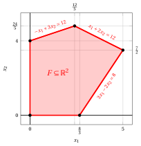
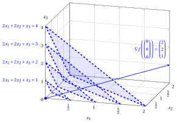
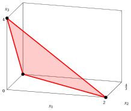

# Linear Programming problems

**Part 1 · Linear functions, polyhedra and linear programming problems · Chapter 4** · [:material-file-pdf-box: Lecture notes, volume 1 (PDF)](../pdf/lecture-notes-1-linear-programming-problems.pdf) · [:material-pencil: Exercises](../exercises/ex-04-lp-problems.md)

## 4.1 Canonical maximization form

!!! definizione "Definition 4.1: Linear Programming problems in canonical maximization form"

    Given:

    1. an objective-function vector ${\boldsymbol c} \in \R^{n}$

    2. a constraint matrix ${\boldsymbol A} \in \R^{m \times n }$

    3. a right-hand-side (RHS) vector ${\boldsymbol b} \in \R^{m}$ with $m$ rows

        $$
        \underbrace{
        \begin{pmatrix}
        c_{1} \\
        c_{2} \\
        \vdots \\
        \vdots \\
        c_{n} \\
        \end{pmatrix}
        }_{{\boldsymbol c}} \in \R^{n}
        \qquad \qquad
        \underbrace{
        \begin{pmatrix}
        a_{11} & a_{12} & \dots & \dots & a_{1n}\\
        a_{21} & a_{22} & \dots & \dots & a_{2n}\\
        \vdots  & \vdots  & \ddots & \ddots & \vdots \\
        a_{m1} & a_{m2} & \dots & \dots & a_{mn}\\
        \end{pmatrix}
        }_{{\boldsymbol A}} \in \R^{m \times n }
        \qquad \qquad
        \underbrace{
        \begin{pmatrix}
        b_{1} \\
        b_{2} \\
        \vdots \\
        b_{m} \\
        \end{pmatrix}
        }_{{\boldsymbol b}} \in \R^{m}
        $$

    a <strong>Linear Programming  problem</strong> LP in <strong>canonical maximization form</strong> with $n$ <u>non-negative variables</u>

    $$
    \underbrace{
    \begin{pmatrix}
    x_{1} \\
    x_{2} \\
    \vdots \\
    \vdots \\
    x_{n} \\
    \end{pmatrix}
    }_{{\boldsymbol x}} \in \R^{n}_{\ge 0}
    $$

    and $m$ <u>less-than-or-equal-to linear constraints</u> is the following optimization problem:

    

    \begin{align*}
    \label{ObjFunc}  &&   \max \;\; \underbrace{\sum_{j =1}^n c_j \, x_j}_{ {\boldsymbol c}' {\boldsymbol x}}  \qquad \qquad \qquad \qquad \qquad \qquad  \tag{4.1a}\\[1ex]
    \label{Cons}     && \text{subject to} \quad \underbrace{\sum_{j =1}^n a_{ij} \, x_j  \le b_i, \qquad   \forall i \in \{1,2,\dots,m\}}_{ {\boldsymbol A}\,{\boldsymbol x}  \le {\boldsymbol b}},  \tag{4.1b}\\[1ex]
    \label{NonNegCons}&& \underbrace{x_j \ge 0, \qquad \forall j \in \{1,2,\dots,n\}}_{{\boldsymbol x} \ge {\boldsymbol 0}}, \tag{4.1c}
    \end{align*}

    where ${\boldsymbol 0} = \begin{pmatrix} 0 \\ 0 \\ \vdots \\ 0 \\ \end{pmatrix}$ is a (column) vector of $n$ zeros.

!!! esempio "Example 4.1: LP problem in canonical maximization form"

    Consider the following input data of an LP problem with $n=2$ and $m=3$:

    $$
    {\boldsymbol c}=
    \begin{pmatrix}
    5 \\[1ex]
    2\\
    \end{pmatrix}
    \qquad
    {\boldsymbol A}=
    \begin{pmatrix}
    -1 & 3 \\[1ex]
    1 & 2 \\[1ex]
    3 & -2 \\
    \end{pmatrix}
    \qquad
    {\boldsymbol b}=
    \begin{pmatrix}
    12 \\[1ex]
    12 \\[1ex]
    8\\
    \end{pmatrix}
    $$

    The numerical entries of the two column vectors and the matrix are

    \begin{gather*}
    c_1=5,~c_2=2,~a_{11}=-1,~a_{12}=3,~a_{21}=1,~a_{22}=2,\\
    a_{31}=3,~a_{32}=-2,~b_1=12,~b_2=12,~b_3=8.
    \end{gather*}

    The problem involves $n=2$ non-negative variables ${\boldsymbol x}= \begin{pmatrix} x_1 \\[1ex] x_2\\ \end{pmatrix}.$

    The associated LP problem in canonical maximization form with $n=2$ non-negative variables and $m=3$ less-than-or-equal-to linear constraints reads as follows:

    $$
    \begin{array}{rrrrrrrrrrrrr}
    {\max} & 5 \, {x_1} & {+} & 2 \, {x_2} \\[1ex]
    \text{subject to} & {-} \, {x_1} & {+} & 3 \, {x_2} & {\le} & 12 \\[1ex]
    & {x_1} & {+} & 2 \, {x_2} & {\le} & 12 \\[1ex]
    & {3} \, {x_1} & {-} & 2 \, {x_2} & {\le} & 8 \\[1ex]
    & {x_1,} &  & {x_2} & { \ge} & {0}
    \end{array}
    $$

!!! esempio "Example 4.2: LP problem in canonical maximization form"

    Consider the following input data of an LP problem with $n=2$ and $m=2$:

    $$
    {\boldsymbol c}=
    \begin{pmatrix}
    -2 \\[1ex]
    -4\\
    \end{pmatrix}
    \qquad
    {\boldsymbol A}=
    \begin{pmatrix}
    -1 & -1 \\[1ex]
    1 & -1 \\
    \end{pmatrix}
    \qquad
    {\boldsymbol b}=
    \begin{pmatrix}
    -2 \\[1ex]
    0\\
    \end{pmatrix}
    $$

    The numerical entries of the two column vectors and the matrix are

    $$
    c_1=-2,~c_2=-4,~a_{11}=-1,~a_{12}=-1,~a_{21}=1,~a_{22}=-1,~b_1=-2,~b_2=0.
    $$

    The problem involves $n=2$ non-negative decision variables ${\boldsymbol x}= \begin{pmatrix} x_1 \\[1ex] x_2\\ \end{pmatrix}.$

    The associated LP problem in canonical maximization form with $n=2$ non-negative variables and $m=2$ less-than-or-equal-to linear constraints reads as follows:

    $$
    \begin{array}{rrrrrrrrrrrrr}
    {\max} & {-2} \, {x_1} & {-} & 4\, {x_2} \\[1ex]
    \text{subject to} & {-} \, {x_1} & {-} & {x_2} & {\le} & {-2} \\[1ex]
    & {x_1} & {-} & {x_2} & {\le} & {0} \\[1ex]
    & {x_1,} &  & {x_2} & { \ge} & {0}
    \end{array}
    $$

### 4.1.1 Feasible region and objective function

!!! definizione "Definition 4.2: feasible region and objective function"

    - The <strong>feasible region</strong> of an LP problem [(4.1)](#eq-CANONICAL) is the <strong>polyhedron</strong> $F$ defined as follows:

        \begin{equation*}
        \label{FeasibleRegion}
        \begin{split}
        F = \left\{~
        \underbrace{
        \begin{pmatrix}
        x_{1} \\
        x_{2} \\
        \vdots \\
        x_{n} \\
        \end{pmatrix}}_{{\boldsymbol x}}  \in \R^n : \right.
        ~~ & \underbrace{\sum_{j=1}^n a_{ij} \, x_j \le b_i,~~\forall i \in \{1,2,\dots,m\}}_{{\boldsymbol A}\,{\boldsymbol x} \le {\boldsymbol b}}, \\[1ex]
        & \left. \vphantom{\begin{pmatrix} x_{1} \\ x_{2} \\ \vdots \\ x_{n} \end{pmatrix}}
        \underbrace{x_j \ge 0,~~\forall j \in \{1,2,\dots,n\}}_{{\boldsymbol x} \ge {\boldsymbol 0}}
        ~\right\}.
        \end{split} \tag{4.2}
        \end{equation*}

        The feasible region is defined by the less-than-or-equal-to linear constraints $\eqref{Cons}$ and the non-negativity constraints $\eqref{NonNegCons}$.

    - The <strong>objective function</strong> $\eqref{ObjFunc}$ of an LP problem [(4.1)](#eq-CANONICAL) to be maximized is the (scalar) <strong>linear function</strong> $f$ defined as follows:

        \begin{equation*}
        \label{ObjectiveFunction}
        f: \R^{n} \rightarrow \R,
        \qquad
        f :
        \underbrace{\begin{pmatrix}
        x_1 \\
        x_2 \\
        \vdots \\
        x_n
        \end{pmatrix}}_{{\boldsymbol x}}
        \mapsto
        \underbrace{\sum_{j=1}^n c_j x_j}_{{\boldsymbol c}' {\boldsymbol x}} \tag{4.3}
        \end{equation*}

!!! esempio "Example 4.3: objective function"

    The objective function of the LP problem of [Example 4.1](#box-2-exLPCanonical) is the scalar linear function:

    $$
    f: \R^2 \rr \R, \quad
    f\!:\!
    \begin{pmatrix}
    x_1 \\[1ex]
    x_2
    \end{pmatrix}
    \mapsto
    5\,x_1 + 2\,x_2
    \quad
    \text{its  gradient  is}
    \quad
    \nabla f\!\left(
    \begin{pmatrix}
    x_1\\[1ex]
    x_2
    \end{pmatrix}
    \right)
    =
    \begin{pmatrix}
    5 \\[1ex] 2
    \end{pmatrix}.
    $$

    { .fig .cornice loading=lazy style="width:48%" }

!!! esempio "Example 4.4: feasible region"

    The feasible region of the LP problem of [Example 4.1](#box-2-exLPCanonical) is the polyhedron:

    $$
    F = \left\{~
    \begin{pmatrix}
    x_1 \\[0.5ex]
    x_2
    \end{pmatrix}
    \in \R^2 :
    -\,x_1 + 3x_2 \le 12,~~
    x_1 + 2x_2 \le 12,~~
    3x_1 - 2x_2 \le 8,~~
    x_1,\, x_2 \ge 0
    ~\right\}.
    $$

    { .fig .cornice loading=lazy style="width:47%" }

### 4.1.2 Lower bounds

!!! definizione "Definition 4.3: feasible solution and lower bound"

    - Given

        $$
        \underbrace{\begin{pmatrix}
        \bar x_1 \\
        \bar x_2 \\
        \vdots \\
        \bar x_n
        \end{pmatrix}}_{{ \bar{\boldsymbol x}}(\, LP \,)} \in F
        $$

        a <strong>feasible solution</strong> of the LP problem [(4.1)](#eq-CANONICAL) (a point satisfying  constraints $\eqref{Cons}$ and $\eqref{NonNegCons}$), we can compute a <strong>lower bound</strong> $LB(\bar{\boldsymbol x})$ on the optimal value $z(\, LP \,)$ as follows:

        \begin{equation*}
        \label{FeasSolCanonical}
        LB(\bar{\boldsymbol x})= \sum_{j=1}^n c_j \; \bar{x}_j \tag{4.4}
        \end{equation*}

!!! chiave ""

    For every feasible solution ${ \bar{\boldsymbol x}}(\, LP \,) \in F$ of an LP problem [(4.1)](#eq-CANONICAL),  we have

    \begin{equation*}
    LB(\bar{\boldsymbol x}) \le z(\, LP \,) \tag{4.5}
    \end{equation*}

!!! esempio "Example 4.5: Feasible solutions and lower bounds"

    Consider the LP problem of [Example 4.1](#box-2-exLPCanonical). A feasible solution is for example ${ \bar{\boldsymbol x}}(\, LP \,)= \begin{pmatrix} 0 \\ 4 \end{pmatrix}$ (where $\bar{x}_1=0$ and $\bar{x}_2=4$) since:

    $$
    - 0 + 3 \cdot 4 = 12 \le 12,~~~ 0 + 2 \cdot 4 = 8 \le 12,~~~ 3 \cdot 0 - 2 \cdot 4 = - 8 \le 8,~~~ 0\ge 0 \text{   and   } 4 \ge 0
    $$

    

    Accordingly, a lower bound $LB(\bar{\boldsymbol x})$ on the optimal value $z(\, LP \,)$ of the LP problem is:

    $$
    LB(\bar{\boldsymbol x})= 5 \cdot 0 + 2 \cdot 4 = 8
    $$

    

    

    { .fig .cornice loading=lazy style="width:95%" }

    

### 4.1.3 Graphical solution method

!!! chiave ""

    An optimal solution of an LP problem [(4.1)](#eq-CANONICAL) in canonical maximization form with two variables can be graphically determined using  the direction of the objective function gradient and  the level sets  perpendicular to the gradient.

!!! esempio "Example 4.6: Graphical solution method"

    For the  LP problem of [Example 4.1](#box-2-exLPCanonical):

    $$
    \begin{array}{rrrrrrrrrrrrr}
    {\max} & 5 \, {x_1} & {+} & 2 \, {x_2} \\[1ex]
    \text{subject to} & {-} \, {x_1} & {+} & 3 \, {x_2} & {\le} & 12 \\[1ex]
    & {x_1} & {+} & 2 \, {x_2} & {\le} & 12 \\[1ex]
    & {3} \, {x_1} & {-} & 2 \, {x_2} & {\le} & 8 \\[1ex]
    & {x_1,} &  & {x_2} & { \ge} & {0}
    \end{array}
    $$

    an optimal solution   is:

    $$
    \underbrace{\begin{pmatrix}
    \tilde x_1\\[0.3ex]
    \tilde x_2
    \end{pmatrix}}_{{ \tilde{\boldsymbol x}}(\, LP \,)}
    =
    \begin{pmatrix}
    5\\[0.3ex]
    \frac{7}{2}
    \end{pmatrix}
    $$

    and the optimal value  is:

    $$
    z(\, LP \,)= 5\; \tilde{x}_1 + 2 \; \tilde{x}_2= 5 \cdot 5 + 2 \cdot \frac{7}{2} = 32
    $$

    { .fig .cornice loading=lazy style="width:88%" }

    In dashed blue, from left to right, the level sets $5\,x_1 + 2\,x_2 = 0$, $5\,x_1 + 2\,x_2 = 8$, $5\,x_1 + 2\,x_2 = \frac{40}{3}$, $5\,x_1 + 2\,x_2 = \frac{108}{5}$ and $5\,x_1 + 2\,x_2 = 32$ of the objective function; the optimal vertex is depicted in blue.

!!! esempio "Example 4.7: Graphical solution method"

    For the  LP problem of [Example 4.2](#box-3-ex-lp-2):

    $$
    \begin{array}{rrrrrrrrrrrrr}
    {\max} & {-2} \, {x_1} & {-} & 4 \, {x_2} \\[1ex]
    \text{subject to} & {-} \, {x_1} & {-} & {x_2} & {\le} & {-2} \\[1ex]
    & {x_1} & {-} & {x_2} & {\le} & {0} \\[1ex]
    & {x_1,} &  & {x_2} & { \ge} & {0}
    \end{array}
    $$

    an optimal solution   is:

    $$
    \underbrace{\begin{pmatrix}
    \tilde x_1\\[0.3ex]
    \tilde x_2
    \end{pmatrix}}_{{ \tilde{\boldsymbol x}}(\, LP \,)}
    =
    \begin{pmatrix}
    1\\[0.3ex]
    1
    \end{pmatrix}
    $$

    and the optimal value  is:

    $$
    z(\, LP \,) = -2\; \tilde{x}_1 - 4 \; \tilde{x}_2= -2 \cdot 1 - 4 \cdot 1 = -6
    $$

    { .fig .cornice loading=lazy style="width:88%" }

    In dashed blue, from bottom to top, the level sets $-2\,x_1 - 4\,x_2 = -6$ and $-2\,x_1 - 4\,x_2 = -8$ of the objective function; the optimal vertex $(1,1)$ is depicted in blue, and the gradient is drawn from the point $(2,4)$.

## 4.2 Standard maximization form

!!! definizione "Definition 4.4: Linear Programming problems in standard maximization form"

    Given:

    1. an objective-function vector ${\boldsymbol c} \in \R^{n}$

    2. a constraint matrix ${\boldsymbol A} \in \R^{m \times n }$

    3. a right-hand-side (RHS) vector ${\boldsymbol b} \in \R^{m}$ with $m$ rows

        $$
        \underbrace{
        \begin{pmatrix}
        c_{1} \\
        c_{2} \\
        \vdots \\
        \vdots \\
        c_{n} \\
        \end{pmatrix}
        }_{{\boldsymbol c}} \in \R^{n}
        \qquad \qquad
        \underbrace{
        \begin{pmatrix}
        a_{11} & a_{12} & \dots & \dots & a_{1n}\\
        a_{21} & a_{22} & \dots & \dots & a_{2n}\\
        \vdots  & \vdots  & \ddots & \ddots & \vdots \\
        a_{m1} & a_{m2} & \dots & \dots & a_{mn}\\
        \end{pmatrix}
        }_{{\boldsymbol A}} \in \R^{m \times n }
        \qquad \qquad
        \underbrace{
        \begin{pmatrix}
        b_{1} \\
        b_{2} \\
        \vdots \\
        b_{m} \\
        \end{pmatrix}
        }_{{\boldsymbol b}} \in \R^{m}
        $$

    a <strong>Linear Programming  problem</strong> LP in <strong>standard maximization form</strong> with $n$ <u>non-negative variables</u>

    $$
    \underbrace{
    \begin{pmatrix}
    x_{1} \\
    x_{2} \\
    \vdots \\
    \vdots \\
    x_{n} \\
    \end{pmatrix}
    }_{{\boldsymbol x}} \in \R^{n}_{\ge 0}
    $$

    and $m$ <u>equality linear constraints</u> is the following optimization problem:

    

    \begin{align*}
    \label{STANDARD_ObjFunc}  &&   \max \;\; \underbrace{\sum_{j =1}^n c_j \, x_j}_{ {\boldsymbol c}' {\boldsymbol x}}  \qquad \qquad \qquad \qquad \qquad \qquad  \tag{4.6a}\\[1ex]
    \label{STANDARD_Cons}     && \text{subject to} \quad \underbrace{\sum_{j =1}^n a_{ij} \, x_j  = b_i, \qquad   \forall i \in \{1,2,\dots,m\}}_{ {\boldsymbol A}\,{\boldsymbol x}  = {\boldsymbol b}},  \tag{4.6b}\\[1ex]
    \label{STANDARD_NonNegCons}&& \underbrace{x_j \ge 0, \qquad \forall j \in \{1,2,\dots,n\}}_{{\boldsymbol x} \ge {\boldsymbol 0}}, \tag{4.6c}
    \end{align*}

    where ${\boldsymbol 0} = \begin{pmatrix} 0 \\ 0 \\ \vdots \\ 0 \\ \end{pmatrix}$ is a (column) vector of $n$ zeros.

!!! esempio "Example 4.8: LP problem in standard maximization form"

    Consider the following input data of an LP problem with $n=3$ and $m=1$:

    $$
    {\boldsymbol c}=
    \begin{pmatrix}
    2 \\[1ex]
    2\\[1ex]
    1\\
    \end{pmatrix}
    \qquad
    {\boldsymbol A}=
    \begin{pmatrix}
    2 & 3 & 1
    \end{pmatrix}
    \qquad
    {\boldsymbol b}=
    \begin{pmatrix}
    4
    \end{pmatrix}
    $$

    The numerical entries of the two column vectors and the matrix are

    $$
    c_1=2,~c_2=2,~c_3=1,~a_{11}=2,~a_{12}=3,~a_{13}=1,~b_1=4.
    $$

    The problem involves $n=3$ non-negative variables ${\boldsymbol x}= \begin{pmatrix} x_1 \\[1ex] x_2 \\[1ex] x_3\\ \end{pmatrix}.$

    The associated LP problem in standard maximization form with $n=3$ non-negative variables and $m=1$ equality linear constraints reads as follows:

    $$
    \begin{array}{rrrrrrrrrrrrr}
    {\max} & 2 \, {x_1} & {+} & 2 \, {x_2} & {+} & \, {x_3} \\[1ex]
    \text{subject to} & {2} \, {x_1} & {+} & 3 \, {x_2} & {+} & \, {x_3} & {=} & 4 \\[1ex]
    & {x_1,} &  & {x_2,} &  & {x_3} & { \ge} & {0}
    \end{array}
    $$

### 4.2.1 Feasible region and objective function

!!! definizione "Definition 4.5: feasible region and objective function"

    - The <strong>feasible region</strong> of an LP problem [(4.6)](#eq-STANDARD) is the <strong>polyhedron</strong> $F$ defined as follows:

        \begin{equation*}
        \label{STANDARD_FeasibleRegion}
        \begin{split}
        F = \left\{~
        \underbrace{
        \begin{pmatrix}
        x_{1} \\
        x_{2} \\
        \vdots \\
        x_{n} \\
        \end{pmatrix}}_{{\boldsymbol x}}  \in \R^n : \right.
        ~~ & \underbrace{\sum_{j=1}^n a_{ij} \, x_j = b_i,~~\forall i \in \{1,2,\dots,m\}}_{{\boldsymbol A}\,{\boldsymbol x} ={\boldsymbol b}}, \\[1ex]
        & \left. \vphantom{\begin{pmatrix} x_{1} \\ x_{2} \\ \vdots \\ x_{n} \end{pmatrix}}
        \underbrace{x_j \ge 0,~~\forall j \in \{1,2,\dots,n\}}_{{\boldsymbol x} \ge {\boldsymbol 0}}
        ~\right\}.
        \end{split} \tag{4.7}
        \end{equation*}

        The feasible region is defined by the equality linear constraints $\eqref{STANDARD_Cons}$ and the non-negativity constraints $\eqref{STANDARD_NonNegCons}$.

    - The <strong>objective function</strong> $\eqref{STANDARD_ObjFunc}$ of an LP problem [(4.6)](#eq-STANDARD) to be maximized is the (scalar) <strong>linear function</strong> $f$ defined as follows:

        \begin{equation*}
        \label{STANDARD_ObjectiveFunction}
        f: \R^{n} \rightarrow \R,
        \qquad
        f :
        \underbrace{\begin{pmatrix}
        x_1 \\
        x_2 \\
        \vdots \\
        x_n
        \end{pmatrix}}_{{\boldsymbol x}}
        \mapsto
        \underbrace{\sum_{j=1}^n c_j x_j}_{{\boldsymbol c}' {\boldsymbol x}} \tag{4.8}
        \end{equation*}

!!! esempio "Example 4.9: objective function"

    The objective function of the LP problem of [Example 4.8](#box-12-exLPStandard) is the scalar linear function:

    $$
    f: \R^3 \rr \R, \quad
    f\!:\!
    \begin{pmatrix}
    x_1 \\[1ex]
    x_2 \\[1ex]
    x_3
    \end{pmatrix}
    \mapsto
    2\,x_1 + 2\,x_2 + x_3
    \quad
    \text{and its gradient is}
    \quad
    \nabla f\!\left(
    \begin{pmatrix}
    x_1\\[1ex]
    x_2\\[1ex]
    x_3
    \end{pmatrix}
    \right)
    =
    \begin{pmatrix}
    2 \\[0.5ex] 2 \\[0.5ex] 1
    \end{pmatrix}.
    $$

    { .fig .cornice loading=lazy style="width:71%" }

!!! esempio "Example 4.10: feasible region"

    The feasible region of the LP problem of [Example 4.8](#box-12-exLPStandard) is the polyhedron:

    $$
    F = \left\{~
    \begin{pmatrix}
    x_1 \\[0.5ex]
    x_2 \\[0.5ex]
    x_3
    \end{pmatrix}
    \in \R^3 :
    2x_1 + 3x_2 + x_3 = 4,~~
    x_1 \ge 0,~~
    x_2 \ge 0,~~
    x_3 \ge 0
    ~\right\}.
    $$

    { .fig .cornice loading=lazy style="width:47%" }

### 4.2.2 Lower bounds

!!! definizione "Definition 4.6: feasible solution and lower bound"

    - Given

        $$
        \underbrace{\begin{pmatrix}
        \bar x_1 \\
        \bar x_2 \\
        \vdots \\
        \bar x_n
        \end{pmatrix}}_{{ \bar{\boldsymbol x}}(\, LP \,)} \in F
        $$

        a <strong>feasible solution</strong> of the LP problem [(4.6)](#eq-STANDARD) (a point satisfying  constraints $\eqref{STANDARD_Cons}$ and $\eqref{STANDARD_NonNegCons}$), we can compute a <strong>lower bound</strong> $LB(\bar{\boldsymbol x})$ on the optimal value $z(\, LP \,)$ as follows:

        \begin{equation*}
        \label{FeasSolStandard}
        LB(\bar{\boldsymbol x})= \sum_{j=1}^n c_j \; \bar{x}_j \tag{4.9}
        \end{equation*}

!!! chiave ""

    For every feasible solution ${ \bar{\boldsymbol x}}(\, LP \,) \in F$ of an LP problem [(4.6)](#eq-STANDARD),  we have

    \begin{equation*}
    LB(\bar{\boldsymbol x}) \le z(\, LP \,) \tag{4.10}
    \end{equation*}

!!! esempio "Example 4.11: Feasible solutions and lower bounds"

    Consider the LP problem of [Example 4.8](#box-12-exLPStandard). A feasible solution is for example ${ \bar{\boldsymbol x}}(\, LP \,)= \begin{pmatrix} 1 \\ \frac13 \\ 1 \end{pmatrix}$ (where $\bar{x}_1 = 1$, $\bar{x}_2 = \tfrac13$ and $\bar{x}_3 = 1$) since:

    $$
    2\cdot 1 + 3\cdot \tfrac13 + 1 = 4,
    \qquad
    1 \ge 0,
    \qquad
    \tfrac13 \ge 0,
    \qquad
    1 \ge 0.
    $$

    Accordingly, a lower bound $LB(\bar{\boldsymbol x})$ on the optimal value $z(\, LP \,)$ of the LP problem is:

    $$
    LB(\bar{\boldsymbol x})
    = 2\cdot 1 + 2\cdot \tfrac13 + 1
    = \frac{11}{3}.
    $$

    { .fig .cornice loading=lazy style="width:47%" }

### 4.2.3 Graphical solution method

!!! chiave ""

    An optimal solution of an LP problem [(4.6)](#eq-STANDARD) in standard maximization form with two or three variables can be graphically determined using  the direction of the objective function gradient and  the level sets  perpendicular to the gradient.

!!! esempio "Example 4.12: Graphical solution method"

    For the LP problem of [Example 4.8](#box-12-exLPStandard):

    $$
    \begin{array}{rrrrrrrrrrrrr}
    {\max} & 2 \, {x_1} & {+} & 2 \, {x_2} & {+} & \, {x_3} \\[1ex]
    \text{subject to} & {2} \, {x_1} & {+} & 3 \, {x_2} & {+} & \, {x_3} & {=} & 4 \\[1ex]
    & {x_1,} &  & {x_2,} &  & {x_3} & { \ge} & {0}
    \end{array}
    $$

    All optimal solutions lie on the line segment

    $$
    \left\{\,
    \begin{pmatrix}
    x_1\\
    x_2\\
    x_3
    \end{pmatrix}   \in \R^3
    \;:\;
    x_2 = 0,\; 2x_1 + x_3 = 4,\; x_1 \ge 0,\; x_3 \ge 0
    \,\right\},
    $$

    i.e., on the segment joining the points $\begin{pmatrix} 2\\ 0\\ 0 \end{pmatrix}$ and $\begin{pmatrix} 0\\ 0\\ 4 \end{pmatrix}$. Taking for instance the optimal solution $\tilde{\boldsymbol x}(\, LP \,) = \begin{pmatrix} 2\\ 0\\ 0 \end{pmatrix}$ (where $\tilde{x}_1=2$, $\tilde{x}_2=0$ and $\tilde{x}_3=0$), the optimal value is: $z(\, LP \,) = 2\,\tilde{x}_1 + 2\,\tilde{x}_2 + \tilde{x}_3 = 2 \cdot 2 + 2 \cdot 0 + 0 = 4.$

    { .fig .cornice loading=lazy style="width:59%" }

<!-- laboratorio-interattivo: sezione generata da interattivi.py -->

## Interactive lab { #interactive-lab }

The ideas of the chapter, hands on: move the sliders and drag the points.
Each app also opens full page in the [interactive lab](../lab/index.md): [The graphical method](../lab/graphical-method.md).

