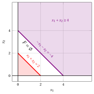
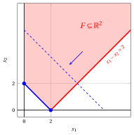

# Possible outcomes and equivalent formulations

**Part 1 · Linear functions, polyhedra and linear programming problems · Chapter 5** · [:material-file-pdf-box: Lecture notes, volume 1 (PDF)](../pdf/lecture-notes-1-linear-programming-problems.pdf) · [:material-pencil: Exercises: Possible outcomes and equivalent formulations](../exercises/ex-05-outcomes-equivalences.md) · [:material-gesture-tap: App: The outcomes of an LP problem](../lab/outcomes.md)

## 5.1 The two reference forms

- Throughout this chapter we refer to the two forms of an LP problem introduced in the previous one. Given an objective-function vector ${\boldsymbol c} \in \R^{n}$, a constraint matrix ${\boldsymbol A} \in \R^{m \times n }$ and a right-hand-side vector ${\boldsymbol b} \in \R^{m}$, they read as follows.

!!! chiave ""

    An LP problem in <strong>canonical maximization form</strong> with $n$ non-negative variables and $m$ less-than-or-equal-to linear constraints:

    

    \begin{align*}
    \label{ObjFunc}  &&   \max \;\; \underbrace{\sum_{j =1}^n c_j \, x_j}_{ {\boldsymbol c}' {\boldsymbol x}}  \qquad \qquad \qquad \qquad \qquad \qquad  \tag{5.1a}\\[1ex]
    \label{Cons}     && \text{subject to} \quad \underbrace{\sum_{j =1}^n a_{ij} \, x_j  \le b_i, \qquad   \forall i \in \{1,2,\dots,m\}}_{ {\boldsymbol A}\,{\boldsymbol x}  \le {\boldsymbol b}},  \tag{5.1b}\\[1ex]
    \label{NonNegCons}&& \underbrace{x_j \ge 0, \qquad \forall j \in \{1,2,\dots,n\}}_{{\boldsymbol x} \ge {\boldsymbol 0}}. \tag{5.1c}
    \end{align*}

!!! chiave ""

    An LP problem in <strong>standard maximization form</strong> with $n$ non-negative variables and $m$ equality linear constraints:

    

    \begin{align*}
    \label{STANDARD_ObjFunc}  &&   \max \;\; \underbrace{\sum_{j =1}^n c_j \, x_j}_{ {\boldsymbol c}' {\boldsymbol x}}  \qquad \qquad \qquad \qquad \qquad \qquad  \tag{5.2a}\\[1ex]
    \label{STANDARD_Cons}     && \text{subject to} \quad \underbrace{\sum_{j =1}^n a_{ij} \, x_j  = b_i, \qquad   \forall i \in \{1,2,\dots,m\}}_{ {\boldsymbol A}\,{\boldsymbol x}  = {\boldsymbol b}},  \tag{5.2b}\\[1ex]
    \label{STANDARD_NonNegCons}&& \underbrace{x_j \ge 0, \qquad \forall j \in \{1,2,\dots,n\}}_{{\boldsymbol x} \ge {\boldsymbol 0}}. \tag{5.2c}
    \end{align*}

- We also refer to the three LP problems used as guiding examples in the previous chapter, which we recall in the following three examples.

!!! esempio "Example 5.1: guiding LP problem in canonical maximization form"

    The first guiding example is the following LP problem in canonical maximization form with $n=2$ non-negative variables and $m=3$ less-than-or-equal-to linear constraints:

    $$
    \begin{array}{rrrrrrrrrrrrr}
    {\max} & 5 \, {x_1} & {+} & 2 \, {x_2} \\[1ex]
    \text{subject to} & {-} \, {x_1} & {+} & 3 \, {x_2} & {\le} & 12 \\[1ex]
    & {x_1} & {+} & 2 \, {x_2} & {\le} & 12 \\[1ex]
    & {3} \, {x_1} & {-} & 2 \, {x_2} & {\le} & 8 \\[1ex]
    & {x_1,} &  & {x_2} & { \ge} & {0}
    \end{array}
    $$

    An optimal solution is $\tilde{\boldsymbol x}(\, LP \,) = \begin{pmatrix} 5 \\[0.5ex] \frac{7}{2} \end{pmatrix}$ and the optimal value is $z(\, LP \,) = 32$.

!!! esempio "Example 5.2: guiding LP problem in canonical maximization form"

    The second guiding example is the following LP problem in canonical maximization form with $n=2$ non-negative variables and $m=2$ less-than-or-equal-to linear constraints:

    $$
    \begin{array}{rrrrrrrrrrrrr}
    {\max} & {-2} \, {x_1} & {-} & 4\, {x_2} \\[1ex]
    \text{subject to} & {-} \, {x_1} & {-} & {x_2} & {\le} & {-2} \\[1ex]
    & {x_1} & {-} & {x_2} & {\le} & {0} \\[1ex]
    & {x_1,} &  & {x_2} & { \ge} & {0}
    \end{array}
    $$

    An optimal solution is $\tilde{\boldsymbol x}(\, LP \,) = \begin{pmatrix} 1 \\[0.5ex] 1 \end{pmatrix}$ and the optimal value is $z(\, LP \,) = -6$.

!!! esempio "Example 5.3: guiding LP problem in standard maximization form"

    The third guiding example is the following LP problem in standard maximization form with $n=3$ non-negative variables and $m=1$ equality linear constraint:

    $$
    \begin{array}{rrrrrrrrrrrrr}
    {\max} & 2 \, {x_1} & {+} & 2 \, {x_2} & {+} & \, {x_3} \\[1ex]
    \text{subject to} & {2} \, {x_1} & {+} & 3 \, {x_2} & {+} & \, {x_3} & {=} & 4 \\[1ex]
    & {x_1,} &  & {x_2,} &  & {x_3} & { \ge} & {0}
    \end{array}
    $$

    Its optimal value is $z(\, LP \,) = 4$, attained by every point of the segment joining $\begin{pmatrix} 2 \\ 0 \\ 0 \end{pmatrix}$ and $\begin{pmatrix} 0 \\ 0 \\ 4 \end{pmatrix}$.

## 5.2 Infeasible and unbounded LP problems

- The LP problems of [Example 5.1](#box-1-ex-oe-1), [Example 5.2](#box-2-ex-oe-2) and [Example 5.3](#box-3-ex-oe-3) admit an optimal solution. This is not always the case: an LP problem may have <u>no feasible solution at all</u>, or it may have feasible solutions <u>of arbitrarily large objective value</u>.

!!! definizione "Definition 5.1: infeasible LP problem"

    An LP problem is called <strong>infeasible</strong> if its feasible region is empty:

    $$
    F = \emptyset .
    $$

!!! definizione "Definition 5.2: unbounded LP problem"

    An LP problem in <strong>maximization form</strong> is called <strong>unbounded</strong> if, for every value $M \in \R$, there exists a feasible solution $\bar{\boldsymbol x}(\, LP \,) \in F$ such that

    $$
    f(\bar{\boldsymbol{x}}(\, LP \,)) > M .
    $$

    An LP problem in <strong>minimization form</strong> is called <strong>unbounded</strong> if, for every value $M \in \R$, there exists a feasible solution $\bar{\boldsymbol x}(\, LP \,) \in F$ such that $f(\bar{\boldsymbol{x}}(\, LP \,)) < M$.

!!! chiave ""

    An LP problem satisfies exactly one of the following three conditions:

    1. it is <strong>infeasible</strong>;

    2. it is <strong>unbounded</strong>;

    3. it admits an <strong>optimal solution</strong> $\tilde{\boldsymbol x}(\, LP \,)$, and the optimal value $z(\, LP \,)$ is a finite number.

- An infeasible LP problem has no feasible solution, so it has no optimal solution and the optimal value $z(\, LP \,)$ is not defined. An unbounded LP problem has feasible solutions, but none of them is optimal, and the optimal value $z(\, LP \,)$ is not defined either.

- In the two cases, with a slight abuse of notation, we write $z(\, LP \,)= -\infty$ for an infeasible LP problem in maximization form and $z(\, LP \,)= +\infty$ for an unbounded LP problem in maximization form.

!!! esempio "Example 5.4: infeasible LP problem"

    Consider the following LP problem in canonical maximization form with $n=2$ non-negative variables and $m=2$ less-than-or-equal-to linear constraints:

    $$
    \begin{array}{rrrrrrrrrrrrr}
    {\max} & \, {x_1} & {+} & \, {x_2} \\[1ex]
    \text{subject to} & \, {x_1} & {+} & \, {x_2} & {\le} & {2} \\[1ex]
    & {-} \, {x_1} & {-} & \, {x_2} & {\le} & {-4} \\[1ex]
    & {x_1,} &  & {x_2} & { \ge} & {0}
    \end{array}
    $$

    The first constraint imposes $x_1 + x_2 \le 2$ and the second one imposes $x_1 + x_2 \ge 4$. No point of $\R^2$ satisfies both of them, and then we have:

    $$
    F = \emptyset .
    $$

    Accordingly, this LP problem is <strong>infeasible</strong>.

    { .fig .cornice loading=lazy style="width:50%" }

    In red the half-plane $x_1 + x_2 \le 2$ (with the non-negativity constraints) and in violet the half-plane $x_1 + x_2 \ge 4$: their intersection is empty.

!!! esempio "Example 5.5: unbounded LP problem"

    Consider the following LP problem in canonical maximization form with $n=2$ non-negative variables and $m=2$ less-than-or-equal-to linear constraints:

    $$
    \begin{array}{rrrrrrrrrrrrr}
    {\max} & \, {x_1} & {+} & \, {x_2} \\[1ex]
    \text{subject to} & {-} \, {x_1} & {+} & \, {x_2} & {\le} & {1} \\[1ex]
    & \, {x_1} & {-} & \, {x_2} & {\le} & {1} \\[1ex]
    & {x_1,} &  & {x_2} & { \ge} & {0}
    \end{array}
    $$

    For every value $t \ge 0$, the point $\bar{\boldsymbol x}(\, LP \,) = \begin{pmatrix} t \\[0.5ex] t \end{pmatrix}$ is a feasible solution, since

    $$
    - t + t = 0 \le 1, \qquad t - t = 0 \le 1, \qquad t \ge 0 \text{   and   } t \ge 0 ,
    $$

    and its objective value is

    $$
    LB(\bar{\boldsymbol x}) = t + t = 2 \, t .
    $$

    Accordingly, for every value $M \in \R$, the feasible solution obtained with $t > \frac{M}{2}$ has an objective value larger than $M$, and then this LP problem is <strong>unbounded</strong>.

    { .fig .cornice loading=lazy style="width:50%" }

    In dashed blue the level sets $x_1 + x_2 = 2$ and $x_1 + x_2 = 6$ of the objective function: the gradient points along the unbounded feasible region.

!!! chiave ""

    An LP problem whose feasible region $F$ is <u>unbounded</u> is not necessarily an unbounded LP problem: the objective function may well attain a finite optimal value on $F$.

!!! esempio "Example 5.6: unbounded feasible region and multiple optimal solutions"

    Consider the following LP problem in canonical maximization form with $n=2$ non-negative variables and $m=2$ less-than-or-equal-to linear constraints:

    $$
    \begin{array}{rrrrrrrrrrrrr}
    {\max} & {-} \, {x_1} & {-} & \, {x_2} \\[1ex]
    \text{subject to} & {-} \, {x_1} & {-} & \, {x_2} & {\le} & {-2} \\[1ex]
    & \, {x_1} & {-} & \, {x_2} & {\le} & {2} \\[1ex]
    & {x_1,} &  & {x_2} & { \ge} & {0}
    \end{array}
    $$

    The feasible region $F$ is unbounded. Nevertheless, the first constraint imposes $x_1 + x_2 \ge 2$ for every feasible solution, and then

    $$
    - x_1 - x_2 \le -2, \qquad \forall \begin{pmatrix} x_1 \\ x_2\end{pmatrix} \in F .
    $$

    The feasible solutions $\begin{pmatrix} 0 \\ 2\end{pmatrix}$ and $\begin{pmatrix} 2 \\ 0\end{pmatrix}$ attain this value, and then they are two <strong>optimal solutions</strong> and the optimal value is $z(\, LP \,) = -2$.

    { .fig .cornice loading=lazy style="width:50%" }

    In dashed blue the level set $-x_1 - x_2 = -6$ and in solid blue the level set $-x_1 - x_2 = -2$, which contains the segment of optimal solutions joining the two blue vertices.

!!! teorema "Observation 5.3: multiple optimal solutions"

    If $\tilde{\boldsymbol x}^{(1)}(\, LP \,)$ and $\tilde{\boldsymbol x}^{(2)}(\, LP \,)$ are two optimal solutions of an LP problem, then every point

    $$
    \lambda \, \tilde{\boldsymbol x}^{(1)}(\, LP \,) + (1-\lambda) \, \tilde{\boldsymbol x}^{(2)}(\, LP \,),
    \qquad \lambda \in [0,1],
    $$

    is an optimal solution as well. Accordingly, an LP problem that admits an optimal solution admits either exactly one optimal solution or infinitely many optimal solutions.

??? dimostrazione "Proof"

    Let $\boldsymbol{x}^{\lambda} = \lambda \, \tilde{\boldsymbol x}^{(1)}(\, LP \,) + (1-\lambda) \, \tilde{\boldsymbol x}^{(2)}(\, LP \,)$ with $\lambda \in [0,1]$. First, $\boldsymbol{x}^{\lambda} \in F$. Indeed, the feasible region $F$ is a polyhedron and, for each of its inequalities ${\boldsymbol a}\,{\boldsymbol x} \le b$, since $\lambda \ge 0$, $1-\lambda \ge 0$ and both solutions satisfy it, we have:

    $$
    {\boldsymbol a}\,\boldsymbol{x}^{\lambda}
    = \lambda \, {\boldsymbol a}\,\tilde{\boldsymbol x}^{(1)}(\, LP \,) + (1-\lambda) \, {\boldsymbol a}\,\tilde{\boldsymbol x}^{(2)}(\, LP \,)
    \le \lambda \, b + (1-\lambda) \, b = b ;
    $$

    the same computation, with $=$ in place of $\le$, holds for each of its equalities. Moreover, since the objective function $f$ is linear, we have:

    \begin{align*}
    f(\boldsymbol{x}^{\lambda})
    &= \lambda \, f(\tilde{\boldsymbol x}^{(1)}(\, LP \,)) + (1-\lambda) \, f(\tilde{\boldsymbol x}^{(2)}(\, LP \,)) \\[2ex]
    &= \lambda \, z(\, LP \,) + (1-\lambda) \, z(\, LP \,) = z(\, LP \,) ,
    \end{align*}

    where the second equality holds because both solutions are optimal. Accordingly, $\boldsymbol{x}^{\lambda}$ is a feasible solution whose objective value is the optimal value, and then it is an optimal solution. □

## 5.3 Equivalent reformulations

- A <strong>generic LP problem</strong> may be written in a form which is neither the canonical maximization form [(5.1)](#eq-CANONICAL) nor the standard maximization form [(5.2)](#eq-STANDARD): its objective function may have to be minimized, its constraints may be of the three types “$\le$”, “$\ge$” and “$=$”, and its variables may be non-positive or free.

- In this section we show that every generic LP problem can be rewritten in canonical maximization form and in standard maximization form.

!!! definizione "Definition 5.4: equivalent LP problems"

    Two LP problems are called <strong>equivalent</strong> if, from an optimal solution of one of them, an optimal solution of the other one can be directly obtained, and the two problems are both infeasible, both unbounded, or both admit an optimal solution.

### 5.3.1 Minimization and maximization form

- For every linear function $f$ and every polyhedron $F$, we have:

    $$
    \min \{\, f(\boldsymbol{x}) \;\text{subject to}\; \boldsymbol{x} \in F \,\}
    =
    - \max \{\, - f(\boldsymbol{x}) \;\text{subject to}\; \boldsymbol{x} \in F \,\} .
    $$

- Accordingly, an LP problem in <strong>minimization form</strong> with objective-function vector ${\boldsymbol c}$ is equivalent to the LP problem in <strong>maximization form</strong> with the same feasible region and objective-function vector $-{\boldsymbol c}$:

    $$
    \underbrace{\sum_{j=1}^n c_j \, x_j}_{{\boldsymbol c}' {\boldsymbol x}}
    \qquad \longrightarrow \qquad
    \underbrace{\sum_{j=1}^n (-c_j) \, x_j}_{-{\boldsymbol c}' {\boldsymbol x}} .
    $$

!!! chiave ""

    The two equivalent LP problems have the <strong>same optimal solutions</strong>, while their optimal values are opposite numbers:

    $$
    \tilde{\boldsymbol x}(\, LP_{\min} \,) = \tilde{\boldsymbol x}(\, LP_{\max} \,)
    \qquad \text{and} \qquad
    z(\, LP_{\min} \,) = - \, z(\, LP_{\max} \,) .
    $$

!!! esempio "Example 5.7: from the minimization to the maximization form"

    Consider the following LP problem in minimization form with $n=2$ non-negative variables:

    $$
    \begin{array}{rrrrrrrrrrrrr}
    {\min} & {2} \, {x_1} & {+} & {4} \, {x_2} \\[1ex]
    \text{subject to} & {-} \, {x_1} & {-} & \, {x_2} & {\le} & {-2} \\[1ex]
    & \, {x_1} & {-} & \, {x_2} & {\le} & {0} \\[1ex]
    & {x_1,} &  & {x_2} & { \ge} & {0}
    \end{array}
    $$

    By changing the sign of the objective-function vector, we obtain the equivalent LP problem in canonical maximization form of [Example 5.2](#box-2-ex-oe-2):

    $$
    \begin{array}{rrrrrrrrrrrrr}
    {\max} & {-2} \, {x_1} & {-} & {4} \, {x_2} \\[1ex]
    \text{subject to} & {-} \, {x_1} & {-} & \, {x_2} & {\le} & {-2} \\[1ex]
    & \, {x_1} & {-} & \, {x_2} & {\le} & {0} \\[1ex]
    & {x_1,} &  & {x_2} & { \ge} & {0}
    \end{array}
    $$

    The optimal solution of both problems is $\tilde{\boldsymbol x}(\, LP \,) = \begin{pmatrix} 1 \\ 1 \end{pmatrix} ,$ while the optimal value of the minimization form is $6$ and the optimal value of the maximization form is $-6$.

### 5.3.2 Greater-than-or-equal-to and equality constraints

- A <strong>greater-than-or-equal-to</strong> linear constraint is equivalent to a less-than-or-equal-to linear constraint, since, by multiplying both sides by $-1$, we have:

    $$
    \sum_{j=1}^n a_{ij} \, x_j \ge b_i
    \qquad \Longleftrightarrow \qquad
    \sum_{j=1}^n (-a_{ij}) \, x_j \le - b_i .
    $$

- An <strong>equality</strong> linear constraint is equivalent to two less-than-or-equal-to linear constraints, since:

    $$
    \sum_{j=1}^n a_{ij} \, x_j = b_i
    \qquad \Longleftrightarrow \qquad
    \underbrace{\sum_{j=1}^n a_{ij} \, x_j \le b_i}_{\text{first constraint}}
    \text{    and    }
    \underbrace{\sum_{j=1}^n (-a_{ij}) \, x_j \le - b_i}_{\text{second constraint}} .
    $$

!!! chiave ""

    An LP problem [(5.2)](#eq-STANDARD) in standard maximization form with $n$ non-negative variables and $m$ equality linear constraints is equivalent to an LP problem [(5.1)](#eq-CANONICAL) in canonical maximization form with the same $n$ non-negative variables and $2 \, m$ less-than-or-equal-to linear constraints:

    \begin{align*}
    &&   \max \;\;{\sum_{j =1}^n c_j \, x_j}                               \\[1ex]
    && \text{subject to} \quad  {\sum_{j =1}^n a_{ij} \, x_j}  &\leq b_i,   & \forall i \in \{1,2,\dots,m\},                    \\[1ex]
    &&   {\sum_{j =1}^n (-a_{ij}) \, x_j}  &\leq -b_i,   & \forall i \in \{1,2,\dots,m\},                    \\[1ex]
    &&x_j                        &\ge  0, & \forall j \in \{1,2,\dots,n\}.
    \end{align*}

    The two LP problems have the <strong>same feasible region</strong>, and then the same optimal solutions and the same optimal value.

!!! esempio "Example 5.8: from the standard to the canonical maximization form"

    Consider the LP problem in standard maximization form of [Example 5.3](#box-3-ex-oe-3), with $n=3$ non-negative variables and $m=1$ equality linear constraint:

    $$
    \begin{array}{rrrrrrrrrrrrr}
    {\max} & 2 \, {x_1} & {+} & 2 \, {x_2} & {+} & \, {x_3} \\[1ex]
    \text{subject to} & {2} \, {x_1} & {+} & 3 \, {x_2} & {+} & \, {x_3} & {=} & 4 \\[1ex]
    & {x_1,} &  & {x_2,} &  & {x_3} & { \ge} & {0}
    \end{array}
    $$

    By replacing the equality linear constraint with two less-than-or-equal-to linear constraints, we obtain the equivalent LP problem in canonical maximization form with $n=3$ non-negative variables and $2 \, m = 2$ less-than-or-equal-to linear constraints:

    $$
    \begin{array}{rrrrrrrrrrrrr}
    {\max} & 2 \, {x_1} & {+} & 2 \, {x_2} & {+} & \, {x_3} \\[1ex]
    \text{subject to} & {2} \, {x_1} & {+} & 3 \, {x_2} & {+} & \, {x_3} & {\le} & 4 \\[1ex]
    & {-2} \, {x_1} & {-} & 3 \, {x_2} & {-} & \, {x_3} & {\le} & {-4} \\[1ex]
    & {x_1,} &  & {x_2,} &  & {x_3} & { \ge} & {0}
    \end{array}
    $$

### 5.3.3 Slack and surplus variables

- A <strong>less-than-or-equal-to</strong> linear constraint is equivalent to an equality linear constraint and a non-negativity constraint, obtained by adding one non-negative variable $x_{n+i}$:

    $$
    \sum_{j=1}^n a_{ij} \, x_j \le b_i
    \qquad \Longleftrightarrow \qquad
    \sum_{j=1}^n a_{ij} \, x_j + x_{n+i} = b_i
    \text{    and    } x_{n+i} \ge 0 .
    $$

- A <strong>greater-than-or-equal-to</strong> linear constraint is equivalent to an equality linear constraint and a non-negativity constraint, obtained by subtracting one non-negative variable $x_{n+i}$:

    $$
    \sum_{j=1}^n a_{ij} \, x_j \ge b_i
    \qquad \Longleftrightarrow \qquad
    \sum_{j=1}^n a_{ij} \, x_j - x_{n+i} = b_i
    \text{    and    } x_{n+i} \ge 0 .
    $$

!!! definizione "Definition 5.5: slack and surplus variables"

    The additional non-negative variable $x_{n+i}$ is called the <strong>slack variable</strong> of a less-than-or-equal-to linear constraint and the <strong>surplus variable</strong> of a greater-than-or-equal-to linear constraint. Its value measures, for a given feasible solution, the difference between the two sides of the constraint.

!!! chiave ""

    An LP problem [(5.1)](#eq-CANONICAL) in canonical maximization form with $n$ non-negative variables and $m$ less-than-or-equal-to linear constraints is equivalent to an LP problem [(5.2)](#eq-STANDARD) in standard maximization form with $n+m$ non-negative variables and the same $m$ linear constraints, now equalities:

    \begin{align*}
    &&  \max \;\;{\sum_{j =1}^n c_j \, x_j}             \\[1ex]
    && \text{subject to} \quad  {\sum_{j =1}^n a_{ij} \, x_j}  + x_{n+i}&= b_i,   & \forall i \in \{1,2,\dots,m\},                     \\[1ex]
    &&x_j                        &\ge  0, & \forall j \in \{1,2,\dots,n+m\}.
    \end{align*}

- In matrix notation, the $m$ slack variables form a column vector ${\boldsymbol x}_S \in \R^{m}_{\ge 0}$ and the constraint matrix of the standard maximization form is obtained by appending to ${\boldsymbol A}$ the <strong>identity matrix</strong> ${\boldsymbol I}$ of size $m$:

    \begin{align*}
    &&   \max \;\;{\boldsymbol c}'\; {\boldsymbol x}                               \\[2ex]
    && \text{subject to} \quad  \underbrace{{\boldsymbol A} \; {\boldsymbol x} +{\boldsymbol I} \; {\boldsymbol x}_S}_{
    \begin{pmatrix} {\boldsymbol A} & {\boldsymbol I} \end{pmatrix}
    \begin{pmatrix} {\boldsymbol x} \\ {\boldsymbol x}_S \end{pmatrix}
    }  &= {\boldsymbol b},  & \phantom{j=1111} \\[2ex]
    && {\boldsymbol x},~{\boldsymbol x}_S                        &\ge {\boldsymbol 0},
    \end{align*}

    where

    $$
    {\boldsymbol x}_S=
    \begin{pmatrix}
    x_{n+1} \\
    x_{n+2} \\
    \vdots  \\
    x_{n+m} \\
    \end{pmatrix}
    \qquad\qquad
    {\boldsymbol I}=
    \begin{pmatrix}
    1 & 0 & \dots & 0\\
    0 & 1 & \dots & 0\\
    \vdots  & \vdots  & \ddots & \vdots \\
    0 &  0&  \dots & 1
    \end{pmatrix}
    $$

!!! esempio "Example 5.9: from the canonical to the standard maximization form"

    By adding $m=3$ slack variables, the LP problem of [Example 5.1](#box-1-ex-oe-1) becomes the following equivalent LP problem in standard maximization form with $n+m=5$ non-negative variables:

    $$
    \begin{array}{rrrrrrrrrrrrrrr}
    {\max} & 5 \, {x_1} & {+} & 2 \, {x_2} \\[1ex]
    \text{subject to} & {-} \, {x_1} & {+} & 3 \, {x_2} & {+} & {x_3} &  &  &  &  & {=} & 12 \\[1ex]
    & {x_1} & {+} & 2 \, {x_2} &  &  & {+} & {x_4} &  &  & {=} & 12 \\[1ex]
    & 3 \, {x_1} & {-} & 2 \, {x_2} &  &  &  &  & {+} & {x_5} & {=} & 8 \\[1ex]
    & {x_1,} &  & {x_2,} &  & {x_3,} &  & {x_4,} &  & {x_5} & {\ge} & {0}
    \end{array}
    $$

    The optimal solution $\tilde{\boldsymbol x}(\, LP \,)$ of [Example 5.1](#box-1-ex-oe-1) satisfies the first constraint strictly and the other two with equality, and then the values of the three slack variables are $\tilde{x}_3 = \frac{13}{2}$, $\tilde{x}_4 = 0$ and $\tilde{x}_5 = 0$.

### 5.3.4 Non-positive and free variables

- A <strong>non-positive</strong> variable $x_j \le 0$ is equivalent to one non-negative variable $x_j^{+} \ge 0$, by setting:

    $$
    x_j = - \, x_j^{+} .
    $$

- A <strong>free</strong> variable $x_j \gtreqless 0$ is equivalent to two non-negative variables $x_j^{+} \ge 0$ and $x_j^{-} \ge 0$, by setting:

    $$
    x_j = x_j^{+} - x_j^{-} .
    $$

!!! chiave ""

    In both cases, the substitution is performed in the objective function and in every linear constraint of the LP problem. A free variable is replaced by <u>two</u> non-negative variables, since every real number is the difference of two non-negative numbers.

!!! esempio "Example 5.10: equivalent LP problem with only non-negative variables"

    Consider the following LP problem with one non-negative variable $x_1 \ge 0$, one non-positive variable $x_2 \le 0$ and one free variable $x_3 \gtreqless 0$:

    $$
    \begin{array}{rrrrrrrrrrrrr}
    {\max} & {2} \, {x_1} & {+} & {4} \, {x_2} & {+} & {2} \, {x_3} \\[2ex]
    \text{subject to} & {-} \, {x_1} & + & \, {x_2} & {+} & {x_3} & {=} & 2 \\[2ex]
    & {8} \, {x_1} & {+} & {2} \, {x_2} &  &  & {=} & {19} \\[2ex]
    & {x_1} &  &  &  &  & { \ge} & { 0 } \\[2ex]
    &  &  & {x_2} &  &  & { \le} & { 0 } \\[2ex]
    &  &  &  &  & {x_3} & { \gtreqless} & { 0 }
    \end{array}
    $$

    By setting $x_2 = -x_2^{+}$ and $x_3 = x_3^{+} - x_3^{-}$, we obtain the following equivalent LP problem with only non-negative variables:

    $$
    \begin{array}{rrrrrrrrrrrrr}
    {\max} & {2} \, {x_1} & {-} & {4} \, {x_2^+} & {+} & {2} \, {x_3^+} & {-} & {2} \, {x_3^-} \\[2ex]
    \text{subject to} & {-} \, {x_1} & {-} & \, {x_2^+} & {+} & {x_3^+} & {-} & {x_3^-} & {=} & 2 \\[2ex]
    & {8} \, {x_1} & {-} & {2} \, {x_2^+} &  &  &  &  & {=} & {19} \\[2ex]
    & {x_1,} &  & {x_2^+,} &  & {x_3^+,} &  & {x_3^-} & { \ge} & { 0 }
    \end{array}
    $$

    From an optimal solution of the second LP problem, an optimal solution of the first one is obtained by computing $\tilde{x}_2 = -\tilde{x}_2^{+}$ and $\tilde{x}_3 = \tilde{x}_3^{+} - \tilde{x}_3^{-}$.

### 5.3.5 From a generic LP problem to the canonical and standard maximization form

!!! chiave ""

    Every generic LP problem can be rewritten in canonical maximization form and in standard maximization form by applying the following transformations:

    
<table>
    <tr>
    <th></th>
    <th><strong>canonical max form</strong></th>
    <th><strong>standard max form</strong></th>
    </tr>
    <tr>
    <td>\(\min {\boldsymbol c}' {\boldsymbol x}\)</td>
    <td>\(-\max (-{\boldsymbol c})' {\boldsymbol x}\)</td>
    <td>\(-\max (-{\boldsymbol c})' {\boldsymbol x}\)</td>
    </tr>
    <tr>
    <td>\(\sum_j a_{ij} x_j \le b_i\)</td>
    <td>unchanged</td>
    <td>add a slack variable \(x_{n+i} \ge 0\)</td>
    </tr>
    <tr>
    <td>\(\sum_j a_{ij} x_j \ge b_i\)</td>
    <td>multiply by \(-1\)</td>
    <td>subtract a surplus variable \(x_{n+i} \ge 0\)</td>
    </tr>
    <tr>
    <td>\(\sum_j a_{ij} x_j = b_i\)</td>
    <td>split into two “\(\le\)”, the second one multiplied by \(-1\)</td>
    <td>unchanged</td>
    </tr>
    <tr>
    <td>\(x_j \ge 0\)</td>
    <td>unchanged</td>
    <td>unchanged</td>
    </tr>
    <tr>
    <td>\(x_j \le 0\)</td>
    <td>\(x_j = -x_j^{+}\)</td>
    <td>\(x_j = -x_j^{+}\)</td>
    </tr>
    <tr>
    <td>\(x_j \gtreqless 0\)</td>
    <td>\(x_j = x_j^{+} - x_j^{-}\)</td>
    <td>\(x_j = x_j^{+} - x_j^{-}\)</td>
    </tr>
    </table>

!!! esempio "Example 5.11: from a generic LP problem to the canonical maximization form"

    Consider the following generic LP problem with $3$ variables:

    $$
    \begin{array}{rrrrrrrrrrrrr}
    {\min} & {3} \, {x_1} & {-} & {2} \, {x_2} & {+} & \, {x_3} \\[2ex]
    \text{subject to} & \, {x_1} & {+} & \, {x_2} & {-} & {x_3} & {\ge} & {4} \\[2ex]
    & {2} \, {x_1} & {-} & \, {x_2} &  &  & {=} & {6} \\[2ex]
    & {x_1} &  &  &  &  & { \ge} & { 0 } \\[2ex]
    &  &  & {x_2} &  &  & { \le} & { 0 } \\[2ex]
    &  &  &  &  & {x_3} & { \gtreqless} & { 0 }
    \end{array}
    $$

    We apply the transformations of the table above:

    1. the objective function is minimized, and then we maximize the opposite objective function;

    2. the first constraint is a greater-than-or-equal-to constraint, and then we multiply it by $-1$;

    3. the second constraint is an equality constraint, and then we split it into two less-than-or-equal-to constraints;

    4. the variable $x_2$ is non-positive, and then we set $x_2 = -x_2^{+}$ with $x_2^{+} \ge 0$;

    5. the variable $x_3$ is free, and then we set $x_3 = x_3^{+} - x_3^{-}$ with $x_3^{+}, x_3^{-} \ge 0$.

    We obtain the following equivalent LP problem in canonical maximization form with $n=4$ non-negative variables and $m=3$ less-than-or-equal-to linear constraints:

    $$
    \begin{array}{rrrrrrrrrrrrr}
    {-} {\max} & {-3} \, {x_1} & {-} & {2} \, {x_2^+} & {-} & \, {x_3^+} & {+} & \, {x_3^-} \\[2ex]
    \text{subject to} & {-} \, {x_1} & {+} & \, {x_2^+} & {+} & {x_3^+} & {-} & {x_3^-} & {\le} & {-4} \\[2ex]
    & {2} \, {x_1} & {+} & \, {x_2^+} &  &  &  &  & {\le} & {6} \\[2ex]
    & {-2} \, {x_1} & {-} & \, {x_2^+} &  &  &  &  & {\le} & {-6} \\[2ex]
    & {x_1,} &  & {x_2^+,} &  & {x_3^+,} &  & {x_3^-} & { \ge} & { 0 }
    \end{array}
    $$

    Finally, by adding $m=3$ slack variables $x_5, x_6, x_7$, we obtain the equivalent LP problem in standard maximization form with $n+m=7$ non-negative variables and $m=3$ equality linear constraints.

### 5.3.6 Rational input data

!!! definizione "Definition 5.6: Least Common Denominator"

    Given a vector ${\boldsymbol v} \in \Q^{k}$ of $k$ rational numbers $v_j = \frac{p_j}{q_j}$ with $p_j \in \Z$ and $q_j \in \N$ coprime, $\forall j \in \{1,2,\dots,k\}$, the <strong>Least Common Denominator</strong> [^1], denoted by $lcd({\boldsymbol v})$, is the smallest positive integer number divisible by all the denominators $q_j$, with $j \in \{1,2,\dots,k\}$.

- Multiplying a linear constraint by a positive number does not change the set of points satisfying it, and multiplying the objective function by a positive number does not change the set of optimal solutions. Accordingly, an LP problem with <strong>rational input data</strong> is equivalent to an LP problem with <strong>integer input data</strong>.

!!! chiave ""

    Given an LP problem [(5.1)](#eq-CANONICAL) with rational input data, the equivalent LP problem with integer input data reads as follows:

    \begin{align*}
    &&  \frac{1}{lcd({\boldsymbol c})} \max \;\;{\sum_{j =1}^n lcd({\boldsymbol c}) \,  c_j \, x_j}                       \\[2ex]
    && \text{subject to} \quad  {\sum_{j =1}^n lcd([{\boldsymbol a}_i~b_i]) \, a_{ij} \, x_j}  &\leq lcd([{\boldsymbol a}_i~b_i]) \,  b_i,   & \forall i \in \{1,2,\dots,m\},                    \\[2ex]
    &&x_j                        &\ge  0, & \forall j \in \{1,2,\dots,n\},
    \end{align*}

    where ${\boldsymbol a}_i$ denotes the $i$-th row of the constraint matrix ${\boldsymbol A}$.

!!! esempio "Example 5.12: equivalent LP problem with integer input data"

    For the following LP problem [(5.1)](#eq-CANONICAL) with $n=5$ non-negative variables, $m=1$ less-than-or-equal-to linear constraint and rational input data:

    $$
    \begin{array}{rrrrrrrrrrrrr}
    {\max} & {\frac{1}{3}} \, {x_1} & {-} & {\frac{11}{27}} \, {x_2} & {+} & {\frac{7}{10}} \, {x_3} & {+} & {\frac{7}{5}} \, {x_4} & {+} & {\frac{2}{9}} \, {x_5} \\[2ex]
    \text{subject to} & {\frac{1}{2}} \, {x_1} & {+} & {\frac{3}{4}} \, {x_2} & {+} & {\frac{11}{6}} \, {x_3} & {-} & {\frac{1}{4}} \, {x_4} & {+} & {\frac{5}{2}} \, {x_5} & {\le} & {\frac{25}{12}} \\[2ex]
    & {x_1,} &  & {x_2,} &  & {x_3,} &  & {x_4,} &  & {x_5} & { \ge} & { 0 }
    \end{array}
    $$

    we have:

    $$
    \underbrace{lcd\left(\begin{pmatrix}
    \frac{1}{3} \\[1ex] -\frac{11}{27} \\[1ex] \frac{7}{10} \\[1ex] \frac{7}{5} \\[1ex] \frac{2}{9}
    \end{pmatrix}\right)}_{=lcd({\boldsymbol c})} = 270 \text{     and     }
    \underbrace{lcd\left(\begin{pmatrix}
    \frac{1}{2} \\[1ex] \frac{3}{4} \\[1ex] \frac{11}{6} \\[1ex] -\frac{1}{4} \\[1ex] \frac{5}{2} \\[1ex] \frac{25}{12}
    \end{pmatrix}\right)}_{= lcd \bigg( \left[  {\boldsymbol a}_1~\frac{25}{12} \right] \bigg)}  = 12
    $$

    and, accordingly, the equivalent LP problem with the same variables and constraints and with integer input data reads as follows:

    $$
    \begin{array}{rrrrrrrrrrrrr}
    {\frac{1}{270}~~~} {\max} & {90} \, {x_1} & {-} & {110} \, {x_2} & {+} & {189} \, {x_3} & {+} & {378} \, {x_4} & {+} & {60} \, {x_5} \\[2ex]
    \text{subject to} & {6} \, {x_1} & {+} & {9} \, {x_2} & {+} & {22} \, {x_3} & {-} & {3} \, {x_4} & {+} & {30} \, {x_5} & {\le} & {25} \\[2ex]
    & {x_1,} &  & {x_2,} &  & {x_3,} &  & {x_4,} &  & {x_5} & { \ge} & { 0 }
    \end{array}
    $$

---

**Exercises on this chapter:** [:material-pencil: Possible outcomes and equivalent formulations](../exercises/ex-05-outcomes-equivalences.md)

[^1]: or the Least Common Multiple of the denominators.

<!-- laboratorio-interattivo: sezione generata da interattivi.py -->

## Interactive lab { #interactive-lab }

The ideas of the chapter, hands on: move the sliders and drag the points.
Each app also opens full page in the [interactive lab](../lab/index.md): [The outcomes of an LP problem](../lab/outcomes.md).

