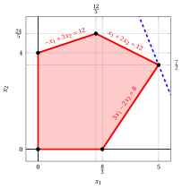
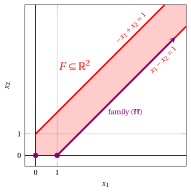

# Simplex algorithm

**Part 2 · The simplex algorithm · Chapter 6** · [:material-file-pdf-box: Lecture notes, volume 2 (PDF)](../pdf/lecture-notes-2-simplex.pdf) · [:material-presentation: Slides](../pdf/slides-06-simplex.pdf) · [:material-pencil: Exercises: Simplex algorithm](../exercises/ex-06-simplex.md) · [:material-gesture-tap: App: The simplex method step by step](../lab/simplex-steps.md)

## 6.1 The standard  form of an LP problem in canonical max  form

- We consider an LP problem in standard maximization form with $n+m$ non-negative variables and $m$ equality linear constraints obtained from an LP problem in canonical maximization form with $n$ non-negative variables and $m$ less-than-or-equal-to linear constraints by adding $m$ slack non-negative variables:

    

    \begin{align*}
    &&   \max \;\;{\boldsymbol c}' \, {\boldsymbol x}  \label{FORM_STANDARD_OBJ} \tag{6.1a}\\[2ex]
    && \text{subject to} \quad  {\boldsymbol A} \; {\boldsymbol x}  &= {\boldsymbol b},  & \phantom{j=1111}  \label{FORM_STANDARD_CONS1} \tag{6.1b}\\[2ex]
    && {\boldsymbol x}                        &\ge  {\boldsymbol 0}. \label{FORM_STANDARD_CONS2} \tag{6.1c}
    \end{align*}

    The input data of the LP problem   are:

    - **1.** an objective-function column vector ${\boldsymbol c} \in \Z^{(n+m) }$ of $n+m$ rows;

    - **2.** a constraint matrix ${\boldsymbol A} \in \Z^{m \times (n+m) }$  of $m$ rows and $n+m$ columns;

    - **3.** a right-hand side column vector ${\boldsymbol b} \in \Z^{m }$ of $m$ rows.

    $$
    {\boldsymbol  c}=
    \begin{pmatrix}
    c_{1} \\
    c_{2} \\
    \vdots  \\
    c_{n} \\
    0 \\
    \vdots  \\
    0 \\
    \end{pmatrix} ~~~~~~
    {\boldsymbol  A}=
    \begin{pmatrix}
    a_{11} & a_{12} & \cdots & a_{1n} & 1 & 0 & \cdots & 0 \\
    a_{21} & a_{22} & \cdots & a_{2n} & 0 & 1 & \cdots & 0 \\
    \vdots & \vdots & \ddots & \vdots & \vdots & \vdots & \ddots & \vdots \\
    a_{m1} & a_{m2} & \cdots & a_{mn} & 0 & 0 & \cdots & 1 \\
    \end{pmatrix} ~~~~~~
    {\boldsymbol b}=
    \begin{pmatrix}
    b_{1} \\
    b_{2} \\
    \vdots  \\
    b_{m} \\
    \end{pmatrix}
    $$

    The $m+n$ non negative variables can be written as a column vector ${\boldsymbol x}$  of $n+m$ rows.

    $$
    {\boldsymbol x} = \begin{pmatrix}
    x_1 \\
    x_2 \\
    \vdots  \\
    x_n \\
    x_{n+1} \\
    x_{n+2} \\
    \vdots  \\
    x_{n+m} \\
    \end{pmatrix}
    $$

    Since the LP problem [(6.1)](#eq-FORM_STANDARD) is obtained by adding $m$ slack variables to an LP problem in canonical form,  we have:

    $$
    \begin{pmatrix}
    a_{1 (n+1)} & a_{1(n+2)} & \cdots   &a_{1(n+m)}\\
    a_{2(n+1)} & a_{2(n+2)} & \cdots   &a_{2(n+m)}\\
    \vdots & \vdots & \ddots & \vdots \\
    a_{m(n+1)} & a_{m(n+2)} & \cdots   &a_{m(n+m)}\\
    \end{pmatrix}
    =\begin{pmatrix}
    1 & 0 & \cdots & 0\\
    0 & 1 & \cdots & 0\\
    \vdots  & \vdots  & \ddots & \vdots \\
    0 &  0&  \cdots & 1
    \end{pmatrix}
    $$

    which is the identity matrix ${\boldsymbol  I}$ of size $m$. Moreover, for the same reason, we have:

    $$
    \begin{pmatrix}
    c_{n+1} \\
    c_{n+2} \\
    \vdots  \\
    c_{n+m} \\
    \end{pmatrix}
    =
    \begin{pmatrix}
    0 \\
    0 \\
    \vdots  \\
    0 \\
    \end{pmatrix}
    $$

!!! chiave ""

    Since the constraint matrix ${\boldsymbol A}  \in \Z^{m \times (n+m) }$ contains the identity matrix ${\boldsymbol I}$ of size $m$,  we have:

    $$
    \rank({\boldsymbol A}) = m
    $$

    Accordingly there are $m$ <strong>linearly independent rows</strong> and  at least one  set of  $m$ <strong>linearly independent columns</strong> [^1] in the constraints matrix ${\boldsymbol A}$.

!!! esempio "Example 6.1: standard max form of LP problems in canonical max form"

    We consider the following LP problem in canonical  max form with $n=2$ variables and $m=3$ constraints:

    $$
    \begin{array}{rrrrrrrrrrrrr}
    {\max} & 5 \, {x_1} & {+} & 2 \, {x_2} \\[1ex]
    \text{subject to} & {-} \, {x_1} & {+} & 3 \, {x_2} & {\le} & 12 \\[1ex]
    & {x_1} & {+} & 2 \, {x_2} & {\le} & 12 \\[1ex]
    & {3} \, {x_1} & {-} & 2 \, {x_2} & {\le} & {8} \\[1ex]
    & {x_1,} &  & {x_2} & { \ge} & {0}
    \end{array}
    $$

    

    { .fig .ovale loading=lazy style="width:94%" }

    

    

    In dashed blue the level set $5\,x_1 + 2\,x_2 = 32$ through the optimal vertex.

    An optimal solution ${\tilde{\boldsymbol x}}(\,LP\,)$  is:

    $$
    \tilde{x}_1=5,~~\tilde{x}_2=\frac{7}{2}
    $$

    and the optimal value is:

    $$
    z(~LP~)  = 32
    $$

    

    The standard form with $n+m=5$ variables and $m=3$ constraints read as follows:

    $$
    \begin{array}{rrrrrrrrrrrrrrr}
    {\max} & 5 \, {x_1} & {+} & 2 \, {x_2} \\[1ex]
    \text{subject to} & {-} \, {x_1} & {+} & 3 \, {x_2} & {+} & {x_3} &  &  &  &  & {=} & 12 \\[1ex]
    & {x_1} & {+} & 2 \, {x_2} &  &  & {+} & {x_4} &  &  & {=} & 12 \\[1ex]
    & 3 \, {x_1} & {-} & 2 \, {x_2} &  &  &  &  & {+} & {x_5} & {=} & 8 \\[1ex]
    & {x_1,} &  & {x_2,} &  & {x_3,} &  & {x_4,} &  & {x_5} & {\ge} & {0}
    \end{array}
    $$

    In the LP problem in standard form (called [Example 6.1](#box-1-ex-simplex-1)), we have:

    $$
    {\boldsymbol  c}=
    \begin{pmatrix}
    5 \\[0.5ex]
    2 \\[0.5ex]
    0  \\[0.5ex]
    0  \\[0.5ex]
    0
    \end{pmatrix}
    \quad
    {\boldsymbol  A}=
    \begin{pmatrix}
    -1 & 3 & 1 & 0 & 0\\[1ex]
    1 & 2 & 0 & 1 & 0\\[1ex]
    3 & -2 & 0 & 0 & 1\\
    \end{pmatrix}
    \quad
    {\boldsymbol b}=
    \begin{pmatrix}
    12 \\[1ex]
    12 \\[1ex]
    8 \\
    \end{pmatrix}
    \text{     and     }  {\boldsymbol  x}=
    \begin{pmatrix}
    x_{1} \\[0.5ex]
    x_{2} \\[0.5ex]
    x_{3}  \\[0.5ex]
    x_{4}  \\[0.5ex]
    x_{5}
    \end{pmatrix}
    $$

    An optimal solution ${\tilde{\boldsymbol x}}(\,LP\,)$ of the standard form is: $\tilde{x}_1=5,~~\tilde{x}_2=\frac{7}{2},~~\tilde{x}_3=\frac{13}{2},~~\tilde{x}_4=0,~~\tilde{x}_5=0$.

## 6.2 Basis of the LP problem in standard form and dictionaries

!!! definizione "Definition 6.1: basis of the LP problem"

    Given a subset $\pazocal{B} \subseteq \{1,2,\dots,n+m\}$ of $m$ indices of the $n+m$ variables of the LP problem [(6.1)](#eq-FORM_STANDARD), if the matrix ${\boldsymbol  A}_{\pazocal{B}} \in \R^{m \times m}$ containing the $m$ columns of  ${\boldsymbol  A}$ with indices $j \in \pazocal{B}$:

    $$
    {\boldsymbol  A}_{\pazocal{B}}=({\boldsymbol  A}_j)_{j \in \pazocal{B}}
    $$

    is invertible , it is called  a <strong>basis</strong> of the LP problem [(6.1)](#eq-FORM_STANDARD).

!!! definizione "Definition 6.2: partition of the indices, basic and non-basic variables"

    Given a basis ${\boldsymbol  A}_{\pazocal{B}}$ of the  LP problem [(6.1)](#eq-FORM_STANDARD),  we have the following <strong>partition</strong> of the indices $\{1,2,\dots,n+m\}$ of the variables:

    $$
    \pazocal{B}\subseteq\{1,2,\dots,n+m\},\qquad |\pazocal{B}|=m,
    $$

    $$
    \pazocal{N}=\{1,2,\dots,n+m\}\setminus\pazocal{B},
    \qquad |\pazocal{N}|=n.
    $$

    Given a partition $\pazocal{B}$ and $\pazocal{N}$, we define:

    1. the column vector of the <strong>basic variables</strong>  containing  the $m$ variables with indices $i \in \pazocal{B}$:

        $$
        {\boldsymbol x}_{\pazocal{B}}= (x_i)_{i \in \pazocal{B}}
        $$

    2. the column vector of the <strong>non-basic variables</strong>  containing  the $n$ variables with indices $i \in \pazocal{N}$:

        $$
        {\boldsymbol x}_{\pazocal{N}}=(x_i)_{i \in \pazocal{N}}
        $$

    3. the column vector ${\boldsymbol c}_{\pazocal{B}} \in \R^{m }$  containing  the $m$ values of ${\boldsymbol  c}$ with indices $i \in \pazocal{B}$:

        $$
        {\boldsymbol c}_{\pazocal{B}}=(c_i)_{i \in \pazocal{B}}
        $$

    4. the matrix ${\boldsymbol  A}_{\pazocal{N}} \in \R^{m \times n}$ containing the $n$ columns of ${\boldsymbol A}$ with indices $j \in \pazocal{N}$:

        $$
        {\boldsymbol  A}_{\pazocal{N}}=({\boldsymbol  A}_j)_{j \in \pazocal{N}}
        $$

    5. the column vector ${\boldsymbol c}_{\pazocal{N}} \in \R^{n }$ containing the $n$ values of ${\boldsymbol  c}$ with indices $i \in \pazocal{N}$:

        $$
        {\boldsymbol c}_{\pazocal{N}}=(c_i)_{i \in \pazocal{N}}
        $$

!!! esempio "Example 6.2: Basis of LP problems, basic variables and non-basic variables"

    For the LP problem of [Example 6.1](#box-1-ex-simplex-1) with $\pazocal{B}= \{1,~~3,~~4\}$, we have:

    $$
    {\boldsymbol  A}_{\pazocal{B}}=
    \begin{pmatrix}
    -1 & 1 & 0 \\
    1 & 0 & 1\\
    3 & 0 & 0\\
    \end{pmatrix}
    \qquad
    \det
    \left(
    {\boldsymbol  A}_{\pazocal{B}}
    \right)
    =
    -1 \cdot 0 \cdot 0
    + 1 \cdot 1 \cdot 3
    + 0 \cdot 1 \cdot 0
    - 1 \cdot 1 \cdot 0
    - (-1) \cdot 1 \cdot 0
    - 0 \cdot 0 \cdot 3 = 3 \neq 0
    $$

    and then $\rank({\boldsymbol  A}_{\pazocal{B}}) = 3$. Accordingly, the matrix ${\boldsymbol  A}_{\pazocal{B}}$ is invertible and it is  a basis of the LP problem. We compute the inverse matrix ${\boldsymbol  A}_{\pazocal{B}}^{-1}$ with the method of Gauss-Jordan:

    \begin{align*}
    &\left(
    \begin{array}{ccc|ccc}
    {-1} & {1} & {0} & {1} & {0} & {0} \\
    {1} & {0} & {1} & {0} & {1} & {0} \\
    {3} & {0} & {0} & {0} & {0} & {1}
    \end{array}
    \right) \\[2ex]
    &\left(
    \begin{array}{ccc|ccc}
    {1} & {-1} & {0} & {-1} & {0} & {0} \\
    {1} & {0} & {1} & {0} & {1} & {0} \\
    {3} & {0} & {0} & {0} & {0} & {1}
    \end{array}
    \right) \hspace{1em} \text{(} R_1 \leftarrow -R_1 \text{)} \\[2ex]
    &\left(
    \begin{array}{ccc|ccc}
    {1} & {-1} & {0} & {-1} & {0} & {0} \\
    {0} & {1} & {1} & {1} & {1} & {0} \\
    {0} & {3} & {0} & {3} & {0} & {1}
    \end{array}
    \right) \hspace{1em} \text{(} R_2 \leftarrow R_2 - R_1,\ R_3 \leftarrow R_3 - 3R_1 \text{)} \\[2ex]
    &\left(
    \begin{array}{ccc|ccc}
    {1} & {0} & {1} & {0} & {1} & {0} \\
    {0} & {1} & {1} & {1} & {1} & {0} \\
    {0} & {0} & {-3} & {0} & {-3} & {1}
    \end{array}
    \right) \hspace{1em} \text{(} R_1 \leftarrow R_1 + R_2,\ R_3 \leftarrow R_3 - 3R_2 \text{)} \\[2ex]
    &\left(
    \begin{array}{ccc|ccc}
    {1} & {0} & {1} & {0} & {1} & {0} \\[0.5ex]
    {0} & {1} & {1} & {1} & {1} & {0} \\[0.5ex]
    {0} & {0} & {1} & {0} & {1} & {-\tfrac{1}{3}}
    \end{array}
    \right) \hspace{1em} \text{(} R_3 \leftarrow -\tfrac{1}{3} R_3 \text{)} \\[2ex]
    &\left(
    \begin{array}{ccc|ccc}
    {1} & {0} & {0} & {0} & {0} & {\tfrac{1}{3}} \\[0.5ex]
    {0} & {1} & {0} & {1} & {0} & {\tfrac{1}{3}} \\[0.5ex]
    {0} & {0} & {1} & {0} & {1} & {-\tfrac{1}{3}}
    \end{array}
    \right) \hspace{1em} \text{(} R_1 \leftarrow R_1 - R_3,\ R_2 \leftarrow R_2 - R_3 \text{)}
    \end{align*}

    Since $\pazocal{B}= \{1,~~3,~~4\}$, we have:

    $$
    {\boldsymbol x}_{\pazocal{B}}=
    \begin{pmatrix}
    x_1 \\[1ex]
    x_3 \\[1ex]
    x_4 \\
    \end{pmatrix}
    \quad\quad
    {\boldsymbol A}_{\pazocal{B}}=
    \begin{pmatrix}
    -1 & 1 & 0 \\[1ex]
    1 & 0 & 1\\[1ex]
    3 & 0 & 0\\
    \end{pmatrix}
    \quad\quad
    {\boldsymbol c}_{\pazocal{B}}=
    \begin{pmatrix}
    5 \\[1ex]
    0 \\[1ex]
    0 \\
    \end{pmatrix}
    \qquad
    \text{and}
    \qquad
    \boldsymbol{A}_{\pazocal{B}}^{-1} =
    \begin{pmatrix}
    0 & 0 & \tfrac{1}{3} \\[1ex]
    1 & 0 & \tfrac{1}{3} \\[1ex]
    0 & 1 & -\tfrac{1}{3}
    \end{pmatrix}
    $$

    accordingly    $\pazocal{N}= \{2,~~5\}$ and we have:

    $$
    {\boldsymbol x}_{\pazocal{N}}=
    \begin{pmatrix}
    x_2 \\[1ex]
    x_5 \\
    \end{pmatrix}
    \quad\quad
    {\boldsymbol A}_{\pazocal{N}}=
    \begin{pmatrix}
    3 & 0 \\[1ex]
    2 & 0 \\[1ex]
    -2 & 1 \\
    \end{pmatrix}
    \quad\quad
    {\boldsymbol c}_{\pazocal{N}}=
    \begin{pmatrix}
    2 \\[1ex]
    0 \\
    \end{pmatrix}
    $$

!!! esempio "Example 6.3: Basis of LP problems, basic variables and non-basic variables"

    For the LP problem of [Example 6.1](#box-1-ex-simplex-1) with $\pazocal{B}= \{1,~~2,~~4\}$, we have:

    $$
    {\boldsymbol  A}_{\pazocal{B}}=
    \begin{pmatrix}
    -1 & 3 & 0 \\
    1 & 2 & 1 \\
    3 & -2 & 0 \\
    \end{pmatrix}
    $$

    and

    \begin{align*}
    \det
    \left(
    {\boldsymbol  A}_{\pazocal{B}}
    \right)
    &=
    -1 \cdot (2 \cdot 0 - 1 \cdot (-2)) - 3 \cdot (1 \cdot 0 - 1 \cdot 3) + 0 \cdot (1 \cdot (-2) - 2 \cdot 3) \\
    &= -1 \cdot 2 + 3 \cdot 3 = 7 \neq 0
    \end{align*}

    and then $\rank({\boldsymbol  A}_{\pazocal{B}}) = 3$. Accordingly, the matrix ${\boldsymbol  A}_{\pazocal{B}}$ is invertible and it is  a basis of the LP problem. We compute the inverse matrix ${\boldsymbol  A}_{\pazocal{B}}^{-1}$ with the method of Gauss-Jordan:

    \begin{align*}
    &\left(
    \begin{array}{ccc|ccc}
    {-1} & {3} & {0} & {1} & {0} & {0} \\
    {1} & {2} & {1} & {0} & {1} & {0} \\
    {3} & {-2} & {0} & {0} & {0} & {1}
    \end{array}
    \right) \\[1ex]
    &\left(
    \begin{array}{ccc|ccc}
    {1} & {-3} & {0} & {-1} & {0} & {0} \\
    {1} & {2} & {1} & {0} & {1} & {0} \\
    {3} & {-2} & {0} & {0} & {0} & {1}
    \end{array}
    \right) \hspace{1em} \text{(} R_1 \leftarrow -R_1 \text{)} \\[1ex]
    &\left(
    \begin{array}{ccc|ccc}
    {1} & {-3} & {0} & {-1} & {0} & {0} \\
    {0} & {5} & {1} & {1} & {1} & {0} \\
    {0} & {7} & {0} & {3} & {0} & {1}
    \end{array}
    \right) \hspace{1em} \text{(} R_2 \leftarrow R_2 - R_1,\ R_3 \leftarrow R_3 - 3R_1 \text{)} \\[1ex]
    &\left(
    \begin{array}{ccc|ccc}
    {1} & {-3} & {0} & {-1} & {0} & {0} \\[0.5ex]
    {0} & {1} & {\frac{1}{5}} & {\frac{1}{5}} & {\frac{1}{5}} & {0} \\[0.5ex]
    {0} & {7} & {0} & {3} & {0} & {1}
    \end{array}
    \right) \hspace{1em} \text{(} R_2 \leftarrow \frac{1}{5} R_2 \text{)} \\[1ex]
    &\left(
    \begin{array}{ccc|ccc}
    {1} & {0} & {\frac{3}{5}} & {-\frac{2}{5}} & {\frac{3}{5}} & {0} \\[0.5ex]
    {0} & {1} & {\frac{1}{5}} & {\frac{1}{5}} & {\frac{1}{5}} & {0} \\[0.5ex]
    {0} & {0} & {-\frac{7}{5}} & {\frac{8}{5}} & {-\frac{7}{5}} & {1}
    \end{array}
    \right) \hspace{1em} \text{(} R_1 \leftarrow R_1 + 3R_2,\ R_3 \leftarrow R_3 - 7R_2 \text{)} \\[1ex]
    &\left(
    \begin{array}{ccc|ccc}
    {1} & {0} & {\frac{3}{5}} & {-\frac{2}{5}} & {\frac{3}{5}} & {0} \\[0.5ex]
    {0} & {1} & {\frac{1}{5}} & {\frac{1}{5}} & {\frac{1}{5}} & {0} \\[0.5ex]
    {0} & {0} & {1} & {-\frac{8}{7}} & {1} & {-\frac{5}{7}}
    \end{array}
    \right) \hspace{1em} \text{(} R_3 \leftarrow -\tfrac{5}{7} R_3 \text{)} \\[1ex]
    &\left(
    \begin{array}{ccc|ccc}
    {1} & {0} & {0} & {\frac{2}{7}} & {0} & {\frac{3}{7}} \\[0.5ex]
    {0} & {1} & {0} & {\frac{3}{7}} & {0} & {\frac{1}{7}} \\[0.5ex]
    {0} & {0} & {1} & {-\frac{8}{7}} & {1} & {-\frac{5}{7}}
    \end{array}
    \right) \hspace{0.5em} \text{(} R_1 \leftarrow R_1 - \tfrac{3}{5}R_3,\ R_2 \leftarrow R_2 - \tfrac{1}{5}R_3 \text{)}
    \end{align*}

    Since $\pazocal{B}= \{1,~~2,~~4\}$, we have:

    $$
    {\boldsymbol x}_{\pazocal{B}}=
    \begin{pmatrix}
    x_1 \\[1ex]
    x_2 \\[1ex]
    x_4 \\
    \end{pmatrix}
    \quad\quad
    {\boldsymbol A}_{\pazocal{B}}=
    \begin{pmatrix}
    -1 & 3 & 0 \\
    1 & 2 & 1 \\
    3 & -2 & 0 \\
    \end{pmatrix}
    \quad\quad
    {\boldsymbol c}_{\pazocal{B}}=
    \begin{pmatrix}
    5 \\[1ex]
    2 \\[1ex]
    0 \\
    \end{pmatrix}
    \quad
    \text{and}
    \quad
    \boldsymbol{A}_{\pazocal{B}}^{-1} =
    \begin{pmatrix}
    \frac{2}{7} & 0 & \frac{3}{7} \\[1ex]
    \frac{3}{7} & 0 & \frac{1}{7} \\[1ex]
    -\frac{8}{7} & 1 & -\frac{5}{7}
    \end{pmatrix}
    $$

    accordingly    $\pazocal{N}= \{3,~~5\}$ and we have:

    $$
    {\boldsymbol x}_{\pazocal{N}}=
    \begin{pmatrix}
    x_3 \\[1ex]
    x_5 \\
    \end{pmatrix}
    \quad\quad
    {\boldsymbol A}_{\pazocal{N}}=
    \begin{pmatrix}
    1 & 0 \\
    0 & 0 \\
    0 & 1 \\
    \end{pmatrix}
    \quad\quad
    {\boldsymbol c}_{\pazocal{N}}=
    \begin{pmatrix}
    0 \\[1ex]
    0 \\
    \end{pmatrix}
    $$

- Given a basis ${\boldsymbol  A}_{\pazocal{B}}$ of the  LP problem [(6.1)](#eq-FORM_STANDARD), we can re-write the equality constraints $\eqref{FORM_STANDARD_CONS1}$ as follows:

    \begin{equation*}
    {\boldsymbol  A} \; {\boldsymbol  x}  =
    \begin{pmatrix}
    {\boldsymbol  A}_{\pazocal{B}} & {\boldsymbol  A}_{\pazocal{N}}
    \end{pmatrix}
    \begin{pmatrix}
    {\boldsymbol  x}_{\pazocal{B}} \\[1ex]
    {{\boldsymbol  x}_{\pazocal{N}}}
    \end{pmatrix}
    ={\boldsymbol  A}_{\pazocal{B}} \; {\boldsymbol  x}_{\pazocal{B}} +{\boldsymbol  A}_{\pazocal{N}} \; {{\boldsymbol  x}_{\pazocal{N}}} =  {\boldsymbol b}
    \end{equation*}

    and then, by multiplying by ${\boldsymbol  A}_{\pazocal{B}}^{-1}$, we have:

    \begin{align*}
    {\boldsymbol  A}_{\pazocal{B}}^{-1} \big({\boldsymbol  A}_{\pazocal{B}} \; {\boldsymbol  x}_{\pazocal{B}} +{\boldsymbol  A}_{\pazocal{N}} \; {{\boldsymbol  x}_{\pazocal{N}}}\big) = {\boldsymbol  A}_{\pazocal{B}}^{-1} \; {\boldsymbol b} &~~\Rightarrow~~
    \underbrace{{\boldsymbol  A}_{\pazocal{B}}^{-1}\;{\boldsymbol  A}_{\pazocal{B}}}_{={\boldsymbol I}} \; {\boldsymbol  x}_{\pazocal{B}} + {\boldsymbol  A}_{\pazocal{B}}^{-1} \;{\boldsymbol  A}_{\pazocal{N}} \; {{\boldsymbol  x}_{\pazocal{N}}} = {\boldsymbol  A}_{\pazocal{B}}^{-1} \; {\boldsymbol b}
    \end{align*}

    !!! chiave ""

        The basic variables can be written in function of the non-basic variables as follows:

        \begin{equation*}
        {\boldsymbol  x}_{\pazocal{B}} = {\boldsymbol  A}_{\pazocal{B}}^{-1} \; {\boldsymbol b} - {\boldsymbol  A}_{\pazocal{B}}^{-1}\;{\boldsymbol  A}_{\pazocal{N}} \; {{\boldsymbol  x}_{\pazocal{N}}}
        \label{BBBB} \tag{6.2}
        \end{equation*}

    Moreover,  we can  re-write the objective function $\eqref{FORM_STANDARD_OBJ}$ value , denoted by  $z$, as follows:

    \begin{equation*}
    z ={\boldsymbol  c}' {\boldsymbol  x}=
    \begin{pmatrix}
    {\boldsymbol c}_{\pazocal{B}} \\[1ex]
    {{\boldsymbol c}_{\pazocal{N}}}
    \end{pmatrix}
    '
    \begin{pmatrix}
    {\boldsymbol  x}_{\pazocal{B}} \\[1ex]
    {{\boldsymbol  x}_{\pazocal{N}}}
    \end{pmatrix}
    = {\boldsymbol c}'_{\pazocal{B}} \; {\boldsymbol  x}_{\pazocal{B}} + {\boldsymbol c}'_{\pazocal{N}} \;{{\boldsymbol  x}_{\pazocal{N}}}
    \end{equation*}

    Using $\eqref{BBBB}$, we then get:

    $$
    z = {\boldsymbol c}'_{\pazocal{B}} \; \big({\boldsymbol  A}_{\pazocal{B}}^{-1} \; {\boldsymbol b} - {\boldsymbol  A}_{\pazocal{B}}^{-1}\;{\boldsymbol  A}_{\pazocal{N}} \; {{\boldsymbol  x}_{\pazocal{N}}}\big) + {\boldsymbol c}'_{\pazocal{N}} \;{{\boldsymbol  x}_{\pazocal{N}}}
    $$

    !!! chiave ""

        The objective function can be written in function of the non-basic variables as follows:

        \begin{equation*}
        z =  {\boldsymbol c}'_{\pazocal{B}} \; {\boldsymbol  A}_{\pazocal{B}}^{-1}\;{\boldsymbol b} + \big({\boldsymbol c}'_{\pazocal{N}} - {\boldsymbol c}'_{\pazocal{B}} \; {\boldsymbol  A}_{\pazocal{B}}^{-1}\;{\boldsymbol  A}_{\pazocal{N}} \big) \; {{\boldsymbol  x}_{\pazocal{N}}}
        \label{OOOO} \tag{6.3}
        \end{equation*}

    Using $\eqref{BBBB}$ and $\eqref{OOOO}$, the <strong>LP problem [(6.1)](#eq-FORM_STANDARD) can be reformulated in form of a dictionary</strong>.

    

    !!! definizione "Definition 6.3: dictionary"

        Given a basis ${\boldsymbol  A}_{\pazocal{B}}$ of the  LP problem [(6.1)](#eq-FORM_STANDARD),  the associated <strong>dictionary</strong> is a system of $m+1$ linear equations in which the basic variables and the objective function are written in function of the non-basic variables:

        \begin{equation*}
        \begin{cases} {\boldsymbol  x}_{\pazocal{B}} = {{\bar{\boldsymbol b}}} - {{\bar{\boldsymbol A}}} \; {{\boldsymbol  x}_{\pazocal{N}}}\\[2ex]
        z = {\bar{z}} + { \bar{\boldsymbol c}}' \; {{\boldsymbol  x}_{\pazocal{N}}} \end{cases}
        \qquad \text{where} \qquad \qquad
        \begin{cases}
        {{\bar{\boldsymbol b}}} = {\boldsymbol  A}_{\pazocal{B}}^{-1} \; {\boldsymbol b}\\[2ex]
        {{\bar{\boldsymbol A}}} =  {{\boldsymbol  A}_{\pazocal{B}}^{-1} \;{\boldsymbol  A}_{\pazocal{N}}}\\[2ex]
        {\bar{z}} =
        {\boldsymbol c}'_{\pazocal{B}} \; {\boldsymbol  A}_{\pazocal{B}}^{-1} \; {\boldsymbol b}   \\[2ex]
        {{ \bar{\boldsymbol c}}'}  = {\boldsymbol c}'_{\pazocal{N}} -  {\boldsymbol c}'_{\pazocal{B}} \; {\boldsymbol  A}_{\pazocal{B}}^{-1} \;{\boldsymbol  A}_{\pazocal{N}}
        \end{cases}
        \label{DICTIONARY} \tag{6.4}
        \end{equation*}

- Given a basis ${\boldsymbol  A}_{\pazocal{B}}$ of the  LP problem [(6.1)](#eq-FORM_STANDARD), in the associated  dictionary there are:

    1. the matrix ${\bar{\boldsymbol A}} \in \R^{m \times n}$ of $m$ rows associated to the basic variables and  $n$ columns associated to the non-basic variables

    2. two columns vectors ${\bar{\boldsymbol b}} \in \R^{m }$ and ${ \bar{\boldsymbol c}} \in \R^{n }$  of $m$ rows associated to the basic variables and of  $n$ rows associated to the non-basic variables, respectively:

        $$
        {\bar{\boldsymbol A}}
        =(\bar{a}_{ij})_{i \in \pazocal{B}, j \in \pazocal{N}},
        \qquad
        {\bar{\boldsymbol b}}
        =(\bar{b}_{i})_{i \in \pazocal{B}},
        \qquad
        {\bar{\boldsymbol c}}
        =(\bar{c}_{i})_{i \in \pazocal{N}}.
        $$

    !!! chiave ""

        A dictionary can  be equivalently rewritten using the summations as follows:

        \begin{equation*}
        \begin{cases} \displaystyle x_{i} = {{ \bar{b}_i}} - \sum_{j \in \pazocal{N}} \bar{a}_{ij} \; x_{j},~~ \forall i \in \pazocal{B}\\[4ex]
        \displaystyle z = \bar{z}  + \sum_{j \in \pazocal{N}} \bar{c}_{j} \; x_{j} \end{cases}
        \end{equation*}

!!! esempio "Example 6.4: simplex dictionary"

    For the LP problem of [Example 6.1](#box-1-ex-simplex-1), with $\pazocal{B}= \{1,~~3,~~4\}$ and $\pazocal{N}= \{2,~~5\},$ we have:

    \begin{align*}
    {{\bar{\boldsymbol b}}} &= {\boldsymbol  A}_{\pazocal{B}}^{-1} \; {\boldsymbol b} = \begin{pmatrix}
    0 & 0 & \frac{1}{3}\\[1ex]
    1 & 0 & \frac{1}{3}\\[1ex]
    0 & 1 & -\frac{1}{3}\\
    \end{pmatrix} \begin{pmatrix}
    12 \\[1ex]
    12 \\[1ex]
    8 \\
    \end{pmatrix} = \begin{pmatrix}
    \frac{8}{3} \\[1ex]
    \frac{44}{3} \\[1ex]
    \frac{28}{3} \\
    \end{pmatrix}\\[2ex]
    {{\bar{\boldsymbol A}}} &=  {{\boldsymbol  A}_{\pazocal{B}}^{-1} \;{\boldsymbol  A}_{\pazocal{N}}} = \begin{pmatrix}
    0 & 0 & \frac{1}{3}\\[1ex]
    1 & 0 & \frac{1}{3}\\[1ex]
    0 & 1 & -\frac{1}{3}\\
    \end{pmatrix} \begin{pmatrix}
    3 & 0 \\[1ex]
    2 & 0 \\[1ex]
    -2 & 1 \\
    \end{pmatrix}
    =
    \begin{pmatrix}
    -\frac{2}{3} & \frac{1}{3}\\[1ex]
    \frac{7}{3} & \frac{1}{3}\\[1ex]
    \frac{8}{3} & -\frac{1}{3}
    \end{pmatrix}
    \\[2ex]
    {\bar{z}} &=
    {\boldsymbol c}'_{\pazocal{B}} \; {\boldsymbol  A}_{\pazocal{B}}^{-1} \; {\boldsymbol b}    =
    \begin{pmatrix}
    5 & 0 & 0\\
    \end{pmatrix}
    \begin{pmatrix}
    0 & 0 & \frac{1}{3}\\[1ex]
    1 & 0 & \frac{1}{3}\\[1ex]
    0 & 1 & -\frac{1}{3}\\
    \end{pmatrix} \begin{pmatrix}
    12 \\[1ex]
    12 \\[1ex]
    8
    \end{pmatrix} =  \begin{pmatrix}
    0 & 0 & \frac{5}{3}
    \end{pmatrix} \begin{pmatrix}
    12 \\[1ex]
    12 \\[1ex]
    8 \\
    \end{pmatrix} = \frac{40}{3}
    \end{align*}

    \begin{align*}
    {{ \bar{\boldsymbol c}}'}  &= {\boldsymbol c}'_{\pazocal{N}} -  {\boldsymbol c}'_{\pazocal{B}} \; {\boldsymbol  A}_{\pazocal{B}}^{-1} \;{\boldsymbol  A}_{\pazocal{N}} = \begin{pmatrix}
    2 & 0\\
    \end{pmatrix}
    -
    \begin{pmatrix}
    5 & 0 & 0\\
    \end{pmatrix}
    \begin{pmatrix}
    0 & 0 & \frac{1}{3}\\[1ex]
    1 & 0 & \frac{1}{3}\\[1ex]
    0 & 1 & -\frac{1}{3}\\
    \end{pmatrix}
    \begin{pmatrix}
    3 & 0 \\[1ex]
    2 & 0 \\[1ex]
    -2 & 1 \\
    \end{pmatrix}\\[1ex]
    &= \begin{pmatrix}
    2 & 0 \\
    \end{pmatrix} - \begin{pmatrix}
    0 & 0 & \frac{5}{3} \\
    \end{pmatrix} \begin{pmatrix}
    3 & 0 \\[1ex]
    2 & 0 \\[1ex]
    -2 & 1 \\
    \end{pmatrix} =
    \begin{pmatrix}
    2 & 0  \\
    \end{pmatrix}
    -
    \begin{pmatrix}
    -\frac{10}{3} & \frac{5}{3} \\
    \end{pmatrix}
    =
    \begin{pmatrix}
    \frac{16}{3} & -\frac{5}{3} \\
    \end{pmatrix}
    \end{align*}

    Accordingly, the associated dictionary is:

    \begin{equation*}
    \begin{cases}
    \begin{pmatrix}
    x_1 \\[1ex]
    x_3 \\[1ex]
    x_4 \\
    \end{pmatrix}=\begin{pmatrix}
    \frac{8}{3} \\[1ex]
    \frac{44}{3} \\[1ex]
    \frac{28}{3} \\
    \end{pmatrix} - \begin{pmatrix}
    -\frac{2}{3} & \frac{1}{3}\\[1ex]
    \frac{7}{3} & \frac{1}{3}\\[1ex]
    \frac{8}{3} & -\frac{1}{3}
    \end{pmatrix} \;\begin{pmatrix}
    x_2 \\[1ex]
    x_5 \\
    \end{pmatrix}\\[5ex]
    z=  \frac{40}{3}  + \begin{pmatrix}
    \frac{16}{3} & -\frac{5}{3}
    \end{pmatrix} \;\begin{pmatrix}
    x_2 \\[1ex]
    x_5 \\
    \end{pmatrix}\\[2ex]
    \end{cases}
    \end{equation*}

    or, equivalently:

    \begin{equation*}
    \begin{cases}
    \begin{array}{rrrrrrrrrrrrr}
    {x_1} & {=} & {\frac{8}{3}} & {+} & {\frac{2}{3}}\, {x_2} & {-} & {\frac{1}{3}}\, {x_5} \\[2ex]
    {x_3} & {=} & {\frac{44}{3}} & {-} & {\frac{7}{3}}\, {x_2} & {-} & {\frac{1}{3}}\, {x_5} \\[2ex]
    {x_4} & {=} & {\frac{28}{3}} & {-} & {\frac{8}{3}}\, {x_2} & {+} & {\frac{1}{3}}\, {x_5} \\[2ex]
    {z} & {=} & {\frac{40}{3}} & {+} & {\frac{16}{3}}\, {x_2} & {-} & {\frac{5}{3}}\, \, {x_5}
    \end{array}
    \end{cases}
    \end{equation*}

    This dictionary is associated to the feasible solution $\bar{x}_1=\frac{8}{3},\bar{x}_2=0,~\bar{x}_3=\frac{44}{3},~\bar{x}_4=\frac{28}{3},\bar{x}_5=0$ of value $z=\frac{40}{3}$.

!!! esempio "Example 6.5: simplex dictionary"

    For the LP problem of [Example 6.1](#box-1-ex-simplex-1), with $\pazocal{B}= \{1,~~2,~~4\}$ and $\pazocal{N}= \{3,~~5\},$ we have:

    \begin{align*}
    {{\bar{\boldsymbol b}}} &= {\boldsymbol  A}_{\pazocal{B}}^{-1} \; {\boldsymbol b} =
    \begin{pmatrix}
    \frac{2}{7} & 0 & \frac{3}{7}\\[1ex]
    \frac{3}{7} & 0 & \frac{1}{7}\\[1ex]
    -\frac{8}{7} & 1 & -\frac{5}{7}\\
    \end{pmatrix} \begin{pmatrix}
    12 \\[1ex]
    12 \\[1ex]
    8 \\
    \end{pmatrix} = \begin{pmatrix}
    \frac{48}{7} \\[1ex]
    \frac{44}{7} \\[1ex]
    -\frac{52}{7} \\
    \end{pmatrix}\\[2ex]
    {{\bar{\boldsymbol A}}} &=  {{\boldsymbol  A}_{\pazocal{B}}^{-1} \;{\boldsymbol  A}_{\pazocal{N}}} =
    \begin{pmatrix}
    \frac{2}{7} & 0 & \frac{3}{7}\\[1ex]
    \frac{3}{7} & 0 & \frac{1}{7}\\[1ex]
    -\frac{8}{7} & 1 & -\frac{5}{7}\\
    \end{pmatrix} \begin{pmatrix}
    1 & 0 \\[1ex]
    0 & 0 \\[1ex]
    0 & 1 \\
    \end{pmatrix}
    =
    \begin{pmatrix}
    \frac{2}{7} & \frac{3}{7}\\[1ex]
    \frac{3}{7} & \frac{1}{7}\\[1ex]
    -\frac{8}{7} & -\frac{5}{7}
    \end{pmatrix}
    \\[2ex]
    {\bar{z}} &=
    {\boldsymbol c}'_{\pazocal{B}} \; {\boldsymbol  A}_{\pazocal{B}}^{-1} \; {\boldsymbol b}    =
    \begin{pmatrix}
    5 & 2 & 0\\
    \end{pmatrix}
    \begin{pmatrix}
    \frac{2}{7} & 0 & \frac{3}{7}\\[1ex]
    \frac{3}{7} & 0 & \frac{1}{7}\\[1ex]
    -\frac{8}{7} & 1 & -\frac{5}{7}\\
    \end{pmatrix} \begin{pmatrix}
    12 \\[1ex]
    12 \\[1ex]
    8
    \end{pmatrix} =  \begin{pmatrix}
    \frac{16}{7} & 0 & \frac{17}{7}\\
    \end{pmatrix} \begin{pmatrix}
    12 \\[1ex]
    12 \\[1ex]
    8 \\
    \end{pmatrix} =  \frac{328}{7}
    \end{align*}

    \begin{align*}
    {{ \bar{\boldsymbol c}}'}  &= {\boldsymbol c}'_{\pazocal{N}} -  {\boldsymbol c}'_{\pazocal{B}} \; {\boldsymbol  A}_{\pazocal{B}}^{-1} \;{\boldsymbol  A}_{\pazocal{N}} = \begin{pmatrix}
    0 & 0\\
    \end{pmatrix}
    -
    \begin{pmatrix}
    5 & 2 & 0\\
    \end{pmatrix}
    \begin{pmatrix}
    \frac{2}{7} & 0 & \frac{3}{7}\\[1ex]
    \frac{3}{7} & 0 & \frac{1}{7}\\[1ex]
    -\frac{8}{7} & 1 & -\frac{5}{7}\\
    \end{pmatrix}
    \begin{pmatrix}
    1 & 0 \\[1ex]
    0 & 0 \\[1ex]
    0 & 1 \\
    \end{pmatrix}\\[1ex]
    &= \begin{pmatrix}
    0 & 0\\
    \end{pmatrix}
    -
    \begin{pmatrix}
    \frac{16}{7} & 0 & \frac{17}{7}\\
    \end{pmatrix}
    \begin{pmatrix}
    1 & 0 \\[1ex]
    0 & 0 \\[1ex]
    0 & 1
    \end{pmatrix}
    =
    \begin{pmatrix}
    0 & 0\\
    \end{pmatrix}
    -
    \begin{pmatrix}
    \frac{16}{7} & \frac{17}{7}\\
    \end{pmatrix}
    =
    \begin{pmatrix}
    -\frac{16}{7} & -\frac{17}{7}
    \end{pmatrix}
    \end{align*}

    Accordingly, the associated dictionary is:

    \begin{equation*}
    \begin{cases}
    \begin{pmatrix}
    x_1 \\[1ex]
    x_2 \\[1ex]
    x_4 \\
    \end{pmatrix}=\begin{pmatrix}
    \frac{48}{7} \\[1ex]
    \frac{44}{7} \\[1ex]
    -\frac{52}{7} \\
    \end{pmatrix} - \begin{pmatrix}
    \frac{2}{7} & \frac{3}{7}\\[1ex]
    \frac{3}{7} & \frac{1}{7}\\[1ex]
    -\frac{8}{7} & -\frac{5}{7}
    \end{pmatrix} \;\begin{pmatrix}
    x_3 \\[1ex]
    x_5 \\
    \end{pmatrix}\\[5ex]
    z=  \frac{328}{7}  + \begin{pmatrix}
    -\frac{16}{7} & -\frac{17}{7}
    \end{pmatrix} \;\begin{pmatrix}
    x_3 \\[1ex]
    x_5 \\
    \end{pmatrix}\\[2ex]
    \end{cases}
    \end{equation*}

    or, equivalently:

    \begin{equation*}
    \begin{cases}
    \begin{array}{rrrrrrrrrrrrr}
    {x_1} & {=} & {\frac{48}{7}} & {-} & {\frac{2}{7}}\, {x_3} & {-} & {\frac{3}{7}}\, {x_5} \\[2ex]
    {x_2} & {=} & {\frac{44}{7}} & {-} & {\frac{3}{7}}\, {x_3} & {-} & {\frac{1}{7}}\, {x_5} \\[2ex]
    {x_4} & {=} & {-\frac{52}{7}} & {+} & {\frac{8}{7}}\, {x_3} & {+} & {\frac{5}{7}}\, {x_5} \\[2ex]
    {z} & {=} & {\frac{328}{7}} & {-} & {\frac{16}{7}}\, {x_3} & {-} & {\frac{17}{7}}\, \, {x_5}
    \end{array}
    \end{cases}
    \end{equation*}

    This dictionary is not associated to a feasible solution.

### 6.2.1 Basic feasible solutions and reduced costs

- The basic variable values depend on the non-basic variable values,  accordingly:

    1. <strong>the basic variables are the dependent variables</strong>

    2. <strong>the non-basic variables are the independent variables</strong>

    

    !!! definizione "Definition 6.4: basic solution"

        Given a basis ${\boldsymbol  A}_{\pazocal{B}}$ of the  LP problem [(6.1)](#eq-FORM_STANDARD), by setting all the non-basic variables to zero we have:

        \begin{equation*}
        {\boldsymbol  x}_{\pazocal{B}} = {{\bar{\boldsymbol b}}} \text{     and     } {\boldsymbol  x}_{\pazocal{N}} = {\boldsymbol 0}
        \label{FEASIBLE_SOLUTIONS} \tag{6.5}
        \end{equation*}

        which is called a <strong>basic solution</strong> of the LP problem [(6.1)](#eq-FORM_STANDARD).

- The variables are non-negative $\eqref{FORM_STANDARD_CONS2}$ so not all  basic solutions are feasible solutions.

!!! definizione "Definition 6.5: basic feasible solutions"

    Given a basis ${\boldsymbol  A}_{\pazocal{B}}$ of the  LP problem [(6.1)](#eq-FORM_STANDARD),  if $~{{\bar{\boldsymbol b}}}  \ge {\boldsymbol 0}~$ then

    \begin{equation*}
    {\boldsymbol  x}_{\pazocal{B}} = {{\bar{\boldsymbol b}}} ~~~\text{and}~~~ {\boldsymbol  x}_{\pazocal{N}} = {\boldsymbol 0} \tag{6.6}
    \end{equation*}

    is called a <strong>basic feasible solution</strong>.

!!! definizione "Definition 6.6: reduced cost vectors"

    Given a basis ${\boldsymbol  A}_{\pazocal{B}}$ of the  LP problem [(6.1)](#eq-FORM_STANDARD), the vector ${{ \bar{\boldsymbol c}}}$ is called the <strong>reduced costs vector</strong>.

- The reduced cost

    $$
    \bar{c}_p=c_p -  {\boldsymbol c}'_{\pazocal{B}} \; {\boldsymbol  A}_{\pazocal{B}}^{-1} \;{\boldsymbol  A}_{p}
    $$

    of a non-basic variable $x_p$ with $p \in \pazocal{N}$ is the change of the objective function per unit increment of the variable.

    The increment is proportional to $c_p$ while the decrement  (due to the change of the basic variables to preserve the equality constraints $\eqref{FORM_STANDARD_CONS1}$) is proportional to ${\boldsymbol  c}'_{\pazocal{B}} {\boldsymbol  A}_{\pazocal{B}}^{-1} \;{\boldsymbol  A}_{p}$.

### 6.2.2 Finding an initial basic feasible solution

!!! chiave ""

    For an LP problem [(6.1)](#eq-FORM_STANDARD),  if $~{\boldsymbol b} \ge {\boldsymbol 0}$, the partition:

    $$
    \pazocal{B}=\{n+1,n+2,\dots,n+m\} \text{   and   } \pazocal{N}=\{1,2,\dots,n\}
    $$

    is associated to a basis ${\boldsymbol  A}_{\pazocal{B}}={\boldsymbol I}$ and to the <strong>initial basic feasible solution</strong>:

    \begin{equation*}
    {\boldsymbol  x}_{\pazocal{B}} = { {\boldsymbol b}} \text{     and     } {\boldsymbol  x}_{\pazocal{N}} = {\boldsymbol 0}
    \label{FEASIBLE_BASIC_SOLUTIONS_INIT} \tag{6.7}
    \end{equation*}

- For an LP problem [(6.1)](#eq-FORM_STANDARD), since in $\pazocal{B}$ there are the indices of the $m$ slack variables, we have:

    $$
    {\boldsymbol  A}_{\pazocal{B}}=
    \begin{pmatrix}
    1 & 0 & \cdots & 0\\
    0 & 1 & \cdots & 0\\
    \vdots  & \vdots  & \ddots & \vdots \\
    0 &  0&  \cdots & 1
    \end{pmatrix}
    ={\boldsymbol  I}
    ={\boldsymbol  A}_{\pazocal{B}}^{-1}
    \quad
    \text{   and   }
    \quad
    {\boldsymbol c}_{\pazocal{B}}
    =
    \begin{pmatrix}
    0 \\
    0 \\
    \vdots  \\
    0 \\
    \end{pmatrix}
    $$

    Accordingly, the matrix ${\boldsymbol  A}_{\pazocal{B}}$ is invertible and then it is  a basis. Moreover, we have:

    $$
    {\boldsymbol  A}_{\pazocal{N}}=
    \begin{pmatrix}
    a_{11} & a_{12} & \cdots & a_{1n}\\
    a_{21} & a_{22} & \cdots & a_{2n}\\
    \vdots  & \vdots  & \ddots & \vdots \\
    a_{m1} & a_{m2} & \cdots & a_{mn}\\
    \end{pmatrix}
    \quad
    \text{   and   }
    \quad
    {\boldsymbol c}_{\pazocal{N}}
    =
    \begin{pmatrix}
    c_{1} \\
    c_{2} \\
    \vdots  \\
    c_{n} \\
    \end{pmatrix}
    $$

    In these cases, we then have:

    \begin{equation*}
    \begin{cases}
    {{\bar{\boldsymbol b}}} = {\boldsymbol  A}_{\pazocal{B}}^{-1} \; {\boldsymbol b} = {\boldsymbol  I} \; {\boldsymbol b} = {\boldsymbol b}\\[1ex]
    {{\bar{\boldsymbol A}}} =  {{\boldsymbol  A}_{\pazocal{B}}^{-1} \;{\boldsymbol  A}_{\pazocal{N}}} = {\boldsymbol  I} \; {\boldsymbol  A}_{\pazocal{N}}= {\boldsymbol  A}_{\pazocal{N}}\\[1ex]
    {\bar{z}} = {{\boldsymbol c}'_{\pazocal{B}} \; {\boldsymbol  A}_{\pazocal{B}}^{-1}} \; {\boldsymbol b} = {{\boldsymbol c}'_{\pazocal{B}} \; {\boldsymbol  I}} \; {\boldsymbol b} = 0\\[1ex]
    {{ \bar{\boldsymbol c}}'}  = {{\boldsymbol c}'_{\pazocal{N}} - {{\boldsymbol c}'_{\pazocal{B}} \; {\boldsymbol  A}_{\pazocal{B}}^{-1}} \;{\boldsymbol  A}_{\pazocal{N}}} = {{\boldsymbol c}'_{\pazocal{N}} - {{\boldsymbol c}'_{\pazocal{B}} \; {\boldsymbol  I}} \;{\boldsymbol  A}_{\pazocal{N}}} =  {\boldsymbol c}'_{\pazocal{N}}
    \end{cases}
    \end{equation*}

!!! esempio "Example 6.6: initial basic feasible solution"

    For the LP problem of [Example 6.1](#box-1-ex-simplex-1), since $\begin{pmatrix} 12 \\ 12 \\ 8 \\ \end{pmatrix} \ge \begin{pmatrix} 0 \\ 0 \\ 0 \\ \end{pmatrix}$, with $\pazocal{B}=\{3,4,5\}$ and $\pazocal{N}=\{1,2\}$, we have the basic feasible solution $\begin{pmatrix} x_3 \\ x_4 \\ x_5 \\ \end{pmatrix} = \begin{pmatrix} 12 \\ 12 \\ 8 \end{pmatrix}$ and $\begin{pmatrix} x_1 \\ x_2 \end{pmatrix} = \begin{pmatrix} 0 \\ 0 \end{pmatrix}.$ Moreover ${\bar{z}}=0$ and we have:

    $$
    {{\boldsymbol  x}_{\pazocal{B}}}=\begin{pmatrix}
    x_3 \\[1ex]
    x_4 \\[1ex]
    x_5 \\
    \end{pmatrix},~~ {\boldsymbol c}'_{\pazocal{B}}=
    \begin{pmatrix}
    0 & 0 & 0
    \end{pmatrix}
    ,~~{\boldsymbol  A}_{\pazocal{B}}=\begin{pmatrix}
    1 & 0 & 0\\[1ex]
    0 & 1 & 0\\[1ex]
    0 & 0 & 1
    \end{pmatrix}
    $$

    and

    $$
    {\boldsymbol  x}_{\pazocal{N}}=\begin{pmatrix}
    x_1 \\[1ex]
    x_2 \\
    \end{pmatrix},~~
    \underbrace{{\boldsymbol c}'_{\pazocal{N}}}_{={{ \bar{\boldsymbol c}}'} }
    =\begin{pmatrix}
    5 & 2
    \end{pmatrix}, ~~
    \underbrace{{\boldsymbol  A}_{\pazocal{N}}}_{= {{\bar{\boldsymbol A}}}} =\begin{pmatrix}
    -1 & 3 \\[1ex]
    1 & 2 \\[1ex]
    3 & -2 \\
    \end{pmatrix}
    $$

## 6.3 Pivoting operations

- Given a basis ${\boldsymbol A}_{\pazocal{B}}$ and a basic feasible  solution ${\boldsymbol  x}_{\pazocal{B}} = {{\bar{\boldsymbol b}}}$ and ${\boldsymbol  x}_{\pazocal{N}} = {\boldsymbol 0}$ of the LP problem [(6.1)](#eq-FORM_STANDARD), if in the associated dictionary there exists $j \in \pazocal{N}$ such that $\bar{c}_j > 0$ (a positive reduced cost), it is necessary to perform a pivoting operation.

!!! definizione "Definition 6.7: pivoting operation"

    A <strong>pivoting operation</strong> consists in determining a <strong>new basic feasible solution</strong> with the goal of increasing the basic feasible solution value by <strong>swapping one non-basic variable and one basic variable</strong>. 

    - The non-basic variable that becomes  basic is called the <strong>pivot column</strong>

    - The basic variable that becomes  non-basic is called the <strong>pivot row</strong>

### 6.3.1 Determining a new basic feasible solution

!!! chiave ""

    <strong>The pivot column is a non-basic variable with a  positive reduced cost</strong>,  i.e., a  non-basic variable

    $$
    x_p \text{  with  } p \in \pazocal{N}
    \text{  such that  } \underbrace{c_p -  {\boldsymbol c}'_{\pazocal{B}} \; {\boldsymbol  A}_{\pazocal{B}}^{-1} \;{\boldsymbol  A}_p}_{=\bar{c}_p} >0
    $$

- Since only the value of the pivot column $x_p$ with $p \in \pazocal{N}$ is (potentially) increased among the non-basic variables,  we have:

    $$
    {\boldsymbol  x}_{\pazocal{B}}
    =
    {{\bar{\boldsymbol b}}}
    - \underbrace{{{\boldsymbol  A}_{\pazocal{B}}^{-1} \;{\boldsymbol  A}_{p}} }_{=\bar{\boldsymbol A}_{p}} \; x_{p}
    $$

    where $\bar{\boldsymbol  A}_{p}$ is the column of the matrix ${\bar{\boldsymbol A}}$ associated to the pivot column $x_p$. These $m$ equalities determine the change of the values of the basic variables caused by an increment of the value of the pivot column. 

    <strong>The value of the pivot column is increased as much as possible while at the same time  maintaining non negative the value of all basic variables</strong>. In this way a new basic feasible solution is determined. Accordingly,  the value of pivot column becomes the maximum value $t$, called $t_m$, such that:

    $$
    {{\bar{\boldsymbol b}}}  - t \; \underbrace{{{\boldsymbol  A}_{\pazocal{B}}^{-1} \;{\boldsymbol  A}_{p}} }_{=\bar{\boldsymbol A}_{p} } \ge {\boldsymbol  0} \quad \Rightarrow \quad t_m=\min \left\{~\frac{\bar b_i}{\bar a_{ip}}: i\in\pazocal{B},~\bar a_{ip}>0 ~\right\}
    $$

    If $\bar a_{ip}\le 0$ for every $i\in\pazocal{B}$, then the LP problem is unbounded in the direction of $x_p$. In this case, the value of the pivot column can be increased without bound while maintaining non negative the value of all basic variables.

    !!! chiave ""

        <strong>Certificate of unboundedness.</strong> Given a basis ${\boldsymbol A}_{\pazocal{B}}$ with a basic feasible solution, if there exists a non-basic variable $x_p$ with $p \in \pazocal{N}$ such that

        $$
        \bar{c}_p > 0
        \qquad \text{and} \qquad
        \bar{a}_{ip} \le 0, \quad \forall i \in \pazocal{B},
        $$

        then the LP problem [(6.1)](#eq-FORM_STANDARD) is <strong>unbounded</strong>.

    - Indeed, for every value $t \ge 0$, the point

        \begin{equation*}
        \label{RAY}
        x_p = t,
        \qquad
        x_i = \bar{b}_i - t \; \bar{a}_{ip} ,\quad \forall i \in \pazocal{B},
        \qquad
        x_j = 0 ,\quad \forall j \in \pazocal{N} \setminus \{p\}, \tag{6.8}
        \end{equation*}

        is a feasible solution of the LP problem [(6.1)](#eq-FORM_STANDARD): it satisfies the equality constraints $\eqref{FORM_STANDARD_CONS1}$ by construction, and it satisfies the non-negativity constraints $\eqref{FORM_STANDARD_CONS2}$ since $\bar{b}_i \ge 0$ and $- \, t \; \bar{a}_{ip} \ge 0$ for every $i \in \pazocal{B}$.

    - The objective value of this feasible solution is

        $$
        \bar{z} + t \; \bar{c}_p ,
        $$

        and then, for every value $M \in \R$, the feasible solution obtained with $t > \frac{M - \bar{z}}{\bar{c}_p}$ has an objective value larger than $M$.

    !!! chiave ""

        <strong>The pivot row is a basic variable whose value becomes zero by setting the value of the pivot column to $t_m$</strong>, i.e., a  basic variable

        $$
        x_r \text{  with  } r \in \pazocal{B}
        \text{    such that    }
        \bar{a}_{rp} > 0 \text{   and   } \bar{b}_r  - t_m \; \bar{a}_{rp} = 0 {\rm ~~(i.e.,~~} \frac{\bar{b}_r}{\bar{a}_{rp}} = t_m {\rm )}
        $$

        where $\bar{a}_{rp}$ is the value of the column $\bar{\boldsymbol  A}_{p}$ associated to the basic variable $x_r$.

- Given $t_m$ and $\bar{\boldsymbol A}_{p}$, <strong>the new basic feasible solution</strong> (which determines the new vector ${\bar{\boldsymbol b}}$) is obtained as follows:

    \begin{equation*}
    \label{UPDATED2}
    x_i =
    \underbrace{\bar{b}_i  - t_m \; \bar{a}_{ip}}_{\text{new } \bar{b}_i},
    \quad \forall i \in \pazocal{B} \setminus \{r\},
    \qquad
    x_p =
    \underbrace{t_m}_{\bar{b}_p},
    \qquad
    x_r=0,
    \qquad
    x_j=0,\quad \forall j \in \pazocal{N}\setminus\{p\}. \tag{6.9}
    \end{equation*}

- Given a pivot column $x_p$ with $p \in \pazocal{N}$ and a pivot row $x_r$ with $r \in \pazocal{B}$, <strong>the new partition of the indices of the variables</strong> is updated as follows:

    \begin{equation*}
    \label{UPDATED1}
    \pazocal{B} \leftarrow \big(\pazocal{B} \setminus \{ r \} \big) \cup \{ p \}
    \text{   and   }
    \pazocal{N} \leftarrow \big(\pazocal{N} \setminus \{ p \} \big) \cup \{ r \} \tag{6.10}
    \end{equation*}

    By construction  ${\boldsymbol  A}_{\pazocal{B}}$ remains a basis.

!!! esempio "Example 6.7: pivoting operations"

    For the LP problem of [Example 6.1](#box-1-ex-simplex-1), with $\pazocal{B}= \{3,~~4,~~5\}$ and $\pazocal{N}= \{1,~~2\},$ we have:

    $$
    {\boldsymbol x}_{\pazocal{B}}=
    \begin{pmatrix}
    x_3 \\
    x_4 \\
    x_5 \\
    \end{pmatrix} ~~
    {\boldsymbol A}_{\pazocal{B}}=
    \begin{pmatrix}
    1 & 0 & 0 \\
    0 & 1 & 0\\
    0 & 0 & 1\\
    \end{pmatrix} ~~
    {\boldsymbol c}'_{\pazocal{B}}=
    \begin{pmatrix}
    0 &
    0 &
    0
    \end{pmatrix} ~~
    {{ \bar{\boldsymbol b} }}=\begin{pmatrix}
    12 \\
    12 \\
    8 \\
    \end{pmatrix}
    $$

    $$
    {\boldsymbol x}_{\pazocal{N}}=
    \begin{pmatrix}
    x_1 \\
    x_2 \\
    \end{pmatrix} ~~
    \underbrace{{\boldsymbol  A}_{\pazocal{N}}}_{= {{\bar{\boldsymbol A}}}}=
    \begin{pmatrix}
    -1 & 3 \\
    1 & 2 \\
    3 & -2 \\
    \end{pmatrix} ~~
    \underbrace{{\boldsymbol c}'_{\pazocal{N}}}_{={{ \bar{\boldsymbol c}}'} }=
    \begin{pmatrix}
    5 &
    2
    \end{pmatrix}
    $$

    Accordingly, we can choose $x_1$ as the <u>pivot column</u> since $\bar{c}_1 = 5 >0$. We then  find the largest $t$ such that ${{\bar{\boldsymbol b}}}  - t \;  \bar{\boldsymbol A}_1 \ge 0$:

    $$
    \begin{cases}
    \underbrace{12 -t \cdot (-1)\ge 0}_{x_3 \ge 0} \\[1ex]
    \underbrace{12 -t \cdot 1\ge 0}_{x_4 \ge 0} \\[1ex]
    \underbrace{8 -t \cdot 3\ge 0}_{x_5 \ge 0} \\
    \end{cases}
    \qquad
    \begin{cases}
    t\ge -12  \\[1ex]
    t\le 12  \\[1ex]
    t\le \frac{8}{3}
    \end{cases}
    \text{   then   } t_{m}=\frac{8}{3}
    $$

    The value of the pivot column  becomes $t_{m}$ and $x_1=\frac{8}{3}$. The value of $x_5$ becomes zero and $x_5$ is the <u>pivot row</u>. The other basic variables take values  ${ \bar{\boldsymbol b} } - t_{m} \; \bar{\boldsymbol A}_1$,  then we have:

    $$
    x_3= 12 - \frac{8}{3} \cdot (-1)=\frac{44}{3},~~~x_4= 12 - \frac{8}{3} \cdot 1=\frac{28}{3} {~~~~\rm and~accordingly~~~} \begin{pmatrix}
    x_1 \\[1ex]
    x_3  \\[1ex]
    x_4
    \end{pmatrix}
    =\begin{pmatrix}
    \frac{8}{3} \\[1ex]
    \frac{44}{3}  \\[1ex]
    \frac{28}{3}
    \end{pmatrix}
    $$

    The new partition of the indices of the variables is $\pazocal{B}=\{1,3,4\}$ and $\pazocal{N}=\{2,5\}$.

In the same dictionary also $\bar{c}_2 = 2 > 0$, so $x_2$ can be chosen as the pivot column as well: the ratio test then gives $t_m = 4$, the pivot row is $x_3$ and the new partition is $\pazocal{B}=\{2,4,5\}$ and $\pazocal{N}=\{1,3\}$. The execution of the simplex algorithm that starts with this choice is worked out in the exercises of this chapter (<em>Simplex algorithm with a different pivot column</em>, problem $P10$).

!!! esempio "Example 6.8: certificate of unboundedness"

    Consider the following LP problem in canonical maximization form with $n=2$ non-negative variables and $m=2$ less-than-or-equal-to linear constraints:

    $$
    \begin{array}{rrrrrrrrrrrrr}
    {\max} & \, {x_1} & {+} & \, {x_2} \\[1ex]
    \text{subject to} & {-} \, {x_1} & {+} & \, {x_2} & {\le} & {1} \\[1ex]
    & \, {x_1} & {-} & \, {x_2} & {\le} & {1} \\[1ex]
    & {x_1,} &  & {x_2} & { \ge} & {0}
    \end{array}
    $$

    By adding $m=2$ slack variables, with $\pazocal{B}= \{3,~~4\}$ and $\pazocal{N}= \{1,~~2\}$ we obtain the initial dictionary:

    \begin{equation*}
    \begin{cases}
    \begin{array}{rrrrrrrrrrrrr}
    {x_3} & {=} & {1} & {+} & {x_1} & {-} & {x_2} \\[2ex]
    {x_4} & {=} & {1} & {-} & {x_1} & {+} & {x_2} \\[2ex]
    {z} & {=} & {0} & {+} & {x_1} & {+} & {x_2}
    \end{array}
    \end{cases}
    \end{equation*}

    We perform one pivoting operation with pivot column $x_1$ (since $\bar{c}_1 = 1 > 0$). The only positive value in the column of $x_1$ is $\bar{a}_{41} = 1$, and then $t_m = \frac{1}{1} = 1$ and the pivot row is $x_4$. With $\pazocal{B}= \{1,~~3\}$ and $\pazocal{N}= \{2,~~4\}$, the new dictionary is:

    \begin{equation*}
    \begin{cases}
    \begin{array}{rrrrrrrrrrrrr}
    {x_1} & {=} & {1} & {+} & {x_2} & {-} & {x_4} \\[2ex]
    {x_3} & {=} & {2} &  &  & {-} & {x_4} \\[2ex]
    {z} & {=} & {1} & {+} & {2\,x_2} & {-} & {x_4}
    \end{array}
    \end{cases}
    \end{equation*}

    The reduced cost of the non-basic variable $x_2$ is $\bar{c}_2 = 2 > 0$, and the values of its column are

    $$
    \bar{a}_{12} = -1 \le 0
    \qquad \text{and} \qquad
    \bar{a}_{32} = 0 \le 0 .
    $$

    Accordingly, no pivot row can be determined and this LP problem is <strong>unbounded</strong>. The corresponding family of feasible solutions $\eqref{RAY}$ is, for every value $t \ge 0$:

    $$
    x_2 = t, \qquad x_1 = 1 + t, \qquad x_3 = 2, \qquad x_4 = 0,
    $$

    whose objective value is $1 + 2 \, t$.

    { .fig .cornice loading=lazy style="width:50%" }

    In violet the basic feasible solution reached after the first pivoting operation and the family of feasible solutions $\eqref{RAY}$ along which the LP problem is unbounded.

### 6.3.2 Update of the dictionary

!!! chiave ""

    Once the pivot column $x_p$ with $p \in \pazocal{N}$ and the pivot row $x_r$ with $r \in \pazocal{B}$ are determined, the new dictionary can be determined by appropriate row operations to achieve the interchange.

- Let $x_p$ be the pivot column and $x_r$ the pivot row. From the equation of the pivot row, we have:

    $$
    x_r=\bar b_r-\bar a_{rp}x_p-\sum_{j\in\pazocal{N}\setminus\{p\}}\bar a_{rj}x_j.
    $$

    Solving for $x_p$ gives the equation of the pivot column in the new dictionary:

    \begin{equation*}
    x_p=\frac{\bar b_r}{\bar a_{rp}}
    -\sum_{j\in\pazocal{N}\setminus\{p\}}
    \frac{\bar a_{rj}}{\bar a_{rp}}x_j
    -\frac{1}{\bar a_{rp}}x_r.
    \label{eq:pivot-equation} \tag{6.11}
    \end{equation*}

    For each remaining basic variable $i\in\pazocal{B}\setminus\{r\}$, substituting with $\eqref{eq:pivot-equation}$ gives their equations in the new dictionary:

    \begin{equation*}
    x_i=\bar b_i
    -\sum_{j\in\pazocal{N}\setminus\{p\}}\bar a_{ij}x_j
    -\bar a_{ip}
    \left(
    \frac{\bar b_r}{\bar a_{rp}}
    -\sum_{j\in\pazocal{N}\setminus\{p\}}
    \frac{\bar a_{rj}}{\bar a_{rp}}x_j
    -\frac{1}{\bar a_{rp}}x_r
    \right).
    \label{eq:remaining-row-update} \tag{6.12}
    \end{equation*}

    For the objective function, substituting with $\eqref{eq:pivot-equation}$ gives the equation of the objective function in the new dictionary:

    \begin{equation*}
    z=\bar z
    +\sum_{j\in\pazocal{N}\setminus\{p\}}\bar c_jx_j
    +\bar c_p
    \left(
    \frac{\bar b_r}{\bar a_{rp}}
    -\sum_{j\in\pazocal{N}\setminus\{p\}}
    \frac{\bar a_{rj}}{\bar a_{rp}}x_j
    -\frac{1}{\bar a_{rp}}x_r
    \right).
    \label{eq:objective-update} \tag{6.13}
    \end{equation*}

!!! esempio "Example 6.9: update of the dictionary"

    For the LP problem of [Example 6.1](#box-1-ex-simplex-1), with $\pazocal{B}= \{3,~~4,~~5\}$ and $\pazocal{N}= \{1,~~2\},$ we have the dictionary:

    \begin{equation*}
    \begin{cases}
    \begin{array}{rrrrrrrrrrrrr}
    {x_3} & {=} & {12} & {+} & {x_1} & {-} & {3\,x_2} \\[2ex]
    {x_4} & {=} & {12} & {-} & {x_1} & {-} & {2\;x_2} \\[2ex]
    {x_5} & {=} & {8} & {-} & {3\,x_1} & {+} & {2\;x_2} \\[2ex]
    {z} & {=} & {0} & {+} & {5\,x_1} & {+} & {2\,x_2}
    \end{array}
    \end{cases}
    \end{equation*}

    Performing the pivot operation with $x_1$ as the pivot column and $x_5$ as the pivot row, we have:

    $$
    x_5 = 8 - 3\,x_1 + 2\,x_2 \quad \text{then} \quad x_1 = \tfrac{8}{3} + \tfrac{2}{3}\,x_2 - \tfrac{1}{3}\,x_5
    $$

    Substituting in the other equations of the dictionary, we get:

    $$
    x_3 = 12 + x_1 - 3\,x_2 = 12 + \left(\dfrac{8}{3} + \dfrac{2}{3}\,x_2 - \dfrac{1}{3}\,x_5\right) - 3\,x_2 = \dfrac{44}{3} - \dfrac{7}{3}\,x_2 - \dfrac{1}{3}\,x_5
    $$

    $$
    x_4 = 12 - x_1 - 2\,x_2 = 12 - \left(\dfrac{8}{3} + \dfrac{2}{3}\,x_2 - \dfrac{1}{3}\,x_5\right) - 2\,x_2 = \dfrac{28}{3} - \dfrac{8}{3}\,x_2 + \dfrac{1}{3}\,x_5
    $$

    $$
    z = 5\,x_1 + 2\,x_2 = 5\left(\dfrac{8}{3} + \dfrac{2}{3}\,x_2 - \dfrac{1}{3}\,x_5\right) + 2\,x_2 = \dfrac{40}{3} + \dfrac{16}{3}\,x_2 - \dfrac{5}{3}\,x_5
    $$

    Accordingly the new dictionary reads as follows:

    \begin{equation*}
    \begin{cases}
    \begin{array}{rrrrrrrrrrrrr}
    {x_1} & {=} & {\frac{8}{3}} & {+} & {\frac{2}{3}}\, {x_2} & {-} & {\frac{1}{3}}\, {x_5} \\[2ex]
    {x_3} & {=} & {\frac{44}{3}} & {-} & {\frac{7}{3}}\, {x_2} & {-} & {\frac{1}{3}}\, {x_5} \\[2ex]
    {x_4} & {=} & {\frac{28}{3}} & {-} & {\frac{8}{3}}\, {x_2} & {+} & {\frac{1}{3}}\, {x_5} \\[2ex]
    {z} & {=} & {\frac{40}{3}} & {+} & {\frac{16}{3}}\, {x_2} & {-} & {\frac{5}{3}}\, {x_5}
    \end{array}
    \end{cases}
    \end{equation*}

    This dictionary is associated to the feasible solution $\bar{x}_1=\frac{8}{3},~\bar{x}_2=0,~\bar{x}_3=\frac{44}{3},~\bar{x}_4=\frac{28}{3},~\bar{x}_5=0$ of value $z=\frac{40}{3}$.

## 6.4 High-level pseudo-code of the simplex algorithm

- The <strong>Phase $0$ of the simplex algorithm</strong> consists in a procedure to determine an initial basic feasible solution and the associated initial dictionary. The Phase $0$ is also able to prove that no basic feasible solution exists for an LP problem [(6.1)](#eq-FORM_STANDARD).

!!! algoritmo "Algorithm"

    - <strong>Input</strong>

        An LP problem [(6.1)](#eq-FORM_STANDARD).

    - <strong>Output</strong>

        An optimal solution of the LP problem [(6.1)](#eq-FORM_STANDARD), if one exists; otherwise, a certificate that the LP problem is infeasible or unbounded.

    - **Step 0:** <strong>Initialization</strong>

        If $b_i \ge 0$ for all $i\in\{1,2,\ldots,m\}$, then set

        $$
        \pazocal B \leftarrow \{n+1,n+2,\ldots,n+m\},
        \qquad
        \pazocal N \leftarrow \{1,2,\ldots,n\},
        $$

        and consider the basic feasible solution

        $$
        x_i=\bar b_i,\quad \forall i\in\pazocal B,
        \qquad
        x_j=0,\quad \forall j\in\pazocal N,
        $$

        of the LP problem [(6.1)](#eq-FORM_STANDARD), together with the associated initial dictionary. Otherwise, execute Phase $0$ of the simplex algorithm.

        If Phase $0$ proves that no basic feasible solution exists, then the LP problem is <strong>infeasible</strong> and <code>STOP</code>. Otherwise, consider the basic feasible solution found by Phase $0$ together with its dictionary.

    - **Step 1:** <strong>Optimality check</strong>

        With respect to the current dictionary

        \begin{equation*}
        \begin{cases}
        \displaystyle
        x_i=\bar b_i-\sum_{j\in\pazocal N}\bar a_{ij}x_j,
        \qquad \forall i\in\pazocal B,\\[4ex]
        \displaystyle
        z=\bar z+\sum_{j\in\pazocal N}\bar c_jx_j,
        \end{cases}
        \end{equation*}

        check the reduced costs. If

        $$
        \bar c_j\le 0,
        \qquad \forall j\in\pazocal N,
        $$

        then the basic feasible solution

        $$
        x_i=\bar b_i,\quad \forall i\in\pazocal B,
        \qquad
        x_j=0,\quad \forall j\in\pazocal N,
        $$

        is an optimal solution and $\bar z$ is the optimal value of the LP problem [(6.1)](#eq-FORM_STANDARD). In this case <code>STOP</code>.

    - **Step 2:** <strong>Pivoting operations</strong>

        The <strong>pivot column</strong> is a non-basic variable $x_p$ with $p \in \pazocal{N}$ such that:

        $$
        \bar{c}_{p} >
        0
        $$

        - **a.** If

            $$
            \bar a_{ip}\le 0,
            ~~~~ \forall i\in\pazocal{B},
            $$

            then the LP problem [(6.1)](#eq-FORM_STANDARD) is <strong>unbounded</strong>.  <code>STOP</code>.

        - **b.** Find the largest value $t$ (called $t_m$) such that:

            $$
            \bar{b}_i  - t \;  \bar{a}_{ip} \ge 0,
            ~~~~ \forall i \in \pazocal{B}
            \quad \Rightarrow \quad
            t_m \leftarrow \min \left\{~\frac{\bar b_i}{\bar a_{ip}}: i\in\pazocal{B},~\bar a_{ip}>0 ~\right\}
            $$

        The <strong>pivot row</strong>  is a basic variable $x_r$  with  $r \in \pazocal{B}$ such that:

        $$
        \bar{a}_{rp} > 0 \text{   and   } \bar{b}_r  - t_m \; \bar{a}_{rp} = 0
        $$

        - **c.** Update the dictionary with the new basis by performing the following operations:

            - The new equation of the pivot column $x_p$ is obtained by isolating $x_p$ in the pivot row:

                \begin{equation*}
                x_p=\frac{\bar b_r}{\bar a_{rp}}
                -\sum_{j\in\pazocal{N}\setminus\{p\}}
                \frac{\bar a_{rj}}{\bar a_{rp}}x_j
                -\frac{1}{\bar a_{rp}}x_r.
                \end{equation*}

            - The new equations of the basic variables $x_i$ with $i \in \pazocal{B}\setminus\{r\}$ are obtained by substituting the new equation of $x_p$ in the old equations of $x_i$:

                \begin{equation*}
                x_i=\bar b_i
                -\sum_{j\in\pazocal{N}\setminus\{p\}}\bar a_{ij}x_j
                -\bar a_{ip}
                \left(
                \frac{\bar b_r}{\bar a_{rp}}
                -\sum_{j\in\pazocal{N}\setminus\{p\}}
                \frac{\bar a_{rj}}{\bar a_{rp}}x_j
                -\frac{1}{\bar a_{rp}}x_r
                \right).
                \end{equation*}

            - The new equation of the objective function $z$ is obtained by substituting the new equation of $x_p$ in the old equation of $z$:

                \begin{equation*}
                z=\bar z
                +\sum_{j\in\pazocal{N}\setminus\{p\}}\bar c_jx_j
                +\bar c_p
                \left(
                \frac{\bar b_r}{\bar a_{rp}}
                -\sum_{j\in\pazocal{N}\setminus\{p\}}
                \frac{\bar a_{rj}}{\bar a_{rp}}x_j
                -\frac{1}{\bar a_{rp}}x_r
                \right).
                \end{equation*}

        - **d.** Update the basis with the new partition of the indices of the variables:

            $$
            \pazocal{B} \leftarrow \big(\pazocal{B} \setminus \{ r \} \big) \cup \{ p \}
            \text{   and   }
            \pazocal{N} \leftarrow \big(\pazocal{N} \setminus \{ p \} \big) \cup \{ r \}
            $$

        go to step $1$.

!!! esempio "Example 6.10: execution of the simplex algorithm"

    We execute the simplex algorithm on the LP problem of [Example 6.1](#box-1-ex-simplex-1). Since ${\boldsymbol b} \ge {\boldsymbol 0}$, the initial basic feasible solution is the one of [Example 6.6](#box-12-ex-simplex-8), associated with $\pazocal{B}=\{3,4,5\}$ and $\pazocal{N}=\{1,2\}$.

    - <strong>Initialization</strong>

        Consider the initial dictionary:

        \begin{equation*}
        \begin{cases}
        \begin{array}{rrrrrrrrrrrrr}
        {x_3} & {=} & {12} & {+} & {x_1} & {-} & {3\,x_2} \\[2ex]
        {x_4} & {=} & {12} & {-} & {x_1} & {-} & {2\;x_2} \\[2ex]
        {x_5} & {=} & {8} & {-} & {3\,x_1} & {+} & {2\;x_2} \\[2ex]
        {z} & {=} & {0} & {+} & {5\,x_1} & {+} & {2\,x_2}
        \end{array}
        \end{cases}
        \end{equation*}

        where $\pazocal{B}=\{3,4,5\}$ and $\pazocal{N}=\{1,2\}$. The  basic feasible  solution is:

        $$
        \bar x_3=12,~~
        \bar x_4=12,~~
        \bar x_5=8,~~~~~
        \bar x_1=0,~~
        \bar x_2=0~~
        ~~~\text{of value   } 0
        $$

    - <strong>Iteration 1</strong>

        If we increase  the value of the variable $x_1$, we can get a better solution. We have:

        $$
        \begin{cases}
        x_3 &= 12 +  x_1 \\[2ex]
        x_4 &= 12 -  x_1 \\[2ex]
        x_5 &= 8 - 3\: x_1
        \end{cases}
        \qquad
        \qquad
        \begin{cases}
        \underbrace{ 12 +  x_1 \ge 0}_{x_3 \ge 0} \\[2ex]
        \underbrace{ 12 -  x_1 \ge 0}_{x_4 \ge 0} \\[2ex]
        \underbrace{  8 - 3\: x_1 \ge 0}_{x_5 \ge 0}
        \end{cases}
        \qquad
        \qquad
        \begin{cases}
        x_1 &\ge  -12 \\[2ex]
        x_1 &\le  12 \\[2ex]
        x_1 &\le \dfrac{8}{3}
        \end{cases}
        $$

        By increasing the value of $x_1$ to $\min \left\{12,\dfrac{8}{3}\right\}=\dfrac{8}{3}$,  the value of $x_5$ decreases to 0.

        Then, we have that:

        - $x_1$ becomes basic and accordingly $x_5$ becomes  non-basic

        We have:

        $$
        x_5 = 8 - 3\; x_1 + 2\; x_2 \text{    then     } x_1= \dfrac{8}{3} +\dfrac{2}{3}\: x_2 -\dfrac{1}{3}\: x_5.
        $$

        Substituting in the other equations of the dictionary, we get:

        $$
        x_3 = 12 +  \left(\dfrac{8}{3} +\dfrac{2}{3}\: x_2 -\dfrac{1}{3}\: x_5 \right) - 3 \:x_2= \dfrac{44}{3}  -\dfrac{7}{3}\: x_2 -\dfrac{1}{3}\: x_5
        $$

        $$
        x_4 = 12 -  \left(\dfrac{8}{3} +\dfrac{2}{3}\: x_2 -\dfrac{1}{3}\: x_5 \right) - 2 \:x_2= \dfrac{28}{3}  -\dfrac{8}{3}\: x_2 +\dfrac{1}{3}\: x_5
        $$

        $$
        z = 5 \: \left(\dfrac{8}{3} +\dfrac{2}{3}\: x_2 -\dfrac{1}{3}\: x_5 \right) + 2 \: x_2 = \dfrac{40}{3} +\dfrac{16}{3}\: x_2 -\dfrac{5}{3}\: x_5
        $$

    - <strong>Iteration 2</strong>

        Consider the dictionary:

        \begin{equation*}
        \begin{cases}
        \begin{array}{rrrrrrrrrrrrr}
        {x_1} & {=} & {\dfrac{8}{3}} & {+} & {\dfrac{2}{3}}\, {x_2} & {-} & {\dfrac{1}{3}}\, {x_5} \\[2ex]
        {x_3} & {=} & {\dfrac{44}{3}} & {-} & {\dfrac{7}{3}}\, {x_2} & {-} & {\dfrac{1}{3}}\, {x_5} \\[2ex]
        {x_4} & {=} & {\dfrac{28}{3}} & {-} & {\dfrac{8}{3}}\, {x_2} & {+} & {\dfrac{1}{3}}\, {x_5} \\[2ex]
        {z} & {=} & {\dfrac{40}{3}} & {+} & {\dfrac{16}{3}}\, {x_2} & {-} & {\dfrac{5}{3}}\, \, {x_5}
        \end{array}
        \end{cases}
        \end{equation*}

        where $\pazocal{B}=\{1,3,4\}$ and $\pazocal{N}=\{2,5\}$. The  basic feasible  solution is:

        $$
        \bar x_1=\dfrac{8}{3},~~
        \bar x_3=\dfrac{44}{3},~~
        \bar x_4=\dfrac{28}{3},~~~~
        \bar x_2=0,~~
        \bar x_5=0
        ~~~\text{of value   } \dfrac{40}{3}
        $$

        If we increase  the value of the variable $x_2$, we can get a better solution. We have:

        $$
        \begin{cases}
        x_1 &= \dfrac{8}{3} + \dfrac{2}{3}\: x_2 \\[2ex]
        x_3 &= \dfrac{44}{3} - \dfrac{7}{3}\: x_2\\[2ex]
        x_4 &= \dfrac{28}{3} - \dfrac{8}{3}\: x_2
        \end{cases}
        \qquad
        \qquad
        \begin{cases}
        \overbrace{ \dfrac{8}{3} + \dfrac{2}{3}\: x_2 \ge 0}^{x_1 \ge 0} \\[2ex]
        \underbrace{  \dfrac{44}{3} - \dfrac{7}{3}\: x_2 \ge 0}_{x_3 \ge 0}\\[2ex]
        \underbrace{  \dfrac{28}{3} - \dfrac{8}{3}\: x_2 \ge 0}_{x_4 \ge 0}
        \end{cases}
        \qquad
        \qquad
        \begin{cases}
        x_2 &\ge  -4 \\[2ex]
        x_2 &\le  \dfrac{44}{7} \\[2ex]
        x_2 &\le  \dfrac{7}{2}
        \end{cases}
        $$

        By increasing the value of $x_2$ to $\min \left\{\dfrac{44}{7},\dfrac{7}{2}\right\}=\dfrac{7}{2}$,  the value of $x_4$ decreases to 0.

        Then, we have that:

        - $x_2$ becomes basic and accordingly $x_4$ becomes  non-basic

        We have:

        $$
        x_4 = \dfrac{28}{3}  -\dfrac{8}{3}\: x_2 +\dfrac{1}{3}\: x_5 \text{    then     } x_2= \dfrac{7}{2} -\dfrac{3}{8}\: x_4 +\dfrac{1}{8}\: x_5.
        $$

        Substituting in the other equations of the dictionary, we get:

        $$
        x_1 = \dfrac{8}{3} + \dfrac{2}{3} \; \left(  \dfrac{7}{2} -\dfrac{3}{8}\: x_4 +\dfrac{1}{8}\: x_5 \right) - \dfrac{1}{3} \:x_5= 5  -\dfrac{1}{4}\: x_4 - \dfrac{1}{4}\: x_5
        $$

        $$
        x_3 = \dfrac{44}{3} - \dfrac{7}{3} \; \left(  \dfrac{7}{2} -\dfrac{3}{8}\: x_4 +\dfrac{1}{8}\: x_5 \right) - \dfrac{1}{3} \:x_5= \dfrac{13}{2}  +\dfrac{7}{8}\: x_4 - \dfrac{5}{8}\: x_5
        $$

        $$
        z =  \dfrac{40}{3}  + \dfrac{16}{3} \; \left(  \dfrac{7}{2} -\dfrac{3}{8}\: x_4 +\dfrac{1}{8}\: x_5 \right) -\dfrac{5}{3}\: x_5 = 32 -2\: x_4  -x_5
        $$

        Accordingly, we obtained an optimal solution and this is the optimal dictionary:

        \begin{equation*}
        \begin{cases}
        \begin{array}{rrrrrrrrrrrrr}
        {x_1=5} & {-} & {\dfrac{1}{4}} \, {x_4} & {-} & {\dfrac{1}{4}}\, {x_5} \\[2ex]
        {x_2=\dfrac{7}{2}} & {-} & {\dfrac{3}{8}}\, {x_4} & {+} & {\dfrac{1}{8}}\, {x_5} \\[2ex]
        {x_3=\dfrac{13}{2}} & {+} & {\dfrac{7}{8}}\, {x_4} & {-} & {\dfrac{5}{8}}\, {x_5} \\[2ex]
        {z= 32} & {-} & {2} \, {x_4} & {-} & \, {x_5}
        \end{array}
        \end{cases}
        \end{equation*}

        where $\pazocal{B}=\{1,2,3\}$ and $\pazocal{N}=\{4,5\}$. The  optimal  solution is:

        $$
        \tilde{x}_1=5,~~
        \tilde{x}_2=\dfrac{7}{2},~~
        \tilde{x}_3=\dfrac{13}{2},~~~~~
        \tilde{x}_4=0,~~
        \tilde{x}_5=0
        ~~~\text{of value   } 32
        $$

    The feasible region of  the LP problem (in canonical form) is the polyhedron shaded in red: 

    { .fig .ovale loading=lazy style="width:65%" }

    In violet the first and the second vertex explored by this execution of the simplex algorithm (before reaching the optimal one depicted in blue).

    In dashed blue,  the contour lines $5\,x_1 + 2\,x_2 = 0$, $5\,x_1 + 2\,x_2 = \frac{40}{3}$ and $5\,x_1 + 2\,x_2 = 32$ of the objective function associated to the values taken in the three vertices.

At the first iteration the pivot column $x_1$ was chosen among the two non-basic variables with a positive reduced cost. Choosing $x_2$ instead, the simplex algorithm reaches the same optimal solution after three pivoting operations, visiting the vertices $(0,4)$ and $\left(\frac{12}{5},\frac{24}{5}\right)$: the choice of the pivot column changes the path on the polyhedron and the number of iterations (see the exercise <em>Simplex algorithm with a different pivot column</em>, problem $P10$).

---

**Exercises on this chapter:** [:material-pencil: Simplex algorithm](../exercises/ex-06-simplex.md)

[^1]: The row rank and the column rank of a matrix are equal

<!-- laboratorio-interattivo: sezione generata da interattivi.py -->

## Interactive lab { #interactive-lab }

The ideas of the chapter, hands on: move the sliders and drag the points.
Each app also opens full page in the [interactive lab](../lab/index.md): [The simplex method step by step](../lab/simplex-steps.md).

