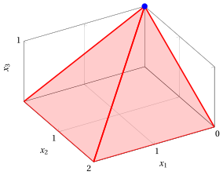

# Optimality conditions and pivot rules

**Part 2 · The simplex algorithm · Chapter 7** · [:material-file-pdf-box: Lecture notes, volume 2 (PDF)](../pdf/lecture-notes-2-simplex.pdf) · [:material-presentation: Slides](../pdf/slides-07-optimality-pivot.pdf) · [:material-pencil: Exercises: Optimality conditions and pivot rules](../exercises/ex-07-optimality-pivot.md)

## 7.1 Sufficient conditions for optimality

- We consider an LP problem in standard maximization form with $n+m$ non-negative variables and $m$ equality linear constraints, obtained from an LP problem in canonical maximization form with $n$ non-negative variables and $m$ less-than-or-equal-to linear constraints by adding $m$ slack non-negative variables:

    

    \begin{align*}
    &&   \max \;\;{\boldsymbol c}' \, {\boldsymbol x}  \label{FORM_STANDARD_OBJ} \tag{7.1a}\\[2ex]
    && \text{subject to} \quad  {\boldsymbol A} \; {\boldsymbol x}  &= {\boldsymbol b},  & \phantom{j=1111}  \label{FORM_STANDARD_CONS1} \tag{7.1b}\\[2ex]
    && {\boldsymbol x}                        &\ge  {\boldsymbol 0}. \label{FORM_STANDARD_CONS2} \tag{7.1c}
    \end{align*}

!!! teorema "Theorem 7.1: sufficient conditions for optimality"

    Given a basis ${\boldsymbol  A}_{\pazocal{B}}$ of the  LP problem [(7.1)](#eq-FORM_STANDARD), if  $~{ \bar{\boldsymbol b}} \ge {\boldsymbol 0}~$ and $~{ \bar{\boldsymbol c}} \le {\boldsymbol 0}~$ then ${\boldsymbol  x}_{\pazocal{B}}={{\bar{\boldsymbol b}}}$ and  ${\boldsymbol  x}_{\pazocal{N}}={{{\boldsymbol 0}}}$ is  an optimal  solution and ${\boldsymbol c}'_{\pazocal{B}} \;  \bar{\boldsymbol b}$ is the optimal solution value.

??? dimostrazione "Proof"

    Given a basis ${\boldsymbol  A}_{\pazocal{B}}$  of the  LP problem [(7.1)](#eq-FORM_STANDARD), if $~{ \bar{\boldsymbol b}} \ge {\boldsymbol 0}~$ then ${\boldsymbol  x}_{\pazocal{B}}={{\bar{\boldsymbol b}}}$ and  ${\boldsymbol  x}_{\pazocal{N}}={{{\boldsymbol 0}}}$ is  a  feasible  solution.  If ${ ~\bar{\boldsymbol c}} \le {\boldsymbol 0}~$, for all feasible solutions ${\boldsymbol x}$ we have:

    \begin{align*}
    {\boldsymbol c}' \; {\boldsymbol x}
    &~~=~~
    {\boldsymbol c}'_{\pazocal{B}} \; {\boldsymbol  x}_{\pazocal{B}} + {\boldsymbol c}'_{\pazocal{N}} \;{{\boldsymbol  x}_{\pazocal{N}}}
    ~~=~~
    {\boldsymbol c}'_{\pazocal{B}} \; {\boldsymbol  A}_{\pazocal{B}}^{-1} \; {\boldsymbol b} + \underbrace{ \bar{\boldsymbol c}'}_{\le {\boldsymbol 0}} \; \underbrace{{{\boldsymbol  x}_{\pazocal{N}}}}_{\ge {\boldsymbol 0}} \\
    &~~ \le ~~
    {\boldsymbol c}'_{\pazocal{B}} \; {\boldsymbol  A}_{\pazocal{B}}^{-1} \; {\boldsymbol b}
    ~~ = ~~
    {\boldsymbol c}'_{\pazocal{B}} \; { \bar{\boldsymbol b}}  + {\boldsymbol c}'_{\pazocal{N}} \;{\boldsymbol  0}
    \end{align*}

    Then the objective function value of all feasible solutions is smaller or equal to the objective function value of the basic feasible solution ${\boldsymbol  x}_{\pazocal{B}}={{\bar{\boldsymbol b}}}$ and  ${\boldsymbol  x}_{\pazocal{N}}={{{\boldsymbol 0}}}$, and accordingly, the latter is an optimal  solution of value ${\boldsymbol c}'_{\pazocal{B}} \;  \bar{\boldsymbol b}$ . □

- We have proven that:

    \begin{equation*}
    ~{ \bar{\boldsymbol b}} \ge {\boldsymbol 0} \text{  and  } { \bar{\boldsymbol c}} \le {\boldsymbol 0} ~~~\Longrightarrow~~~ {\boldsymbol  x}_{\pazocal{B}}={{\bar{\boldsymbol b}}} \text{  and  }  {\boldsymbol  x}_{\pazocal{N}}={{{\boldsymbol 0}}},
    \text{  optimal solution}
    \end{equation*}

    so  “${ \bar{\boldsymbol b}} \ge {\boldsymbol 0}$ and ${ \bar{\boldsymbol c}} \le {\boldsymbol 0}$” is a sufficient condition to  “${\boldsymbol  x}_{\pazocal{B}}={{\bar{\boldsymbol b}}}$ and  ${\boldsymbol  x}_{\pazocal{N}}={{{\boldsymbol 0}}}$, optimal  solution” and “${\boldsymbol  x}_{\pazocal{B}}={{\bar{\boldsymbol b}}}$ and  ${\boldsymbol  x}_{\pazocal{N}}={{{\boldsymbol 0}}}$, optimal  solution” is a necessary condition to “${ \bar{\boldsymbol b}} \ge {\boldsymbol 0}$ and ${ \bar{\boldsymbol c}} \le {\boldsymbol 0}$”. The implication does not work in the other direction (we will see a counterexample). Accordingly:

    \begin{equation*}
    {\boldsymbol  x}_{\pazocal{B}}={{\bar{\boldsymbol b}}} \text{  and  }  {\boldsymbol  x}_{\pazocal{N}}={{{\boldsymbol 0}}},
    \text{  optimal solution}
    ~~~\nRightarrow~~~
    { \bar{\boldsymbol c}} \le {\boldsymbol 0}
    \end{equation*}

!!! teorema "Corollary 7.2"

    Given a basis ${\boldsymbol  A}_{\pazocal{B}}$ of the  LP problem [(7.1)](#eq-FORM_STANDARD), if  $~{ \bar{\boldsymbol b}} \ge {\boldsymbol 0}~$ and $~{ \bar{\boldsymbol c}} < {\boldsymbol 0}~$ then ${\boldsymbol  x}_{\pazocal{B}}={{\bar{\boldsymbol b}}}$ and  ${\boldsymbol  x}_{\pazocal{N}}={{{\boldsymbol 0}}}$ is  the unique optimal  solution.

??? dimostrazione "Proof"

    It follows from the previous Theorem that ${\boldsymbol  x}_{\pazocal{B}}={{\bar{\boldsymbol b}}}$ and  ${\boldsymbol  x}_{\pazocal{N}}={{{\boldsymbol 0}}}$ is an optimal solution. If ${ ~\bar{\boldsymbol c}} < {\boldsymbol 0}~$ and since any feasible solutions ${\boldsymbol x}$ different from ${\boldsymbol  x}_{\pazocal{B}}={{\bar{\boldsymbol b}}}$ and  ${\boldsymbol  x}_{\pazocal{N}}={{{\boldsymbol 0}}}$ must have ${\boldsymbol  x}_{\pazocal{N}} \neq {\boldsymbol  0}$, we have:

    \begin{align*}
    {\boldsymbol c}' \; {\boldsymbol x}
    &~~=~~
    {\boldsymbol c}'_{\pazocal{B}} \; {\boldsymbol  x}_{\pazocal{B}} + {\boldsymbol c}'_{\pazocal{N}} \;{{\boldsymbol  x}_{\pazocal{N}}}
    ~~=~~
    {\boldsymbol c}'_{\pazocal{B}} \; {\boldsymbol  A}_{\pazocal{B}}^{-1} \; {\boldsymbol b} + \underbrace{ \bar{\boldsymbol c}'}_{< {\boldsymbol 0}} \; \underbrace{{{\boldsymbol  x}_{\pazocal{N}}}}_{\ge {\boldsymbol 0} \text{  and  } \neq {\boldsymbol 0}} \\
    &~~ < ~~
    {\boldsymbol c}'_{\pazocal{B}} \; {\boldsymbol  A}_{\pazocal{B}}^{-1} \; {\boldsymbol b}
    ~~ = ~~
    {\boldsymbol c}'_{\pazocal{B}} \; { \bar{\boldsymbol b}}  + {\boldsymbol c}'_{\pazocal{N}} \;{\boldsymbol  0}
    \end{align*}

    Accordingly,  ${\boldsymbol  x}_{\pazocal{B}}={{\bar{\boldsymbol b}}}$ and  ${\boldsymbol  x}_{\pazocal{N}}={{{\boldsymbol 0}}}$ is the unique optimal solution. □

- Accordingly, we have shown that:

    \begin{equation*}
    ~{ \bar{\boldsymbol b}} \ge {\boldsymbol 0} \text{  and  } { \bar{\boldsymbol c}} < {\boldsymbol 0} ~~~\Longrightarrow~~~ {\boldsymbol  x}_{\pazocal{B}}={{\bar{\boldsymbol b}}} \text{  and  }  {\boldsymbol  x}_{\pazocal{N}}={{{\boldsymbol 0}}},
    \text{  unique optimal solution}
    \end{equation*}

    so  “${ \bar{\boldsymbol b}} \ge {\boldsymbol 0}$ and ${ \bar{\boldsymbol c}} < {\boldsymbol 0}$” is a sufficient condition to  “${\boldsymbol  x}_{\pazocal{B}}={{\bar{\boldsymbol b}}}$ and  ${\boldsymbol  x}_{\pazocal{N}}={{{\boldsymbol 0}}}$, unique optimal  solution”. The implication does not work in the other direction (we will give a counterexample). Accordingly

    \begin{equation*}
    {\boldsymbol  x}_{\pazocal{B}}={{\bar{\boldsymbol b}}} \text{  and  }  {\boldsymbol  x}_{\pazocal{N}}={{{\boldsymbol 0}}},
    \text{  unique optimal solution}
    ~~~\nRightarrow~~~
    { \bar{\boldsymbol c}} < {\boldsymbol 0}
    \end{equation*}

!!! esempio "Example 7.1: standard max form of LP problems in canonical max form"

    We introduce the following LP problem in canonical  max form with $n=3$ variables and $m=2$ constraints and its standard form with $n+m=5$ variables and $m=2$ constraints:

    $$
    \begin{array}{rrrrrrrrrrrrr}
    {\max} & {x_1} & {+} & 2 \, {x_2} & {+} & 7 \, {x_3} \\[2ex]
    \text{subject to} & {x_1} &  &  & {+} & 2 \, {x_3} & {\le} & 2 \\[2ex]
    &  &  & {x_2} & {+} & 2 \, {x_3} & {\le} & 2 \\[2ex]
    & {x_1,} &  & {x_2,} &  & {x_3} & { \ge} & {0}
    \end{array}
    $$

    $$
    \begin{array}{rrrrrrrrrrrrr}
    {\max} & {x_1} & {+} & 2 \, {x_2} & {+} & 7 \, {x_3} \\[2ex]
    \text{subject to} & {x_1} &  &  & {+} & 2 \, {x_3} & {+} \, {x_4} &  & {=} & 2 \\[2ex]
    &  &  & {x_2} & {+} & 2 \, {x_3} &  & {+} \, {x_5} & {=} & 2 \\[2ex]
    & {x_1,} &  & {x_2,} &  & {x_3,} & {x_4,} & {x_5} & { \ge} & {0}
    \end{array}
    $$

    In the LP problem in standard form, we have:

    $$
    {\boldsymbol  c}=
    \begin{pmatrix}
    1 \\[1ex]
    2 \\[1ex]
    7  \\[1ex]
    0  \\[1ex]
    0
    \end{pmatrix}
    \quad
    {\boldsymbol  A}=
    \begin{pmatrix}
    1 & 0 & 2 & 1 & 0\\[1ex]
    0 & 1 & 2 & 0 & 1
    \end{pmatrix}
    \quad
    {\boldsymbol b}=
    \begin{pmatrix}
    2 \\[1ex]
    2
    \end{pmatrix}
    \text{     and     }
    \quad
    {\boldsymbol  x}=
    \begin{pmatrix}
    x_{1} \\[1ex]
    x_{2} \\[1ex]
    x_{3}  \\[1ex]
    x_{4}  \\[1ex]
    x_{5}
    \end{pmatrix}
    $$

    

    { .fig .ovale loading=lazy style="width:97%" }

    

    

    An optimal solution ${\tilde{\boldsymbol x}}(\,\text{LP}\,)$  of the canonical form is:

    $$
    \tilde{x}_1=0,~~\tilde{x}_2=0,~~\tilde{x}_3=1
    $$

    and the optimal solution value is:

    $$
    z(~\text{LP}~)  = 7
    $$

    An optimal solution ${\tilde{\boldsymbol x}}(\,\text{LP}\,)$ of the standard form is:

    $$
    \tilde{x}_1=0,~~\tilde{x}_2=0,~~\tilde{x}_3=1,~~\tilde{x}_4=0,~~\tilde{x}_5=0
    $$

    with the same optimal solution value.

    

!!! esempio "Example 7.2: optimality conditions"

    For the LP problem of [Example 7.1](#box-3-ex-pivot-1), with $\pazocal{B}= \{2,~~3\}$ and $\pazocal{N}= \{1,~~4,~~5\},$ we have:

    $$
    {\boldsymbol x}_{\pazocal{B}}=
    \begin{pmatrix}
    x_2 \\[1ex]
    x_3
    \end{pmatrix} ~~
    {\boldsymbol A}_{\pazocal{B}}=
    \begin{pmatrix}
    0 & 2 \\[1ex]
    1 & 2
    \end{pmatrix} ~~
    {\boldsymbol  A}^{-1}_{\pazocal{B}}
    =
    \begin{pmatrix}
    -1 & 1 \\[1ex]
    \frac{1}{2} & 0
    \end{pmatrix} ~~
    {\boldsymbol c}_{\pazocal{B}}=
    \begin{pmatrix}
    2 \\[1ex]
    7
    \end{pmatrix}
    $$

    $$
    {\boldsymbol x}_{\pazocal{N}}=
    \begin{pmatrix}
    x_1 \\[1ex]
    x_4 \\[1ex]
    x_5
    \end{pmatrix} ~~
    {\boldsymbol A}_{\pazocal{N}}=
    \begin{pmatrix}
    1 & 1 & 0 \\[1ex]
    0 & 0 & 1
    \end{pmatrix} ~~
    {\boldsymbol c}_{\pazocal{N}}=
    \begin{pmatrix}
    1 \\[1ex]
    0 \\[1ex]
    0
    \end{pmatrix}
    $$

    Accordingly, we have:

    \begin{align*}
    {{\bar{\boldsymbol b}}} &= {\boldsymbol  A}_{\pazocal{B}}^{-1} \; {\boldsymbol b} = \begin{pmatrix}
    -1 & 1 \\[1ex]
    \frac{1}{2} & 0
    \end{pmatrix}
    \begin{pmatrix}
    2 \\[1ex]
    2
    \end{pmatrix} = \begin{pmatrix}
    0 \\[1ex]
    1
    \end{pmatrix}\\[3ex]
    {{\bar{\boldsymbol A}}} &=  {{\boldsymbol  A}_{\pazocal{B}}^{-1} \;{\boldsymbol  A}_{\pazocal{N}}} = {{\boldsymbol  A}_{\pazocal{B}}^{-1} \;{\boldsymbol  A}_{\pazocal{N}}} = \begin{pmatrix}
    -1 & 1 \\[1ex]
    \frac{1}{2} & 0
    \end{pmatrix} \begin{pmatrix}
    1 & 1 & 0 \\[1ex]
    0 & 0 & 1
    \end{pmatrix}
    =
    \begin{pmatrix}
    -1 & -1 & 1\\[1ex]
    \frac{1}{2} & \frac{1}{2} & 0
    \end{pmatrix}
    \\[3ex]
    {\bar{z}} &=
    {\boldsymbol c}'_{\pazocal{B}} \; {\boldsymbol  A}_{\pazocal{B}}^{-1} \; {\boldsymbol b}    =
    \begin{pmatrix}
    2 & 7 \\
    \end{pmatrix}
    \begin{pmatrix}
    -1 & 1 \\[1ex]
    \frac{1}{2} & 0
    \end{pmatrix}
    \begin{pmatrix}
    2 \\[1ex]
    2
    \end{pmatrix}
    =
    \begin{pmatrix}
    \frac{3}{2} & 2 \\
    \end{pmatrix}
    \begin{pmatrix}
    2 \\[1ex]
    2
    \end{pmatrix}
    =7
    \end{align*}

    \begin{align*}
    {{ \bar{\boldsymbol c}}'}  &= {\boldsymbol c}'_{\pazocal{N}} -  {\boldsymbol c}'_{\pazocal{B}} \; {\boldsymbol  A}_{\pazocal{B}}^{-1} \;{\boldsymbol  A}_{\pazocal{N}} = \begin{pmatrix}
    1 & 0 & 0\\
    \end{pmatrix}
    -
    \begin{pmatrix}
    2 & 7 \\
    \end{pmatrix}
    \begin{pmatrix}
    -1 & 1 \\[1ex]
    \frac{1}{2} & 0
    \end{pmatrix}
    \begin{pmatrix}
    1 & 1 & 0 \\[1ex]
    0 & 0 & 1
    \end{pmatrix}\\[1ex]
    &= \begin{pmatrix}
    1 & 0 & 0
    \end{pmatrix}
    -
    \begin{pmatrix}
    \frac{3}{2} & 2 \\
    \end{pmatrix}
    \begin{pmatrix}
    1 & 1 & 0 \\[1ex]
    0 & 0 & 1
    \end{pmatrix}
    =
    \begin{pmatrix}
    1 & 0 & 0
    \end{pmatrix}
    -
    \begin{pmatrix}
    \frac{3}{2} & \frac{3}{2} & 2
    \end{pmatrix}
    =
    \begin{pmatrix}
    -\frac{1}{2} & -\frac{3}{2} & -2
    \end{pmatrix}
    \end{align*}

    Since $~{ \bar{\boldsymbol b}} \ge {\boldsymbol 0}~$ and $~{ \bar{\boldsymbol c}} \le {\boldsymbol 0}~$, then the basic feasible solution

    $$
    \begin{pmatrix}
    x_2 \\[1ex]
    x_3
    \end{pmatrix}=
    \begin{pmatrix}
    0 \\[1ex]
    1
    \end{pmatrix}
    \text{  and  }
    \begin{pmatrix}
    x_1 \\[1ex]
    x_4 \\[1ex]
    x_5
    \end{pmatrix}=
    \begin{pmatrix}
    0 \\[1ex]
    0 \\[1ex]
    0
    \end{pmatrix}
    $$

    is the unique optimal solution and ${\bar{z}} = 7$ is the optimal solution value.

    The associated dictionary is:

    \begin{equation*}
    \begin{cases}
    \begin{array}{rrrrrrrrrrrrr}
    {x_2} & {=} & {0} & {+} & {x_1} & {+} & {x_4} & {-} & {x_5} \\[2ex]
    {x_3} & {=} & {1} & {-} & {\frac{1}{2}}\, {x_1} & {-} & {\frac{1}{2}}\, {x_4} \\[2ex]
    {z} & {=} & {7} & {-} & {\frac{1}{2}}\, {x_1} & {-} & {\frac{3}{2}}\, {x_4} & {-} & {2}\, {x_5}
    \end{array}
    \end{cases}
    \end{equation*}

!!! esempio "Example 7.3: optimality conditions"

    For the LP problem of [Example 7.1](#box-3-ex-pivot-1), with $\pazocal{B}= \{3,~~5\}$ and $\pazocal{N}= \{1,~~2,~~4\},$ we have:

    $$
    {\boldsymbol x}_{\pazocal{B}}=
    \begin{pmatrix}
    x_3 \\[1ex]
    x_5
    \end{pmatrix} ~~
    {\boldsymbol A}_{\pazocal{B}}=
    \begin{pmatrix}
    2 & 0 \\[1ex]
    2 & 1
    \end{pmatrix} ~~
    {\boldsymbol A}^{-1}_{\pazocal{B}}=
    \begin{pmatrix}
    \frac{1}{2} & 0 \\[1ex]
    -1 & 1
    \end{pmatrix} ~~
    {\boldsymbol c}_{\pazocal{B}}=
    \begin{pmatrix}
    7 \\[1ex]
    0
    \end{pmatrix}
    $$

    $$
    {\boldsymbol x}_{\pazocal{N}}=
    \begin{pmatrix}
    x_1 \\[1ex]
    x_2 \\[1ex]
    x_4
    \end{pmatrix} ~~
    {\boldsymbol A}_{\pazocal{N}}=
    \begin{pmatrix}
    1 & 0 & 1 \\[1ex]
    0 & 1 & 0
    \end{pmatrix} ~~
    {\boldsymbol c}_{\pazocal{N}}=
    \begin{pmatrix}
    1 \\[1ex]
    2 \\[1ex]
    0
    \end{pmatrix}
    $$

    Accordingly, we have:

    \begin{align*}
    {{\bar{\boldsymbol b}}} &= {\boldsymbol  A}_{\pazocal{B}}^{-1} \; {\boldsymbol b} = \begin{pmatrix}
    \frac{1}{2} & 0 \\[1ex]
    -1 & 1
    \end{pmatrix}
    \begin{pmatrix}
    2 \\[1ex]
    2
    \end{pmatrix} = \begin{pmatrix}
    1 \\[1ex]
    0
    \end{pmatrix}\\[3ex]
    {{\bar{\boldsymbol A}}} &=  {{\boldsymbol  A}_{\pazocal{B}}^{-1} \;{\boldsymbol  A}_{\pazocal{N}}} = {{\boldsymbol  A}_{\pazocal{B}}^{-1} \;{\boldsymbol  A}_{\pazocal{N}}}=  \begin{pmatrix}
    \frac{1}{2} & 0 \\[1ex]
    -1 & 1
    \end{pmatrix} \begin{pmatrix}
    1 & 0 & 1 \\[1ex]
    0 & 1 & 0
    \end{pmatrix}
    =
    \begin{pmatrix}
    \frac{1}{2} & 0 & \frac{1}{2}\\[1ex]
    -1 & 1 & -1
    \end{pmatrix}
    \\[3ex]
    {\bar{z}} &=
    {\boldsymbol c}'_{\pazocal{B}} \; {\boldsymbol  A}_{\pazocal{B}}^{-1} \; {\boldsymbol b}    =
    \begin{pmatrix}
    7 & 0 \\
    \end{pmatrix}
    \begin{pmatrix}
    \frac{1}{2} & 0 \\[1ex]
    -1 & 1
    \end{pmatrix}
    \begin{pmatrix}
    2 \\[1ex]
    2
    \end{pmatrix}
    =
    \begin{pmatrix}
    \frac{7}{2} & 0 \\
    \end{pmatrix}
    \begin{pmatrix}
    2 \\[1ex]
    2
    \end{pmatrix}
    =7
    \end{align*}

    \begin{align*}
    {{ \bar{\boldsymbol c}}'}  &= {\boldsymbol c}'_{\pazocal{N}} -  {\boldsymbol c}'_{\pazocal{B}} \; {\boldsymbol  A}_{\pazocal{B}}^{-1} \;{\boldsymbol  A}_{\pazocal{N}} = \begin{pmatrix}
    1 & 2 & 0\\
    \end{pmatrix}
    -
    \begin{pmatrix}
    7 & 0 \\
    \end{pmatrix}
    \begin{pmatrix}
    \frac{1}{2} & 0 \\[1ex]
    -1 & 1
    \end{pmatrix}
    \begin{pmatrix}
    1 & 0 & 1 \\[1ex]
    0 & 1 & 0
    \end{pmatrix}\\[1ex]
    &= \begin{pmatrix}
    1 & 2 & 0
    \end{pmatrix}
    -
    \begin{pmatrix}
    \frac{7}{2} & 0 \\
    \end{pmatrix}
    \begin{pmatrix}
    1 & 0 & 1 \\[1ex]
    0 & 1 & 0
    \end{pmatrix}
    =
    \begin{pmatrix}
    1 & 2 & 0
    \end{pmatrix}
    -
    \begin{pmatrix}
    \frac{7}{2} & 0 & \frac{7}{2}
    \end{pmatrix}
    =
    \begin{pmatrix}
    -\frac{5}{2} & 2 & -\frac{7}{2}
    \end{pmatrix}
    \end{align*}

    Since $~{ \bar{\boldsymbol b}} \ge {\boldsymbol 0}~$ and $\bar{z}=7~$ (the optimal solution value), then the basic feasible solution

    $$
    \begin{pmatrix}
    x_3 \\[1ex]
    x_5
    \end{pmatrix}=
    \begin{pmatrix}
    1 \\[1ex]
    0
    \end{pmatrix}
    \text{  and  }
    \begin{pmatrix}
    x_1 \\[1ex]
    x_2 \\[1ex]
    x_4
    \end{pmatrix}=
    \begin{pmatrix}
    0 \\[1ex]
    0 \\[1ex]
    0
    \end{pmatrix}
    $$

    is an optimal solution but $\bar{\boldsymbol c} \nleq {\boldsymbol 0}$. It is a <strong>counterexample</strong> to the fact that a basic optimal solution implies  non-positive reduced costs. Since this optimal solution is unique (see [Example 7.2](#box-4-ex-pivot-2)), it is also a <strong>counterexample</strong> to the fact that a unique basic optimal solution implies negative reduced costs. 

    The associated dictionary is:

    \begin{equation*}
    \begin{cases}
    \begin{array}{rrrrrrrrrrrrr}
    {x_3} & {=} & {1} & {-} & {\frac{1}{2}} {x_1} &  &  & {-} & {\frac{1}{2}} {x_4} \\[2ex]
    {x_5} & {=} & {0} & {+} & \, {x_1} & {-} & \, {x_2} & {+} & \, {x_4} \\[2ex]
    {z} & {=} & {7} & {-} & {\frac{5}{2}}\, {x_1} & {+} & {2}\, {x_2} & {-} & {\frac{7}{2}}\, {x_4}
    \end{array}
    \end{cases}
    \end{equation*}

## 7.2 Necessary conditions for optimality

### 7.2.1 Degenerate basic feasible solutions

!!! definizione "Definition 7.3: degenerate basic feasible solutions"

    Given a basis ${\boldsymbol  A}_{\pazocal{B}}$ of the  LP problem [(7.1)](#eq-FORM_STANDARD),  if $~{ \bar{\boldsymbol b}} \ge {\boldsymbol 0}~$ and for some $i \in \pazocal{B}$ we have $\bar{b}_i=0$ then ${\boldsymbol  x}_{\pazocal{B}} = {{\bar{\boldsymbol b}}}$ and ${\boldsymbol  x}_{\pazocal{N}} = {\boldsymbol 0}$ is called a <strong>degenerate basic feasible solution</strong>.

- In a degenerate basic feasible solution there are more than $n$ variables at zero (also some basic variables are at zero and not only all the non-basic variables).

!!! teorema "Theorem 7.4: necessary conditions for optimality"

    Given a basis ${\boldsymbol  A}_{\pazocal{B}}$ of the  LP problem [(7.1)](#eq-FORM_STANDARD), if  ${\boldsymbol  x}_{\pazocal{B}}={{\bar{\boldsymbol b}}}$ and  ${\boldsymbol  x}_{\pazocal{N}}={{{\boldsymbol 0}}}$ is  a non degenerate  optimal solution then $~{ \bar{\boldsymbol c}} \le {\boldsymbol 0}~$.

??? dimostrazione "Proof"

    Suppose  by contradiction that ${\boldsymbol  x}_{\pazocal{B}}={{\bar{\boldsymbol b}}}$ and  ${\boldsymbol  x}_{\pazocal{N}}={{{\boldsymbol 0}}}$ is a non degenerate optimal  solution and that $\bar{c}_p > 0$ for some $p \in \pazocal{N}$.  Since the solution is non degenerate and feasible we have ${\bar{\boldsymbol b}} >0$ but then there is a positive value $\vartheta >0$ such that:

    $$
    {\boldsymbol  x}_{\pazocal{B}}
    =
    {{\bar{\boldsymbol b}}}
    - \underbrace{{{\boldsymbol  A}_{\pazocal{B}}^{-1} \;{\boldsymbol  A}_{p}} }_{=\bar{\boldsymbol A}_{p}} \; {\vartheta} \ge 0
    $$

    Then by setting $x_p = \vartheta$ and ${\boldsymbol  x}_{\pazocal{B}} = {{\bar{\boldsymbol b}}} - \bar{\boldsymbol A}_{p} \; {\vartheta}$ (all other variables at zero), we get another feasible solution with a strictly better objective function value. This is a contradiction with  ${\boldsymbol  x}_{\pazocal{B}}={{\bar{\boldsymbol b}}}$ and  ${\boldsymbol  x}_{\pazocal{N}}={{{\boldsymbol 0}}}$ being optimal, so we must have $~{ \bar{\boldsymbol c}} \le {\boldsymbol 0}~$. □

- Combined with the sufficient conditions for optimality, we have shown that:

    \begin{equation*}
    {\boldsymbol  x}_{\pazocal{B}}={{\bar{\boldsymbol b}}} \text{  and  }  {\boldsymbol  x}_{\pazocal{N}}={{{\boldsymbol 0}}},
    \text{  non degenerate optimal  solution}  ~~~\Longleftrightarrow~~~  { \bar{\boldsymbol b}} > {\boldsymbol 0} \text{  and  }  { \bar{\boldsymbol c}} \le {\boldsymbol 0}
    \end{equation*}

    so  “${ \bar{\boldsymbol b}} > {\boldsymbol 0}$ and ${ \bar{\boldsymbol c}} \le {\boldsymbol 0}$” is a necessary and sufficient condition to  “${\boldsymbol  x}_{\pazocal{B}}={{\bar{\boldsymbol b}}}$ and  ${\boldsymbol  x}_{\pazocal{N}}={{{\boldsymbol 0}}}$, non-degenerate optimal  solution” and vice-versa.

!!! esempio "Example 7.4: degenerate basic feasible solutions"

    For the LP problem of [Example 7.1](#box-3-ex-pivot-1), with $\pazocal{B}= \{3,~~5\}$ and $\pazocal{N}= \{1,~~2,~~4\},$ we have the degenerate basic feasible solution:

    $$
    \begin{pmatrix}
    x_3 \\[1ex]
    x_5
    \end{pmatrix}=
    \begin{pmatrix}
    1 \\[1ex]
    0
    \end{pmatrix}
    \text{    and    }
    \begin{pmatrix}
    x_1 \\[1ex]
    x_2 \\[1ex]
    x_4
    \end{pmatrix}=
    \begin{pmatrix}
    0 \\[1ex]
    0 \\[1ex]
    0
    \end{pmatrix}
    $$

!!! definizione "Definition 7.5: degenerate pivoting operation"

    A <strong>degenerate pivoting operation</strong> occurs when $t_m = 0$, i.e., when the pivot row $x_r$ has $\bar{b}_r = 0$; this can happen only if the basic feasible solution is degenerate.

!!! chiave ""

    The <strong>value of the objective function increases in each non degenerate pivoting operation and can remain unchanged only in a degenerate one</strong>.

## 7.3 Pivot rules

- In pivoting operations, a <strong>pivot rule</strong> is a way of answering the two questions:

    1. How to determine the pivot column in cases where there are multiple non-basic variables with positive reduced costs?

    2. How to determine the pivot row in cases where there are multiple basic variables taking a value of zero when setting the value of the pivot column to its maximum possible value $t_m$?

### 7.3.1 Anti-cycling pivot rules

!!! teorema "Theorem 7.6"

    If the simplex algorithm fails to terminate, then it must cycle.

??? dimostrazione "Proof"

    There are at most ${n+m \choose m}$ bases  ${\boldsymbol  A}_{\pazocal{B}}$ of the  LP problem [(7.1)](#eq-FORM_STANDARD) and, accordingly, dictionaries. Then, if the simplex algorithm fails to terminate, it must visit some of these dictionaries more than once. Hence, the algorithm cycles. □

- <strong>It is very rare that the simplex algorithm cycles, but instances in which it cycles exist</strong>.

- Cycling can occur only within a sequence of degenerate basic feasible solutions when the objective function remains unchanged.

#### Bland's pivot rule

- <strong>Bland's pivot rule</strong> (smallest-index pivot rule) selects the pivot column and the pivot row as follows:

    1. the <strong>pivot column</strong> is the non-basic variable $x_p$ with the <strong>smallest index</strong> $p \in \pazocal{N}$ such that:

        $$
        \bar{c}_{p} > 0   \text{    or  equivalently   } {c}_{p} > {{{\boldsymbol c}'_{\pazocal{B}} \; {\boldsymbol  A}_{\pazocal{B}}^{-1}}}  \;{\boldsymbol  A}_{p}
        $$

    2. the <strong>pivot row</strong>  is the basic variable $x_r$  with  the <strong>smallest index</strong> $r \in \pazocal{B}$ such that:

        $$
        \bar{a}_{rp} > 0 \text{   and   } \frac{\bar{b}_r}{\bar{a}_{rp}} = t_m
        $$

!!! teorema "Theorem 7.7"

    The simplex algorithm terminates as long as the pivot column and pivot row are selected by Bland's pivot rule in each pivoting operation.

- According to the previous Theorem, the proof only needs to show that cycling is impossible when the Bland's pivot rule is used.

??? dimostrazione "Proof"

    We proceed by contradiction and we assume that cycling does occur.  Accordingly, let

    $$
    D_0,~~D_1,~~ D_2,~~ \dots~~, D_{k-1},~~D_0,~~D_1,~~ D_2,~~ \dots
    $$

    be a sequence of dictionaries  such that the dictionary $D_0$ is repeated after $k$ degenerate pivoting operations with constant objective function value.

    We say that a variable is <em>fickle</em> if it is a basic variable in some dictionaries and a non-basic variable in some others.

    Let $x_t$ be the fickle variable having the largest index $t$ and let $D$  denote a dictionary

    \begin{equation*}
    \begin{cases} \displaystyle x_{i} = {{ \bar{b}_i}} - \sum_{j \in \pazocal{N}} \bar{a}_{ij} \; x_{j},~~ \forall i \in \pazocal{B}\\[4ex]
    \displaystyle z = \bar{z}  + \sum_{j \in \pazocal{N}} \bar{c}_{j} \; x_{j} \end{cases}
    \end{equation*}

    of the cycling sequence $D_0,~~D_1,~~ D_2,~~ \dots~~, D_{k-1}$ in which $x_t$ is the pivot row. Let $x_s$ denote the pivot column  of the dictionary $D$.  W.l.o.g, we  assume that $D = D_0$.

    Let $D^{*}$  denote a dictionary

    \begin{equation*}
    \begin{cases} \displaystyle x_{i} = {{ \bar{b}^*_i}} - \sum_{j \in \pazocal{N}^*} \bar{a}^*_{ij} \; x_{j},~~ \forall i \in \pazocal{B}^*\\[4ex]
    \displaystyle z = \bar{z}^*  + \sum_{j \in \pazocal{N}^*} \bar{c}^*_{j} \; x_{j} \end{cases}
    \end{equation*}

    of the sequence  $D_1,~~ D_2,~~ \dots~~, D_{k-1}$ in which $x_t$ is the pivot column.

    Since all the pivoting operations in the cycle are degenerate (the objective function value remains constant), we have that ${\bar{z}}={\bar{z}}^*=v$, and therefore we can write the objective function of the dictionary $D^{*}$ as

    \begin{equation*}
    \label{BB}
    {z}= v  + \sum_{j=1}^{n+m} \hat{c}^*_j \; x_j
    \quad \text{  where  } \quad \hat{c}^*_j =
    \begin{cases}
    \bar{c}^*_j & \text{if  } j \in  \pazocal{N}^* \\
    0 & \text{otherwise}
    \end{cases} \tag{7.2}
    \end{equation*}

    We consider the solution obtained by increasing the value of $x_s$  to $\vartheta$:

    $$
    x_s=\vartheta, ~~~~ x_i=0, ~ \forall i \in \pazocal{N} \setminus \{s\},~~~~ x_i=\bar{b}_i - \bar{a}_{is}  \: \vartheta, ~ \forall i \in  \pazocal{B}
    $$

    Accordingly,  for the objective function $z$ of the dictionaries $D$ and $D^{*}$, we have:

    $$
    z =v + \bar{c}_s \; \vartheta \text{      and     } z =v + \hat{c}_s^* \; \vartheta + \sum_{i \in \pazocal{B}} \hat{c}_i^* \; \big(\bar{b}_i - \bar{a}_{is} \vartheta \big)
    $$

    Equating these two expressions for $z$,  we have:

    $$
    \left( \bar{c}_s - \hat{c}_s^* + \sum_{i \in \pazocal{B} } \hat{c}_i^* \: \bar{a}_{is} \right) \: \vartheta= \sum_{i \in \pazocal{B} } \hat{c}_i^* \: \bar{b}_{i} ~~\Rightarrow~~ \bar{c}_s - \hat{c}_s^* + \sum_{i \in \pazocal{B} } \hat{c}_i^* \: \bar{a}_{is}  = 0
    $$

    The implication is due to the fact that the equation must hold for every $\vartheta$ (accordingly, we also have  $\sum_{i \in \pazocal{B} } \hat{c}_i^* \: \bar{b}_{i}  =0$).

    The fact that $x_s$ is the pivot column in $D$ implies that $\bar{c}_s > 0$. Since $x_s$ is  fickle and $s \neq t$ ($x_s$ is non-basic and $x_t$ is basic in $D$),  we have $s < t$. Moreover, we have $\hat{c}_s^*  \le 0$: if $s \in \pazocal{B}^*$, then $\hat{c}_s^* = 0$; if $s \in \pazocal{N}^*$ and $\hat{c}_s^* = \bar{c}_s^* > 0$, then, according to Bland's rule and since $s < t$, $x_s$ and not $x_t$ would be the pivot column in $D^{*}$. Accordingly, we have:

    $$
    \sum_{i \in \pazocal{B} } \hat{c}_i^* \: \bar{a}_{is} = \hat{c}_s^* - \bar{c}_s < 0 ~~\Rightarrow
    \text{ there exists } r \in \pazocal{B}:~ \hat{c}_r^* \bar{a}_{rs} < 0 \text{ and then  } \hat{c}_r^* \neq 0 \text{ and }  r \in  \pazocal{N}^*
    $$

    Hence  $x_r$ is fickle and therefore $r \le t$.  In fact, $r < t$, since $\hat{c}_t^* \bar{a}_{ts} > 0$: both factors are positive, since $\hat{c}_t^*=\bar{c}_t^* > 0$ ($x_t$ is the pivot column  in $D^*$) and $\bar{a}_{ts} > 0$ ($x_t$ is the pivot row in $D$).

    The fact that $r < t$ implies that $\hat{c}_r^* \le 0$ (otherwise, according to Bland's rule,  $x_r$ would be the pivot column  in $D^*$).  Then we have:

    $$
    \hat{c}_r^* \bar{a}_{rs} < 0 \text{  and  } \hat{c}_r^* \le 0 ~~\Rightarrow~~~ \bar{a}_{rs} > 0
    $$

    Since each of the dictionaries in the cycle describes the same feasible solution (all pivoting operations are degenerate), every fickle variable is zero in all these dictionaries (it is zero in a dictionary in which it is non-basic).

    In particular,  $x_r = 0$. But in $D$,  $x_r$ is basic. Hence $\bar{b}_r=0$ and, since $\bar{a}_{rs} > 0$, we have $\frac{\bar{b}_r}{\bar{a}_{rs}} = 0 = t_m$. So $x_r$ was a candidate to be the pivot row in $D$, and since $r < t$, according to Bland's rule it should have been chosen instead of $x_t$.

    This is the contradiction that proves that a cycling sequence of dictionaries cannot exist using Bland's rule. □

---

**Exercises on this chapter:** [:material-pencil: Optimality conditions and pivot rules](../exercises/ex-07-optimality-pivot.md)
